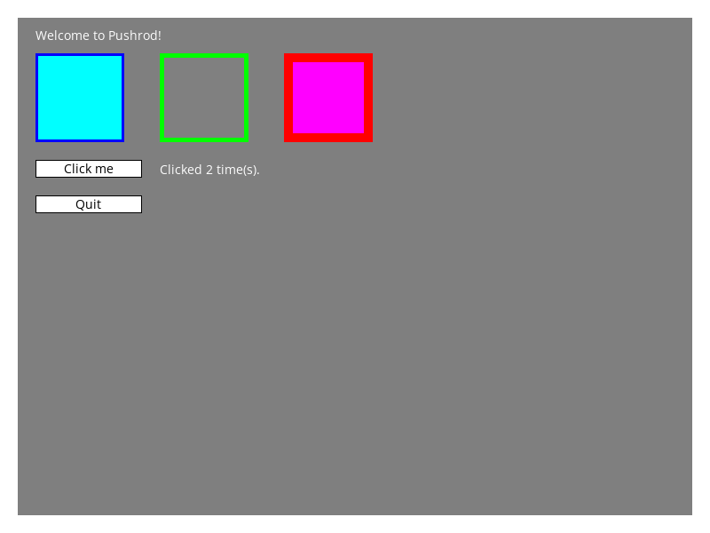

# rust-pushrod

Pushrod is a library that uses the SDL2 library to interact with the operating system, and uses
OpenGL for the drawing layer.

## Documentation

The documentation site lives in [`pushrod-docs/`](pushrod-docs/) (Docusaurus). It has a five-minute quick start, guides for creating applications, handling events, and creating widgets, and a page for every widget. To preview it: `cd pushrod-docs && npm install && npm start`.

## Summary

Pushrod is small, simple, and lightweight.  It combines the two classic ways of writing GUI
applications:

- **An event queue, like GEM on the Atari ST.**  SDL2 events are routed to the `Widget` under
  the mouse.  `Widget`s change their own state, and queue any events they generate (such as
  `Clicked`).
- **Event procedures, like Visual Basic.**  After the queue is processed, each event is delivered
  to the callbacks registered for that `Widget`.  Callbacks receive mutable access to your
  application state and to every `Widget` in the window, by ID.

An earlier version of Pushrod called callbacks directly from inside the `Widget`s, which made it
nearly impossible to pass mutable references to the rest of the application.  Queueing events
first, and only then calling the callbacks once no `Widget` is borrowed, removes that problem.

`Widget`s are stored in a flat list and addressed by ID, with parent and child links by ID, like
the `OBJECT` tree of a GEM resource.  This keeps forms simple to save, load, and edit visually.

## Writing an application

```rust
#[derive(Default)]
struct AppState {
    clicks: u32,
}

let mut engine: Engine<AppState> = Engine::new(size(800, 600), 30);

let label = engine.add_widget(TextWidget::new(/* ... */));
let button = engine.add_widget(ButtonWidget::new(/* ... */));

engine.on_click(button, move |state, ui| {
    state.clicks += 1;
    ui.get_mut::<TextWidget>(label)
        .unwrap()
        .set_text(format!("Clicked {} times", state.clicks));
});

let state = engine.run(sdl_context, window, AppState::default());
```

See [`examples/base.rs`](examples/base.rs) for a complete application.

## Writing a widget

A `Widget` stores a `WidgetCore` (ID, origin, size, color, visibility, texture) and implements
three functions.  Everything else has a default implementation.  Appearance is composed from the
functions in the `paint` module (`fill`, `border`, `text`):

```rust
pub struct PanelWidget {
    core: WidgetCore,
}

impl Widget for PanelWidget {
    fn core(&self) -> &WidgetCore { &self.core }
    fn core_mut(&mut self) -> &mut WidgetCore { &mut self.core }

    fn paint(&self, c: &mut Canvas<Window>, _fc: &mut FontCache) {
        paint::fill(c, self.get_color());
        paint::border(c, self.get_size(), Color::BLACK, 1);
    }
}
```

Interactive `Widget`s also implement `handle_event`, and call `ctx.emit(...)` to generate events.

Pushrod requires Rust 1.86 or newer.

## Installing on Ubuntu Linux

```shell
sudo apt install libsdl2-dev libsdl2-ttf-dev libsdl2-image-dev
```

## Installing on Redhat Linux

```shell
sudo yum install libsdl2-dev libsdl2-ttf-dev libsdl2-image-dev
```

## Installing on Mac OS X

Install Brew.  [Go here to get instructions on how to install.](https://www.brew.sh)

Once installed, run the following commands:

```shell
brew update
brew upgrade
brew install sdl2 sdl2_image sdl2_ttf
```

Then modify your .profile and add:

```shell
export LIBRARY_PATH="$LIBRARY_PATH:/opt/homebrew/lib"
```

And you should be able to not only build the application, but you should be able to run the
examples in the examples directory.

### State of the app

This is the current state of the example app.

