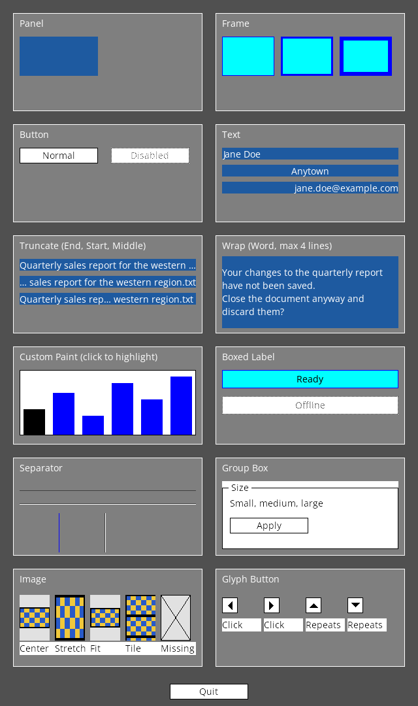

# rust-pushrod

[](https://github.com/KenSuenobu/rust-pushrod/actions/workflows/ci.yml)

Pushrod is a library that uses the SDL2 library to interact with the operating system, and uses
OpenGL for the drawing layer.

## Documentation

The documentation site lives in [`pushrod-docs/`](pushrod-docs/) (Docusaurus). It has a five-minute quick start, guides for creating applications, handling events, and creating widgets, and a page for every widget. To preview it: `cd pushrod-docs && npm install && npm start`.

## Summary

Pushrod is small, simple, and lightweight.  It combines the two classic ways of writing GUI
applications:

- **An event queue, like GEM on the Atari ST.**  SDL2 events are routed to the `Widget` under
  the mouse.  `Widget`s change their own state, and queue any events they generate (such as
  `Clicked`).
- **Event procedures, like Visual Basic.**  After the queue is processed, each event is delivered
  to the callbacks registered for that `Widget`.  Callbacks receive mutable access to your
  application state and to every `Widget` in the window, by ID.

An earlier version of Pushrod called callbacks directly from inside the `Widget`s, which made it
nearly impossible to pass mutable references to the rest of the application.  Queueing events
first, and only then calling the callbacks once no `Widget` is borrowed, removes that problem.

`Widget`s are stored in a flat list and addressed by ID, with parent and child links by ID, like
the `OBJECT` tree of a GEM resource.  This keeps forms simple to save, load, and edit visually.

## Crates

Pushrod is a Cargo workspace with two crates:

| Crate | What it contains |
|---|---|
| [`pushrod`](src/lib.rs) (this directory) | The core: engine, widget tree and IDs, events and callbacks, `paint` helpers, texture and font caches. No widgets except the window's root. |
| [`pushrod-widgets`](pushrod-widgets/) | The standard widgets: simple, flat, and predictable. |

```toml
[dependencies]
pushrod = { git = "https://github.com/KenSuenobu/rust-pushrod" }
pushrod-widgets = { git = "https://github.com/KenSuenobu/rust-pushrod" }
pushrod-sdl2 = { git = "https://github.com/KenSuenobu/rust-pushrod" }
```

SDL2 lives in its own backend crate, `pushrod-sdl2`, so the core and the widgets don't depend on
SDL at all and an SDL3 backend can drop in later. Tests can use the core's `HeadlessBackend`, which
needs no display.

`pushrod-widgets` uses only the core's public API, so another widget library can extend it or
replace it entirely: drop shadows, gradients, tree and graph views, 3D containers, whatever an
application needs, without changing the core.

## Writing an application

```rust
use pushrod::prelude::*;
use pushrod_widgets::prelude::*;

#[derive(Default)]
struct AppState {
    clicks: u32,
}

let mut engine: Engine<AppState> = Engine::new(size(800, 600), 30);

let label = engine.add_widget(Text::new("Not clicked").at(20, 20).size(200, 20));
let button = engine.add_widget(Button::new("Click me").at(20, 60).size(120, 24));

engine.on_click(button, move |state, ui| {
    state.clicks += 1;
    ui.get_mut::<Text>(label)
        .unwrap()
        .set_text(format!("Clicked {} times", state.clicks));
});

let state = pushrod_sdl2::run(
    engine,
    WindowSettings::new("Clicks", size(800, 600)),
    AppState::default(),
)?;
```

Prefer to run the loop yourself? Ask the engine for each event instead of registering callbacks:

```rust
let mut events = pushrod_sdl2::event_loop(&mut engine, WindowSettings::new("Clicks", size(800, 600)))?;

while let Some(event) = engine.next_event(&mut events) {
    if let Event::Clicked { id, .. } = event {
        if id == button { /* ... */ }
    }
}
```

See [`pushrod-sdl2/examples/base.rs`](pushrod-sdl2/examples/base.rs) for a complete application, and the
[quick start](pushrod-docs/docs/getting-started/quick-start.mdx) for both styles side by side.

## Writing a widget

A `Widget` stores a `WidgetCore` (ID, origin, size, color, visibility) and implements
three functions.  Everything else has a default implementation.  Appearance is composed from the
functions in the `paint` module (`fill`, `border`, `text`):

```rust
pub struct PanelWidget {
    core: WidgetCore,
}

impl Widget for PanelWidget {
    fn core(&self) -> &WidgetCore { &self.core }
    fn core_mut(&mut self) -> &mut WidgetCore { &mut self.core }

    fn paint(&self, p: &mut dyn Painter) {
        paint::fill(p, self.get_color());
        paint::border(p, self.get_size(), Color::BLACK, 1);
    }
}
```

Interactive `Widget`s also implement `handle_event`, and call `ctx.emit(...)` to generate events.
The guide [Writing widgets and composites](docs/WRITING_WIDGETS.md) covers the rest: events and
callbacks, behavior and state, input controllers, composites, custom events, and testing.

Pushrod requires Rust 1.100 or newer (edition 2024).

## Design philosophy

Pushrod follows one rule: **Keep It Stupid Simple.** Widgets are flat: fills, one-pixel borders,
and text. No glass, no beveled edges, no rounded corners, no shadows. Making things look fancy is up to the
application, or to a separate widget library that extends or replaces `pushrod-widgets`. The reasons are performance, a clean and consistent look, usability, and predictable
behavior. See [DESIGN_PHILOSOPHY.md](DESIGN_PHILOSOPHY.md).

## Roadmap

The [roadmap](docs/ROADMAP_EXTENSIBLE_WIDGET_LIBRARY.md) covers the core, events, forms, and
release plan. Each widget has its own roadmap in [docs/widgets](docs/widgets/README.md) that
specifies what it is, what it does, how it looks, and how it responds.

## Installing on Ubuntu Linux

```shell
sudo apt install libsdl2-dev libsdl2-ttf-dev libsdl2-image-dev
```

## Installing on Redhat Linux

```shell
sudo yum install libsdl2-dev libsdl2-ttf-dev libsdl2-image-dev
```

## Installing on Mac OS X

Install Brew.  [Go here to get instructions on how to install.](https://www.brew.sh)

Once installed, run the following commands:

```shell
brew update
brew upgrade
brew install sdl2 sdl2_image sdl2_ttf
```

Then modify your .profile and add:

```shell
export LIBRARY_PATH="$LIBRARY_PATH:/opt/homebrew/lib"
```

And you should be able to not only build the application, but you should be able to run the
examples (`cargo run -p pushrod-sdl2 --example base`).

### Widget gallery

The gallery shows every built-in widget, and its states, on a labeled tile
(`cargo run -p pushrod-sdl2 --example gallery`).  Each new widget adds its tile.



To retake the screenshot, run
`cargo run -p pushrod-sdl2 --example gallery -- --screenshot pushrod-docs/static/img/screenshots/gallery.png`.

## Performance

Pushrod's premise is small and fast, so the numbers are measured on every pull request
(headless, with built-in timing: `cargo bench -p pushrod-sdl2 --bench performance`) and compared
with a stored baseline.  A budget that grows more than 10% fails CI; a timing that gets much
slower warns.  Numbers from an Apple-silicon laptop (macOS, release build):

| Benchmark | Current | Unit |
|---|---:|---|
| Event dispatch (pointer event through the 148-widget gallery) | 3,700 | ns/event |
| Gallery frame under interaction (one slider changes, one click) | 14 | µs/frame |
| Gallery full redraw (every widget repainted and blitted) | 8 | µs/frame |
| Text: first layout (font load and glyph atlas warm-up) | 784 | µs |
| Text: repeat layout of the same text | 4,437 | ns |
| Form load (40 label and field rows, first frame) | 379 | µs |
| Texture memory per widget (gallery average) | 113,103 | bytes |
| Gallery example binary (release) | 1,475,088 | bytes |

These time Pushrod's own work (event routing, layout, painting calls, cache bookkeeping); GPU
time is not included.  **Low-end target:** on a Raspberry Pi 4 class device, one interactive
frame of Pushrod's CPU work stays under 2 ms (an eighth of a 60 frames-per-second budget) and a
dialog application's binary stays under 5 MB.  The target is a budget, not yet measured on that
hardware.  See [Performance benchmarks and budgets](pushrod-docs/docs/contributing/performance-benchmarks-and-budgets.md).

## Contributing

See [CONTRIBUTING.md](CONTRIBUTING.md). Demos, examples, tests, mockups, and documentation use fictional sample data only: no real names or personal information.
