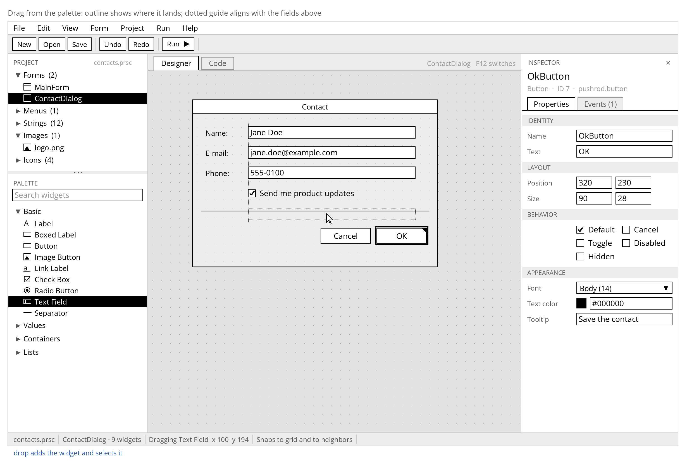
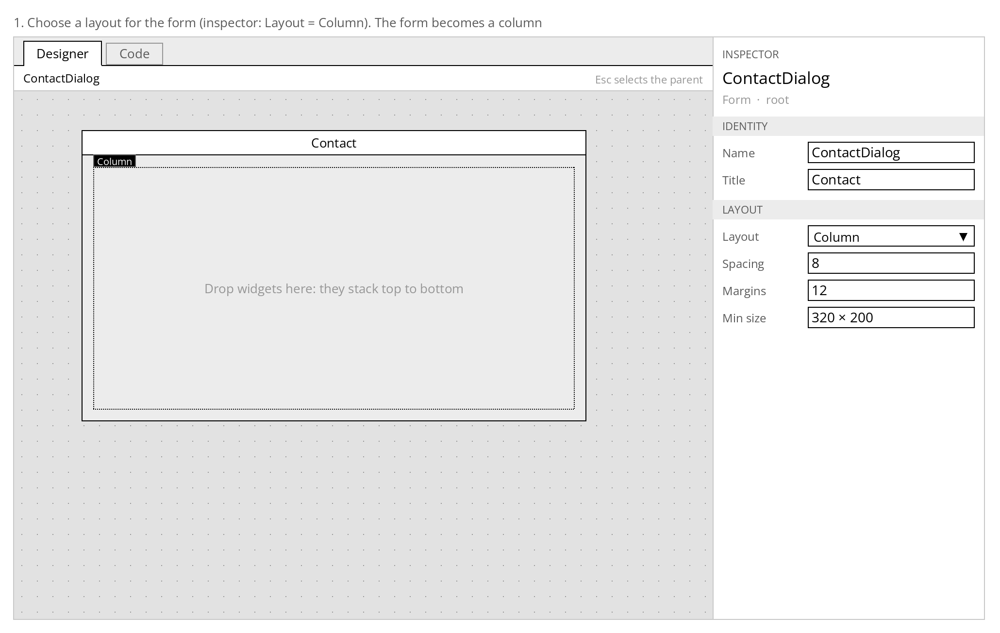
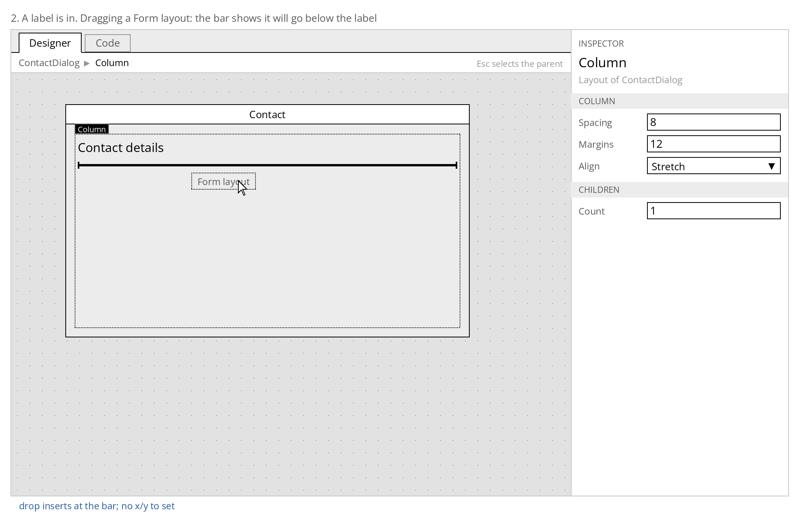
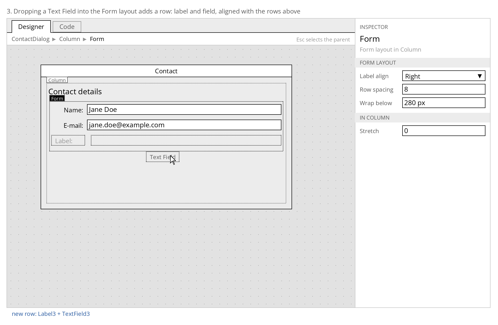
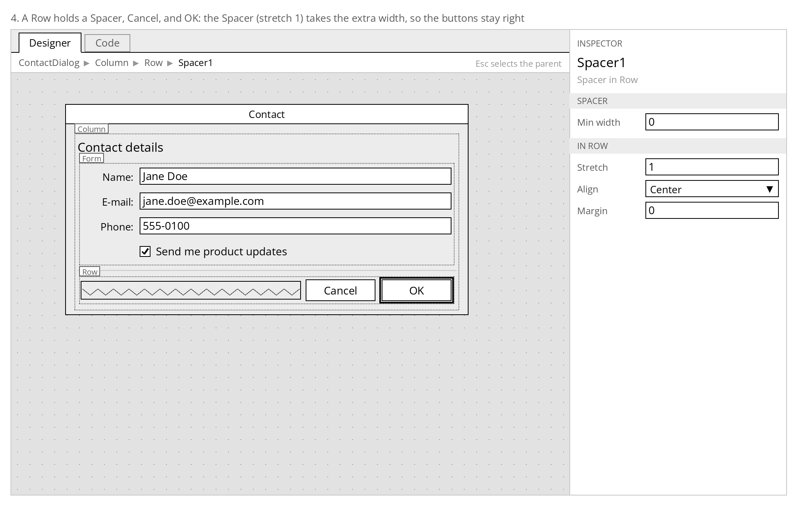
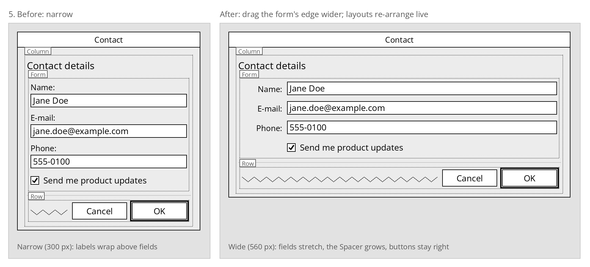
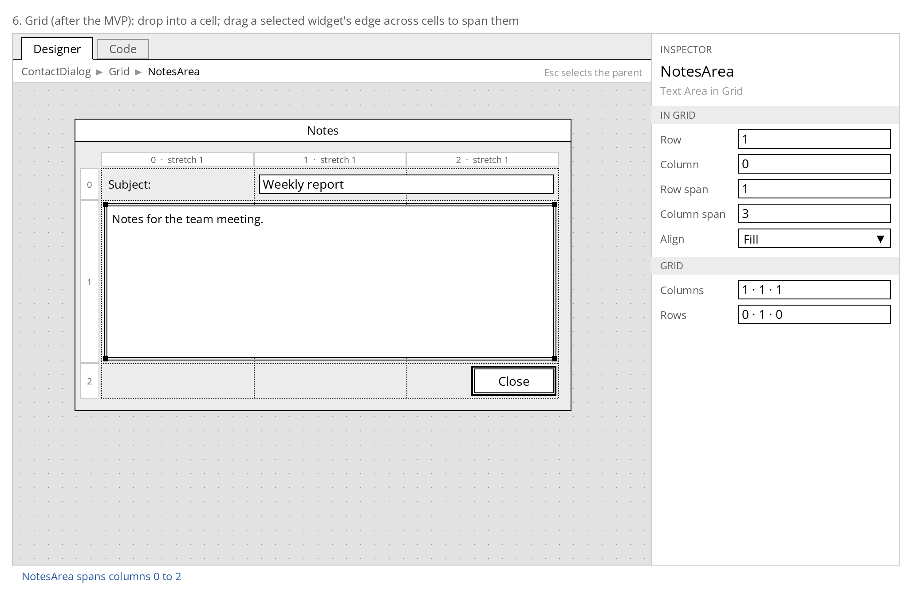
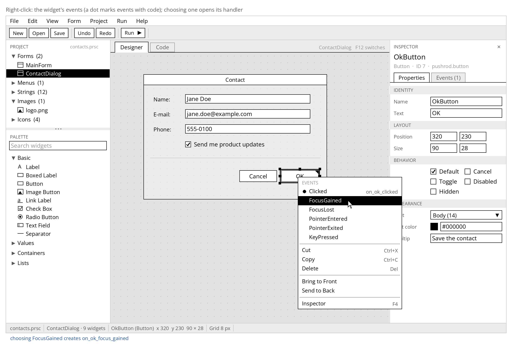
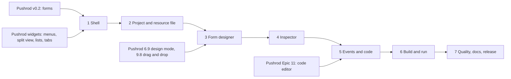
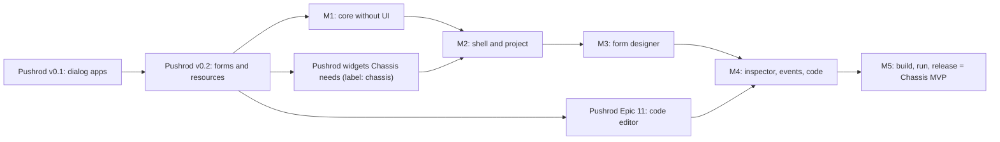

# Roadmap: Chassis

## Description

> Create a roadmap for Chassis. Create a mockup and let's work on the design. It should draw
> inspiration from Borland Delphi and Visual Studio Code. The left side should contain a drawer that
> contains the forms and resources that would be used in an accompanying RSC file (similar to Atari
> ST resources) and should have a designer section allowing for form elements to be dragged and
> dropped into the designer area. In the designer area, you should be able to click on a form element
> and edit its properties in a drawer that appears on the right-hand side of the screen (or as a
> callout, whichever makes more sense). Switching views is done as a tab at the top of the screen
> where the editor section is: two tabs - designer and code. When right-clicking on an element, the
> events that the widget supports is listed as a dropdown list. Clicking on the event will allow for
> a callback to be edited. Any events that have code assigned to them should have an indicator of
> some sort to show that code exists for that event.

Chassis is a visual form designer and code-behind editor for Pushrod applications, in the tradition
of the rapid-application-development IDEs: draw a form, set its properties, double-click a control,
and write the code for its event. It is built entirely with Pushrod, follows Pushrod's
[design philosophy](../DESIGN_PHILOSOPHY.md) (flat, simple, no shadows), and saves forms to a
Pushrod resource file (the `PRSC` form file format, Pushrod roadmap 6.3), the way Atari ST programs
kept their dialogs in an `.RSC` file.

**Status:** design approved; issues filed on GitHub (titles `chassis: [epic.issue] ...`, label `chassis`, one
milestone per phase). See the [Action Plan](#action-plan) for how Chassis gets written.

## Design

### Window layout


```text
+--------------------------------------------------------------------------------------+
| File  Edit  View  Form  Project  Run  Help                              (menu bar)    |
| [New][Open][Save] | [Undo][Redo] | [Run >]                               (toolbar)    |
+-----------------+----------------------------------------------+---------------------+
| PROJECT         |  [Designer] [Code]          ContactDialog    | INSPECTOR         x |
|  v Forms (2)    | +------------------------------------------+ | OkButton            |
|     MainForm    | |  . . . . design surface (grid) . . . . . | | Button . ID 7       |
|   > ContactDlg  | |   +---------- Contact ----------+        | | [Properties][Events]|
|  > Menus (1)    | |   | Name:   [Jane Doe         ] |        | |  IDENTITY           |
|  > Strings (12) | |   | E-mail: [jane.doe@example ] |        | |  Name  [OkButton]   |
|  v Images (1)   | |   |              [Cancel] [ OK ]|        | |  LAYOUT  ...        |
|  > Icons (4)    | |   +-----------------------------+        | |  BEHAVIOR ...       |
|=================| |                                          | |  APPEARANCE ...     |
| PALETTE         | |                                          | |                     |
| [Search      ]  | |                                          | |                     |
|  v Basic        | |                                          | |                     |
|     Label ...   | +------------------------------------------+ |                     |
+-----------------+----------------------------------------------+---------------------+
| contacts.prsc | ContactDialog . 9 widgets | OkButton x 320 y 230 90x28 | Grid 8 px     |
+--------------------------------------------------------------------------------------+
```

| Area | What it holds | Pushrod widgets |
|---|---|---|
| Menu bar, toolbar, status bar | Commands (File, Edit, View, Form, Project, Run, Help); New, Open, Save, Undo, Redo, Run; file, form, selection, and grid status | Menu bar (2.11), toolbar (2.15), status bar (2.16), actions (9.5) |
| **Project drawer** (left, top) | The resource file's contents: Forms, Menus, Strings, Images, Icons. Double-click a form to open it | Expander sections (3.10) holding list views (4.5) |
| **Palette** (left, bottom) | Every widget type from the widget registry, searchable and grouped (Basic, Values, Containers, Lists); third-party widget libraries appear automatically | Text field (2.6), expanders, list views, drag source (9.8) |
| **Editor** (center) | Two tabs per form: **Designer** (the form on a grid) and **Code** (its event handlers). F12 switches, as in Delphi | Tab view (4.4), design mode (6.9), code editor (Epic 11) |
| **Inspector** (right) | The selected widget's identity, then **Properties** and **Events** tabs | Split view (3.9), form layout (5.7), field editors |

The drawers are split views (3.9): drag the dividers to resize them, double-click to collapse, and
the widths are remembered.

### Placing widgets



Drag a widget from the palette onto the form. While dragging, an outline shows where it will land;
it snaps to the grid and to neighboring widgets, and a dotted guide appears when its edges line up
with others. Dropping adds the widget, gives it a unique name (`TextField1`), and selects it.
Selected widgets show eight square handles for resizing; arrow keys nudge by one grid step.

### Designing with layouts

Forms can be laid out two ways, and both can be mixed in one form:

- **Fixed positions** (layout: None): drop a widget anywhere; it keeps the x and y you give it, with
  grid snapping and guides (as above).
- **Layout managers** (Pushrod 5.5 to 5.10): the form or a container gets a layout, and dropped
  widgets are *inserted* into it rather than positioned. The layout decides positions and sizes, so
  forms resize gracefully and adapt to longer text.

The palette has a **Layouts** section (Column, Row, Form, Grid, Stack, Flow, and Spacer). A layout
can be set on the form or any container in the inspector (Layout = Column), or dropped as a nested
layout. The designer marks every layout with a dotted outline and a small name tag (designer only;
nothing extra is drawn at run time).





While dragging over a layout, a **black insertion bar** shows where the widget will go (between
which children); there is no position to set. Dropping into a **Form layout** adds a whole row: a
label and the field, aligned with the rows above (labels share one right-aligned column).



A **Spacer** (drawn as a spring, only in the designer) takes up extra space. A Row of Spacer,
Cancel, and OK keeps the buttons right-aligned at any width. Selecting a child shows its own
properties plus an **"In Row"** (or "In Form", "In Grid") section with its layout settings: stretch,
alignment, margin, and for grids, row, column, and spans.



Drag the form's edge to try sizes: layouts re-arrange live in the designer. When the form gets
narrower than the Form layout's *wrap below* width, labels move above their fields.



A **Grid** (after the Pushrod MVP) shows numbered row and column headers with each track's stretch;
drop into a cell, and drag a selected widget's edge across cells to span them.



**Selecting inside nested layouts.** A **breadcrumb** above the design surface shows the path from
the form to the selection (`ContactDialog > Column > Row > Spacer1`); click any part to select it,
or press Escape to select the parent. This replaces a tree view for navigating the form's structure.

### Inspector: a drawer, not a callout

The inspector is a **drawer on the right**, recommended over a callout:

- It never covers the form being edited; a callout would sit on top of the widgets around the one
  selected.
- It stays open while you click from widget to widget, so you can compare and edit several in a
  row. A callout closes and reopens with each selection.
- It has room for long property lists and the Events tab.
- It can be collapsed (the `x`, or F4 to toggle) when you want the whole width for the form.

### Events and the code indicator



Right-clicking a widget opens a menu whose top section lists **every event that widget type
supports**. Events that already have code show a **filled dot** and the handler's name on the right.
Below the events are the usual commands (Cut, Copy, Delete, Bring to Front, Send to Back,
Inspector).

Choosing an event:

- **With code:** switches to the Code tab with the caret in that handler.
- **Without code:** creates the handler stub (`on_ok_focus_gained`), switches to the Code tab, and
  places the caret in its body.

Double-clicking a widget does the same for its **default event** (`Clicked` for buttons,
`Toggled` for check boxes, `TextChanged` for text fields).

Code is indicated in three places, all flat and monochrome:

| Where | Indicator |
|---|---|
| Right-click events menu | Filled dot before the event, handler name on the right |
| Inspector, Events tab | Filled dot and handler name; events without code show "add..." |
| Design surface | A small filled triangle in the widget's upper right corner when any of its events has code |

### Code view


Each form has one code file (`src/forms/contact_dialog.rs`) holding its handlers. Chassis writes
the function signatures and keeps them read-only (shaded); everything inside the function bodies
belongs to you and is never rewritten. The editor is the Chassis code editor (Pushrod Epic 11,
[`docs/chassis/code-editor.md`](chassis/code-editor.md)). The inspector shows the Events tab while
the Code tab is active, so you can jump between handlers.

### Resources by ID

Applications built with Chassis load their resource file once and get everything from it by ID, the
way Atari ST programs used their `.RSC` file: forms, strings, images, icons, files, menus, and
alerts. Pushrod provides this at run time (Pushrod 6.10 to 6.12); Chassis is the editor for it.

```rust
use pushrod::resource::Resources;
mod ids { include!("generated/ids.rs"); }

// One self-contained binary: the resource file is embedded at compile time.
let resources = Resources::from_bytes(include_bytes!("../contacts.prsc"))?;
engine.set_resources(resources);

// In a callback: everything by typed ID.
let dialog = ui.resources().form(ids::forms::CONTACT_DIALOG)?;
let logo = ui.resources().image(ids::images::LOGO);
let message = ui.resources().string(ids::strings::SAVE_FAILED);
let license = ui.resources().file(ids::files::LICENSE);
```

| Idea | Atari GEM AES | Classic Mac OS | Pushrod |
|---|---|---|---|
| Load the application's resources | Load a resource file | Open a resource file | `Resources::load(path)` or `Resources::from_bytes(...)` (embedded) |
| Use resources already in memory | Fix up a resource in memory | Resources in the application's own file | `Resources::from_bytes(include_bytes!(...))` |
| Get a resource | Address by type and index | Get by type and ID | Typed getter per kind: `form(FormId)`, `string(StringId)`, `image(ImageId)`, ... |
| Names for IDs in code | Header file from the resource editor | Constants by convention | Generated `ids.rs`, one module per kind and per form (6.12) |
| Several resource sources | One file per application | Chain of open resource files | Stacked resource sets, searched in order |

Where AES used a bare number plus a type code, Pushrod's IDs are typed per kind, so passing an
image's ID where a string's is expected doesn't compile. IDs are never renumbered when resources are
added or removed.

### Project layout on disk

```text
contacts/
  Cargo.toml
  contacts.prsc                 forms, strings, images, icons, files, menus, alerts (Pushrod 6.3, 6.11)
  src/
    main.rs                     yours (Chassis creates it once)
    forms/
      contact_dialog.rs         yours: handler bodies; signatures guarded by Chassis
    generated/                  Chassis-owned, rewritten on save, never edited by hand
      ids.rs                    typed ID constants: one module per resource kind and per form (6.12)
      contact_dialog_wiring.rs  registers each handler with the engine by widget ID
```

Generated code and your code never share a function body, so regenerating can't lose your work.

### Design decisions

| Question | Decision |
|---|---|
| Inspector placement | A drawer on the right, not a callout |
| Code indicator on the design surface | Corner triangle, always shown in the designer |
| Handler names | `on_<widget>_<event>` in snake case (`on_ok_focus_gained`), renamed automatically with the widget |
| Code files | One handler file per form (`src/forms/<form>.rs`) |
| Resource file extension | `.prsc`, matching the format's magic number |
| Default layout for new forms | Fixed positions (the classic designer feel); **New Form with Layout** creates a Column with a Form layout and a button Row instead |
| Where Chassis lives | A `chassis/` crate in this repository's workspace, so Pushrod API changes and Chassis updates land together; it can move to its own repository once Pushrod's APIs settle |
| Tree view | Not needed: the project drawer uses expander sections with lists, and the designer's breadcrumb navigates nested layouts |

## Relationship to Pushrod

Chassis is the biggest user of Pushrod's form, resource, and design-mode work, and it needs several widgets
that are after Pushrod's MVP. Chassis's own MVP therefore starts after Pushrod v0.2 (forms).

| Chassis needs | Pushrod roadmap |
|---|---|
| Form file, loader, writer, ID constants | 6.3, 6.4, 6.5, 6.6 (MVP v0.2) |
| Widget registry and property introspection | 6.1, 6.2 (MVP v0.2) |
| Design mode: selection overlay, handles, editing through undo | 6.9, 1.15 |
| Resource manager: load a resource file, get forms, strings, images, icons, files, menus by typed ID | 6.10, 6.11, 6.12 (MVP v0.2) |
| Event metadata per widget type (supported events, default event, handler signature) | 6.13 |
| File chooser (Open Project) | 2.12 |
| Drag and drop | 9.8 |
| Actions and shortcuts | 9.5 |
| Menu bar, context menu, toolbar, status bar | 2.11, 2.19, 2.15, 2.16 |
| Split view, expander, list view, tab view, choice button | 3.9, 3.10, 4.5, 4.4, 3.6 |
| Code editor | Epic 11 (`chassis-code-editor`) |
| Layout managers (designing resizable forms) | 5.5 to 5.7 |

Property editors stay within Pushrod's parked decisions: colors are a swatch plus a hex field (the
color picker is parked), and fonts are a choice of registered fonts (the font chooser is parked).



## MVP Definition

The Chassis MVP is a version in which a developer can:

1. Create or open a project: a Cargo crate plus its `.prsc` resource file.
2. Add a form, drag the core widgets (labels, buttons, check boxes, radio buttons, text fields,
   separators, group boxes) onto it, either at fixed positions with grid snapping or into Column,
   Row, and Form layouts that resize with the window, and undo any change.
3. Edit any widget's properties in the inspector, with names validated as Rust identifiers.
4. See every event a widget supports (right-click menu and inspector), see which have code, and
   create or open a handler with one click (or double-click for the default event).
5. Edit handlers in the Code tab, with generated signatures protected.
6. Manage the resource file's strings, images, icons, and files, and use them from widgets and code by
   typed ID.
7. Save, build, and run the application from Chassis.

<!-- chassis-roadmap:generated:start -->
## Epics

| Epic | Title | Summary | Issues | MVP issues |
|---|---|---|---|---|
| 1 ([#157](https://github.com/KenSuenobu/rust-pushrod/issues/157)) | Application shell | Main window, three-pane workspace, Designer/Code tabs, and commands. | 5 | 4 |
| 2 ([#158](https://github.com/KenSuenobu/rust-pushrod/issues/158)) | Project and resource file | Project model, open and save, the project drawer, and editors for forms, strings, images, icons, files, and menus. | 8 | 7 |
| 3 ([#159](https://github.com/KenSuenobu/rust-pushrod/issues/159)) | Form designer | Design surface, palette, drag and drop, selection, snapping, containers, layouts, and undo. | 9 | 8 |
| 4 ([#160](https://github.com/KenSuenobu/rust-pushrod/issues/160)) | Inspector | The right-hand drawer: identity, typed property editors, names and IDs. | 5 | 4 |
| 5 ([#161](https://github.com/KenSuenobu/rust-pushrod/issues/161)) | Events and code | Events menu with code indicators, inspector Events tab, handler creation, the code view, and generated wiring. | 7 | 7 |
| 6 ([#162](https://github.com/KenSuenobu/rust-pushrod/issues/162)) | Build and run | Code generation rules, a command-line generator, build and run, error list, templates. | 5 | 3 |
| 7 ([#163](https://github.com/KenSuenobu/rust-pushrod/issues/163)) | Quality, documentation, and release | CI and golden screenshots, documentation, the sample project, packaging. | 4 | 3 |

## Epic 1: Application shell ([#157](https://github.com/KenSuenobu/rust-pushrod/issues/157))

Main window, three-pane workspace, Designer/Code tabs, and commands.

**Problem.** Chassis needs its own window: the standard menu bar, toolbar, and status bar, the project drawer, editor, and inspector panes, and a consistent command model, all drawn by Pushrod.

**Scope.** A `chassis` binary crate built on Pushrod with the layout from the design mockups: menu bar, toolbar, status bar, a three-pane split view, and Designer/Code tabs for the open form. Every command is a Pushrod action with menu, toolbar, and shortcut.

| Issue | Title | Summary | Labels | Parallel | MVP | Phase | Complexity | Affected modules |
|---|---|---|---|---|---|---|---|---|
| 1.1 ([#168](https://github.com/KenSuenobu/rust-pushrod/issues/168)) | Chassis crate and main window | Binary crate and the main window with menu bar, toolbar, and status bar. | `app`, `chassis`, `chassis-mvp`, `size/M` | N | Y | M2 | M | `chassis/Cargo.toml`, `chassis/src/main.rs`, `chassis/src/app.rs` |
| 1.2 ([#169](https://github.com/KenSuenobu/rust-pushrod/issues/169)) | Three-pane workspace | Project drawer, editor, and inspector in resizable, collapsible split views. | `app`, `chassis`, `chassis-mvp`, `parallelizable`, `size/M` | Y | Y | M2 | M | `chassis/src/workspace.rs` |
| 1.3 ([#171](https://github.com/KenSuenobu/rust-pushrod/issues/171)) | Designer and Code tabs | Two tabs per open form; F12 switches; each keeps its scroll, selection, and caret. | `app`, `chassis`, `chassis-mvp`, `parallelizable`, `size/S` | Y | Y | M2 | S | `chassis/src/editor_tabs.rs` |
| 1.4 ([#170](https://github.com/KenSuenobu/rust-pushrod/issues/170)) | Commands, menus, and shortcuts | Every command as an action, reachable from menus, toolbar, and familiar shortcuts. | `app`, `chassis`, `chassis-mvp`, `parallelizable`, `size/M` | Y | Y | M2 | M | `chassis/src/commands.rs` |
| 1.5 ([#200](https://github.com/KenSuenobu/rust-pushrod/issues/200)) | Workspace settings | Remember window size, pane widths, open forms, and recent projects. | `app`, `chassis`, `parallelizable`, `size/S` | Y | N | post | S | `chassis/src/settings.rs` |

### 1.1: Chassis crate and main window

*Issue [#168](https://github.com/KenSuenobu/rust-pushrod/issues/168) · Chassis M2: shell and project*

**Problem Statement.** Chassis needs its own application window, built with Pushrod so it looks and behaves like the applications it designs.

**Solution / Scope.** A `chassis` binary crate in the workspace. Main window with the menu bar (File, Edit, View, Form, Project, Run, Help), a toolbar (New, Open, Save, Undo, Redo, Run), and a status bar showing the resource file, the open form and its widget count, the selection's name, type, position, and size, and the grid size. Everything drawn by Pushrod; no OS-native menus.


**Acceptance Criteria.**

- Window frame matches the mockup (menu bar, toolbar, status bar)
- Menus open and toolbar buttons trigger their commands (stubs where later issues implement them)
- Status bar updates with the selection

**Parallelism / Dependencies.** Not parallelizable. Pushrod: Pushrod 2.11 [#37](https://github.com/KenSuenobu/rust-pushrod/issues/37) Menu bar and drop-down menus (drawn by Pushrod), Pushrod 2.15 [#84](https://github.com/KenSuenobu/rust-pushrod/issues/84) Toolbar, Pushrod 2.16 [#85](https://github.com/KenSuenobu/rust-pushrod/issues/85) Status bar, Pushrod 9.5 [#97](https://github.com/KenSuenobu/rust-pushrod/issues/97) Actions and keyboard shortcuts: shared commands for menus, toolbars, and buttons, Pushrod 10.6 [#134](https://github.com/KenSuenobu/rust-pushrod/issues/134) Backend crates: keep SDL out of the core and the widgets

**Technical Stack.** Rust, Pushrod, pushrod-widgets, pushrod-sdl2

**Documentation.** `pushrod-docs/docs/chassis/overview.md` ("Chassis overview", Chassis group, new).

### 1.2: Three-pane workspace

*Issue [#169](https://github.com/KenSuenobu/rust-pushrod/issues/169) · Chassis M2: shell and project*

**Problem Statement.** The project, the form, and the selected widget's details must all be visible at once without crowding the form.

**Solution / Scope.** A horizontal split view with three panes: the project drawer (left, itself split into Project and Palette), the editor (center), and the inspector (right). Dividers drag, double-click collapses, minimum widths hold, F4 toggles the inspector, and the editor takes extra space as the window grows.


**Acceptance Criteria.**

- Dividers drag and collapse; minimum widths respected
- F4 toggles the inspector
- Layout matches the mockup at 1200 x 760 and scales up

**Parallelism / Dependencies.** Parallelizable. Chassis: 1.1 ([#168](https://github.com/KenSuenobu/rust-pushrod/issues/168)); Pushrod: Pushrod 3.9 [#47](https://github.com/KenSuenobu/rust-pushrod/issues/47) Split view (panes with draggable dividers)

**Technical Stack.** Rust, Pushrod

**Documentation.** `pushrod-docs/docs/chassis/overview.md` ("Chassis overview", Chassis group, update).

### 1.3: Designer and Code tabs

*Issue [#171](https://github.com/KenSuenobu/rust-pushrod/issues/171) · Chassis M2: shell and project*

**Problem Statement.** Each form has a visual side and a code side; switching must be instant and must not lose your place.

**Solution / Scope.** A tab strip above the editor with Designer and Code tabs for the open form and the form's name on the right. F12 switches, as in Delphi. Each tab keeps its own state (designer selection and scroll; code caret and scroll). Opening another form keeps the active tab.


**Acceptance Criteria.**

- F12 and clicking switch tabs
- Selection, scroll, and caret preserved across switches
- Opening another form keeps the active tab

**Parallelism / Dependencies.** Parallelizable. Chassis: 1.2 ([#169](https://github.com/KenSuenobu/rust-pushrod/issues/169)); Pushrod: Pushrod 4.4 [#51](https://github.com/KenSuenobu/rust-pushrod/issues/51) Tab view

**Technical Stack.** Rust, Pushrod

**Documentation.** `pushrod-docs/docs/chassis/overview.md` ("Chassis overview", Chassis group, update).

### 1.4: Commands, menus, and shortcuts

*Issue [#170](https://github.com/KenSuenobu/rust-pushrod/issues/170) · Chassis M2: shell and project*

**Problem Statement.** Users coming from Delphi or VS Code expect their usual keys, and every command must be reachable consistently.

**Solution / Scope.** Every command (New, Open, Save, Undo, Redo, Cut, Copy, Paste, Delete, Select All, Bring to Front, Send to Back, Align, Run, Toggle Inspector, Switch Tab) is a Pushrod action with its menu entry, toolbar button where shown, and shortcut: Ctrl+N/O/S, Ctrl+Z/Y, Ctrl+X/C/V, Del, Ctrl+A, F4, F12, F5. Actions enable and disable with the selection.

**Acceptance Criteria.**

- Every command reachable from menu and shortcut, toolbar where shown
- Commands disabled when not applicable
- Shortcut list on the docs site

**Parallelism / Dependencies.** Parallelizable. Chassis: 1.1 ([#168](https://github.com/KenSuenobu/rust-pushrod/issues/168)); Pushrod: Pushrod 9.5 [#97](https://github.com/KenSuenobu/rust-pushrod/issues/97) Actions and keyboard shortcuts: shared commands for menus, toolbars, and buttons

**Technical Stack.** Rust, Pushrod

**Documentation.** `pushrod-docs/docs/chassis/keyboard-shortcuts.md` ("Keyboard shortcuts", Chassis group, new).

### 1.5: Workspace settings

*Issue [#200](https://github.com/KenSuenobu/rust-pushrod/issues/200) · Chassis: after the MVP*

**Problem Statement.** Re-arranging panes and reopening the last project every session is tedious.

**Solution / Scope.** Save window size and position, pane widths and collapsed state, open forms and active tabs per project, and a recent-projects list (File menu), in the user's configuration directory, never in the project.

**Acceptance Criteria.**

- Restarting restores the layout and reopens the last project
- Recent projects in the File menu

**Parallelism / Dependencies.** Parallelizable. Chassis: 1.2 ([#169](https://github.com/KenSuenobu/rust-pushrod/issues/169)), 2.2 ([#172](https://github.com/KenSuenobu/rust-pushrod/issues/172))

**Technical Stack.** Rust, directories, serde

**Documentation.** `pushrod-docs/docs/chassis/overview.md` ("Chassis overview", Chassis group, update).

## Epic 2: Project and resource file ([#158](https://github.com/KenSuenobu/rust-pushrod/issues/158))

Project model, open and save, the project drawer, and editors for forms, strings, images, icons, files, and menus.

**Problem.** A Chassis project is a Cargo crate plus a resource file holding everything the application loads by ID: forms, strings, images, icons, files, and menus. Chassis must manage all of it without ever overwriting the developer's code.

**Scope.** A project model with clear file ownership, new/open/save, the project drawer listing every resource kind, and simple editors for each kind. Resources are read and written through Pushrod's resource manager and format (6.10 to 6.12), so what Chassis edits is exactly what the application loads.

| Issue | Title | Summary | Labels | Parallel | MVP | Phase | Complexity | Affected modules |
|---|---|---|---|---|---|---|---|---|
| 2.1 ([#164](https://github.com/KenSuenobu/rust-pushrod/issues/164)) | Project model | A project is a Cargo crate, its resource file, its handler files, and its generated files. | `chassis`, `chassis-mvp`, `project`, `size/M` | N | Y | M1 | M | `chassis/src/project/mod.rs` |
| 2.2 ([#172](https://github.com/KenSuenobu/rust-pushrod/issues/172)) | New, open, and save | Create a project from scratch, open an existing one, save the resource file and generated code. | `chassis`, `chassis-mvp`, `project`, `size/M` | N | Y | M2 | M | `chassis/src/project/io.rs`, `chassis/src/commands.rs` |
| 2.3 ([#173](https://github.com/KenSuenobu/rust-pushrod/issues/173)) | Project drawer | Resource sections (Forms, Strings, Images, Icons, Files, Menus) as expanders with lists. | `chassis`, `chassis-mvp`, `parallelizable`, `size/M`, `ui` | Y | Y | M2 | M | `chassis/src/project_drawer.rs` |
| 2.4 ([#174](https://github.com/KenSuenobu/rust-pushrod/issues/174)) | Manage resources and IDs | Add, rename, duplicate, and delete resources; see and copy each resource's ID. | `chassis`, `chassis-mvp`, `parallelizable`, `project`, `size/S` | Y | Y | M2 | S | `chassis/src/project/resources.rs`, `chassis/src/project_drawer.rs` |
| 2.5 ([#175](https://github.com/KenSuenobu/rust-pushrod/issues/175)) | String table editor | Edit the resource file's strings: name, text, and ID. | `chassis`, `chassis-mvp`, `parallelizable`, `project`, `resources`, `size/S` | Y | Y | M2 | S | `chassis/src/editors/strings.rs` |
| 2.6 ([#176](https://github.com/KenSuenobu/rust-pushrod/issues/176)) | Images and icons | Import images and icons into the resource file and use them in widgets by ID. | `chassis`, `chassis-mvp`, `parallelizable`, `project`, `resources`, `size/M` | Y | Y | M2 | M | `chassis/src/editors/images.rs`, `chassis/src/editors/icons.rs` |
| 2.7 ([#201](https://github.com/KenSuenobu/rust-pushrod/issues/201)) | Menu editor | Design menu bars and context menus stored in the resource file. | `chassis`, `parallelizable`, `project`, `resources`, `size/M` | Y | N | post | M | `chassis/src/editors/menus.rs` |
| 2.8 ([#177](https://github.com/KenSuenobu/rust-pushrod/issues/177)) | Files | Add arbitrary files (license text, templates, data) to the resource file and load them by ID. | `chassis`, `chassis-mvp`, `parallelizable`, `project`, `resources`, `size/S` | Y | Y | M2 | S | `chassis/src/editors/files.rs` |

### 2.1: Project model

*Issue [#164](https://github.com/KenSuenobu/rust-pushrod/issues/164) · Chassis M1: core without UI*

**Problem Statement.** Chassis must know which files it owns and which belong to the developer, and how forms, resources, generated code, and handlers relate, so it can never overwrite user code.

**Solution / Scope.** A `Project`: the crate's `Cargo.toml`, the `.prsc` resource file (forms, strings, images, icons, files, menus; read and written through Pushrod 6.10 to 6.12), handler files `src/forms/<form>.rs` (user-owned; Chassis guards only the signatures it generated), and `src/generated/` (Chassis-owned: typed resource IDs and event wiring). The model finds existing handlers by parsing the handler files (tree-sitter), so it always reflects the code as it is on disk. No UI: fully unit-tested.

**Acceptance Criteria.**

- Loads a project directory and reports its forms, resources, and handlers
- Ownership rules documented and enforced (Chassis writes only generated files and stubs)
- Unit tests cover the model without a window

**Parallelism / Dependencies.** Not parallelizable. Pushrod: Pushrod 6.10 [#153](https://github.com/KenSuenobu/rust-pushrod/issues/153) Resource manager: load resource sets and get resources by ID, Pushrod 6.11 [#154](https://github.com/KenSuenobu/rust-pushrod/issues/154) Resource kinds: strings, images, icons, files, menus, and alerts, Pushrod 6.12 [#155](https://github.com/KenSuenobu/rust-pushrod/issues/155) Typed resource IDs: generated constants per resource kind

**Technical Stack.** Rust, toml_edit, tree-sitter

**Documentation.** `pushrod-docs/docs/chassis/projects-and-resources.md` ("Projects and resources", Chassis group, new).

### 2.2: New, open, and save

*Issue [#172](https://github.com/KenSuenobu/rust-pushrod/issues/172) · Chassis M2: shell and project*

**Problem Statement.** Users need to start a project from nothing and come back to it later.

**Solution / Scope.** New Project creates a Cargo crate (Pushrod dependencies, `src/main.rs` that loads the resource file and opens the first form), an empty resource file with one form, and the generated folder. Open loads a project directory (file chooser, Pushrod 2.12). Save writes the resource file and regenerates `src/generated/`; unsaved changes show in the title and status bar and are confirmed on close.

**Acceptance Criteria.**

- A new project builds and runs (an empty form) without edits
- Save then reopen restores every resource exactly
- Closing with unsaved changes asks to save

**Parallelism / Dependencies.** Not parallelizable. Chassis: 2.1 ([#164](https://github.com/KenSuenobu/rust-pushrod/issues/164)), 1.4 ([#170](https://github.com/KenSuenobu/rust-pushrod/issues/170)), 6.1 ([#165](https://github.com/KenSuenobu/rust-pushrod/issues/165)); Pushrod: Pushrod 2.12 [#38](https://github.com/KenSuenobu/rust-pushrod/issues/38) File chooser dialog (drawn by Pushrod), Pushrod 6.5 [#64](https://github.com/KenSuenobu/rust-pushrod/issues/64) Form writer: save a widget subtree to a file

**Technical Stack.** Rust, Pushrod

**Documentation.** `pushrod-docs/docs/chassis/getting-started.md` ("Getting started with Chassis", Chassis group, new).

### 2.3: Project drawer

*Issue [#173](https://github.com/KenSuenobu/rust-pushrod/issues/173) · Chassis M2: shell and project*

**Problem Statement.** Everything in the resource file must be visible and one double-click from its editor.

**Solution / Scope.** The top of the left drawer: the file name, then an expander section per resource kind (Forms, Strings, Images, Icons, Files, Menus) with a count, each holding a list with an icon per entry. Double-click opens the resource's editor (forms open in the Designer). No tree view: nested structure inside a form is navigated with the designer's breadcrumb (3.8).


**Acceptance Criteria.**

- Sections expand and collapse; counts correct
- Double-click opens the right editor
- Selection follows the open form

**Parallelism / Dependencies.** Parallelizable. Chassis: 1.2 ([#169](https://github.com/KenSuenobu/rust-pushrod/issues/169)), 2.1 ([#164](https://github.com/KenSuenobu/rust-pushrod/issues/164)); Pushrod: Pushrod 3.10 [#90](https://github.com/KenSuenobu/rust-pushrod/issues/90) Expander (collapsible section), Pushrod 4.5 [#52](https://github.com/KenSuenobu/rust-pushrod/issues/52) List view

**Technical Stack.** Rust, Pushrod

**Documentation.** `pushrod-docs/docs/chassis/projects-and-resources.md` ("Projects and resources", Chassis group, update).

### 2.4: Manage resources and IDs

*Issue [#174](https://github.com/KenSuenobu/rust-pushrod/issues/174) · Chassis M2: shell and project*

**Problem Statement.** Resources need to be created, renamed, copied, and removed, and developers need each one's ID constant to use in code.

**Solution / Scope.** For every resource kind: Add (with name), Rename (validated as an identifier; renames the generated constant and, for forms, the handler file and module), Duplicate, Delete (confirms; for forms, says what happens to the handler file). The context menu offers Copy ID Constant (`ids::images::LOGO`). IDs are assigned once and never reused or renumbered (Pushrod 6.11). Every change goes through the undo stack (Pushrod 1.15).

**Acceptance Criteria.**

- Renaming a form renames its handler file and generated code; the project still builds
- Copy ID Constant copies the exact generated name
- IDs never change when other resources are added or removed

**Parallelism / Dependencies.** Parallelizable. Chassis: 2.3 ([#173](https://github.com/KenSuenobu/rust-pushrod/issues/173)); Pushrod: Pushrod 6.11 [#154](https://github.com/KenSuenobu/rust-pushrod/issues/154) Resource kinds: strings, images, icons, files, menus, and alerts, Pushrod 6.12 [#155](https://github.com/KenSuenobu/rust-pushrod/issues/155) Typed resource IDs: generated constants per resource kind, Pushrod 1.15 [#81](https://github.com/KenSuenobu/rust-pushrod/issues/81) Undo and redo command stack

**Technical Stack.** Rust

**Documentation.** `pushrod-docs/docs/chassis/projects-and-resources.md` ("Projects and resources", Chassis group, update).

### 2.5: String table editor

*Issue [#175](https://github.com/KenSuenobu/rust-pushrod/issues/175) · Chassis M2: shell and project*

**Problem Statement.** Labels, messages, and alert text belong in the resource file so they can be changed (and later translated) without touching code.

**Solution / Scope.** Opening Strings shows a table (name, ID, text) with add, edit in place, delete, and search. Text properties in the inspector can point at a string resource instead of literal text (Pushrod 6.10), shown as `@strings.SAVE_FAILED`. Deleting a string used by a widget warns and lists the users.

**Acceptance Criteria.**

- Add, edit, delete, search strings
- Widgets can use a string resource for their text
- Deleting a used string warns

**Parallelism / Dependencies.** Parallelizable. Chassis: 2.3 ([#173](https://github.com/KenSuenobu/rust-pushrod/issues/173)); Pushrod: Pushrod 6.10 [#153](https://github.com/KenSuenobu/rust-pushrod/issues/153) Resource manager: load resource sets and get resources by ID, Pushrod 6.11 [#154](https://github.com/KenSuenobu/rust-pushrod/issues/154) Resource kinds: strings, images, icons, files, menus, and alerts, Pushrod 4.9 [#92](https://github.com/KenSuenobu/rust-pushrod/issues/92) Table view

**Technical Stack.** Rust, Pushrod

**Documentation.** `pushrod-docs/docs/chassis/projects-and-resources.md` ("Projects and resources", Chassis group, update).

### 2.6: Images and icons

*Issue [#176](https://github.com/KenSuenobu/rust-pushrod/issues/176) · Chassis M2: shell and project*

**Problem Statement.** Applications need pictures and icons that travel with them and are shared by every widget that uses them.

**Solution / Scope.** Import PNG files as image resources (drag from the OS onto the Images section, or Add). Icons combine an image, optional mask and selected-state image, and a caption. A preview pane shows each at 1x and 2x. Image and icon properties in the inspector choose from these resources (4.3). Replacing an image's file keeps its ID.

**Acceptance Criteria.**

- Import, preview, rename, replace, delete images and icons
- Widgets reference them by ID
- Replacing keeps the ID and updates every widget

**Parallelism / Dependencies.** Parallelizable. Chassis: 2.3 ([#173](https://github.com/KenSuenobu/rust-pushrod/issues/173)); Pushrod: Pushrod 6.10 [#153](https://github.com/KenSuenobu/rust-pushrod/issues/153) Resource manager: load resource sets and get resources by ID, Pushrod 6.11 [#154](https://github.com/KenSuenobu/rust-pushrod/issues/154) Resource kinds: strings, images, icons, files, menus, and alerts, Pushrod 2.7 [#33](https://github.com/KenSuenobu/rust-pushrod/issues/33) Image widget, Pushrod 2.8 [#34](https://github.com/KenSuenobu/rust-pushrod/issues/34) Icon widget (picture with caption), Pushrod 9.8 [#100](https://github.com/KenSuenobu/rust-pushrod/issues/100) Drag and drop within the application

**Technical Stack.** Rust, Pushrod, png

**Documentation.** `pushrod-docs/docs/chassis/projects-and-resources.md` ("Projects and resources", Chassis group, update).

### 2.7: Menu editor

*Issue [#201](https://github.com/KenSuenobu/rust-pushrod/issues/201) · Chassis: after the MVP*

**Problem Statement.** Menus are resources too; building them in code is tedious and they should be editable like forms.

**Solution / Scope.** A menu designer: items, separators, submenus, check items, shortcuts, mnemonics, and the action name each item triggers (Pushrod 6.8). Preview shows the menu as it will appear.

**Acceptance Criteria.**

- Create, nest, reorder menu items
- Items bind to actions by name
- Menus load at run time by ID

**Parallelism / Dependencies.** Parallelizable. Chassis: 2.3 ([#173](https://github.com/KenSuenobu/rust-pushrod/issues/173)); Pushrod: Pushrod 6.11 [#154](https://github.com/KenSuenobu/rust-pushrod/issues/154) Resource kinds: strings, images, icons, files, menus, and alerts, Pushrod 6.8 [#67](https://github.com/KenSuenobu/rust-pushrod/issues/67) Bind actions by name from form files, Pushrod 2.11 [#37](https://github.com/KenSuenobu/rust-pushrod/issues/37) Menu bar and drop-down menus (drawn by Pushrod)

**Technical Stack.** Rust, Pushrod

**Documentation.** `pushrod-docs/docs/chassis/projects-and-resources.md` ("Projects and resources", Chassis group, update).

### 2.8: Files

*Issue [#177](https://github.com/KenSuenobu/rust-pushrod/issues/177) · Chassis M2: shell and project*

**Problem Statement.** Applications ship data besides pictures and text; keeping it in the resource file keeps the application a single self-contained binary.

**Solution / Scope.** Add files to the Files section (drag from the OS, or Add); each gets a name, ID, and MIME type. The editor shows size and type, a text preview for text files, and Replace and Export. Code loads them with `resources.file(ids::files::LICENSE)`.

**Acceptance Criteria.**

- Add, rename, replace, export, delete files
- Text files preview
- Files load at run time by ID

**Parallelism / Dependencies.** Parallelizable. Chassis: 2.3 ([#173](https://github.com/KenSuenobu/rust-pushrod/issues/173)); Pushrod: Pushrod 6.10 [#153](https://github.com/KenSuenobu/rust-pushrod/issues/153) Resource manager: load resource sets and get resources by ID, Pushrod 6.11 [#154](https://github.com/KenSuenobu/rust-pushrod/issues/154) Resource kinds: strings, images, icons, files, menus, and alerts

**Technical Stack.** Rust, Pushrod

**Documentation.** `pushrod-docs/docs/chassis/projects-and-resources.md` ("Projects and resources", Chassis group, update).

## Epic 3: Form designer ([#159](https://github.com/KenSuenobu/rust-pushrod/issues/159))

Design surface, palette, drag and drop, selection, snapping, containers, layouts, and undo.

**Problem.** The heart of Chassis: building forms visually, either at fixed positions or with layout managers, with every change reversible.

**Scope.** The open form on a grid in Pushrod design mode, a palette fed by the widget registry, drag-and-drop placement with outline previews and insertion bars, selection handles, snapping and guides, containers and tab order, layout managers with a breadcrumb, and undo for everything.

| Issue | Title | Summary | Labels | Parallel | MVP | Phase | Complexity | Affected modules |
|---|---|---|---|---|---|---|---|---|
| 3.1 ([#178](https://github.com/KenSuenobu/rust-pushrod/issues/178)) | Design surface | The open form on a dotted grid, in Pushrod design mode. | `chassis`, `chassis-mvp`, `designer`, `size/M` | N | Y | M3 | M | `chassis/src/designer/surface.rs` |
| 3.2 ([#179](https://github.com/KenSuenobu/rust-pushrod/issues/179)) | Widget palette | Every registered widget type, searchable and grouped, including layouts. | `chassis`, `chassis-mvp`, `designer`, `parallelizable`, `size/M` | Y | Y | M3 | M | `chassis/src/designer/palette.rs` |
| 3.3 ([#181](https://github.com/KenSuenobu/rust-pushrod/issues/181)) | Drag and drop placement | Drag from the palette; outline preview; drop creates and selects. | `chassis`, `chassis-mvp`, `designer`, `size/M` | N | Y | M3 | M | `chassis/src/designer/placement.rs` |
| 3.4 ([#180](https://github.com/KenSuenobu/rust-pushrod/issues/180)) | Selection, move, and resize | Click, Shift+click, marquee; eight handles; keyboard nudge. | `chassis`, `chassis-mvp`, `designer`, `size/M` | N | Y | M3 | M | `chassis/src/designer/selection.rs` |
| 3.5 ([#182](https://github.com/KenSuenobu/rust-pushrod/issues/182)) | Snapping and alignment | Grid snap, guides to neighbors, align and distribute commands. | `chassis`, `chassis-mvp`, `designer`, `parallelizable`, `size/M` | Y | Y | M3 | M | `chassis/src/designer/snap.rs` |
| 3.6 ([#184](https://github.com/KenSuenobu/rust-pushrod/issues/184)) | Containers, z-order, and tab order | Drop into group boxes and containers; bring forward and back; set the Tab order. | `chassis`, `chassis-mvp`, `designer`, `parallelizable`, `size/M` | Y | Y | M3 | M | `chassis/src/designer/structure.rs` |
| 3.7 ([#183](https://github.com/KenSuenobu/rust-pushrod/issues/183)) | Clipboard and undo | Cut, copy, paste, duplicate; every designer change undoable. | `chassis`, `chassis-mvp`, `designer`, `parallelizable`, `size/M` | Y | Y | M3 | M | `chassis/src/designer/history.rs` |
| 3.8 ([#185](https://github.com/KenSuenobu/rust-pushrod/issues/185)) | Layout managers in the designer | Insert widgets into Column, Row, Form, and Grid layouts; spacers; breadcrumb; live resize. | `chassis`, `chassis-mvp`, `designer`, `layout`, `size/L` | N | Y | M3 | L | `chassis/src/designer/layouts.rs`, `chassis/src/designer/breadcrumb.rs` |
| 3.9 ([#202](https://github.com/KenSuenobu/rust-pushrod/issues/202)) | Form preview | Run the form live inside Chassis without building. | `chassis`, `designer`, `parallelizable`, `size/M` | Y | N | post | M | `chassis/src/designer/preview.rs` |

### 3.1: Design surface

*Issue [#178](https://github.com/KenSuenobu/rust-pushrod/issues/178) · Chassis M3: form designer*

**Problem Statement.** Forms must be edited exactly as they will look, without their widgets reacting to clicks the way they do at run time.

**Solution / Scope.** The Designer tab shows the form (built from the resource file through the registry) on a gray canvas with a dotted grid (8 px default, View menu). Pushrod design mode intercepts input: clicks select instead of activating, and an overlay draws selection outlines, handles, guides, layout tags, and code indicators. Zoom 100% and 200%.


**Acceptance Criteria.**

- Forms look exactly as at run time
- Widgets don't react in the designer
- Grid size and visibility adjustable

**Parallelism / Dependencies.** Not parallelizable. Chassis: 1.3 ([#171](https://github.com/KenSuenobu/rust-pushrod/issues/171)), 2.1 ([#164](https://github.com/KenSuenobu/rust-pushrod/issues/164)); Pushrod: Pushrod 6.9 [#68](https://github.com/KenSuenobu/rust-pushrod/issues/68) Design-mode hooks for Chassis, Pushrod 6.4 [#63](https://github.com/KenSuenobu/rust-pushrod/issues/63) Form loader: build a form from a file with stable IDs

**Technical Stack.** Rust, Pushrod

**Documentation.** `pushrod-docs/docs/chassis/designing-forms.md` ("Designing forms", Chassis group, new).

### 3.2: Widget palette

*Issue [#179](https://github.com/KenSuenobu/rust-pushrod/issues/179) · Chassis M3: form designer*

**Problem Statement.** Users need every available widget at hand, including ones from widget libraries other than pushrod-widgets.

**Solution / Scope.** The lower part of the left drawer: a search field and expander sections (Basic, Values, Containers, Lists, Layouts, plus one per extra widget library) listing every registered type with its icon and display name. Widget libraries that register types appear without changes to Chassis.


**Acceptance Criteria.**

- All registered types listed and searchable
- A widget library added to the project appears in the palette

**Parallelism / Dependencies.** Parallelizable. Chassis: 1.2 ([#169](https://github.com/KenSuenobu/rust-pushrod/issues/169)); Pushrod: Pushrod 6.1 [#60](https://github.com/KenSuenobu/rust-pushrod/issues/60) Widget registry and factory, Pushrod 1.22 [#131](https://github.com/KenSuenobu/rust-pushrod/issues/131) Widget libraries: extend or replace pushrod-widgets

**Technical Stack.** Rust, Pushrod

**Documentation.** `pushrod-docs/docs/chassis/designing-forms.md` ("Designing forms", Chassis group, update).

### 3.3: Drag and drop placement

*Issue [#181](https://github.com/KenSuenobu/rust-pushrod/issues/181) · Chassis M3: form designer*

**Problem Statement.** Placing widgets by dragging is the core of a visual designer.

**Solution / Scope.** Dragging a palette entry over the form shows the new widget's outline at its default size, snapped (3.5); over a layout, an insertion bar instead (3.8). Dropping creates the widget through the registry with a unique name (`TextField1`), adds it to the container under the pointer, records undo, and selects it. Escape cancels. Click-then-click placement works too.


**Acceptance Criteria.**

- Outline follows the pointer and snaps; drop creates and selects
- Escape cancels; one undo removes the widget

**Parallelism / Dependencies.** Not parallelizable. Chassis: 3.1 ([#178](https://github.com/KenSuenobu/rust-pushrod/issues/178)), 3.2 ([#179](https://github.com/KenSuenobu/rust-pushrod/issues/179)); Pushrod: Pushrod 9.8 [#100](https://github.com/KenSuenobu/rust-pushrod/issues/100) Drag and drop within the application

**Technical Stack.** Rust, Pushrod

**Documentation.** `pushrod-docs/docs/chassis/designing-forms.md` ("Designing forms", Chassis group, update).

### 3.4: Selection, move, and resize

*Issue [#180](https://github.com/KenSuenobu/rust-pushrod/issues/180) · Chassis M3: form designer*

**Problem Statement.** Widgets must be selected, moved, and resized precisely.

**Solution / Scope.** Click selects; Shift+click adds or removes; dragging on empty space draws a selection rectangle. Selections show an outline and eight square handles; dragging the body moves, a handle resizes. Arrow keys nudge one grid step (Shift: one pixel). Moving follows Pushrod's drawing mode (live or outline). The inspector and status bar follow the selection.


**Acceptance Criteria.**

- All gestures work and update the inspector live
- Multi-selection moves together

**Parallelism / Dependencies.** Not parallelizable. Chassis: 3.1 ([#178](https://github.com/KenSuenobu/rust-pushrod/issues/178)); Pushrod: Pushrod 10.1 [#105](https://github.com/KenSuenobu/rust-pushrod/issues/105) Drawing modes: live or outline feedback while moving and resizing

**Technical Stack.** Rust, Pushrod

**Documentation.** `pushrod-docs/docs/chassis/designing-forms.md` ("Designing forms", Chassis group, update).

### 3.5: Snapping and alignment

*Issue [#182](https://github.com/KenSuenobu/rust-pushrod/issues/182) · Chassis M3: form designer*

**Problem Statement.** Neat forms need aligned edges and even spacing without pixel-hunting.

**Solution / Scope.** Snap to the grid, and to neighbors' edges and centers within 4 px, shown with dotted guides. Form menu: Align Left, Right, Top, Bottom, Centers; Make Same Width and Height; Distribute Horizontally and Vertically. Alt disables snapping while dragging.


**Acceptance Criteria.**

- Guides appear when edges or centers line up
- Align and distribute work on multi-selections

**Parallelism / Dependencies.** Parallelizable. Chassis: 3.4 ([#180](https://github.com/KenSuenobu/rust-pushrod/issues/180))

**Technical Stack.** Rust

**Documentation.** `pushrod-docs/docs/chassis/designing-forms.md` ("Designing forms", Chassis group, update).

### 3.6: Containers, z-order, and tab order

*Issue [#184](https://github.com/KenSuenobu/rust-pushrod/issues/184) · Chassis M3: form designer*

**Problem Statement.** Forms nest widgets in group boxes and containers, and keyboard users need a sensible Tab order.

**Solution / Scope.** Dropping onto a group box or container makes the widget its child (origins become relative). Bring to Front and Send to Back change sibling order. Form > Tab Order shows numbers on focusable widgets; clicking them in sequence sets the order.

**Acceptance Criteria.**

- Moving a group box moves its children
- Tab order edits persist to the resource file

**Parallelism / Dependencies.** Parallelizable. Chassis: 3.4 ([#180](https://github.com/KenSuenobu/rust-pushrod/issues/180)); Pushrod: Pushrod 1.4 [#20](https://github.com/KenSuenobu/rust-pushrod/issues/20) Keyboard focus, Tab order, and Return/Escape, Pushrod 3.3 [#41](https://github.com/KenSuenobu/rust-pushrod/issues/41) Group box (titled frame), Pushrod 5.3 [#58](https://github.com/KenSuenobu/rust-pushrod/issues/58) Container: a scrollable viewport onto fixed-size content

**Technical Stack.** Rust

**Documentation.** `pushrod-docs/docs/chassis/designing-forms.md` ("Designing forms", Chassis group, update).

### 3.7: Clipboard and undo

*Issue [#183](https://github.com/KenSuenobu/rust-pushrod/issues/183) · Chassis M3: form designer*

**Problem Statement.** Every designer action must be reversible, and widgets need copying.

**Solution / Scope.** Every change (add, delete, move, resize, property edit, reparent, reorder, layout change, handler creation) is a Pushrod undo command; consecutive nudges merge. Cut, Copy, Paste, Duplicate (Ctrl+D) copy widgets with properties (names made unique; handlers not copied).

**Acceptance Criteria.**

- Every change undoes and redoes exactly
- Pasted widgets get unique names

**Parallelism / Dependencies.** Parallelizable. Chassis: 3.4 ([#180](https://github.com/KenSuenobu/rust-pushrod/issues/180)); Pushrod: Pushrod 1.15 [#81](https://github.com/KenSuenobu/rust-pushrod/issues/81) Undo and redo command stack

**Technical Stack.** Rust

**Documentation.** `pushrod-docs/docs/chassis/designing-forms.md` ("Designing forms", Chassis group, update).

### 3.8: Layout managers in the designer

*Issue [#185](https://github.com/KenSuenobu/rust-pushrod/issues/185) · Chassis M3: form designer*

**Problem Statement.** Fixed positions break when text gets longer or the window resizes. Layout managers adapt, but only if the designer makes them as easy as dropping a widget at a position.

**Solution / Scope.** A Layouts palette section (Column, Row, Form, Grid, Stack, Flow, Spacer) and a Layout property on the form and every container. Layouts get a dotted outline and name tag in the designer. Dragging over a layout shows an insertion bar; dropping inserts there; dropping into a Form layout adds a label-and-field row; dragging a child reorders it or moves it between layouts. A Spacer is drawn as a spring. The layout settings (spacing, margins, label alignment, wrap width) and each child's "In <layout>" settings are stored as properties, so the inspector (4.2) shows them. Dragging the form's edge re-runs layouts live. A breadcrumb above the surface selects parents; Escape selects the parent. Column, Row, Form, and Spacer are in the MVP; Grid, Stack, and Flow appear when Pushrod ships them.


**Acceptance Criteria.**

- The contact dialog can be built entirely with layouts, as in the layout mockups
- Resizing in the designer matches the running application
- Reordering by drag, and undo, work inside layouts
- Breadcrumb and Escape select parents

**Parallelism / Dependencies.** Not parallelizable. Chassis: 3.3 ([#181](https://github.com/KenSuenobu/rust-pushrod/issues/181)), 3.4 ([#180](https://github.com/KenSuenobu/rust-pushrod/issues/180)); Pushrod: Pushrod 5.5 [#116](https://github.com/KenSuenobu/rust-pushrod/issues/116) Layout manager foundation: Layout trait, size hints, measure and arrange, Pushrod 5.6 [#117](https://github.com/KenSuenobu/rust-pushrod/issues/117) Row and column layouts, Pushrod 5.7 [#118](https://github.com/KenSuenobu/rust-pushrod/issues/118) Form layout: aligned label and field rows

**Technical Stack.** Rust, Pushrod

**Documentation.** `pushrod-docs/docs/chassis/designing-forms.md` ("Designing forms", Chassis group, update).

### 3.9: Form preview

*Issue [#202](https://github.com/KenSuenobu/rust-pushrod/issues/202) · Chassis: after the MVP*

**Problem Statement.** Checking how a form behaves (focus order, resizing, keyboard) shouldn't require a full build.

**Solution / Scope.** Preview (Ctrl+R) opens the form in a separate window with live widgets: they respond to input, but handlers don't run. Closing returns to the designer.

**Acceptance Criteria.**

- Preview behaves like the running form except for handlers
- Tab order and resizing can be tested

**Parallelism / Dependencies.** Parallelizable. Chassis: 3.1 ([#178](https://github.com/KenSuenobu/rust-pushrod/issues/178)); Pushrod: Pushrod 1.16 [#82](https://github.com/KenSuenobu/rust-pushrod/issues/82) Multiple windows: separate OS windows, each with its own engine

**Technical Stack.** Rust, Pushrod

**Documentation.** `pushrod-docs/docs/chassis/designing-forms.md` ("Designing forms", Chassis group, update).

## Epic 4: Inspector ([#160](https://github.com/KenSuenobu/rust-pushrod/issues/160))

The right-hand drawer: identity, typed property editors, names and IDs.

**Problem.** Every widget's properties must be editable without per-widget code in Chassis, and names must stay valid Rust identifiers because they become constants and handler names.

**Scope.** A drawer (not a callout) with the selection's identity, a Properties tab built from Pushrod's property introspection with typed editors, and an Events tab (Epic 5). Names are validated and renames carried into code.

| Issue | Title | Summary | Labels | Parallel | MVP | Phase | Complexity | Affected modules |
|---|---|---|---|---|---|---|---|---|
| 4.1 ([#186](https://github.com/KenSuenobu/rust-pushrod/issues/186)) | Inspector drawer | Identity header and Properties/Events tabs for the selection. | `chassis`, `chassis-mvp`, `inspector`, `size/S` | N | Y | M4 | S | `chassis/src/inspector/mod.rs` |
| 4.2 ([#187](https://github.com/KenSuenobu/rust-pushrod/issues/187)) | Property grid | Every property from introspection, grouped and labeled. | `chassis`, `chassis-mvp`, `inspector`, `size/M` | N | Y | M4 | M | `chassis/src/inspector/grid.rs` |
| 4.3 ([#188](https://github.com/KenSuenobu/rust-pushrod/issues/188)) | Typed property editors | Text, number, check, choice, color, font, string-resource, and image editors. | `chassis`, `chassis-mvp`, `inspector`, `parallelizable`, `size/M` | Y | Y | M4 | M | `chassis/src/inspector/editors.rs` |
| 4.4 ([#191](https://github.com/KenSuenobu/rust-pushrod/issues/191)) | Names and IDs | Validated, unique Rust identifiers; renames carried into constants and handlers. | `chassis`, `chassis-mvp`, `inspector`, `parallelizable`, `size/M` | Y | Y | M4 | M | `chassis/src/inspector/names.rs` |
| 4.5 ([#203](https://github.com/KenSuenobu/rust-pushrod/issues/203)) | Multiple selection editing | Edit the properties several selected widgets share. | `chassis`, `inspector`, `parallelizable`, `size/M` | Y | N | post | M | `chassis/src/inspector/grid.rs` |

### 4.1: Inspector drawer

*Issue [#186](https://github.com/KenSuenobu/rust-pushrod/issues/186) · Chassis M4: inspector, events, and code*

**Problem Statement.** Users need to see what is selected and edit it without covering the form.

**Solution / Scope.** The right drawer (a drawer, not a callout: it never covers the form, stays open between selections, and has room for long lists): the widget's name, then its type, ID, and registry type name; then Properties and Events tabs. With nothing selected, the form's own properties. F4 or the close button collapses it.


**Acceptance Criteria.**

- Follows the selection in the designer and the caret's handler in the code view
- Collapses and restores

**Parallelism / Dependencies.** Not parallelizable. Chassis: 1.2 ([#169](https://github.com/KenSuenobu/rust-pushrod/issues/169))

**Technical Stack.** Rust, Pushrod

**Documentation.** `pushrod-docs/docs/chassis/inspector.md` ("The inspector", Chassis group, new).

### 4.2: Property grid

*Issue [#187](https://github.com/KenSuenobu/rust-pushrod/issues/187) · Chassis M4: inspector, events, and code*

**Problem Statement.** Every widget type has different properties; the inspector must show them all without per-widget code in Chassis.

**Solution / Scope.** Properties come from Pushrod's introspection (6.2): name, kind, value, category. Rows grouped under headers (Identity, Layout, Behavior, Appearance, then the type's own categories), label left, editor right. Edits apply immediately and record undo. When the selection is inside a layout, an "In Row" (or Column, Form, Grid) section shows its layout settings (stretch, alignment, margin; grid cell and spans), and a selected layout shows its own (spacing, margins, label alignment, wrap width), as in the layout mockups.


**Acceptance Criteria.**

- Any registered widget's properties appear, including third-party widgets
- Changes show in the designer immediately and undo
- Layout settings for the selection's parent layout appear in an "In <layout>" section

**Parallelism / Dependencies.** Not parallelizable. Chassis: 4.1 ([#186](https://github.com/KenSuenobu/rust-pushrod/issues/186)); Pushrod: Pushrod 6.2 [#61](https://github.com/KenSuenobu/rust-pushrod/issues/61) Property introspection: list, get, and set widget properties by name, Pushrod 5.7 [#118](https://github.com/KenSuenobu/rust-pushrod/issues/118) Form layout: aligned label and field rows

**Technical Stack.** Rust, Pushrod

**Documentation.** `pushrod-docs/docs/chassis/inspector.md` ("The inspector", Chassis group, update).

### 4.3: Typed property editors

*Issue [#188](https://github.com/KenSuenobu/rust-pushrod/issues/188) · Chassis M4: inspector, events, and code*

**Problem Statement.** Each kind of property needs an editor that prevents invalid values.

**Solution / Scope.** Text (text field, or a string resource via `@strings.NAME`), integer (numeric field with range), boolean (check box; behavior flags grouped), enumeration (choice button), color (swatch plus hex field; the color picker is parked), font (choice of registered fonts; the font chooser is parked), image and icon (choice of the resource file's images and icons, 2.6). Invalid input is marked and not applied.


**Acceptance Criteria.**

- Each kind has its editor; invalid values can't be applied
- Behavior flags appear as grouped check boxes
- Text and images can reference resources by ID

**Parallelism / Dependencies.** Parallelizable. Chassis: 4.2 ([#187](https://github.com/KenSuenobu/rust-pushrod/issues/187)), 2.5 ([#175](https://github.com/KenSuenobu/rust-pushrod/issues/175)), 2.6 ([#176](https://github.com/KenSuenobu/rust-pushrod/issues/176)); Pushrod: Pushrod 2.6 [#32](https://github.com/KenSuenobu/rust-pushrod/issues/32) Text field: single-line entry with input masks, validation, and numeric mode, Pushrod 2.4 [#30](https://github.com/KenSuenobu/rust-pushrod/issues/30) Check box with indeterminate state, Pushrod 3.6 [#44](https://github.com/KenSuenobu/rust-pushrod/issues/44) Choice button: pop-up list and click-to-cycle modes, Pushrod 1.24 [#137](https://github.com/KenSuenobu/rust-pushrod/issues/137) Fonts: shared font handles and a built-in default font

**Technical Stack.** Rust, Pushrod

**Documentation.** `pushrod-docs/docs/chassis/inspector.md` ("The inspector", Chassis group, update).

### 4.4: Names and IDs

*Issue [#191](https://github.com/KenSuenobu/rust-pushrod/issues/191) · Chassis M4: inspector, events, and code*

**Problem Statement.** Widget names become ID constants and handler names; bad or duplicate names break the build.

**Solution / Scope.** Names must be valid identifiers (UpperCamelCase in the designer; `SCREAMING_SNAKE_CASE` constants and `snake_case` handler names) and unique per form. Renaming updates the generated ID constant and renames the widget's handlers in the code file (code editor API, Pushrod 11.8). The numeric ID is shown read-only.

**Acceptance Criteria.**

- Invalid or duplicate names refused with a message
- Renaming renames handlers and the project still builds

**Parallelism / Dependencies.** Parallelizable. Chassis: 4.2 ([#187](https://github.com/KenSuenobu/rust-pushrod/issues/187)), 5.3 ([#190](https://github.com/KenSuenobu/rust-pushrod/issues/190)); Pushrod: Pushrod 6.12 [#155](https://github.com/KenSuenobu/rust-pushrod/issues/155) Typed resource IDs: generated constants per resource kind, Pushrod 11.8 [#149](https://github.com/KenSuenobu/rust-pushrod/issues/149) Chassis: Code editor API for the Chassis designer

**Technical Stack.** Rust

**Documentation.** `pushrod-docs/docs/chassis/inspector.md` ("The inspector", Chassis group, update).

### 4.5: Multiple selection editing

*Issue [#203](https://github.com/KenSuenobu/rust-pushrod/issues/203) · Chassis: after the MVP*

**Problem Statement.** Setting the same font or color on many widgets one at a time is slow.

**Solution / Scope.** With several widgets selected, the inspector shows the properties they share; differing values show as blank; editing sets the value on all, as one undo step.

**Acceptance Criteria.**

- Shared properties shown; differing values blank
- One edit applies to all, undoable in one step

**Parallelism / Dependencies.** Parallelizable. Chassis: 4.2 ([#187](https://github.com/KenSuenobu/rust-pushrod/issues/187))

**Technical Stack.** Rust

**Documentation.** `pushrod-docs/docs/chassis/inspector.md` ("The inspector", Chassis group, update).

## Epic 5: Events and code ([#161](https://github.com/KenSuenobu/rust-pushrod/issues/161))

Events menu with code indicators, inspector Events tab, handler creation, the code view, and generated wiring.

**Problem.** Connecting a control to code should take one click: see which events a widget supports, see which already have code, and jump straight into a handler, as in the classic rapid-application-development IDEs.

**Scope.** Event lists from Pushrod's registry metadata (6.13) in the right-click menu and the inspector, with a filled-dot indicator where code exists and a corner mark on the design surface; handler stubs created and found through the Chassis code editor (Pushrod Epic 11); generated wiring that registers every handler by widget ID.

| Issue | Title | Summary | Labels | Parallel | MVP | Phase | Complexity | Affected modules |
|---|---|---|---|---|---|---|---|---|
| 5.1 ([#192](https://github.com/KenSuenobu/rust-pushrod/issues/192)) | Events context menu | Right-click lists the widget's events, with a dot where code exists. | `chassis`, `chassis-mvp`, `events`, `parallelizable`, `size/S` | Y | Y | M4 | S | `chassis/src/designer/context_menu.rs` |
| 5.2 ([#193](https://github.com/KenSuenobu/rust-pushrod/issues/193)) | Inspector Events tab | Every event with its handler name or "add..."; count on the tab. | `chassis`, `chassis-mvp`, `events`, `inspector`, `parallelizable`, `size/S` | Y | Y | M4 | S | `chassis/src/inspector/events.rs` |
| 5.3 ([#190](https://github.com/KenSuenobu/rust-pushrod/issues/190)) | Create and open handlers | Choosing an event (or double-clicking a widget) creates or opens its handler. | `chassis`, `chassis-mvp`, `code`, `events`, `size/M` | N | Y | M4 | M | `chassis/src/code/handlers.rs` |
| 5.4 ([#189](https://github.com/KenSuenobu/rust-pushrod/issues/189)) | Code view | The Code tab: the form's handler file in the Chassis code editor. | `chassis`, `chassis-mvp`, `code`, `size/M` | N | Y | M4 | M | `chassis/src/code/view.rs` |
| 5.5 ([#194](https://github.com/KenSuenobu/rust-pushrod/issues/194)) | Code indicator on the design surface | Corner mark on widgets that have handlers. | `chassis`, `chassis-mvp`, `designer`, `events`, `parallelizable`, `size/S` | Y | Y | M4 | S | `chassis/src/designer/overlay.rs` |
| 5.6 ([#195](https://github.com/KenSuenobu/rust-pushrod/issues/195)) | Keep handlers in sync | Renames, deletions, and orphaned handlers. | `chassis`, `chassis-mvp`, `code`, `events`, `parallelizable`, `size/M` | Y | Y | M4 | M | `chassis/src/code/sync.rs` |
| 5.7 ([#166](https://github.com/KenSuenobu/rust-pushrod/issues/166)) | Event wiring generation | Generated code registers each handler with the engine by widget ID. | `chassis`, `chassis-mvp`, `codegen`, `size/M` | N | Y | M1 | M | `chassis/src/codegen/wiring.rs` |

### 5.1: Events context menu

*Issue [#192](https://github.com/KenSuenobu/rust-pushrod/issues/192) · Chassis M4: inspector, events, and code*

**Problem Statement.** The fastest way to a widget's code is from the widget itself.

**Solution / Scope.** Right-clicking a widget shows an Events section with every event from Pushrod's registry metadata (6.13), default event first. Events with code show a filled dot and the handler name; choosing any event runs 5.3. Below: Cut, Copy, Delete, Bring to Front, Send to Back, Inspector.


**Acceptance Criteria.**

- Lists exactly the widget's events, default first
- Dots and handler names reflect the code file
- Choosing an event opens or creates its handler

**Parallelism / Dependencies.** Parallelizable. Chassis: 5.3 ([#190](https://github.com/KenSuenobu/rust-pushrod/issues/190)); Pushrod: Pushrod 6.13 [#156](https://github.com/KenSuenobu/rust-pushrod/issues/156) Event metadata in the widget registry, Pushrod 2.19 [#88](https://github.com/KenSuenobu/rust-pushrod/issues/88) Context menus

**Technical Stack.** Rust, Pushrod

**Documentation.** `pushrod-docs/docs/chassis/events-and-code.md` ("Events and code", Chassis group, new).

### 5.2: Inspector Events tab

*Issue [#193](https://github.com/KenSuenobu/rust-pushrod/issues/193) · Chassis M4: inspector, events, and code*

**Problem Statement.** The full event picture for a widget should be visible alongside its properties.

**Solution / Scope.** The Events tab lists every event: filled dot and handler name when code exists, "add..." otherwise. Clicking either runs 5.3. The tab label counts events with code ("Events (2)").


**Acceptance Criteria.**

- Matches the context menu's information
- Count updates as handlers are added and removed

**Parallelism / Dependencies.** Parallelizable. Chassis: 4.1 ([#186](https://github.com/KenSuenobu/rust-pushrod/issues/186)), 5.3 ([#190](https://github.com/KenSuenobu/rust-pushrod/issues/190)); Pushrod: Pushrod 6.13 [#156](https://github.com/KenSuenobu/rust-pushrod/issues/156) Event metadata in the widget registry

**Technical Stack.** Rust, Pushrod

**Documentation.** `pushrod-docs/docs/chassis/events-and-code.md` ("Events and code", Chassis group, update).

### 5.3: Create and open handlers

*Issue [#190](https://github.com/KenSuenobu/rust-pushrod/issues/190) · Chassis M4: inspector, events, and code*

**Problem Statement.** Writing code for an event should be one action, never a hunt through files.

**Solution / Scope.** For a widget and event: if the handler exists (code editor `find_function`), switch to the Code tab with the caret in its body. Otherwise insert `fn on_<widget>_<event>(state: &mut AppState, ui: &mut Ui<'_>, ...)` (payload parameters from 6.13) after the widget's other handlers, guard its signature, record it for wiring (5.7), switch tabs, and place the caret. Double-clicking a widget does this for its default event. Creation and wiring are one undo step.


**Acceptance Criteria.**

- Existing handlers open; missing ones are created once, never duplicated
- New stubs compile immediately
- Undo removes the stub and its wiring

**Parallelism / Dependencies.** Not parallelizable. Chassis: 5.4 ([#189](https://github.com/KenSuenobu/rust-pushrod/issues/189)), 2.1 ([#164](https://github.com/KenSuenobu/rust-pushrod/issues/164)); Pushrod: Pushrod 6.13 [#156](https://github.com/KenSuenobu/rust-pushrod/issues/156) Event metadata in the widget registry, Pushrod 11.8 [#149](https://github.com/KenSuenobu/rust-pushrod/issues/149) Chassis: Code editor API for the Chassis designer

**Technical Stack.** Rust, chassis-code-editor

**Documentation.** `pushrod-docs/docs/chassis/events-and-code.md` ("Events and code", Chassis group, update).

### 5.4: Code view

*Issue [#189](https://github.com/KenSuenobu/rust-pushrod/issues/189) · Chassis M4: inspector, events, and code*

**Problem Statement.** The Code tab must show the open form's handlers in a proper code editor.

**Solution / Scope.** The Code tab hosts the Chassis code editor (Pushrod Epic 11) with the form's handler file. Generated signatures and the header comment are guarded (read-only, shaded). The inspector shows the Events tab while the Code tab is active; moving the caret into a handler selects its widget.


**Acceptance Criteria.**

- Guarded lines can't be edited; bodies can
- Caret in a handler selects its widget

**Parallelism / Dependencies.** Not parallelizable. Chassis: 1.3 ([#171](https://github.com/KenSuenobu/rust-pushrod/issues/171)); Pushrod: Pushrod 11.2 [#143](https://github.com/KenSuenobu/rust-pushrod/issues/143) Chassis: Code editor view: gutter, visible-line rendering, caret, Pushrod 11.3 [#144](https://github.com/KenSuenobu/rust-pushrod/issues/144) Chassis: Code editor input: keyboard, mouse selection, clipboard, input methods, Pushrod 11.8 [#149](https://github.com/KenSuenobu/rust-pushrod/issues/149) Chassis: Code editor API for the Chassis designer

**Technical Stack.** Rust, chassis-code-editor

**Documentation.** `pushrod-docs/docs/chassis/events-and-code.md` ("Events and code", Chassis group, update).

### 5.5: Code indicator on the design surface

*Issue [#194](https://github.com/KenSuenobu/rust-pushrod/issues/194) · Chassis M4: inspector, events, and code*

**Problem Statement.** At a glance, the form should show which widgets already have code.

**Solution / Scope.** A small filled triangle in the upper right corner of any widget with at least one handler, drawn by the design overlay (not part of the widget). Hidden in preview.


**Acceptance Criteria.**

- Appears and disappears as handlers are added and removed

**Parallelism / Dependencies.** Parallelizable. Chassis: 3.1 ([#178](https://github.com/KenSuenobu/rust-pushrod/issues/178)), 2.1 ([#164](https://github.com/KenSuenobu/rust-pushrod/issues/164))

**Technical Stack.** Rust

**Documentation.** `pushrod-docs/docs/chassis/events-and-code.md` ("Events and code", Chassis group, update).

### 5.6: Keep handlers in sync

*Issue [#195](https://github.com/KenSuenobu/rust-pushrod/issues/195) · Chassis M4: inspector, events, and code*

**Problem Statement.** Renaming or deleting widgets must not leave code that no longer matches the form.

**Solution / Scope.** Renaming a widget renames its handlers (4.4). Deleting a widget asks whether to keep its handlers; kept handlers become orphaned and are listed (Form > Orphaned Handlers) to reattach to another widget's event or delete. A rename or deletion never breaks the build.

**Acceptance Criteria.**

- Renames update handler names and wiring
- Deleting a widget never silently deletes code

**Parallelism / Dependencies.** Parallelizable. Chassis: 5.3 ([#190](https://github.com/KenSuenobu/rust-pushrod/issues/190)), 5.7 ([#166](https://github.com/KenSuenobu/rust-pushrod/issues/166))

**Technical Stack.** Rust

**Documentation.** `pushrod-docs/docs/chassis/events-and-code.md` ("Events and code", Chassis group, update).

### 5.7: Event wiring generation

*Issue [#166](https://github.com/KenSuenobu/rust-pushrod/issues/166) · Chassis M1: core without UI*

**Problem Statement.** Handlers must be connected to the engine by widget ID without the developer writing registration code.

**Solution / Scope.** Generate `src/generated/<form>_wiring.rs` with `pub fn wire(engine: &mut Engine<AppState>, form: &FormHandle)` registering every handler with its widget's ID and event (`engine.on_click(form.id(ids::contact_dialog::OK_BUTTON), on_ok_clicked)`), using typed IDs (Pushrod 6.12). Generated files carry a do-not-edit header, are rewritten in full, and are deterministic. Testable without the UI.

**Acceptance Criteria.**

- A project with handlers builds and every handler fires
- Deterministic output (same input, same output)

**Parallelism / Dependencies.** Not parallelizable. Chassis: 2.1 ([#164](https://github.com/KenSuenobu/rust-pushrod/issues/164)); Pushrod: Pushrod 6.12 [#155](https://github.com/KenSuenobu/rust-pushrod/issues/155) Typed resource IDs: generated constants per resource kind, Pushrod 6.13 [#156](https://github.com/KenSuenobu/rust-pushrod/issues/156) Event metadata in the widget registry

**Technical Stack.** Rust

**Documentation.** `pushrod-docs/docs/chassis/projects-and-resources.md` ("Projects and resources", Chassis group, update).

## Epic 6: Build and run ([#162](https://github.com/KenSuenobu/rust-pushrod/issues/162))

Code generation rules, a command-line generator, build and run, error list, templates.

**Problem.** Developers must trust that Chassis never destroys their code, and trying the application should be one key away.

**Scope.** Written, tested code generation rules; a `chassis generate` command for builds without the UI; Run (F5) through Cargo with an output panel; later an error list and project templates.

| Issue | Title | Summary | Labels | Parallel | MVP | Phase | Complexity | Affected modules |
|---|---|---|---|---|---|---|---|---|
| 6.1 ([#165](https://github.com/KenSuenobu/rust-pushrod/issues/165)) | Code generation rules | What Chassis writes, when, and what it never touches. | `chassis`, `chassis-mvp`, `codegen`, `size/S` | N | Y | M1 | S | `chassis/src/codegen/mod.rs` |
| 6.2 ([#196](https://github.com/KenSuenobu/rust-pushrod/issues/196)) | Build and run | Run (F5) builds with Cargo and launches the application; output panel. | `build`, `chassis`, `chassis-mvp`, `size/M` | N | Y | M5 | M | `chassis/src/build.rs` |
| 6.3 ([#204](https://github.com/KenSuenobu/rust-pushrod/issues/204)) | Error list | Compiler errors listed and linked to the code view. | `build`, `chassis`, `parallelizable`, `size/M` | Y | N | post | M | `chassis/src/build/errors.rs` |
| 6.4 ([#205](https://github.com/KenSuenobu/rust-pushrod/issues/205)) | Project templates | Start from an empty app, a dialog app, or the contacts sample. | `chassis`, `parallelizable`, `project`, `size/S` | Y | N | post | S | `chassis/templates/` |
| 6.5 ([#167](https://github.com/KenSuenobu/rust-pushrod/issues/167)) | Command-line generator | `chassis generate` regenerates IDs and wiring without opening the UI. | `chassis`, `chassis-mvp`, `cli`, `codegen`, `parallelizable`, `size/S` | Y | Y | M1 | S | `chassis/src/cli.rs` |

### 6.1: Code generation rules

*Issue [#165](https://github.com/KenSuenobu/rust-pushrod/issues/165) · Chassis M1: core without UI*

**Problem Statement.** Developers must be able to trust that Chassis never destroys their code.

**Solution / Scope.** Written rules, enforced by tests: Chassis rewrites only `src/generated/`; creates `src/main.rs` and `src/forms/<form>.rs` once; afterwards only inserts handler stubs and renames guarded signatures; never edits a function body. Generated output is formatted with `rustfmt`.

**Acceptance Criteria.**

- Tests prove handler bodies survive every designer operation
- Rules documented

**Parallelism / Dependencies.** Not parallelizable. Chassis: 2.1 ([#164](https://github.com/KenSuenobu/rust-pushrod/issues/164))

**Technical Stack.** Rust, rustfmt

**Documentation.** `pushrod-docs/docs/chassis/projects-and-resources.md` ("Projects and resources", Chassis group, update).

### 6.2: Build and run

*Issue [#196](https://github.com/KenSuenobu/rust-pushrod/issues/196) · Chassis M5: build, run, and release (MVP)*

**Problem Statement.** Trying the application should be one key away.

**Solution / Scope.** Run (F5, toolbar) saves, runs `cargo build` with JSON messages, shows progress in a collapsible output panel below the editor, and launches the application. Stop ends it. Failures open the output panel.

**Acceptance Criteria.**

- F5 builds and launches the app
- Build output visible; failures reported

**Parallelism / Dependencies.** Not parallelizable. Chassis: 2.2 ([#172](https://github.com/KenSuenobu/rust-pushrod/issues/172)), 6.1 ([#165](https://github.com/KenSuenobu/rust-pushrod/issues/165))

**Technical Stack.** Rust, Cargo

**Documentation.** `pushrod-docs/docs/chassis/getting-started.md` ("Getting started with Chassis", Chassis group, update).

### 6.3: Error list

*Issue [#204](https://github.com/KenSuenobu/rust-pushrod/issues/204) · Chassis: after the MVP*

**Problem Statement.** Reading raw compiler output to find an error is slow.

**Solution / Scope.** Parse Cargo's JSON diagnostics into a list (file, line, message); clicking an entry opens the Code tab at that line. Errors in handlers are also marked on their widget's events.

**Acceptance Criteria.**

- Errors listed and navigable
- Handler errors marked in the events list

**Parallelism / Dependencies.** Parallelizable. Chassis: 6.2 ([#196](https://github.com/KenSuenobu/rust-pushrod/issues/196)), 5.4 ([#189](https://github.com/KenSuenobu/rust-pushrod/issues/189))

**Technical Stack.** Rust, Cargo

**Documentation.** `pushrod-docs/docs/chassis/getting-started.md` ("Getting started with Chassis", Chassis group, update).

### 6.4: Project templates

*Issue [#205](https://github.com/KenSuenobu/rust-pushrod/issues/205) · Chassis: after the MVP*

**Problem Statement.** Starting every project from an empty form is slower than starting from a working pattern.

**Solution / Scope.** New Project offers templates: empty application, dialog application (main window plus a modal dialog), and the contacts sample.

**Acceptance Criteria.**

- Each template builds and runs unchanged

**Parallelism / Dependencies.** Parallelizable. Chassis: 2.2 ([#172](https://github.com/KenSuenobu/rust-pushrod/issues/172))

**Technical Stack.** Rust

**Documentation.** `pushrod-docs/docs/chassis/getting-started.md` ("Getting started with Chassis", Chassis group, update).

### 6.5: Command-line generator

*Issue [#167](https://github.com/KenSuenobu/rust-pushrod/issues/167) · Chassis M1: core without UI*

**Problem Statement.** Builds on CI and developers who edit resource files outside the UI need generated code to stay current, and the core must be testable before the window exists.

**Solution / Scope.** `chassis generate [project]` regenerates `src/generated/` from the resource file and handler files, using the same code as the UI; `chassis check` reports missing or orphaned handlers and invalid names. Used by the CI tests and usable from `build.rs`.

**Acceptance Criteria.**

- Output identical to what the UI generates
- `chassis check` exits non-zero on problems

**Parallelism / Dependencies.** Parallelizable. Chassis: 2.1 ([#164](https://github.com/KenSuenobu/rust-pushrod/issues/164)), 5.7 ([#166](https://github.com/KenSuenobu/rust-pushrod/issues/166)), 6.1 ([#165](https://github.com/KenSuenobu/rust-pushrod/issues/165))

**Technical Stack.** Rust, clap

**Documentation.** `pushrod-docs/docs/chassis/projects-and-resources.md` ("Projects and resources", Chassis group, update).

## Epic 7: Quality, documentation, and release ([#163](https://github.com/KenSuenobu/rust-pushrod/issues/163))

CI and golden screenshots, documentation, the sample project, packaging.

**Problem.** Chassis is a large application; it needs tests that catch regressions in its own screens, documentation that teaches the workflow, and a way to install it.

**Scope.** CI with golden-image tests of Chassis's screens (matching the mockups), a Chassis section on the documentation site with a start-to-finish tutorial, the contacts sample kept as a test, and release packaging after the MVP.

| Issue | Title | Summary | Labels | Parallel | MVP | Phase | Complexity | Affected modules |
|---|---|---|---|---|---|---|---|---|
| 7.1 ([#197](https://github.com/KenSuenobu/rust-pushrod/issues/197)) | CI and golden screenshots | Build, test, and compare Chassis's own screens with goldens. | `chassis`, `chassis-mvp`, `parallelizable`, `quality`, `size/M` | Y | Y | M5 | M | `.github/workflows/ci.yml`, `chassis/tests/` |
| 7.2 ([#198](https://github.com/KenSuenobu/rust-pushrod/issues/198)) | Chassis documentation | A Chassis section on the docs site with a start-to-finish tutorial. | `chassis`, `chassis-mvp`, `documentation`, `parallelizable`, `size/M` | Y | Y | M5 | M | `pushrod-docs/docs/chassis/` |
| 7.3 ([#199](https://github.com/KenSuenobu/rust-pushrod/issues/199)) | Sample project | The contacts sample, built with Chassis, fictional data only. | `chassis`, `chassis-mvp`, `example`, `parallelizable`, `size/S` | Y | Y | M5 | S | `examples/chassis-contacts/` |
| 7.4 ([#206](https://github.com/KenSuenobu/rust-pushrod/issues/206)) | Packaging and releases | `cargo install chassis` and downloadable builds. | `chassis`, `parallelizable`, `release`, `size/M` | Y | N | post | M | `chassis/Cargo.toml`, `.github/workflows/release.yml` |

### 7.1: CI and golden screenshots

*Issue [#197](https://github.com/KenSuenobu/rust-pushrod/issues/197) · Chassis M5: build, run, and release (MVP)*

**Problem Statement.** A large application regresses easily; its screens and generated code need automatic checks.

**Solution / Scope.** CI runs Chassis's unit tests (project model, code generation rules, `chassis generate` output), designer operations through `Engine::dispatch` on the headless backend, and golden-image tests of the main screens matching the mockups. Starts in M1 with the core tests and grows each phase.

**Acceptance Criteria.**

- Core tests from M1 onward
- Golden images for designer, events menu, and code view

**Parallelism / Dependencies.** Parallelizable. Chassis: 1.1 ([#168](https://github.com/KenSuenobu/rust-pushrod/issues/168)); Pushrod: Pushrod 7.2 [#70](https://github.com/KenSuenobu/rust-pushrod/issues/70) Golden-image rendering tests, Pushrod 10.6 [#134](https://github.com/KenSuenobu/rust-pushrod/issues/134) Backend crates: keep SDL out of the core and the widgets

**Technical Stack.** Rust, GitHub Actions

**Documentation.** `pushrod-docs/docs/contributing/testing.md` ("Testing", Chassis group, update).

### 7.2: Chassis documentation

*Issue [#198](https://github.com/KenSuenobu/rust-pushrod/issues/198) · Chassis M5: build, run, and release (MVP)*

**Problem Statement.** The workflow must be learnable without reading the source.

**Solution / Scope.** A Chassis group on the documentation site: overview, getting started (build the contact form end to end), designing forms (including layouts), the inspector, events and code, projects and resources, keyboard shortcuts. Written alongside each phase, finished here; follows CONTRIBUTING.md's documentation rules.

**Acceptance Criteria.**

- All pages published with screenshots from Chassis itself
- Tutorial reproduces the sample project

**Parallelism / Dependencies.** Parallelizable. Chassis: 6.2 ([#196](https://github.com/KenSuenobu/rust-pushrod/issues/196)); Pushrod: Pushrod 7.8 [#122](https://github.com/KenSuenobu/rust-pushrod/issues/122) Documentation site: build pushrod-docs in CI and publish it

**Technical Stack.** Docusaurus

**Documentation.** `pushrod-docs/docs/chassis/overview.md` ("Chassis overview", Chassis group, update).

### 7.3: Sample project

*Issue [#199](https://github.com/KenSuenobu/rust-pushrod/issues/199) · Chassis M5: build, run, and release (MVP)*

**Problem Statement.** Users and tests need a real project made with Chassis.

**Solution / Scope.** The contacts application (Jane Doe, jane.doe@example.com, 555-0100), created in Chassis, kept in the repository, regenerated with `chassis generate` in CI, and used by the tutorial.

**Acceptance Criteria.**

- Builds and runs in CI
- Matches the tutorial

**Parallelism / Dependencies.** Parallelizable. Chassis: 6.2 ([#196](https://github.com/KenSuenobu/rust-pushrod/issues/196)), 6.5 ([#167](https://github.com/KenSuenobu/rust-pushrod/issues/167))

**Technical Stack.** Rust

**Documentation.** `pushrod-docs/docs/chassis/getting-started.md` ("Getting started with Chassis", Chassis group, update).

### 7.4: Packaging and releases

*Issue [#206](https://github.com/KenSuenobu/rust-pushrod/issues/206) · Chassis: after the MVP*

**Problem Statement.** Users shouldn't have to clone the repository to use Chassis.

**Solution / Scope.** Publish `chassis` to crates.io and attach builds for Linux, macOS, and Windows (with SDL bundled, Pushrod 7.9) to GitHub releases.

**Acceptance Criteria.**

- `cargo install chassis` works
- Release builds start on a clean machine

**Parallelism / Dependencies.** Parallelizable. Chassis: 7.1 ([#197](https://github.com/KenSuenobu/rust-pushrod/issues/197)), 7.2 ([#198](https://github.com/KenSuenobu/rust-pushrod/issues/198)); Pushrod: Pushrod 7.5 [#73](https://github.com/KenSuenobu/rust-pushrod/issues/73) Changelog, Cargo metadata, and crates.io release, Pushrod 7.9 [#139](https://github.com/KenSuenobu/rust-pushrod/issues/139) Easy installation: bundled SDL, static linking, and platform guides

**Technical Stack.** Rust, GitHub Actions

**Documentation.** `pushrod-docs/docs/chassis/overview.md` ("Chassis overview", Chassis group, update).

## Work Order

Work in this order; items in the same phase can run in parallel unless their dependencies say otherwise.

**Chassis M1: core without UI**

- 2.1 ([#164](https://github.com/KenSuenobu/rust-pushrod/issues/164)) Project model
- 6.1 ([#165](https://github.com/KenSuenobu/rust-pushrod/issues/165)) Code generation rules
- 5.7 ([#166](https://github.com/KenSuenobu/rust-pushrod/issues/166)) Event wiring generation
- 6.5 ([#167](https://github.com/KenSuenobu/rust-pushrod/issues/167)) Command-line generator

**Chassis M2: shell and project**

- 1.1 ([#168](https://github.com/KenSuenobu/rust-pushrod/issues/168)) Chassis crate and main window
- 1.2 ([#169](https://github.com/KenSuenobu/rust-pushrod/issues/169)) Three-pane workspace
- 1.4 ([#170](https://github.com/KenSuenobu/rust-pushrod/issues/170)) Commands, menus, and shortcuts
- 1.3 ([#171](https://github.com/KenSuenobu/rust-pushrod/issues/171)) Designer and Code tabs
- 2.2 ([#172](https://github.com/KenSuenobu/rust-pushrod/issues/172)) New, open, and save
- 2.3 ([#173](https://github.com/KenSuenobu/rust-pushrod/issues/173)) Project drawer
- 2.4 ([#174](https://github.com/KenSuenobu/rust-pushrod/issues/174)) Manage resources and IDs
- 2.5 ([#175](https://github.com/KenSuenobu/rust-pushrod/issues/175)) String table editor
- 2.6 ([#176](https://github.com/KenSuenobu/rust-pushrod/issues/176)) Images and icons
- 2.8 ([#177](https://github.com/KenSuenobu/rust-pushrod/issues/177)) Files

**Chassis M3: form designer**

- 3.1 ([#178](https://github.com/KenSuenobu/rust-pushrod/issues/178)) Design surface
- 3.2 ([#179](https://github.com/KenSuenobu/rust-pushrod/issues/179)) Widget palette
- 3.4 ([#180](https://github.com/KenSuenobu/rust-pushrod/issues/180)) Selection, move, and resize
- 3.3 ([#181](https://github.com/KenSuenobu/rust-pushrod/issues/181)) Drag and drop placement
- 3.5 ([#182](https://github.com/KenSuenobu/rust-pushrod/issues/182)) Snapping and alignment
- 3.7 ([#183](https://github.com/KenSuenobu/rust-pushrod/issues/183)) Clipboard and undo
- 3.6 ([#184](https://github.com/KenSuenobu/rust-pushrod/issues/184)) Containers, z-order, and tab order
- 3.8 ([#185](https://github.com/KenSuenobu/rust-pushrod/issues/185)) Layout managers in the designer

**Chassis M4: inspector, events, and code**

- 4.1 ([#186](https://github.com/KenSuenobu/rust-pushrod/issues/186)) Inspector drawer
- 4.2 ([#187](https://github.com/KenSuenobu/rust-pushrod/issues/187)) Property grid
- 4.3 ([#188](https://github.com/KenSuenobu/rust-pushrod/issues/188)) Typed property editors
- 5.4 ([#189](https://github.com/KenSuenobu/rust-pushrod/issues/189)) Code view
- 5.3 ([#190](https://github.com/KenSuenobu/rust-pushrod/issues/190)) Create and open handlers
- 4.4 ([#191](https://github.com/KenSuenobu/rust-pushrod/issues/191)) Names and IDs
- 5.1 ([#192](https://github.com/KenSuenobu/rust-pushrod/issues/192)) Events context menu
- 5.2 ([#193](https://github.com/KenSuenobu/rust-pushrod/issues/193)) Inspector Events tab
- 5.5 ([#194](https://github.com/KenSuenobu/rust-pushrod/issues/194)) Code indicator on the design surface
- 5.6 ([#195](https://github.com/KenSuenobu/rust-pushrod/issues/195)) Keep handlers in sync

**Chassis M5: build, run, and release (MVP)**

- 6.2 ([#196](https://github.com/KenSuenobu/rust-pushrod/issues/196)) Build and run
- 7.1 ([#197](https://github.com/KenSuenobu/rust-pushrod/issues/197)) CI and golden screenshots
- 7.2 ([#198](https://github.com/KenSuenobu/rust-pushrod/issues/198)) Chassis documentation
- 7.3 ([#199](https://github.com/KenSuenobu/rust-pushrod/issues/199)) Sample project

**Chassis: after the MVP**

- 1.5 ([#200](https://github.com/KenSuenobu/rust-pushrod/issues/200)) Workspace settings
- 2.7 ([#201](https://github.com/KenSuenobu/rust-pushrod/issues/201)) Menu editor
- 3.9 ([#202](https://github.com/KenSuenobu/rust-pushrod/issues/202)) Form preview
- 4.5 ([#203](https://github.com/KenSuenobu/rust-pushrod/issues/203)) Multiple selection editing
- 6.3 ([#204](https://github.com/KenSuenobu/rust-pushrod/issues/204)) Error list
- 6.4 ([#205](https://github.com/KenSuenobu/rust-pushrod/issues/205)) Project templates
- 7.4 ([#206](https://github.com/KenSuenobu/rust-pushrod/issues/206)) Packaging and releases

## Action Plan

Chassis is written in five phases, each a GitHub milestone with a working, demonstrable result. Phase 1 needs no window, so it starts as soon as Pushrod's resource manager exists; the UI phases wait for the Pushrod widgets they use.



| Phase (milestone) | Result | Issues | Starts when |
|---|---|---|---|
| **Chassis M1: core without UI** | Project model, resource access, code generation, and a command-line generator, all testable without a window. Can start as soon as Pushrod's resource manager (6.10 to 6.12) lands. | 2.1 ([#164](https://github.com/KenSuenobu/rust-pushrod/issues/164)), 6.1 ([#165](https://github.com/KenSuenobu/rust-pushrod/issues/165)), 5.7 ([#166](https://github.com/KenSuenobu/rust-pushrod/issues/166)), 6.5 ([#167](https://github.com/KenSuenobu/rust-pushrod/issues/167)) | Pushrod 6.10 to 6.12 (resources and typed IDs, v0.2) and 6.13 (event metadata) land |
| **Chassis M2: shell and project** | The main window, three panes, Designer/Code tabs, commands, and the project drawer with resource editors. | 1.1 ([#168](https://github.com/KenSuenobu/rust-pushrod/issues/168)), 1.2 ([#169](https://github.com/KenSuenobu/rust-pushrod/issues/169)), 1.4 ([#170](https://github.com/KenSuenobu/rust-pushrod/issues/170)), 1.3 ([#171](https://github.com/KenSuenobu/rust-pushrod/issues/171)), 2.2 ([#172](https://github.com/KenSuenobu/rust-pushrod/issues/172)), 2.3 ([#173](https://github.com/KenSuenobu/rust-pushrod/issues/173)), 2.4 ([#174](https://github.com/KenSuenobu/rust-pushrod/issues/174)), 2.5 ([#175](https://github.com/KenSuenobu/rust-pushrod/issues/175)), 2.6 ([#176](https://github.com/KenSuenobu/rust-pushrod/issues/176)), 2.8 ([#177](https://github.com/KenSuenobu/rust-pushrod/issues/177)) | M1 done; Pushrod actions, menus, toolbar, status bar, split view, expander, list view, tab view, file chooser |
| **Chassis M3: form designer** | Design surface, palette, drag and drop, selection, snapping, containers, layouts, and undo. | 3.1 ([#178](https://github.com/KenSuenobu/rust-pushrod/issues/178)), 3.2 ([#179](https://github.com/KenSuenobu/rust-pushrod/issues/179)), 3.4 ([#180](https://github.com/KenSuenobu/rust-pushrod/issues/180)), 3.3 ([#181](https://github.com/KenSuenobu/rust-pushrod/issues/181)), 3.5 ([#182](https://github.com/KenSuenobu/rust-pushrod/issues/182)), 3.7 ([#183](https://github.com/KenSuenobu/rust-pushrod/issues/183)), 3.6 ([#184](https://github.com/KenSuenobu/rust-pushrod/issues/184)), 3.8 ([#185](https://github.com/KenSuenobu/rust-pushrod/issues/185)) | M2 done; Pushrod design mode (6.9), drag and drop (9.8), undo (1.15), layouts (5.5 to 5.7) |
| **Chassis M4: inspector, events, and code** | Property inspector, events menu and indicators, handler creation, and the code view. | 4.1 ([#186](https://github.com/KenSuenobu/rust-pushrod/issues/186)), 4.2 ([#187](https://github.com/KenSuenobu/rust-pushrod/issues/187)), 4.3 ([#188](https://github.com/KenSuenobu/rust-pushrod/issues/188)), 5.4 ([#189](https://github.com/KenSuenobu/rust-pushrod/issues/189)), 5.3 ([#190](https://github.com/KenSuenobu/rust-pushrod/issues/190)), 4.4 ([#191](https://github.com/KenSuenobu/rust-pushrod/issues/191)), 5.1 ([#192](https://github.com/KenSuenobu/rust-pushrod/issues/192)), 5.2 ([#193](https://github.com/KenSuenobu/rust-pushrod/issues/193)), 5.5 ([#194](https://github.com/KenSuenobu/rust-pushrod/issues/194)), 5.6 ([#195](https://github.com/KenSuenobu/rust-pushrod/issues/195)) | M3 done; Pushrod event metadata (6.13), context menu (2.19), choice button (3.6), code editor (Epic 11) |
| **Chassis M5: build, run, and release (MVP)** | Build and run from Chassis, CI, documentation, and the sample project. Completes the Chassis MVP. | 6.2 ([#196](https://github.com/KenSuenobu/rust-pushrod/issues/196)), 7.1 ([#197](https://github.com/KenSuenobu/rust-pushrod/issues/197)), 7.2 ([#198](https://github.com/KenSuenobu/rust-pushrod/issues/198)), 7.3 ([#199](https://github.com/KenSuenobu/rust-pushrod/issues/199)) | M4 done |
| **Chassis: after the MVP** | Settings, menu editor, form preview, multi-selection editing, error list, templates, packaging. | 1.5 ([#200](https://github.com/KenSuenobu/rust-pushrod/issues/200)), 2.7 ([#201](https://github.com/KenSuenobu/rust-pushrod/issues/201)), 3.9 ([#202](https://github.com/KenSuenobu/rust-pushrod/issues/202)), 4.5 ([#203](https://github.com/KenSuenobu/rust-pushrod/issues/203)), 6.3 ([#204](https://github.com/KenSuenobu/rust-pushrod/issues/204)), 6.4 ([#205](https://github.com/KenSuenobu/rust-pushrod/issues/205)), 7.4 ([#206](https://github.com/KenSuenobu/rust-pushrod/issues/206)) | Chassis MVP released |

### First steps

1. **Finish Pushrod v0.1.** Every Chassis phase builds on it; it remains the top priority.
2. **In Pushrod v0.2, do the resource work right after the form file:** 6.11 (resource kinds), 6.12 (typed IDs), 6.10 (resource manager), then pull 6.13 (event metadata) forward; it is small and unblocks Chassis M1 and M4.
3. **Start Chassis M1 as soon as 6.12 and 6.13 land:** add a `chassis/` crate to the workspace with a library plus the `chassis` binary. Write the project model, code generation rules, wiring generation, and `chassis generate` test-first; none of it needs a window.
4. **Meanwhile, work the Pushrod issues labeled `chassis` that are after the Pushrod MVP,** in the order the Chassis phases need them (below). The code editor (Epic 11) can run as a parallel track from the start.
5. **End every phase with a demo and golden screenshots** that match the mockups in this document, and the matching documentation pages.

### Pushrod work Chassis depends on

Pushrod MVP issues Chassis uses directly: Pushrod 1.4 ([#20](https://github.com/KenSuenobu/rust-pushrod/issues/20)), Pushrod 1.24 ([#137](https://github.com/KenSuenobu/rust-pushrod/issues/137)), Pushrod 2.4 ([#30](https://github.com/KenSuenobu/rust-pushrod/issues/30)), Pushrod 2.6 ([#32](https://github.com/KenSuenobu/rust-pushrod/issues/32)), Pushrod 2.7 ([#33](https://github.com/KenSuenobu/rust-pushrod/issues/33)), Pushrod 3.3 ([#41](https://github.com/KenSuenobu/rust-pushrod/issues/41)), Pushrod 5.3 ([#58](https://github.com/KenSuenobu/rust-pushrod/issues/58)), Pushrod 5.5 ([#116](https://github.com/KenSuenobu/rust-pushrod/issues/116)), Pushrod 5.6 ([#117](https://github.com/KenSuenobu/rust-pushrod/issues/117)), Pushrod 5.7 ([#118](https://github.com/KenSuenobu/rust-pushrod/issues/118)), Pushrod 6.1 ([#60](https://github.com/KenSuenobu/rust-pushrod/issues/60)), Pushrod 6.2 ([#61](https://github.com/KenSuenobu/rust-pushrod/issues/61)), Pushrod 6.4 ([#63](https://github.com/KenSuenobu/rust-pushrod/issues/63)), Pushrod 6.5 ([#64](https://github.com/KenSuenobu/rust-pushrod/issues/64)), Pushrod 6.10 ([#153](https://github.com/KenSuenobu/rust-pushrod/issues/153)), Pushrod 6.11 ([#154](https://github.com/KenSuenobu/rust-pushrod/issues/154)), Pushrod 6.12 ([#155](https://github.com/KenSuenobu/rust-pushrod/issues/155)), Pushrod 7.2 ([#70](https://github.com/KenSuenobu/rust-pushrod/issues/70)), Pushrod 7.8 ([#122](https://github.com/KenSuenobu/rust-pushrod/issues/122)), Pushrod 10.6 ([#134](https://github.com/KenSuenobu/rust-pushrod/issues/134)).

Issues **after the Pushrod MVP** that the Chassis MVP needs (all labeled `chassis` on GitHub, so `label:chassis` shows the whole path):

| Pushrod issue | Title | Needed by |
|---|---|---|
| 1.15 ([#81](https://github.com/KenSuenobu/rust-pushrod/issues/81)) | Undo and redo command stack | 2.4, 3.7 (first in M2) |
| 1.22 ([#131](https://github.com/KenSuenobu/rust-pushrod/issues/131)) | Widget libraries: extend or replace pushrod-widgets | 3.2 (first in M3) |
| 2.8 ([#34](https://github.com/KenSuenobu/rust-pushrod/issues/34)) | Icon widget (picture with caption) | 2.6 (first in M2) |
| 2.11 ([#37](https://github.com/KenSuenobu/rust-pushrod/issues/37)) | Menu bar and drop-down menus (drawn by Pushrod) | 1.1 (first in M2) |
| 2.12 ([#38](https://github.com/KenSuenobu/rust-pushrod/issues/38)) | File chooser dialog (drawn by Pushrod) | 2.2 (first in M2) |
| 2.15 ([#84](https://github.com/KenSuenobu/rust-pushrod/issues/84)) | Toolbar | 1.1 (first in M2) |
| 2.16 ([#85](https://github.com/KenSuenobu/rust-pushrod/issues/85)) | Status bar | 1.1 (first in M2) |
| 2.19 ([#88](https://github.com/KenSuenobu/rust-pushrod/issues/88)) | Context menus | 5.1 (first in M4) |
| 3.6 ([#44](https://github.com/KenSuenobu/rust-pushrod/issues/44)) | Choice button: pop-up list and click-to-cycle modes | 4.3 (first in M4) |
| 3.9 ([#47](https://github.com/KenSuenobu/rust-pushrod/issues/47)) | Split view (panes with draggable dividers) | 1.2 (first in M2) |
| 3.10 ([#90](https://github.com/KenSuenobu/rust-pushrod/issues/90)) | Expander (collapsible section) | 2.3 (first in M2) |
| 4.4 ([#51](https://github.com/KenSuenobu/rust-pushrod/issues/51)) | Tab view | 1.3 (first in M2) |
| 4.5 ([#52](https://github.com/KenSuenobu/rust-pushrod/issues/52)) | List view | 2.3 (first in M2) |
| 4.9 ([#92](https://github.com/KenSuenobu/rust-pushrod/issues/92)) | Table view | 2.5 (first in M2) |
| 6.9 ([#68](https://github.com/KenSuenobu/rust-pushrod/issues/68)) | Design-mode hooks for Chassis | 3.1 (first in M3) |
| 6.13 ([#156](https://github.com/KenSuenobu/rust-pushrod/issues/156)) | Event metadata in the widget registry | 5.1, 5.2, 5.3, 5.7 (first in M1) |
| 9.5 ([#97](https://github.com/KenSuenobu/rust-pushrod/issues/97)) | Actions and keyboard shortcuts: shared commands for menus, toolbars, and buttons | 1.1, 1.4 (first in M2) |
| 9.8 ([#100](https://github.com/KenSuenobu/rust-pushrod/issues/100)) | Drag and drop within the application | 2.6, 3.3 (first in M2) |
| 10.1 ([#105](https://github.com/KenSuenobu/rust-pushrod/issues/105)) | Drawing modes: live or outline feedback while moving and resizing | 3.4 (first in M3) |
| 11.2 ([#143](https://github.com/KenSuenobu/rust-pushrod/issues/143)) | Chassis: Code editor view: gutter, visible-line rendering, caret | 5.4 (first in M4) |
| 11.3 ([#144](https://github.com/KenSuenobu/rust-pushrod/issues/144)) | Chassis: Code editor input: keyboard, mouse selection, clipboard, input methods | 5.4 (first in M4) |
| 11.8 ([#149](https://github.com/KenSuenobu/rust-pushrod/issues/149)) | Chassis: Code editor API for the Chassis designer | 4.4, 5.3, 5.4 (first in M4) |

### Parallel tracks

- **Track A, Pushrod widgets and services:** the table above, in phase order.
- **Track B, Chassis:** M1 immediately after Pushrod's resource work; then M2 to M5 as Track A delivers.
- **Track C, Chassis code editor (Pushrod Epic 11):** independent until M4 needs it.

### Risks

| Risk | Mitigation |
|---|---|
| Design mode (Pushrod 6.9) is the most complex dependency | Build it against the reference application (Pushrod 7.10) before Chassis M3 needs it |
| The code editor (Epic 11) is large | Tier 1 only; Chassis M4 needs only the view, input, highlighting, and the designer API |
| Generated code overwriting user code | Code generation rules (6.1) are written and tested in M1, before any UI exists |
| Pushrod APIs still changing | Chassis lives in the same workspace, so API changes and Chassis updates land in the same pull request |

<!-- chassis-roadmap:generated:end -->

## Sources

- Mockups: [`docs/mockups/generate.py`](mockups/generate.py) (`chassis-1` to `chassis-4`, `chassis-layout-1` to `chassis-layout-6`).
- Pushrod roadmap: [`docs/ROADMAP_EXTENSIBLE_WIDGET_LIBRARY.md`](ROADMAP_EXTENSIBLE_WIDGET_LIBRARY.md)
  (Epic 6 forms, Epic 11 code editor).
- [GEM AES resource library](https://freemint.github.io/tos.hyp/en/rsrc.html) (loading a resource file and getting objects by type and index).
- [Inside Macintosh: Resource Manager](https://developer.apple.com/library/archive/documentation/mac/MoreToolbox/MoreToolbox-18.html) (getting a resource by type and ID).
- Ideas (not names or artwork) from Borland Delphi (form designer, object inspector, F12 form/code
  toggle, double-click to create an event handler), Visual Studio Code (side drawers, tabs, command
  model), and Atari ST resource files (forms and resources kept in one file, addressed by ID).
