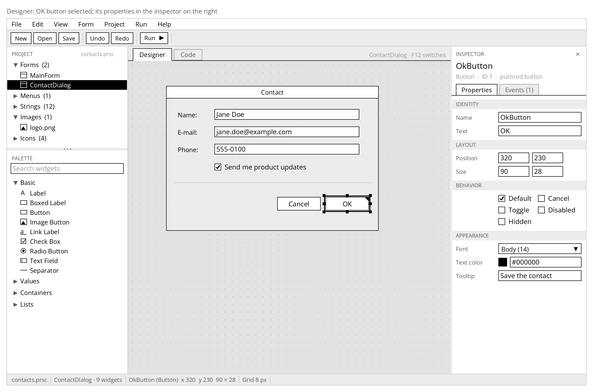
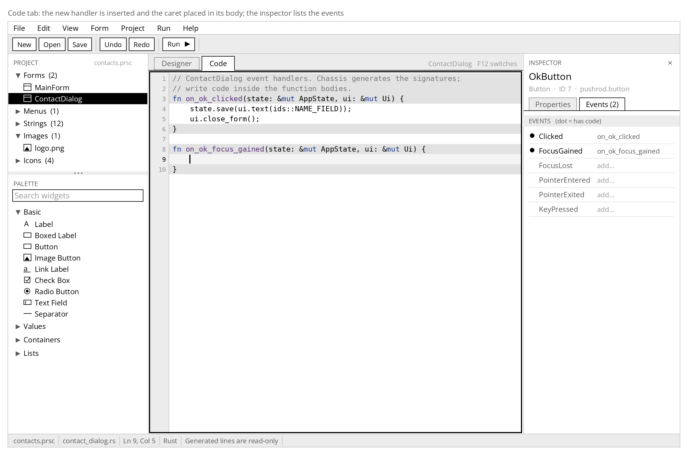
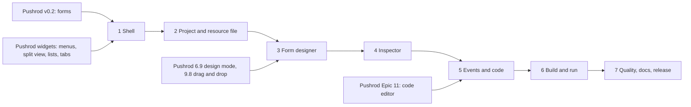

# Roadmap: Chassis

## Description

> Create a roadmap for Chassis. Create a mockup and let's work on the design. It should draw
> inspiration from Borland Delphi and Visual Studio Code. The left side should contain a drawer that
> contains the forms and resources that would be used in an accompanying RSC file (similar to Atari
> ST resources) and should have a designer section allowing for form elements to be dragged and
> dropped into the designer area. In the designer area, you should be able to click on a form element
> and edit its properties in a drawer that appears on the right-hand side of the screen (or as a
> callout, whichever makes more sense). Switching views is done as a tab at the top of the screen
> where the editor section is: two tabs - designer and code. When right-clicking on an element, the
> events that the widget supports is listed as a dropdown list. Clicking on the event will allow for
> a callback to be edited. Any events that have code assigned to them should have an indicator of
> some sort to show that code exists for that event.

Chassis is a visual form designer and code-behind editor for Pushrod applications, in the tradition
of the rapid-application-development IDEs: draw a form, set its properties, double-click a control,
and write the code for its event. It is built entirely with Pushrod, follows Pushrod's
[design philosophy](../DESIGN_PHILOSOPHY.md) (flat, simple, no shadows), and saves forms to a
Pushrod resource file (the `PRSC` form file format, Pushrod roadmap 6.3), the way Atari ST programs
kept their dialogs in an `.RSC` file.

**Status:** design draft. Issues are not filed yet; this document is for reviewing the design first.
The issue numbers below (`chassis: [1.1] ...`) are placeholders.

## Design

### Window layout



```text
+--------------------------------------------------------------------------------------+
| File  Edit  View  Form  Project  Run  Help                              (menu bar)    |
| [New][Open][Save] | [Undo][Redo] | [Run >]                               (toolbar)    |
+-----------------+----------------------------------------------+---------------------+
| PROJECT         |  [Designer] [Code]          ContactDialog    | INSPECTOR         x |
|  v Forms (2)    | +------------------------------------------+ | OkButton            |
|     MainForm    | |  . . . . design surface (grid) . . . . . | | Button . ID 7       |
|   > ContactDlg  | |   +---------- Contact ----------+        | | [Properties][Events]|
|  > Menus (1)    | |   | Name:   [Jane Doe         ] |        | |  IDENTITY           |
|  > Strings (12) | |   | E-mail: [jane.doe@example ] |        | |  Name  [OkButton]   |
|  v Images (1)   | |   |              [Cancel] [ OK ]|        | |  LAYOUT  ...        |
|  > Icons (4)    | |   +-----------------------------+        | |  BEHAVIOR ...       |
|=================| |                                          | |  APPEARANCE ...     |
| PALETTE         | |                                          | |                     |
| [Search      ]  | |                                          | |                     |
|  v Basic        | |                                          | |                     |
|     Label ...   | +------------------------------------------+ |                     |
+-----------------+----------------------------------------------+---------------------+
| contacts.prsc | ContactDialog . 9 widgets | OkButton x 320 y 230 90x28 | Grid 8 px     |
+--------------------------------------------------------------------------------------+
```

| Area | What it holds | Pushrod widgets |
|---|---|---|
| Menu bar, toolbar, status bar | Commands (File, Edit, View, Form, Project, Run, Help); New, Open, Save, Undo, Redo, Run; file, form, selection, and grid status | Menu bar (2.11), toolbar (2.15), status bar (2.16), actions (9.5) |
| **Project drawer** (left, top) | The resource file's contents: Forms, Menus, Strings, Images, Icons. Double-click a form to open it | Expander sections (3.10) holding list views (4.5) |
| **Palette** (left, bottom) | Every widget type from the widget registry, searchable and grouped (Basic, Values, Containers, Lists); third-party widget libraries appear automatically | Text field (2.6), expanders, list views, drag source (9.8) |
| **Editor** (center) | Two tabs per form: **Designer** (the form on a grid) and **Code** (its event handlers). F12 switches, as in Delphi | Tab view (4.4), design mode (6.9), code editor (Epic 11) |
| **Inspector** (right) | The selected widget's identity, then **Properties** and **Events** tabs | Split view (3.9), form layout (5.7), field editors |

The drawers are split views (3.9): drag the dividers to resize them, double-click to collapse, and
the widths are remembered.

### Placing widgets


Drag a widget from the palette onto the form. While dragging, an outline shows where it will land;
it snaps to the grid and to neighboring widgets, and a dotted guide appears when its edges line up
with others. Dropping adds the widget, gives it a unique name (`TextField1`), and selects it.
Selected widgets show eight square handles for resizing; arrow keys nudge by one grid step.

### Inspector: a drawer, not a callout

The inspector is a **drawer on the right**, recommended over a callout:

- It never covers the form being edited; a callout would sit on top of the widgets around the one
  selected.
- It stays open while you click from widget to widget, so you can compare and edit several in a
  row. A callout closes and reopens with each selection.
- It has room for long property lists and the Events tab.
- It can be collapsed (the `x`, or F4 to toggle) when you want the whole width for the form.

### Events and the code indicator


Right-clicking a widget opens a menu whose top section lists **every event that widget type
supports**. Events that already have code show a **filled dot** and the handler's name on the right.
Below the events are the usual commands (Cut, Copy, Delete, Bring to Front, Send to Back,
Inspector).

Choosing an event:

- **With code:** switches to the Code tab with the caret in that handler.
- **Without code:** creates the handler stub (`on_ok_focus_gained`), switches to the Code tab, and
  places the caret in its body.

Double-clicking a widget does the same for its **default event** (`Clicked` for buttons,
`Toggled` for check boxes, `TextChanged` for text fields).

Code is indicated in three places, all flat and monochrome:

| Where | Indicator |
|---|---|
| Right-click events menu | Filled dot before the event, handler name on the right |
| Inspector, Events tab | Filled dot and handler name; events without code show "add..." |
| Design surface | A small filled triangle in the widget's upper right corner when any of its events has code |

### Code view



Each form has one code file (`src/forms/contact_dialog.rs`) holding its handlers. Chassis writes
the function signatures and keeps them read-only (shaded); everything inside the function bodies
belongs to you and is never rewritten. The editor is the Chassis code editor (Pushrod Epic 11,
[`docs/chassis/code-editor.md`](chassis/code-editor.md)). The inspector shows the Events tab while
the Code tab is active, so you can jump between handlers.

### Project layout on disk

```text
contacts/
  Cargo.toml
  contacts.prsc                 forms, menus, strings, images, icons (Pushrod form file, 6.3)
  src/
    main.rs                     yours (Chassis creates it once)
    forms/
      contact_dialog.rs         yours: handler bodies; signatures guarded by Chassis
    generated/                  Chassis-owned, rewritten on save, never edited by hand
      ids.rs                    ID constants per form (6.6)
      contact_dialog_wiring.rs  registers each handler with the engine by widget ID
```

Generated code and your code never share a function body, so regenerating can't lose your work.

### Open design questions

1. **Inspector placement:** drawer (recommended above) or callout?
2. **Code indicator on the design surface:** keep the corner triangle, or show it only while the
   Events tab is open?
3. **Handler names:** `on_<widget>_<event>` in snake case (`on_ok_focus_gained`), renamed
   automatically when the widget is renamed?
4. **One code file per form** (proposed), or one per project?
5. **Resource file extension:** `.prsc`, matching the format's magic number?
6. **Where Chassis lives:** in this repository's workspace (simplest while Pushrod's APIs are
   moving), or its own repository from the start?
7. **Tree view:** the project drawer uses expander sections with lists, so Chassis doesn't need the
   parked tree view. Is that enough, or should nested resources (menus with submenus) unpark it?

## Relationship to Pushrod

Chassis is the biggest user of Pushrod's form and design-mode work, and it needs several widgets
that are after Pushrod's MVP. Chassis's own MVP therefore starts after Pushrod v0.2 (forms).

| Chassis needs | Pushrod roadmap |
|---|---|
| Form file, loader, writer, ID constants | 6.3, 6.4, 6.5, 6.6 (MVP v0.2) |
| Widget registry and property introspection | 6.1, 6.2 (MVP v0.2) |
| Design mode: selection overlay, handles, editing through undo | 6.9, 1.15 |
| Event metadata per widget type (supported events, default event, handler signature) | **new: extends 6.1** (to be filed with this roadmap) |
| Drag and drop | 9.8 |
| Actions and shortcuts | 9.5 |
| Menu bar, context menu, toolbar, status bar | 2.11, 2.19, 2.15, 2.16 |
| Split view, expander, list view, tab view, choice button | 3.9, 3.10, 4.5, 4.4, 3.6 |
| Code editor | Epic 11 (`chassis-code-editor`) |
| Layout managers (designing resizable forms) | 5.5 to 5.7 |

Property editors stay within Pushrod's parked decisions: colors are a swatch plus a hex field (the
color picker is parked), and fonts are a choice of registered fonts (the font chooser is parked).



## MVP Definition

The Chassis MVP is a version in which a developer can:

1. Create or open a project: a Cargo crate plus its `.prsc` resource file.
2. Add a form, drag the core widgets (labels, buttons, check boxes, radio buttons, text fields,
   separators, group boxes) onto it, move and resize them with grid snapping, and undo any change.
3. Edit any widget's properties in the inspector, with names validated as Rust identifiers.
4. See every event a widget supports (right-click menu and inspector), see which have code, and
   create or open a handler with one click (or double-click for the default event).
5. Edit handlers in the Code tab, with generated signatures protected.
6. Save, build, and run the application from Chassis.

## Epics

| Epic | Title | Summary | Issues | MVP issues |
|---|---|---|---|---|
| 1 | Application shell | Main window, three-pane workspace, Designer/Code tabs, commands | 5 | 4 |
| 2 | Project and resource file | Project model, open/save, project drawer, resource management | 7 | 4 |
| 3 | Form designer | Design surface, palette, drag and drop, selection, snapping, containers, undo | 9 | 7 |
| 4 | Inspector | Inspector drawer, property grid, typed editors, names and IDs | 5 | 4 |
| 5 | Events and code | Event metadata, events menu, indicators, handlers, code view, wiring | 8 | 8 |
| 6 | Build and run | Code generation rules, build and run, error list, templates | 4 | 2 |
| 7 | Quality, documentation, and release | CI and golden screenshots, docs, sample project, packaging | 4 | 3 |

## Epic 1: Application shell

The window Chassis runs in, built entirely from Pushrod widgets.

| Issue | Title | Summary | Labels | Parallel | MVP | Complexity | Affected modules |
|---|---|---|---|---|---|---|---|
| 1.1 | Chassis crate and main window | Binary crate, main window with menu bar, toolbar, and status bar | `chassis`, `app` | N | Y | M | `chassis/src/main.rs`, `app.rs` |
| 1.2 | Three-pane workspace | Project drawer, editor, and inspector in resizable, collapsible split views | `chassis`, `app` | Y | Y | M | `workspace.rs` |
| 1.3 | Designer and Code tabs | Two tabs per open form; F12 switches; each keeps its scroll, selection, and caret | `chassis`, `app` | Y | Y | S | `editor_tabs.rs` |
| 1.4 | Commands, menus, and shortcuts | Every command as an action, reachable from menus, toolbar, and familiar shortcuts | `chassis`, `app` | Y | Y | M | `commands.rs` |
| 1.5 | Workspace settings | Remember window size, pane widths, open forms, and recent projects | `chassis`, `app` | Y | N | S | `settings.rs` |

### 1.1: Chassis crate and main window

**Problem Statement.** Chassis needs its own application: a window with the standard menu bar,
toolbar, and status bar, built with Pushrod so it looks and behaves like what it designs.

**Solution / Scope.** A `chassis` binary crate. Main window with the menu bar (File, Edit, View,
Form, Project, Run, Help), a toolbar (New, Open, Save, Undo, Redo, Run), and a status bar showing the
resource file, the open form and its widget count, the selection's name, type, position, and size,
and the grid size. Everything is drawn by Pushrod; no OS-native menus.

**Acceptance Criteria.**
- Window matches the mockup's frame (menu bar, toolbar, status bar)
- Menus open and toolbar buttons trigger their commands (stubbed where later issues implement them)
- Status bar updates when the selection changes

**Parallelism / Dependencies.** Requires Pushrod 2.11, 2.15, 2.16, 9.5.

**Technical Stack.** Rust, Pushrod, `pushrod-widgets`, `pushrod-sdl2`.

**Documentation.** Chassis section on the docs site: "Chassis overview" page with an annotated
screenshot of the window.

### 1.2: Three-pane workspace

**Problem Statement.** The project, the form, and the selected widget's details all need to be
visible at once without crowding the form.

**Solution / Scope.** A horizontal split view (Pushrod 3.9) with three panes: the project drawer
(left, itself split vertically into Project and Palette), the editor (center), and the inspector
(right). Panes resize by dragging dividers, collapse by double-clicking them (or View menu, F4 for
the inspector), and keep minimum widths. The editor takes the extra space when the window grows.

**Acceptance Criteria.**
- Dividers drag and collapse; minimum widths respected
- Inspector toggles with F4
- Layout matches the mockup at 1200 x 760 and scales to larger windows

**Parallelism / Dependencies.** Requires 1.1, Pushrod 3.9.

**Technical Stack.** Rust, Pushrod.

**Documentation.** "Chassis overview": the three panes and how to resize and hide them.

### 1.3: Designer and Code tabs

**Problem Statement.** Each form has a visual side and a code side; switching between them must be
instant and must not lose your place.

**Solution / Scope.** A tab strip above the editor with **Designer** and **Code** tabs for the open
form, the form's name on the right. F12 switches (as in Delphi). Each tab keeps its own state:
designer selection and scroll, code caret and scroll. Opening a different form from the project
drawer switches both tabs to that form.

**Acceptance Criteria.**
- F12 and clicking switch tabs
- Selection, scroll, and caret are preserved across switches
- Opening another form keeps the active tab

**Parallelism / Dependencies.** Requires 1.2, Pushrod 4.4.

**Technical Stack.** Rust, Pushrod.

**Documentation.** "Chassis overview": Designer and Code tabs.

### 1.4: Commands, menus, and shortcuts

**Problem Statement.** Users coming from Delphi or VS Code expect their usual keys, and every
command needs to be reachable from menus, toolbar, and keyboard consistently.

**Solution / Scope.** Every command (New, Open, Save, Undo, Redo, Cut, Copy, Paste, Delete, Select
All, Bring to Front, Send to Back, Align, Run, Toggle Inspector, Switch Tab) is a Pushrod action
(9.5) with its menu entry, toolbar button where shown, and shortcut: Ctrl+N/O/S, Ctrl+Z/Y,
Ctrl+X/C/V, Del, Ctrl+A, F4 (inspector), F12 (tab), F5 (run). Actions are enabled and disabled
with the selection.

**Acceptance Criteria.**
- Every command reachable from menu and shortcut; toolbar where shown
- Disabled when not applicable (no selection, nothing to undo)
- Shortcut list on the docs site

**Parallelism / Dependencies.** Requires 1.1, Pushrod 9.5.

**Technical Stack.** Rust, Pushrod.

**Documentation.** "Keyboard shortcuts" page.

### 1.5: Workspace settings

**Problem Statement.** Re-arranging panes and reopening the last project every session is tedious.

**Solution / Scope.** Save window size and position, pane widths and collapsed state, open forms and
active tabs per project, and a recent-projects list (File menu). Stored in the user's configuration
directory; never in the project.

**Acceptance Criteria.**
- Restarting restores the layout and reopens the last project
- Recent projects list in the File menu

**Parallelism / Dependencies.** Requires 1.2, 2.2.

**Technical Stack.** Rust, `directories`, `serde`.

**Documentation.** "Chassis overview": settings.

## Epic 2: Project and resource file

A Chassis project is a Cargo crate plus its `.prsc` resource file.

| Issue | Title | Summary | Labels | Parallel | MVP | Complexity | Affected modules |
|---|---|---|---|---|---|---|---|
| 2.1 | Project model | A project is a Cargo crate, its resource file, and its generated and handler files | `chassis`, `project` | N | Y | M | `project.rs` |
| 2.2 | New, open, and save | Create a project from scratch, open an existing one, save the resource file | `chassis`, `project` | N | Y | M | `project.rs`, `commands.rs` |
| 2.3 | Project drawer | Resource sections (Forms, Menus, Strings, Images, Icons) as expanders with lists | `chassis`, `ui` | Y | Y | M | `project_drawer.rs` |
| 2.4 | Manage resources | Add, rename, duplicate, and delete forms and other resources | `chassis`, `project` | Y | Y | S | `project.rs`, `project_drawer.rs` |
| 2.5 | String table editor | Edit the resource file's strings for labels and messages | `chassis`, `project` | Y | N | S | `strings_editor.rs` |
| 2.6 | Images and icons | Import images and icons into the resource file and use them in widgets | `chassis`, `project` | Y | N | S | `images.rs` |
| 2.7 | Menu editor | Design menu bars and context menus stored in the resource file | `chassis`, `project` | Y | N | M | `menu_editor.rs` |

### 2.1: Project model

**Problem Statement.** Chassis has to know which files it owns, which belong to the developer, and
how forms, generated code, and handlers relate, so it can never overwrite user code.

**Solution / Scope.** A `Project`: the crate's `Cargo.toml`, the `.prsc` resource file (forms,
menus, strings, images, icons; Pushrod 6.3), handler files `src/forms/<form>.rs` (user-owned, with
Chassis-guarded signatures), and `src/generated/` (Chassis-owned: ID constants via 6.6 and wiring,
6.1 in this roadmap). The model tracks which handlers exist for each widget event by parsing the
handler files (tree-sitter, through the code editor's `find_function`).

**Acceptance Criteria.**
- Project loads from a directory and reports its forms and handlers
- Ownership rules documented and enforced (Chassis writes only generated files and stubs)

**Parallelism / Dependencies.** Requires Pushrod 6.3, 6.4, 6.5, 6.6.

**Technical Stack.** Rust, `toml_edit`, tree-sitter.

**Documentation.** "Projects and resource files" page, with the directory layout.

### 2.2: New, open, and save

**Problem Statement.** Users need to start a project from nothing and come back to it later.

**Solution / Scope.** New Project creates a Cargo crate (`Cargo.toml` with Pushrod dependencies,
`src/main.rs` that loads the first form), an empty resource file with one form, and the generated
folder. Open loads a project directory. Save writes the resource file (6.5) and regenerates
`src/generated/`; unsaved changes are marked in the title and status bar and confirmed on close.

**Acceptance Criteria.**
- New project builds and runs (an empty form) without edits
- Save then reopen restores every form exactly
- Closing with unsaved changes asks to save

**Parallelism / Dependencies.** Requires 2.1, 1.4.

**Technical Stack.** Rust, Pushrod.

**Documentation.** "Getting started with Chassis" tutorial (create the contact form).

### 2.3: Project drawer

**Problem Statement.** The resource file's contents must be visible and easy to open.

**Solution / Scope.** The top of the left drawer: the file name, then one expander section (Pushrod
3.10) per resource kind (Forms, Menus, Strings, Images, Icons) with a count, each holding a list
(4.5) with an icon per entry. Double-click opens a form in the editor; the open form is selected.
Right-click offers the commands from 2.4. No tree view is needed (see open question 7).

**Acceptance Criteria.**
- Sections expand and collapse; counts are correct
- Double-click opens a form; the selection follows the open form

**Parallelism / Dependencies.** Requires 1.2, 2.1, Pushrod 3.10, 4.5.

**Technical Stack.** Rust, Pushrod.

**Documentation.** "Projects and resource files": the project drawer.

### 2.4: Manage resources

**Problem Statement.** Forms and resources need to be created, renamed, copied, and removed.

**Solution / Scope.** Add Form (with name), Rename (validated as a Rust identifier, renames the
handler file and generated module), Duplicate, and Delete (confirms, and lists the handler file that
will be kept or removed). All through undo.

**Acceptance Criteria.**
- Renaming a form renames its handler file and generated code; the project still builds
- Delete asks before removing code

**Parallelism / Dependencies.** Requires 2.3, 3.7.

**Technical Stack.** Rust.

**Documentation.** "Projects and resource files": managing resources.

### 2.5 to 2.7: Strings, images and icons, menus (post-MVP)

String table editing (a list of name and text pairs, used by labels and messages), image and icon
import (PNG into the resource file's image pool, selectable in image properties), and a menu
designer (menu bars and context menus as resources, bound to actions by name, Pushrod 6.8). Each
gets its own issue with mockups when the MVP is in use.

## Epic 3: Form designer

| Issue | Title | Summary | Labels | Parallel | MVP | Complexity | Affected modules |
|---|---|---|---|---|---|---|---|
| 3.1 | Design surface | The open form on a dotted grid, in Pushrod design mode | `chassis`, `designer` | N | Y | M | `designer/surface.rs` |
| 3.2 | Widget palette | Every registered widget type, searchable and grouped | `chassis`, `designer` | Y | Y | M | `designer/palette.rs` |
| 3.3 | Drag and drop placement | Drag from the palette; outline preview; drop creates and selects | `chassis`, `designer` | N | Y | M | `designer/placement.rs` |
| 3.4 | Selection, move, and resize | Click, Shift+click, marquee; handles; keyboard nudge | `chassis`, `designer` | N | Y | M | `designer/selection.rs` |
| 3.5 | Snapping and alignment | Grid snap, guides to neighbors, align and distribute commands | `chassis`, `designer` | Y | Y | M | `designer/snap.rs` |
| 3.6 | Containers, z-order, and tab order | Drop into group boxes and containers; bring forward; set tab order | `chassis`, `designer` | Y | Y | M | `designer/structure.rs` |
| 3.7 | Clipboard and undo | Cut, copy, paste, duplicate; every designer change undoable | `chassis`, `designer` | Y | Y | M | `designer/history.rs` |
| 3.8 | Layout managers in the designer | Place widgets in row, column, form, and grid layouts | `chassis`, `designer` | Y | N | L | `designer/layouts.rs` |
| 3.9 | Form preview | Run the form live inside Chassis without building | `chassis`, `designer` | Y | N | M | `designer/preview.rs` |

### 3.1: Design surface

**Problem Statement.** Forms must be edited as they will look, without their widgets reacting to
clicks the way they do at run time.

**Solution / Scope.** The Designer tab shows the form (loaded from the resource file through the
registry) on a gray canvas with a dotted grid (8 px default, View menu). Pushrod design mode (6.9)
intercepts input: clicks select instead of activating, and an overlay draws selection outlines,
handles, guides, and code indicators. Zoom 100% and 200% for detail work.

**Acceptance Criteria.**
- Forms look exactly as at run time
- Widgets don't react (buttons don't press) in the designer
- Grid size and visibility adjustable

**Parallelism / Dependencies.** Requires 1.3, 2.1, Pushrod 6.9.

**Technical Stack.** Rust, Pushrod.

**Documentation.** "Designing forms" page.

### 3.2: Widget palette

**Problem Statement.** Users need every available widget at hand, including ones from widget
libraries other than `pushrod-widgets`.

**Solution / Scope.** The lower part of the left drawer: a search field and expander sections
(Basic, Values, Containers, Lists, plus one per extra widget library) listing every type in the
widget registry (Pushrod 6.1) with its icon and display name. Typing filters. Widget libraries that
register types (Pushrod 1.22) appear without changes to Chassis.

**Acceptance Criteria.**
- All registered types listed and searchable
- A widget library added to the project appears in the palette

**Parallelism / Dependencies.** Requires 1.2, Pushrod 6.1, 1.22.

**Technical Stack.** Rust, Pushrod.

**Documentation.** "Designing forms": the palette.

### 3.3: Drag and drop placement

**Problem Statement.** Placing widgets by dragging is the core of a visual designer.

**Solution / Scope.** Dragging a palette entry (Pushrod 9.8) over the form shows the new widget's
outline at its default size, snapped (3.5). Dropping creates the widget through the registry with a
unique name (`TextField1`), adds it to the container under the pointer (3.6), records an undo step,
and selects it. Escape cancels. Clicking a palette entry and then clicking the form places it too.

**Acceptance Criteria.**
- Outline follows the pointer and snaps; drop creates and selects
- Escape cancels; one undo removes the widget

**Parallelism / Dependencies.** Requires 3.1, 3.2, Pushrod 9.8.

**Technical Stack.** Rust, Pushrod.

**Documentation.** "Designing forms": adding widgets.

### 3.4: Selection, move, and resize

**Problem Statement.** Widgets must be selected, moved, and resized precisely.

**Solution / Scope.** Click selects; Shift+click adds or removes; dragging on empty space draws a
selection rectangle. A selection shows an outline and eight square handles; dragging the body moves,
dragging a handle resizes. Arrow keys nudge one grid step (Shift: one pixel). The inspector and
status bar follow the selection. Moving follows Pushrod's drawing mode (live or outline, 10.1).

**Acceptance Criteria.**
- All gestures work and update the inspector live
- Multi-selection moves together

**Parallelism / Dependencies.** Requires 3.1.

**Technical Stack.** Rust, Pushrod.

**Documentation.** "Designing forms": selecting and arranging.

### 3.5: Snapping and alignment

**Problem Statement.** Neat forms need aligned edges and even spacing without pixel-hunting.

**Solution / Scope.** Snap to the grid, and to the edges and centers of neighboring widgets within
4 px, shown with dotted guides (as in the drag mockup). Form menu: Align Left, Right, Top, Bottom,
Centers; Make Same Width and Height; Distribute Horizontally and Vertically. Alt disables snapping
while dragging.

**Acceptance Criteria.**
- Guides appear when edges or centers line up
- Align and distribute commands work on multi-selections

**Parallelism / Dependencies.** Requires 3.4.

**Technical Stack.** Rust.

**Documentation.** "Designing forms": alignment.

### 3.6: Containers, z-order, and tab order

**Problem Statement.** Forms nest widgets in group boxes and containers, and keyboard users need a
sensible Tab order.

**Solution / Scope.** Dropping onto a group box or container makes the widget its child (origins
become relative). Bring to Front and Send to Back change sibling order. Form > Tab Order shows
numbers on focusable widgets; clicking them in sequence sets the order (Pushrod 1.4).

**Acceptance Criteria.**
- Moving a group box moves its children
- Tab order editing persists to the resource file

**Parallelism / Dependencies.** Requires 3.4, Pushrod 1.4, 3.3 (group box), 5.3 (container).

**Technical Stack.** Rust.

**Documentation.** "Designing forms": containers and tab order.

### 3.7: Clipboard and undo

**Problem Statement.** Every designer action must be reversible, and widgets need copying.

**Solution / Scope.** Every change (add, delete, move, resize, property edit, reparent, reorder,
handler creation) is a Pushrod undo command (1.15); consecutive nudges merge. Cut, Copy, Paste, and
Duplicate (Ctrl+D) copy widgets with their properties (names made unique; handlers are not copied).

**Acceptance Criteria.**
- Every change undoes and redoes exactly
- Pasted widgets get unique names

**Parallelism / Dependencies.** Requires 3.4, Pushrod 1.15.

**Technical Stack.** Rust.

**Documentation.** "Designing forms": undo and clipboard.

### 3.8 and 3.9: Layout managers and form preview (post-MVP)

Placing widgets inside Pushrod's row, column, form, and grid layouts (5.5 to 5.7), so designed forms
resize gracefully; and a preview mode that runs the form live inside Chassis (widgets respond,
handlers don't run) to check behavior without building.

## Epic 4: Inspector

| Issue | Title | Summary | Labels | Parallel | MVP | Complexity | Affected modules |
|---|---|---|---|---|---|---|---|
| 4.1 | Inspector drawer | Identity header and Properties/Events tabs for the selection | `chassis`, `inspector` | N | Y | S | `inspector/mod.rs` |
| 4.2 | Property grid | Every property from introspection, grouped and labeled | `chassis`, `inspector` | N | Y | M | `inspector/grid.rs` |
| 4.3 | Typed property editors | Text, number, check, choice, color, font, and image editors | `chassis`, `inspector` | Y | Y | M | `inspector/editors.rs` |
| 4.4 | Names and IDs | Validated, unique Rust identifiers; renames carried to code | `chassis`, `inspector` | Y | Y | M | `inspector/names.rs` |
| 4.5 | Multiple selection | Edit the properties several selected widgets share | `chassis`, `inspector` | Y | N | M | `inspector/grid.rs` |

### 4.1: Inspector drawer

**Problem Statement.** Users need to see what is selected and edit it without covering the form.

**Solution / Scope.** The right drawer (see "Inspector: a drawer, not a callout"): the widget's name
in large text, then its type, ID, and registry type name; then **Properties** and **Events** tabs.
With nothing selected, it shows the form's own properties. F4 or `x` collapses it.

**Acceptance Criteria.**
- Follows the selection in the designer and the caret's handler in the code view
- Collapses and restores

**Parallelism / Dependencies.** Requires 1.2.

**Technical Stack.** Rust, Pushrod.

**Documentation.** "The inspector" page.

### 4.2: Property grid

**Problem Statement.** Every widget type has different properties; the inspector must show them all
without per-widget code in Chassis.

**Solution / Scope.** Properties come from Pushrod's introspection (6.2): name, kind, value, and a
category. Rows are grouped under headers (Identity, Layout, Behavior, Appearance, then the type's own
categories), label on the left, editor on the right. Editing applies immediately to the designer and
records undo.

**Acceptance Criteria.**
- Any registered widget's properties appear correctly, including third-party widgets
- Changes show in the designer immediately and undo

**Parallelism / Dependencies.** Requires 4.1, Pushrod 6.2, 5.7.

**Technical Stack.** Rust, Pushrod.

**Documentation.** "The inspector": properties.

### 4.3: Typed property editors

**Problem Statement.** Each kind of property needs an editor that prevents invalid values.

**Solution / Scope.** Text (text field), integer (numeric text field with range), boolean (check
box, grouped for behavior flags), enumeration (choice button, 3.6), color (swatch plus hex field; the
color picker is parked), font (choice of registered fonts, Pushrod 1.24; the font chooser is
parked), image (choice of images in the resource file). Invalid input is marked and not applied.

**Acceptance Criteria.**
- Each kind has its editor; invalid values can't be applied
- Behavior flags appear as grouped check boxes, as in the mockup

**Parallelism / Dependencies.** Requires 4.2, Pushrod 2.6, 2.4, 3.6.

**Technical Stack.** Rust, Pushrod.

**Documentation.** "The inspector": editing values.

### 4.4: Names and IDs

**Problem Statement.** Widget names become Rust identifiers and handler names; bad or duplicate names
break the build.

**Solution / Scope.** Names must be valid Rust identifiers (UpperCamelCase in the designer, converted
to `SCREAMING_SNAKE_CASE` constants and `snake_case` handler names) and unique per form. Renaming
updates ID constants and renames that widget's handlers in the code file (code editor API, Epic 11).
The numeric ID is shown read-only.

**Acceptance Criteria.**
- Invalid or duplicate names are refused with a message
- Renaming a widget renames its handlers and the project still builds

**Parallelism / Dependencies.** Requires 4.2, 5.4.

**Technical Stack.** Rust.

**Documentation.** "The inspector": names.

### 4.5: Multiple selection (post-MVP)

With several widgets selected, show the properties they share; editing one sets it on all.

## Epic 5: Events and code

| Issue | Title | Summary | Labels | Parallel | MVP | Complexity | Affected modules |
|---|---|---|---|---|---|---|---|
| 5.1 | Event metadata in the widget registry | Each widget type lists its events, default event, and handler signature | `chassis`, `pushrod-core` | N | Y | M | Pushrod `registry.rs` |
| 5.2 | Events context menu | Right-click lists the widget's events, with a dot where code exists | `chassis`, `events` | Y | Y | S | `designer/context_menu.rs` |
| 5.3 | Inspector Events tab | Every event with its handler or "add..." | `chassis`, `events` | Y | Y | S | `inspector/events.rs` |
| 5.4 | Create and open handlers | Choosing an event (or double-clicking) creates or opens its handler | `chassis`, `events` | N | Y | M | `code/handlers.rs` |
| 5.5 | Code view | The Code tab: the form's handler file in the Chassis code editor | `chassis`, `code` | N | Y | M | `code/view.rs` |
| 5.6 | Code indicator on the design surface | Corner mark on widgets that have handlers | `chassis`, `events` | Y | Y | S | `designer/overlay.rs` |
| 5.7 | Keep handlers in sync | Renames, deletions, and orphaned handlers | `chassis`, `events` | Y | Y | M | `code/sync.rs` |
| 5.8 | Event wiring generation | Generated code registers each handler with the engine by widget ID | `chassis`, `codegen` | N | Y | M | `codegen/wiring.rs` |

### 5.1: Event metadata in the widget registry

**Problem Statement.** Chassis must list the events each widget type supports, but Pushrod's
registry (6.1) only knows how to construct widgets, not what they emit.

**Solution / Scope.** Extend Pushrod's `WidgetRegistry` entries with `events: &[EventInfo]` (name,
description, payload fields, whether it is the default event) and the handler signature for each,
derived from the event vocabulary (9.1). Shared events (focus, pointer, key) come from the core; each
widget adds its own (`Clicked`, `Toggled`, `TextChanged`, ...). Filed as a Pushrod issue extending
6.1, labeled `chassis`.

**Acceptance Criteria.**
- Every standard widget declares its events and default event
- Third-party widget libraries can declare theirs

**Parallelism / Dependencies.** Requires Pushrod 6.1, 9.1.

**Technical Stack.** Rust, Pushrod.

**Documentation.** Pushrod docs: "Widget registry" gains an events section; each widget page already
lists its events.

### 5.2: Events context menu

**Problem Statement.** The fastest way to reach a widget's code is from the widget itself.

**Solution / Scope.** Right-clicking a widget (Pushrod 2.19) shows an **Events** section with every
event from 5.1, in a fixed order (default first). Events with code show a filled dot and the handler
name; choosing any event runs 5.4. Below: Cut, Copy, Delete, Bring to Front, Send to Back,
Inspector. Matches the mockup.

**Acceptance Criteria.**
- Lists exactly the widget's events, default first
- Dots and handler names reflect the code file
- Choosing an event opens or creates its handler

**Parallelism / Dependencies.** Requires 5.1, 5.4, Pushrod 2.19.

**Technical Stack.** Rust, Pushrod.

**Documentation.** "Events and code" page.

### 5.3: Inspector Events tab

**Problem Statement.** The full event picture for a widget should be visible alongside its
properties.

**Solution / Scope.** The inspector's Events tab lists every event: filled dot and handler name when
code exists, "add..." otherwise. Clicking either runs 5.4. The tab label shows the count of events
with code ("Events (2)").

**Acceptance Criteria.**
- Matches the context menu's information
- Count updates when handlers are added or removed

**Parallelism / Dependencies.** Requires 4.1, 5.1, 5.4.

**Technical Stack.** Rust, Pushrod.

**Documentation.** "Events and code".

### 5.4: Create and open handlers

**Problem Statement.** Writing code for an event should be one action, never a hunt through files.

**Solution / Scope.** For a widget and event: if the handler exists (found with the code editor's
`find_function`, Epic 11.8), switch to the Code tab and place the caret in its body. Otherwise insert
a stub `fn on_<widget>_<event>(state: &mut AppState, ui: &mut Ui<'_>, ...)` (payload parameters from
5.1) after the widget's other handlers, mark its signature read-only, record it for wiring (5.8),
switch tabs, and place the caret. Double-clicking a widget does this for its default event. Creating
a handler is one undo step together with the wiring change.

**Acceptance Criteria.**
- Existing handlers open; missing ones are created once, never duplicated
- New stubs compile immediately
- Undo removes the stub and its wiring

**Parallelism / Dependencies.** Requires 5.1, 5.5, 2.1, Pushrod Epic 11 (11.8).

**Technical Stack.** Rust, `chassis-code-editor`.

**Documentation.** "Events and code".

### 5.5: Code view

**Problem Statement.** The Code tab must show the open form's handlers in a proper code editor.

**Solution / Scope.** The Code tab hosts the Chassis code editor (Pushrod Epic 11) with the form's
handler file. Generated signatures and the header comment are guarded (read-only, shaded). The
inspector shows the Events tab while the Code tab is active, and moving the caret into a handler
selects its widget. Saving the project saves the file.

**Acceptance Criteria.**
- Guarded lines can't be edited; bodies can
- Caret in a handler selects its widget in the inspector

**Parallelism / Dependencies.** Requires 1.3, Pushrod Epic 11.

**Technical Stack.** Rust, `chassis-code-editor`.

**Documentation.** "Events and code": the Code tab.

### 5.6: Code indicator on the design surface

**Problem Statement.** At a glance, the form should show which widgets already have code.

**Solution / Scope.** A small filled triangle in the upper right corner of any widget with at least
one handler, drawn by the design overlay (not part of the widget). Hidden in form preview. See open
question 2.

**Acceptance Criteria.**
- Appears and disappears as handlers are added and removed

**Parallelism / Dependencies.** Requires 3.1, 2.1.

**Technical Stack.** Rust.

**Documentation.** "Events and code": indicators.

### 5.7: Keep handlers in sync

**Problem Statement.** Renaming or deleting widgets must not leave code that no longer matches the
form.

**Solution / Scope.** Renaming a widget renames its handlers (4.4). Deleting a widget asks whether to
keep its handlers; kept handlers become **orphaned** and are listed (Form > Orphaned Handlers) so
they can be reattached to another widget's event or deleted. The build never breaks because of a
rename or deletion.

**Acceptance Criteria.**
- Renames update handler names and wiring
- Deleting a widget never silently deletes code

**Parallelism / Dependencies.** Requires 5.4, 5.8.

**Technical Stack.** Rust.

**Documentation.** "Events and code": renaming and deleting.

### 5.8: Event wiring generation

**Problem Statement.** Handlers must be connected to the engine by widget ID without the developer
writing registration code.

**Solution / Scope.** On save, generate `src/generated/<form>_wiring.rs` with
`pub fn wire(engine: &mut Engine<AppState>, form: &FormHandle)` registering every handler with its
widget's ID and event (`engine.on_click(form.id(ids::OK), on_ok_clicked)`), using the ID constants
from Pushrod 6.6. Generated files carry a "do not edit" header and are rewritten in full.

**Acceptance Criteria.**
- A project with handlers builds and every handler fires at run time
- Generated files are deterministic (same input, same output)

**Parallelism / Dependencies.** Requires 2.1, 5.1, Pushrod 6.6.

**Technical Stack.** Rust.

**Documentation.** "Projects and resource files": generated code.

## Epic 6: Build and run

| Issue | Title | Summary | Labels | Parallel | MVP | Complexity | Affected modules |
|---|---|---|---|---|---|---|---|
| 6.1 | Code generation rules | What Chassis writes, when, and what it never touches | `chassis`, `codegen` | N | Y | S | `codegen/mod.rs` |
| 6.2 | Build and run | Run (F5) builds with Cargo and launches the application; output panel | `chassis`, `build` | N | Y | M | `build.rs` |
| 6.3 | Error list | Compiler errors listed and linked to the code view | `chassis`, `build` | Y | N | M | `build/errors.rs` |
| 6.4 | Project templates | Start from an empty app, a dialog app, or the contacts sample | `chassis`, `project` | Y | N | S | `templates/` |

### 6.1: Code generation rules

**Problem Statement.** Developers must be able to trust that Chassis never destroys their code.

**Solution / Scope.** Written rules, enforced by tests: Chassis rewrites only `src/generated/`;
creates `src/main.rs` and `src/forms/<form>.rs` once; afterwards only inserts handler stubs and
renames guarded signatures in handler files; never edits a function body. Generated output is
formatted with `rustfmt`.

**Acceptance Criteria.**
- Tests prove handler bodies survive every designer operation
- Rules documented

**Parallelism / Dependencies.** Requires 2.1, 5.8.

**Technical Stack.** Rust, `rustfmt`.

**Documentation.** "Projects and resource files": what Chassis writes.

### 6.2: Build and run

**Problem Statement.** Trying the application should be one key away.

**Solution / Scope.** Run (F5, toolbar) saves, runs `cargo build` with JSON messages, shows progress
in an output panel (collapsible, below the editor), and launches the application. Stop ends it.
Errors open the output panel.

**Acceptance Criteria.**
- F5 builds and launches the app
- Build output visible; failures reported

**Parallelism / Dependencies.** Requires 2.2, 6.1.

**Technical Stack.** Rust, Cargo.

**Documentation.** "Getting started with Chassis": running the app.

### 6.3 and 6.4: Error list and templates (post-MVP)

Parse Cargo's JSON diagnostics into a clickable error list that opens the code view at the right
line; and project templates (empty application, dialog application, the contacts sample).

## Epic 7: Quality, documentation, and release

| Issue | Title | Summary | Labels | Parallel | MVP | Complexity | Affected modules |
|---|---|---|---|---|---|---|---|
| 7.1 | CI and golden screenshots | Build, test, and compare Chassis's own screens with goldens | `chassis`, `quality` | Y | Y | M | `.github/workflows/`, `tests/` |
| 7.2 | Chassis documentation | A Chassis section on the docs site with a getting-started tutorial | `chassis`, `documentation` | Y | Y | M | `pushrod-docs/docs/chassis/` |
| 7.3 | Sample project | The contacts sample, built with Chassis, fictional data only | `chassis`, `example` | Y | Y | S | `examples/contacts/` |
| 7.4 | Packaging and releases | `cargo install chassis` and downloadable builds | `chassis`, `release` | Y | N | M | `Cargo.toml`, `.github/workflows/` |

### 7.1 to 7.4

- **7.1:** CI runs Chassis's tests (project model, code generation rules, designer operations through
  `Engine::dispatch`) and golden-image tests of the main screens, matching the mockups above.
- **7.2:** a **Chassis** group on the documentation site: overview, getting started (build the
  contact form end to end), designing forms, the inspector, events and code, projects and resource
  files, keyboard shortcuts. Every page follows CONTRIBUTING.md's documentation rules.
- **7.3:** the contacts sample (Jane Doe, jane.doe@example.com, 555-0100), created in Chassis and
  kept in the repository as a test and a tutorial reference.
- **7.4:** release packaging once the MVP is in use.

## Work Order

1. **After Pushrod v0.2 and the widgets Chassis needs** (see "Relationship to Pushrod"): 5.1 (filed
   as a Pushrod issue) can start as soon as Pushrod 6.1 lands.
2. **Shell:** 1.1, 1.2, 1.4, 1.3
3. **Project:** 2.1, 2.2, 2.3, 2.4
4. **Designer:** 3.1, 3.2, 3.4, 3.3, 3.5, 3.7, 3.6
5. **Inspector:** 4.1, 4.2, 4.3, 4.4
6. **Events and code:** 5.1, 5.5, 5.4, 5.8, 5.2, 5.3, 5.6, 5.7
7. **Build:** 6.1, 6.2
8. **Quality:** 7.1, 7.2, 7.3 (written alongside, finished here) -- **Chassis MVP**
9. **After the MVP:** 1.5, 2.5, 2.6, 2.7, 3.8, 3.9, 4.5, 6.3, 6.4, 7.4

## Sources

- Mockups: [`docs/mockups/generate.py`](mockups/generate.py) (`chassis-1` to `chassis-4`).
- Pushrod roadmap: [`docs/ROADMAP_EXTENSIBLE_WIDGET_LIBRARY.md`](ROADMAP_EXTENSIBLE_WIDGET_LIBRARY.md)
  (Epic 6 forms, Epic 11 code editor).
- Ideas (not names or artwork) from Borland Delphi (form designer, object inspector, F12 form/code
  toggle, double-click to create an event handler), Visual Studio Code (side drawers, tabs, command
  model), and Atari ST resource files (forms and resources kept in one file, addressed by ID).
