# Roadmap: Extensible Widget Library

## Description

> Make Pushrod's widget library as flexible and easy to extend as possible, so that more features can be added and the library can be extended naturally. Draw widget inspiration from Atari TOS 2.06 (GEM AES), NeXTSTEP, and Mac OS / macOS. Widget design stays simple and is drawn the way it is today. Skinning and themes are a feature for the distant future. Pushrod's premise is to be small, simple, lightweight, and easy to maintain and use.
>
> A future product, **Chassis**, will be a point-and-click, drag-and-drop interface designer. Like the Atari RSC workflow (and Shift's *Interface* editor, which was much harder to use), forms will be saved to a binary resource file and built on the fly, so that code doesn't need to be rewritten to match the design: only the callbacks are written, and they refer to widgets by ID. This is why Pushrod gives every widget an ID.

> Inspiration also comes from Motif, Intergraph, classic Mac OS, and AmigaOS for the base widgets, and from Qt, GTK, and other operating systems for widgets, events, and callbacks, to make the design as complete as possible. The focus is usability: not implementing everything under the sun just because we can. The *ideas* matter, not the old naming conventions (GEM's names were shaped by the compiler limits of the time): Pushrod uses its own modern names for functions and events.
>
> Rust applications are meant to be self-contained, so Pushrod must not rely on OS-specific functionality such as native menus: menus and every other control are drawn by Pushrod so that design, look, and feel stay consistent. SDL2 provides graphics and input, and its GPU textures store each widget's drawing so that frames are composed by blitting, with all drawing done by the GPU rather than the CPU wherever possible.

This roadmap builds on the core modernization in #10 (`dyn Widget` tree, `WidgetCore`, `paint` helpers, mutable `handle_event`, `Engine<S>` callbacks).

## Guiding principles

- **Small and simple.** Every widget is a `WidgetCore` plus a `paint` function composed from `fill`, `border`, and `text`. No new runtime dependencies without a strong reason.
- **Shared behavior lives in the core.** Flags, states, focus, clipping, and events are implemented once (Epic 1, Epic 5), so a new widget gets them for free.
- **IDs are the contract.** Widgets are addressed by stable IDs, like the numbered objects in classic resource files. Forms, generated constants, and callbacks all key off IDs.
- **Runtime first, designer second.** Epic 6 builds everything Chassis needs (registry, properties, form file format, loader/writer, design-mode hooks) into Pushrod itself.
- **Keep it stupid simple.** Widgets are flat: fills, one-pixel borders, and text. No glass, no bevels, no shadows, no rounded corners. Fancy looks are up to the application (custom paint, 2.10 (#36); theming hooks, Epic 8, not scheduled). See [`DESIGN_PHILOSOPHY.md`](../DESIGN_PHILOSOPHY.md).
- **Modern names.** Older systems are credited for ideas only. Pushrod's flags, events, and callbacks use plain, modern names, collected in the *Naming* section so they can be reviewed in one place.
- **Retained, with stable identity.** Widgets persist and keep stable IDs, which is what accessibility trees, caching, incremental updates, and form files all need.
- **Engine separate from design.** The engine (tree, events, invalidation, paint API) and the design layer (widgets, defaults, appearance, themes) are separate modules with written specs (7.6 (#114)).
- **Use shared foundations.** Text layout (Parley) and accessibility (AccessKit) come from the ecosystem's well-tested crates rather than being reinvented.
- **Layouts are optional and extensible.** Containers can stay absolutely positioned, as designed forms were on classic systems, or use simple layout managers (row, column, form, grid, stack, flow) and custom ones, so forms resize and adapt to text and fonts.
- **Fictional sample data only.** Demos, examples, tests, mockups, documentation, and issue text never contain real names or personal information; use placeholders such as Jane Doe, jane.doe@example.com, Anytown, and /home/user (see CONTRIBUTING.md).
- **Documented as it's built.** The Docusaurus site in `pushrod-docs/` has a five-minute quick start, guides for applications, events, and widgets, and one page per widget under **Widgets**. Every issue lists the pages it adds or updates, and the docs ship in the same PR as the code.
- **Core and widgets are separate crates.** `pushrod` is the core (engine, tree, events, paint helpers); `pushrod-widgets` holds the standard widgets and uses only public core API. Other widget libraries can extend or replace it (1.22), so a fancier look never requires changing the core.
- **Backends are crates.** The core and the widgets never name SDL. `pushrod-sdl2` implements the backend today; `pushrod-sdl3` (10.5) and an Atari ST backend (10.4) plug in the same way, so applications switch by changing one dependency.
- **Documentation ships with the code.** Every user-visible change includes its Docusaurus pages, rustdoc, screenshots, and changelog entry in the same pull request; outdated documentation is a bug (CONTRIBUTING.md).
- **Chassis components are labeled.** Work that exists for the Chassis designer (the code editor, Epic 11) carries the `chassis` label and a "Chassis:" title, and lives in `chassis-*` crates that any Pushrod application can still use.
- **Usability first.** A control is added because it makes ordinary applications easier to use, not because another toolkit had it. Ideas that didn't meet that bar are listed under *Parked*.
- **Self-contained and GPU-first.** Pushrod draws everything itself through SDL2: no OS-native menus, menu bars, dialogs, or controls, so applications look and behave the same everywhere. Each widget paints into its own GPU texture only when invalidated; frames are composed by blitting cached textures; text comes from a glyph atlas texture. SDL2 does the heavy lifting for graphics and input.

## MVP Definition

The MVP (v1 release candidate, published to crates.io) is a version of Pushrod in which an application can:

1. Build a complete dialog: labels, boxed labels, separators, buttons with default/cancel/toggle behavior, check boxes, radio groups, text fields with validation, images, sliders, scroll bars, progress bars, group boxes, and alerts.
2. Use the keyboard: focus, Tab order, mnemonics, Return for the default button, Escape to cancel.
3. Handle events with a modern event model (clear event names, capture/bubble propagation, reusable input controllers) and Visual Basic-style callbacks (`on_click`, `on_toggle`, `on_value_change`, `on_text_change`, custom events, timers).
4. Compose new widgets from paint helpers or from other widgets (composites), with children clipped to their parents.
5. **Load a form from a binary form file by ID**, with generated ID constants, and run it as a modal dialog, which is the runtime foundation that Chassis needs.
6. Rely on CI, golden-image tests, a widget gallery, a reference application built only with Pushrod, a guide for writing widgets, and documentation for everything.
7. Draw everything through a backend crate (SDL2 today, SDL3 later) into GPU textures, with no OS-native UI, no per-frame CPU pixel work, sharp rendering on high-DPI displays, and no SDL types in the core or widget APIs.

MVP scope: **66 of 124 active issues**, delivered in two release stages. The MVP column shows each issue's stage, and GitHub milestones match.

- **v0.1: dialog applications** (53 issues): Build and ship real dialog-style applications: core, backends, events, focus, the core widgets, composition, layouts, high-DPI, modal dialogs, CI, docs, and the first crates.io release.
- **v0.2: forms (MVP complete)** (13 issues): Forms and form files (the runtime foundation for Chassis), plus input methods, mnemonics, accessibility, and written specs. Completes the MVP.

Everything else (actions and shortcuts, bindings, drag and drop, lists, tables, tabs, menus, toolbars, file chooser, text areas, multiple windows, the SDL3 backend, Chassis design mode, theming) follows the MVP.

## Epics

| Epic | Title | Summary | Issues | MVP issues |
|---|---|---|---|---|
| 1 (#11) | Core: behavior flags, focus, timing, and performance | Shared behavior every widget gets for free: behavior flags and visual states, event masks, keyboard focus and mnemonics, timers, GPU text, and tree editing. | 25 | 19 |
| 2 (#12) | Core dialog widgets | The widgets every dialog needs: labels, buttons, check boxes, radio groups, text fields, images, alerts, menus, tooltips, toolbars, and more. | 22 | 10 |
| 3 (#13) | Value and choice controls | Scroll bar, slider, group box, choice button, expander, and date picker. | 9 | 3 |
| 4 (#14) | Lists, tables, progress, spin boxes, and tabs | Progress bar, spin box, tab view, list view, table view, and combo box. | 7 | 1 |
| 5 (#15) | Composition, clipping, and layout managers | Clip children to parents, composite widgets with retrievable parts, a scrollable Container with its own content area, autoresizing, and simple, extensible layout managers. | 10 | 6 |
| 6 (#16) | Forms and form files (foundation for Chassis) | Widget registry, property introspection, a binary form file format, loader and writer, generated ID constants, modal dialogs, named actions, and design-mode hooks. | 13 | 10 |
| 7 (#17) | Quality, documentation, and release | CI, golden-image tests, a widget gallery, a guide for writing widgets, a changelog, and the crates.io release. | 10 | 10 |
| 8 (#18) | Theming and skins (distant future) | Placeholder: an optional theme layer for pushrod-widgets. Not scheduled; different looks can already be built as separate widget libraries (1.22). | 2 | 0 |
| 9 (#79) | Event model and callbacks | A modern event vocabulary, capture/bubble propagation, reusable input controllers, event filters, actions and shortcuts, property bindings, callback handles, and drag and drop. | 11 | 5 |
| 10 (#103) | Rendering backends, drawing modes, and vintage hardware | Backend crates (SDL2 now, SDL3 later) with no SDL in the core, a backend-neutral paint API, high-DPI, live vs. outline drawing for slow and vintage machines, a no_std core, and an experimental Atari ST backend. | 6 | 2 |
| 11 (#141) | Chassis: code editor (chassis-code-editor) | A lightweight code editor component ("Monaco lite", Tier 1 features only) for Chassis's code-behind view, built as its own crate on Pushrod. | 9 | 0 |

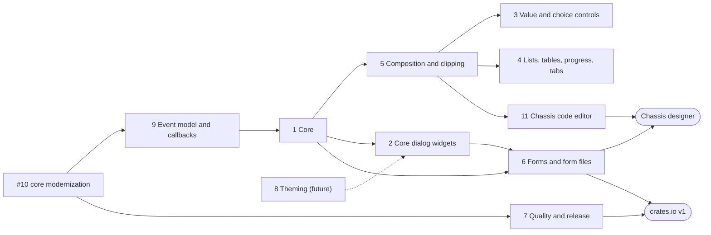

### How it fits together

```text
        Chassis (future product: drag-and-drop designer)
                 | writes                    ^ drives design mode (6.9)
                 v                           |
  form file  -- 6.4 loader --> WidgetCache (ID tree) <-- 6.5 writer
  (6.3 format)                    |   ^
      |                           |   | widgets created by type name (6.1)
      +-- 6.6 codegen --> ids.rs  |   | and configured by property (6.2)
                          |       v
  application code:  engine.on_click(form.id(main::OK), |state, ui| ...)
```

## Widget roadmaps

Each widget has its own roadmap in [`docs/widgets/`](widgets/README.md), the specification for what it is, what it does, how it looks, and how it responds. This file keeps the core, event, form, and release work, and the order everything is built in.

[Boxed Label](widgets/boxed-label.md) · [Glyph Button](widgets/glyph-button.md) · [Button](widgets/button.md) · [Check Box](widgets/check-box.md) · [Radio Button](widgets/radio-button.md) · [Text Field](widgets/text-field.md) · [Image](widgets/image.md) · [Icon](widgets/icon.md) · [Alert](widgets/alert.md) · [Custom Paint](widgets/custom-paint.md) · [Menu Bar and Menus](widgets/menu-bar-and-menus.md) · [File Chooser](widgets/file-chooser.md) · [Tooltip](widgets/tooltip.md) · [Separator](widgets/separator.md) · [Toolbar](widgets/toolbar.md) · [Status Bar](widgets/status-bar.md) · [Switch](widgets/switch.md) · [Text Area](widgets/text-area.md) · [Context Menu](widgets/context-menu.md) · [Message Bar](widgets/message-bar.md) · [Image Button](widgets/image-button.md) · [Link Label](widgets/link-label.md) · [Scroll Bar](widgets/scroll-bar.md) · [Slider](widgets/slider.md) · [Group Box](widgets/group-box.md) · [Choice Button](widgets/choice-button.md) · [Column Browser](widgets/column-browser.md) · [Split View](widgets/split-view.md) · [Expander](widgets/expander.md) · [Date Picker](widgets/date-picker.md) · [Dial](widgets/dial.md) · [Progress Bar](widgets/progress-bar.md) · [Spin Box](widgets/spin-box.md) · [Tab View](widgets/tab-view.md) · [List View](widgets/list-view.md) · [Combo Box](widgets/combo-box.md) · [Table View](widgets/table-view.md) · [Spinner](widgets/spinner.md) · [Container](widgets/container.md)

## Modern foundations

Findings from Raph Levien's *Advice for the Next 100 Rust GUIs* (Linebender, 2026), applied to Pushrod:

| Finding | Applied in |
|---|---|
| Text layout is largely solved by shared crates (Parley; Cosmic Text as an alternative) | 1.18 (#111), 1.7 (#3) |
| Accessibility via AccessKit, done well rather than box-ticking, without per-frame cost | 1.14 (#80) (now MVP) |
| Input methods (IME) are hard and often incomplete | 1.19 (#112), 2.6 (#32) |
| Layers avoid re-rendering but cost memory; use hints like repaint boundaries | 1.20 (#113), 10.2 (#106) |
| Retained mode needs stable identity and reliable caching | Stable `WidgetId`s throughout; layout and atlas caching |
| Clear module boundaries with specs; separate the design layer from the engine | 7.6 (#114), 10.3 (#107) |
| Virtualized lists need an incremental data-model interface | 4.5 (#52) |
| Precompute the static parts of a design | 6.4 (#63) |
| Performance gaps signal missed optimizations; measure | 7.7 (#115) |
| Adapt web specs rather than copy them (curated style subset) | 8.1 (#74) |

Not adopted for now: system-compositor video layers (outside SDL2's scope) and mobile platforms (the article recommends native UI there).

## Inspiration

Where each idea comes from. Pushrod takes the common, proven core of these systems and keeps it small.

| Idea | Atari GEM / classic Mac OS | AmigaOS, Motif, NeXTSTEP, Intergraph | Qt, GTK, Windows, Haiku |
|---|---|---|---|
| Widgets addressed by stable numbers; forms stored in files | GEM resource files; classic Mac dialog item numbers; Amiga gadget IDs | NeXTSTEP and Mac interface files with tags | Qt Designer files; GTK builder files |
| Behavior and state flags on each widget | GEM object flags and states | Disabled ghosting (Mac, Amiga, Motif); default-button emphasis | GTK state flags; Qt widget attributes |
| Keyboard use | GEM/Mac: Return = default, Escape/Cmd-. = cancel | Motif tab groups; Amiga/Motif underlined keys | Qt/GTK mnemonics, focus chains, shortcuts |
| Waiting only for wanted events | GEM multi-event wait with a mask |  | Event masks/controllers in GTK |
| Commands shared by menus, toolbars, keys |  | NeXTSTEP target/action | Qt actions; GTK actions |
| Event routing | Single target (GEM, classic Mac) | Fixed mouse-button roles (Intergraph workstations) | Capture/bubble (GTK); accept/ignore + filters (Qt) |
| Reusable input handling |  |  | GTK event controllers |
| Keeping values in sync |  |  | GTK property bindings; Qt property notifications |
| Layout on resize | Fixed-size forms (GEM, AmigaOS) | Motif form attachments; NeXTSTEP autoresizing | Qt/GTK layout managers (adopted as simple, extensible layouts) |
| Value controls | Hand-built sliders (GEM) | Amiga sliders/scrollers/cycle gadgets; Motif scale/spin box | Qt/GTK sliders, spin buttons, switches |
| Lists, tables, and hierarchies |  | Amiga list views; Motif lists; NeXTSTEP column browser | Qt/GTK item models and views; Mac Finder column view; Windows report lists |
| Dialogs and notices | GEM/Mac alerts and modal dialogs | Motif message and file dialogs | GTK info bars; Qt/GTK dialogs |
| Drawing while moving | Outline dragging (GEM, classic Mac) |  | 'Show contents while dragging' options (later desktops) |
| Modern foundations |  |  | Shared text layout (Parley), AccessKit, repaint boundaries (Flutter), drawing groups (SwiftUI), engine/design-layer split (Xilem/Masonry) |

Intergraph is thinly represented: public documentation for the Environ V forms toolkit is scarce, so it needs first-hand input before it informs more issues.

## Naming

Pushrod's vocabulary, defined in 9.1 (#93) and 1.1 (#19). Edit here and in those issues to change a name everywhere.

**Behavior flags:** `FOCUSABLE`, `TOGGLE`, `DEFAULT_ACTION`, `CANCEL_ACTION`, `DISMISSES_DIALOG`, `ACTIVATE_ON_PRESS`, `EXCLUSIVE`, `HIDDEN`

**Visual states:** `PRESSED`, `CHECKED`, `INDETERMINATE`, `DISABLED`, `FOCUSED`, `HOVERED`, `DRAG_OVER`

**Event mask classes:** `POINTER_BUTTONS`, `POINTER_MOTION`, `HOVER`, `SCROLL`, `KEYBOARD`, `TEXT`, `FOCUS`, `WINDOW`, `LIFECYCLE`, `TIMER`, `CUSTOM`, `ENGINE`

**Events:** `PointerEntered`, `PointerExited`, `PointerMoved`, `PointerPressed`, `PointerReleased`, `Clicked`, `Scrolled`, `KeyPressed`, `KeyReleased`, `TextEntered`, `FocusGained`, `FocusLost`, `Activated`, `Toggled`, `ValueChanged`, `SelectionChanged`, `TextChanged`, `GuardedEditBlocked`, `FindChanged`, `CaretMoved`, `AccessoryClicked`, `EditingFinished`, `Triggered`, `ContextMenuRequested`, `PropertyChanged`, `ViewportChanged`, `Dropped`, `Shown`, `Hidden`, `Resized`, `Moved`, `Removed`, `WindowResized`, `WindowFocusChanged`, `CloseRequested`, `Tick`, `Engine`, `Custom`, `Raw`

**Callbacks:** `on_click`, `on_press`, `on_release`, `on_hover`, `on_activate`, `on_toggle`, `on_value_change`, `on_viewport_change`, `on_selection_change`, `on_text_change`, `on_editing_finished`, `on_key_press`, `on_focus_change`, `on_context_menu`, `on_drop`, `on_action`, `on_custom::<T>`, `on_event`, `on_timer`, `on_idle`, `on_start`, `on_close_request`, `on_engine_event`, `next_event (event-loop style)`

**Drawing modes:** `Live`, `Outline`, `Auto`

**Engine events:** `DrawingModeChanged`, `EventMaskChanged`, `FocusChanged`, `ModalOpened`, `ModalClosed`, `MenuOpened`, `MenuClosed`, `WidgetAdded`, `WidgetRemoved`, `WidgetReparented`, `FormLoaded`, `DragStarted`, `DragEnded`, `TooltipShown`, `TooltipHidden`, `TimerFired`, `WindowOpened`, `WindowClosed`, `ScaleFactorChanged`, `ActionChanged`, `IdleStarted`, `IdleEnded`

**Crates:** `pushrod`, `pushrod-widgets`, `pushrod-sdl2`, `pushrod-sdl3`, `chassis-code-editor`, `chassis`

## Epic 1: Core: behavior flags, focus, timing, and performance (#11)

Shared behavior every widget gets for free: behavior flags and visual states, event masks, keyboard focus and mnemonics, timers, GPU text, and tree editing.

**Problem.** PR #10 gives Pushrod a widget tree, mutable event handling, and callbacks, but widgets can't yet express common behavior (toggle, default button, disabled), there is no keyboard focus, events can't be filtered, and text is re-rasterized from disk on every repaint.

**Scope.** Implement shared behavior once, in the core, so every widget inherits it: behavior flags and visual states, run-loop and widget event masks, keyboard focus, mnemonics, timers and idle callbacks, a GPU glyph atlas, tree editing, accessibility, undo, and multiple windows.

**Dependencies.** Starts right after #10 and 9.1 (#93). 1.1 (#19), 1.2 (#6), 1.6 (#22), 1.7 (#3), 1.13 (#78) are parallel; focus (1.4 (#20)) needs propagation (9.2 (#94)).

| Issue | Title | Summary | Labels | Parallel | MVP | Complexity | Affected modules |
|---|---|---|---|---|---|---|---|
| 1.3 (#7) | Broadcast events to all interested widgets | Window-level and application-wide events go to every widget whose mask includes them. | `core`, `enhancement`, `mvp`, `parallelizable`, `size/S` | Y | v0.1 | S | `src/cache.rs`, `src/engine.rs` |
| 1.4 (#20) | Keyboard focus, Tab order, and Return/Escape | Focusable widgets take keyboard focus; Tab moves it; Return and Escape trigger the default and cancel buttons. | `chassis`, `core`, `enhancement`, `mvp`, `size/M`, `usability` | N | v0.1 | M | `src/cache.rs`, `src/engine.rs`, `src/widget.rs` |
| 1.5 (#21) | Timers and idle callbacks | Repeating/one-shot timers, per-widget ticks for animation, and idle callbacks. | `core`, `enhancement`, `mvp`, `parallelizable`, `size/S` | Y | v0.1 | S | `src/engine.rs`, `src/event.rs` |
| 1.6 (#22) | Callback registry for every widget event | on_click, on_press, on_release, on_hover, on_toggle, on_value_change, on_selection_change, on_text_change, on_editing_finished, on_activate, on_key_press, on_focus_change. | `core`, `enhancement`, `mvp`, `parallelizable`, `size/S` | Y | v0.1 | S | `src/engine.rs` |
| 1.7 (#3) | GPU text: font cache with a glyph atlas texture | Load each font once, rasterize glyphs once into a GPU atlas, and draw text by blitting glyphs. | `core`, `enhancement`, `mvp`, `parallelizable`, `performance`, `size/M` | Y | v0.1 | M | `src/font.rs`, `src/paint.rs`, `src/cache.rs`, `src/engine.rs` |
| 1.8 (#23) | Edit the widget tree at run time: remove, reparent, reorder | Remove widgets and change parent or stacking order without breaking IDs. | `core`, `enhancement`, `mvp`, `parallelizable`, `size/M` | Y | v0.1 | M | `src/cache.rs`, `src/engine.rs` |
| 1.9 (#24) | Dirty-rectangle redraw | Only re-blit the screen regions that changed. | `core`, `parallelizable`, `performance`, `size/M` | Y | N | M | `src/cache.rs`, `src/engine.rs` |
| 1.10 (#25) | High-DPI rendering and window resize | The root widget follows the window size; crisp rendering on high-DPI displays. | `core`, `enhancement`, `mvp`, `parallelizable`, `size/M` | Y | v0.1 | M | `src/engine.rs`, `src/cache.rs`, `src/geometry.rs` |
| 1.11 (#26) | Application lifecycle: startup and close-request callbacks | Run code before the first frame; confirm or veto closing the window. | `core`, `enhancement`, `parallelizable`, `size/S`, `usability` | Y | N | S | `src/engine.rs` |
| 1.12 (#76) | Keyboard mnemonics: underlined shortcut letters | Alt+letter (or the letter alone in dialogs) activates a control, shown by an underlined character. | `core`, `enhancement`, `mvp`, `size/S`, `usability` | N | v0.2 | S | `src/paint.rs`, `src/cache.rs`, `pushrod-widgets/src/button_widget.rs`, `pushrod-widgets/src/text_widget.rs` |
| 1.13 (#78) | Custom application events with payloads | Applications and widgets fire their own typed events; the core ignores them but delivers them to handle_event and callbacks. | `core`, `enhancement`, `events`, `mvp`, `parallelizable`, `size/M` | Y | v0.1 | M | `src/event.rs`, `src/engine.rs`, `src/cache.rs` |
| 1.14 (#80) | Accessibility: expose widgets to screen readers | Publish roles, names, states, and actions of widgets to the platform accessibility APIs. | `core`, `enhancement`, `mvp`, `parallelizable`, `size/L`, `usability` | Y | v0.2 | L | `src/accessibility.rs (new)`, `src/widget.rs`, `src/engine.rs` |
| 1.15 (#81) | Undo and redo command stack | An application-level undo stack that text fields and actions can use. | `chassis`, `core`, `enhancement`, `parallelizable`, `size/M`, `usability` | Y | N | M | `src/undo.rs (new)`, `src/engine.rs` |
| 1.16 (#82) | Multiple windows: separate OS windows, each with its own engine | Open additional operating-system windows (dialogs, palettes, inspectors), each driven by its own engine instance and widget tree. | `core`, `enhancement`, `parallelizable`, `size/L` | Y | N | L | `src/engine.rs`, `src/cache.rs` |
| 1.17 (#104) | Per-state appearance: colors, border, and font for each visual state | Every widget carries appearance attributes for normal, pressed, hovered, focused, disabled, and drag-over, so the look changes automatically as the state changes. | `core`, `enhancement`, `mvp`, `size/M`, `usability` | N | v0.1 | M | `src/widget.rs`, `src/paint.rs`, `pushrod-widgets (all widgets)` |
| 1.18 (#111) | Text layout engine: Parley for shaping, bidi, line breaking, and font fallback (with an SDL2 compatibility gate) | Lay out text with a real layout engine and feed its glyph runs into the GPU glyph atlas. | `core`, `enhancement`, `mvp`, `size/M`, `usability` | N | v0.1 | M | `text/layout.rs (new)`, `src/font.rs`, `src/paint.rs` |
| 1.19 (#112) | Input method (IME) support: composition text and candidate window | Show in-progress composition text in fields and position the platform candidate window at the caret. | `core`, `enhancement`, `mvp`, `size/M`, `usability` | N | v0.2 | M | `pushrod-widgets/src/text_field.rs`, `src/engine.rs`, `src/event.rs` |
| 1.20 (#113) | Layers and invalidation: cache hints, texture memory budget, incremental pipeline | Decide which widgets get their own GPU texture, cap texture memory, and invalidate layout, paint, and compositing separately. | `core`, `parallelizable`, `performance`, `size/M` | Y | N | M | `src/cache.rs`, `src/texture.rs`, `src/widget.rs` |
| 1.21 (#130) | Split the standard widgets into the pushrod-widgets crate | Make Pushrod a Cargo workspace: `pushrod` is the core, and the standard widgets move to their own crate, `pushrod-widgets`. | `architecture`, `enhancement`, `mvp`, `size/S` | N | v0.1 | S | `Cargo.toml (workspace)`, `src/root_widget.rs (new)`, `pushrod-widgets/ (new crate)` |
| 1.22 (#131) | Widget libraries: extend or replace pushrod-widgets | Make it straightforward for a separate crate to add widgets alongside pushrod-widgets, or to replace it with a different look. | `architecture`, `chassis`, `enhancement`, `extensibility`, `parallelizable`, `size/M` | Y | N | M | `src/registry.rs`, `pushrod-widgets/src/lib.rs`, `examples/widget-library/ (new crate)` |
| 1.23 (#136) | Public API polish before publishing: builders, prelude, and stability | Make the public API pleasant and stable before crates.io: builders with defaults, preludes, non-exhaustive enums, and consistent names. | `api`, `enhancement`, `mvp`, `parallelizable`, `size/M`, `usability` | Y | v0.1 | M | `src/lib.rs`, `pushrod-widgets (all widgets)` |
| 1.24 (#137) | Fonts: shared font handles and a built-in default font | Replace per-widget font file paths with shared `Font` handles, and ship a default font so applications work without any font files. | `api`, `chassis`, `enhancement`, `mvp`, `parallelizable`, `size/S`, `text`, `usability` | Y | v0.1 | S | `src/font.rs`, `assets/ (font and license)` |
| 1.25 (#138) | Errors: return Result instead of panicking | Library code reports failures (fonts, images, windows, unknown widget IDs) as `Result` values instead of panicking. | `api`, `enhancement`, `mvp`, `parallelizable`, `reliability`, `size/S` | Y | v0.1 | S | `src/error.rs (new)`, `src/font.rs`, `src/engine.rs`, `src/cache.rs` |

### 1.1 (#19): Widget behavior flags and visual states

**Status:** done (#19).

**Problem Statement.** Every classic system stored what an object can do and how it currently looks as flags on the object itself, so selection, default buttons, and disabled appearance worked the same everywhere and could be saved in form files. Pushrod widgets only have `hidden`, so each widget would reinvent these behaviors and the form file (6.3 (#62)) would have nothing generic to store.

**Solution / Scope.** Add two bitflag types to `WidgetCore`. `Behavior`: `FOCUSABLE`, `TOGGLE` (stays pressed after a click), `DEFAULT_ACTION` (activated by Return), `CANCEL_ACTION` (activated by Escape), `DISMISSES_DIALOG` (closes the enclosing modal dialog and reports itself, 6.7 (#66)), `ACTIVATE_ON_PRESS` (fires on press, not release), `EXCLUSIVE` (one-of-many among siblings, 2.5 (#31)), `HIDDEN`. `VisualState`: `PRESSED` (shown while the mouse button is held on it; no flags = normal), `CHECKED`, `INDETERMINATE` (mixed/tri-state), `DISABLED`, `FOCUSED`, `HOVERED` (pointer inside), `DRAG_OVER` (a drag is over it, 9.8 (#100)). Default trait methods `behavior()`, `set_behavior()`, `state()`, `set_state()`, `is_enabled()`, `set_enabled()`. `HIDDEN` backs the existing `set_hidden`. `paint::state_overlay` draws DISABLED (a cached 50% dither texture copied with alpha), FOCUSED (dotted outline), and INDETERMINATE generically. Disabled widgets receive no input.

```text
Behavior (what it does)          VisualState (how it looks now)
FOCUSABLE                        PRESSED
TOGGLE                           CHECKED
DEFAULT_ACTION   (Return)        INDETERMINATE
CANCEL_ACTION    (Escape)        DISABLED
DISMISSES_DIALOG                 FOCUSED
ACTIVATE_ON_PRESS                HOVERED
EXCLUSIVE        (radio groups)  DRAG_OVER
HIDDEN
```

#### Look and behavior (proposed)

Each image shows the widget step by step, drawn in Pushrod's current style; blue notes name the event emitted. Mockups come from [`docs/mockups/generate.py`](https://github.com/KenSuenobu/rust-pushrod/blob/main/docs/mockups/generate.py): edit a frame there and re-run it to change the design, and update this section.

**The same button in each visual state**


#### Events and callbacks

| Event emitted | When | Application callback |
|---|---|---|
| `StateChanged { id }` | Optional, for observers; widgets emit their semantic events (Toggled, ...) instead | `on_event(..)` |

Like every widget, it can also receive application-defined custom events in `handle_event` and emit its own (1.13 (#78)).

**Acceptance Criteria.**

- `Behavior` and `VisualState` exist on `WidgetCore` with default trait accessors
- `set_hidden`/`is_hidden` are implemented on `HIDDEN` (no API break)
- Disabled widgets are skipped by input routing and focus
- `paint::state_overlay` draws DISABLED, FOCUSED, and INDETERMINATE after `paint()`, using a cached GPU dither texture
- Tests for flags, states, and disabled routing

**Parallelism / Dependencies.** Not parallelizable. Requires PR #10 and 9.1 (#93). Blocks 1.4 (#20), 2.3 (#29), 2.4 (#30), 2.5 (#31), 6.2 (#61).

**Technical Stack.** Rust, SDL2 render API

**Documentation.** Docusaurus page: `pushrod-docs/docs/concepts/widget-behavior-flags-and-visual-states.md` ("Widget behavior flags and visual states", Concepts, new). Guides: 'Behavior and state' section with the table above. Rustdoc: `widget::Behavior`, `widget::VisualState`, `paint::state_overlay`. Examples: Disabled and default buttons in `examples/base.rs`. Screenshots: Gallery tile per state (7.3 (#71)).

**Sources.** [GEM AES object structure (flags, states, object tree)](https://www.seasip.info/Gem/aestruct.html)

### 1.2 (#6): Event masks for the run loop and for widgets

*Reuses existing issue #6.*

**Problem Statement.** Classic event loops waited only for the kinds of events an application asked for, which kept them fast and idle when nothing relevant happened. Pushrod's run loop processes every SDL event, and every pointer event is routed even to widgets that never handle events. (Original issue #6.)

**Solution / Scope.** One `EventMask` type with classes `POINTER_BUTTONS`, `POINTER_MOTION`, `HOVER`, `SCROLL`, `KEYBOARD`, `TEXT`, `FOCUS`, `WINDOW`, `LIFECYCLE`, `TIMER`, `CUSTOM`. **Run-loop mask:** `Engine::set_event_mask` / `Ui::set_event_mask` (changeable at run time). Events outside the mask are dropped before routing and callbacks; SDL event types that only feed masked-out classes are disabled at the source with `EventPump::disable_event`, so SDL never queues them. Close requests are always delivered (1.11 (#26)). With no `TIMER` class and nothing animating, the loop blocks on `wait_event_timeout` instead of polling, so idle applications use no CPU. **Widget mask:** default trait method `event_mask()` returning `EventMask::NONE`; routing, propagation (9.2 (#94)), and broadcasts skip widgets whose mask excludes the event. An event is handled only if it passes both masks. Changing either mask emits `Engine(EventMaskChanged { scope, old, new })` (9.10 (#109)).

```text
SDL2 ──(types disabled at source for masked classes)──> event pump
                                         │
                 run-loop mask ── not in mask: dropped
                                         │
           routing / propagation (9.2) / broadcast (1.3)
                                         │
                 widget mask ── not in mask: skipped
                                         │
            Widget::handle_event -> queue -> callbacks
```

**Acceptance Criteria.**

- Run-loop mask filters before routing and callbacks; changes apply on the next event
- Masked SDL event types are disabled in SDL and re-enabled when the mask changes
- Close requests are always delivered
- Idle loop blocks on `wait_event_timeout` (near-zero idle CPU)
- Widgets never receive events outside their mask; a `BoxWidget` receives nothing while a button still clicks

**Status:** done (#6).

**Parallelism / Dependencies.** Not parallelizable. Requires 9.1 (#93). Blocks 1.3 (#7).

**Technical Stack.** Rust, SDL2 event subsystem

**Documentation.** Docusaurus page: `pushrod-docs/docs/concepts/event-masks-for-the-run-loop-and-for-widgets.md` ("Event masks for the run loop and for widgets", Concepts, new). Guides: 'Event masks' section. Rustdoc: `event::EventMask`, `Engine::set_event_mask`, `Widget::event_mask`. Examples: Example disables pointer motion when no hover effects are needed. Screenshots: n/a.

**Sources.** [GEM AES object structure (flags, states, object tree)](https://www.seasip.info/Gem/aestruct.html)

### 1.3 (#7): Broadcast events to all interested widgets

*Reuses existing issue #7.*

**Problem Statement.** Some events aren't tied to a pointer position or the focused widget: window focus changes, window resize, theme or locale changes, and application-defined broadcasts. They should reach every widget that wants them. (Original issue #7.)

**Solution / Scope.** Add `WidgetCache::broadcast(event)`, delivering to every visible, enabled widget whose `event_mask` includes the event's class, in draw order. Window focus, window resize, and `EventTarget::Broadcast` custom events (1.13 (#78)) use it. Keyboard events are *not* broadcast: they go to the focused widget and bubble (9.2 (#94)).

**Acceptance Criteria.**

- Window focus and resize events reach widgets with `WINDOW` in their mask
- Order is deterministic (draw order) and tested

**Parallelism / Dependencies.** Parallelizable. Requires 1.2 (#6).

**Technical Stack.** Rust

**Documentation.** Docusaurus page: `pushrod-docs/docs/concepts/broadcast-events-to-all-interested-widgets.md` ("Broadcast events to all interested widgets", Concepts, new). Guides: Event flow diagram updated. Rustdoc: `WidgetCache::broadcast`. Examples: n/a. Screenshots: n/a.

### 1.4 (#20): Keyboard focus, Tab order, and Return/Escape

**Problem Statement.** There is no keyboard focus. Every desktop system lets users move between fields with Tab, use arrow keys within a group, press Return for the default button, and press Escape to cancel.

**Solution / Scope.** Track `focused` in `WidgetCache`. Clicking a `FOCUSABLE` widget focuses it. Tab/Shift-Tab moves between focus groups in ID order (the order designed in the form); arrow keys move within a group (for example a radio group). Return activates the `DEFAULT_ACTION` widget of the current form; Escape (and Cmd-. on macOS) activates `CANCEL_ACTION`. Focus changes emit `FocusLost` then `FocusGained`. SDL text input starts and stops with focus on text widgets. `Ui::set_focus(id)`, `Ui::focused()`. Emits its engine event (9.10 (#109)).

**Acceptance Criteria.**

- Focus moves by click, Tab, Shift-Tab, and arrows within groups
- Return/Escape activate default/cancel
- `FocusGained`/`FocusLost` delivered and tested
- `Ui::set_focus`/`Ui::focused`
- Emits the corresponding `EngineEvent` (9.10 (#109))

**Parallelism / Dependencies.** Not parallelizable. Requires 1.1 (#19), 9.1 (#93), 9.2 (#94).

**Technical Stack.** Rust, SDL2 text input

**Documentation.** Docusaurus page: `pushrod-docs/docs/guides/keyboard-and-focus.md` ("Keyboard and Focus", Guides, new). Guides: Keyboard section. Rustdoc: Focus API. Examples: Form with two fields and OK/Cancel. Screenshots: Focused field in gallery.

**Sources.** [O'Reilly Motif Programming Manual: keyboard traversal](https://www.oreilly.com/library/view/volume-6a-motif/9780596000431/chapter-44.html)

### 1.5 (#21): Timers and idle callbacks

**Problem Statement.** Applications and widgets need time-based events: caret blinking, auto-repeat on arrow buttons, indeterminate progress, clocks. Work that should run when nothing else is pending (deferred layout, incremental loading) needs an idle hook.

**Solution / Scope.** `Engine::on_timer(interval, repeat, |state, ui| ..) -> TimerId`, `Ui::cancel_timer(id)`. Widgets with `TIMER` in their mask receive `Tick { elapsed }` once per frame while they request animation (`ctx.request_animation()`). `Engine::on_idle(|state, ui| ..)` runs once per loop iteration when the event queue is empty. Timers fire from the run loop based on `Instant`. Emits its engine event (9.10 (#109)).

**Acceptance Criteria.**

- One-shot and repeating timers fire within one frame of their interval
- Timers can be cancelled from callbacks
- `Tick` only flows while a widget requests animation
- Idle callbacks run only when no events are pending
- Emits the corresponding `EngineEvent` (9.10 (#109))

**Parallelism / Dependencies.** Parallelizable. Requires 1.2 (#6).

**Technical Stack.** Rust std::time

**Documentation.** Docusaurus page: `pushrod-docs/docs/concepts/timers-and-idle-callbacks.md` ("Timers and idle callbacks", Concepts, new). Guides: Timers section. Rustdoc: `on_timer`, `on_idle`, `TimerId`, `Tick`. Examples: Clock label updated every second. Screenshots: n/a.

### 1.6 (#22): Callback registry for every widget event

**Problem Statement.** `on_click` and the catch-all `on_event` only cover buttons. Value controls, text fields, lists, and focus all need their own clearly named callbacks.

**Solution / Scope.** Add per-widget registration methods mapping one-to-one onto the event vocabulary (9.1 (#93)): `on_click`, `on_press` (mouse button went down on the widget), `on_release` (went up, inside or outside), `on_activate`, `on_toggle(|state, ui, checked|)`, `on_value_change`, `on_viewport_change`, `on_selection_change`, `on_text_change`, `on_editing_finished`, `on_key_press`, `on_focus_change(|state, ui, gained|)`, `on_hover(|state, ui, inside|)`. All share one internal map keyed by `(WidgetId, EventKind)` and return a `CallbackId` (9.7 (#99)).

**Acceptance Criteria.**

- Each method fires only for its widget and event kind
- Callbacks run in registration order after the widget updated itself
- Tests for each kind

**Parallelism / Dependencies.** Parallelizable. Requires 9.1 (#93).

**Technical Stack.** Rust

**Documentation.** Docusaurus page: `pushrod-docs/docs/guides/handling-events.md` ("Handling events", Guides, update). Guides: Table of callbacks (see Naming in the roadmap). Rustdoc: All `on_*` methods. Examples: Check box with `on_toggle` in the example. Screenshots: n/a.

**Sources.** [Qt: QAction (shared commands for menus, toolbars, shortcuts)](https://doc.qt.io/qt-6/qaction.html); [Apple: Target-Action](https://developer.apple.com/library/archive/documentation/General/Devpedia-CocoaApp-MOSX/TargetAction.html)

### 1.7 (#3): GPU text: font cache with a glyph atlas texture

*Reuses existing issue #3.*

**Problem Statement.** `FontCache::render_text` reloads the font from disk and rasterizes a new surface on the CPU for every repaint of every text widget. Original issue #3 also asked for the font cache to live with the `WidgetCache`.

**Solution / Scope.** Load fonts once per `(path, size, style)` (the TTF context lives for the process). Rasterize each glyph once with SDL_ttf into a glyph atlas texture on the GPU; draw strings by copying glyph rectangles with `Canvas::copy`, colored with `set_color_mod`, using SDL_ttf metrics for kerning and wrapping. Changing text or its color never rasterizes again. Move ownership of the font cache into `WidgetCache`, as #3 requested. Glyph runs come from the text layout engine (1.18 (#111)); the atlas stays the drawing path.

**Acceptance Criteria.**

- Each font is loaded at most once per process
- After warm-up, repainting text performs only texture copies
- Text color changes use color modulation
- `FontCache` is owned by `WidgetCache`

**Parallelism / Dependencies.** Parallelizable. Requires 1.18 (#111).

**Technical Stack.** Rust, sdl2::ttf, SDL2 render API

**Documentation.** Docusaurus page: `pushrod-docs/docs/concepts/gpu-text.md` ("GPU text", Concepts, new). Guides: n/a. Rustdoc: `font::FontCache`, atlas notes. Examples: n/a. Screenshots: n/a.

### 1.8 (#23): Edit the widget tree at run time: remove, reparent, reorder

**Problem Statement.** Widgets can only be added. Opening and closing dialogs, list rows, and Chassis editing need removal, reparenting, and stacking-order changes.

**Solution / Scope.** `WidgetCache::remove(id)` removes a subtree, leaves a tombstone so other IDs stay stable, destroys its textures, and emits `Removed`. `reparent(id, parent)` and `set_stacking_index(id, index)` among siblings. Focus, hover, and pointer capture pointing into a removed subtree are cleared. Emits its engine event (9.10 (#109)).

**Acceptance Criteria.**

- Remaining IDs never change
- Removed textures are destroyed
- Focus/hover/capture cleared safely
- Tests for remove, reparent, reorder
- Emits the corresponding `EngineEvent` (9.10 (#109))

**Parallelism / Dependencies.** Parallelizable. Requires 9.1 (#93).

**Technical Stack.** Rust

**Documentation.** Docusaurus page: `pushrod-docs/docs/concepts/edit-the-widget-tree-at-run-time.md` ("Edit the widget tree at run time", Concepts, new). Guides: n/a. Rustdoc: New `WidgetCache` methods. Examples: Button that adds and removes a widget. Screenshots: n/a.

### 1.9 (#24): Dirty-rectangle redraw

**Problem Statement.** Any change re-blits every widget texture. That's correct and cheap for small forms but scales with widget count.

**Solution / Scope.** Track the union of changed rectangles per frame; clip the canvas to it and copy only intersecting cached textures. Full blit on expose/resize. All on the GPU. Merge only if it beats a full blit on the gallery.

**Acceptance Criteria.**

- One changed widget copies only intersecting textures
- Golden tests (7.2 (#70)) pass
- Benchmark in the PR

**Parallelism / Dependencies.** Parallelizable. Requires 7.2 (#70).

**Technical Stack.** Rust, SDL2 clip rect

**Documentation.** Docusaurus page: `pushrod-docs/docs/concepts/dirty-rectangle-redraw.md` ("Dirty-rectangle redraw", Concepts, new). Guides: n/a. Rustdoc: `draw_loop` docs. Examples: n/a. Screenshots: n/a.

### 1.10 (#25): High-DPI rendering and window resize

**Problem Statement.** The root widget keeps its initial size when the window is resized, and high-DPI displays get a scaled, blurry image.

**Solution / Scope.** **High-DPI (MVP):** widgets work in logical coordinates; windows are created high-DPI aware, and each widget's texture is rendered at physical resolution (logical size times the window's scale factor), so text and lines stay sharp. One-pixel borders scale to whole physical pixels (1 px at 1x, 2 px at 2x). The scale factor is available to `paint` and changes when a window moves to a different display (engine event, 9.10 (#109)). **Resize:** on window resize, resize the root; containers with a layout (5.5 (#116)) re-arrange, and the window's minimum size comes from the root layout's minimum size hint. Autoresizing anchors (5.4 (#59)) apply after the MVP.

**Acceptance Criteria.**

- Sharp text and lines at 1x, 1.5 (#21)x, and 2x
- Moving a window between displays re-renders at the new scale
- Resizing re-runs layouts and respects minimum size

**Parallelism / Dependencies.** Parallelizable. Requires 5.5 (#116), 10.2 (#106). Pairs with 5.4 (#59) (autoresizing) after the MVP.

**Technical Stack.** Rust, SDL2 window/high-DPI API

**Documentation.** Docusaurus page: `pushrod-docs/docs/concepts/window-resize-and-high-dpi-rendering.md` ("Window resize and high-DPI rendering", Concepts, new). Guides: High-DPI notes. Rustdoc: Resize behavior. Examples: Resizable example. Screenshots: n/a.

### 1.11 (#26): Application lifecycle: startup and close-request callbacks

**Problem Statement.** There is no hook to run code before the first frame, and no way to ask 'Save changes?' before the window closes.

**Solution / Scope.** `Engine::on_start(|state, ui| ..)` runs once before the first frame. `Engine::on_close_request(|state, ui| -> CloseDecision)` runs when the user closes the window; `CloseDecision::Stay` keeps the application running (for example while an alert asks to save). `ui.quit()` bypasses it.

**Acceptance Criteria.**

- `on_start` runs once before the first draw
- `on_close_request` can veto
- Tests via `Engine::dispatch`

**Parallelism / Dependencies.** Parallelizable. Requires 9.1 (#93).

**Technical Stack.** Rust

**Documentation.** Docusaurus page: `pushrod-docs/docs/concepts/application-lifecycle.md` ("Application lifecycle", Concepts, new). Guides: Lifecycle section. Rustdoc: `on_start`, `on_close_request`. Examples: Quit confirmation using an alert (2.9 (#35)). Screenshots: n/a.

### 1.12 (#76): Keyboard mnemonics: underlined shortcut letters

**Problem Statement.** Keyboard users need a direct way to reach a control without tabbing through every field. Most desktop toolkits mark a letter in the label as its keyboard equivalent.

**Solution / Scope.** Labels may contain `_` before a character (`"_Save"`); `__` is a literal underscore. `paint::text` draws the character underlined and omits the marker. Each form has a mnemonic table: Alt+letter (or the letter alone when no text field has focus) activates the control: buttons click, check boxes toggle, and a label moves focus to the next focusable widget. Duplicates are reported in debug builds.

#### Look and behavior (proposed)

Each image shows the widget step by step, drawn in Pushrod's current style; blue notes name the event emitted. Mockups come from [`docs/mockups/generate.py`](https://github.com/KenSuenobu/rust-pushrod/blob/main/docs/mockups/generate.py): edit a frame there and re-run it to change the design, and update this section.

**Labels with mnemonics: `_` marks the letter, drawn underlined**


#### Events and callbacks

| Event emitted | When | Application callback |
|---|---|---|
| `Clicked { id }` | Mnemonic activates a button | `on_click(id, ..)` |
| `Toggled { id, checked }` | Mnemonic toggles a check box | `on_toggle(id, ..)` |
| `FocusGained { id }` | Mnemonic on a label focuses the next field | `on_focus_change(id, ..)` |

Like every widget, it can also receive application-defined custom events in `handle_event` and emit its own (1.13 (#78)).

**Acceptance Criteria.**

- Markers are underlined, not drawn
- Alt+letter activates buttons and toggles check boxes; labels focus the next field
- Scoped to the topmost modal dialog
- Duplicate detection in debug builds

**Parallelism / Dependencies.** Not parallelizable. Requires 1.4 (#20).

**Technical Stack.** Rust

**Documentation.** Docusaurus page: `pushrod-docs/docs/concepts/keyboard-mnemonics.md` ("Keyboard mnemonics", Concepts, new). Guides: Keyboard section. Rustdoc: Mnemonic syntax. Examples: Mnemonics on example buttons. Screenshots: Gallery tile.

**Sources.** [AmigaOS GadTools autodoc (gadget kinds, underlined keyboard equivalents)](https://amigadev.grimore.org/Includes_and_Autodocs_2._guide/node05a3.html); [ICS: Motif widget descriptions](https://motif.ics.com/book/export/html/341)

### 1.13 (#78): Custom application events with payloads

**Problem Statement.** Applications need their own events ('document saved', 'download 40% done', 'refresh the list') that widgets and callbacks can react to without the library knowing about them, and background threads need a safe way to notify the UI thread.

**Solution / Scope.** `Event::Custom(CustomEvent)` with `CustomEvent { source: Option<WidgetId>, target: EventTarget, payload: Rc<dyn Any> }`; `EventTarget` is `Widget(id)`, `Subtree(id)`, `Broadcast`, or `ApplicationOnly`. Fire with `ui.post(target, payload)` from callbacks or `ctx.post(target, payload)` from widgets; `event.payload::<T>()` downcasts. The core never interprets custom events (no focus, capture, selection, or redraw side effects). They are queued and delivered in order to (1) `handle_event` of each targeted widget with `CUSTOM` in its mask, then (2) `on_custom::<T>(|state, ui, source, payload: &T| ..)`, then (3) `on_event`. Posting during delivery appends to the same queue, with a per-frame cap against runaway loops. `engine.sender()` returns a `Send` handle whose `post` pushes an SDL2 user event (thread-safe) that the run loop turns into a `Custom` event on the UI thread.

```text
 app callback ──ui.post(target, Payload)──┐
 widget ──ctx.post(target, Payload)───────┤
 other thread ──sender.post(..)─> SDL user event ─┤
                                          v
                               event queue (FIFO)  (core ignores Custom)
             ┌────────────────────────────┼──────────────────────────┐
             v                            v                          v
 Widget::handle_event(&Custom)   on_custom::<Payload>(..)      on_event(..)
```

#### Look and behavior (proposed)

Each image shows the widget step by step, drawn in Pushrod's current style; blue notes name the event emitted. Mockups come from [`docs/mockups/generate.py`](https://github.com/KenSuenobu/rust-pushrod/blob/main/docs/mockups/generate.py): edit a frame there and re-run it to change the design, and update this section.

**No visual; usage sketch**

```rust
 struct DownloadProgress { percent: u8 }

 // background thread
 sender.post(EventTarget::Widget(progress_id), DownloadProgress { percent: 40 });

 // the progress bar's handle_event receives Event::Custom with the payload,
 // and the application can react too:
 engine.on_custom::<DownloadProgress>(|state, ui, _source, p| state.last = p.percent);
```

#### Events and callbacks

| Event emitted | When | Application callback |
|---|---|---|
| `Custom(CustomEvent)` | Posted by `ui.post`, `ctx.post`, or `sender().post` | `Widget::handle_event` (targets), `on_custom::<T>(..)`, `on_event(..)` |

Like every widget, it can also receive application-defined custom events in `handle_event` and emit its own (1.13 (#78)).

**Acceptance Criteria.**

- `ui.post`, `ctx.post`, and `sender().post` deliver the payload intact
- Only targeted widgets receive it in `handle_event`
- `on_custom::<T>` fires only for payload type T
- No core side effects
- Runaway re-posting is capped
- Tests for each target and cross-thread posting

**Parallelism / Dependencies.** Parallelizable. Requires 9.1 (#93) and 1.2 (#6).

**Technical Stack.** Rust (`std::any`, `Rc`), SDL2 user events

**Documentation.** Docusaurus page: `pushrod-docs/docs/events/custom-events.md` ("Custom Events", Events, new). Guides: 'Custom events' section. Rustdoc: `CustomEvent`, `EventTarget`, `Ui::post`, `EventCtx::post`, `Engine::on_custom`, `Engine::sender`. Examples: Background thread updates a progress bar. Screenshots: n/a.

**Sources.** [Qt: The Event System (accept/ignore, event filters, posting custom events)](https://doc.qt.io/qt-6/eventsandfilters.html)

### 1.14 (#80): Accessibility: expose widgets to screen readers

**Problem Statement.** Because Pushrod draws everything itself, screen readers can't see its controls. Native-widget toolkits get accessibility from the OS; self-drawn toolkits must publish an accessibility tree.

**Solution / Scope.** Give each widget an accessibility role, label, value, and state (default trait method with sensible defaults per widget), and publish the tree with the AccessKit crate, which bridges to Windows, macOS, and Linux accessibility APIs while Pushrod keeps drawing everything through SDL2. Focus changes and value changes update the tree; accessibility actions (press, focus, set value) map onto normal Pushrod events. Do it well, not as box-ticking: build the AccessKit tree from stable `WidgetId`s and send only incremental updates for widgets whose role, name, value, or state changed, never a full rebuild per frame; activate it lazily so applications pay nothing when no assistive technology is running. Composite parts (5.2 (#57)) appear as children, and text fields expose their text and selection.

**Acceptance Criteria.**

- A screen reader announces focused buttons, check boxes, and text fields with name and state
- Accessibility actions trigger the same callbacks as user input
- Updates are incremental (changed nodes only) and the tree is only built when assistive technology is active

**Parallelism / Dependencies.** Parallelizable. Requires 1.1 (#19), 1.4 (#20), 6.2 (#61).

**Technical Stack.** Rust, AccessKit (new optional dependency)

**Documentation.** Docusaurus page: `pushrod-docs/docs/concepts/accessibility.md` ("Accessibility", Concepts, new). Guides: Accessibility section. Rustdoc: Accessibility trait methods. Examples: Example works with a screen reader. Screenshots: n/a.

**Sources.** [Raph Levien, "Advice for the Next 100 Rust GUIs" (Linebender blog, 2026)](https://linebender.org/blog/next-100-guis/); [AccessKit: cross-platform accessibility infrastructure](https://github.com/AccessKit/accesskit)

### 1.15 (#81): Undo and redo command stack

**Problem Statement.** Users expect Undo/Redo. Without a shared mechanism each application and widget implements its own, and text fields can't participate in application undo.

**Solution / Scope.** `UndoStack` of `Command` objects (`apply`, `revert`, optional `merge` for typing runs) owned by the application state or a form. Text fields push edits by default; Undo/Redo actions (9.5 (#97)) are enabled from `can_undo`/`can_redo`. Chassis uses the same stack for design edits.

**Acceptance Criteria.**

- Undo/redo of text edits and application commands
- Consecutive typing merges into one undo step
- Undo/Redo actions enable and disable automatically

**Parallelism / Dependencies.** Parallelizable. Requires 9.5 (#97).

**Technical Stack.** Rust

**Documentation.** Docusaurus page: `pushrod-docs/docs/concepts/undo-and-redo-command-stack.md` ("Undo and redo command stack", Concepts, new). Guides: Undo section. Rustdoc: `undo` module. Examples: Text field with undo. Screenshots: n/a.

### 1.16 (#82): Multiple windows: separate OS windows, each with its own engine

**Problem Statement.** Pushrod drives one window. Tool palettes, inspectors (Chassis), and secondary documents need more.

**Solution / Scope.** Each window is a real OS window (an SDL window) driven by its own `Engine` instance with its own widget tree, IDs, focus, and drawing; Pushrod draws everything inside it, while the frame (title bar, close, resize) belongs to the operating system. An `Application` owns the SDL context and a set of engines keyed by window ID, routes each SDL event to the engine for its window, and runs them in one loop (callbacks or `next_event`, 9.11 (#124)). Application state is shared: callbacks receive the state and a `Ui` for their own window, plus `ui.app()` to open, find, or close other windows (`open_window(title, size) -> WindowId`). Closing a window emits `CloseRequested` for that window (vetoable, 1.11 (#26)) and `WindowClosed` (9.10 (#109)); the application ends when the last window closes unless configured otherwise. Modal dialogs can be separate windows or in-window forms (6.7 (#66)).

**Acceptance Criteria.**

- Two OS windows, each with its own engine and widget tree, render and receive input independently
- Shared application state; callbacks can open, find, and close other windows
- Closing one window doesn't end the application unless it's the last
- Works in both callback and event-loop styles

**Parallelism / Dependencies.** Parallelizable. Requires 9.1 (#93).

**Technical Stack.** Rust, SDL2 windows

**Documentation.** Docusaurus page: `pushrod-docs/docs/concepts/multiple-windows.md` ("Multiple windows", Concepts, new). Guides: Windows section. Rustdoc: Window API. Examples: Example with a second window. Screenshots: n/a.

### 1.17 (#104): Per-state appearance: colors, border, and font for each visual state

**Problem Statement.** Today a widget's look is hard-coded per state (the button inverts when pressed). Applications can't say 'this button turns blue on hover' or 'this field gets a thicker border when focused', and every widget re-implements its own state colors.

**Solution / Scope.** Add `StateStyle { background, foreground, border_color, border_width, font: Option<TextStyle> }` and an `Appearance` on `WidgetCore` holding one `StateStyle` per visual state: `normal`, `pressed`, `hovered`, `focused`, `disabled`, `checked`, `drag_over`. Unset fields fall back to `normal`, and `normal` falls back to the built-in defaults (today's look: pressed = inverted). `paint` helpers read the *effective* style for the current state (`self.style()`), so widgets get state-dependent appearance without code. API: `set_style(VisualState::HOVERED, StateStyle { background: Some(..), .. })`, `appearance_mut()`. State changes (pointer enter/exit, press/release, drag in/out, focus) invalidate only when the effective style actually changes. Appearance is a property (6.2 (#61)), so form files and Chassis store it, and parts of composites (5.2 (#57)) have their own.

```text
state change ──> effective style = appearance[state] ⟶ falls back to appearance.normal ⟶ built-in default
                  │
                  └─> repaint only if the effective style changed
```

#### Look and behavior (proposed)

Each image shows the widget step by step, drawn in Pushrod's current style; blue notes name the event emitted. Mockups come from [`docs/mockups/generate.py`](https://github.com/KenSuenobu/rust-pushrod/blob/main/docs/mockups/generate.py): edit a frame there and re-run it to change the design, and update this section.

**One button through its states with a custom appearance (hover = blue, pressed = dark blue)**

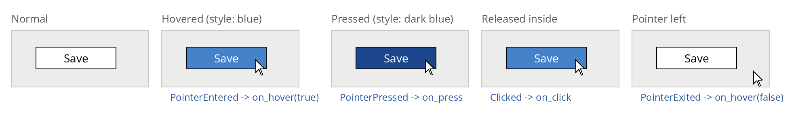

**A drop target in its drag-over state**

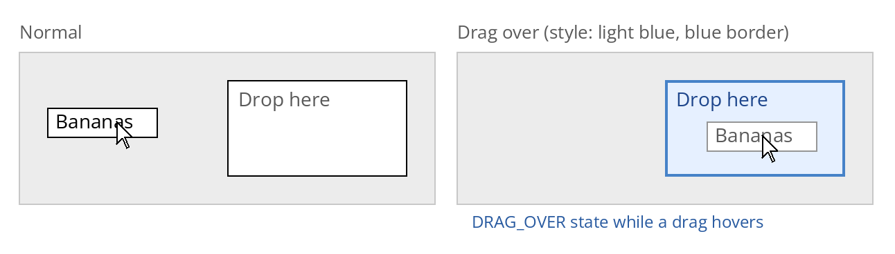

#### Events and callbacks

| Event emitted | When | Application callback |
|---|---|---|
| `PointerEntered / PointerExited { id }` | Pointer moves in or out (hover state) | `on_hover(id, ..)` |
| `PointerPressed / PointerReleased { id }` | Mouse button down / up on the widget (pressed state) | `on_press(id, ..)`, `on_release(id, ..)` |

Like every widget, it can also receive application-defined custom events in `handle_event` and emit its own (1.13 (#78)).

**Acceptance Criteria.**

- `StateStyle` and `Appearance` on every widget with fallback to normal and built-in defaults
- Hover, press/release, focus, disabled, checked, and drag-over switch the effective style automatically
- Default look unchanged (golden images identical)
- Repaint only when the effective style changes
- Stored in form files

**Parallelism / Dependencies.** Not parallelizable. Requires 1.1 (#19), 9.1 (#93).

**Technical Stack.** Rust

**Documentation.** Docusaurus page: `pushrod-docs/docs/concepts/per-state-appearance.md` ("Per-state appearance", Concepts, new). Guides: 'Appearance and states' section. Rustdoc: `StateStyle`, `Appearance`, `Widget::style`. Examples: Example: hover color on a button. Screenshots: Gallery tile per state.

**Sources.** [GEM AES object structure (flags, states, object tree)](https://www.seasip.info/Gem/aestruct.html)

### 1.18 (#111): Text layout engine: Parley for shaping, bidi, line breaking, and font fallback (with an SDL2 compatibility gate)

**Problem Statement.** SDL_ttf renders strings but doesn't handle complex scripts, right-to-left text, proper line breaking, font fallback for missing glyphs, or the caret and selection geometry that text fields need. Writing that ourselves would be a large, error-prone project; the ecosystem has converged on shared solutions.

**Solution / Scope.** Use Parley for layout only: it computes glyph positions, line breaks, bidi, and font fallback, and provides caret and selection geometry; it does not draw. Pushrod keeps drawing: each glyph from Parley's glyph runs is rasterized once (with swash) into a CPU bitmap, uploaded into the SDL2 glyph-atlas texture (1.7 (#3)), and drawn by copying atlas rectangles with color modulation, so the GPU-first design is unchanged and steady-state text drawing does no CPU rasterization. **Compatibility gate (first step):** a spike in `examples/parley_spike.rs` renders labels and a text field through Parley → glyph bitmap → SDL2 atlas texture. It must show (a) no per-frame CPU rasterization after warm-up, (b) the same texture/blit path as other widgets, and (c) acceptable binary size and startup time. If the spike fails, Parley stays behind an off-by-default `parley` Cargo feature and the default `TextLayout` remains SDL_ttf-based until it passes. Text layouts are cached per widget and recomputed only when text, font, or width changes, and they supply size hints to layout managers (5.5 (#116)). The `TextLayout` trait allows Cosmic Text or a bitmap-font layout (vintage targets, 10.4 (#108); Parley can also build without std via its `libm` feature).

**Acceptance Criteria.**

- Spike passes the compatibility gate (or Parley is feature-gated off by default with the reason recorded in the issue)
- Glyphs rasterized once into the SDL2 atlas; steady-state drawing is texture copies only
- RTL, CJK, and emoji fallback render correctly; caret/selection geometry drives text fields
- Layouts cached; recomputed only on text/font/width change; provide size hints
- `TextLayout` trait with Parley as default once the gate passes

**Parallelism / Dependencies.** Not parallelizable. Requires 10.2 (#106).

**Technical Stack.** Rust, Parley (new dependency), SDL2 render API

**Documentation.** Docusaurus page: `pushrod-docs/docs/concepts/text.md` ("Text", Concepts, new). Guides: 'Text' section. Rustdoc: `TextLayout`, layout caching. Examples: International text sample in the gallery. Screenshots: Gallery tile.

**Sources.** [Raph Levien, "Advice for the Next 100 Rust GUIs" (Linebender blog, 2026)](https://linebender.org/blog/next-100-guis/); [Parley (Linebender): rich text layout library](https://github.com/linebender/parley)

### 1.19 (#112): Input method (IME) support: composition text and candidate window

**Problem Statement.** Chinese, Japanese, and Korean users type through an input method: keystrokes produce composition (pre-edit) text that is shown underlined until committed, and the platform shows a candidate list near the caret. Without this, text fields are unusable for a large share of users.

**Solution / Scope.** Handle SDL's text-editing events: show composition text inline at the caret with an underline (and the IME's own cursor/selection within it), replace it on each update, and insert it on commit (`TextEntered`). Report the caret rectangle with SDL's text-input rectangle so the platform candidate window appears next to the caret. Emit `CompositionStarted/Updated/Ended` engine events (9.10 (#109)). Works for single-line fields and the text area.

#### Look and behavior (proposed)

Each image shows the widget step by step, drawn in Pushrod's current style; blue notes name the event emitted. Mockups come from [`docs/mockups/generate.py`](https://github.com/KenSuenobu/rust-pushrod/blob/main/docs/mockups/generate.py): edit a frame there and re-run it to change the design, and update this section.

**Composing Japanese in a text field**


#### Events and callbacks

| Event emitted | When | Application callback |
|---|---|---|
| `Engine(CompositionStarted / CompositionUpdated / CompositionEnded)` | Input method composition begins, changes, or ends | `on_engine_event(..)` |
| `TextChanged { id }` | Only when the composition is committed | `on_text_change(id, ..)` |

Like every widget, it can also receive application-defined custom events in `handle_event` and emit its own (1.13 (#78)).

**Acceptance Criteria.**

- Japanese and Chinese input methods compose and commit correctly in a text field
- Candidate window appears at the caret and follows it
- Composition never fires `TextChanged` until committed

**Parallelism / Dependencies.** Not parallelizable. Requires 1.4 (#20), 1.18 (#111).

**Technical Stack.** Rust, SDL2 text input/editing events

**Documentation.** Docusaurus page: `pushrod-docs/docs/guides/text-input-and-ime.md` ("Text Input and IME", Guides, new). Guides: 'Text input' section. Rustdoc: IME behavior in text widget docs. Examples: Gallery field tested with an IME. Screenshots: Gallery tile.

**Sources.** [Raph Levien, "Advice for the Next 100 Rust GUIs" (Linebender blog, 2026)](https://linebender.org/blog/next-100-guis/)

### 1.20 (#113): Layers and invalidation: cache hints, texture memory budget, incremental pipeline

**Problem Statement.** Pushrod gives every widget its own texture. Cached layers avoid re-rendering unchanged content, but they cost GPU memory, and too many small layers can be slower than drawing into a parent. A toolkit is at heart an incremental computation engine: work should be redone only at the level that changed.

**Solution / Scope.** Add `CacheHint { Own, Parent, Auto }` per widget: `Own` keeps a texture (a repaint boundary), `Parent` paints into the nearest ancestor's texture, `Auto` uses heuristics (size, repaint frequency, child count). A texture memory budget with LRU eviction frees textures of hidden or rarely changing widgets. Split invalidation into three levels: layout (size/position or text layout changed), paint (appearance changed), and composite (only position or visibility changed, so no repaint, just a re-blit). Report texture memory in benchmarks (7.7 (#115)).

**Acceptance Criteria.**

- Cache hints honored; Auto measurably reduces texture count on the gallery
- Memory budget enforced with eviction
- Moving a widget re-composites without repainting
- Golden images unchanged

**Parallelism / Dependencies.** Parallelizable. Requires 10.2 (#106), 7.7 (#115).

**Technical Stack.** Rust, SDL2

**Documentation.** Docusaurus page: `pushrod-docs/docs/concepts/layers-and-invalidation.md` ("Layers and invalidation", Concepts, new). Guides: 'Performance' section. Rustdoc: `CacheHint`, invalidation levels. Examples: n/a. Screenshots: n/a.

**Sources.** [Raph Levien, "Advice for the Next 100 Rust GUIs" (Linebender blog, 2026)](https://linebender.org/blog/next-100-guis/)

### 1.21 (#130): Split the standard widgets into the pushrod-widgets crate

**Problem Statement.** With the widgets inside the core crate, the core and the look are tied together. Anyone wanting a different look (shadows, gradients) or specialized widgets (tree view, graph view, 3D container) would have to change Pushrod itself.

**Solution / Scope.** A Cargo workspace with two crates. **`pushrod`** (the core, repository root): engine, widget tree and IDs, events and callbacks, `paint` helpers, texture and font caches, and shared widget behavior. Its only widget is `RootWidget`, the window's ID-0 background, so the engine doesn't depend on any widget library; `Engine::set_background(color)` recolors it. **`pushrod-widgets`** (`pushrod-widgets/`): the standard KISS widget set (`BaseWidget`, `BoxWidget`, `TextWidget`, `ButtonWidget` today; every widget in this roadmap's widget epics lands here). It depends on `pushrod` and uses only its public API, so the crate boundary itself guarantees another library can do anything it does. The example and the widget tests move with the widgets; the core keeps tests that need no widgets. Both crates are versioned and published together (7.5 (#73)).

**Acceptance Criteria.**

- `cargo test --workspace`, clippy, and docs pass
- The core builds and runs with no widget crate (root widget only)
- `pushrod-widgets` uses only public core API
- Docs, README, and examples show both dependencies

**Parallelism / Dependencies.** Not parallelizable. Requires PR #10. Do before the widget epics, so new widgets land in `pushrod-widgets`.

**Technical Stack.** Rust, Cargo workspace

**Documentation.** Docusaurus page: `pushrod-docs/docs/getting-started/installation.md` ("Installation", Getting started, update). Guides: update the guide or concept page covering: installation (two crates), Widget libraries. Rustdoc: crate-level docs for both crates; `RootWidget`, `Engine::set_background`. Examples: `cargo run -p pushrod-widgets --example base`. Screenshots: n/a.

### 1.22 (#131): Widget libraries: extend or replace pushrod-widgets

**Problem Statement.** pushrod-widgets is deliberately plain. Applications that want drop shadows, gradients, or rounded corners, or specialized widgets such as a tree view, a graph view, or a 3D container, need a supported way to build them without forking Pushrod, and forms designed in Chassis need to load them.

**Solution / Scope.** **Extending:** a crate depends on `pushrod` (and `pushrod-widgets` if it reuses or wraps standard widgets) and defines new widgets; they share the tree, IDs, events, callbacks, and shared behavior with every other widget. **Replacing:** a crate depends on `pushrod` alone and supplies its own widget set, drawing however it likes into each widget's texture. **Registration (forms and Chassis):** each library exposes `register(&mut WidgetRegistry)` (6.1 (#60)) under its own type-name prefix (`pushrod.button`, `acme.tree_view`). A replacement library may register the standard type names (`pushrod.button`, ...) so existing form files load with its look, without changing the forms. **Rules:** pushrod-widgets uses only public core API (enforced by the crate boundary); anything a library needs that the core doesn't expose is a core issue. **Example:** `examples/widget-library/`, a small crate that adds one new widget and one restyled replacement of a standard widget (deliberately outside pushrod-widgets, so it can break the KISS rules there), with a test that loads a form using it.

**Acceptance Criteria.**

- A separate crate adds a widget that works with IDs, events, callbacks, and focus like a standard one
- A replacement library registers standard type names and a form loads with its look
- Docs page explains extending and replacing

**Parallelism / Dependencies.** Parallelizable. Requires 1.21 (#130), 6.1 (#60).

**Technical Stack.** Rust

**Documentation.** Docusaurus page: `pushrod-docs/docs/concepts/widget-libraries.md` ("Widget libraries", Concepts, update). Guides: update the guide or concept page covering: Widget libraries. Rustdoc: `WidgetRegistry` registration per library. Examples: `examples/widget-library/`. Screenshots: n/a.

### 1.23 (#136): Public API polish before publishing: builders, prelude, and stability

**Problem Statement.** Constructors take many positional arguments (`ButtonWidget::new` takes nine), and every new event or option would be a breaking change. With two crates and third-party widget libraries, the core's public API is a contract.

**Solution / Scope.** **Construction:** short constructors with sensible defaults plus chained setters (`Button::new("OK").at(20, 60).size(120, 24)`), or a builder where a widget has many options; the default font, colors, and size come from the engine (1.24 (#137)). **Names:** decide once whether widget types keep the `Widget` suffix (`ButtonWidget`) or drop it (`Button`), and apply it across the crates and the roadmap. **Stability:** `#[non_exhaustive]` on public enums (events, keys) and option structs; `#[must_use]` where results matter; `Debug` on public types. **Preludes:** `pushrod::prelude` and `pushrod_widgets::prelude` export what applications normally use. **Policy:** semantic versioning; after the first release, `cargo-semver-checks` runs in CI.

**Acceptance Criteria.**

- No public constructor needs more than three required arguments
- Public enums are `#[non_exhaustive]`
- Quick start uses the preludes
- Naming decision recorded in the roadmap's Naming section

**Parallelism / Dependencies.** Parallelizable. Requires 1.21 (#130), 9.1 (#93), 1.24 (#137), 1.25 (#138).

**Technical Stack.** Rust

**Documentation.** Docusaurus page: `pushrod-docs/docs/guides/creating-an-application.md` ("Creating an application", Guides, update). Guides: update the guide or concept page covering: quick start, creating an application, every widget page's Creating it section. Rustdoc: constructors, builders, preludes. Examples: all examples updated. Screenshots: n/a.

### 1.24 (#137): Fonts: shared font handles and a built-in default font

**Problem Statement.** Every text widget takes a font file path, size, and style, so applications repeat them everywhere and the quick start fails unless it runs from a directory containing `assets/`.

**Solution / Scope.** A `Font { family, size, style }` handle, cheap to clone, resolved by the font cache (1.7 (#3)). Fonts are registered once (`engine.fonts().load("Body", path)` or from bytes). The core embeds one default font (an OFL-licensed sans serif, with its license file) so `Font::default()` works with no files at all; applications can change the default. Widgets use the engine's default font unless given one.

**Acceptance Criteria.**

- Quick start runs from any directory with no font files
- Widgets accept a `Font` handle; no file paths in widget constructors
- Embedded font's license included and noted in the docs

**Parallelism / Dependencies.** Parallelizable. Requires 1.7 (#3).

**Technical Stack.** Rust

**Documentation.** Docusaurus page: `pushrod-docs/docs/concepts/text-and-fonts.md` ("Text and fonts", Concepts, new). Guides: update the guide or concept page covering: a new Text and fonts page, quick start. Rustdoc: `Font`, `FontCache::load`, default font. Examples: examples drop font paths. Screenshots: n/a.

### 1.25 (#138): Errors: return Result instead of panicking

**Problem Statement.** Library code calls `unwrap()` on font loading, texture creation, and SDL initialization, so a missing file or driver problem crashes the application instead of letting it recover or report the problem.

**Solution / Scope.** A `pushrod::Error` enum (backend initialization, font, image, texture, unknown widget ID, form file) implementing `std::error::Error`, and `Result` on every fallible public function. No `unwrap`/`expect` in library code except documented invariants, enforced with `clippy::unwrap_used` and `clippy::expect_used` outside tests. Errors that happen inside the event loop are reported through an `Error` engine event (9.10 (#109)) rather than a panic.

**Acceptance Criteria.**

- No `unwrap`/`expect` in library code (lints enforced)
- Missing font or image returns an error, not a panic
- Error event delivered for failures during the run loop

**Parallelism / Dependencies.** Parallelizable. Requires 9.10 (#109).

**Technical Stack.** Rust

**Documentation.** Docusaurus page: `pushrod-docs/docs/guides/creating-an-application.md` ("Creating an application", Guides, update). Guides: update the guide or concept page covering: a new Errors section in creating an application. Rustdoc: `pushrod::Error`, fallible functions. Examples: examples handle errors with `?`. Screenshots: n/a.

## Epic 2: Core dialog widgets (#12)

The widgets every dialog needs: labels, buttons, check boxes, radio groups, text fields, images, alerts, menus, tooltips, toolbars, and more.

**Problem.** Pushrod has four widgets (base, box, text, button). Real dialogs need the rest of the everyday vocabulary that every desktop system, from GEM and the classic Mac to Qt and GTK, converged on.

**Scope.** Implement the everyday dialog widgets, each composed from `paint` helpers and drawn in Pushrod's current flat style. Ideas come from GEM, classic Mac OS, AmigaOS, Motif, NeXTSTEP, Qt, GTK, Windows, and Haiku; names are Pushrod's own.

**Dependencies.** Needs behavior flags (1.1 (#19)) and callbacks (1.6 (#22)); text entry needs focus (1.4 (#20)). Simple widgets (2.1 (#27), 2.7 (#33), 2.10 (#36), 2.14 (#83)) can start right after #10.

| Issue | Title | Summary | Labels | Parallel | MVP | Complexity | Affected modules |
|---|---|---|---|---|---|---|---|
| 2.1 (#27) | Boxed label widget | Text with background and border. | `good first issue`, `mvp`, `parallelizable`, `size/S`, `widget` | Y | v0.1 | S | `pushrod-widgets/src/boxed_label.rs (new)` |
| 2.2 (#28) | Glyph button (small single-character button) | A small box with an arrow or symbol, used for scroll arrows, close boxes, and spin buttons. | `mvp`, `parallelizable`, `size/S`, `widget` | Y | v0.1 | S | `pushrod-widgets/src/glyph_button.rs (new)` |
| 2.3 (#29) | Button behaviors: default, cancel, toggle, activate-on-press, dismiss dialog | A push button that runs an action when clicked; it can also be a dialog's default or cancel button, a toggle, or a button that closes a dialog. | `enhancement`, `mvp`, `size/S`, `usability`, `widget` | N | v0.1 | S | `pushrod-widgets/src/button_widget.rs`, `src/paint.rs` |
| 2.4 (#30) | Check box with indeterminate state | Box with a check mark and label; toggles checked; optional mixed state. | `chassis`, `enhancement`, `mvp`, `parallelizable`, `size/S`, `widget` | Y | v0.1 | S | `pushrod-widgets/src/check_box.rs (new)` |
| 2.5 (#31) | Radio buttons and radio groups | One-of-many selection among sibling widgets. | `enhancement`, `mvp`, `parallelizable`, `size/S`, `widget` | Y | v0.1 | S | `pushrod-widgets/src/radio_button.rs (new)`, `src/cache.rs` |
| 2.6 (#32) | Text field: single-line entry with input masks, validation, and numeric mode | Single-line text entry with caret, selection, clipboard, input mask, validator, and numeric mode. | `chassis`, `enhancement`, `mvp`, `size/L`, `widget` | N | v0.1 | L | `pushrod-widgets/src/text_field.rs (new)`, `src/paint.rs` |
| 2.7 (#33) | Image widget | Display a PNG/BMP image centered, stretched, scaled to fit, or tiled. | `chassis`, `enhancement`, `mvp`, `parallelizable`, `size/S`, `widget` | Y | v0.1 | S | `pushrod-widgets/src/image_widget.rs (new)`, `src/texture.rs` |
| 2.8 (#34) | Icon widget (picture with caption) | Picture with a caption, selectable and double-clickable, like desktop icons. | `chassis`, `enhancement`, `parallelizable`, `size/S`, `widget` | Y | N | S | `pushrod-widgets/src/icon_widget.rs (new)` |
| 2.9 (#35) | Alert dialog | One-call modal alert with icon, message, and up to three buttons. | `enhancement`, `forms`, `mvp`, `size/M`, `widget` | N | v0.1 | M | `pushrod-widgets/src/alert.rs (new)`, `src/engine.rs` |
| 2.10 (#36) | Custom paint widget (closure-drawn) | One-off custom drawing without writing a widget struct. | `enhancement`, `good first issue`, `mvp`, `parallelizable`, `size/S`, `widget` | Y | v0.1 | S | `pushrod-widgets/src/custom_paint.rs (new)` |
| 2.11 (#37) | Menu bar and drop-down menus (drawn by Pushrod) | Menu bar with drop-down menus, separators, check marks, submenus, shortcuts, and mnemonics. | `chassis`, `enhancement`, `parallelizable`, `size/L`, `widget` | Y | N | L | `pushrod-widgets/src/menu.rs (new)`, `src/cache.rs`, `src/engine.rs` |
| 2.12 (#38) | File chooser dialog (drawn by Pushrod) | Choose a file or directory with a consistent look on every platform. | `chassis`, `enhancement`, `forms`, `parallelizable`, `size/L`, `widget` | Y | N | L | `pushrod-widgets/src/file_chooser.rs (new)` |
| 2.13 (#77) | Tooltips | Short help text shown after the pointer rests on a widget. | `enhancement`, `parallelizable`, `size/S`, `usability`, `widget` | Y | N | S | `src/cache.rs`, `pushrod-widgets/src/tooltip.rs (new)` |
| 2.14 (#83) | Separator line | Horizontal or vertical divider line. | `good first issue`, `mvp`, `parallelizable`, `size/S`, `widget` | Y | v0.1 | S | `pushrod-widgets/src/separator.rs (new)` |
| 2.15 (#84) | Toolbar | A row of icon/text buttons bound to actions. | `chassis`, `enhancement`, `parallelizable`, `size/M`, `widget` | Y | N | M | `pushrod-widgets/src/toolbar.rs (new)` |
| 2.16 (#85) | Status bar | A strip at the bottom of the window for messages and status fields. | `chassis`, `enhancement`, `parallelizable`, `size/S`, `widget` | Y | N | S | `pushrod-widgets/src/status_bar.rs (new)` |
| 2.17 (#86) | Switch (on/off slide toggle) | A sliding on/off switch for settings that take effect immediately. | `enhancement`, `parallelizable`, `size/S`, `widget` | Y | N | S | `pushrod-widgets/src/switch.rs (new)` |
| 2.18 (#87) | Multi-line text area | Multi-line plain-text editing with scrolling, selection, clipboard, and undo. | `enhancement`, `size/L`, `widget` | N | N | L | `pushrod-widgets/src/text_area.rs (new)` |
| 2.19 (#88) | Context menus | Right-click (or long-press) pop-up menus for a widget. | `chassis`, `enhancement`, `parallelizable`, `size/S`, `usability`, `widget` | Y | N | S | `pushrod-widgets/src/menu.rs`, `src/cache.rs` |
| 2.20 (#89) | Message bar (non-modal inline notice) | A dismissible banner for warnings and information that doesn't block the window. | `enhancement`, `parallelizable`, `size/S`, `usability`, `widget` | Y | N | S | `pushrod-widgets/src/message_bar.rs (new)` |
| 2.21 (#125) | Image button | A button that shows an image, or an image with a text label, with the full button behavior. | `enhancement`, `parallelizable`, `size/S`, `widget` | Y | N | S | `pushrod-widgets/src/image_button.rs (new)` |
| 2.22 (#126) | Link label | Clickable text that looks like a link and opens a URL or runs a callback. | `enhancement`, `parallelizable`, `size/S`, `usability`, `widget` | Y | N | S | `pushrod-widgets/src/link_label.rs (new)` |

### 2.1 (#27): Boxed label widget

Text with background and border. **Widget roadmap:** [`docs/widgets/boxed-label.md`](widgets/boxed-label.md) (look, behavior, events, acceptance criteria).

**Dependencies.** Requires PR #10.

### 2.2 (#28): Glyph button (small single-character button)

A small box with an arrow or symbol, used for scroll arrows, close boxes, and spin buttons. **Widget roadmap:** [`docs/widgets/glyph-button.md`](widgets/glyph-button.md) (look, behavior, events, acceptance criteria).

**Dependencies.** Requires 1.1 (#19), 1.5 (#21).

### 2.3 (#29): Button behaviors: default, cancel, toggle, activate-on-press, dismiss dialog

A push button that runs an action when clicked; it can also be a dialog's default or cancel button, a toggle, or a button that closes a dialog. **Widget roadmap:** [`docs/widgets/button.md`](widgets/button.md) (look, behavior, events, acceptance criteria).

**Dependencies.** Requires 1.1 (#19), 1.6 (#22).

### 2.4 (#30): Check box with indeterminate state

Box with a check mark and label; toggles checked; optional mixed state. **Widget roadmap:** [`docs/widgets/check-box.md`](widgets/check-box.md) (look, behavior, events, acceptance criteria).

**Dependencies.** Requires 1.1 (#19), 1.6 (#22).

### 2.5 (#31): Radio buttons and radio groups

One-of-many selection among sibling widgets. **Widget roadmap:** [`docs/widgets/radio-button.md`](widgets/radio-button.md) (look, behavior, events, acceptance criteria).

**Dependencies.** Requires 1.1 (#19), 1.6 (#22).

### 2.6 (#32): Text field: single-line entry with input masks, validation, and numeric mode

Single-line text entry with caret, selection, clipboard, input mask, validator, and numeric mode. **Widget roadmap:** [`docs/widgets/text-field.md`](widgets/text-field.md) (look, behavior, events, acceptance criteria).

**Dependencies.** Requires 1.4 (#20), 1.5 (#21), 1.6 (#22). Pairs with 1.19 (#112) (input-method composition arrives in v0.2; plain typing works in v0.1).

### 2.7 (#33): Image widget

Display a PNG/BMP image centered, stretched, scaled to fit, or tiled. **Widget roadmap:** [`docs/widgets/image.md`](widgets/image.md) (look, behavior, events, acceptance criteria).

**Dependencies.** Requires PR #10.

### 2.8 (#34): Icon widget (picture with caption)

Picture with a caption, selectable and double-clickable, like desktop icons. **Widget roadmap:** [`docs/widgets/icon.md`](widgets/icon.md) (look, behavior, events, acceptance criteria).

**Dependencies.** Requires 1.6 (#22), 2.7 (#33).

### 2.9 (#35): Alert dialog

One-call modal alert with icon, message, and up to three buttons. **Widget roadmap:** [`docs/widgets/alert.md`](widgets/alert.md) (look, behavior, events, acceptance criteria).

**Dependencies.** Requires 2.3 (#29), 6.7 (#66), 5.2 (#57).

### 2.10 (#36): Custom paint widget (closure-drawn)

One-off custom drawing without writing a widget struct. **Widget roadmap:** [`docs/widgets/custom-paint.md`](widgets/custom-paint.md) (look, behavior, events, acceptance criteria).

**Dependencies.** Requires PR #10.

### 2.11 (#37): Menu bar and drop-down menus (drawn by Pushrod)

Menu bar with drop-down menus, separators, check marks, submenus, shortcuts, and mnemonics. **Widget roadmap:** [`docs/widgets/menu-bar-and-menus.md`](widgets/menu-bar-and-menus.md) (look, behavior, events, acceptance criteria).

**Dependencies.** Requires 1.1 (#19), 1.12 (#76), 5.1 (#56), 5.2 (#57), 9.5 (#97).

### 2.12 (#38): File chooser dialog (drawn by Pushrod)

Choose a file or directory with a consistent look on every platform. **Widget roadmap:** [`docs/widgets/file-chooser.md`](widgets/file-chooser.md) (look, behavior, events, acceptance criteria).

**Dependencies.** Requires 2.6 (#32), 4.5 (#52), 6.7 (#66), 5.2 (#57).

### 2.13 (#77): Tooltips

Short help text shown after the pointer rests on a widget. **Widget roadmap:** [`docs/widgets/tooltip.md`](widgets/tooltip.md) (look, behavior, events, acceptance criteria).

**Dependencies.** Requires 1.5 (#21), 5.1 (#56).

### 2.14 (#83): Separator line

Horizontal or vertical divider line. **Widget roadmap:** [`docs/widgets/separator.md`](widgets/separator.md) (look, behavior, events, acceptance criteria).

**Dependencies.** Requires PR #10.

### 2.15 (#84): Toolbar

A row of icon/text buttons bound to actions. **Widget roadmap:** [`docs/widgets/toolbar.md`](widgets/toolbar.md) (look, behavior, events, acceptance criteria).

**Dependencies.** Requires 9.5 (#97), 5.2 (#57), 2.21 (#125).

### 2.16 (#85): Status bar

A strip at the bottom of the window for messages and status fields. **Widget roadmap:** [`docs/widgets/status-bar.md`](widgets/status-bar.md) (look, behavior, events, acceptance criteria).

**Dependencies.** Requires 1.5 (#21), 5.2 (#57).

### 2.17 (#86): Switch (on/off slide toggle)

A sliding on/off switch for settings that take effect immediately. **Widget roadmap:** [`docs/widgets/switch.md`](widgets/switch.md) (look, behavior, events, acceptance criteria).

**Dependencies.** Requires 1.1 (#19), 1.6 (#22).

### 2.18 (#87): Multi-line text area

Multi-line plain-text editing with scrolling, selection, clipboard, and undo. **Widget roadmap:** [`docs/widgets/text-area.md`](widgets/text-area.md) (look, behavior, events, acceptance criteria).

**Dependencies.** Requires 2.6 (#32), 5.3 (#58), 1.7 (#3).

### 2.19 (#88): Context menus

Right-click (or long-press) pop-up menus for a widget. **Widget roadmap:** [`docs/widgets/context-menu.md`](widgets/context-menu.md) (look, behavior, events, acceptance criteria).

**Dependencies.** Requires 2.11 (#37), 9.4 (#96).

### 2.20 (#89): Message bar (non-modal inline notice)

A dismissible banner for warnings and information that doesn't block the window. **Widget roadmap:** [`docs/widgets/message-bar.md`](widgets/message-bar.md) (look, behavior, events, acceptance criteria).

**Dependencies.** Requires 1.5 (#21), 2.3 (#29), 5.2 (#57).

### 2.21 (#125): Image button

A button that shows an image, or an image with a text label, with the full button behavior. **Widget roadmap:** [`docs/widgets/image-button.md`](widgets/image-button.md) (look, behavior, events, acceptance criteria).

**Dependencies.** Requires 2.3 (#29), 2.7 (#33), 5.2 (#57).

### 2.22 (#126): Link label

Clickable text that looks like a link and opens a URL or runs a callback. **Widget roadmap:** [`docs/widgets/link-label.md`](widgets/link-label.md) (look, behavior, events, acceptance criteria).

**Dependencies.** Requires 1.4 (#20), 1.6 (#22).

## Epic 3: Value and choice controls (#13)

Scroll bar, slider, group box, choice button, expander, and date picker.

**Problem.** Picking a value from a range, scrolling, and choosing one of several options are needed everywhere. Older systems made applications build these by hand; later toolkits provide a small set of consistent controls.

**Scope.** Implement a small set of value and choice controls, using composite widgets (5.2 (#57)) where a control has parts. Value controls emit `ValueChanged` and are wired with `on_value_change`. Several more specialized controls were considered and parked.

**Dependencies.** Needs composite widgets (5.2 (#57)) for the scroll bar, and callbacks (1.6 (#22)). The slider (3.2 (#40)) and group box (3.3 (#41)) can start early.

| Issue | Title | Summary | Labels | Parallel | MVP | Complexity | Affected modules |
|---|---|---|---|---|---|---|---|
| 3.1 (#39) | Scroll bar | Vertical/horizontal scroll bar with arrows and a proportional thumb. | `enhancement`, `mvp`, `size/M`, `widget` | N | v0.1 | M | `pushrod-widgets/src/scroll_bar.rs (new)` |
| 3.2 (#40) | Slider | Horizontal/vertical slider with range, optional ticks, and value label. | `enhancement`, `mvp`, `parallelizable`, `size/S`, `widget` | Y | v0.1 | S | `pushrod-widgets/src/slider.rs (new)` |
| 3.3 (#41) | Group box (titled frame) | A frame with a title in its top border, grouping related controls. | `chassis`, `good first issue`, `mvp`, `parallelizable`, `size/S`, `widget` | Y | v0.1 | S | `pushrod-widgets/src/group_box.rs (new)` |
| 3.6 (#44) | Choice button: pop-up list and click-to-cycle modes | Pick one of several options compactly, as a pop-up list or a click-to-cycle button. | `chassis`, `enhancement`, `parallelizable`, `size/M`, `usability`, `widget` | Y | N | M | `pushrod-widgets/src/choice_button.rs (new)` |
| 3.7 (#45) | Column browser (multi-column hierarchical browser) | Columns of lists where selecting an item in one column fills the next, as in the NeXTSTEP browser and the Mac Finder's column view. | `enhancement`, `parallelizable`, `size/L`, `usability`, `widget` | Y | N | L | `pushrod-widgets/src/column_browser.rs (new)` |
| 3.9 (#47) | Split view (panes with draggable dividers) | Two or more panes side by side or stacked, separated by dividers the user drags to resize them. | `chassis`, `enhancement`, `layout`, `parallelizable`, `size/M`, `usability`, `widget` | Y | N | M | `pushrod-widgets/src/split_view.rs (new)` |
| 3.10 (#90) | Expander (collapsible section) | A titled section that shows or hides its contents when clicked. | `chassis`, `enhancement`, `parallelizable`, `size/S`, `usability`, `widget` | Y | N | S | `pushrod-widgets/src/expander.rs (new)` |
| 3.11 (#91) | Date picker | A date field with a drop-down month calendar. | `enhancement`, `parallelizable`, `size/M`, `widget` | Y | N | M | `pushrod-widgets/src/date_picker.rs (new)` |
| 3.12 (#127) | Dial (rotary knob) | A round control turned by dragging, the wheel, or the keyboard, for values like volume, pan, or angle. | `enhancement`, `parallelizable`, `size/S`, `widget` | Y | N | S | `pushrod-widgets/src/dial.rs (new)` |

### 3.1 (#39): Scroll bar

Vertical/horizontal scroll bar with arrows and a proportional thumb. **Widget roadmap:** [`docs/widgets/scroll-bar.md`](widgets/scroll-bar.md) (look, behavior, events, acceptance criteria).

**Dependencies.** Requires 1.5 (#21), 1.6 (#22), 2.2 (#28), 5.2 (#57).

### 3.2 (#40): Slider

Horizontal/vertical slider with range, optional ticks, and value label. **Widget roadmap:** [`docs/widgets/slider.md`](widgets/slider.md) (look, behavior, events, acceptance criteria).

**Dependencies.** Requires 1.6 (#22).

### 3.3 (#41): Group box (titled frame)

A frame with a title in its top border, grouping related controls. **Widget roadmap:** [`docs/widgets/group-box.md`](widgets/group-box.md) (look, behavior, events, acceptance criteria).

**Dependencies.** Requires PR #10.

### 3.6 (#44): Choice button: pop-up list and click-to-cycle modes

Pick one of several options compactly, as a pop-up list or a click-to-cycle button. **Widget roadmap:** [`docs/widgets/choice-button.md`](widgets/choice-button.md) (look, behavior, events, acceptance criteria).

**Dependencies.** Requires 1.6 (#22), 5.1 (#56), 5.2 (#57).

### 3.7 (#45): Column browser (multi-column hierarchical browser)

Columns of lists where selecting an item in one column fills the next, as in the NeXTSTEP browser and the Mac Finder's column view. **Widget roadmap:** [`docs/widgets/column-browser.md`](widgets/column-browser.md) (look, behavior, events, acceptance criteria).

**Dependencies.** Requires 4.5 (#52), 5.2 (#57), 5.3 (#58).

### 3.9 (#47): Split view (panes with draggable dividers)

Two or more panes side by side or stacked, separated by dividers the user drags to resize them. **Widget roadmap:** [`docs/widgets/split-view.md`](widgets/split-view.md) (look, behavior, events, acceptance criteria).

**Dependencies.** Requires 5.2 (#57), 5.5 (#116), 9.4 (#96).

### 3.10 (#90): Expander (collapsible section)

A titled section that shows or hides its contents when clicked. **Widget roadmap:** [`docs/widgets/expander.md`](widgets/expander.md) (look, behavior, events, acceptance criteria).

**Dependencies.** Requires 1.1 (#19), 5.4 (#59).

### 3.11 (#91): Date picker

A date field with a drop-down month calendar. **Widget roadmap:** [`docs/widgets/date-picker.md`](widgets/date-picker.md) (look, behavior, events, acceptance criteria).

**Dependencies.** Requires 2.6 (#32), 5.1 (#56), 5.2 (#57).

### 3.12 (#127): Dial (rotary knob)

A round control turned by dragging, the wheel, or the keyboard, for values like volume, pan, or angle. **Widget roadmap:** [`docs/widgets/dial.md`](widgets/dial.md) (look, behavior, events, acceptance criteria).

**Dependencies.** Requires 1.6 (#22), 9.4 (#96).

## Epic 4: Lists, tables, progress, spin boxes, and tabs (#14)

Progress bar, spin box, tab view, list view, table view, and combo box.

**Problem.** Everyday applications show progress, enter numbers, page settings into tabs, and browse lists and tables.

**Scope.** Implement the controls ordinary applications use constantly. Lists and tables share a data-source model and only paint visible rows.

**Dependencies.** Mostly post-MVP. The progress bar (4.1 (#48)) is MVP. Lists and tables need the scroll view (5.3 (#58)).

| Issue | Title | Summary | Labels | Parallel | MVP | Complexity | Affected modules |
|---|---|---|---|---|---|---|---|
| 4.1 (#48) | Progress bar | A bar showing how far along a task is; with no value it shows a busy animation (like HTML's progress element). | `good first issue`, `mvp`, `parallelizable`, `size/S`, `widget` | Y | v0.1 | S | `pushrod-widgets/src/progress_bar.rs (new)` |
| 4.2 (#49) | Spin box | Numeric field with up/down arrows, range, and step. | `enhancement`, `parallelizable`, `size/S`, `widget` | Y | N | S | `pushrod-widgets/src/spin_box.rs (new)` |
| 4.4 (#51) | Tab view | Tabs that switch between pages of controls. | `chassis`, `enhancement`, `layout`, `parallelizable`, `size/M`, `widget` | Y | N | M | `pushrod-widgets/src/tab_view.rs (new)` |
| 4.5 (#52) | List view | Scrolling list with single/multiple selection, backed by a data source. | `chassis`, `enhancement`, `size/L`, `widget` | N | N | L | `pushrod-widgets/src/list_view.rs (new)` |
| 4.6 (#53) | Combo box | Text field with a drop-down list of suggestions. | `enhancement`, `parallelizable`, `size/M`, `widget` | Y | N | M | `pushrod-widgets/src/combo_box.rs (new)` |
| 4.9 (#92) | Table view | Multi-column list with headers, column resizing, and sorting. | `chassis`, `enhancement`, `parallelizable`, `size/L`, `widget` | Y | N | L | `pushrod-widgets/src/table_view.rs (new)` |
| 4.10 (#128) | Busy spinner | A small animated indicator for work of unknown length, for use inline or on buttons. | `enhancement`, `parallelizable`, `size/S`, `usability`, `widget` | Y | N | S | `pushrod-widgets/src/spinner.rs (new)` |

### 4.1 (#48): Progress bar

A bar showing how far along a task is; with no value it shows a busy animation (like HTML's progress element). **Widget roadmap:** [`docs/widgets/progress-bar.md`](widgets/progress-bar.md) (look, behavior, events, acceptance criteria).

**Dependencies.** Requires 1.5 (#21).

### 4.2 (#49): Spin box

Numeric field with up/down arrows, range, and step. **Widget roadmap:** [`docs/widgets/spin-box.md`](widgets/spin-box.md) (look, behavior, events, acceptance criteria).

**Dependencies.** Requires 2.2 (#28), 2.6 (#32), 5.2 (#57).

### 4.4 (#51): Tab view

Tabs that switch between pages of controls. **Widget roadmap:** [`docs/widgets/tab-view.md`](widgets/tab-view.md) (look, behavior, events, acceptance criteria).

**Dependencies.** Requires 1.1 (#19), 5.2 (#57).

### 4.5 (#52): List view

Scrolling list with single/multiple selection, backed by a data source. **Widget roadmap:** [`docs/widgets/list-view.md`](widgets/list-view.md) (look, behavior, events, acceptance criteria).

**Dependencies.** Requires 1.6 (#22), 5.3 (#58), 5.2 (#57).

### 4.6 (#53): Combo box

Text field with a drop-down list of suggestions. **Widget roadmap:** [`docs/widgets/combo-box.md`](widgets/combo-box.md) (look, behavior, events, acceptance criteria).

**Dependencies.** Requires 2.6 (#32), 4.5 (#52), 5.1 (#56), 5.2 (#57).

### 4.9 (#92): Table view

Multi-column list with headers, column resizing, and sorting. **Widget roadmap:** [`docs/widgets/table-view.md`](widgets/table-view.md) (look, behavior, events, acceptance criteria).

**Dependencies.** Requires 4.5 (#52), 5.2 (#57).

### 4.10 (#128): Busy spinner

A small animated indicator for work of unknown length, for use inline or on buttons. **Widget roadmap:** [`docs/widgets/spinner.md`](widgets/spinner.md) (look, behavior, events, acceptance criteria).

**Dependencies.** Requires 1.5 (#21).

## Epic 5: Composition, clipping, and layout managers (#15)

Clip children to parents, composite widgets with retrievable parts, a scrollable Container with its own content area, autoresizing, and simple, extensible layout managers.

**Problem.** Children draw outside their parents, interactive widgets can't be reused as parts, and nothing adapts when a window or parent is resized. Classic systems (GEM, AmigaOS) had no layout managers: forms were fixed-size, and putting a resizable form in a window was very difficult. Modern applications expect forms that resize, adapt to different fonts and translations, and size themselves to their content.

**Scope.** Clip children, add composites with retrievable parts, a scroll view, and autoresizing for absolutely positioned forms. Add a small `Layout` trait with simple built-in managers (row and column, form, then grid, stack, and flow) that applications can extend with their own. Absolute positioning stays available: a container without a layout behaves exactly as today.

**Dependencies.** Clipping (5.1 (#56)) and composites (5.2 (#57)) are MVP and block the complex controls.

| Issue | Title | Summary | Labels | Parallel | MVP | Complexity | Affected modules |
|---|---|---|---|---|---|---|---|
| 5.1 (#56) | Clip children to their parent's bounds | Children never draw or receive input outside their parent. | `core`, `enhancement`, `layout`, `mvp`, `size/S` | N | v0.1 | S | `src/cache.rs` |
| 5.2 (#57) | Composite widgets: build widgets from parts that applications can retrieve and modify | A Composite trait whose parts (labels, buttons, icons, rows) are real widgets that applications can fetch, restyle, add, and remove. | `core`, `enhancement`, `layout`, `mvp`, `size/M`, `usability` | N | v0.1 | M | `src/widget.rs`, `src/cache.rs`, `src/composite.rs (new)` |
| 5.3 (#58) | Container: a scrollable viewport onto fixed-size content | A widget whose children live on a content area with its own size and 0,0 origin; the container's frame is a viewport panned by scroll bars. | `chassis`, `enhancement`, `layout`, `mvp`, `size/M`, `usability`, `widget` | N | v0.1 | M | `pushrod-widgets/src/container.rs (new)`, `src/cache.rs` |
| 5.4 (#59) | Autoresizing (keep margins or stretch on resize) | Children keep margins or stretch when their parent is resized. | `enhancement`, `layout`, `parallelizable`, `size/S` | Y | N | S | `src/widget.rs`, `src/cache.rs` |
| 5.5 (#116) | Layout manager foundation: Layout trait, size hints, measure and arrange | A small Layout trait any container can use; widgets report minimum, preferred, and maximum sizes; containers measure then arrange their children. | `chassis`, `core`, `enhancement`, `layout`, `mvp`, `size/M` | N | v0.1 | M | `layout/mod.rs (new)`, `src/widget.rs`, `src/cache.rs` |
| 5.6 (#117) | Row and column layouts | Arrange children in a horizontal row or vertical column with spacing, margins, alignment, and stretch. | `chassis`, `enhancement`, `layout`, `mvp`, `size/S` | N | v0.1 | S | `layout/linear.rs (new)` |
| 5.7 (#118) | Form layout: aligned label and field rows | Two-column 'Label: field' rows with labels aligned and fields stretching to the available width. | `chassis`, `enhancement`, `layout`, `mvp`, `size/S`, `usability` | N | v0.1 | S | `layout/form.rs (new)` |
| 5.8 (#119) | Grid layout | Rows and columns of cells with spans, per-row/column stretch, and alignment. | `enhancement`, `layout`, `parallelizable`, `size/M` | Y | N | M | `layout/grid.rs (new)` |
| 5.9 (#120) | Stack layout (one child visible at a time) | Children occupy the same area; one is shown at a time (pages, wizards, tab contents). | `enhancement`, `layout`, `parallelizable`, `size/S` | Y | N | S | `layout/stack.rs (new)` |
| 5.10 (#121) | Flow layout (wrapping rows) | Children placed left to right, wrapping to the next row when the width runs out. | `enhancement`, `layout`, `parallelizable`, `size/S` | Y | N | S | `layout/flow.rs (new)` |

### 5.1 (#56): Clip children to their parent's bounds

**Problem Statement.** A child partly outside its parent draws over neighbors and receives input outside the parent; containers need clipping.

**Solution / Scope.** Each widget's visible rectangle is its rectangle intersected with its ancestors'. Blits use cropped source/destination rectangles; hit testing uses the visible rectangle. Overlays (menus, tooltips, pop-ups) opt out.

**Acceptance Criteria.**

- Partly outside children are cropped
- Hit testing ignores cropped parts
- Golden test

**Parallelism / Dependencies.** Not parallelizable. Requires PR #10.

**Technical Stack.** Rust, SDL2 rects

**Documentation.** Docusaurus page: `pushrod-docs/docs/concepts/clip-children-to-their-parent-s-bounds.md` ("Clip children to their parent's bounds", Concepts, new). Guides: Tree section. Rustdoc: Draw/hit rules in `cache` docs. Examples: n/a. Screenshots: n/a.

### 5.2 (#57): Composite widgets: build widgets from parts that applications can retrieve and modify

**Problem Statement.** Complex controls (alert, scroll bar, spin box, combo box, menu, file chooser) are naturally made from simpler widgets. `paint` made drawing reusable, but interactive widgets can't yet be reused as parts of another widget. And because every widget that displays elements must be customizable, an application must be able to reach those elements: change the font or color of an alert's message, add a Help button to an alert, restyle one menu item, or recolor a scroll bar's thumb.

**Solution / Scope.** `Composite` trait: `build(&mut self, parts: &mut PartsBuilder)` runs when the widget is added and creates its parts as ordinary child widgets with their own IDs. **Parts are public, not hidden.** Every composite provides (1) `parts() -> Vec<(PartName, WidgetId)>` listing every part by a stable name (`"message"`, `"button:0"`, `"thumb"`), (2) `part(name) -> Option<WidgetId>`, and (3) typed accessors for its own structure (for example `AlertParts { icon, title, message, buttons: Vec<WidgetId> }`). Applications change parts through the normal API: `ui.get_mut::<TextWidget>(parts.message)?.set_font(..)`, `set_font_color`, `set_color`, `set_text`, any property (6.2 (#61)). Composites whose structure is a list (alert buttons, menu items, toolbar items, tabs, list columns) also provide `add_*`, `insert_*`, and `remove_*` methods that create or remove parts and re-lay them out (for example `alert.add_button("Help") -> WidgetId`). Part events reach the composite's `handle_part_event` first, so it can translate them (an arrow's `Clicked` into the scroll bar's `ValueChanged`); applications can also attach callbacks directly to a part's ID. Form files (6.5 (#64)) store a composite as its type plus part overrides (changed properties) and added or removed parts, so customizations survive save and load. Chassis selects a composite as one object and lets the user drill into its parts.

```text
Alert (composite, id 40)
 ├── icon     (ImageWidget, id 41)   "icon"
 ├── title    (TextWidget,  id 42)   "title"
 ├── message  (TextWidget,  id 43)   "message"   <- app: set_font(bold), set_font_color(..)
 ├── button 0 (ButtonWidget,id 44)   "button:0"  Delete
 ├── button 1 (ButtonWidget,id 45)   "button:1"  Cancel
 └── button 2 (ButtonWidget,id 46)   "button:2"  Help   <- app: alert.add_button("Help")
```

#### Look and behavior (proposed)

Each image shows the widget step by step, drawn in Pushrod's current style; blue notes name the event emitted. Mockups come from [`docs/mockups/generate.py`](https://github.com/KenSuenobu/rust-pushrod/blob/main/docs/mockups/generate.py): edit a frame there and re-run it to change the design, and update this section.

**An alert customized through its parts: bold red message, an extra Help button**

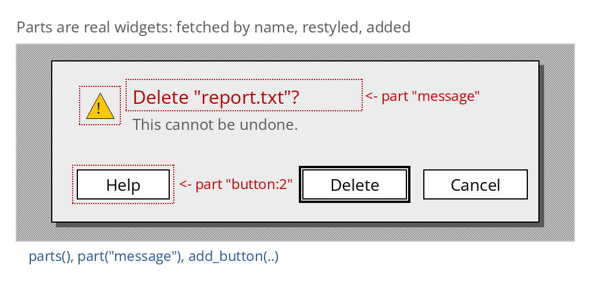

#### Events and callbacks

| Event emitted | When | Application callback |
|---|---|---|
| (part events) | A part emits an event; the composite may translate it | `on_click(part_id, ..)` on a part, or the composite's own callbacks |

Like every widget, it can also receive application-defined custom events in `handle_event` and emit its own (1.13 (#78)).

**Acceptance Criteria.**

- Composites create parts as ordinary widgets with IDs
- `parts()`, `part(name)`, and typed part accessors exist on every built-in composite
- Changing a part's font, color, or text through `ui.get_mut` repaints it
- List-structured composites support add/insert/remove of parts with automatic re-layout
- Composite translates part events; callbacks on part IDs also work
- Form round trip preserves part overrides and added/removed parts
- Scroll bar and alert built on it

**Parallelism / Dependencies.** Not parallelizable. Requires 1.6 (#22), 9.2 (#94).

**Technical Stack.** Rust

**Documentation.** Docusaurus page: `pushrod-docs/docs/guides/composite-widgets.md` ("Composite Widgets", Guides, new). Guides: 'Writing a composite widget' guide. Rustdoc: `composite` module. Examples: Composite example. Screenshots: n/a.

### 5.3 (#58): Container: a scrollable viewport onto fixed-size content

A widget whose children live on a content area with its own size and 0,0 origin; the container's frame is a viewport panned by scroll bars. **Widget roadmap:** [`docs/widgets/container.md`](widgets/container.md) (look, behavior, events, acceptance criteria).

**Dependencies.** Requires 3.1 (#39), 5.1 (#56), 5.2 (#57).

### 5.4 (#59): Autoresizing (keep margins or stretch on resize)

**Problem Statement.** Designed forms are absolutely positioned, which is simple, but nothing adapts when a window or pane is resized.

**Solution / Scope.** An `Anchors` setting on `WidgetCore` (left, right, top, bottom, plus stretch width/height), applied when the parent's size changes. Absolute positioning remains the default; no constraint solver. Sibling-relative attachments can be revisited only if real forms need them. Anchors apply to containers without a layout manager; containers with a layout (5.5 (#116)) are arranged by the layout instead.

**Acceptance Criteria.**

- Children follow their anchors on parent resize
- Stored in form files

**Parallelism / Dependencies.** Parallelizable. Requires PR #10.

**Technical Stack.** Rust

**Documentation.** Docusaurus page: `pushrod-docs/docs/concepts/autoresizing.md` ("Autoresizing", Concepts, new). Guides: Layout section. Rustdoc: `Anchors`. Examples: Resizable example. Screenshots: n/a.

**Sources.** [Motif reference: form attachments](https://man.archlinux.org/man/XmForm.3.en)

### 5.5 (#116): Layout manager foundation: Layout trait, size hints, measure and arrange

**Problem Statement.** Pushrod only supports absolute positions. Resizable windows, translated text of different lengths, user font sizes, and dialogs that size themselves to their content all need layout managers. Classic Atari and Amiga forms couldn't resize at all, which is a big part of why their dialogs felt rigid.

**Solution / Scope.** Add `SizeHint { min, preferred, max }` (each widget reports it; text widgets measure through the text layout, 1.18 (#111)) and a per-widget `LayoutParams { stretch, alignment, margin }`. Add `trait Layout { fn measure(&self, children: &[ChildInfo], available: Size) -> SizeHint; fn arrange(&self, children: &[ChildInfo], bounds: Rect) -> Vec<Rect>; }`; any container widget can hold `Option<Box<dyn Layout>>` (`set_layout`). Layout runs as its own invalidation level: changing a child's size hint, text, font, or visibility, or resizing the container, marks layout dirty up to the nearest container whose own size doesn't change; measure and arrange run once per frame before painting, and arrange only moves widgets (re-blit) unless their size changed. Without a layout, a container keeps absolute positioning and autoresizing (5.4 (#59)). Applications extend the system by implementing `Layout` for their own managers. Emits `Engine(LayoutChanged { container })` (9.10 (#109)).

```text
            measure (bottom-up)                   arrange (top-down)
window  <- SizeHint{min,pref,max} --   window  -- Rect --> 
  column <- hints of children --        column -- Rects for each child -->
    label   (text layout size)            label    (moved, re-blit only)
    field   (min width 120)               field    (resized -> repaint)
```

**Acceptance Criteria.**

- `SizeHint`, `LayoutParams`, and the `Layout` trait
- Containers with a layout are measured and arranged once per frame when dirty
- Layout invalidation stops at containers whose size doesn't change
- Moving without resizing doesn't repaint
- Absolute positioning unchanged when no layout is set
- An application-defined layout works

**Parallelism / Dependencies.** Not parallelizable. Requires 1.18 (#111), 9.10 (#109).

**Technical Stack.** Rust

**Documentation.** Docusaurus page: `pushrod-docs/docs/layouts/layouts-overview.md` ("Layouts Overview", Layouts, new). Guides: 'Layouts' section. Rustdoc: `layout` module, `Layout` trait, `SizeHint`. Examples: Custom layout example. Screenshots: n/a.

**Sources.** [Motif reference: form attachments](https://man.archlinux.org/man/XmForm.3.en)

### 5.6 (#117): Row and column layouts

**Problem Statement.** Most dialogs are rows and columns: a column of fields, a row of buttons aligned to the right.

**Solution / Scope.** `Row` and `Column` layouts with `spacing`, `margins`, cross-axis alignment, and per-child `stretch` (children with stretch share extra space proportionally; others keep their preferred size). A `Spacer` widget (`Spacer::stretch()`) pushes items apart, for example to right-align OK/Cancel. Children respect min/max sizes.

#### Look and behavior (proposed)

Each image shows the widget step by step, drawn in Pushrod's current style; blue notes name the event emitted. Mockups come from [`docs/mockups/generate.py`](https://github.com/KenSuenobu/rust-pushrod/blob/main/docs/mockups/generate.py): edit a frame there and re-run it to change the design, and update this section.

**A column of fields above a right-aligned button row, at two window widths**

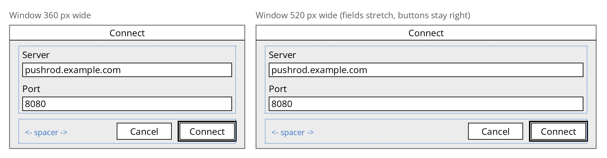

#### Events and callbacks

| Event emitted | When | Application callback |
|---|---|---|
| `Engine(LayoutChanged { container })` | Children re-arranged | `on_engine_event(..)` |

Like every widget, it can also receive application-defined custom events in `handle_event` and emit its own (1.13 (#78)).

**Acceptance Criteria.**

- Row and column with spacing, margins, alignment, stretch
- Spacer for right/bottom alignment
- Min/max respected while resizing

**Parallelism / Dependencies.** Not parallelizable. Requires 5.5 (#116).

**Technical Stack.** Rust

**Documentation.** Docusaurus page: `pushrod-docs/docs/layouts/row-and-column.md` ("Row and Column", Layouts, new). Guides: 'Layouts' section. Rustdoc: `Row`, `Column`, `Spacer`. Examples: Example dialog built with rows and columns. Screenshots: Gallery tile.

### 5.7 (#118): Form layout: aligned label and field rows

**Problem Statement.** Data-entry forms are label/field rows. Aligning labels by hand breaks when text is translated or fonts change.

**Solution / Scope.** `FormLayout::add_row(label, field)`: labels right- (Mac style) or left-aligned in a column sized to the widest label; fields stretch; optional full-width rows (check boxes, group boxes); rows wrap the label above the field when the form gets too narrow. Clicking a label focuses its field (works with mnemonics, 1.12 (#76)).

#### Look and behavior (proposed)

Each image shows the widget step by step, drawn in Pushrod's current style; blue notes name the event emitted. Mockups come from [`docs/mockups/generate.py`](https://github.com/KenSuenobu/rust-pushrod/blob/main/docs/mockups/generate.py): edit a frame there and re-run it to change the design, and update this section.

**Form layout: wide window, then narrow window (labels move above fields)**

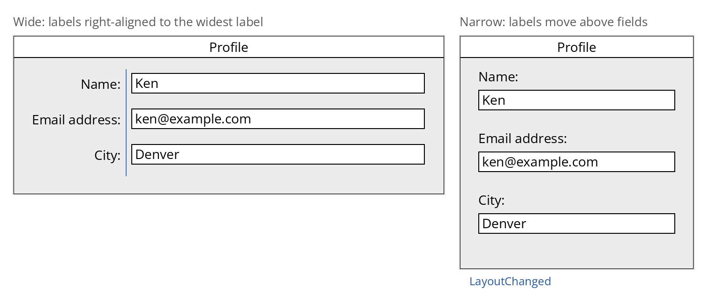

#### Events and callbacks

| Event emitted | When | Application callback |
|---|---|---|
| `Engine(LayoutChanged { container })` | Rows re-arranged | `on_engine_event(..)` |

Like every widget, it can also receive application-defined custom events in `handle_event` and emit its own (1.13 (#78)).

**Acceptance Criteria.**

- Labels align to the widest label
- Fields stretch with the window
- Narrow mode puts labels above fields
- Label click focuses its field

**Parallelism / Dependencies.** Not parallelizable. Requires 5.5 (#116).

**Technical Stack.** Rust

**Documentation.** Docusaurus page: `pushrod-docs/docs/layouts/form-layout.md` ("Form Layout", Layouts, new). Guides: 'Layouts' section. Rustdoc: `FormLayout`. Examples: Settings form example. Screenshots: Gallery tile.

### 5.8 (#119): Grid layout

**Problem Statement.** Calculator keypads, property sheets, and dashboards need cells aligned in both directions.

**Solution / Scope.** `Grid::place(child, row, col, row_span, col_span)` with per-row and per-column min sizes and stretch factors, spacing, and cell alignment.

#### Look and behavior (proposed)

Each image shows the widget step by step, drawn in Pushrod's current style; blue notes name the event emitted. Mockups come from [`docs/mockups/generate.py`](https://github.com/KenSuenobu/rust-pushrod/blob/main/docs/mockups/generate.py): edit a frame there and re-run it to change the design, and update this section.

**Grid with a spanning cell, at two window widths**

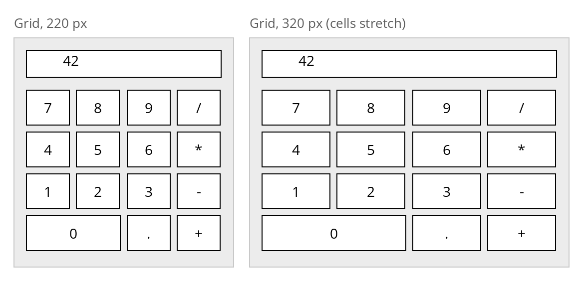

**Acceptance Criteria.**

- Spans, stretch, alignment, spacing
- Correct min/preferred sizes from cell hints

**Parallelism / Dependencies.** Parallelizable. Requires 5.5 (#116).

**Technical Stack.** Rust

**Documentation.** Docusaurus page: `pushrod-docs/docs/layouts/grid.md` ("Grid", Layouts, new). Guides: 'Layouts' section. Rustdoc: `Grid`. Examples: Calculator example. Screenshots: Gallery tile.

### 5.9 (#120): Stack layout (one child visible at a time)

**Problem Statement.** Tab views, wizards, and settings pages switch between pages in the same space.

**Solution / Scope.** `Stack` sized to its largest child (or the current one), showing one child; `set_current(index)` hides the others. Used by the tab view (4.4 (#51)).

**Acceptance Criteria.**

- Switching pages hides others and keeps their state
- Size policy: largest or current

**Parallelism / Dependencies.** Parallelizable. Requires 5.5 (#116).

**Technical Stack.** Rust

**Documentation.** Docusaurus page: `pushrod-docs/docs/layouts/stack.md` ("Stack", Layouts, new). Guides: 'Layouts' section. Rustdoc: `Stack`. Examples: Wizard example. Screenshots: n/a.

### 5.10 (#121): Flow layout (wrapping rows)

**Problem Statement.** Tag lists, icon views, and toolbars that wrap need content to reflow as the width changes.

**Solution / Scope.** `Flow` with horizontal and vertical spacing and row alignment; measure reports the height needed for a given width.

#### Look and behavior (proposed)

Each image shows the widget step by step, drawn in Pushrod's current style; blue notes name the event emitted. Mockups come from [`docs/mockups/generate.py`](https://github.com/KenSuenobu/rust-pushrod/blob/main/docs/mockups/generate.py): edit a frame there and re-run it to change the design, and update this section.

**Flow layout reflowing tags at two widths**

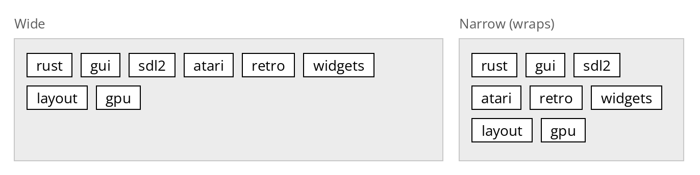

**Acceptance Criteria.**

- Reflows on resize
- Height-for-width measurement

**Parallelism / Dependencies.** Parallelizable. Requires 5.5 (#116).

**Technical Stack.** Rust

**Documentation.** Docusaurus page: `pushrod-docs/docs/layouts/flow.md` ("Flow", Layouts, new). Guides: 'Layouts' section. Rustdoc: `Flow`. Examples: Tag list example. Screenshots: Gallery tile.

## Epic 6: Forms and form files (foundation for Chassis) (#16)

Widget registry, property introspection, a binary form file format, loader and writer, generated ID constants, modal dialogs, named actions, and design-mode hooks.

**Problem.** Forms are built in code. The goal is to design a form visually, save it to a binary file, and load it at run time, so only callbacks are hand-written and they refer to widgets by ID. Every classic system converged on this idea (numbered objects in GEM resource files, numbered dialog items on the classic Mac, gadget IDs on the Amiga, tags in NeXTSTEP nib files). Chassis will be Pushrod's visual designer; Pushrod needs the runtime side first.

**Scope.** Add a widget registry, property introspection, a versioned binary form format, loader and writer, generated ID constants, modal dialogs, actions bound by name, and design-mode hooks for Chassis.

**Dependencies.** Needs behavior flags (1.1 (#19)) and the registry/properties (6.1 (#60), 6.2 (#61)) first; modal dialogs need focus (1.4 (#20)) and tree editing (1.8 (#23)). Chassis design mode (6.9 (#68)) is post-MVP.

| Issue | Title | Summary | Labels | Parallel | MVP | Complexity | Affected modules |
|---|---|---|---|---|---|---|---|
| 6.1 (#60) | Widget registry and factory | Create widgets by type name, the prerequisite for loading forms. | `chassis`, `core`, `enhancement`, `forms`, `mvp`, `size/S` | N | v0.2 | S | `src/registry.rs (new)` |
| 6.2 (#61) | Property introspection: list, get, and set widget properties by name | Each widget describes its properties for saving, loading, bindings, and the Chassis inspector. | `chassis`, `core`, `enhancement`, `forms`, `mvp`, `size/M` | N | v0.2 | M | `src/widget.rs`, `src/properties.rs (new)`, `pushrod-widgets (all widgets)` |
| 6.3 (#62) | Form file format (binary, versioned) | The binary file that stores forms: object table by ID, string and image pools, symbols. | `chassis`, `enhancement`, `forms`, `mvp`, `size/L` | N | v0.2 | L | `docs/FORM_FORMAT.md (new)`, `form/format.rs (new)` |
| 6.4 (#63) | Form loader: build a form from a file with stable IDs | Load a form and attach callbacks by ID or name. | `chassis`, `enhancement`, `forms`, `mvp`, `size/M` | N | v0.2 | M | `form/loader.rs (new)`, `src/engine.rs` |
| 6.5 (#64) | Form writer: save a widget subtree to a file | Serialize any subtree into the form format. | `chassis`, `enhancement`, `forms`, `mvp`, `parallelizable`, `size/M` | Y | v0.2 | M | `form/writer.rs (new)` |
| 6.6 (#65) | Generate ID constants from a form file | build.rs helper and CLI that emit Rust constants for named objects. | `chassis`, `enhancement`, `forms`, `mvp`, `parallelizable`, `size/S` | Y | v0.2 | S | `form/codegen.rs (new)` |
| 6.7 (#66) | Modal dialogs: run a form until a dismissing control is chosen | Open a form modally; the result is the ID of the control that dismissed it. | `core`, `enhancement`, `forms`, `mvp`, `size/M` | N | v0.1 | M | `src/engine.rs`, `src/cache.rs` |
| 6.8 (#67) | Bind actions by name from form files | Form files name the action a control triggers; applications register handlers by name. | `chassis`, `enhancement`, `forms`, `parallelizable`, `size/S` | Y | N | S | `src/engine.rs`, `form/loader.rs` |
| 6.9 (#68) | Design-mode hooks for Chassis | Select, move, resize, and edit widgets without triggering their behavior. | `chassis`, `enhancement`, `forms`, `parallelizable`, `size/L` | Y | N | L | `src/cache.rs`, `src/engine.rs`, `src/design.rs (new)` |
| 6.10 (#153) | Resource manager: load resource sets and get resources by ID | Load a resource file (from disk or embedded in the executable) and get its forms, strings, images, icons, files, menus, and alerts by ID. | `chassis`, `enhancement`, `forms`, `mvp`, `parallelizable`, `resources`, `size/M` | Y | v0.2 | M | `src/resource/mod.rs (new)`, `src/resource/set.rs (new)`, `src/engine.rs` |
| 6.11 (#154) | Resource kinds: strings, images, icons, files, menus, and alerts | Extend the resource file format beyond forms: string tables, images, icons, arbitrary files, menus, and alerts, each with a stable ID. | `chassis`, `enhancement`, `forms`, `mvp`, `parallelizable`, `resources`, `size/M` | Y | v0.2 | M | `src/form/format.rs`, `docs/FORM_FORMAT.md` |
| 6.12 (#155) | Typed resource IDs: generated constants per resource kind | Generate typed ID constants for every resource kind and for the widgets inside each form, so code refers to resources by name. | `chassis`, `codegen`, `enhancement`, `forms`, `mvp`, `parallelizable`, `resources`, `size/S` | Y | v0.2 | S | `src/resource/id.rs (new)`, `src/form/codegen.rs` |
| 6.13 (#156) | Event metadata in the widget registry | Each registered widget type declares the events it emits, its default event, and each event's payload, so tools like Chassis can list them. | `chassis`, `enhancement`, `events`, `forms`, `parallelizable`, `size/M` | Y | N | M | `src/registry.rs`, `pushrod-widgets (all widgets)` |

### 6.1 (#60): Widget registry and factory

**Problem Statement.** A form file stores 'a button with these properties'. Loading it needs to construct widgets from a type name, including application-defined widgets.

**Solution / Scope.** `WidgetRegistry` maps stable type names (`"pushrod.button"`) to constructors from properties. Each widget library registers its own types (`pushrod_widgets::register(&mut registry)` for the standard set); applications and other widget libraries (1.22 (#131)) register theirs. A library may re-register a standard type name to replace its look in existing forms. Chassis uses it for its palette.

**Acceptance Criteria.**

- All built-ins registered
- Custom widgets registrable
- Unknown names are errors, not panics

**Parallelism / Dependencies.** Not parallelizable. Requires PR #10.

**Technical Stack.** Rust

**Documentation.** Docusaurus page: `pushrod-docs/docs/forms/widget-registry-and-factory.md` ("Widget registry and factory", Forms, new). Guides: Forms section. Rustdoc: `registry` module. Examples: n/a. Screenshots: n/a.

### 6.2 (#61): Property introspection: list, get, and set widget properties by name

**Problem Statement.** Saving and loading forms, property bindings (9.6 (#98)), and Chassis's inspector need to enumerate and change properties without knowing the concrete type.

**Solution / Scope.** `Property { name, kind, value }` and trait methods `properties()` / `set_property(name, value)`; `WidgetCore` properties (origin, size, color, behavior, state, anchors, tooltip) come by default. Setting a property emits `PropertyChanged { id, name }` (used by bindings). Hand-written per widget; a derive macro can follow if boilerplate grows.

**Acceptance Criteria.**

- Every built-in lists and sets all properties
- Round-trip test
- `PropertyChanged` emitted on change

**Parallelism / Dependencies.** Not parallelizable. Requires 1.1 (#19), 6.1 (#60).

**Technical Stack.** Rust

**Documentation.** Docusaurus page: `pushrod-docs/docs/forms/property-introspection.md` ("Property introspection", Forms, new). Guides: Forms section. Rustdoc: `properties` module. Examples: n/a. Screenshots: n/a.

### 6.3 (#62): Form file format (binary, versioned)

**Problem Statement.** Designed forms must be stored compactly and loaded quickly, with programs referring to objects only by number, as every classic system did.

**Solution / Scope.** Header (magic `PRSC`, version, offsets); form table (name, root); object table (type, parent, first child, next sibling, origin, size, behavior, state, anchors, property offset); tag-length-value property blocks so new properties don't break old readers; string pool; image pool; symbol table (names for IDs and actions). Little-endian, std only. Specified in `docs/FORM_FORMAT.md`. Layouts are stored too: a container's layout kind and parameters, and each child's layout parameters (stretch, alignment, margins, grid cell).

```text
+---------------------------+
| Header  'PRSC' v1 offsets |
+---------------------------+
| Form table   name -> root |
+---------------------------+
| Object table (per widget) |
|  type, parent, child, next|
|  x, y, w, h, behavior,    |
|  state, anchors, props    |
+---------------------------+
| Property blocks (TLV)     |
| String pool | Image pool  |
| Symbols (ID and action    |
|   names)                  |
+---------------------------+
```

**Acceptance Criteria.**

- Spec merged
- Reader/writer with tests on hand-built bytes
- Unknown property tags skipped
- Versioned

**Parallelism / Dependencies.** Not parallelizable. Requires 6.1 (#60), 6.2 (#61).

**Technical Stack.** Rust (std only)

**Documentation.** Docusaurus page: `pushrod-docs/docs/forms/form-file-format.md` ("Form file format", Forms, new). Guides: Forms section linking the spec. Rustdoc: `form` module. Examples: n/a. Screenshots: n/a.

**Sources.** [GEM AES object structure (flags, states, object tree)](https://www.seasip.info/Gem/aestruct.html); [FreeMiNT AES docs: object tree fundamentals](https://freemint.github.io/tos.hyp/en/aes_fundamentals.html); [Shift Interface resource editor (Atari)](https://atariuptodate.de/en/1277/interface)

### 6.4 (#63): Form loader: build a form from a file with stable IDs

**Problem Statement.** The point of form files is that code doesn't rebuild the UI: the application loads the form and attaches callbacks.

**Solution / Scope.** `Engine::load_form(file, "main") -> FormHandle` creates widgets via the registry, applies properties, and maps form-local object numbers to `WidgetId`s (`form.id(main::OK)`). Emits its engine event (9.10 (#109)). Forms are mostly static: at load, precompute what can't change (text layouts of fixed labels, static textures) so the dynamic work at run time is only what the application actually changes. Forms are normally obtained through the resource manager (`resources.form(ids::forms::MAIN)`, 6.10 (#153)).

**Acceptance Criteria.**

- Loaded form renders identically to the code-built version (golden)
- IDs resolve via generated constants
- Errors name object and property
- Emits the corresponding `EngineEvent` (9.10 (#109))

**Parallelism / Dependencies.** Not parallelizable. Requires 6.3 (#62).

**Technical Stack.** Rust

**Documentation.** Docusaurus page: `pushrod-docs/docs/forms/loading-forms.md` ("Loading Forms", Forms, new). Guides: Forms quick start. Rustdoc: `load_form`, `FormHandle`. Examples: `examples/form.rs`. Screenshots: Form screenshot.

### 6.5 (#64): Form writer: save a widget subtree to a file

**Problem Statement.** Chassis must save designs, and tests need files produced from code-built forms.

**Solution / Scope.** `FormWriter::add_form(name, &cache, root)` + `write(path)`; skips composite parts; properties via introspection; deduplicates strings and images.

**Acceptance Criteria.**

- Round trip preserves properties and pixels
- Composite parts not written

**Parallelism / Dependencies.** Parallelizable. Requires 6.3 (#62).

**Technical Stack.** Rust

**Documentation.** Docusaurus page: `pushrod-docs/docs/forms/form-writer.md` ("Form writer", Forms, new). Guides: Forms section. Rustdoc: `FormWriter`. Examples: n/a. Screenshots: n/a.

### 6.6 (#65): Generate ID constants from a form file

**Problem Statement.** Callbacks attach by ID; names keep code readable, and renaming in the designer should break the build rather than silently attach to the wrong widget.

**Solution / Scope.** `pushrod::form::codegen::write_ids(file, out_rs)` for build.rs plus a small CLI; generates `pub mod main { pub const OK: FormIndex = FormIndex(5); }`. Extended to every resource kind, with typed IDs, by 6.12 (#155).

**Acceptance Criteria.**

- build.rs integration used by the form example
- Deterministic, rustfmt-clean output

**Parallelism / Dependencies.** Parallelizable. Requires 6.3 (#62), 6.4 (#63).

**Technical Stack.** Rust, build.rs

**Documentation.** Docusaurus page: `pushrod-docs/docs/forms/generate-id-constants-from-a-form-file.md` ("Generate ID constants from a form file", Forms, new). Guides: Forms quick start. Rustdoc: `form::codegen`. Examples: Example uses generated constants. Screenshots: n/a.

**Sources.** [Shift Interface resource editor (Atari)](https://atariuptodate.de/en/1277/interface)

### 6.7 (#66): Modal dialogs: run a form until a dismissing control is chosen

**Problem Statement.** Alerts, file choosers, and settings dialogs need modal behavior: input goes only to the dialog until it is dismissed.

**Solution / Scope.** `ui.open_modal(root, |state, ui, dismissed_by| ..)`. While open, input goes only to the modal subtree (the rest is drawn but inert), focus starts on the first focusable widget, Return/Escape map to default/cancel, and a `DISMISSES_DIALOG` control closes it. Modals nest. Emits its engine event (9.10 (#109)).

**Acceptance Criteria.**

- Input blocked outside the top modal
- Dismissing control reported
- Nested modals
- Emits the corresponding `EngineEvent` (9.10 (#109))

**Parallelism / Dependencies.** Not parallelizable. Requires 1.4 (#20), 1.8 (#23), 2.3 (#29).

**Technical Stack.** Rust

**Documentation.** Docusaurus page: `pushrod-docs/docs/forms/modal-dialogs.md` ("Modal dialogs", Forms, new). Guides: Dialogs section. Rustdoc: `Ui::open_modal`. Examples: Settings dialog example. Screenshots: Modal screenshot.

### 6.8 (#67): Bind actions by name from form files

**Problem Statement.** A designer should be able to connect a button to 'save' without code changes.

**Solution / Scope.** Any widget may carry an `action` name; loading a form binds it to the named action (9.5 (#97)). Unbound names are reported once.

**Acceptance Criteria.**

- Actions bind at load time
- Missing actions reported

**Parallelism / Dependencies.** Parallelizable. Requires 6.4 (#63), 9.5 (#97).

**Technical Stack.** Rust

**Documentation.** Docusaurus page: `pushrod-docs/docs/forms/bind-actions-by-name-from-form-files.md` ("Bind actions by name from form files", Forms, new). Guides: Forms section. Rustdoc: Action binding. Examples: Form example uses actions. Screenshots: n/a.

**Sources.** [Apple: Target-Action](https://developer.apple.com/library/archive/documentation/General/Devpedia-CocoaApp-MOSX/TargetAction.html)

### 6.9 (#68): Design-mode hooks for Chassis

**Problem Statement.** Chassis will be a drag-and-drop form designer built on Pushrod. It must hit-test every object, draw selection handles, and edit widgets without them reacting.

**Solution / Scope.** `DesignMode` on `WidgetCache`: an event filter (9.3 (#95)) intercepts all input; `design_hit` includes disabled widgets; an overlay draws handles and alignment guides; edits go through the undo stack (1.15 (#81)) and emit `DesignChanged`. Composite parts aren't separately selectable. The designer edits layouts as well: choose a container's layout, drag children between cells or rows, and edit spacing, stretch, and alignment.

**Acceptance Criteria.**

- No widget reacts in design mode
- Select/move/resize/reparent, undoable
- Back to run mode restores behavior

**Parallelism / Dependencies.** Parallelizable. Requires 1.8 (#23), 1.15 (#81), 5.2 (#57), 6.2 (#61), 9.3 (#95).

**Technical Stack.** Rust

**Documentation.** Docusaurus page: `pushrod-docs/docs/forms/design-mode-hooks-for-chassis.md` ("Design-mode hooks for Chassis", Forms, new). Guides: Chassis section. Rustdoc: `design` module. Examples: Minimal designer example. Screenshots: Design-mode screenshot.

**Sources.** [Shift Interface resource editor (Atari)](https://atariuptodate.de/en/1277/interface)

### 6.10 (#153): Resource manager: load resource sets and get resources by ID

**Problem Statement.** An application's dialogs, text, pictures, icons, and data files belong together with its user interface, not scattered across the file system or hard-coded. On the Atari ST, an application loaded one resource file and asked for each piece by ID; the Mac and Windows worked the same way. Pushrod's form file (6.3 (#62)) stores forms, but there is no runtime API to load a resource file as a whole and pull any kind of resource out of it by ID.

**Solution / Scope.** A `Resources` set, loaded once and owned by the `Engine` (`engine.resources()`, and `ui.resources()` in callbacks):

- **Loading:** `Resources::load(path)` from a file, or `Resources::from_bytes(include_bytes!("app.prsc"))` for a resource file embedded in the executable (the self-contained default for Rust applications: one binary, nothing to install beside it). Data is validated once at load and returns `Result` (1.25 (#138)); dropping the set frees it.
- **Getting by ID:** one typed getter per kind: `form(FormId) -> FormHandle` (builds the widget tree through the registry, 6.4 (#63)), `string(StringId) -> &str`, `image(ImageId) -> ImageHandle` (decoded once and uploaded as a GPU texture on first use), `icon(IconId) -> IconHandle`, `file(FileId) -> &[u8]`, `menu(MenuId)`, `alert(AlertId)`. IDs are typed per kind (6.12 (#155)), so asking for an image with a string's ID doesn't compile, where AES used a bare number plus a type code.
- **Several sets:** applications can stack resource sets (application, then shared or library sets); lookups search them in order, like the Mac's chain of open resource files, so a library can ship default icons that an application overrides.
- **By name:** `resources.find::<ImageId>("logo")` for tools such as Chassis and for debugging; applications use the generated constants.
- **Widgets use resource IDs:** properties can reference resources (an Image widget's `image: ImageId`, a Label's `text: StringId`), resolved when the form is built, so forms never carry duplicate copies of shared images or text.
- Emits engine events for loading and freeing (9.10 (#109)). Hot reload while developing is a later addition.

**Acceptance Criteria.**

- Load from a file and from embedded bytes; same results
- Every kind retrievable by typed ID; wrong-kind IDs fail to compile
- Stacked sets resolve in order; an application set overrides a library set
- Images upload once and are shared by every widget that uses them
- Malformed files return an error, never panic

**Parallelism / Dependencies.** Parallelizable. Requires 6.3 (#62), 6.4 (#63), 6.11 (#154), 1.25 (#138).

**Technical Stack.** Rust

**Documentation.** Docusaurus page: `pushrod-docs/docs/forms/resources.md` ("Resources", Forms, new). Guides: update the guide or concept page covering: a new Resources page (loading, embedding, getting by ID). Rustdoc: `Resources`, typed getters, `ImageHandle`, `IconHandle`. Examples: `examples/resources.rs`. Screenshots: n/a.

### 6.11 (#154): Resource kinds: strings, images, icons, files, menus, and alerts

**Problem Statement.** Forms reference text, pictures, and icons, and applications ship other data (license text, templates, sample files). Keeping them in the same resource file, under IDs, keeps the application self-contained and lets Chassis edit them in one place.

**Solution / Scope.** Add tables to the format (6.3 (#62)), each entry with a stable numeric ID and a name:

- **Strings:** UTF-8 text, for labels, messages, and localization later (one table per language is a future extension).
- **Images:** PNG data, decoded on first use.
- **Icons:** an image plus optional mask, optional selected-state image, and a caption, the modern counterpart of an AES icon block. Drawn flat by the Icon widget (2.8 (#34)).
- **Files:** named, opaque byte blobs with a MIME type, for anything else the application needs.
- **Menus:** menu bars and context menus (items, separators, shortcuts, action names, 6.8 (#67)).
- **Alerts:** an alert's kind, title, message string, and button strings, shown with one call (2.9 (#35)).

IDs are assigned once and never renumbered when other resources are added or removed (unlike classic resource editors that renumbered objects), so code and saved settings that use an ID stay valid. Unknown tables are skipped by older readers (tag-length-value, as for properties).

**Acceptance Criteria.**

- Round trip (write, read) for every kind
- IDs stay stable when resources are added, removed, or reordered
- Older readers skip unknown kinds
- `docs/FORM_FORMAT.md` documents every table

**Parallelism / Dependencies.** Parallelizable. Requires 6.3 (#62).

**Technical Stack.** Rust

**Documentation.** Docusaurus page: `pushrod-docs/docs/forms/form-file-format.md` ("Form file format", Forms, update). Guides: update the guide or concept page covering: Form file format (resource kinds), Resources. Rustdoc: format tables. Examples: n/a. Screenshots: n/a.

### 6.12 (#155): Typed resource IDs: generated constants per resource kind

**Problem Statement.** Numbers in code are unreadable and fragile. The resource editor should produce named constants, and the type system should stop an ID of one kind being used as another.

**Solution / Scope.** ID newtypes `FormId`, `StringId`, `ImageId`, `IconId`, `FileId`, `MenuId`, `AlertId` (and `FormIndex` for widgets inside a form). Code generation (extending 6.6 (#65), for `build.rs` or the CLI) writes one module per kind and one per form:

```rust
pub mod forms { pub const CONTACT_DIALOG: FormId = FormId(1); }
pub mod contact_dialog { pub const OK_BUTTON: FormIndex = FormIndex(7); }
pub mod strings { pub const SAVE_FAILED: StringId = StringId(3); }
pub mod images { pub const LOGO: ImageId = ImageId(1); }
pub mod files { pub const LICENSE: FileId = FileId(1); }
```

Names come from the resource file's symbol table (converted to `SCREAMING_SNAKE_CASE`). Output is deterministic, so regenerating doesn't churn version control.

**Acceptance Criteria.**

- Constants generated for every kind and every named widget
- Passing an ID of the wrong kind is a compile error
- Generated output identical across runs

**Parallelism / Dependencies.** Parallelizable. Requires 6.6 (#65), 6.11 (#154).

**Technical Stack.** Rust

**Documentation.** Docusaurus page: `pushrod-docs/docs/forms/generate-id-constants-from-a-form-file.md` ("Generate ID constants from a form file", Forms, update). Guides: update the guide or concept page covering: Generate ID constants, Resources. Rustdoc: ID types, generated modules. Examples: examples use generated IDs. Screenshots: n/a.

### 6.13 (#156): Event metadata in the widget registry

**Problem Statement.** Chassis lists every event a widget supports (right-click menu, inspector Events tab) and creates handler stubs with the right parameters. The registry (6.1 (#60)) only knows how to construct widgets, not what they emit.

**Solution / Scope.** Registry entries gain `events: &'static [EventInfo]`: name, one-line description, payload fields with types, whether it is the default event, and the callback registration it maps to (`on_click`, `on_toggle`, ...). Shared events (focus, pointer, key) come from the core; each widget adds its own (`Clicked`, `Toggled`, `TextChanged`). Widget libraries declare theirs the same way (1.22 (#131)). A test checks every standard widget's declared events against the events it actually emits.

**Acceptance Criteria.**

- Every standard widget declares its events and default event
- Declared events match emitted events (test)
- Third-party widget libraries can declare theirs

**Parallelism / Dependencies.** Parallelizable. Requires 6.1 (#60), 9.1 (#93).

**Technical Stack.** Rust

**Documentation.** Docusaurus page: `pushrod-docs/docs/forms/widget-registry-and-factory.md` ("Widget registry and factory", Forms, update). Guides: update the guide or concept page covering: Widget registry (events section). Rustdoc: `EventInfo`. Examples: n/a. Screenshots: n/a.

## Epic 7: Quality, documentation, and release (#17)

CI, golden-image tests, a widget gallery, a guide for writing widgets, a changelog, and the crates.io release.

**Problem.** There is no CI or automated rendering check, and the crates.io release is out of date (#1, #8). Cargo.toml's repository and documentation URLs point at the old `pushrod-widgets` crate.

**Scope.** Add CI with SDL2 and Xvfb, golden-image tests, a gallery example, a widget-authoring guide, a changelog, and publish to crates.io.

**Dependencies.** CI (7.1 (#69)) first, in parallel with 9.1 (#93). The release (7.5 (#73)) is last.

| Issue | Title | Summary | Labels | Parallel | MVP | Complexity | Affected modules |
|---|---|---|---|---|---|---|---|
| 7.2 (#70) | Golden-image rendering tests | Render each widget and state and compare with reference PNGs. | `chassis`, `ci`, `enhancement`, `mvp`, `size/M` | N | v0.1 | M | `tests/visual.rs (new)`, `tests/golden/ (new)` |
| 7.3 (#71) | Widget gallery example | One window showing every widget and state. | `documentation`, `enhancement`, `good first issue`, `mvp`, `parallelizable`, `size/S` | Y | v0.1 | S | `pushrod-widgets/examples/gallery.rs (new)` |
| 7.4 (#72) | Guide: writing widgets and composites | Step-by-step docs for extending Pushrod. | `documentation`, `mvp`, `parallelizable`, `size/S` | Y | v0.1 | S | `docs/WRITING_WIDGETS.md (new)`, `src/lib.rs` |
| 7.5 (#73) | Changelog, Cargo metadata, and crates.io release | Publish the modernized library (answers #1 and #8). | `ci`, `documentation`, `mvp`, `size/S` | N | v0.1 | S | `Cargo.toml`, `CHANGELOG.md (new)` |
| 7.6 (#114) | Module boundaries and written specs with conformance tests | Specify each module's contract (widget, events, paint, form format) in docs/specs and test against it. | `ci`, `documentation`, `enhancement`, `mvp`, `parallelizable`, `size/M` | Y | v0.2 | M | `docs/specs/ (new)`, `tests/conformance/ (new)` |
| 7.7 (#115) | Performance benchmarks and budgets | Measure frame time, input latency, memory per widget, and startup; fail CI on regressions. | `ci`, `mvp`, `parallelizable`, `performance`, `size/S` | Y | v0.1 | S | `benches/ (new)`, `.github/workflows/ci.yml` |
| 7.9 (#139) | Easy installation: bundled SDL, static linking, and platform guides | Make installing Pushrod painless on Linux, macOS, and Windows, including building SDL from source. | `build`, `documentation`, `mvp`, `parallelizable`, `size/S`, `usability` | Y | v0.1 | S | `Cargo.toml`, `.github/workflows/ci.yml`, `pushrod-docs/` |
| 7.10 (#140) | Reference application: a real app built only with Pushrod | A small but complete application, maintained in the repository, that exercises the MVP together and surfaces API problems early. | `example`, `mvp`, `parallelizable`, `quality`, `size/M`, `usability` | Y | v0.1 | M | `pushrod-widgets/examples/contacts/ (new)` |

### 7.1 (#69): CI: build, test, clippy, fmt, doc with SDL2

**Status:** done (#69).

**Problem Statement.** There is no CI.

**Solution / Scope.** **Done in #133:** GitHub Actions running `cargo fmt --check`, `clippy -D warnings`, tests, and rustdoc with `-D warnings` on Ubuntu with Rust 1.100.0 (the minimum supported version) and latest stable, plus a sample-data check for e-mail addresses outside example.com/.org/.net. **Remaining:** macOS and Windows runners; extend the sample-data check to home-directory paths containing user names; keep `rust-version` at the latest stable Rust as new releases ship.

**Acceptance Criteria.**

- Runs on PRs and main
- Fails on warnings, formatting, or tests
- README badge
- Sample-data check flags real-looking e-mail addresses and user home paths

**Parallelism / Dependencies.** Parallelizable. Independent; do first.

**Technical Stack.** GitHub Actions

**Documentation.** Docusaurus page: `pushrod-docs/docs/contributing/ci.md` ("CI", Contributing, new). Guides: CI badge. Rustdoc: n/a. Examples: n/a. Screenshots: n/a.

### 7.2 (#70): Golden-image rendering tests

**Problem Statement.** Rendering was verified by hand in PR #10; it should be automatic.

**Solution / Scope.** Harness renders widgets under Xvfb with SDL's software renderer (tests only, for determinism; applications use the GPU), reads pixels, compares with `tests/golden/` with tolerance; `UPDATE_GOLDEN=1` regenerates; CI uploads diff images.

**Acceptance Criteria.**

- Goldens for every widget and state
- Runs in CI
- Diffs uploaded on failure

**Parallelism / Dependencies.** Not parallelizable. Requires 7.1 (#69).

**Technical Stack.** Rust, SDL2, Xvfb

**Documentation.** Docusaurus page: `pushrod-docs/docs/contributing/golden-image-rendering-tests.md` ("Golden-image rendering tests", Contributing, new). Guides: Testing section. Rustdoc: n/a. Examples: n/a. Screenshots: n/a.

### 7.3 (#71): Widget gallery example

**Problem Statement.** There is no single place to see every widget.

**Solution / Scope.** `pushrod-widgets/examples/gallery.rs` with labeled tiles; each widget issue adds its tile; README screenshot comes from it. All sample data in the gallery is fictional (CONTRIBUTING.md).

**Acceptance Criteria.**

- Shows every merged widget
- README screenshot from it

**Parallelism / Dependencies.** Parallelizable. Requires PR #10.

**Technical Stack.** Rust

**Documentation.** Docusaurus page: `pushrod-docs/docs/intro.md` ("Introduction (gallery screenshot)", Introduction, update). Guides: Screenshot + run command. Rustdoc: n/a. Examples: This is the example. Screenshots: Gallery screenshot.

### 7.4 (#72): Guide: writing widgets and composites

**Problem Statement.** Extending Pushrod is the point of the redesign; it needs end-to-end docs.

**Solution / Scope.** Guide: paint-only widget, interactive widget with events and callbacks, behavior and state, input controllers (9.4 (#96)), composites, custom events, registry and properties, testing with `Engine::dispatch` and goldens. Includes the sample-data rule: fictional placeholders only, no real names or PII. Covers where code goes: shared behavior in the `pushrod` core, standard widgets in `pushrod-widgets`, and anything fancier in a separate widget library (1.22 (#131)).

**Acceptance Criteria.**

- Compiling examples for each section
- Linked from README and crate docs

**Parallelism / Dependencies.** Parallelizable. Requires 5.2 (#57), 9.4 (#96). Pairs with 6.2 (#61) (the registry and properties chapter is added in v0.2).

**Technical Stack.** Markdown, rustdoc

**Documentation.** Docusaurus page: `pushrod-docs/docs/guides/creating-widgets.md` ("Creating widgets", Guides, update). Guides: Link. Rustdoc: Crate docs link. Examples: n/a. Screenshots: n/a.

### 7.5 (#73): Changelog, Cargo metadata, and crates.io release

**Problem Statement.** #1 and #8 asked about crates.io; metadata points at the old crate; no changelog.

**Solution / Scope.** Fix URLs, add `CHANGELOG.md` starting with PR #10, choose a version above previously published ones, `cargo publish --dry-run` in CI, publish after the MVP. Publish the crates in dependency order (`pushrod`, `pushrod-sdl2`, `pushrod-widgets`) with matching versions. The names `pushrod` and `pushrod-widgets` already exist on crates.io: confirm ownership (`cargo owner --list`) before publishing, and reserve `pushrod-sdl2` and `pushrod-sdl3`. Publish v0.1 (dialog applications) and v0.2 (forms); v1.0 follows once the MVP has been used in real applications.

**Acceptance Criteria.**

- Metadata correct
- Changelog complete
- docs.rs builds

**Parallelism / Dependencies.** Not parallelizable. Requires all MVP issues.

**Technical Stack.** Cargo

**Documentation.** Docusaurus page: `pushrod-docs/docs/contributing/changelog-cargo-metadata-and-crates-io-release.md` ("Changelog, Cargo metadata, and crates.io release", Contributing, new). Guides: Install from crates.io. Rustdoc: docs.rs build. Examples: n/a. Screenshots: n/a.

### 7.6 (#114): Module boundaries and written specs with conformance tests

**Problem Statement.** Contributors (human or AI-assisted) work best against modules with clear boundaries and written contracts. Pushrod's contracts (what a widget must do, how events are routed, what a painter must provide, the form file format) live only in code and issue text.

**Solution / Scope.** Write short specs in `docs/specs/`: `widget.md` (core, paint, events, parts, properties), `events.md` (vocabulary, phases, masks, engine events, ordering guarantees), `paint.md` (Painter trait and cache policy), `forms.md` (links to the form format). Keep the engine (tree, events, invalidation, paint API) separate from the design layer (widget defaults, appearance, theme) in both docs and module layout. Add conformance tests in `tests/conformance/` that check each guarantee (event order, propagation, mask filtering, engine-event emission) so alternative widgets and backends can prove compliance. Specs and conformance tests use fictional sample data only.

**Acceptance Criteria.**

- Specs for widget, events, paint, and forms
- Engine and design layer separated in module layout
- Conformance tests for each stated guarantee run in CI

**Parallelism / Dependencies.** Parallelizable. Requires 9.1 (#93), 7.1 (#69).

**Technical Stack.** Markdown, Rust tests

**Documentation.** Docusaurus page: `pushrod-docs/docs/contributing/specs.md` ("Specifications", Contributing, new). Guides: Contributing section links the specs. Rustdoc: Links from crate docs. Examples: n/a. Screenshots: n/a.

**Sources.** [Raph Levien, "Advice for the Next 100 Rust GUIs" (Linebender blog, 2026)](https://linebender.org/blog/next-100-guis/)

### 7.7 (#115): Performance benchmarks and budgets

**Problem Statement.** Pushrod's premise is small and fast, but nothing measures it, so regressions go unnoticed.

**Solution / Scope.** Benchmarks (headless where possible): event dispatch throughput, frame time for the gallery under interaction, text layout and atlas warm-up, form load time, texture memory per widget, and binary size. Record a baseline; CI flags regressions beyond a tolerance. Publish numbers in the README, including a low-end target.

**Acceptance Criteria.**

- Benchmarks run in CI with a stored baseline
- Regressions beyond tolerance fail or warn
- README shows current numbers

**Parallelism / Dependencies.** Parallelizable. Requires 7.1 (#69).

**Technical Stack.** Rust (criterion or built-in timing), GitHub Actions

**Documentation.** Docusaurus page: `pushrod-docs/docs/contributing/performance-benchmarks-and-budgets.md` ("Performance benchmarks and budgets", Contributing, new). Guides: 'Performance' section with numbers. Rustdoc: n/a. Examples: n/a. Screenshots: n/a.

**Sources.** [Raph Levien, "Advice for the Next 100 Rust GUIs" (Linebender blog, 2026)](https://linebender.org/blog/next-100-guis/)

### 7.8 (#122): Documentation site: build pushrod-docs in CI and publish it

**Status:** done (#122).

**Problem Statement.** The `pushrod-docs` Docusaurus site exists, but nothing builds it automatically, so broken links or stale pages could merge, and it isn't published anywhere.

**Solution / Scope.** **Done in #133:** `npm ci && npm run build` in `pushrod-docs` on every PR. **Remaining:** deploy `main` to GitHub Pages at `/rust-pushrod/`. Publish rustdoc output alongside it (`/rust-pushrod/api/`) and link it from the navbar. Add a check that every widget module in `src/` has a page in `pushrod-docs/docs/widgets/`, and that code samples marked as checked compile (a doc-sample test crate).

**Acceptance Criteria.**

- PRs fail when the docs build fails
- `main` deploys to GitHub Pages
- API reference published and linked
- Missing widget pages are reported
- Checked code samples compile in CI

**Parallelism / Dependencies.** Parallelizable. Requires 7.1 (#69).

**Technical Stack.** GitHub Actions, Node (Docusaurus), rustdoc

**Documentation.** Docusaurus page: `pushrod-docs/docs/writing-documentation.md` ("Writing documentation", Writing documentation, update). Guides: Writing documentation page: how CI checks docs. Rustdoc: API reference linked from the site. Examples: n/a. Screenshots: n/a.

### 7.9 (#139): Easy installation: bundled SDL, static linking, and platform guides

**Problem Statement.** Installing the SDL2, SDL2_ttf, and SDL2_image system libraries is the biggest hurdle for new users, especially on Windows and macOS.

**Solution / Scope.** **Done in #133:** `bundled` and `static-link` features passed through to `sdl2`, and documented. `bundled` builds SDL2 only; SDL2_ttf and SDL2_image still come from the system. **Remaining:** a CI job that builds with `bundled` on macOS and Windows; step-by-step installation pages per platform; after 10.6 (#134), the features live on the backend crate, and once text and images no longer need SDL2_ttf/SDL2_image (10.6 (#134)), `bundled` produces a fully self-contained build.

**Acceptance Criteria.**

- CI builds with `bundled` on macOS and Windows
- Installation pages for Linux, macOS, and Windows tested from a clean machine
- With 10.6 (#134) complete, `bundled` needs no system libraries

**Parallelism / Dependencies.** Parallelizable. Requires 7.1 (#69).

**Technical Stack.** Rust

**Documentation.** Docusaurus page: `pushrod-docs/docs/getting-started/installation.md` ("Installation", Getting started, update). Guides: update the guide or concept page covering: installation. Rustdoc: feature flags. Examples: n/a. Screenshots: n/a.

### 7.10 (#140): Reference application: a real app built only with Pushrod

**Problem Statement.** The gallery shows widgets one at a time. Problems with focus, layout, dialogs, resizing, and API ergonomics only show up when widgets are combined into a real application.

**Solution / Scope.** A contact-card editor with fictional data (Jane Doe, jane.doe@example.com, Anytown): a scrollable list of contacts in a Container, text fields with validation, check boxes and radio buttons, a slider, default and cancel buttons, an alert to confirm deletion, keyboard navigation, window resizing with layouts, and high-DPI rendering. Each MVP stage updates it: v0.1 builds its window in code; v0.2 loads the same window from a form file. Golden-image tests cover its main screens. Every friction found while building it is filed as an issue.

**Acceptance Criteria.**

- Runs on Linux, macOS, and Windows
- Fully usable with the keyboard alone
- v0.2 version loads its window from a form file
- Golden images in CI

**Parallelism / Dependencies.** Parallelizable. Requires 2.6 (#32), 2.9 (#35), 5.3 (#58), 5.6 (#117), 1.10 (#25).

**Technical Stack.** Rust

**Documentation.** Docusaurus page: `pushrod-docs/docs/guides/reference-application.md` ("Reference application", Guides, new). Guides: update the guide or concept page covering: a new Reference application tutorial that walks through it. Rustdoc: n/a. Examples: the app itself. Screenshots: Screenshots of its main screens.

## Epic 8: Theming and skins (distant future) (#18)

Placeholder: an optional theme layer for pushrod-widgets. Not scheduled; different looks can already be built as separate widget libraries (1.22).

**Problem.** Themes and skins are planned for the distant future. Pushrod's premise is small, simple, and easy to maintain.

**Scope.** Record the direction so today's work doesn't block it. Completely different looks don't need this epic: they belong in separate widget libraries that extend or replace pushrod-widgets (1.22 (#131)). This epic is only about letting pushrod-widgets itself take colors and metrics from a theme; all its drawing goes through the `paint` module, so a theme can be introduced there without changing widgets.

**Dependencies.** Not scheduled.

| Issue | Title | Summary | Labels | Parallel | MVP | Complexity | Affected modules |
|---|---|---|---|---|---|---|---|
| 8.1 (#74) | Theme for colors and metrics (future) | Move hard-coded colors and metrics into a theme; the default reproduces today's look. | `future`, `parallelizable`, `size/M`, `theming` | Y | N | M | `src/paint.rs`, `src/theme.rs (new)` |
| 8.2 (#75) | Skins: image-based widget rendering (future) | Let a skin replace paint with nine-slice images. | `future`, `parallelizable`, `size/L`, `theming` | Y | N | L | `src/theme.rs`, `src/paint.rs` |

### 8.1 (#74): Theme for colors and metrics (future)

**Problem Statement.** Colors, borders, and fonts are hard-coded. Theming is planned for the distant future.

**Solution / Scope.** When scheduled: `Theme` passed to `paint`, with `Theme::classic()` pixel-identical to today's goldens. Until then, new widgets take colors from `paint` helpers, not literals. If theming adopts style rules, use a small curated subset designed for incremental evaluation rather than full CSS. The theme belongs to pushrod-widgets; the core stays neutral.

**Acceptance Criteria.**

- (Future) classic theme matches goldens

**Parallelism / Dependencies.** Parallelizable. Not scheduled. Requires 7.2 (#70).

**Technical Stack.** Rust

**Documentation.** Docusaurus page: `pushrod-docs/docs/concepts/theme-for-colors-and-metrics.md` ("Theme for colors and metrics", Concepts, new). Guides: (Future). Rustdoc: (Future). Examples: n/a. Screenshots: n/a.

### 8.2 (#75): Skins: image-based widget rendering (future)

**Problem Statement.** Skins are a long-term goal.

**Solution / Scope.** When scheduled: nine-slice GPU textures per widget kind and state, falling back to classic painting.

**Acceptance Criteria.**

- (Future) sample skin renders the gallery

**Parallelism / Dependencies.** Parallelizable. Not scheduled. Requires 8.1 (#74).

**Technical Stack.** Rust, SDL2_image

**Documentation.** Docusaurus page: `pushrod-docs/docs/concepts/skins.md` ("Skins", Concepts, new). Guides: (Future). Rustdoc: (Future). Examples: n/a. Screenshots: n/a.

## Epic 9: Event model and callbacks (#79)

A modern event vocabulary, capture/bubble propagation, reusable input controllers, event filters, actions and shortcuts, property bindings, callback handles, and drag and drop.

**Problem.** PR #10 has three events (`BoundsChange`, `Clicked`, `SystemEvent`) delivered to a single widget, plus `on_click`/`on_event`. Modern toolkits show what a complete, easy-to-use event model needs: clear event names, propagation from the target widget up through its parents with a way to mark events handled (Qt, GTK), interception by filters (Qt), reusable input handlers (GTK event controllers), shared commands for menus, toolbars, and shortcuts (Qt actions), and bindings that keep two properties in sync (GTK).

**Scope.** Define Pushrod's event and callback vocabulary once (9.1 (#93)) and build propagation, controllers, filters, actions, bindings, callback handles, and drag and drop on top of it. All of it stays inside Pushrod's own run loop on top of SDL2.

**Dependencies.** 9.1 (#93) comes first of all: every other issue uses its names. Propagation (9.2 (#94)) and input controllers (9.4 (#96)) are MVP; filters, actions, bindings, callback handles, drag and drop, and cursors follow.

| Issue | Title | Summary | Labels | Parallel | MVP | Complexity | Affected modules |
|---|---|---|---|---|---|---|---|
| 9.2 (#94) | Event propagation: capture, target, and bubble phases with handled/ignored | Input events travel from the window down to the target widget and back up to its parents, and any widget can mark them handled. | `core`, `enhancement`, `events`, `mvp`, `size/M` | N | v0.1 | M | `src/cache.rs`, `src/widget.rs`, `src/event.rs` |
| 9.3 (#95) | Event filters: observe or intercept another widget's events | Install a filter that sees a widget's (or the whole application's) events first and can stop them. | `enhancement`, `events`, `parallelizable`, `size/S` | Y | N | S | `src/cache.rs`, `src/engine.rs` |
| 9.4 (#96) | Reusable input controllers: click, drag, scroll, hover, long-press, key | Composable input handlers that widgets attach instead of re-implementing press/drag/release logic. | `core`, `enhancement`, `events`, `mvp`, `size/M` | N | v0.1 | M | `src/controllers.rs (new)`, `src/widget.rs`, `pushrod-widgets/src/button_widget.rs` |
| 9.5 (#97) | Actions and keyboard shortcuts: shared commands for menus, toolbars, and buttons | One action object drives every menu item, toolbar button, and shortcut that performs the same command, keeping enabled/checked state in sync. | `chassis`, `core`, `enhancement`, `events`, `size/M`, `usability` | N | N | M | `src/action.rs (new)`, `src/engine.rs`, `pushrod-widgets/src/menu.rs`, `pushrod-widgets/src/toolbar.rs` |
| 9.6 (#98) | Property bindings: keep two properties in sync | Bind a source widget property to a target property, one-way or two-way, with optional conversion. | `enhancement`, `events`, `parallelizable`, `size/M` | Y | N | M | `src/binding.rs (new)`, `src/engine.rs` |
| 9.7 (#99) | Callback handles: disconnect, block, and unblock | Every registration returns a handle to remove or temporarily silence the callback. | `enhancement`, `events`, `parallelizable`, `size/S` | Y | N | S | `src/engine.rs` |
| 9.8 (#100) | Drag and drop within the application | Drag data between widgets (list to list, file icon to drop zone) with drop targets and feedback. | `chassis`, `enhancement`, `events`, `parallelizable`, `size/L`, `usability` | Y | N | L | `src/dnd.rs (new)`, `src/cache.rs` |
| 9.9 (#101) | Pointer cursor per widget | Widgets choose the pointer shape (I-beam over text, resize arrows, hand over links). | `enhancement`, `events`, `parallelizable`, `size/S`, `usability` | Y | N | S | `src/widget.rs`, `src/cache.rs` |

### 9.1 (#93): Event vocabulary: modern event names and structure

**Status:** done (#93).

**Problem Statement.** PR #10 inherited `BoundsChange`, `Clicked(u32, u8)`, and `SystemEvent`. Names should say what happened in plain modern terms, carry named fields, and cover pointer, keyboard, focus, semantic, lifecycle, window, time, and custom events consistently, so every other issue uses the same words.

**Solution / Scope.** Replace `PushrodEvent` with `pushrod::Event` (struct variants, named fields). **Pointer:** `PointerEntered`, `PointerExited`, `PointerMoved`, `PointerPressed`, `PointerReleased`, `Clicked { id, button, count }`, `Scrolled { id, delta }`. **Keyboard:** `KeyPressed { id, key, modifiers, repeat }`, `KeyReleased`, `TextEntered { id, text }`. **Focus:** `FocusGained`, `FocusLost`. **Semantic (emitted by widgets):** `Activated`, `Toggled { checked }`, `ValueChanged`, `SelectionChanged`, `TextChanged`, `EditingFinished`, `Triggered { action }`, `ContextMenuRequested { position }`, `PropertyChanged { name }`, `ViewportChanged { offset }`. **Lifecycle:** `Shown`, `Hidden`, `Resized`, `Moved`, `Removed`. **Window:** `WindowResized`, `WindowFocusChanged`, `CloseRequested`. **Time:** `Tick { elapsed }`. **Engine:** `Engine(EngineEvent)` for actions Pushrod performs internally (9.10 (#109)). **Extension:** `Custom(CustomEvent)` (1.13 (#78)), `Raw(sdl2::event::Event)` for anything not yet mapped. `BoundsChange` becomes `PointerExited` + `PointerEntered`. Each event has `kind() -> EventKind` (used by masks and the callback registry) and `widget() -> Option<WidgetId>`.

```text
PR #10                     ->  this issue
BoundsChange(from, to)     ->  PointerExited { id: from } + PointerEntered { id: to }
Clicked(id, clicks)        ->  Clicked { id, button, count }
SystemEvent(id, sdl_event) ->  PointerPressed / PointerReleased / PointerMoved { id, .. }
                               (Raw(sdl_event) for unmapped SDL events)
```

**Acceptance Criteria.**

- `pushrod::Event` with the variants above; `EventKind`; `widget()`
- PR #10 behavior and tests ported to the new names
- `ButtonWidget` uses `PointerPressed/Released/Entered/Exited`
- Rustdoc lists every event with when it is emitted

**Parallelism / Dependencies.** Not parallelizable. Requires PR #10. Blocks every issue that names events.

**Technical Stack.** Rust

**Documentation.** Docusaurus page: `pushrod-docs/docs/events/event-reference.md` ("Event Reference", Events, new). Guides: 'Events' table (see Naming in the roadmap). Rustdoc: `event` module: every variant documented. Examples: Example updated. Screenshots: n/a.

**Sources.** [Qt: The Event System (accept/ignore, event filters, posting custom events)](https://doc.qt.io/qt-6/eventsandfilters.html); [GTK 4: input handling (event controllers, capture/target/bubble phases)](https://docs.gtk.org/gtk4/input-handling.html)

### 9.2 (#94): Event propagation: capture, target, and bubble phases with handled/ignored

**Problem Statement.** Today an input event goes to exactly one widget. Containers can't react to keys their children ignore (Return in a dialog, arrow keys in a group), can't intercept clicks before children (a list selecting a row whose label was clicked), and composites can't see their parts' input.

**Solution / Scope.** Pointer events target the top-most widget under the pointer (or the captured widget); key events target the focused widget. Delivery runs in three phases: **capture** from the root down to the target's parent (widgets opt in with `handles_capture()`), **target**, then **bubble** from the target's parent up to the root. `handle_event` returns `Propagation::Stop` or `Propagation::Continue`. Semantic events (`Clicked`, `ValueChanged`, ...) don't propagate; they go to callbacks. Disabled and hidden widgets are skipped, as are widgets whose mask excludes the event.

```text
          window (root)
   capture │        ▲ bubble
           v        │
         dialog ────┘   (sees Return the text field ignored -> default button)
   capture │        ▲ bubble
           v        │
        text field  (target: handles letters, ignores Return)
```

**Acceptance Criteria.**

- Capture, target, bubble order tested
- `Propagation::Stop` ends delivery
- Return in a text field reaches the dialog's default-button handling

**Parallelism / Dependencies.** Not parallelizable. Requires 9.1 (#93).

**Technical Stack.** Rust

**Documentation.** Docusaurus page: `pushrod-docs/docs/events/event-propagation.md` ("Event propagation", Events, new). Guides: Event flow section. Rustdoc: `Propagation`, phases in `event` docs. Examples: n/a. Screenshots: n/a.

**Sources.** [GTK 4: input handling (event controllers, capture/target/bubble phases)](https://docs.gtk.org/gtk4/input-handling.html); [Qt: The Event System (accept/ignore, event filters, posting custom events)](https://doc.qt.io/qt-6/eventsandfilters.html)

### 9.3 (#95): Event filters: observe or intercept another widget's events

**Problem Statement.** Sometimes one object must watch or change another's input without subclassing it: a dialog changing Return handling in a field, a global shortcut layer, Chassis design mode, input recording for tests.

**Solution / Scope.** `engine.add_event_filter(target: FilterTarget, |state, ui, &Event| -> Propagation) -> FilterId` where `FilterTarget` is a widget, a subtree, or `Application`. Filters run before capture, in installation order; `Stop` swallows the event. `remove_event_filter(id)`.

**Acceptance Criteria.**

- Widget, subtree, and application filters
- Stop prevents delivery
- Removal works

**Parallelism / Dependencies.** Parallelizable. Requires 9.2 (#94).

**Technical Stack.** Rust

**Documentation.** Docusaurus page: `pushrod-docs/docs/events/event-filters.md` ("Event filters", Events, new). Guides: Event flow section. Rustdoc: Event filter API. Examples: Example logs all key presses. Screenshots: n/a.

**Sources.** [Qt: The Event System (accept/ignore, event filters, posting custom events)](https://doc.qt.io/qt-6/eventsandfilters.html)

### 9.4 (#96): Reusable input controllers: click, drag, scroll, hover, long-press, key

**Problem Statement.** Buttons, check boxes, sliders, scroll bars, and list rows all re-implement 'press, track, release inside', dragging thresholds, double-click counting, and long-press. Duplicated input logic is the most common source of inconsistent behavior.

**Solution / Scope.** Controllers own an input pattern and report high-level results to the widget: `ClickController` (press/release inside, count, capture while pressed), `DragController` (threshold, start/update/end with offsets), `ScrollController`, `HoverController` (enter/exit), `LongPressController`, `KeyController`. A widget holds controllers in a `Controllers` list in its core; the default `handle_event` feeds them; widgets implement small hooks (`on_controller_event`). `ButtonWidget` is ported to `ClickController` as the reference.

**Acceptance Criteria.**

- Controllers for click, drag, scroll, hover, long-press, key
- Button ported with identical behavior (PR #10 tests pass)
- Slider and scroll bar use DragController

**Parallelism / Dependencies.** Not parallelizable. Requires 9.1 (#93), 9.2 (#94).

**Technical Stack.** Rust

**Documentation.** Docusaurus page: `pushrod-docs/docs/events/reusable-input-controllers.md` ("Reusable input controllers", Events, new). Guides: 'Writing a widget' guide section. Rustdoc: `controllers` module. Examples: Custom widget using DragController. Screenshots: n/a.

**Sources.** [GTK 4: input handling (event controllers, capture/target/bubble phases)](https://docs.gtk.org/gtk4/input-handling.html)

### 9.5 (#97): Actions and keyboard shortcuts: shared commands for menus, toolbars, and buttons

**Problem Statement.** The same command (Save, Bold, Undo) appears in a menu, a toolbar, a button, and a keyboard shortcut. Without a shared object, applications must keep their enabled and checked states in sync by hand.

**Solution / Scope.** `Action { id, label, icon, shortcut, tooltip, status_text, checkable, checked, enabled }` registered with `engine.add_action(..)`. Menus, toolbars, and buttons created from an action reflect its state automatically; changing `enabled` or `checked` updates every control. Triggering any of them emits `Triggered { action }` and runs `on_action(action, |state, ui| ..)`. Shortcuts are scoped to the application, window, or a widget subtree, with standard platform shortcuts (`StandardShortcut::Save` = Ctrl+S / Cmd+S). Action groups make checkable actions exclusive. Emits its engine event (9.10 (#109)).

**Acceptance Criteria.**

- A Bold action toggled from the toolbar checks the Bold menu item
- Disabling an action disables every control
- Shortcuts trigger actions; platform-standard keys map correctly
- Exclusive action groups
- Emits the corresponding `EngineEvent` (9.10 (#109))

**Parallelism / Dependencies.** Not parallelizable. Requires 9.1 (#93), 1.6 (#22).

**Technical Stack.** Rust

**Documentation.** Docusaurus page: `pushrod-docs/docs/events/actions-and-keyboard-shortcuts.md` ("Actions and keyboard shortcuts", Events, new). Guides: Actions section. Rustdoc: `action` module. Examples: Example with Save/Bold actions in a menu, toolbar, and shortcut. Screenshots: n/a.

**Sources.** [Qt: QAction (shared commands for menus, toolbars, shortcuts)](https://doc.qt.io/qt-6/qaction.html); [Apple: Target-Action](https://developer.apple.com/library/archive/documentation/General/Devpedia-CocoaApp-MOSX/TargetAction.html)

### 9.6 (#98): Property bindings: keep two properties in sync

**Problem Statement.** Much callback code only copies one value to another ('slider value shows in the label', 'check box enables the field'). Bindings declare that once.

**Solution / Scope.** `engine.bind(source_id, "value", target_id, "text").transform(|v| ..).two_way().build() -> BindingId`. Implemented on `PropertyChanged` (6.2 (#61)); values are only propagated when they actually change (avoids loops). `ui.unbind(id)`.

**Acceptance Criteria.**

- One-way and two-way bindings with transforms
- No infinite loops
- Unbind

**Parallelism / Dependencies.** Parallelizable. Requires 6.2 (#61).

**Technical Stack.** Rust

**Documentation.** Docusaurus page: `pushrod-docs/docs/events/property-bindings.md` ("Property bindings", Events, new). Guides: Bindings section. Rustdoc: `binding` module. Examples: Slider bound to a label. Screenshots: n/a.

**Sources.** [GObject: property bindings (GBinding)](https://docs.gtk.org/gobject/class.Binding.html)

### 9.7 (#99): Callback handles: disconnect, block, and unblock

**Problem Statement.** Callbacks can't be removed, and code that sets a value programmatically often needs to suppress its own change callback to avoid feedback.

**Solution / Scope.** All `on_*` methods return `CallbackId`; `engine.disconnect(id)`, `ui.block(id)`, `ui.unblock(id)`, and a scoped `ui.blocked(id, || ..)`.

**Acceptance Criteria.**

- Disconnect removes; block suppresses until unblock
- Scoped blocking restores state even on early return

**Parallelism / Dependencies.** Parallelizable. Requires 1.6 (#22).

**Technical Stack.** Rust

**Documentation.** Docusaurus page: `pushrod-docs/docs/events/callback-handles.md` ("Callback handles", Events, new). Guides: Callbacks section. Rustdoc: `CallbackId` API. Examples: n/a. Screenshots: n/a.

**Sources.** [GObject: property bindings (GBinding)](https://docs.gtk.org/gobject/class.Binding.html)

### 9.8 (#100): Drag and drop within the application

**Problem Statement.** Moving items by dragging is a basic desktop interaction.

**Solution / Scope.** `DragSource` and `DropTarget` controllers (9.4 (#96)): the source provides a typed payload and a drag image (a GPU texture following the pointer); targets declare accepted types, highlight on hover, and receive `Dropped { id, payload }`. Escape cancels. Files dropped onto the window from the OS arrive as `Dropped` with paths (via SDL's drop events). Emits its engine event (9.10 (#109)).

#### Look and behavior (proposed)

Each image shows the widget step by step, drawn in Pushrod's current style; blue notes name the event emitted. Mockups come from [`docs/mockups/generate.py`](https://github.com/KenSuenobu/rust-pushrod/blob/main/docs/mockups/generate.py): edit a frame there and re-run it to change the design, and update this section.

**1. Drag starts 2. Over an accepting target (highlighted) 3. Dropped**

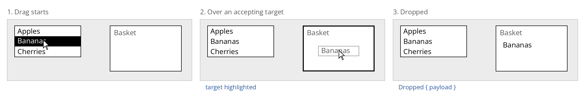

#### Events and callbacks

| Event emitted | When | Application callback |
|---|---|---|
| `Dropped { id, payload }` | Payload dropped on an accepting target | `on_drop(id, ..)` |

Like every widget, it can also receive application-defined custom events in `handle_event` and emit its own (1.13 (#78)).

**Acceptance Criteria.**

- Drag between two lists
- Drop highlighting and cancel
- OS file drops delivered
- Emits the corresponding `EngineEvent` (9.10 (#109))

**Parallelism / Dependencies.** Parallelizable. Requires 9.4 (#96), 5.1 (#56).

**Technical Stack.** Rust, SDL2 drop events

**Documentation.** Docusaurus page: `pushrod-docs/docs/events/drag-and-drop-within-the-application.md` ("Drag and drop within the application", Events, new). Guides: Drag and drop section. Rustdoc: `dnd` module. Examples: Reorder a list by dragging. Screenshots: Gallery tile.

### 9.9 (#101): Pointer cursor per widget

**Problem Statement.** The pointer shape tells users what will happen: text can be selected, an edge can be resized, a link can be followed.

**Solution / Scope.** Optional `cursor` on `WidgetCore` (`Arrow`, `IBeam`, `Hand`, `ResizeHorizontal`, `ResizeVertical`, `Move`, `Wait`, `Crosshair`) applied on `PointerEntered` using SDL system cursors; text fields default to I-beam.

**Acceptance Criteria.**

- Cursor changes on hover and restores on exit
- Busy cursor while `ui.set_busy(true)`

**Parallelism / Dependencies.** Parallelizable. Requires 9.1 (#93).

**Technical Stack.** Rust, SDL2 cursors

**Documentation.** Docusaurus page: `pushrod-docs/docs/events/pointer-cursor-per-widget.md` ("Pointer cursor per widget", Events, new). Guides: Usability section. Rustdoc: `set_cursor`. Examples: n/a. Screenshots: n/a.

### 9.10 (#109): Engine events: every internal action Pushrod performs emits an event

**Problem Statement.** Applications can only react to what they can observe. Today Pushrod changes things internally (moves focus, opens a modal dialog, switches drawing mode, adds or removes widgets) without telling anyone, so applications can't keep a status line, log, preference, or custom widget in sync.

**Solution / Scope.** Add `Event::Engine(EngineEvent)`: one variant per internal action, each with the details an application needs. Initial set: `DrawingModeChanged { old, new, reason }` (10.1 (#105)), `EventMaskChanged { scope, old, new }` (1.2 (#6)), `FocusChanged { old, new }` (1.4 (#20)), `ModalOpened { root }` / `ModalClosed { root, dismissed_by }` (6.7 (#66)), `MenuOpened` / `MenuClosed` (2.11 (#37)), `WidgetAdded` / `WidgetRemoved` / `WidgetReparented` (1.8 (#23)), `FormLoaded { form, root }` (6.4 (#63)), `DragStarted` / `DragEnded { dropped }` (9.8 (#100)), `TooltipShown` / `TooltipHidden` (2.13 (#77)), `TimerFired { timer }` (1.5 (#21)), `WindowOpened` / `WindowClosed` (1.16 (#82)), `ScaleFactorChanged` (1.10 (#25)), `ActionChanged { action }` (9.5 (#97)), `IdleStarted` / `IdleEnded`. Engine events are broadcast after the action has completed: to widgets whose mask includes the `ENGINE` class (with an optional filter by kind), then to `engine.on_engine_event(|state, ui, &EngineEvent| ..)` and `on_event`. They never trigger further internal actions by themselves, so they can't loop. **Standing rule for the project:** any issue that adds an internal action must add its `EngineEvent` variant and emit it; the guide (7.4 (#72)) and review checklist say so.

```text
internal action (e.g. ui.set_drawing_mode(Outline))
        │ completes
        v
Engine(DrawingModeChanged { old: Live, new: Outline, reason: Application })
        │ broadcast (after the action, never re-entrant)
        ├──> widgets with ENGINE in their mask (optionally filtered by kind)
        ├──> on_engine_event(|state, ui, ev| ..)
        └──> on_event(..)
```

#### Events and callbacks

| Event emitted | When | Application callback |
|---|---|---|
| `Engine(EngineEvent)` | After any internal action completes | `on_engine_event(..)`, widgets with the ENGINE mask, `on_event(..)` |

Like every widget, it can also receive application-defined custom events in `handle_event` and emit its own (1.13 (#78)).

**Acceptance Criteria.**

- `EngineEvent` enum with the initial variants above (those whose features exist are emitted now; the rest are added by their issues)
- Broadcast after completion to masked widgets and `on_engine_event`
- Kind filter for widgets and callbacks
- No re-entrant loops (engine events never trigger internal actions on their own)
- Guide and PR checklist state the rule

**Status:** done (#109).

**Parallelism / Dependencies.** Not parallelizable. Requires 9.1 (#93), 1.2 (#6).

**Technical Stack.** Rust

**Documentation.** Docusaurus page: `pushrod-docs/docs/events/engine-events.md` ("Engine events", Events, new). Guides: 'Engine events' section with the full list. Rustdoc: `EngineEvent` (every variant documented with when it fires). Examples: Example status line that shows focus and drawing-mode changes. Screenshots: n/a.

**Sources.** [Qt: The Event System (accept/ignore, event filters, posting custom events)](https://doc.qt.io/qt-6/eventsandfilters.html)

### 9.11 (#124): Event-loop style: keep parity with callbacks

**Problem Statement.** Pushrod now supports two styles: callbacks (`engine.run`) and an application-driven loop (`engine.event_loop` + `next_event`). As the event system grows (engine events, custom events, timers, masks, actions), the loop style could fall behind.

**Solution / Scope.** Rule: every event that reaches callbacks is also returned by `next_event`, in the same order: semantic events, `Engine(..)` events (9.10 (#109)), `Custom(..)` events (1.13 (#78)), timer events (1.5 (#21)), and action triggers (9.5 (#97)). The run-loop mask (1.2 (#6)) applies to both. Add `next_event_with(&mut events, &mut state)`, which also runs registered callbacks for each event before returning it, so an application can mix styles (for example callbacks for most widgets, a loop for the main window logic). Add conformance tests (7.6 (#114)) that run the same scripted input through both styles and compare the event sequences.

**Acceptance Criteria.**

- Every event kind is delivered by both styles in the same order
- `next_event_with` runs callbacks then returns the event
- Conformance test compares both styles on the same input

**Status:** done (#124).

**Parallelism / Dependencies.** Parallelizable. Requires 9.1 (#93).

**Technical Stack.** Rust

**Documentation.** Docusaurus page: `pushrod-docs/docs/guides/handling-events.md` ("Handling events", Guides, update). Guides: Two ways to handle events (events guide). Rustdoc: `Engine::event_loop`, `next_event`, `next_event_with`. Examples: Quick start shows both styles. Screenshots: n/a.

**Sources.** [GEM AES object structure (flags, states, object tree)](https://www.seasip.info/Gem/aestruct.html)

## Epic 10: Rendering backends, drawing modes, and vintage hardware (#103)

Backend crates (SDL2 now, SDL3 later) with no SDL in the core, a backend-neutral paint API, high-DPI, live vs. outline drawing for slow and vintage machines, a no_std core, and an experimental Atari ST backend.

**Problem.** Pushrod should run well on slow GPUs and, ideally, on vintage hardware such as the Atari ST. Two things stand in the way: dragging and resizing redraw content continuously (expensive on slow hardware), and widgets paint directly onto an SDL2 canvas, which ties every widget to SDL2.

**Scope.** Add a feedback mode (live or outline) for anything that moves or resizes; route all painting through a small backend-neutral `Painter` trait whose default backend is SDL2 with GPU texture caching; split out a `no_std` + `alloc` core; then explore an Atari ST/TOS backend. SDL2 remains the default and does the heavy lifting on modern systems.

**Dependencies.** The backend-neutral paint API (10.2 (#106)) is MVP and should land before the widget count grows. Drawing modes (10.1 (#105)) follow the input controllers (9.4 (#96)). The no_std core (10.3 (#107)) and the Atari ST backend (10.4 (#108)) are future work.

| Issue | Title | Summary | Labels | Parallel | MVP | Complexity | Affected modules |
|---|---|---|---|---|---|---|---|
| 10.1 (#105) | Drawing modes: live or outline feedback while moving and resizing | Live mode redraws content as things move; outline mode shows only a dotted rectangle until the move ends. Switchable at run time, with a system-wide event. | `chassis`, `core`, `enhancement`, `parallelizable`, `performance`, `portability`, `size/M` | Y | N | M | `src/engine.rs`, `src/cache.rs`, `src/controllers.rs` |
| 10.3 (#107) | no_std + alloc core crate | Split the widget tree, events, and widgets into a core crate that builds without the standard library. | `core`, `enhancement`, `future`, `parallelizable`, `portability`, `size/L` | Y | N | L | `src/lib.rs`, `Cargo.toml`, `pushrod-widgets/Cargo.toml` |
| 10.4 (#108) | Experimental: Atari ST / TOS backend | Run Pushrod applications on an Atari ST: 68000 target, TOS input, monochrome or low-color drawing, outline mode, direct drawing. | `enhancement`, `future`, `parallelizable`, `portability`, `size/L` | Y | N | L | `pushrod-tos (new crate)` |
| 10.6 (#134) | Backend crates: keep SDL out of the core and the widgets | Move everything SDL-specific into a `pushrod-sdl2` backend crate, so `pushrod` and `pushrod-widgets` have no SDL dependency and a future SDL3 backend is a drop-in swap. | `architecture`, `chassis`, `enhancement`, `mvp`, `parallelizable`, `rendering`, `size/L` | Y | v0.1 | L | `src/backend.rs (new)`, `src/engine.rs`, `src/event.rs`, `src/geometry.rs`, `pushrod-sdl2/ (new crate)`, `pushrod-widgets (all widgets)` |
| 10.5 (#135) | SDL3 backend (pushrod-sdl3) | A second backend crate on SDL3, a drop-in replacement for pushrod-sdl2. | `enhancement`, `parallelizable`, `platform`, `rendering`, `size/M` | Y | N | M | `pushrod-sdl3/ (new crate)` |

### 10.1 (#105): Drawing modes: live or outline feedback while moving and resizing

**Problem Statement.** Moving or resizing something (a dragged item, a split divider, a column width, a window or panel, objects in Chassis) normally repaints content continuously. On slow GPUs, software renderers, and vintage machines that's too slow and looks jerky.

**Solution / Scope.** `Engine::set_drawing_mode(DrawingMode::Live | DrawingMode::Outline | DrawingMode::Auto)`, overridable per widget. **Live:** content follows the pointer and repaints as it moves. **Outline:** only a dotted (inverted where the backend supports it) rectangle is drawn in the overlay layer while dragging; the real move or resize, and its repaint, happen once on release. Value controls follow the same rule: in outline mode the slider and scroll-bar thumbs still move, but `ValueChanged` and dependent repaints (for example scrolled content) happen on release. **Auto** measures frame time and switches to outline when frames take longer than a threshold. Drag controllers (9.4 (#96)) implement it, so every widget that drags gets it for free. **Run-time switching:** `ui.set_drawing_mode(mode)` (and `Engine::set_drawing_mode` at startup) can be called at any time, for example from a preferences check box; an interaction already in progress finishes in the mode it started in. Every change, whether by the application or by Auto, broadcasts `Engine(DrawingModeChanged { old, new, reason: Application | Auto })` (9.10 (#109)) to all widgets with the `ENGINE` mask class and to `on_engine_event` callbacks, so applications and widgets can respond (for example turn off animations or show an indicator).

#### Look and behavior (proposed)

Each image shows the widget step by step, drawn in Pushrod's current style; blue notes name the event emitted. Mockups come from [`docs/mockups/generate.py`](https://github.com/KenSuenobu/rust-pushrod/blob/main/docs/mockups/generate.py): edit a frame there and re-run it to change the design, and update this section.

**Live mode: the dragged panel repaints at every position**

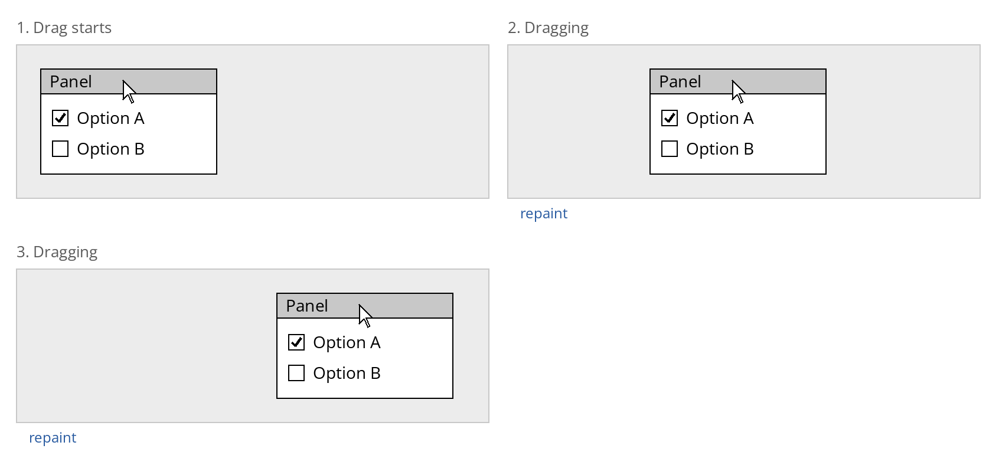

**Outline mode: only an outline moves; the panel repaints once on release**

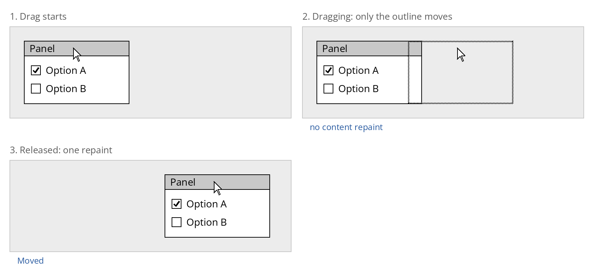

#### Events and callbacks

| Event emitted | When | Application callback |
|---|---|---|
| `Moved / Resized { id }` | Live: continuously; Outline: once on release | `on_event(..)` |
| `Engine(DrawingModeChanged { old, new, reason })` | Mode switched by the application or by Auto | `on_engine_event(..)`; widgets with the ENGINE mask |

Like every widget, it can also receive application-defined custom events in `handle_event` and emit its own (1.13 (#78)).

**Acceptance Criteria.**

- Live, Outline, and Auto modes for drag, resize, divider, and column-width interactions
- Outline mode performs no content repaint until release
- Value controls defer change events and dependent repaints in outline mode
- Auto switches based on measured frame time
- `ui.set_drawing_mode` switches at run time; in-progress interactions finish in their starting mode
- Each change broadcasts `DrawingModeChanged { old, new, reason }`

**Parallelism / Dependencies.** Parallelizable. Requires 9.4 (#96), 9.10 (#109).

**Technical Stack.** Rust

**Documentation.** Docusaurus page: `pushrod-docs/docs/platforms/drawing-modes.md` ("Drawing modes", Platforms, new). Guides: 'Slow hardware' section. Rustdoc: `DrawingMode`. Examples: Example toggles the mode at run time. Screenshots: n/a.

### 10.2 (#106): Backend-neutral paint API (SDL2 backend by default)

**Status:** done (#106).

**Problem Statement.** `Widget::paint` takes `&mut sdl2::render::Canvas<Window>`, so every widget depends on SDL2. Changing that signature after dozens of widgets exist would be expensive, and it is the main obstacle to software rendering and vintage targets.

**Solution / Scope.** Introduce `trait Painter { fn fill(&mut self, color); fn fill_rect(..); fn rect(..); fn line(..); fn text(..) -> Size; fn image(..); fn dither(..); fn clip(..) }` (kept small: only what `paint` helpers need) and change `Widget::paint(&self, p: &mut dyn Painter)`. The default `Sdl2Painter` keeps today's design exactly: each widget paints into its own GPU texture when invalidated and frames are blits of cached textures. A backend also declares a `CachePolicy` (`TextureCache` on GPUs; `DirectDraw` on memory-poor systems, painting invalidated widgets straight to the screen with clipping). The SDL2 backend remains the default; nothing changes for applications. `Widget::paint` takes Pushrod's own `Painter`, never an SDL type, so widget libraries never compile against a specific SDL version (10.6 (#134)).

**Acceptance Criteria.**

- All widgets paint through `Painter`; no widget imports `sdl2::render`
- SDL2 backend renders pixel-identical goldens
- A headless test backend records paint calls for unit tests
- Cache policy is backend-selected

**Parallelism / Dependencies.** Not parallelizable. Requires PR #10. Gate: must land before the widget epics and before v1, together with 10.6 (#134).

**Technical Stack.** Rust

**Documentation.** Docusaurus page: `pushrod-docs/docs/platforms/backend-neutral-paint-api.md` ("Backend-neutral paint API", Platforms, new). Guides: 'Backends' section. Rustdoc: `Painter` trait, `Sdl2Painter`, `CachePolicy`. Examples: Test backend used in widget tests. Screenshots: n/a.

### 10.3 (#107): no_std + alloc core crate

**Problem Statement.** Vintage targets have no Rust standard library; Rust's m68k bare-metal target builds only `core` and `alloc`.

**Solution / Scope.** Once SDL lives only in backend crates (10.6 (#134)), make the `pushrod` core itself `#![no_std]` + `alloc`, with `std` as a default feature; time, files, and threads go through the `Backend` trait. `pushrod-widgets` follows (default `std` feature). This is what lets the Atari ST backend (10.4 (#108)) reuse the core and the standard widgets unchanged. The split follows the module boundaries and specs in 7.6 (#114).

**Acceptance Criteria.**

- `pushrod-core` builds for a `no_std` target with `alloc`
- `pushrod` API unchanged

**Parallelism / Dependencies.** Parallelizable. Requires 10.6 (#134), 7.6 (#114).

**Technical Stack.** Rust (core, alloc)

**Documentation.** Docusaurus page: `pushrod-docs/docs/platforms/no-std-alloc-core-crate.md` ("no_std + alloc core crate", Platforms, new). Guides: 'Backends' section. Rustdoc: Crate layout. Examples: n/a. Screenshots: n/a.

**Sources.** [Rust platform support: m68k-unknown-none-elf](https://doc.rust-lang.org/rustc/platform-support/m68k-unknown-none-elf.html)

### 10.4 (#108): Experimental: Atari ST / TOS backend

**Problem Statement.** It would be ideal for a Pushrod application to run on the Atari ST. Rust can already produce TOS programs for the 68000, but SDL2 isn't available there and an 8 MHz 68000 with 512 KB to 4 MB of RAM can't afford a texture per widget.

**Solution / Scope.** A `pushrod-tos` platform crate on top of `pushrod-core` (10.3 (#107)), built for Rust's `m68k-unknown-none-elf` target with `build-std` (core, alloc) and linked into a `.PRG`. Backend options to evaluate: (a) draw directly into screen memory (monochrome 640x400 first, then low/medium resolution bitplanes) with a fixed bitmap font; (b) use the VDI; (c) use SDL 1.2 (#6)'s Atari port. Input from the IKBD/GEMDOS. Defaults for the platform: `DrawingMode::Outline`, `CachePolicy::DirectDraw`, bitmap font instead of the glyph atlas. Start with a hello-world form (label + button + callback) running in Hatari, then on hardware.

**Acceptance Criteria.**

- A Pushrod form with a button and callback runs in the Hatari emulator
- Size and speed measured and documented
- Runs on real ST hardware

**Parallelism / Dependencies.** Parallelizable. Requires 10.1 (#105), 10.2 (#106), 10.3 (#107).

**Technical Stack.** Rust nightly (`build-std`), m68k, TOS, Hatari

**Documentation.** Docusaurus page: `pushrod-docs/docs/platforms/experimental.md` ("Experimental", Platforms, new). Guides: 'Vintage hardware' section. Rustdoc: `pushrod-tos` README. Examples: Hello-world form PRG. Screenshots: n/a.

**Sources.** [Rust platform support: m68k-unknown-none-elf](https://doc.rust-lang.org/rustc/platform-support/m68k-unknown-none-elf.html); [RuST: Rust 'hello world' for Atari TOS / EmuTOS (toslibc toslink)](https://github.com/DominoTree/RuST); [SDL 1.2 README.MiNT (Atari TOS/MiNT video, keyboard, mouse drivers)](https://sources.debian.org/src/libsdl1.2/1.2.15%2Bdfsg2-6/README.MiNT)

### 10.6 (#134): Backend crates: keep SDL out of the core and the widgets

**Problem Statement.** SDL2 types appear throughout the public API: `Widget::paint` takes `&mut Canvas<Window>`, `PushrodEvent::SystemEvent` wraps `sdl2::event::Event`, `Engine::run` takes `Sdl` and `Window`, and widgets use `sdl2::pixels::Color`. Every widget library would compile against SDL2 directly, so moving to SDL3 (or to the Atari ST, 10.4 (#108)) would break all of them. The Rust SDL3 bindings are still being migrated, so the switch isn't urgent, but the API has to be ready before v1 freezes it.

**Solution / Scope.** **Core (`pushrod`):** no SDL dependency. It defines the `Painter` trait (10.2 (#106)), a `Backend` trait (create and resize windows, deliver input, manage widget textures, clock, clipboard, open URLs), and its own value types: `Color`, `Point`/`Size`/`Rect`, `Key`/`Modifiers`/`MouseButton`, and the input events of the event vocabulary (9.1 (#93)). No `sdl2` type appears in any public signature. **`pushrod-sdl2`:** implements `Backend` and `Painter` with SDL2, keeping today's design exactly: one GPU texture per widget, repainted only when invalidated, frames composed by blitting, text from the glyph atlas. The `bundled` and `static-link` features move here. **`pushrod-widgets`:** depends on `pushrod` only. **Applications** pick a backend: `pushrod_sdl2::run(engine, WindowSettings { title, size, .. }, state)` (and the event-loop style, 9.11 (#124)). **Testing:** a `HeadlessBackend` in the core (no window, records paint calls) replaces SDL in unit tests, so tests run without a display. With text rasterized by swash (1.18 (#111)) and images decoded in Rust, the SDL2_ttf and SDL2_image libraries are no longer needed, so the backend needs only SDL itself: simpler to port, and `bundled` becomes fully self-contained.

**Acceptance Criteria.**

- `cargo tree -p pushrod` and `cargo tree -p pushrod-widgets` show no `sdl2`
- No SDL type in any public signature of the core or the widgets
- `pushrod-sdl2` reproduces today's rendering (golden images unchanged)
- Tests run on the headless backend without a display

**Parallelism / Dependencies.** Parallelizable. Requires 10.2 (#106), 9.1 (#93), 1.21 (#130). Do before the widget count grows.

**Technical Stack.** Rust, SDL2 (backend crate only)

**Documentation.** Docusaurus page: `pushrod-docs/docs/platforms/backends.md` ("Backends", Platforms, new). Guides: update the guide or concept page covering: installation (choosing a backend), Widget libraries, a new Backends page. Rustdoc: `Backend`, `Painter`, `pushrod_sdl2::run`, `HeadlessBackend`. Examples: examples use `pushrod_sdl2::run`. Screenshots: n/a.

### 10.5 (#135): SDL3 backend (pushrod-sdl3)

**Problem Statement.** SDL3 is SDL's current major version. Pushrod should be able to move to it without changing applications or widget libraries.

**Solution / Scope.** Implement `Backend` and `Painter` (10.6 (#134)) on the `sdl3` crate with the same texture-per-widget design. Switching an application is a one-line `Cargo.toml` change plus `pushrod_sdl3::run`. Start when the Rust SDL3 bindings have a stable release; until then, track their migration status. The golden-image tests (7.2 (#70)) must pass unchanged on both backends.

**Acceptance Criteria.**

- The gallery and reference application run on SDL3 unchanged
- Golden images match the SDL2 backend
- pushrod-sdl2 keeps working; applications choose either

**Parallelism / Dependencies.** Parallelizable. Requires 10.6 (#134), 7.2 (#70).

**Technical Stack.** Rust, SDL3 (sdl3 crate)

**Documentation.** Docusaurus page: `pushrod-docs/docs/platforms/backends.md` ("Backends", Platforms, update). Guides: update the guide or concept page covering: Backends. Rustdoc: `pushrod_sdl3::run`. Examples: examples run with either backend. Screenshots: n/a.

## Epic 11: Chassis: code editor (chassis-code-editor) (#141)

A lightweight code editor component ("Monaco lite", Tier 1 features only) for Chassis's code-behind view, built as its own crate on Pushrod.

**Problem.** Chassis, the visual form designer, works like the classic rapid-application-development IDEs: draw a form, double-click a control, and land in its event-handler stub to write code. That needs an embedded code editor, and none of the existing Rust code-editor components can be used in Pushrod: each is tied to its own toolkit's drawing and input.

**Scope.** A `chassis-code-editor` crate: a Pushrod widget library (1.22 (#131)) providing a `CodeEditor` widget with Tier 1 features only. **In scope:** a rope text buffer, cursors and selections, clipboard, undo and redo with typing grouped, line numbers, syntax highlighting (tree-sitter), scrolling that lays out and draws only visible lines, find, auto-indent, bracket matching, and an API that lets Chassis insert and navigate to generated code and protect it from edits. **Out of scope (Tier 2 and 3):** multiple cursors, folding, minimap, regex replace, language servers (completion, hover, diagnostics), diff view. It follows the design philosophy (flat, simple) and is usable by any Pushrod application, not only Chassis.

**Dependencies.** After the MVP. Starts once widget libraries (1.22 (#131)) exist; the view needs the glyph atlas (1.7 (#3)), Parley (1.18 (#111)), layers (1.20 (#113)), and the Container (5.3 (#58)). The designer API (11.8 (#149)) pairs with Chassis design mode (6.9 (#68)).

| Issue | Title | Summary | Labels | Parallel | MVP | Complexity | Affected modules |
|---|---|---|---|---|---|---|---|
| 11.1 (#142) | Chassis: Code editor crate and editing core | Create `chassis-code-editor` with its text buffer, cursor and selection model, and edit commands, independent of drawing. | `architecture`, `chassis`, `code-editor`, `enhancement`, `parallelizable`, `size/M` | Y | N | M | `chassis-code-editor/ (new crate)`, `chassis-code-editor/src/buffer.rs (new)`, `chassis-code-editor/src/selection.rs (new)`, `chassis-code-editor/src/command.rs (new)` |
| 11.2 (#143) | Chassis: Code editor view: gutter, visible-line rendering, caret | The `CodeEditor` widget: draws line numbers, the visible lines, the current line, and the caret, and scrolls through files of any length. | `chassis`, `code-editor`, `enhancement`, `parallelizable`, `rendering`, `size/L`, `widget` | Y | N | L | `chassis-code-editor/src/view.rs (new)`, `chassis-code-editor/src/gutter.rs (new)` |
| 11.3 (#144) | Chassis: Code editor input: keyboard, mouse selection, clipboard, input methods | Editing with the keyboard and mouse the way users expect from a code editor. | `chassis`, `code-editor`, `enhancement`, `input`, `parallelizable`, `size/M`, `usability`, `widget` | Y | N | M | `chassis-code-editor/src/input.rs (new)` |
| 11.4 (#145) | Chassis: Code editor undo and redo | Undo and redo every edit, with consecutive typing grouped into one step. | `chassis`, `code-editor`, `enhancement`, `parallelizable`, `size/S`, `usability` | Y | N | S | `chassis-code-editor/src/history.rs (new)` |
| 11.5 (#146) | Chassis: Code editor syntax highlighting with tree-sitter | Highlight code incrementally as it is edited, with a small, flat color scheme. | `chassis`, `code-editor`, `enhancement`, `parallelizable`, `size/M`, `text` | Y | N | M | `chassis-code-editor/src/highlight.rs (new)` |
| 11.6 (#147) | Chassis: Code editor find | A find bar inside the editor: type to search, step through matches. | `chassis`, `code-editor`, `enhancement`, `parallelizable`, `size/S`, `usability`, `widget` | Y | N | S | `chassis-code-editor/src/find.rs (new)` |
| 11.7 (#148) | Chassis: Code editor auto-indent and bracket matching | New lines keep and adjust indentation, and the bracket matching the one at the caret is boxed. | `chassis`, `code-editor`, `enhancement`, `parallelizable`, `size/S`, `usability` | Y | N | S | `chassis-code-editor/src/indent.rs (new)` |
| 11.8 (#149) | Chassis: Code editor API for the Chassis designer | Let Chassis insert, find, and protect generated code: double-click a control and land in its event handler. | `api`, `chassis`, `code-editor`, `enhancement`, `parallelizable`, `size/M` | Y | N | M | `chassis-code-editor/src/api.rs (new)` |
| 11.9 (#150) | Chassis: Code editor documentation, example, and tests | Document the code editor on the site, ship an example editor, and cover it with golden-image tests. | `chassis`, `code-editor`, `documentation`, `parallelizable`, `quality`, `size/S` | Y | N | S | `chassis-code-editor/examples/editor.rs (new)`, `chassis-code-editor/tests/ (new)`, `pushrod-docs/docs/chassis/ (new)` |

### 11.1 (#142): Chassis: Code editor crate and editing core

Create `chassis-code-editor` with its text buffer, cursor and selection model, and edit commands, independent of drawing. **Specification:** [`docs/chassis/code-editor.md`](chassis/code-editor.md).

**Dependencies.** Requires 1.21 (#130), 1.22 (#131).

### 11.2 (#143): Chassis: Code editor view: gutter, visible-line rendering, caret

The `CodeEditor` widget: draws line numbers, the visible lines, the current line, and the caret, and scrolls through files of any length. **Specification:** [`docs/chassis/code-editor.md`](chassis/code-editor.md).

**Dependencies.** Requires 11.1 (#142), 1.7 (#3), 1.18 (#111), 1.20 (#113), 5.3 (#58), 1.10 (#25), 1.24 (#137).

### 11.3 (#144): Chassis: Code editor input: keyboard, mouse selection, clipboard, input methods

Editing with the keyboard and mouse the way users expect from a code editor. **Specification:** [`docs/chassis/code-editor.md`](chassis/code-editor.md).

**Dependencies.** Requires 11.2 (#143), 1.4 (#20), 1.19 (#112), 9.4 (#96), 9.5 (#97).

### 11.4 (#145): Chassis: Code editor undo and redo

Undo and redo every edit, with consecutive typing grouped into one step. **Specification:** [`docs/chassis/code-editor.md`](chassis/code-editor.md).

**Dependencies.** Requires 11.1 (#142), 1.15 (#81).

### 11.5 (#146): Chassis: Code editor syntax highlighting with tree-sitter

Highlight code incrementally as it is edited, with a small, flat color scheme. **Specification:** [`docs/chassis/code-editor.md`](chassis/code-editor.md).

**Dependencies.** Requires 11.2 (#143).

### 11.6 (#147): Chassis: Code editor find

A find bar inside the editor: type to search, step through matches. **Specification:** [`docs/chassis/code-editor.md`](chassis/code-editor.md).

**Dependencies.** Requires 11.3 (#144), 2.6 (#32), 2.2 (#28).

### 11.7 (#148): Chassis: Code editor auto-indent and bracket matching

New lines keep and adjust indentation, and the bracket matching the one at the caret is boxed. **Specification:** [`docs/chassis/code-editor.md`](chassis/code-editor.md).

**Dependencies.** Requires 11.3 (#144), 11.5 (#146).

### 11.8 (#149): Chassis: Code editor API for the Chassis designer

Let Chassis insert, find, and protect generated code: double-click a control and land in its event handler. **Specification:** [`docs/chassis/code-editor.md`](chassis/code-editor.md).

**Dependencies.** Requires 11.4 (#145), 11.5 (#146). Pairs with 6.9 (#68) (Chassis design-mode hooks).

### 11.9 (#150): Chassis: Code editor documentation, example, and tests

Document the code editor on the site, ship an example editor, and cover it with golden-image tests. **Specification:** [`docs/chassis/code-editor.md`](chassis/code-editor.md).

**Dependencies.** Requires 11.6 (#147), 11.7 (#148), 11.8 (#149), 7.2 (#70).

## Work Order

Work in this order. Items in the same step can be done in parallel unless their dependencies say otherwise.

**1. Foundation (do first, mostly parallel)**

- 1.21 (#130) Split the standard widgets into the pushrod-widgets crate — MVP v0.1
- 7.1 (#69) CI: build, test, clippy, fmt, doc with SDL2 — MVP v0.1
- 7.8 (#122) Documentation site: build pushrod-docs in CI and publish it — MVP v0.1
- 9.1 (#93) Event vocabulary: modern event names and structure — MVP v0.1
- 10.2 (#106) Backend-neutral paint API (SDL2 backend by default) — MVP v0.1
- 1.1 (#19) Widget behavior flags and visual states — MVP v0.1
- 1.2 (#6) Event masks for the run loop and for widgets — MVP v0.1
- 9.10 (#109) Engine events: every internal action Pushrod performs emits an event — MVP v0.1
- 9.11 (#124) Event-loop style: keep parity with callbacks — MVP v0.1
- 1.3 (#7) Broadcast events to all interested widgets — MVP v0.1
- 1.6 (#22) Callback registry for every widget event — MVP v0.1
- 1.13 (#78) Custom application events with payloads — MVP v0.1
- 1.18 (#111) Text layout engine: Parley for shaping, bidi, line breaking, and font fallback (with an SDL2 compatibility gate) — MVP v0.1
- 1.7 (#3) GPU text: font cache with a glyph atlas texture — MVP v0.1
- 7.3 (#71) Widget gallery example — MVP v0.1
- 7.6 (#114) Module boundaries and written specs with conformance tests — MVP v0.2

**2. Input model**

- 9.2 (#94) Event propagation: capture, target, and bubble phases with handled/ignored — MVP v0.1
- 9.4 (#96) Reusable input controllers: click, drag, scroll, hover, long-press, key — MVP v0.1
- 1.4 (#20) Keyboard focus, Tab order, and Return/Escape — MVP v0.1
- 1.19 (#112) Input method (IME) support: composition text and candidate window — MVP v0.2
- 1.17 (#104) Per-state appearance: colors, border, and font for each visual state — MVP v0.1
- 1.12 (#76) Keyboard mnemonics: underlined shortcut letters — MVP v0.2
- 1.5 (#21) Timers and idle callbacks — MVP v0.1
- 10.6 (#134) Backend crates: keep SDL out of the core and the widgets — MVP v0.1
- 1.25 (#138) Errors: return Result instead of panicking — MVP v0.1
- 1.24 (#137) Fonts: shared font handles and a built-in default font — MVP v0.1
- 1.23 (#136) Public API polish before publishing: builders, prelude, and stability — MVP v0.1

**3. Core dialog widgets**

- 2.10 (#36) Custom paint widget (closure-drawn) — MVP v0.1
- 2.1 (#27) Boxed label widget — MVP v0.1
- 2.14 (#83) Separator line — MVP v0.1
- 3.3 (#41) Group box (titled frame) — MVP v0.1
- 2.7 (#33) Image widget — MVP v0.1
- 2.2 (#28) Glyph button (small single-character button) — MVP v0.1
- 2.3 (#29) Button behaviors: default, cancel, toggle, activate-on-press, dismiss dialog — MVP v0.1
- 2.4 (#30) Check box with indeterminate state — MVP v0.1
- 2.5 (#31) Radio buttons and radio groups — MVP v0.1
- 4.1 (#48) Progress bar — MVP v0.1
- 3.2 (#40) Slider — MVP v0.1
- 2.6 (#32) Text field: single-line entry with input masks, validation, and numeric mode — MVP v0.1

**4. Composition**

- 5.1 (#56) Clip children to their parent's bounds — MVP v0.1
- 5.2 (#57) Composite widgets: build widgets from parts that applications can retrieve and modify — MVP v0.1
- 5.5 (#116) Layout manager foundation: Layout trait, size hints, measure and arrange — MVP v0.1
- 5.6 (#117) Row and column layouts — MVP v0.1
- 5.7 (#118) Form layout: aligned label and field rows — MVP v0.1
- 3.1 (#39) Scroll bar — MVP v0.1
- 5.3 (#58) Container: a scrollable viewport onto fixed-size content — MVP v0.1
- 7.2 (#70) Golden-image rendering tests — MVP v0.1
- 7.7 (#115) Performance benchmarks and budgets — MVP v0.1
- 1.10 (#25) High-DPI rendering and window resize — MVP v0.1
- 7.9 (#139) Easy installation: bundled SDL, static linking, and platform guides — MVP v0.1

**5. Forms runtime**

- 6.1 (#60) Widget registry and factory — MVP v0.2
- 6.2 (#61) Property introspection: list, get, and set widget properties by name — MVP v0.2
- 1.14 (#80) Accessibility: expose widgets to screen readers — MVP v0.2
- 6.3 (#62) Form file format (binary, versioned) — MVP v0.2
- 6.4 (#63) Form loader: build a form from a file with stable IDs — MVP v0.2
- 6.5 (#64) Form writer: save a widget subtree to a file — MVP v0.2
- 6.6 (#65) Generate ID constants from a form file — MVP v0.2
- 6.11 (#154) Resource kinds: strings, images, icons, files, menus, and alerts — MVP v0.2
- 6.12 (#155) Typed resource IDs: generated constants per resource kind — MVP v0.2
- 6.10 (#153) Resource manager: load resource sets and get resources by ID — MVP v0.2
- 1.8 (#23) Edit the widget tree at run time: remove, reparent, reorder — MVP v0.1
- 6.7 (#66) Modal dialogs: run a form until a dismissing control is chosen — MVP v0.1
- 2.9 (#35) Alert dialog — MVP v0.1

**6. MVP release**

- 7.10 (#140) Reference application: a real app built only with Pushrod — MVP v0.1
- 7.4 (#72) Guide: writing widgets and composites — MVP v0.1
- 7.5 (#73) Changelog, Cargo metadata, and crates.io release — MVP v0.1

**7. After MVP: events and commands**

- 9.3 (#95) Event filters: observe or intercept another widget's events
- 9.5 (#97) Actions and keyboard shortcuts: shared commands for menus, toolbars, and buttons
- 9.6 (#98) Property bindings: keep two properties in sync
- 9.7 (#99) Callback handles: disconnect, block, and unblock
- 9.8 (#100) Drag and drop within the application
- 9.9 (#101) Pointer cursor per widget
- 1.11 (#26) Application lifecycle: startup and close-request callbacks
- 1.15 (#81) Undo and redo command stack
- 10.1 (#105) Drawing modes: live or outline feedback while moving and resizing

**8. After MVP: widgets**

- 5.4 (#59) Autoresizing (keep margins or stretch on resize)
- 5.8 (#119) Grid layout
- 5.9 (#120) Stack layout (one child visible at a time)
- 5.10 (#121) Flow layout (wrapping rows)
- 4.5 (#52) List view
- 3.7 (#45) Column browser (multi-column hierarchical browser)
- 4.2 (#49) Spin box
- 4.4 (#51) Tab view
- 4.6 (#53) Combo box
- 4.9 (#92) Table view
- 3.6 (#44) Choice button: pop-up list and click-to-cycle modes
- 3.10 (#90) Expander (collapsible section)
- 3.11 (#91) Date picker
- 2.11 (#37) Menu bar and drop-down menus (drawn by Pushrod)
- 2.13 (#77) Tooltips
- 2.21 (#125) Image button
- 2.15 (#84) Toolbar
- 2.16 (#85) Status bar
- 2.17 (#86) Switch (on/off slide toggle)
- 2.18 (#87) Multi-line text area
- 2.19 (#88) Context menus
- 2.20 (#89) Message bar (non-modal inline notice)
- 2.8 (#34) Icon widget (picture with caption)
- 2.12 (#38) File chooser dialog (drawn by Pushrod)
- 2.22 (#126) Link label
- 3.12 (#127) Dial (rotary knob)
- 4.10 (#128) Busy spinner
- 3.9 (#47) Split view (panes with draggable dividers)

**9. After MVP: platform and Chassis**

- 1.9 (#24) Dirty-rectangle redraw
- 1.16 (#82) Multiple windows: separate OS windows, each with its own engine
- 6.8 (#67) Bind actions by name from form files
- 6.9 (#68) Design-mode hooks for Chassis
- 10.3 (#107) no_std + alloc core crate
- 10.4 (#108) Experimental: Atari ST / TOS backend
- 1.20 (#113) Layers and invalidation: cache hints, texture memory budget, incremental pipeline
- 1.22 (#131) Widget libraries: extend or replace pushrod-widgets
- 10.5 (#135) SDL3 backend (pushrod-sdl3)
- 6.13 (#156) Event metadata in the widget registry

**10. After MVP: Chassis code editor**

- 11.1 (#142) Chassis: Code editor crate and editing core
- 11.2 (#143) Chassis: Code editor view: gutter, visible-line rendering, caret
- 11.3 (#144) Chassis: Code editor input: keyboard, mouse selection, clipboard, input methods
- 11.4 (#145) Chassis: Code editor undo and redo
- 11.5 (#146) Chassis: Code editor syntax highlighting with tree-sitter
- 11.6 (#147) Chassis: Code editor find
- 11.7 (#148) Chassis: Code editor auto-indent and bracket matching
- 11.8 (#149) Chassis: Code editor API for the Chassis designer
- 11.9 (#150) Chassis: Code editor documentation, example, and tests

**11. Distant future**

- 8.1 (#74) Theme for colors and metrics (future)
- 8.2 (#75) Skins: image-based widget rendering (future)

## Parked

Considered and closed as *not planned*, to keep Pushrod focused on usability. Each can be reopened if real applications need it.

| Issue | Title | Why parked |
|---|---|---|
| 3.4 (#42) | Matrix of cells (grid of buttons with selection modes) | Radio groups (2.5 (#31)) and the choice button (3.6 (#44)) cover the common cases; palettes can be built from buttons. |
| 3.5 (#43) | Labeled field rows | Text fields with built-in labels (2.6 (#32)) cover this. |
| 3.8 (#46) | Color well and picker | Rarely needed in ordinary dialogs; revisit if the Chassis inspector needs it. |
| 4.3 (#50) | Segmented control | Radio groups and the choice button's cycle mode cover the same choices. |
| 4.7 (#54) | Level indicator | The progress bar covers capacity displays. |
| 4.8 (#55) | Outline view (expandable tree list) | Specialized and not a core widget. A tree view fits naturally in a separate widget library that extends pushrod-widgets (1.22 (#131)); community contributions welcome. |
| 3.13 (#129) | Font chooser | Specialized; most applications don't let users pick fonts. Revisit alongside the color picker. |

## Existing issues

| Issue | Status |
|---|---|
| #4 Create ButtonWidget | Closed by #10 |
| #9 Add mutability to handle_event | Closed by #10 |
| #6 Add event mask to widgets | Reformatted as 1.2 (#6) |
| #7 Add broadcast of specific events | Reformatted as 1.3 (#7) |
| #3 Move FontCache to WidgetCache | Reformatted as 1.7 (#3) (now a GPU glyph atlas) |
| #10 core modernization | Event names will be modernized by 9.1 (#93) |
| #1, #8 crates.io releases | Answered by 7.5 (#73) |

## Sources

- [GEM AES object structure (flags, states, object tree)](https://www.seasip.info/Gem/aestruct.html)
- [FreeMiNT AES docs: object tree fundamentals](https://freemint.github.io/tos.hyp/en/aes_fundamentals.html)
- [Shift Interface resource editor (Atari)](https://atariuptodate.de/en/1277/interface)
- [OpenStep specification: controls and target/action](https://www.ict.griffith.edu.au/teaching/2501ICT/archive/resources/OpenStepSpec/ApplicationKit/Classes/NSControl.html)
- [Apple: Target-Action](https://developer.apple.com/library/archive/documentation/General/Devpedia-CocoaApp-MOSX/TargetAction.html)
- [AmigaOS GadTools autodoc (gadget kinds, underlined keyboard equivalents)](https://amigadev.grimore.org/Includes_and_Autodocs_2._guide/node05a3.html)
- [ICS: Motif widget descriptions](https://motif.ics.com/book/export/html/341)
- [Motif reference: form attachments](https://man.archlinux.org/man/XmForm.3.en)
- [O'Reilly Motif Programming Manual: keyboard traversal](https://www.oreilly.com/library/view/volume-6a-motif/9780596000431/chapter-44.html)
- [MAME wiki: Intergraph InterPro / CLIX / Environ V](https://wiki.mamedev.org/index.php/Driver:InterPro)
- [Qt: The Event System (accept/ignore, event filters, posting custom events)](https://doc.qt.io/qt-6/eventsandfilters.html)
- [Qt: QAction (shared commands for menus, toolbars, shortcuts)](https://doc.qt.io/qt-6/qaction.html)
- [GTK 4: input handling (event controllers, capture/target/bubble phases)](https://docs.gtk.org/gtk4/input-handling.html)
- [GObject: property bindings (GBinding)](https://docs.gtk.org/gobject/class.Binding.html)
- [Rust platform support: m68k-unknown-none-elf](https://doc.rust-lang.org/rustc/platform-support/m68k-unknown-none-elf.html)
- [RuST: Rust 'hello world' for Atari TOS / EmuTOS (toslibc toslink)](https://github.com/DominoTree/RuST)
- [SDL 1.2 README.MiNT (Atari TOS/MiNT video, keyboard, mouse drivers)](https://sources.debian.org/src/libsdl1.2/1.2.15%2Bdfsg2-6/README.MiNT)
- [Raph Levien, "Advice for the Next 100 Rust GUIs" (Linebender blog, 2026)](https://linebender.org/blog/next-100-guis/)
- [Parley: rich text layout (Linebender)](https://github.com/linebender/parley)
- [AccessKit: cross-platform accessibility infrastructure](https://github.com/AccessKit/accesskit)
- [Parley (Linebender): rich text layout library](https://github.com/linebender/parley)
- Apple AppKit documentation for NSStepper, NSSegmentedControl, NSTabView, NSProgressIndicator, NSLevelIndicator, NSComboBox, NSOutlineView (Mac OS X successors of the NeXTSTEP Application Kit)
