# Roadmap: Extensible Widget Library

## Description

> Make Pushrod's widget library as flexible and easy to extend as possible, so that more features can be added and the library can be extended naturally. Draw widget inspiration from Atari TOS 2.06 (GEM AES), NeXTSTEP, and Mac OS / macOS. Widget design stays simple and is drawn the way it is today. Skinning and themes are a feature for the distant future. Pushrod's premise is to be small, simple, lightweight, and easy to maintain and use.
>
> A future product, **Chassis**, will be a point-and-click, drag-and-drop interface designer. Like the Atari RSC workflow (and Shift's *Interface* editor, which was much harder to use), forms will be saved to a binary resource file and built on the fly, so that code doesn't need to be rewritten to match the design: only the callbacks are written, and they refer to widgets by ID. This is why Pushrod gives every widget an ID.

> Inspiration also comes from Motif, Intergraph, classic Mac OS, and AmigaOS for the base widgets, and from Qt, GTK, and other operating systems for widgets, events, and callbacks, to make the design as complete as possible. The focus is usability: not implementing everything under the sun just because we can. The *ideas* matter, not the old naming conventions (GEM's names were shaped by the compiler limits of the time): Pushrod uses its own modern names for functions and events.
>
> Rust applications are meant to be self-contained, so Pushrod must not rely on OS-specific functionality such as native menus: menus and every other control are drawn by Pushrod so that design, look, and feel stay consistent. SDL2 provides graphics and input, and its GPU textures store each widget's drawing so that frames are composed by blitting, with all drawing done by the GPU rather than the CPU wherever possible.

This roadmap builds on the core modernization in #10 (`dyn Widget` tree, `WidgetCore`, `paint` helpers, mutable `handle_event`, `Engine<S>` callbacks).

## Guiding principles

- **Small and simple.** Every widget is a `WidgetCore` plus a `paint` function composed from `fill`, `border`, and `text`. No new runtime dependencies without a strong reason.
- **Shared behavior lives in the core.** Flags, states, focus, clipping, and events are implemented once (Epic 1, Epic 5), so a new widget gets them for free.
- **IDs are the contract.** Widgets are addressed by stable IDs, like the numbered objects in classic resource files. Forms, generated constants, and callbacks all key off IDs.
- **Runtime first, designer second.** Epic 6 builds everything Chassis needs (registry, properties, form file format, loader/writer, design-mode hooks) into Pushrod itself.
- **Same look.** New widgets use the current flat, black-and-white style. Theming is Epic 8 and is not scheduled.
- **Modern names.** Older systems are credited for ideas only. Pushrod's flags, events, and callbacks use plain, modern names, collected in the *Naming* section so they can be reviewed in one place.
- **Retained, with stable identity.** Widgets persist and keep stable IDs, which is what accessibility trees, caching, incremental updates, and form files all need.
- **Engine separate from design.** The engine (tree, events, invalidation, paint API) and the design layer (widgets, defaults, appearance, themes) are separate modules with written specs (7.6 (#114)).
- **Use shared foundations.** Text layout (Parley) and accessibility (AccessKit) come from the ecosystem's well-tested crates rather than being reinvented.
- **Usability first.** A control is added because it makes ordinary applications easier to use, not because another toolkit had it. Ideas that didn't meet that bar are listed under *Parked*.
- **Self-contained and GPU-first.** Pushrod draws everything itself through SDL2: no OS-native menus, menu bars, dialogs, or controls, so applications look and behave the same everywhere. Each widget paints into its own GPU texture only when invalidated; frames are composed by blitting cached textures; text comes from a glyph atlas texture. SDL2 does the heavy lifting for graphics and input.

## MVP Definition

The MVP (v1 release candidate, published to crates.io) is a version of Pushrod in which an application can:

1. Build a complete dialog: labels, boxed labels, separators, buttons with default/cancel/toggle behavior, check boxes, radio groups, text fields with validation, images, sliders, scroll bars, progress bars, group boxes, and alerts.
2. Use the keyboard: focus, Tab order, mnemonics, Return for the default button, Escape to cancel.
3. Handle events with a modern event model (clear event names, capture/bubble propagation, reusable input controllers) and Visual Basic-style callbacks (`on_click`, `on_toggle`, `on_value_change`, `on_text_change`, custom events, timers).
4. Compose new widgets from paint helpers or from other widgets (composites), with children clipped to their parents.
5. **Load a form from a binary form file by ID**, with generated ID constants, and run it as a modal dialog, which is the runtime foundation that Chassis needs.
6. Rely on CI, golden-image tests, a widget gallery, and a guide for writing widgets.
7. Draw everything through SDL2 GPU textures, with no OS-native UI and no per-frame CPU pixel work.

MVP scope: **49 of 89 active issues** (marked **Y** in the MVP column). Everything else (actions and shortcuts, bindings, drag and drop, lists, tables, tabs, menus, toolbars, file chooser, text areas, accessibility, multiple windows, Chassis design mode, theming) follows the MVP.

## Epics

| Epic | Title | Summary | Issues | MVP issues |
|---|---|---|---|---|
| 1 (#11) | Core: behavior flags, focus, timing, and performance | Shared behavior every widget gets for free: behavior flags and visual states, event masks, keyboard focus and mnemonics, timers, GPU text, and tree editing. | 20 | 14 |
| 2 (#12) | Core dialog widgets | The widgets every dialog needs: labels, buttons, check boxes, radio groups, text fields, images, alerts, menus, tooltips, toolbars, and more. | 20 | 10 |
| 3 (#13) | Value and choice controls | Scroll bar, slider, group box, choice button, expander, and date picker. | 7 | 3 |
| 4 (#14) | Lists, tables, progress, spin boxes, and tabs | Progress bar, spin box, tab view, list view, table view, and combo box. | 6 | 1 |
| 5 (#15) | Composition, clipping, and layout | Clip children to parents, build widgets from child widgets, scroll views, and autoresizing. | 4 | 2 |
| 6 (#16) | Forms and form files (foundation for Chassis) | Widget registry, property introspection, a binary form file format, loader and writer, generated ID constants, modal dialogs, named actions, and design-mode hooks. | 9 | 7 |
| 7 (#17) | Quality, documentation, and release | CI, golden-image tests, a widget gallery, a guide for writing widgets, a changelog, and the crates.io release. | 7 | 7 |
| 8 (#18) | Theming and skins (distant future) | Placeholder: route colors and metrics through a theme, then allow skins. Not scheduled. | 2 | 0 |
| 9 (#79) | Event model and callbacks | A modern event vocabulary, capture/bubble propagation, reusable input controllers, event filters, actions and shortcuts, property bindings, callback handles, and drag and drop. | 10 | 4 |
| 10 (#103) | Rendering backends, drawing modes, and vintage hardware | Live vs. outline drawing for slow GPUs and vintage machines, a backend-neutral paint API (SDL2 by default), a no_std core, and an experimental Atari ST target. | 4 | 1 |

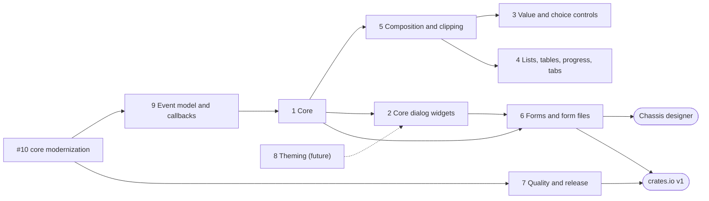

### How it fits together

```text
        Chassis (future product: drag-and-drop designer)
                 | writes                    ^ drives design mode (6.9)
                 v                           |
  form file  -- 6.4 loader --> WidgetCache (ID tree) <-- 6.5 writer
  (6.3 format)                    |   ^
      |                           |   | widgets created by type name (6.1)
      +-- 6.6 codegen --> ids.rs  |   | and configured by property (6.2)
                          |       v
  application code:  engine.on_click(form.id(main::OK), |state, ui| ...)
```

## Modern foundations

Findings from Raph Levien's *Advice for the Next 100 Rust GUIs* (Linebender, 2026), applied to Pushrod:

| Finding | Applied in |
|---|---|
| Text layout is largely solved by shared crates (Parley; Cosmic Text as an alternative) | 1.18 (#111), 1.7 (#3) |
| Accessibility via AccessKit, done well rather than box-ticking, without per-frame cost | 1.14 (#80) (now MVP) |
| Input methods (IME) are hard and often incomplete | 1.19 (#112), 2.6 (#32) |
| Layers avoid re-rendering but cost memory; use hints like repaint boundaries | 1.20 (#113), 10.2 (#106) |
| Retained mode needs stable identity and reliable caching | Stable `WidgetId`s throughout; layout and atlas caching |
| Clear module boundaries with specs; separate the design layer from the engine | 7.6 (#114), 10.3 (#107) |
| Virtualized lists need an incremental data-model interface | 4.5 (#52) |
| Precompute the static parts of a design | 6.4 (#63) |
| Performance gaps signal missed optimizations; measure | 7.7 (#115) |
| Adapt web specs rather than copy them (curated style subset) | 8.1 (#74) |

Not adopted for now: system-compositor video layers (outside SDL2's scope) and mobile platforms (the article recommends native UI there).

## Inspiration

Where each idea comes from. Pushrod takes the common, proven core of these systems and keeps it small.

| Idea | Atari GEM / classic Mac OS | AmigaOS, Motif, NeXTSTEP, Intergraph | Qt, GTK, Windows, Haiku |
|---|---|---|---|
| Widgets addressed by stable numbers; forms stored in files | GEM resource files; classic Mac dialog item numbers; Amiga gadget IDs | NeXTSTEP and Mac interface files with tags | Qt Designer files; GTK builder files |
| Behavior and state flags on each widget | GEM object flags and states | Disabled ghosting (Mac, Amiga, Motif); default-button emphasis | GTK state flags; Qt widget attributes |
| Keyboard use | GEM/Mac: Return = default, Escape/Cmd-. = cancel | Motif tab groups; Amiga/Motif underlined keys | Qt/GTK mnemonics, focus chains, shortcuts |
| Waiting only for wanted events | GEM multi-event wait with a mask |  | Event masks/controllers in GTK |
| Commands shared by menus, toolbars, keys |  | NeXTSTEP target/action | Qt actions; GTK actions |
| Event routing | Single target (GEM, classic Mac) | Fixed mouse-button roles (Intergraph workstations) | Capture/bubble (GTK); accept/ignore + filters (Qt) |
| Reusable input handling |  |  | GTK event controllers |
| Keeping values in sync |  |  | GTK property bindings; Qt property notifications |
| Layout on resize | Fixed positions | Motif form attachments; NeXTSTEP autoresizing | Qt/GTK layout managers (not adopted: too heavy) |
| Value controls | Hand-built sliders (GEM) | Amiga sliders/scrollers/cycle gadgets; Motif scale/spin box | Qt/GTK sliders, spin buttons, switches |
| Lists, tables, and hierarchies |  | Amiga list views; Motif lists; NeXTSTEP column browser | Qt/GTK item models and views; Mac Finder column view; Windows report lists |
| Dialogs and notices | GEM/Mac alerts and modal dialogs | Motif message and file dialogs | GTK info bars; Qt/GTK dialogs |
| Drawing while moving | Outline dragging (GEM, classic Mac) |  | 'Show contents while dragging' options (later desktops) |
| Modern foundations |  |  | Shared text layout (Parley), AccessKit, repaint boundaries (Flutter), drawing groups (SwiftUI), engine/design-layer split (Xilem/Masonry) |

Intergraph is thinly represented: public documentation for the Environ V forms toolkit is scarce, so it needs first-hand input before it informs more issues.

## Naming

Pushrod's vocabulary, defined in 9.1 (#93) and 1.1 (#19). Edit here and in those issues to change a name everywhere.

**Behavior flags:** `FOCUSABLE`, `TOGGLE`, `DEFAULT_ACTION`, `CANCEL_ACTION`, `DISMISSES_DIALOG`, `ACTIVATE_ON_PRESS`, `EXCLUSIVE`, `HIDDEN`

**Visual states:** `PRESSED`, `CHECKED`, `INDETERMINATE`, `DISABLED`, `FOCUSED`, `HOVERED`, `DRAG_OVER`

**Event mask classes:** `POINTER_BUTTONS`, `POINTER_MOTION`, `HOVER`, `SCROLL`, `KEYBOARD`, `TEXT`, `FOCUS`, `WINDOW`, `LIFECYCLE`, `TIMER`, `CUSTOM`, `ENGINE`

**Events:** `PointerEntered`, `PointerExited`, `PointerMoved`, `PointerPressed`, `PointerReleased`, `Clicked`, `Scrolled`, `KeyPressed`, `KeyReleased`, `TextEntered`, `FocusGained`, `FocusLost`, `Activated`, `Toggled`, `ValueChanged`, `SelectionChanged`, `TextChanged`, `EditingFinished`, `Triggered`, `ContextMenuRequested`, `PropertyChanged`, `Dropped`, `Shown`, `Hidden`, `Resized`, `Moved`, `Removed`, `WindowResized`, `WindowFocusChanged`, `CloseRequested`, `Tick`, `Engine`, `Custom`, `Raw`

**Callbacks:** `on_click`, `on_press`, `on_release`, `on_hover`, `on_activate`, `on_toggle`, `on_value_change`, `on_selection_change`, `on_text_change`, `on_editing_finished`, `on_key_press`, `on_focus_change`, `on_context_menu`, `on_drop`, `on_action`, `on_custom::<T>`, `on_event`, `on_timer`, `on_idle`, `on_start`, `on_close_request`, `on_engine_event`

**Drawing modes:** `Live`, `Outline`, `Auto`

**Engine events:** `DrawingModeChanged`, `EventMaskChanged`, `FocusChanged`, `ModalOpened`, `ModalClosed`, `MenuOpened`, `MenuClosed`, `WidgetAdded`, `WidgetRemoved`, `WidgetReparented`, `FormLoaded`, `DragStarted`, `DragEnded`, `TooltipShown`, `TooltipHidden`, `TimerFired`, `WindowOpened`, `WindowClosed`, `ScaleFactorChanged`, `ActionChanged`, `IdleStarted`, `IdleEnded`

## Epic 1: Core: behavior flags, focus, timing, and performance (#11)

Shared behavior every widget gets for free: behavior flags and visual states, event masks, keyboard focus and mnemonics, timers, GPU text, and tree editing.

**Problem.** PR #10 gives Pushrod a widget tree, mutable event handling, and callbacks, but widgets can't yet express common behavior (toggle, default button, disabled), there is no keyboard focus, events can't be filtered, and text is re-rasterized from disk on every repaint.

**Scope.** Implement shared behavior once, in the core, so every widget inherits it: behavior flags and visual states, run-loop and widget event masks, keyboard focus, mnemonics, timers and idle callbacks, a GPU glyph atlas, tree editing, accessibility, undo, and multiple windows.

**Dependencies.** Starts right after #10 and 9.1 (#93). 1.1 (#19), 1.2 (#6), 1.6 (#22), 1.7 (#3), 1.13 (#78) are parallel; focus (1.4 (#20)) needs propagation (9.2 (#94)).

| Issue | Title | Summary | Labels | Parallel | MVP | Complexity | Affected modules |
|---|---|---|---|---|---|---|---|
| 1.1 (#19) | Widget behavior flags and visual states | Behavior flags (toggle, default, cancel, exclusive, focusable, ...) and visual states (pressed, checked, disabled, ...) on every widget. | `core`, `enhancement`, `mvp`, `size/M`, `usability` | N | Y | M | `widget.rs`, `paint.rs`, `cache.rs` |
| 1.2 (#6) | Event masks for the run loop and for widgets | Filter events for the whole run loop and per widget, so only events in the mask are handled. | `core`, `enhancement`, `mvp`, `performance`, `size/M` | N | Y | M | `event.rs`, `engine.rs`, `cache.rs`, `widget.rs` |
| 1.3 (#7) | Broadcast events to all interested widgets | Window-level and application-wide events go to every widget whose mask includes them. | `core`, `enhancement`, `mvp`, `parallelizable`, `size/S` | Y | Y | S | `cache.rs`, `engine.rs` |
| 1.4 (#20) | Keyboard focus, Tab order, and Return/Escape | Focusable widgets take keyboard focus; Tab moves it; Return and Escape trigger the default and cancel buttons. | `core`, `enhancement`, `mvp`, `size/M`, `usability` | N | Y | M | `cache.rs`, `engine.rs`, `widget.rs` |
| 1.5 (#21) | Timers and idle callbacks | Repeating/one-shot timers, per-widget ticks for animation, and idle callbacks. | `core`, `enhancement`, `mvp`, `parallelizable`, `size/S` | Y | Y | S | `engine.rs`, `event.rs` |
| 1.6 (#22) | Callback registry for every widget event | on_click, on_press, on_release, on_hover, on_toggle, on_value_change, on_selection_change, on_text_change, on_editing_finished, on_activate, on_key_press, on_focus_change. | `core`, `enhancement`, `mvp`, `parallelizable`, `size/S` | Y | Y | S | `engine.rs` |
| 1.7 (#3) | GPU text: font cache with a glyph atlas texture | Load each font once, rasterize glyphs once into a GPU atlas, and draw text by blitting glyphs. | `core`, `enhancement`, `mvp`, `parallelizable`, `performance`, `size/M` | Y | Y | M | `font.rs`, `paint.rs`, `cache.rs`, `engine.rs` |
| 1.8 (#23) | Edit the widget tree at run time: remove, reparent, reorder | Remove widgets and change parent or stacking order without breaking IDs. | `core`, `enhancement`, `mvp`, `parallelizable`, `size/M` | Y | Y | M | `cache.rs`, `engine.rs` |
| 1.9 (#24) | Dirty-rectangle redraw | Only re-blit the screen regions that changed. | `core`, `parallelizable`, `performance`, `size/M` | Y | N | M | `cache.rs`, `engine.rs` |
| 1.10 (#25) | Window resize and high-DPI rendering | The root widget follows the window size; crisp rendering on high-DPI displays. | `core`, `enhancement`, `parallelizable`, `size/M` | Y | N | M | `engine.rs`, `cache.rs`, `geometry.rs` |
| 1.11 (#26) | Application lifecycle: startup and close-request callbacks | Run code before the first frame; confirm or veto closing the window. | `core`, `enhancement`, `parallelizable`, `size/S`, `usability` | Y | N | S | `engine.rs` |
| 1.12 (#76) | Keyboard mnemonics: underlined shortcut letters | Alt+letter (or the letter alone in dialogs) activates a control, shown by an underlined character. | `core`, `enhancement`, `mvp`, `size/S`, `usability` | N | Y | S | `paint.rs`, `cache.rs`, `button_widget.rs`, `text_widget.rs` |
| 1.13 (#78) | Custom application events with payloads | Applications and widgets fire their own typed events; the core ignores them but delivers them to handle_event and callbacks. | `core`, `enhancement`, `events`, `mvp`, `parallelizable`, `size/M` | Y | Y | M | `event.rs`, `engine.rs`, `cache.rs` |
| 1.14 (#80) | Accessibility: expose widgets to screen readers | Publish roles, names, states, and actions of widgets to the platform accessibility APIs. | `core`, `enhancement`, `mvp`, `parallelizable`, `size/L`, `usability` | Y | Y | L | `accessibility.rs (new)`, `widget.rs`, `engine.rs` |
| 1.15 (#81) | Undo and redo command stack | An application-level undo stack that text fields and actions can use. | `core`, `enhancement`, `parallelizable`, `size/M`, `usability` | Y | N | M | `undo.rs (new)`, `engine.rs` |
| 1.16 (#82) | Multiple windows | Open additional top-level windows, each with its own widget tree, sharing one application state. | `core`, `enhancement`, `parallelizable`, `size/L` | Y | N | L | `engine.rs`, `cache.rs` |
| 1.17 (#104) | Per-state appearance: colors, border, and font for each visual state | Every widget carries appearance attributes for normal, pressed, hovered, focused, disabled, and drag-over, so the look changes automatically as the state changes. | `core`, `enhancement`, `mvp`, `size/M`, `usability` | N | Y | M | `widget.rs`, `paint.rs`, `all widgets` |
| 1.18 (#111) | Text layout engine: shaping, bidi, line breaking, and font fallback (Parley) | Lay out text with a real layout engine and feed its glyph runs into the GPU glyph atlas. | `core`, `enhancement`, `mvp`, `size/M`, `usability` | N | Y | M | `text/layout.rs (new)`, `font.rs`, `paint.rs` |
| 1.19 (#112) | Input method (IME) support: composition text and candidate window | Show in-progress composition text in fields and position the platform candidate window at the caret. | `core`, `enhancement`, `mvp`, `size/M`, `usability` | N | Y | M | `text_field.rs`, `engine.rs`, `event.rs` |
| 1.20 (#113) | Layers and invalidation: cache hints, texture memory budget, incremental pipeline | Decide which widgets get their own GPU texture, cap texture memory, and invalidate layout, paint, and compositing separately. | `core`, `parallelizable`, `performance`, `size/M` | Y | N | M | `cache.rs`, `texture.rs`, `widget.rs` |

### 1.1 (#19): Widget behavior flags and visual states

**Problem Statement.** Every classic system stored what an object can do and how it currently looks as flags on the object itself, so selection, default buttons, and disabled appearance worked the same everywhere and could be saved in form files. Pushrod widgets only have `hidden`, so each widget would reinvent these behaviors and the form file (6.3 (#62)) would have nothing generic to store.

**Solution / Scope.** Add two bitflag types to `WidgetCore`. `Behavior`: `FOCUSABLE`, `TOGGLE` (stays pressed after a click), `DEFAULT_ACTION` (activated by Return), `CANCEL_ACTION` (activated by Escape), `DISMISSES_DIALOG` (closes the enclosing modal dialog and reports itself, 6.7 (#66)), `ACTIVATE_ON_PRESS` (fires on press, not release), `EXCLUSIVE` (one-of-many among siblings, 2.5 (#31)), `HIDDEN`. `VisualState`: `PRESSED` (shown while the mouse button is held on it; no flags = normal), `CHECKED`, `INDETERMINATE` (mixed/tri-state), `DISABLED`, `FOCUSED`, `HOVERED` (pointer inside), `DRAG_OVER` (a drag is over it, 9.8 (#100)). Default trait methods `behavior()`, `set_behavior()`, `state()`, `set_state()`, `is_enabled()`, `set_enabled()`. `HIDDEN` backs the existing `set_hidden`. `paint::state_overlay` draws DISABLED (a cached 50% dither texture copied with alpha), FOCUSED (dotted outline), and INDETERMINATE generically. Disabled widgets receive no input.

```text
Behavior (what it does)          VisualState (how it looks now)
FOCUSABLE                        PRESSED
TOGGLE                           CHECKED
DEFAULT_ACTION   (Return)        INDETERMINATE
CANCEL_ACTION    (Escape)        DISABLED
DISMISSES_DIALOG                 FOCUSED
ACTIVATE_ON_PRESS                HOVERED
EXCLUSIVE        (radio groups)  DRAG_OVER
HIDDEN
```

#### Look and behavior (proposed)

Each image shows the widget step by step, drawn in Pushrod's current style; blue notes name the event emitted. Mockups come from [`docs/mockups/generate.py`](https://github.com/KenSuenobu/rust-pushrod/blob/main/docs/mockups/generate.py): edit a frame there and re-run it to change the design, and update this section.

**The same button in each visual state**

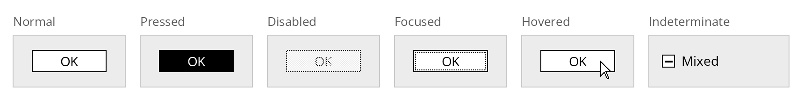

#### Events and callbacks

| Event emitted | When | Application callback |
|---|---|---|
| `StateChanged { id }` | Optional, for observers; widgets emit their semantic events (Toggled, ...) instead | `on_event(..)` |

Like every widget, it can also receive application-defined custom events in `handle_event` and emit its own (1.13 (#78)).

**Acceptance Criteria.**

- `Behavior` and `VisualState` exist on `WidgetCore` with default trait accessors
- `set_hidden`/`is_hidden` are implemented on `HIDDEN` (no API break)
- Disabled widgets are skipped by input routing and focus
- `paint::state_overlay` draws DISABLED, FOCUSED, and INDETERMINATE after `paint()`, using a cached GPU dither texture
- Tests for flags, states, and disabled routing

**Parallelism / Dependencies.** Not parallelizable. Requires PR #10 and 9.1 (#93). Blocks 1.4 (#20), 2.3 (#29), 2.4 (#30), 2.5 (#31), 6.2 (#61).

**Technical Stack.** Rust, SDL2 render API

**Documentation.** Rustdoc: `widget::Behavior`, `widget::VisualState`, `paint::state_overlay`. README/guides: 'Behavior and state' section with the table above. Examples: Disabled and default buttons in `examples/base.rs`. Screenshots: Gallery tile per state (7.3 (#71)).

**Sources.** [GEM AES object structure (flags, states, object tree)](https://www.seasip.info/Gem/aestruct.html)

### 1.2 (#6): Event masks for the run loop and for widgets

*Reuses existing issue #6.*

**Problem Statement.** Classic event loops waited only for the kinds of events an application asked for, which kept them fast and idle when nothing relevant happened. Pushrod's run loop processes every SDL event, and every pointer event is routed even to widgets that never handle events. (Original issue #6.)

**Solution / Scope.** One `EventMask` type with classes `POINTER_BUTTONS`, `POINTER_MOTION`, `HOVER`, `SCROLL`, `KEYBOARD`, `TEXT`, `FOCUS`, `WINDOW`, `LIFECYCLE`, `TIMER`, `CUSTOM`. **Run-loop mask:** `Engine::set_event_mask` / `Ui::set_event_mask` (changeable at run time). Events outside the mask are dropped before routing and callbacks; SDL event types that only feed masked-out classes are disabled at the source with `EventPump::disable_event`, so SDL never queues them. Close requests are always delivered (1.11 (#26)). With no `TIMER` class and nothing animating, the loop blocks on `wait_event_timeout` instead of polling, so idle applications use no CPU. **Widget mask:** default trait method `event_mask()` returning `EventMask::NONE`; routing, propagation (9.2 (#94)), and broadcasts skip widgets whose mask excludes the event. An event is handled only if it passes both masks. Changing either mask emits `Engine(EventMaskChanged { scope, old, new })` (9.10 (#109)).

```text
SDL2 ──(types disabled at source for masked classes)──> event pump
                                         │
                 run-loop mask ── not in mask: dropped
                                         │
           routing / propagation (9.2) / broadcast (1.3)
                                         │
                 widget mask ── not in mask: skipped
                                         │
            Widget::handle_event -> queue -> callbacks
```

**Acceptance Criteria.**

- Run-loop mask filters before routing and callbacks; changes apply on the next event
- Masked SDL event types are disabled in SDL and re-enabled when the mask changes
- Close requests are always delivered
- Idle loop blocks on `wait_event_timeout` (near-zero idle CPU)
- Widgets never receive events outside their mask; a `BoxWidget` receives nothing while a button still clicks

**Parallelism / Dependencies.** Not parallelizable. Requires 9.1 (#93). Blocks 1.3 (#7).

**Technical Stack.** Rust, SDL2 event subsystem

**Documentation.** Rustdoc: `event::EventMask`, `Engine::set_event_mask`, `Widget::event_mask`. README/guides: 'Event masks' section. Examples: Example disables pointer motion when no hover effects are needed. Screenshots: n/a.

**Sources.** [GEM AES object structure (flags, states, object tree)](https://www.seasip.info/Gem/aestruct.html)

### 1.3 (#7): Broadcast events to all interested widgets

*Reuses existing issue #7.*

**Problem Statement.** Some events aren't tied to a pointer position or the focused widget: window focus changes, window resize, theme or locale changes, and application-defined broadcasts. They should reach every widget that wants them. (Original issue #7.)

**Solution / Scope.** Add `WidgetCache::broadcast(event)`, delivering to every visible, enabled widget whose `event_mask` includes the event's class, in draw order. Window focus, window resize, and `EventTarget::Broadcast` custom events (1.13 (#78)) use it. Keyboard events are *not* broadcast: they go to the focused widget and bubble (9.2 (#94)).

**Acceptance Criteria.**

- Window focus and resize events reach widgets with `WINDOW` in their mask
- Order is deterministic (draw order) and tested

**Parallelism / Dependencies.** Parallelizable. Requires 1.2 (#6).

**Technical Stack.** Rust

**Documentation.** Rustdoc: `WidgetCache::broadcast`. README/guides: Event flow diagram updated. Examples: n/a. Screenshots: n/a.

### 1.4 (#20): Keyboard focus, Tab order, and Return/Escape

**Problem Statement.** There is no keyboard focus. Every desktop system lets users move between fields with Tab, use arrow keys within a group, press Return for the default button, and press Escape to cancel.

**Solution / Scope.** Track `focused` in `WidgetCache`. Clicking a `FOCUSABLE` widget focuses it. Tab/Shift-Tab moves between focus groups in ID order (the order designed in the form); arrow keys move within a group (for example a radio group). Return activates the `DEFAULT_ACTION` widget of the current form; Escape (and Cmd-. on macOS) activates `CANCEL_ACTION`. Focus changes emit `FocusLost` then `FocusGained`. SDL text input starts and stops with focus on text widgets. `Ui::set_focus(id)`, `Ui::focused()`. Emits its engine event (9.10 (#109)).

**Acceptance Criteria.**

- Focus moves by click, Tab, Shift-Tab, and arrows within groups
- Return/Escape activate default/cancel
- `FocusGained`/`FocusLost` delivered and tested
- `Ui::set_focus`/`Ui::focused`
- Emits the corresponding `EngineEvent` (9.10 (#109))

**Parallelism / Dependencies.** Not parallelizable. Requires 1.1 (#19), 9.1 (#93), 9.2 (#94).

**Technical Stack.** Rust, SDL2 text input

**Documentation.** Rustdoc: Focus API. README/guides: Keyboard section. Examples: Form with two fields and OK/Cancel. Screenshots: Focused field in gallery.

**Sources.** [O'Reilly Motif Programming Manual: keyboard traversal](https://www.oreilly.com/library/view/volume-6a-motif/9780596000431/chapter-44.html)

### 1.5 (#21): Timers and idle callbacks

**Problem Statement.** Applications and widgets need time-based events: caret blinking, auto-repeat on arrow buttons, indeterminate progress, clocks. Work that should run when nothing else is pending (deferred layout, incremental loading) needs an idle hook.

**Solution / Scope.** `Engine::on_timer(interval, repeat, |state, ui| ..) -> TimerId`, `Ui::cancel_timer(id)`. Widgets with `TIMER` in their mask receive `Tick { elapsed }` once per frame while they request animation (`ctx.request_animation()`). `Engine::on_idle(|state, ui| ..)` runs once per loop iteration when the event queue is empty. Timers fire from the run loop based on `Instant`. Emits its engine event (9.10 (#109)).

**Acceptance Criteria.**

- One-shot and repeating timers fire within one frame of their interval
- Timers can be cancelled from callbacks
- `Tick` only flows while a widget requests animation
- Idle callbacks run only when no events are pending
- Emits the corresponding `EngineEvent` (9.10 (#109))

**Parallelism / Dependencies.** Parallelizable. Requires 1.2 (#6).

**Technical Stack.** Rust std::time

**Documentation.** Rustdoc: `on_timer`, `on_idle`, `TimerId`, `Tick`. README/guides: Timers section. Examples: Clock label updated every second. Screenshots: n/a.

### 1.6 (#22): Callback registry for every widget event

**Problem Statement.** `on_click` and the catch-all `on_event` only cover buttons. Value controls, text fields, lists, and focus all need their own clearly named callbacks.

**Solution / Scope.** Add per-widget registration methods mapping one-to-one onto the event vocabulary (9.1 (#93)): `on_click`, `on_press` (mouse button went down on the widget), `on_release` (went up, inside or outside), `on_activate`, `on_toggle(|state, ui, checked|)`, `on_value_change`, `on_selection_change`, `on_text_change`, `on_editing_finished`, `on_key_press`, `on_focus_change(|state, ui, gained|)`, `on_hover(|state, ui, inside|)`. All share one internal map keyed by `(WidgetId, EventKind)` and return a `CallbackId` (9.7 (#99)).

**Acceptance Criteria.**

- Each method fires only for its widget and event kind
- Callbacks run in registration order after the widget updated itself
- Tests for each kind

**Parallelism / Dependencies.** Parallelizable. Requires 9.1 (#93).

**Technical Stack.** Rust

**Documentation.** Rustdoc: All `on_*` methods. README/guides: Table of callbacks (see Naming in the roadmap). Examples: Check box with `on_toggle` in the example. Screenshots: n/a.

**Sources.** [Qt: QAction (shared commands for menus, toolbars, shortcuts)](https://doc.qt.io/qt-6/qaction.html); [Apple: Target-Action](https://developer.apple.com/library/archive/documentation/General/Devpedia-CocoaApp-MOSX/TargetAction.html)

### 1.7 (#3): GPU text: font cache with a glyph atlas texture

*Reuses existing issue #3.*

**Problem Statement.** `FontCache::render_text` reloads the font from disk and rasterizes a new surface on the CPU for every repaint of every text widget. Original issue #3 also asked for the font cache to live with the `WidgetCache`.

**Solution / Scope.** Load fonts once per `(path, size, style)` (the TTF context lives for the process). Rasterize each glyph once with SDL_ttf into a glyph atlas texture on the GPU; draw strings by copying glyph rectangles with `Canvas::copy`, colored with `set_color_mod`, using SDL_ttf metrics for kerning and wrapping. Changing text or its color never rasterizes again. Move ownership of the font cache into `WidgetCache`, as #3 requested. Glyph runs come from the text layout engine (1.18 (#111)); the atlas stays the drawing path.

**Acceptance Criteria.**

- Each font is loaded at most once per process
- After warm-up, repainting text performs only texture copies
- Text color changes use color modulation
- `FontCache` is owned by `WidgetCache`

**Parallelism / Dependencies.** Parallelizable. Requires 1.18 (#111).

**Technical Stack.** Rust, sdl2::ttf, SDL2 render API

**Documentation.** Rustdoc: `font::FontCache`, atlas notes. README/guides: n/a. Examples: n/a. Screenshots: n/a.

### 1.8 (#23): Edit the widget tree at run time: remove, reparent, reorder

**Problem Statement.** Widgets can only be added. Opening and closing dialogs, list rows, and Chassis editing need removal, reparenting, and stacking-order changes.

**Solution / Scope.** `WidgetCache::remove(id)` removes a subtree, leaves a tombstone so other IDs stay stable, destroys its textures, and emits `Removed`. `reparent(id, parent)` and `set_stacking_index(id, index)` among siblings. Focus, hover, and pointer capture pointing into a removed subtree are cleared. Emits its engine event (9.10 (#109)).

**Acceptance Criteria.**

- Remaining IDs never change
- Removed textures are destroyed
- Focus/hover/capture cleared safely
- Tests for remove, reparent, reorder
- Emits the corresponding `EngineEvent` (9.10 (#109))

**Parallelism / Dependencies.** Parallelizable. Requires 9.1 (#93).

**Technical Stack.** Rust

**Documentation.** Rustdoc: New `WidgetCache` methods. README/guides: n/a. Examples: Button that adds and removes a widget. Screenshots: n/a.

### 1.9 (#24): Dirty-rectangle redraw

**Problem Statement.** Any change re-blits every widget texture. That's correct and cheap for small forms but scales with widget count.

**Solution / Scope.** Track the union of changed rectangles per frame; clip the canvas to it and copy only intersecting cached textures. Full blit on expose/resize. All on the GPU. Merge only if it beats a full blit on the gallery.

**Acceptance Criteria.**

- One changed widget copies only intersecting textures
- Golden tests (7.2 (#70)) pass
- Benchmark in the PR

**Parallelism / Dependencies.** Parallelizable. Requires 7.2 (#70).

**Technical Stack.** Rust, SDL2 clip rect

**Documentation.** Rustdoc: `draw_loop` docs. README/guides: n/a. Examples: n/a. Screenshots: n/a.

### 1.10 (#25): Window resize and high-DPI rendering

**Problem Statement.** The root widget keeps its initial size when the window is resized, and high-DPI displays get a scaled, blurry image.

**Solution / Scope.** On window resize, resize the root and apply autoresizing (5.4 (#59)). Create windows with high-DPI support and render textures at physical resolution with a logical coordinate scale so text stays sharp. Emits its engine event (9.10 (#109)).

**Acceptance Criteria.**

- Resizing resizes the root and redraws
- Text is sharp on a 2x display
- Emits the corresponding `EngineEvent` (9.10 (#109))

**Parallelism / Dependencies.** Parallelizable. Requires 5.4 (#59).

**Technical Stack.** Rust, SDL2 window/high-DPI API

**Documentation.** Rustdoc: Resize behavior. README/guides: High-DPI notes. Examples: Resizable example. Screenshots: n/a.

### 1.11 (#26): Application lifecycle: startup and close-request callbacks

**Problem Statement.** There is no hook to run code before the first frame, and no way to ask 'Save changes?' before the window closes.

**Solution / Scope.** `Engine::on_start(|state, ui| ..)` runs once before the first frame. `Engine::on_close_request(|state, ui| -> CloseDecision)` runs when the user closes the window; `CloseDecision::Stay` keeps the application running (for example while an alert asks to save). `ui.quit()` bypasses it.

**Acceptance Criteria.**

- `on_start` runs once before the first draw
- `on_close_request` can veto
- Tests via `Engine::dispatch`

**Parallelism / Dependencies.** Parallelizable. Requires 9.1 (#93).

**Technical Stack.** Rust

**Documentation.** Rustdoc: `on_start`, `on_close_request`. README/guides: Lifecycle section. Examples: Quit confirmation using an alert (2.9 (#35)). Screenshots: n/a.

### 1.12 (#76): Keyboard mnemonics: underlined shortcut letters

**Problem Statement.** Keyboard users need a direct way to reach a control without tabbing through every field. Most desktop toolkits mark a letter in the label as its keyboard equivalent.

**Solution / Scope.** Labels may contain `_` before a character (`"_Save"`); `__` is a literal underscore. `paint::text` draws the character underlined and omits the marker. Each form has a mnemonic table: Alt+letter (or the letter alone when no text field has focus) activates the control: buttons click, check boxes toggle, and a label moves focus to the next focusable widget. Duplicates are reported in debug builds.

#### Look and behavior (proposed)

Each image shows the widget step by step, drawn in Pushrod's current style; blue notes name the event emitted. Mockups come from [`docs/mockups/generate.py`](https://github.com/KenSuenobu/rust-pushrod/blob/main/docs/mockups/generate.py): edit a frame there and re-run it to change the design, and update this section.

**Labels with mnemonics: `_` marks the letter, drawn underlined**


#### Events and callbacks

| Event emitted | When | Application callback |
|---|---|---|
| `Clicked { id }` | Mnemonic activates a button | `on_click(id, ..)` |
| `Toggled { id, checked }` | Mnemonic toggles a check box | `on_toggle(id, ..)` |
| `FocusGained { id }` | Mnemonic on a label focuses the next field | `on_focus_change(id, ..)` |

Like every widget, it can also receive application-defined custom events in `handle_event` and emit its own (1.13 (#78)).

**Acceptance Criteria.**

- Markers are underlined, not drawn
- Alt+letter activates buttons and toggles check boxes; labels focus the next field
- Scoped to the topmost modal dialog
- Duplicate detection in debug builds

**Parallelism / Dependencies.** Not parallelizable. Requires 1.4 (#20).

**Technical Stack.** Rust

**Documentation.** Rustdoc: Mnemonic syntax. README/guides: Keyboard section. Examples: Mnemonics on example buttons. Screenshots: Gallery tile.

**Sources.** [AmigaOS GadTools autodoc (gadget kinds, underlined keyboard equivalents)](https://amigadev.grimore.org/Includes_and_Autodocs_2._guide/node05a3.html); [ICS: Motif widget descriptions](https://motif.ics.com/book/export/html/341)

### 1.13 (#78): Custom application events with payloads

**Problem Statement.** Applications need their own events ('document saved', 'download 40% done', 'refresh the list') that widgets and callbacks can react to without the library knowing about them, and background threads need a safe way to notify the UI thread.

**Solution / Scope.** `Event::Custom(CustomEvent)` with `CustomEvent { source: Option<WidgetId>, target: EventTarget, payload: Rc<dyn Any> }`; `EventTarget` is `Widget(id)`, `Subtree(id)`, `Broadcast`, or `ApplicationOnly`. Fire with `ui.post(target, payload)` from callbacks or `ctx.post(target, payload)` from widgets; `event.payload::<T>()` downcasts. The core never interprets custom events (no focus, capture, selection, or redraw side effects). They are queued and delivered in order to (1) `handle_event` of each targeted widget with `CUSTOM` in its mask, then (2) `on_custom::<T>(|state, ui, source, payload: &T| ..)`, then (3) `on_event`. Posting during delivery appends to the same queue, with a per-frame cap against runaway loops. `engine.sender()` returns a `Send` handle whose `post` pushes an SDL2 user event (thread-safe) that the run loop turns into a `Custom` event on the UI thread.

```text
 app callback ──ui.post(target, Payload)──┐
 widget ──ctx.post(target, Payload)───────┤
 other thread ──sender.post(..)─> SDL user event ─┤
                                          v
                               event queue (FIFO)  (core ignores Custom)
             ┌────────────────────────────┼──────────────────────────┐
             v                            v                          v
 Widget::handle_event(&Custom)   on_custom::<Payload>(..)      on_event(..)
```

#### Look and behavior (proposed)

Each image shows the widget step by step, drawn in Pushrod's current style; blue notes name the event emitted. Mockups come from [`docs/mockups/generate.py`](https://github.com/KenSuenobu/rust-pushrod/blob/main/docs/mockups/generate.py): edit a frame there and re-run it to change the design, and update this section.

**No visual; usage sketch**

```rust
 struct DownloadProgress { percent: u8 }

 // background thread
 sender.post(EventTarget::Widget(progress_id), DownloadProgress { percent: 40 });

 // the progress bar's handle_event receives Event::Custom with the payload,
 // and the application can react too:
 engine.on_custom::<DownloadProgress>(|state, ui, _source, p| state.last = p.percent);
```

#### Events and callbacks

| Event emitted | When | Application callback |
|---|---|---|
| `Custom(CustomEvent)` | Posted by `ui.post`, `ctx.post`, or `sender().post` | `Widget::handle_event` (targets), `on_custom::<T>(..)`, `on_event(..)` |

Like every widget, it can also receive application-defined custom events in `handle_event` and emit its own (1.13 (#78)).

**Acceptance Criteria.**

- `ui.post`, `ctx.post`, and `sender().post` deliver the payload intact
- Only targeted widgets receive it in `handle_event`
- `on_custom::<T>` fires only for payload type T
- No core side effects
- Runaway re-posting is capped
- Tests for each target and cross-thread posting

**Parallelism / Dependencies.** Parallelizable. Requires 9.1 (#93) and 1.2 (#6).

**Technical Stack.** Rust (`std::any`, `Rc`), SDL2 user events

**Documentation.** Rustdoc: `CustomEvent`, `EventTarget`, `Ui::post`, `EventCtx::post`, `Engine::on_custom`, `Engine::sender`. README/guides: 'Custom events' section. Examples: Background thread updates a progress bar. Screenshots: n/a.

**Sources.** [Qt: The Event System (accept/ignore, event filters, posting custom events)](https://doc.qt.io/qt-6/eventsandfilters.html)

### 1.14 (#80): Accessibility: expose widgets to screen readers

**Problem Statement.** Because Pushrod draws everything itself, screen readers can't see its controls. Native-widget toolkits get accessibility from the OS; self-drawn toolkits must publish an accessibility tree.

**Solution / Scope.** Give each widget an accessibility role, label, value, and state (default trait method with sensible defaults per widget), and publish the tree with the AccessKit crate, which bridges to Windows, macOS, and Linux accessibility APIs while Pushrod keeps drawing everything through SDL2. Focus changes and value changes update the tree; accessibility actions (press, focus, set value) map onto normal Pushrod events. Do it well, not as box-ticking: build the AccessKit tree from stable `WidgetId`s and send only incremental updates for widgets whose role, name, value, or state changed, never a full rebuild per frame; activate it lazily so applications pay nothing when no assistive technology is running. Composite parts (5.2 (#57)) appear as children, and text fields expose their text and selection.

**Acceptance Criteria.**

- A screen reader announces focused buttons, check boxes, and text fields with name and state
- Accessibility actions trigger the same callbacks as user input
- Updates are incremental (changed nodes only) and the tree is only built when assistive technology is active

**Parallelism / Dependencies.** Parallelizable. Requires 1.1 (#19), 1.4 (#20), 6.2 (#61).

**Technical Stack.** Rust, AccessKit (new optional dependency)

**Documentation.** Rustdoc: Accessibility trait methods. README/guides: Accessibility section. Examples: Example works with a screen reader. Screenshots: n/a.

**Sources.** [Raph Levien, "Advice for the Next 100 Rust GUIs" (Linebender blog, 2026)](https://linebender.org/blog/next-100-guis/); [AccessKit: cross-platform accessibility infrastructure](https://github.com/AccessKit/accesskit)

### 1.15 (#81): Undo and redo command stack

**Problem Statement.** Users expect Undo/Redo. Without a shared mechanism each application and widget implements its own, and text fields can't participate in application undo.

**Solution / Scope.** `UndoStack` of `Command` objects (`apply`, `revert`, optional `merge` for typing runs) owned by the application state or a form. Text fields push edits by default; Undo/Redo actions (9.5 (#97)) are enabled from `can_undo`/`can_redo`. Chassis uses the same stack for design edits.

**Acceptance Criteria.**

- Undo/redo of text edits and application commands
- Consecutive typing merges into one undo step
- Undo/Redo actions enable and disable automatically

**Parallelism / Dependencies.** Parallelizable. Requires 9.5 (#97).

**Technical Stack.** Rust

**Documentation.** Rustdoc: `undo` module. README/guides: Undo section. Examples: Text field with undo. Screenshots: n/a.

### 1.16 (#82): Multiple windows

**Problem Statement.** Pushrod drives one window. Tool palettes, inspectors (Chassis), and secondary documents need more.

**Solution / Scope.** `Ui::open_window(title, size) -> WindowId` creates an SDL window with its own canvas and `WidgetCache`; events carry the window ID; widget IDs are unique per window; callbacks receive the window in `Ui`. Closing a window emits `CloseRequested` for that window. Emits its engine event (9.10 (#109)).

**Acceptance Criteria.**

- Two windows render and receive input independently
- Callbacks can reach widgets in any window
- Closing one window doesn't end the application unless it's the last
- Emits the corresponding `EngineEvent` (9.10 (#109))

**Parallelism / Dependencies.** Parallelizable. Requires 9.1 (#93).

**Technical Stack.** Rust, SDL2 windows

**Documentation.** Rustdoc: Window API. README/guides: Windows section. Examples: Example with a second window. Screenshots: n/a.

### 1.17 (#104): Per-state appearance: colors, border, and font for each visual state

**Problem Statement.** Today a widget's look is hard-coded per state (the button inverts when pressed). Applications can't say 'this button turns blue on hover' or 'this field gets a thicker border when focused', and every widget re-implements its own state colors.

**Solution / Scope.** Add `StateStyle { background, foreground, border_color, border_width, font: Option<TextStyle> }` and an `Appearance` on `WidgetCore` holding one `StateStyle` per visual state: `normal`, `pressed`, `hovered`, `focused`, `disabled`, `checked`, `drag_over`. Unset fields fall back to `normal`, and `normal` falls back to the built-in defaults (today's look: pressed = inverted). `paint` helpers read the *effective* style for the current state (`self.style()`), so widgets get state-dependent appearance without code. API: `set_style(VisualState::HOVERED, StateStyle { background: Some(..), .. })`, `appearance_mut()`. State changes (pointer enter/exit, press/release, drag in/out, focus) invalidate only when the effective style actually changes. Appearance is a property (6.2 (#61)), so form files and Chassis store it, and parts of composites (5.2 (#57)) have their own.

```text
state change ──> effective style = appearance[state] ⟶ falls back to appearance.normal ⟶ built-in default
                  │
                  └─> repaint only if the effective style changed
```

#### Look and behavior (proposed)

Each image shows the widget step by step, drawn in Pushrod's current style; blue notes name the event emitted. Mockups come from [`docs/mockups/generate.py`](https://github.com/KenSuenobu/rust-pushrod/blob/main/docs/mockups/generate.py): edit a frame there and re-run it to change the design, and update this section.

**One button through its states with a custom appearance (hover = blue, pressed = dark blue)**


**A drop target in its drag-over state**


#### Events and callbacks

| Event emitted | When | Application callback |
|---|---|---|
| `PointerEntered / PointerExited { id }` | Pointer moves in or out (hover state) | `on_hover(id, ..)` |
| `PointerPressed / PointerReleased { id }` | Mouse button down / up on the widget (pressed state) | `on_press(id, ..)`, `on_release(id, ..)` |

Like every widget, it can also receive application-defined custom events in `handle_event` and emit its own (1.13 (#78)).

**Acceptance Criteria.**

- `StateStyle` and `Appearance` on every widget with fallback to normal and built-in defaults
- Hover, press/release, focus, disabled, checked, and drag-over switch the effective style automatically
- Default look unchanged (golden images identical)
- Repaint only when the effective style changes
- Stored in form files

**Parallelism / Dependencies.** Not parallelizable. Requires 1.1 (#19), 9.1 (#93).

**Technical Stack.** Rust

**Documentation.** Rustdoc: `StateStyle`, `Appearance`, `Widget::style`. README/guides: 'Appearance and states' section. Examples: Example: hover color on a button. Screenshots: Gallery tile per state.

**Sources.** [GEM AES object structure (flags, states, object tree)](https://www.seasip.info/Gem/aestruct.html)

### 1.18 (#111): Text layout engine: shaping, bidi, line breaking, and font fallback (Parley)

**Problem Statement.** SDL_ttf renders strings but doesn't handle complex scripts, right-to-left text, proper line breaking, font fallback for missing glyphs, or the caret and selection geometry that text fields need. Writing that ourselves would be a large, error-prone project; the ecosystem has converged on shared solutions.

**Solution / Scope.** Use Parley for text layout (shaping, bidirectional text, line breaking, font fallback, alignment) and its cursor/selection geometry for text fields. Glyphs from the layout are rasterized once into the GPU glyph atlas (1.7 (#3)) and drawn by copying atlas rectangles, so the GPU-first design is unchanged. Text layouts are cached per widget and recomputed only when text, font, or width changes. Keep the layout behind a small `TextLayout` trait so Cosmic Text can be swapped in (avoiding a monoculture) and a bitmap-font layout can serve vintage targets (10.4 (#108)).

**Acceptance Criteria.**

- Arabic/Hebrew (RTL), CJK, and emoji fallback render correctly in labels and fields
- Caret and selection geometry from the layout engine drive text fields
- Layouts cached and recomputed only on text/font/width change
- `TextLayout` trait with the Parley implementation as default

**Parallelism / Dependencies.** Not parallelizable. Requires 10.2 (#106).

**Technical Stack.** Rust, Parley (new dependency), SDL2 render API

**Documentation.** Rustdoc: `TextLayout`, layout caching. README/guides: 'Text' section. Examples: International text sample in the gallery. Screenshots: Gallery tile.

**Sources.** [Raph Levien, "Advice for the Next 100 Rust GUIs" (Linebender blog, 2026)](https://linebender.org/blog/next-100-guis/); [Parley: rich text layout (Linebender)](https://github.com/linebender/parley)

### 1.19 (#112): Input method (IME) support: composition text and candidate window

**Problem Statement.** Chinese, Japanese, and Korean users type through an input method: keystrokes produce composition (pre-edit) text that is shown underlined until committed, and the platform shows a candidate list near the caret. Without this, text fields are unusable for a large share of users.

**Solution / Scope.** Handle SDL's text-editing events: show composition text inline at the caret with an underline (and the IME's own cursor/selection within it), replace it on each update, and insert it on commit (`TextEntered`). Report the caret rectangle with SDL's text-input rectangle so the platform candidate window appears next to the caret. Emit `CompositionStarted/Updated/Ended` engine events (9.10 (#109)). Works for single-line fields and the text area.

#### Look and behavior (proposed)

Each image shows the widget step by step, drawn in Pushrod's current style; blue notes name the event emitted. Mockups come from [`docs/mockups/generate.py`](https://github.com/KenSuenobu/rust-pushrod/blob/main/docs/mockups/generate.py): edit a frame there and re-run it to change the design, and update this section.

**Composing Japanese in a text field**

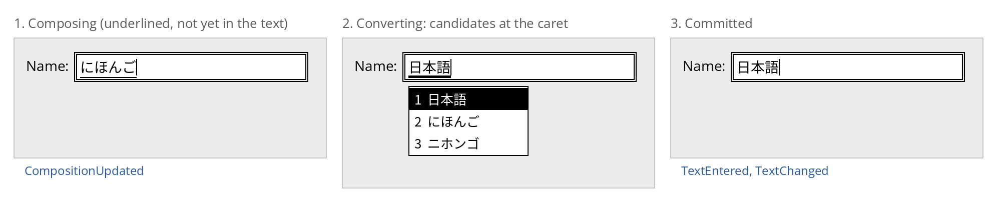

#### Events and callbacks

| Event emitted | When | Application callback |
|---|---|---|
| `Engine(CompositionStarted / CompositionUpdated / CompositionEnded)` | Input method composition begins, changes, or ends | `on_engine_event(..)` |
| `TextChanged { id }` | Only when the composition is committed | `on_text_change(id, ..)` |

Like every widget, it can also receive application-defined custom events in `handle_event` and emit its own (1.13 (#78)).

**Acceptance Criteria.**

- Japanese and Chinese input methods compose and commit correctly in a text field
- Candidate window appears at the caret and follows it
- Composition never fires `TextChanged` until committed

**Parallelism / Dependencies.** Not parallelizable. Requires 1.4 (#20), 1.18 (#111).

**Technical Stack.** Rust, SDL2 text input/editing events

**Documentation.** Rustdoc: IME behavior in text widget docs. README/guides: 'Text input' section. Examples: Gallery field tested with an IME. Screenshots: Gallery tile.

**Sources.** [Raph Levien, "Advice for the Next 100 Rust GUIs" (Linebender blog, 2026)](https://linebender.org/blog/next-100-guis/)

### 1.20 (#113): Layers and invalidation: cache hints, texture memory budget, incremental pipeline

**Problem Statement.** Pushrod gives every widget its own texture. Cached layers avoid re-rendering unchanged content, but they cost GPU memory, and too many small layers can be slower than drawing into a parent. A toolkit is at heart an incremental computation engine: work should be redone only at the level that changed.

**Solution / Scope.** Add `CacheHint { Own, Parent, Auto }` per widget: `Own` keeps a texture (a repaint boundary), `Parent` paints into the nearest ancestor's texture, `Auto` uses heuristics (size, repaint frequency, child count). A texture memory budget with LRU eviction frees textures of hidden or rarely changing widgets. Split invalidation into three levels: layout (size/position or text layout changed), paint (appearance changed), and composite (only position or visibility changed, so no repaint, just a re-blit). Report texture memory in benchmarks (7.7 (#115)).

**Acceptance Criteria.**

- Cache hints honored; Auto measurably reduces texture count on the gallery
- Memory budget enforced with eviction
- Moving a widget re-composites without repainting
- Golden images unchanged

**Parallelism / Dependencies.** Parallelizable. Requires 10.2 (#106), 7.7 (#115).

**Technical Stack.** Rust, SDL2

**Documentation.** Rustdoc: `CacheHint`, invalidation levels. README/guides: 'Performance' section. Examples: n/a. Screenshots: n/a.

**Sources.** [Raph Levien, "Advice for the Next 100 Rust GUIs" (Linebender blog, 2026)](https://linebender.org/blog/next-100-guis/)

## Epic 2: Core dialog widgets (#12)

The widgets every dialog needs: labels, buttons, check boxes, radio groups, text fields, images, alerts, menus, tooltips, toolbars, and more.

**Problem.** Pushrod has four widgets (base, box, text, button). Real dialogs need the rest of the everyday vocabulary that every desktop system, from GEM and the classic Mac to Qt and GTK, converged on.

**Scope.** Implement the everyday dialog widgets, each composed from `paint` helpers and drawn in Pushrod's current flat style. Ideas come from GEM, classic Mac OS, AmigaOS, Motif, NeXTSTEP, Qt, GTK, Windows, and Haiku; names are Pushrod's own.

**Dependencies.** Needs behavior flags (1.1 (#19)) and callbacks (1.6 (#22)); text entry needs focus (1.4 (#20)). Simple widgets (2.1 (#27), 2.7 (#33), 2.10 (#36), 2.14 (#83)) can start right after #10.

| Issue | Title | Summary | Labels | Parallel | MVP | Complexity | Affected modules |
|---|---|---|---|---|---|---|---|
| 2.1 (#27) | Boxed label widget | Text with background and border. | `good first issue`, `mvp`, `parallelizable`, `size/S`, `widget` | Y | Y | S | `boxed_label.rs (new)` |
| 2.2 (#28) | Glyph button (small single-character button) | A small box with an arrow or symbol, used for scroll arrows, close boxes, and spin buttons. | `mvp`, `parallelizable`, `size/S`, `widget` | Y | Y | S | `glyph_button.rs (new)` |
| 2.3 (#29) | Button behaviors: default, cancel, toggle, activate-on-press, dismiss dialog | Drive ButtonWidget behavior from behavior flags. | `enhancement`, `mvp`, `size/S`, `usability`, `widget` | N | Y | S | `button_widget.rs`, `paint.rs` |
| 2.4 (#30) | Check box with indeterminate state | Box with a check mark and label; toggles checked; optional mixed state. | `enhancement`, `mvp`, `parallelizable`, `size/S`, `widget` | Y | Y | S | `check_box.rs (new)` |
| 2.5 (#31) | Radio buttons and radio groups | One-of-many selection among sibling widgets. | `enhancement`, `mvp`, `parallelizable`, `size/S`, `widget` | Y | Y | S | `radio_button.rs (new)`, `cache.rs` |
| 2.6 (#32) | Text field: single-line entry with input masks, validation, and numeric mode | Single-line text entry with caret, selection, clipboard, input mask, validator, and numeric mode. | `enhancement`, `mvp`, `size/L`, `widget` | N | Y | L | `text_field.rs (new)`, `paint.rs` |
| 2.7 (#33) | Image widget | Display a PNG/BMP image centered, stretched, scaled to fit, or tiled. | `enhancement`, `mvp`, `parallelizable`, `size/S`, `widget` | Y | Y | S | `image_widget.rs (new)`, `texture.rs` |
| 2.8 (#34) | Icon widget (picture with caption) | Picture with a caption, selectable and double-clickable, like desktop icons. | `enhancement`, `parallelizable`, `size/S`, `widget` | Y | N | S | `icon_widget.rs (new)` |
| 2.9 (#35) | Alert dialog | One-call modal alert with icon, message, and up to three buttons. | `enhancement`, `forms`, `mvp`, `size/M`, `widget` | N | Y | M | `alert.rs (new)`, `engine.rs` |
| 2.10 (#36) | Custom paint widget (closure-drawn) | One-off custom drawing without writing a widget struct. | `enhancement`, `good first issue`, `mvp`, `parallelizable`, `size/S`, `widget` | Y | Y | S | `custom_paint.rs (new)` |
| 2.11 (#37) | Menu bar and drop-down menus (drawn by Pushrod) | Menu bar with drop-down menus, separators, check marks, submenus, shortcuts, and mnemonics. | `enhancement`, `parallelizable`, `size/L`, `widget` | Y | N | L | `menu.rs (new)`, `cache.rs`, `engine.rs` |
| 2.12 (#38) | File chooser dialog (drawn by Pushrod) | Choose a file or directory with a consistent look on every platform. | `enhancement`, `forms`, `parallelizable`, `size/L`, `widget` | Y | N | L | `file_chooser.rs (new)` |
| 2.13 (#77) | Tooltips | Short help text shown after the pointer rests on a widget. | `enhancement`, `parallelizable`, `size/S`, `usability`, `widget` | Y | N | S | `cache.rs`, `tooltip.rs (new)` |
| 2.14 (#83) | Separator line | Horizontal or vertical divider line. | `good first issue`, `mvp`, `parallelizable`, `size/S`, `widget` | Y | Y | S | `separator.rs (new)` |
| 2.15 (#84) | Toolbar | A row of icon/text buttons bound to actions. | `enhancement`, `parallelizable`, `size/M`, `widget` | Y | N | M | `toolbar.rs (new)` |
| 2.16 (#85) | Status bar | A strip at the bottom of the window for messages and status fields. | `enhancement`, `parallelizable`, `size/S`, `widget` | Y | N | S | `status_bar.rs (new)` |
| 2.17 (#86) | Switch (on/off slide toggle) | A sliding on/off switch for settings that take effect immediately. | `enhancement`, `parallelizable`, `size/S`, `widget` | Y | N | S | `switch.rs (new)` |
| 2.18 (#87) | Multi-line text area | Multi-line plain-text editing with scrolling, selection, clipboard, and undo. | `enhancement`, `size/L`, `widget` | N | N | L | `text_area.rs (new)` |
| 2.19 (#88) | Context menus | Right-click (or long-press) pop-up menus for a widget. | `enhancement`, `parallelizable`, `size/S`, `usability`, `widget` | Y | N | S | `menu.rs`, `cache.rs` |
| 2.20 (#89) | Message bar (non-modal inline notice) | A dismissible banner for warnings and information that doesn't block the window. | `enhancement`, `parallelizable`, `size/S`, `usability`, `widget` | Y | N | S | `message_bar.rs (new)` |

### 2.1 (#27): Boxed label widget

**Problem Statement.** Boxed labels (text with a background and border) are common in dialogs and status areas, but need two stacked widgets today.

**Solution / Scope.** Add `BoxedLabel` = `fill` + `text` + `border`, reusing `TextStyle`. Kept under 100 lines as the reference example of composing paint helpers.

#### Look and behavior (proposed)

Each image shows the widget step by step, drawn in Pushrod's current style; blue notes name the event emitted. Mockups come from [`docs/mockups/generate.py`](https://github.com/KenSuenobu/rust-pushrod/blob/main/docs/mockups/generate.py): edit a frame there and re-run it to change the design, and update this section.

**Normal and disabled**

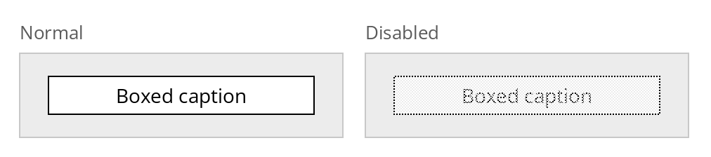

#### Events and callbacks

| Event emitted | When | Application callback |
|---|---|---|
| (none) | Display only | n/a |

Like every widget, it can also receive application-defined custom events in `handle_event` and emit its own (1.13 (#78)).

**Acceptance Criteria.**

- Renders background, centered text, border
- Display only (empty event mask)

**Parallelism / Dependencies.** Parallelizable. Requires PR #10.

**Technical Stack.** Rust

**Documentation.** Rustdoc: Module docs. README/guides: Widget list. Examples: Gallery. Screenshots: Gallery tile.

**Sources.** [GEM AES object structure (flags, states, object tree)](https://www.seasip.info/Gem/aestruct.html)

### 2.2 (#28): Glyph button (small single-character button)

**Problem Statement.** Scroll bars, spin boxes, and title gadgets need a small button showing one symbol, often repeating while held.

**Solution / Scope.** Add `GlyphButton { glyph: char }`: fill + centered glyph + border; inverted while pressed. With `ACTIVATE_ON_PRESS` it fires on press and auto-repeats while held (400 ms delay, then every 100 ms, via timers).

#### Look and behavior (proposed)

Each image shows the widget step by step, drawn in Pushrod's current style; blue notes name the event emitted. Mockups come from [`docs/mockups/generate.py`](https://github.com/KenSuenobu/rust-pushrod/blob/main/docs/mockups/generate.py): edit a frame there and re-run it to change the design, and update this section.

**1. Idle 2. Pressed (fires immediately) 3. Held: repeats 4. Released 5. Disabled**

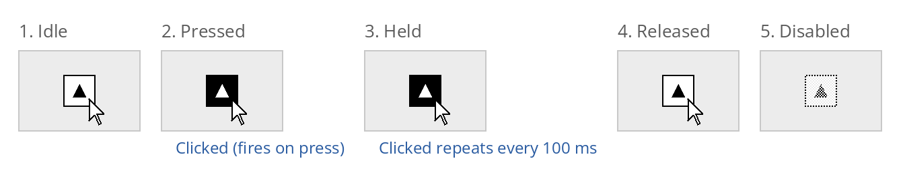

#### Events and callbacks

| Event emitted | When | Application callback |
|---|---|---|
| `Clicked { id }` | On press, then on each auto-repeat | `on_click(id, ..)` |

Like every widget, it can also receive application-defined custom events in `handle_event` and emit its own (1.13 (#78)).

**Acceptance Criteria.**

- Centered glyph
- Pressed state inverts
- Activate-on-press with auto-repeat

**Parallelism / Dependencies.** Parallelizable. Requires 1.1 (#19), 1.5 (#21).

**Technical Stack.** Rust

**Documentation.** Rustdoc: Module docs. README/guides: Widget list. Examples: Gallery. Screenshots: Gallery tile.

**Sources.** [GEM AES object structure (flags, states, object tree)](https://www.seasip.info/Gem/aestruct.html); [ICS: Motif widget descriptions](https://motif.ics.com/book/export/html/341)

### 2.3 (#29): Button behaviors: default, cancel, toggle, activate-on-press, dismiss dialog

**Problem Statement.** `ButtonWidget` is only a push button. Dialogs need a visibly distinct default button (Return), a cancel button (Escape), toggle buttons, buttons that fire on press, and buttons that close a dialog.

**Solution / Scope.** Behavior comes from flags (1.1 (#19)): `DEFAULT_ACTION` draws a 2 px ring and is triggered by Return; `CANCEL_ACTION` by Escape; `TOGGLE` stays pressed and emits `Toggled`; `ACTIVATE_ON_PRESS` emits `Clicked` on press; `DISMISSES_DIALOG` closes the modal dialog (6.7 (#66)) and reports its ID. Pressed inversion moves to shared state painting.

#### Look and behavior (proposed)

Each image shows the widget step by step, drawn in Pushrod's current style; blue notes name the event emitted. Mockups come from [`docs/mockups/generate.py`](https://github.com/KenSuenobu/rust-pushrod/blob/main/docs/mockups/generate.py): edit a frame there and re-run it to change the design, and update this section.

**Push button: 1. idle 2. pressed 3. dragged out (releases) 4. released inside -> Clicked**

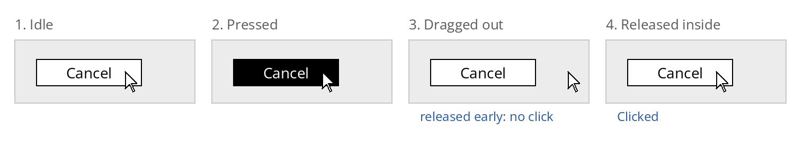

**Default button: 2 px ring, Return activates it**

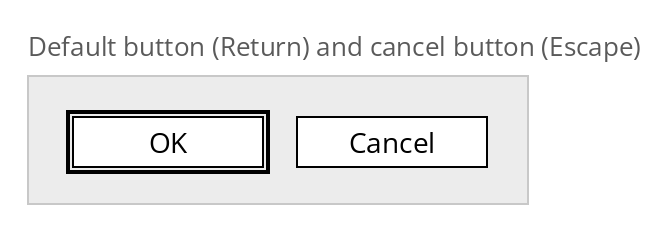

**Toggle button: click stays pressed, click again releases**

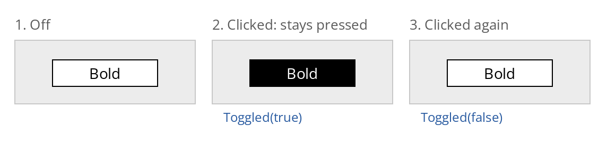

#### Events and callbacks

| Event emitted | When | Application callback |
|---|---|---|
| `Clicked { id, button, count }` | Push/default/cancel: release inside; activate-on-press: press | `on_click(id, ..)` |
| `Toggled { id, checked }` | Toggle button changes state | `on_toggle(id, ..)` |

Like every widget, it can also receive application-defined custom events in `handle_event` and emit its own (1.13 (#78)).

**Acceptance Criteria.**

- Each flag combination behaves as described and is tested
- Default button is recognizable at a glance
- No regression in PR #10 click tests

**Parallelism / Dependencies.** Not parallelizable. Requires 1.1 (#19), 1.6 (#22).

**Technical Stack.** Rust

**Documentation.** Rustdoc: Behavior table on `ButtonWidget`. README/guides: n/a. Examples: OK (default) / Cancel in example. Screenshots: Gallery tile.

**Sources.** [GEM AES object structure (flags, states, object tree)](https://www.seasip.info/Gem/aestruct.html); [ICS: Motif widget descriptions](https://motif.ics.com/book/export/html/341)

### 2.4 (#30): Check box with indeterminate state

**Problem Statement.** A first-class check box is expected everywhere, including a 'mixed' state when it summarizes several items.

**Solution / Scope.** Add `CheckBox`: square + check mark when `CHECKED`, a dash when `INDETERMINATE`, followed by a label. Clicking the box or label toggles and emits `Toggled`; Space toggles when focused; clicking an indeterminate box makes it checked.

#### Look and behavior (proposed)

Each image shows the widget step by step, drawn in Pushrod's current style; blue notes name the event emitted. Mockups come from [`docs/mockups/generate.py`](https://github.com/KenSuenobu/rust-pushrod/blob/main/docs/mockups/generate.py): edit a frame there and re-run it to change the design, and update this section.

**1. Unchecked 2. Pressed 3. Checked 4. Indeterminate 5. Focused 6. Disabled**

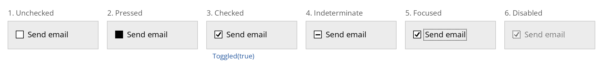

#### Events and callbacks

| Event emitted | When | Application callback |
|---|---|---|
| `Toggled { id, checked }` | Click, Space, or mnemonic | `on_toggle(id, ..)` |
| `FocusGained / FocusLost { id }` | Keyboard focus moves | `on_focus_change(id, ..)` |

Like every widget, it can also receive application-defined custom events in `handle_event` and emit its own (1.13 (#78)).

**Acceptance Criteria.**

- Click, Space, and mnemonic toggle
- Indeterminate renders and resolves on click
- Label click toggles

**Parallelism / Dependencies.** Parallelizable. Requires 1.1 (#19), 1.6 (#22).

**Technical Stack.** Rust

**Documentation.** Rustdoc: Module docs. README/guides: Widget list. Examples: Example + gallery. Screenshots: Gallery tile.

### 2.5 (#31): Radio buttons and radio groups

**Problem Statement.** Choosing exactly one of a few options is everywhere; selecting one radio button must clear its siblings, which needs core support.

**Solution / Scope.** Add `RadioButton` (circle + label) with the `EXCLUSIVE` behavior. When one becomes checked, exclusive siblings under the same parent are cleared and `Toggled` is emitted for the newly checked one (and `Toggled(false)` for the one cleared). `RadioGroup::new(labels)` builds a labeled group in one call; `ui.checked_in_group(parent)`. Arrow keys move within the group (1.4 (#20)).

#### Look and behavior (proposed)

Each image shows the widget step by step, drawn in Pushrod's current style; blue notes name the event emitted. Mockups come from [`docs/mockups/generate.py`](https://github.com/KenSuenobu/rust-pushrod/blob/main/docs/mockups/generate.py): edit a frame there and re-run it to change the design, and update this section.

**1. Medium checked 2. Pressing Large 3. Released: Large checked, Medium cleared**

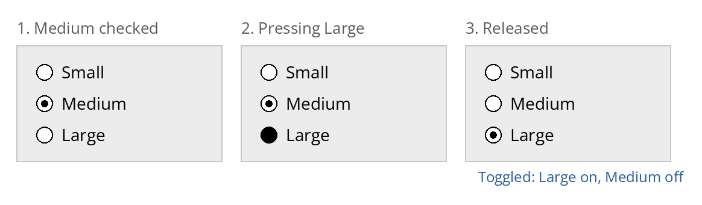

#### Events and callbacks

| Event emitted | When | Application callback |
|---|---|---|
| `Toggled { id, checked }` | A radio becomes checked or is cleared | `on_toggle(id, ..)`; `ui.checked_in_group(parent)` |

Like every widget, it can also receive application-defined custom events in `handle_event` and emit its own (1.13 (#78)).

**Acceptance Criteria.**

- Exactly one exclusive sibling is checked after any change
- Works for any widget with `EXCLUSIVE`
- Arrow keys move within the group

**Parallelism / Dependencies.** Parallelizable. Requires 1.1 (#19), 1.6 (#22).

**Technical Stack.** Rust

**Documentation.** Rustdoc: Module docs. README/guides: Widget list. Examples: Size picker in example. Screenshots: Gallery tile.

**Sources.** [AmigaOS GadTools autodoc (gadget kinds, underlined keyboard equivalents)](https://amigadev.grimore.org/Includes_and_Autodocs_2._guide/node05a3.html)

### 2.6 (#32): Text field: single-line entry with input masks, validation, and numeric mode

**Problem Statement.** There is no text input. Fields need a caret, selection, clipboard, and a way to restrict and validate input.

**Solution / Scope.** Add `TextField`: caret (blinking via timers), selection with Shift+arrows and mouse drag, Home/End, word movement, clipboard via SDL, max length, placeholder text, password mode. Restrict input with an input mask (`"99/99/9999"`, `9` digit, `A` letter, `X` any) or a `Validator` trait (`validate(&str) -> Valid | Intermediate | Invalid`); `IntegerField`/`NumberField` presets with range. Optional built-in label (`with_label("Name:")`). Uses SDL text input events. Emits `TextChanged` on each edit and `EditingFinished` on Return or focus loss. Input method composition is handled per 1.19 (#112).

#### Look and behavior (proposed)

Each image shows the widget step by step, drawn in Pushrod's current style; blue notes name the event emitted. Mockups come from [`docs/mockups/generate.py`](https://github.com/KenSuenobu/rust-pushrod/blob/main/docs/mockups/generate.py): edit a frame there and re-run it to change the design, and update this section.

**1. empty 2. focused 3. typing 4. selection 5. rejected character 6. disabled**


**Input mask `99/99/9999`**


#### Events and callbacks

| Event emitted | When | Application callback |
|---|---|---|
| `TextChanged { id }` | Every edit; read `text()` | `on_text_change(id, ..)` |
| `EditingFinished { id }` | Return or focus loss (validate here) | `on_editing_finished(id, ..)` |
| `KeyPressed { id, key, modifiers }` | Keys while focused | `on_key_press(id, ..)` |

Like every widget, it can also receive application-defined custom events in `handle_event` and emit its own (1.13 (#78)).

**Acceptance Criteria.**

- Typing, deleting, caret movement, selection, copy/paste
- Masks and validators reject invalid input
- Numeric mode with range
- `EditingFinished` on Return and focus loss

**Parallelism / Dependencies.** Not parallelizable. Requires 1.4 (#20), 1.5 (#21), 1.6 (#22), 1.19 (#112).

**Technical Stack.** Rust, SDL2 text input and clipboard

**Documentation.** Rustdoc: Module docs incl. mask characters. README/guides: Widget list. Examples: Name and age fields in example. Screenshots: Gallery tile.

**Sources.** [GEM AES object structure (flags, states, object tree)](https://www.seasip.info/Gem/aestruct.html); [AmigaOS GadTools autodoc (gadget kinds, underlined keyboard equivalents)](https://amigadev.grimore.org/Includes_and_Autodocs_2._guide/node05a3.html)

### 2.7 (#33): Image widget

**Problem Statement.** There is no way to show a bitmap.

**Solution / Scope.** `ImageWidget` loads an image once with SDL2_image into a shared GPU texture cache keyed by path and copies it with a fit mode: `Center`, `Stretch`, `Fit` (keep aspect), `Tile`. Missing files draw a crossed box instead of panicking.

#### Look and behavior (proposed)

Each image shows the widget step by step, drawn in Pushrod's current style; blue notes name the event emitted. Mockups come from [`docs/mockups/generate.py`](https://github.com/KenSuenobu/rust-pushrod/blob/main/docs/mockups/generate.py): edit a frame there and re-run it to change the design, and update this section.

**Fit modes and missing file**

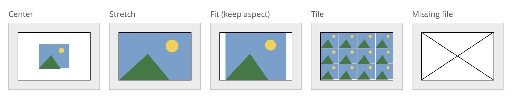

#### Events and callbacks

| Event emitted | When | Application callback |
|---|---|---|
| `Clicked { id }` | Only if made clickable | `on_click(id, ..)` |

Like every widget, it can also receive application-defined custom events in `handle_event` and emit its own (1.13 (#78)).

**Acceptance Criteria.**

- Loads PNG and BMP
- Fit modes render as documented
- Missing files don't panic

**Parallelism / Dependencies.** Parallelizable. Requires PR #10.

**Technical Stack.** Rust, sdl2::image

**Documentation.** Rustdoc: Module docs. README/guides: Widget list. Examples: Logo in example. Screenshots: Gallery tile.

### 2.8 (#34): Icon widget (picture with caption)

**Problem Statement.** Launchers, file views, and tool palettes use icons with captions.

**Solution / Scope.** `IconWidget` = image + caption; click selects (caption inverted), double-click or Return activates.

#### Look and behavior (proposed)

Each image shows the widget step by step, drawn in Pushrod's current style; blue notes name the event emitted. Mockups come from [`docs/mockups/generate.py`](https://github.com/KenSuenobu/rust-pushrod/blob/main/docs/mockups/generate.py): edit a frame there and re-run it to change the design, and update this section.

**1. Idle 2. Selected 3. Activated (double-click)**

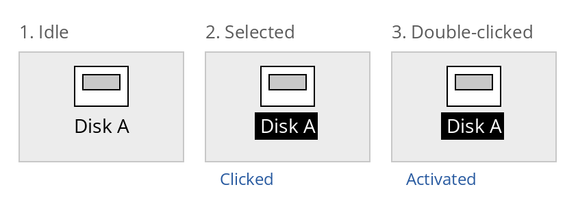

#### Events and callbacks

| Event emitted | When | Application callback |
|---|---|---|
| `Clicked { id, count }` | Click selects | `on_click(id, ..)` |
| `Activated { id }` | Double-click or Return | `on_activate(id, ..)` |

Like every widget, it can also receive application-defined custom events in `handle_event` and emit its own (1.13 (#78)).

**Acceptance Criteria.**

- Selection inverts the caption
- Double-click and Return emit `Activated`

**Parallelism / Dependencies.** Parallelizable. Requires 1.6 (#22), 2.7 (#33).

**Technical Stack.** Rust

**Documentation.** Rustdoc: Module docs. README/guides: Widget list. Examples: Gallery. Screenshots: Gallery tile.

### 2.9 (#35): Alert dialog

**Problem Statement.** Every system has a one-call alert (icon, message, a few buttons). Pushrod has no modal dialogs.

**Solution / Scope.** `ui.alert(AlertKind, title, message, buttons, default, |state, ui, choice| ..)` builds a centered modal form (6.7 (#66)) from existing widgets and calls the completion closure with the chosen button index. Return chooses the default, Escape the last button. Always drawn by Pushrod. **Parts (5.2 (#57)):** `AlertParts { icon, title, message, buttons }`; `add_button`, `remove_button`, `set_default_button`. Every part can be retrieved and restyled (font, color, text). Example: `let a = ui.alert(..); ui.get_mut::<TextWidget>(a.parts().message)?.set_font_color(Color::RED); a.add_button(ui, "Help");`

#### Look and behavior (proposed)

Each image shows the widget step by step, drawn in Pushrod's current style; blue notes name the event emitted. Mockups come from [`docs/mockups/generate.py`](https://github.com/KenSuenobu/rust-pushrod/blob/main/docs/mockups/generate.py): edit a frame there and re-run it to change the design, and update this section.

**1. Alert opens centered; the rest of the window is drawn but inert**

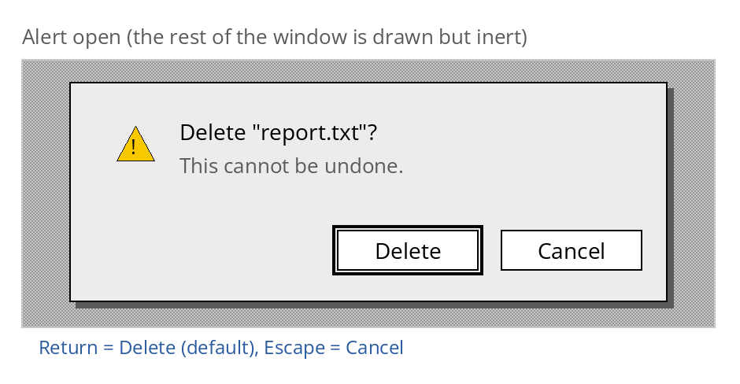

**2. Return = Delete (default), Escape = Cancel  3. Closes; completion gets the index**

```rust
 ui.alert(AlertKind::Warning, "Delete \"report.txt\"?", "This cannot be undone.",
          &["Delete", "Cancel"], 0, |state, ui, choice| if choice == 0 { /* delete */ });
```

**Customized through its parts: bold red message, an extra Help button**


#### Events and callbacks

| Event emitted | When | Application callback |
|---|---|---|
| (completion) | A button is chosen | Completion closure `FnOnce(&mut S, &mut Ui, usize)` |

Like every widget, it can also receive application-defined custom events in `handle_event` and emit its own (1.13 (#78)).

**Acceptance Criteria.**

- Modal: nothing else receives input while open
- Return/Escape behave as described
- Completion closure gets the index
- Parts are retrievable and modifiable as described

**Parallelism / Dependencies.** Not parallelizable. Requires 2.3 (#29), 6.7 (#66), 5.2 (#57).

**Technical Stack.** Rust

**Documentation.** Rustdoc: `alert` module. README/guides: Dialogs section. Examples: Quit confirmation (1.11 (#26)). Screenshots: Gallery tile.

**Sources.** [ICS: Motif widget descriptions](https://motif.ics.com/book/export/html/341)

### 2.10 (#36): Custom paint widget (closure-drawn)

**Problem Statement.** A full `Widget` impl is a lot of ceremony for a one-off drawing (a chart, a preview).

**Solution / Scope.** `CustomPaint::new(origin, size, |canvas, size, state| ..)` with an optional event closure. The closure draws into the widget's GPU texture with the SDL2 canvas; it only runs when invalidated.

#### Look and behavior (proposed)

Each image shows the widget step by step, drawn in Pushrod's current style; blue notes name the event emitted. Mockups come from [`docs/mockups/generate.py`](https://github.com/KenSuenobu/rust-pushrod/blob/main/docs/mockups/generate.py): edit a frame there and re-run it to change the design, and update this section.

**Drawn entirely by the application's closure**


#### Events and callbacks

| Event emitted | When | Application callback |
|---|---|---|
| (any) | Whatever the optional event closure emits or posts | `on_click`, `on_value_change`, `on_custom::<T>` as appropriate |

Like every widget, it can also receive application-defined custom events in `handle_event` and emit its own (1.13 (#78)).

**Acceptance Criteria.**

- Closure paints into the texture
- Optional event closure receives events
- Example draws a chart

**Parallelism / Dependencies.** Parallelizable. Requires PR #10.

**Technical Stack.** Rust

**Documentation.** Rustdoc: Module docs. README/guides: Linked from 'Writing a widget'. Examples: Gallery. Screenshots: Gallery tile.

**Sources.** [GEM AES object structure (flags, states, object tree)](https://www.seasip.info/Gem/aestruct.html)

### 2.11 (#37): Menu bar and drop-down menus (drawn by Pushrod)

**Problem Statement.** Desktop applications need menus that look and behave the same on every platform.

**Solution / Scope.** `MenuBar` and `Menu` widgets built as composites (5.2 (#57)). Items come from actions (9.5 (#97)) or plain labels; support separators, check/radio items, disabled items, submenus, shortcut text, and mnemonics (1.12 (#76)). Menus open on click, track the pointer, draw in the overlay layer above all widgets, and close on outside click or Escape. Never uses the OS menu bar or native menus. **Parts (5.2 (#57)):** `MenuBar::menus()`, `Menu::items()`, `add_item`, `insert_item`, `remove_item`, `add_separator`; each item is a part with its own font and color. Every part can be retrieved and restyled (font, color, text). Emits its engine event (9.10 (#109)).

#### Look and behavior (proposed)

Each image shows the widget step by step, drawn in Pushrod's current style; blue notes name the event emitted. Mockups come from [`docs/mockups/generate.py`](https://github.com/KenSuenobu/rust-pushrod/blob/main/docs/mockups/generate.py): edit a frame there and re-run it to change the design, and update this section.

**1. Idle 2. File opened (overlay) 3. Hovering Save 4. Release: Save triggered**

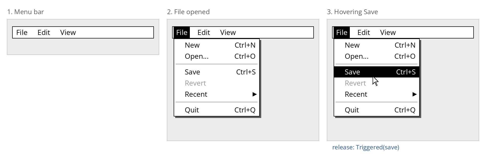

#### Events and callbacks

| Event emitted | When | Application callback |
|---|---|---|
| `Triggered { action }` | Item chosen by mouse, shortcut, or mnemonic | `on_action(action, ..)` (9.5 (#97)) or `on_click(item_id, ..)` |

Like every widget, it can also receive application-defined custom events in `handle_event` and emit its own (1.13 (#78)).

**Acceptance Criteria.**

- Menus open, track, select, and close correctly
- Submenus and keyboard navigation
- No OS-native menu APIs on any platform
- Parts are retrievable and modifiable as described
- Emits the corresponding `EngineEvent` (9.10 (#109))

**Parallelism / Dependencies.** Parallelizable. Requires 1.1 (#19), 1.12 (#76), 5.1 (#56), 5.2 (#57), 9.5 (#97).

**Technical Stack.** Rust

**Documentation.** Rustdoc: `menu` module. README/guides: Menus section. Examples: File/Edit menus in example. Screenshots: Gallery tile.

**Sources.** [Qt: QAction (shared commands for menus, toolbars, shortcuts)](https://doc.qt.io/qt-6/qaction.html)

### 2.12 (#38): File chooser dialog (drawn by Pushrod)

**Problem Statement.** Applications need to open and save files; native dialogs would break the consistent look.

**Solution / Scope.** Modal form built from the list view (4.5 (#52)), text fields, and buttons: directory, filter, file list, name, OK/Cancel; Open and Save modes. Completion closure receives `Option<PathBuf>`. OS-native dialogs are deliberately not used. **Parts (5.2 (#57)):** `FileChooserParts { folder, filter, list, name, buttons }`; `add_button` (for example 'New Folder'), `add_filter_choice`. Every part can be retrieved and restyled (font, color, text).

#### Look and behavior (proposed)

Each image shows the widget step by step, drawn in Pushrod's current style; blue notes name the event emitted. Mockups come from [`docs/mockups/generate.py`](https://github.com/KenSuenobu/rust-pushrod/blob/main/docs/mockups/generate.py): edit a frame there and re-run it to change the design, and update this section.

**Open dialog**


#### Events and callbacks

| Event emitted | When | Application callback |
|---|---|---|
| (completion) | Open or Cancel | Completion closure `FnOnce(&mut S, &mut Ui, Option<PathBuf>)` |

Like every widget, it can also receive application-defined custom events in `handle_event` and emit its own (1.13 (#78)).

**Acceptance Criteria.**

- Navigate, filter, choose; keyboard operable
- Returns None on cancel
- Parts are retrievable and modifiable as described

**Parallelism / Dependencies.** Parallelizable. Requires 2.6 (#32), 4.5 (#52), 6.7 (#66), 5.2 (#57).

**Technical Stack.** Rust std::fs

**Documentation.** Rustdoc: Module docs. README/guides: Dialogs section. Examples: Open button in example. Screenshots: Gallery tile.

**Sources.** [ICS: Motif widget descriptions](https://motif.ics.com/book/export/html/341)

### 2.13 (#77): Tooltips

**Problem Statement.** Icon buttons and terse labels are hard to learn without explanation.

**Solution / Scope.** Optional `tooltip` text on `WidgetCore` (actions supply it automatically). After a delay (600 ms), draw a bordered text box in the overlay layer near the pointer; hide it on movement, click, or key press. Emits its engine event (9.10 (#109)).

#### Look and behavior (proposed)

Each image shows the widget step by step, drawn in Pushrod's current style; blue notes name the event emitted. Mockups come from [`docs/mockups/generate.py`](https://github.com/KenSuenobu/rust-pushrod/blob/main/docs/mockups/generate.py): edit a frame there and re-run it to change the design, and update this section.

**1. Pointer rests 2. After 600 ms 3. Pointer moves: hidden**


#### Events and callbacks

| Event emitted | When | Application callback |
|---|---|---|
| (none) | Purely visual | n/a |

Like every widget, it can also receive application-defined custom events in `handle_event` and emit its own (1.13 (#78)).

**Acceptance Criteria.**

- Appears after the delay and hides correctly
- Stays inside the window; never under the pointer
- Emits the corresponding `EngineEvent` (9.10 (#109))

**Parallelism / Dependencies.** Parallelizable. Requires 1.5 (#21), 5.1 (#56).

**Technical Stack.** Rust

**Documentation.** Rustdoc: `set_tooltip`. README/guides: Usability section. Examples: Tooltips on example buttons. Screenshots: Gallery tile.

### 2.14 (#83): Separator line

**Problem Statement.** Dialogs group content with simple lines; today that needs a 1-pixel BoxWidget.

**Solution / Scope.** `Separator::horizontal(width)` / `vertical(height)`: a 1 px line (optionally etched as two lines). Display only.

#### Look and behavior (proposed)

Each image shows the widget step by step, drawn in Pushrod's current style; blue notes name the event emitted. Mockups come from [`docs/mockups/generate.py`](https://github.com/KenSuenobu/rust-pushrod/blob/main/docs/mockups/generate.py): edit a frame there and re-run it to change the design, and update this section.

**Horizontal and vertical**

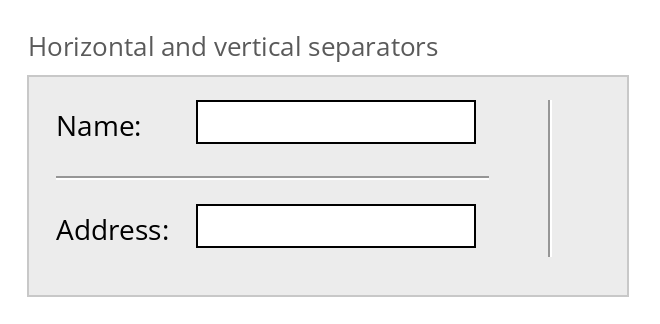

#### Events and callbacks

| Event emitted | When | Application callback |
|---|---|---|
| (none) | Display only | n/a |

Like every widget, it can also receive application-defined custom events in `handle_event` and emit its own (1.13 (#78)).

**Acceptance Criteria.**

- Horizontal and vertical render correctly

**Parallelism / Dependencies.** Parallelizable. Requires PR #10.

**Technical Stack.** Rust

**Documentation.** Rustdoc: Module docs. README/guides: Widget list. Examples: Gallery. Screenshots: Gallery tile.

### 2.15 (#84): Toolbar

**Problem Statement.** Frequent commands should be one click away.

**Solution / Scope.** `Toolbar` composite of tool buttons created from actions (9.5 (#97)): icon and/or text, toggle actions stay pressed, disabled actions gray out, tooltips from the action. Overflow items move into a '>>' menu. **Parts (5.2 (#57)):** `items()`, `add_action`, `insert_action`, `remove_item`; each tool button is a part. Every part can be retrieved and restyled (font, color, text).

#### Look and behavior (proposed)

Each image shows the widget step by step, drawn in Pushrod's current style; blue notes name the event emitted. Mockups come from [`docs/mockups/generate.py`](https://github.com/KenSuenobu/rust-pushrod/blob/main/docs/mockups/generate.py): edit a frame there and re-run it to change the design, and update this section.

**Toolbar with a toggled Bold and a disabled Paste**


#### Events and callbacks

| Event emitted | When | Application callback |
|---|---|---|
| `Triggered { action }` | A tool button is clicked | `on_action(action, ..)` |

Like every widget, it can also receive application-defined custom events in `handle_event` and emit its own (1.13 (#78)).

**Acceptance Criteria.**

- Buttons reflect action state
- Overflow menu when too narrow
- Parts are retrievable and modifiable as described

**Parallelism / Dependencies.** Parallelizable. Requires 9.5 (#97), 5.2 (#57), 2.7 (#33).

**Technical Stack.** Rust

**Documentation.** Rustdoc: Module docs. README/guides: Widget list. Examples: Toolbar in example. Screenshots: Gallery tile.

**Sources.** [Qt: QAction (shared commands for menus, toolbars, shortcuts)](https://doc.qt.io/qt-6/qaction.html)

### 2.16 (#85): Status bar

**Problem Statement.** Applications show transient messages ('Saved') and permanent status (line/column) at the bottom of the window.

**Solution / Scope.** `StatusBar` with a message area (`show_message(text, timeout)`) and permanent fields; actions' status text appears while their menu item is hovered. **Parts (5.2 (#57)):** `fields()`, `add_field`, `remove_field`. Every part can be retrieved and restyled (font, color, text).

#### Look and behavior (proposed)

Each image shows the widget step by step, drawn in Pushrod's current style; blue notes name the event emitted. Mockups come from [`docs/mockups/generate.py`](https://github.com/KenSuenobu/rust-pushrod/blob/main/docs/mockups/generate.py): edit a frame there and re-run it to change the design, and update this section.

**Status bar**

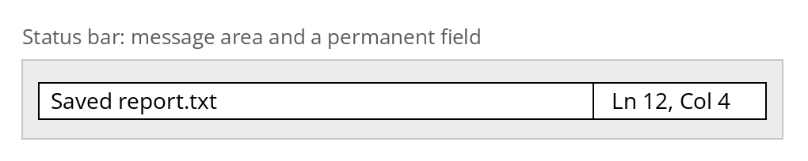

#### Events and callbacks

| Event emitted | When | Application callback |
|---|---|---|
| (none) | Display only | n/a |

Like every widget, it can also receive application-defined custom events in `handle_event` and emit its own (1.13 (#78)).

**Acceptance Criteria.**

- Timed messages clear themselves
- Hovered action status text appears
- Parts are retrievable and modifiable as described

**Parallelism / Dependencies.** Parallelizable. Requires 1.5 (#21), 5.2 (#57).

**Technical Stack.** Rust

**Documentation.** Rustdoc: Module docs. README/guides: Widget list. Examples: Status bar in example. Screenshots: Gallery tile.

### 2.17 (#86): Switch (on/off slide toggle)

**Problem Statement.** Settings that apply immediately read more clearly as a switch than as a check box.

**Solution / Scope.** `Switch`: track with a knob; click or drag toggles; Space when focused. Emits `Toggled`.

#### Look and behavior (proposed)

Each image shows the widget step by step, drawn in Pushrod's current style; blue notes name the event emitted. Mockups come from [`docs/mockups/generate.py`](https://github.com/KenSuenobu/rust-pushrod/blob/main/docs/mockups/generate.py): edit a frame there and re-run it to change the design, and update this section.

**Off, on, disabled**

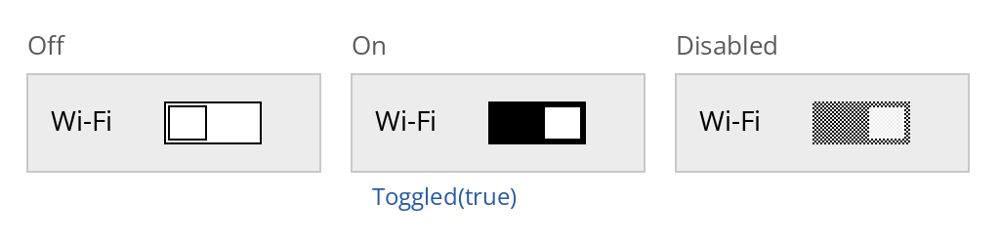

#### Events and callbacks

| Event emitted | When | Application callback |
|---|---|---|
| `Toggled { id, checked }` | State changes | `on_toggle(id, ..)` |

Like every widget, it can also receive application-defined custom events in `handle_event` and emit its own (1.13 (#78)).

**Acceptance Criteria.**

- Click, drag, Space toggle

**Parallelism / Dependencies.** Parallelizable. Requires 1.1 (#19), 1.6 (#22).

**Technical Stack.** Rust

**Documentation.** Rustdoc: Module docs. README/guides: Widget list. Examples: Gallery. Screenshots: Gallery tile.

### 2.18 (#87): Multi-line text area

**Problem Statement.** Notes, descriptions, and logs need multi-line text, which a single-line field can't provide.

**Solution / Scope.** `TextArea` in a scroll view: line wrapping, caret and selection across lines, clipboard, undo (1.15 (#81)), read-only mode for logs, `append` for log output. Only visible lines are painted from the glyph atlas.

#### Look and behavior (proposed)

Each image shows the widget step by step, drawn in Pushrod's current style; blue notes name the event emitted. Mockups come from [`docs/mockups/generate.py`](https://github.com/KenSuenobu/rust-pushrod/blob/main/docs/mockups/generate.py): edit a frame there and re-run it to change the design, and update this section.

**Editing with a selection**

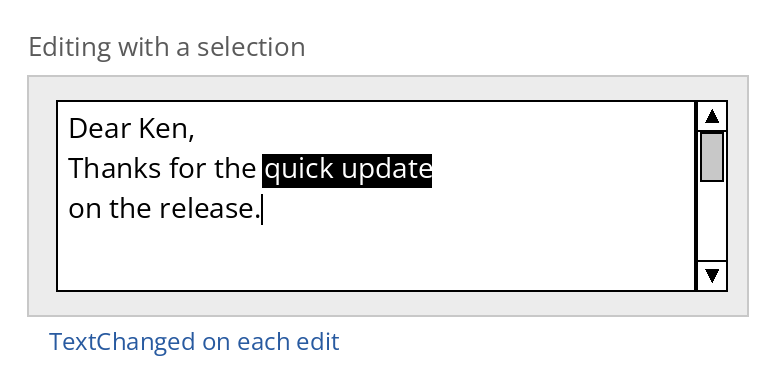

#### Events and callbacks

| Event emitted | When | Application callback |
|---|---|---|
| `TextChanged { id }` | Every edit | `on_text_change(id, ..)` |
| `EditingFinished { id }` | Focus loss | `on_editing_finished(id, ..)` |

Like every widget, it can also receive application-defined custom events in `handle_event` and emit its own (1.13 (#78)).

**Acceptance Criteria.**

- Editing, selection, clipboard, undo
- Smooth with 10,000 lines

**Parallelism / Dependencies.** Not parallelizable. Requires 2.6 (#32), 5.3 (#58), 1.7 (#3).

**Technical Stack.** Rust

**Documentation.** Rustdoc: Module docs. README/guides: Widget list. Examples: Notes area in example. Screenshots: Gallery tile.

### 2.19 (#88): Context menus

**Problem Statement.** Commands that apply to one object (a list row, a text selection) belong in a menu that appears where the user clicked.

**Solution / Scope.** `widget.set_context_menu(menu)` or `on_context_menu(id, |state, ui, at| -> Option<Menu>)` to build it dynamically. Opens on secondary click, long-press, or the Menu key, at the pointer, in the overlay layer; reuses `Menu` (2.11 (#37)) and actions (9.5 (#97)).

#### Look and behavior (proposed)

Each image shows the widget step by step, drawn in Pushrod's current style; blue notes name the event emitted. Mockups come from [`docs/mockups/generate.py`](https://github.com/KenSuenobu/rust-pushrod/blob/main/docs/mockups/generate.py): edit a frame there and re-run it to change the design, and update this section.

**Right-click on a list row**


#### Events and callbacks

| Event emitted | When | Application callback |
|---|---|---|
| `ContextMenuRequested { id, position }` | Secondary click / long-press / Menu key | `on_context_menu(id, ..)` |

Like every widget, it can also receive application-defined custom events in `handle_event` and emit its own (1.13 (#78)).

**Acceptance Criteria.**

- Opens on secondary click, long-press, and Menu key
- Dynamic menus via callback

**Parallelism / Dependencies.** Parallelizable. Requires 2.11 (#37), 9.4 (#96).

**Technical Stack.** Rust

**Documentation.** Rustdoc: Context menu API. README/guides: Menus section. Examples: Context menu on a list. Screenshots: Gallery tile.

**Sources.** [MAME wiki: Intergraph InterPro / CLIX / Environ V](https://wiki.mamedev.org/index.php/Driver:InterPro)

### 2.20 (#89): Message bar (non-modal inline notice)

**Problem Statement.** Many messages don't need a modal alert ('Connection lost, retrying'); blocking the user is worse usability.

**Solution / Scope.** `MessageBar` at the top of a form: icon, text, optional action buttons, close box; slides in by animating its height. **Parts (5.2 (#57)):** `MessageBarParts { icon, message, buttons, close }`; `add_button`. Every part can be retrieved and restyled (font, color, text).

#### Look and behavior (proposed)

Each image shows the widget step by step, drawn in Pushrod's current style; blue notes name the event emitted. Mockups come from [`docs/mockups/generate.py`](https://github.com/KenSuenobu/rust-pushrod/blob/main/docs/mockups/generate.py): edit a frame there and re-run it to change the design, and update this section.

**Message bar with an action**

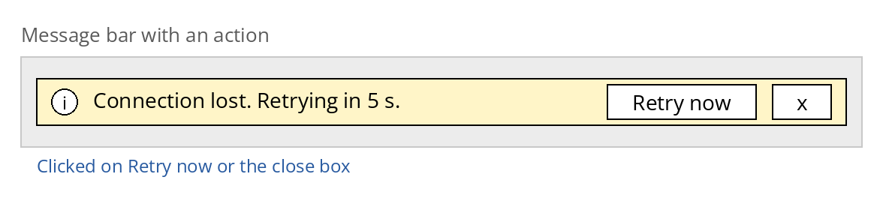

#### Events and callbacks

| Event emitted | When | Application callback |
|---|---|---|
| `Clicked { id }` | Action button or close box | `on_click(id, ..)` |

Like every widget, it can also receive application-defined custom events in `handle_event` and emit its own (1.13 (#78)).

**Acceptance Criteria.**

- Shows, hides, and dismisses
- Action buttons fire callbacks
- Parts are retrievable and modifiable as described

**Parallelism / Dependencies.** Parallelizable. Requires 1.5 (#21), 2.3 (#29), 5.2 (#57).

**Technical Stack.** Rust

**Documentation.** Rustdoc: Module docs. README/guides: Usability section. Examples: Example shows a connection warning. Screenshots: Gallery tile.

## Epic 3: Value and choice controls (#13)

Scroll bar, slider, group box, choice button, expander, and date picker.

**Problem.** Picking a value from a range, scrolling, and choosing one of several options are needed everywhere. Older systems made applications build these by hand; later toolkits provide a small set of consistent controls.

**Scope.** Implement a small set of value and choice controls, using composite widgets (5.2 (#57)) where a control has parts. Value controls emit `ValueChanged` and are wired with `on_value_change`. Several more specialized controls were considered and parked.

**Dependencies.** Needs composite widgets (5.2 (#57)) for the scroll bar, and callbacks (1.6 (#22)). The slider (3.2 (#40)) and group box (3.3 (#41)) can start early.

| Issue | Title | Summary | Labels | Parallel | MVP | Complexity | Affected modules |
|---|---|---|---|---|---|---|---|
| 3.1 (#39) | Scroll bar | Vertical/horizontal scroll bar with arrows and a proportional thumb. | `enhancement`, `mvp`, `size/M`, `widget` | N | Y | M | `scroll_bar.rs (new)` |
| 3.2 (#40) | Slider | Horizontal/vertical slider with range, optional ticks, and value label. | `enhancement`, `mvp`, `parallelizable`, `size/S`, `widget` | Y | Y | S | `slider.rs (new)` |
| 3.3 (#41) | Group box (titled frame) | A frame with a title in its top border, grouping related controls. | `good first issue`, `mvp`, `parallelizable`, `size/S`, `widget` | Y | Y | S | `group_box.rs (new)` |
| 3.6 (#44) | Choice button: pop-up list and click-to-cycle modes | Pick one of several options compactly, as a pop-up list or a click-to-cycle button. | `enhancement`, `parallelizable`, `size/M`, `usability`, `widget` | Y | N | M | `choice_button.rs (new)` |
| 3.7 (#45) | Column browser (multi-column hierarchical browser) | Columns of lists where selecting an item in one column fills the next, as in the NeXTSTEP browser and the Mac Finder's column view. | `enhancement`, `parallelizable`, `size/L`, `usability`, `widget` | Y | N | L | `column_browser.rs (new)` |
| 3.10 (#90) | Expander (collapsible section) | A titled section that shows or hides its contents when clicked. | `enhancement`, `parallelizable`, `size/S`, `usability`, `widget` | Y | N | S | `expander.rs (new)` |
| 3.11 (#91) | Date picker | A date field with a drop-down month calendar. | `enhancement`, `parallelizable`, `size/M`, `widget` | Y | N | M | `date_picker.rs (new)` |

### 3.1 (#39): Scroll bar

**Problem Statement.** Scroll views, lists, and text areas need scroll bars; older systems made applications assemble them by hand.

**Solution / Scope.** `ScrollBar` composite (5.2 (#57)): two glyph buttons (activate-on-press with auto-repeat), a track, and a draggable thumb sized by `visible / total`. Value 0.0 to 1.0 plus page size; clicking the track pages. Emits `ValueChanged`. **Parts (5.2 (#57)):** `ScrollBarParts { up, down, track, thumb }` (colors and glyphs customizable). Every part can be retrieved and restyled (font, color, text).

#### Look and behavior (proposed)

Each image shows the widget step by step, drawn in Pushrod's current style; blue notes name the event emitted. Mockups come from [`docs/mockups/generate.py`](https://github.com/KenSuenobu/rust-pushrod/blob/main/docs/mockups/generate.py): edit a frame there and re-run it to change the design, and update this section.

**1. Idle 2. Track clicked below thumb (page down) 3. Thumb dragged 4. Down arrow held**

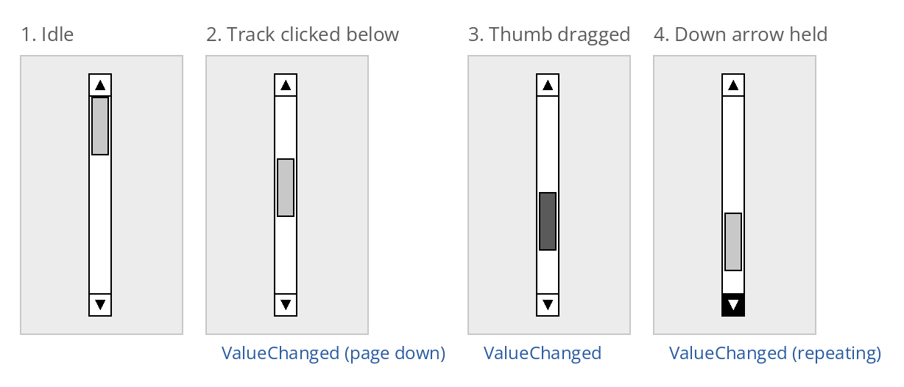

**Horizontal**


#### Events and callbacks

| Event emitted | When | Application callback |
|---|---|---|
| `ValueChanged { id }` | Position changes; read `value()` | `on_value_change(id, ..)` |

Like every widget, it can also receive application-defined custom events in `handle_event` and emit its own (1.13 (#78)).

**Acceptance Criteria.**

- Drag, arrows with repeat, track paging
- Thumb size reflects proportion
- Parts are retrievable and modifiable as described

**Parallelism / Dependencies.** Not parallelizable. Requires 1.5 (#21), 1.6 (#22), 2.2 (#28), 5.2 (#57).

**Technical Stack.** Rust

**Documentation.** Rustdoc: Module docs. README/guides: Widget list. Examples: Gallery. Screenshots: Gallery tile.

**Sources.** [AmigaOS GadTools autodoc (gadget kinds, underlined keyboard equivalents)](https://amigadev.grimore.org/Includes_and_Autodocs_2._guide/node05a3.html); [ICS: Motif widget descriptions](https://motif.ics.com/book/export/html/341); [OpenStep specification: controls and target/action](https://www.ict.griffith.edu.au/teaching/2501ICT/archive/resources/OpenStepSpec/ApplicationKit/Classes/NSControl.html)

### 3.2 (#40): Slider

**Problem Statement.** There is no way to pick a value from a range.

**Solution / Scope.** `Slider { min, max, value, step, ticks, show_value }`: track + knob; drag or click; arrow keys when focused; optional value text beside it. Emits `ValueChanged` continuously and `EditingFinished` on release.

#### Look and behavior (proposed)

Each image shows the widget step by step, drawn in Pushrod's current style; blue notes name the event emitted. Mockups come from [`docs/mockups/generate.py`](https://github.com/KenSuenobu/rust-pushrod/blob/main/docs/mockups/generate.py): edit a frame there and re-run it to change the design, and update this section.

**1. Idle 2. Dragging 3. Ticks with snap 4. Disabled**

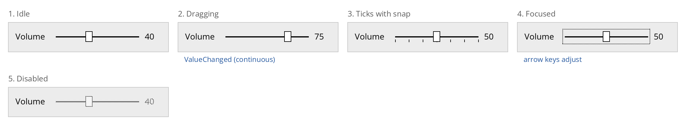

#### Events and callbacks

| Event emitted | When | Application callback |
|---|---|---|
| `ValueChanged { id }` | While dragging and on key/click | `on_value_change(id, ..)` |
| `EditingFinished { id }` | Drag released | `on_editing_finished(id, ..)` |

Like every widget, it can also receive application-defined custom events in `handle_event` and emit its own (1.13 (#78)).

**Acceptance Criteria.**

- Drag/click set value within range
- Ticks and snapping
- Keyboard adjusts

**Parallelism / Dependencies.** Parallelizable. Requires 1.6 (#22).

**Technical Stack.** Rust

**Documentation.** Rustdoc: Module docs. README/guides: Widget list. Examples: Volume slider in example. Screenshots: Gallery tile.

**Sources.** [AmigaOS GadTools autodoc (gadget kinds, underlined keyboard equivalents)](https://amigadev.grimore.org/Includes_and_Autodocs_2._guide/node05a3.html); [ICS: Motif widget descriptions](https://motif.ics.com/book/export/html/341)

### 3.3 (#41): Group box (titled frame)

**Problem Statement.** Dialogs group related controls inside a titled frame.

**Solution / Scope.** `GroupBox`: border with a gap at the top-left for the title. Children are added normally.

#### Look and behavior (proposed)

Each image shows the widget step by step, drawn in Pushrod's current style; blue notes name the event emitted. Mockups come from [`docs/mockups/generate.py`](https://github.com/KenSuenobu/rust-pushrod/blob/main/docs/mockups/generate.py): edit a frame there and re-run it to change the design, and update this section.

**Group box**

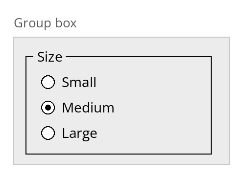

#### Events and callbacks

| Event emitted | When | Application callback |
|---|---|---|
| (none) | Container only | n/a |

Like every widget, it can also receive application-defined custom events in `handle_event` and emit its own (1.13 (#78)).

**Acceptance Criteria.**

- Title interrupts the border
- Works as the parent of a radio group

**Parallelism / Dependencies.** Parallelizable. Requires PR #10.

**Technical Stack.** Rust

**Documentation.** Rustdoc: Module docs. README/guides: Widget list. Examples: Group the radio buttons in the example. Screenshots: Gallery tile.

**Sources.** [OpenStep specification: controls and target/action](https://www.ict.griffith.edu.au/teaching/2501ICT/archive/resources/OpenStepSpec/ApplicationKit/Classes/NSControl.html); [ICS: Motif widget descriptions](https://motif.ics.com/book/export/html/341)

### 3.6 (#44): Choice button: pop-up list and click-to-cycle modes

**Problem Statement.** Choosing one option from a list shouldn't always require radio buttons that take up space.

**Solution / Scope.** `ChoiceButton { items, selected, mode }`. `Popup` mode opens an overlay list positioned so the current item sits under the pointer. `Cycle` mode advances on each click (Shift-click goes back) without a list: the most compact choice for two to five options. Emits `SelectionChanged`. **Parts (5.2 (#57)):** `items()`, `add_item`, `remove_item`; the pop-up list's rows are parts. Every part can be retrieved and restyled (font, color, text).

#### Look and behavior (proposed)

Each image shows the widget step by step, drawn in Pushrod's current style; blue notes name the event emitted. Mockups come from [`docs/mockups/generate.py`](https://github.com/KenSuenobu/rust-pushrod/blob/main/docs/mockups/generate.py): edit a frame there and re-run it to change the design, and update this section.

**Popup mode: 1. closed 2. open, current item under pointer 3. Large chosen**

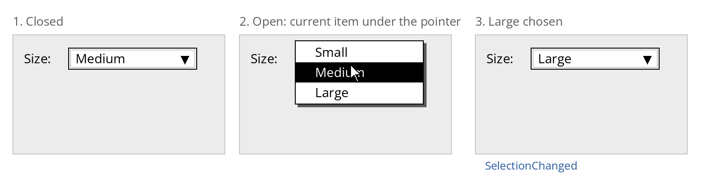

**Cycle mode: each click advances; Shift-click goes back**

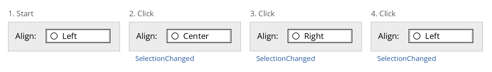

#### Events and callbacks

| Event emitted | When | Application callback |
|---|---|---|
| `SelectionChanged { id }` | Selection changes; read `selected()` | `on_selection_change(id, ..)` |

Like every widget, it can also receive application-defined custom events in `handle_event` and emit its own (1.13 (#78)).

**Acceptance Criteria.**

- Popup opens over the current item; selects by mouse/keyboard
- Cycle mode advances and reverses
- Parts are retrievable and modifiable as described

**Parallelism / Dependencies.** Parallelizable. Requires 1.6 (#22), 5.1 (#56), 5.2 (#57).

**Technical Stack.** Rust

**Documentation.** Rustdoc: Module docs. README/guides: Widget list. Examples: Gallery. Screenshots: Gallery tile.

**Sources.** [AmigaOS GadTools autodoc (gadget kinds, underlined keyboard equivalents)](https://amigadev.grimore.org/Includes_and_Autodocs_2._guide/node05a3.html); [ICS: Motif widget descriptions](https://motif.ics.com/book/export/html/341); [OpenStep specification: controls and target/action](https://www.ict.griffith.edu.au/teaching/2501ICT/archive/resources/OpenStepSpec/ApplicationKit/Classes/NSControl.html)

### 3.7 (#45): Column browser (multi-column hierarchical browser)

**Problem Statement.** Hierarchies (folders, settings categories, class trees, mail folders) are easiest to navigate when the whole path stays visible. NeXTSTEP's column browser shows column 0 as the root; selecting an item in column 0 fills column 1 with its children, selecting in column 1 fills column 2, and so on, with the path always on screen.

**Solution / Scope.** `ColumnBrowser` composite (5.2 (#57)) of list-view columns (4.5 (#52)) inside a horizontal scroll view (5.3 (#58)). Data comes from a `BrowserModel` trait: `children(&path) -> Vec<BrowserItem>`, `is_leaf(&path)`, optional icon and label per item. Selecting an item in column *n* replaces every column to the right with a new column *n+1* listing that item's children; selecting a leaf clears the columns to the right (an optional preview pane can show leaf details). Branch items show a ▶ marker. When columns overflow the width, the view scrolls horizontally to keep the newest column visible. Columns have a fixed default width and can be resized by dragging the divider between them. Keyboard: Up/Down move within a column, Right enters the selected branch (moving focus to the next column), Left returns to the parent column, typing jumps to a matching item, Return activates. Double-click or Return on a leaf emits `Activated`. **Parts (5.2 (#57)):** `columns()` returns each column's list-view ID; columns can be restyled like any list view; `path()` and `set_path()` read and set the selection. The file chooser (2.12 (#38)) can offer a column mode built on it.

```text
col[0] (root)       col[1] (children of
                    col[0] selection)   col[2] (children of col[1] selection)
+--------------+    +--------------+    +--------------+
| Applications▶|    | ken         ▶|    | Documents   ▶|
|#Users########|--> |#ken#########▶|--> |#Projects####▶|--> col[3] ...
| System      ▶|    | shared      ▶|    | Music       ▶|
+--------------+    +--------------+    +--------------+
```

#### Look and behavior (proposed)

Each image shows the widget step by step, drawn in Pushrod's current style; blue notes name the event emitted. Mockups come from [`docs/mockups/generate.py`](https://github.com/KenSuenobu/rust-pushrod/blob/main/docs/mockups/generate.py): edit a frame there and re-run it to change the design, and update this section.

**Selecting in each column fills the next one**


**Many columns: the view scrolls horizontally to keep the newest column visible**

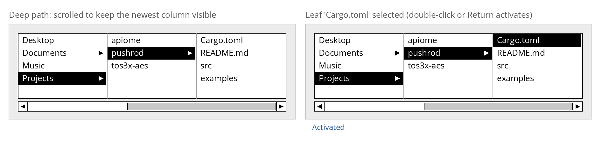

#### Events and callbacks

| Event emitted | When | Application callback |
|---|---|---|
| `SelectionChanged { id }` | The selected path changes; read `path()` | `on_selection_change(id, ..)` |
| `Activated { id }` | Double-click or Return on a leaf | `on_activate(id, ..)` |

Like every widget, it can also receive application-defined custom events in `handle_event` and emit its own (1.13 (#78)).

**Acceptance Criteria.**

- Selecting in column n fills column n+1 and clears columns to its right
- Leaf selection clears columns to the right; optional preview pane
- Horizontal scrolling keeps the newest column visible; column widths are resizable
- Keyboard navigation: Up/Down, Right into a branch, Left to parent, type-ahead, Return
- `path()`/`set_path()`, `columns()` part access
- Works with a filesystem model and an in-memory tree model

**Parallelism / Dependencies.** Parallelizable. Requires 4.5 (#52), 5.2 (#57), 5.3 (#58).

**Technical Stack.** Rust

**Documentation.** Rustdoc: Module docs + `BrowserModel`. README/guides: Widget list. Examples: Filesystem browser example. Screenshots: Gallery tile.

**Sources.** [OpenStep specification: controls and target/action](https://www.ict.griffith.edu.au/teaching/2501ICT/archive/resources/OpenStepSpec/ApplicationKit/Classes/NSControl.html)

### 3.10 (#90): Expander (collapsible section)

**Problem Statement.** Advanced options clutter dialogs; hiding them behind a disclosure keeps simple cases simple.

**Solution / Scope.** `Expander { title, expanded }`: triangle + title; toggling hides or shows the child subtree and resizes the expander (autoresizing 5.4 (#59) moves following siblings if configured). Emits `Toggled`.

#### Look and behavior (proposed)

Each image shows the widget step by step, drawn in Pushrod's current style; blue notes name the event emitted. Mockups come from [`docs/mockups/generate.py`](https://github.com/KenSuenobu/rust-pushrod/blob/main/docs/mockups/generate.py): edit a frame there and re-run it to change the design, and update this section.

**Collapsed and expanded**

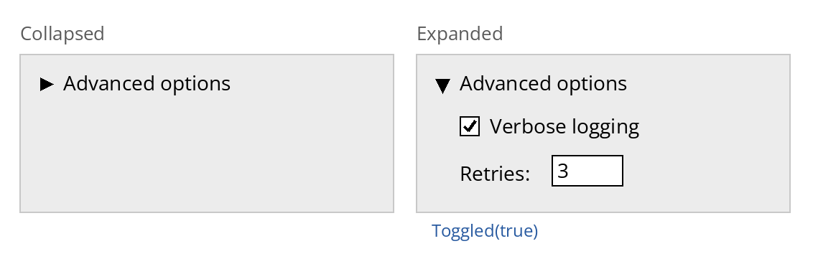

#### Events and callbacks

| Event emitted | When | Application callback |
|---|---|---|
| `Toggled { id, checked }` | Expanded/collapsed | `on_toggle(id, ..)` |

Like every widget, it can also receive application-defined custom events in `handle_event` and emit its own (1.13 (#78)).

**Acceptance Criteria.**

- Click, Space, and mnemonic toggle
- Children hidden and shown

**Parallelism / Dependencies.** Parallelizable. Requires 1.1 (#19), 5.4 (#59).

**Technical Stack.** Rust

**Documentation.** Rustdoc: Module docs. README/guides: Widget list. Examples: Advanced options in example. Screenshots: Gallery tile.

### 3.11 (#91): Date picker

**Problem Statement.** Typing dates is error-prone; forms commonly need a date.

**Solution / Scope.** `DatePicker`: a masked text field (2.6 (#32)) plus a button that opens a month calendar in the overlay (arrows for month/year, keyboard navigation, today highlighted). Emits `ValueChanged`. **Parts (5.2 (#57)):** `DatePickerParts { field, button, calendar }`; day cells are parts of the calendar. Every part can be retrieved and restyled (font, color, text).

#### Look and behavior (proposed)

Each image shows the widget step by step, drawn in Pushrod's current style; blue notes name the event emitted. Mockups come from [`docs/mockups/generate.py`](https://github.com/KenSuenobu/rust-pushrod/blob/main/docs/mockups/generate.py): edit a frame there and re-run it to change the design, and update this section.

**Calendar open**

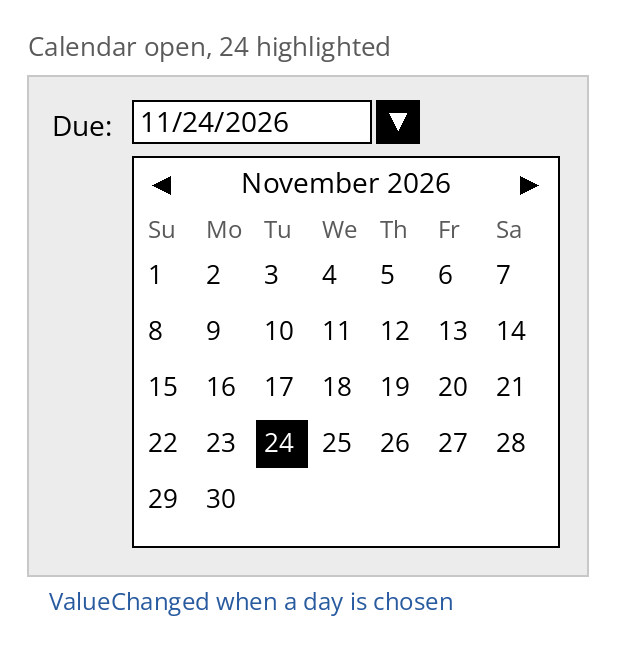

#### Events and callbacks

| Event emitted | When | Application callback |
|---|---|---|
| `ValueChanged { id }` | Date chosen or typed; read `date()` | `on_value_change(id, ..)` |

Like every widget, it can also receive application-defined custom events in `handle_event` and emit its own (1.13 (#78)).

**Acceptance Criteria.**

- Calendar navigation by mouse and keyboard
- Typed and picked dates agree
- Parts are retrievable and modifiable as described

**Parallelism / Dependencies.** Parallelizable. Requires 2.6 (#32), 5.1 (#56), 5.2 (#57).

**Technical Stack.** Rust

**Documentation.** Rustdoc: Module docs. README/guides: Widget list. Examples: Gallery. Screenshots: Gallery tile.

## Epic 4: Lists, tables, progress, spin boxes, and tabs (#14)

Progress bar, spin box, tab view, list view, table view, and combo box.

**Problem.** Everyday applications show progress, enter numbers, page settings into tabs, and browse lists and tables.

**Scope.** Implement the controls ordinary applications use constantly. Lists and tables share a data-source model and only paint visible rows.

**Dependencies.** Mostly post-MVP. The progress bar (4.1 (#48)) is MVP. Lists and tables need the scroll view (5.3 (#58)).

| Issue | Title | Summary | Labels | Parallel | MVP | Complexity | Affected modules |
|---|---|---|---|---|---|---|---|
| 4.1 (#48) | Progress bar | Determinate bar and indeterminate busy mode. | `good first issue`, `mvp`, `parallelizable`, `size/S`, `widget` | Y | Y | S | `progress_bar.rs (new)` |
| 4.2 (#49) | Spin box | Numeric field with up/down arrows, range, and step. | `enhancement`, `parallelizable`, `size/S`, `widget` | Y | N | S | `spin_box.rs (new)` |
| 4.4 (#51) | Tab view | Tabs that switch between pages of controls. | `enhancement`, `layout`, `parallelizable`, `size/M`, `widget` | Y | N | M | `tab_view.rs (new)` |
| 4.5 (#52) | List view | Scrolling list with single/multiple selection, backed by a data source. | `enhancement`, `size/L`, `widget` | N | N | L | `list_view.rs (new)` |
| 4.6 (#53) | Combo box | Text field with a drop-down list of suggestions. | `enhancement`, `parallelizable`, `size/M`, `widget` | Y | N | M | `combo_box.rs (new)` |
| 4.9 (#92) | Table view | Multi-column list with headers, column resizing, and sorting. | `enhancement`, `parallelizable`, `size/L`, `widget` | Y | N | L | `table_view.rs (new)` |

### 4.1 (#48): Progress bar

**Problem Statement.** Long operations need visible progress.

**Solution / Scope.** `ProgressBar { min, max, value, indeterminate }`: border + filled part; busy mode animates a moving block with ticks (1.5 (#21)). Display only.

#### Look and behavior (proposed)

Each image shows the widget step by step, drawn in Pushrod's current style; blue notes name the event emitted. Mockups come from [`docs/mockups/generate.py`](https://github.com/KenSuenobu/rust-pushrod/blob/main/docs/mockups/generate.py): edit a frame there and re-run it to change the design, and update this section.

**0%, 40%, busy**

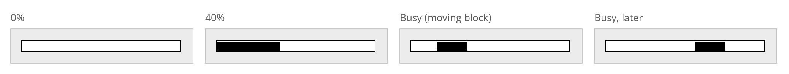

#### Events and callbacks

| Event emitted | When | Application callback |
|---|---|---|
| (none) | Display only; set with `set_value()` (often from a custom event, 1.13 (#78)) | n/a |

Like every widget, it can also receive application-defined custom events in `handle_event` and emit its own (1.13 (#78)).

**Acceptance Criteria.**

- Fill proportional to value
- Busy mode animates without callbacks

**Parallelism / Dependencies.** Parallelizable. Requires 1.5 (#21).

**Technical Stack.** Rust

**Documentation.** Rustdoc: Module docs. README/guides: Widget list. Examples: Progress fed by a custom event. Screenshots: Gallery tile.

### 4.2 (#49): Spin box

**Problem Statement.** Numbers within a range are easier to adjust with arrows than by typing.

**Solution / Scope.** `SpinBox` = numeric text field (2.6 (#32)) + two glyph buttons with auto-repeat; Up/Down keys and the wheel adjust; typed values are clamped on `EditingFinished`. **Parts (5.2 (#57)):** `SpinBoxParts { field, up, down }`. Every part can be retrieved and restyled (font, color, text).

#### Look and behavior (proposed)

Each image shows the widget step by step, drawn in Pushrod's current style; blue notes name the event emitted. Mockups come from [`docs/mockups/generate.py`](https://github.com/KenSuenobu/rust-pushrod/blob/main/docs/mockups/generate.py): edit a frame there and re-run it to change the design, and update this section.

**1. Idle 2. Up held 3. Out-of-range typing clamps 4. Disabled**

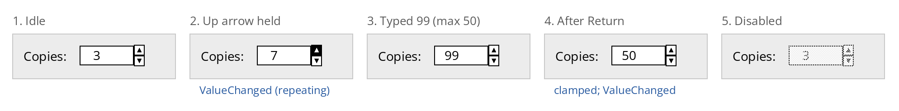

#### Events and callbacks

| Event emitted | When | Application callback |
|---|---|---|
| `ValueChanged { id }` | Value changes; read `value()` | `on_value_change(id, ..)` |

Like every widget, it can also receive application-defined custom events in `handle_event` and emit its own (1.13 (#78)).

**Acceptance Criteria.**

- Arrows, keys, wheel adjust within range
- Typed values clamp
- Parts are retrievable and modifiable as described

**Parallelism / Dependencies.** Parallelizable. Requires 2.2 (#28), 2.6 (#32), 5.2 (#57).

**Technical Stack.** Rust

**Documentation.** Rustdoc: Module docs. README/guides: Widget list. Examples: Gallery. Screenshots: Gallery tile.

**Sources.** [ICS: Motif widget descriptions](https://motif.ics.com/book/export/html/341); [AmigaOS GadTools autodoc (gadget kinds, underlined keyboard equivalents)](https://amigadev.grimore.org/Includes_and_Autodocs_2._guide/node05a3.html)

### 4.4 (#51): Tab view

**Problem Statement.** Settings dialogs group many controls into pages.

**Solution / Scope.** `TabView`: tab strip + one container per page; switching hides inactive pages (IDs and state preserved). Ctrl+Tab switches pages. Emits `SelectionChanged`. **Parts (5.2 (#57)):** `tabs()`, `pages()`, `add_page(title) -> (tab_id, page_id)`, `remove_page`. Every part can be retrieved and restyled (font, color, text).

#### Look and behavior (proposed)

Each image shows the widget step by step, drawn in Pushrod's current style; blue notes name the event emitted. Mockups come from [`docs/mockups/generate.py`](https://github.com/KenSuenobu/rust-pushrod/blob/main/docs/mockups/generate.py): edit a frame there and re-run it to change the design, and update this section.

**1. General active 2. Advanced chosen**

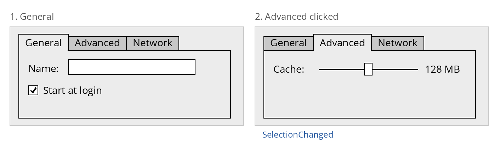

#### Events and callbacks

| Event emitted | When | Application callback |
|---|---|---|
| `SelectionChanged { id }` | Active page changes; read `selected_page()` | `on_selection_change(id, ..)` |

Like every widget, it can also receive application-defined custom events in `handle_event` and emit its own (1.13 (#78)).

**Acceptance Criteria.**

- Switching hides/shows pages
- Hidden controls keep state and IDs
- Ctrl+Tab
- Parts are retrievable and modifiable as described

**Parallelism / Dependencies.** Parallelizable. Requires 1.1 (#19), 5.2 (#57).

**Technical Stack.** Rust

**Documentation.** Rustdoc: Module docs. README/guides: Widget list. Examples: Settings dialog example. Screenshots: Gallery tile.

**Sources.** [ICS: Motif widget descriptions](https://motif.ics.com/book/export/html/341)

### 4.5 (#52): List view

**Problem Statement.** Lists are needed by file choosers, combo boxes, and most applications.

**Solution / Scope.** `ListView` in a scroll view, rows from a `ListModel` trait (`len`, `item(i)`, change notifications so the view updates when the model changes); only visible rows painted. Single, multiple, and range selection; keyboard navigation and type-ahead; double-click or Return activates. **Parts (5.2 (#57)):** `rows()` (visible row parts), per-row style via a `row_style` callback for model-driven rows. Every part can be retrieved and restyled (font, color, text). The `ListModel` reports changes as ranges (`inserted(range)`, `removed(range)`, `changed(range)`, `reset`) so the view updates incrementally, and row widgets are recycled as the list scrolls (virtualization).

#### Look and behavior (proposed)

Each image shows the widget step by step, drawn in Pushrod's current style; blue notes name the event emitted. Mockups come from [`docs/mockups/generate.py`](https://github.com/KenSuenobu/rust-pushrod/blob/main/docs/mockups/generate.py): edit a frame there and re-run it to change the design, and update this section.

**1. Idle 2. Click selects 3. Shift-click extends 4. Double-click activates**

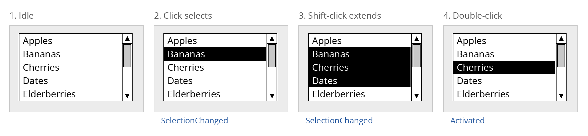

#### Events and callbacks

| Event emitted | When | Application callback |
|---|---|---|
| `SelectionChanged { id }` | Selection changes; read `selected_rows()` | `on_selection_change(id, ..)` |
| `Activated { id }` | Double-click or Return | `on_activate(id, ..)` |

Like every widget, it can also receive application-defined custom events in `handle_event` and emit its own (1.13 (#78)).

**Acceptance Criteria.**

- Smooth with 10,000 rows
- Selection modes and keyboard navigation
- Model change notifications update the view
- Parts are retrievable and modifiable as described
- Range-based model notifications; row widgets recycled while scrolling

**Parallelism / Dependencies.** Not parallelizable. Requires 1.6 (#22), 5.3 (#58), 5.2 (#57).

**Technical Stack.** Rust

**Documentation.** Rustdoc: Module docs + `ListModel`. README/guides: Widget list. Examples: Gallery. Screenshots: Gallery tile.

**Sources.** [AmigaOS GadTools autodoc (gadget kinds, underlined keyboard equivalents)](https://amigadev.grimore.org/Includes_and_Autodocs_2._guide/node05a3.html); [ICS: Motif widget descriptions](https://motif.ics.com/book/export/html/341)

### 4.6 (#53): Combo box

**Problem Statement.** Choosing common values while allowing free entry needs a combo box.

**Solution / Scope.** Composite of `TextField` + arrow + overlay `ListView`; typing filters; choosing fills the field. **Parts (5.2 (#57)):** `ComboBoxParts { field, button, list }`; `add_item`, `remove_item`. Every part can be retrieved and restyled (font, color, text).

#### Look and behavior (proposed)

Each image shows the widget step by step, drawn in Pushrod's current style; blue notes name the event emitted. Mockups come from [`docs/mockups/generate.py`](https://github.com/KenSuenobu/rust-pushrod/blob/main/docs/mockups/generate.py): edit a frame there and re-run it to change the design, and update this section.

**1. Idle 2. Typing filters 3. Chosen**


#### Events and callbacks

| Event emitted | When | Application callback |
|---|---|---|
| `TextChanged { id }` | Typing | `on_text_change(id, ..)` |
| `SelectionChanged { id }` | Item chosen from the list | `on_selection_change(id, ..)` |

Like every widget, it can also receive application-defined custom events in `handle_event` and emit its own (1.13 (#78)).

**Acceptance Criteria.**

- Typing filters; arrow opens; choosing fills
- Parts are retrievable and modifiable as described

**Parallelism / Dependencies.** Parallelizable. Requires 2.6 (#32), 4.5 (#52), 5.1 (#56), 5.2 (#57).

**Technical Stack.** Rust

**Documentation.** Rustdoc: Module docs. README/guides: Widget list. Examples: Gallery. Screenshots: Gallery tile.

**Sources.** [ICS: Motif widget descriptions](https://motif.ics.com/book/export/html/341)

### 4.9 (#92): Table view

**Problem Statement.** Records with several fields (files with size and date, orders, logs) need columns.

**Solution / Scope.** `TableView` extending the list view: column headers, resizable columns, click a header to sort (via the model), per-column alignment; a `TableModel` supplies cells. **Parts (5.2 (#57)):** `columns()`, `add_column`, `remove_column`; header cells are parts. Every part can be retrieved and restyled (font, color, text).

#### Look and behavior (proposed)

Each image shows the widget step by step, drawn in Pushrod's current style; blue notes name the event emitted. Mockups come from [`docs/mockups/generate.py`](https://github.com/KenSuenobu/rust-pushrod/blob/main/docs/mockups/generate.py): edit a frame there and re-run it to change the design, and update this section.

**Sorted by Size**

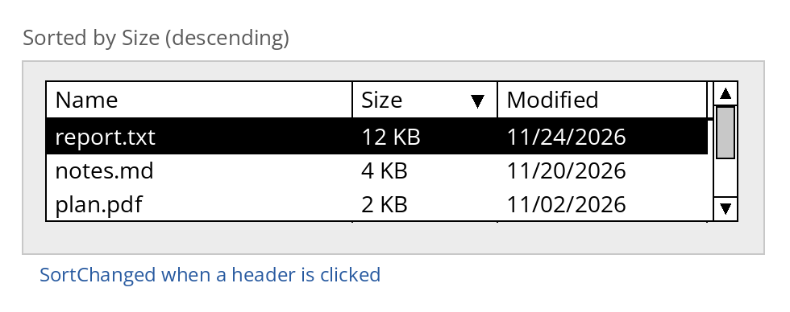

#### Events and callbacks

| Event emitted | When | Application callback |
|---|---|---|
| `SelectionChanged { id }` | Row selection | `on_selection_change(id, ..)` |
| `Activated { id }` | Double-click or Return | `on_activate(id, ..)` |
| `SortChanged { id, column, ascending }` | Header clicked | `on_event(..)` |

Like every widget, it can also receive application-defined custom events in `handle_event` and emit its own (1.13 (#78)).

**Acceptance Criteria.**

- Columns resize and sort
- Only visible cells painted
- Parts are retrievable and modifiable as described

**Parallelism / Dependencies.** Parallelizable. Requires 4.5 (#52), 5.2 (#57).

**Technical Stack.** Rust

**Documentation.** Rustdoc: Module docs + `TableModel`. README/guides: Widget list. Examples: File list in example. Screenshots: Gallery tile.

## Epic 5: Composition, clipping, and layout (#15)

Clip children to parents, build widgets from child widgets, scroll views, and autoresizing.

**Problem.** Children draw outside their parents, interactive widgets can't be reused as parts of other widgets, and nothing adapts when a parent is resized.

**Scope.** Clip children to their parents, add composite widgets (the reuse mechanism for complex controls), a scroll view, and simple autoresizing. Absolute positioning stays the default, as in a designed form.

**Dependencies.** Clipping (5.1 (#56)) and composites (5.2 (#57)) are MVP and block the complex controls.

| Issue | Title | Summary | Labels | Parallel | MVP | Complexity | Affected modules |
|---|---|---|---|---|---|---|---|
| 5.1 (#56) | Clip children to their parent's bounds | Children never draw or receive input outside their parent. | `core`, `enhancement`, `layout`, `mvp`, `size/S` | N | Y | S | `cache.rs` |
| 5.2 (#57) | Composite widgets: build widgets from parts that applications can retrieve and modify | A Composite trait whose parts (labels, buttons, icons, rows) are real widgets that applications can fetch, restyle, add, and remove. | `core`, `enhancement`, `layout`, `mvp`, `size/M`, `usability` | N | Y | M | `widget.rs`, `cache.rs`, `composite.rs (new)` |
| 5.3 (#58) | Scroll view | A container whose content is larger than its frame. | `enhancement`, `layout`, `size/M`, `widget` | N | N | M | `scroll_view.rs (new)`, `cache.rs` |
| 5.4 (#59) | Autoresizing (keep margins or stretch on resize) | Children keep margins or stretch when their parent is resized. | `enhancement`, `layout`, `parallelizable`, `size/S` | Y | N | S | `widget.rs`, `cache.rs` |

### 5.1 (#56): Clip children to their parent's bounds

**Problem Statement.** A child partly outside its parent draws over neighbors and receives input outside the parent; scroll views need clipping.

**Solution / Scope.** Each widget's visible rectangle is its rectangle intersected with its ancestors'. Blits use cropped source/destination rectangles; hit testing uses the visible rectangle. Overlays (menus, tooltips, pop-ups) opt out.

**Acceptance Criteria.**

- Partly outside children are cropped
- Hit testing ignores cropped parts
- Golden test

**Parallelism / Dependencies.** Not parallelizable. Requires PR #10.

**Technical Stack.** Rust, SDL2 rects

**Documentation.** Rustdoc: Draw/hit rules in `cache` docs. README/guides: Tree section. Examples: n/a. Screenshots: n/a.

### 5.2 (#57): Composite widgets: build widgets from parts that applications can retrieve and modify

**Problem Statement.** Complex controls (alert, scroll bar, spin box, combo box, menu, file chooser) are naturally made from simpler widgets. `paint` made drawing reusable, but interactive widgets can't yet be reused as parts of another widget. And because every widget that displays elements must be customizable, an application must be able to reach those elements: change the font or color of an alert's message, add a Help button to an alert, restyle one menu item, or recolor a scroll bar's thumb.

**Solution / Scope.** `Composite` trait: `build(&mut self, parts: &mut PartsBuilder)` runs when the widget is added and creates its parts as ordinary child widgets with their own IDs. **Parts are public, not hidden.** Every composite provides (1) `parts() -> Vec<(PartName, WidgetId)>` listing every part by a stable name (`"message"`, `"button:0"`, `"thumb"`), (2) `part(name) -> Option<WidgetId>`, and (3) typed accessors for its own structure (for example `AlertParts { icon, title, message, buttons: Vec<WidgetId> }`). Applications change parts through the normal API: `ui.get_mut::<TextWidget>(parts.message)?.set_font(..)`, `set_font_color`, `set_color`, `set_text`, any property (6.2 (#61)). Composites whose structure is a list (alert buttons, menu items, toolbar items, tabs, list columns) also provide `add_*`, `insert_*`, and `remove_*` methods that create or remove parts and re-lay them out (for example `alert.add_button("Help") -> WidgetId`). Part events reach the composite's `handle_part_event` first, so it can translate them (an arrow's `Clicked` into the scroll bar's `ValueChanged`); applications can also attach callbacks directly to a part's ID. Form files (6.5 (#64)) store a composite as its type plus part overrides (changed properties) and added or removed parts, so customizations survive save and load. Chassis selects a composite as one object and lets the user drill into its parts.

```text
Alert (composite, id 40)
 ├── icon     (ImageWidget, id 41)   "icon"
 ├── title    (TextWidget,  id 42)   "title"
 ├── message  (TextWidget,  id 43)   "message"   <- app: set_font(bold), set_font_color(..)
 ├── button 0 (ButtonWidget,id 44)   "button:0"  Delete
 ├── button 1 (ButtonWidget,id 45)   "button:1"  Cancel
 └── button 2 (ButtonWidget,id 46)   "button:2"  Help   <- app: alert.add_button("Help")
```

#### Look and behavior (proposed)

Each image shows the widget step by step, drawn in Pushrod's current style; blue notes name the event emitted. Mockups come from [`docs/mockups/generate.py`](https://github.com/KenSuenobu/rust-pushrod/blob/main/docs/mockups/generate.py): edit a frame there and re-run it to change the design, and update this section.

**An alert customized through its parts: bold red message, an extra Help button**


#### Events and callbacks

| Event emitted | When | Application callback |
|---|---|---|
| (part events) | A part emits an event; the composite may translate it | `on_click(part_id, ..)` on a part, or the composite's own callbacks |

Like every widget, it can also receive application-defined custom events in `handle_event` and emit its own (1.13 (#78)).

**Acceptance Criteria.**

- Composites create parts as ordinary widgets with IDs
- `parts()`, `part(name)`, and typed part accessors exist on every built-in composite
- Changing a part's font, color, or text through `ui.get_mut` repaints it
- List-structured composites support add/insert/remove of parts with automatic re-layout
- Composite translates part events; callbacks on part IDs also work
- Form round trip preserves part overrides and added/removed parts
- Scroll bar and alert built on it

**Parallelism / Dependencies.** Not parallelizable. Requires 1.6 (#22), 9.2 (#94).

**Technical Stack.** Rust

**Documentation.** Rustdoc: `composite` module. README/guides: 'Writing a composite widget' guide. Examples: Composite example. Screenshots: n/a.

### 5.3 (#58): Scroll view

**Problem Statement.** Lists, text areas, and long forms need a scrolling viewport.

**Solution / Scope.** `ScrollView` with a content container offset by the scroll position, scroll bars as needed, wheel and keyboard scrolling, `scroll_to(rect)` to keep the focused widget visible. **Parts (5.2 (#57)):** `ScrollViewParts { content, vertical, horizontal }`. Every part can be retrieved and restyled (font, color, text).

#### Look and behavior (proposed)

Each image shows the widget step by step, drawn in Pushrod's current style; blue notes name the event emitted. Mockups come from [`docs/mockups/generate.py`](https://github.com/KenSuenobu/rust-pushrod/blob/main/docs/mockups/generate.py): edit a frame there and re-run it to change the design, and update this section.

**Content clipped; wheel or bars move it**

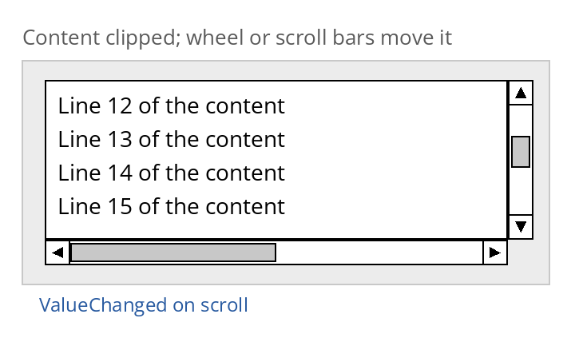

#### Events and callbacks

| Event emitted | When | Application callback |
|---|---|---|
| `ValueChanged { id }` | Scroll position changes; read `scroll_offset()` | `on_value_change(id, ..)` |

Like every widget, it can also receive application-defined custom events in `handle_event` and emit its own (1.13 (#78)).

**Acceptance Criteria.**

- Scrolls with bars, wheel, keys
- Focused widget scrolled into view
- Parts are retrievable and modifiable as described

**Parallelism / Dependencies.** Not parallelizable. Requires 3.1 (#39), 5.1 (#56), 5.2 (#57).

**Technical Stack.** Rust

**Documentation.** Rustdoc: Module docs. README/guides: Layout section. Examples: Long form in a scroll view. Screenshots: Gallery tile.

### 5.4 (#59): Autoresizing (keep margins or stretch on resize)

**Problem Statement.** Designed forms are absolutely positioned, which is simple, but nothing adapts when a window or pane is resized.

**Solution / Scope.** An `Anchors` setting on `WidgetCore` (left, right, top, bottom, plus stretch width/height), applied when the parent's size changes. Absolute positioning remains the default; no constraint solver. Sibling-relative attachments can be revisited only if real forms need them.

**Acceptance Criteria.**

- Children follow their anchors on parent resize
- Stored in form files

**Parallelism / Dependencies.** Parallelizable. Requires PR #10.

**Technical Stack.** Rust

**Documentation.** Rustdoc: `Anchors`. README/guides: Layout section. Examples: Resizable example. Screenshots: n/a.

**Sources.** [Motif reference: form attachments](https://man.archlinux.org/man/XmForm.3.en)

## Epic 6: Forms and form files (foundation for Chassis) (#16)

Widget registry, property introspection, a binary form file format, loader and writer, generated ID constants, modal dialogs, named actions, and design-mode hooks.

**Problem.** Forms are built in code. The goal is to design a form visually, save it to a binary file, and load it at run time, so only callbacks are hand-written and they refer to widgets by ID. Every classic system converged on this idea (numbered objects in GEM resource files, numbered dialog items on the classic Mac, gadget IDs on the Amiga, tags in NeXTSTEP nib files). Chassis will be Pushrod's visual designer; Pushrod needs the runtime side first.

**Scope.** Add a widget registry, property introspection, a versioned binary form format, loader and writer, generated ID constants, modal dialogs, actions bound by name, and design-mode hooks for Chassis.

**Dependencies.** Needs behavior flags (1.1 (#19)) and the registry/properties (6.1 (#60), 6.2 (#61)) first; modal dialogs need focus (1.4 (#20)) and tree editing (1.8 (#23)). Chassis design mode (6.9 (#68)) is post-MVP.

| Issue | Title | Summary | Labels | Parallel | MVP | Complexity | Affected modules |
|---|---|---|---|---|---|---|---|
| 6.1 (#60) | Widget registry and factory | Create widgets by type name, the prerequisite for loading forms. | `chassis`, `core`, `enhancement`, `forms`, `mvp`, `size/S` | N | Y | S | `registry.rs (new)` |
| 6.2 (#61) | Property introspection: list, get, and set widget properties by name | Each widget describes its properties for saving, loading, bindings, and the Chassis inspector. | `chassis`, `core`, `enhancement`, `forms`, `mvp`, `size/M` | N | Y | M | `widget.rs`, `properties.rs (new)`, `all widgets` |
| 6.3 (#62) | Form file format (binary, versioned) | The binary file that stores forms: object table by ID, string and image pools, symbols. | `chassis`, `enhancement`, `forms`, `mvp`, `size/L` | N | Y | L | `docs/FORM_FORMAT.md (new)`, `form/format.rs (new)` |
| 6.4 (#63) | Form loader: build a form from a file with stable IDs | Load a form and attach callbacks by ID or name. | `chassis`, `enhancement`, `forms`, `mvp`, `size/M` | N | Y | M | `form/loader.rs (new)`, `engine.rs` |
| 6.5 (#64) | Form writer: save a widget subtree to a file | Serialize any subtree into the form format. | `chassis`, `enhancement`, `forms`, `mvp`, `parallelizable`, `size/M` | Y | Y | M | `form/writer.rs (new)` |
| 6.6 (#65) | Generate ID constants from a form file | build.rs helper and CLI that emit Rust constants for named objects. | `chassis`, `enhancement`, `forms`, `mvp`, `parallelizable`, `size/S` | Y | Y | S | `form/codegen.rs (new)` |
| 6.7 (#66) | Modal dialogs: run a form until a dismissing control is chosen | Open a form modally; the result is the ID of the control that dismissed it. | `core`, `enhancement`, `forms`, `mvp`, `size/M` | N | Y | M | `engine.rs`, `cache.rs` |
| 6.8 (#67) | Bind actions by name from form files | Form files name the action a control triggers; applications register handlers by name. | `chassis`, `enhancement`, `forms`, `parallelizable`, `size/S` | Y | N | S | `engine.rs`, `form/loader.rs` |
| 6.9 (#68) | Design-mode hooks for Chassis | Select, move, resize, and edit widgets without triggering their behavior. | `chassis`, `enhancement`, `forms`, `parallelizable`, `size/L` | Y | N | L | `cache.rs`, `engine.rs`, `design.rs (new)` |

### 6.1 (#60): Widget registry and factory

**Problem Statement.** A form file stores 'a button with these properties'. Loading it needs to construct widgets from a type name, including application-defined widgets.

**Solution / Scope.** `WidgetRegistry` maps stable type names (`"pushrod.button"`) to constructors from properties. Built-ins register themselves; applications register custom widgets. Chassis uses it for its palette.

**Acceptance Criteria.**

- All built-ins registered
- Custom widgets registrable
- Unknown names are errors, not panics

**Parallelism / Dependencies.** Not parallelizable. Requires PR #10.

**Technical Stack.** Rust

**Documentation.** Rustdoc: `registry` module. README/guides: Forms section. Examples: n/a. Screenshots: n/a.

### 6.2 (#61): Property introspection: list, get, and set widget properties by name

**Problem Statement.** Saving and loading forms, property bindings (9.6 (#98)), and Chassis's inspector need to enumerate and change properties without knowing the concrete type.

**Solution / Scope.** `Property { name, kind, value }` and trait methods `properties()` / `set_property(name, value)`; `WidgetCore` properties (origin, size, color, behavior, state, anchors, tooltip) come by default. Setting a property emits `PropertyChanged { id, name }` (used by bindings). Hand-written per widget; a derive macro can follow if boilerplate grows.

**Acceptance Criteria.**

- Every built-in lists and sets all properties
- Round-trip test
- `PropertyChanged` emitted on change

**Parallelism / Dependencies.** Not parallelizable. Requires 1.1 (#19), 6.1 (#60).

**Technical Stack.** Rust

**Documentation.** Rustdoc: `properties` module. README/guides: Forms section. Examples: n/a. Screenshots: n/a.

### 6.3 (#62): Form file format (binary, versioned)

**Problem Statement.** Designed forms must be stored compactly and loaded quickly, with programs referring to objects only by number, as every classic system did.

**Solution / Scope.** Header (magic `PRSC`, version, offsets); form table (name, root); object table (type, parent, first child, next sibling, origin, size, behavior, state, anchors, property offset); tag-length-value property blocks so new properties don't break old readers; string pool; image pool; symbol table (names for IDs and actions). Little-endian, std only. Specified in `docs/FORM_FORMAT.md`.

```text
+---------------------------+
| Header  'PRSC' v1 offsets |
+---------------------------+
| Form table   name -> root |
+---------------------------+
| Object table (per widget) |
|  type, parent, child, next|
|  x, y, w, h, behavior,    |
|  state, anchors, props    |
+---------------------------+
| Property blocks (TLV)     |
| String pool | Image pool  |
| Symbols (ID and action    |
|   names)                  |
+---------------------------+
```

**Acceptance Criteria.**

- Spec merged
- Reader/writer with tests on hand-built bytes
- Unknown property tags skipped
- Versioned

**Parallelism / Dependencies.** Not parallelizable. Requires 6.1 (#60), 6.2 (#61).

**Technical Stack.** Rust (std only)

**Documentation.** Rustdoc: `form` module. README/guides: Forms section linking the spec. Examples: n/a. Screenshots: n/a.

**Sources.** [GEM AES object structure (flags, states, object tree)](https://www.seasip.info/Gem/aestruct.html); [FreeMiNT AES docs: object tree fundamentals](https://freemint.github.io/tos.hyp/en/aes_fundamentals.html); [Shift Interface resource editor (Atari)](https://atariuptodate.de/en/1277/interface)

### 6.4 (#63): Form loader: build a form from a file with stable IDs

**Problem Statement.** The point of form files is that code doesn't rebuild the UI: the application loads the form and attaches callbacks.

**Solution / Scope.** `Engine::load_form(file, "main") -> FormHandle` creates widgets via the registry, applies properties, and maps form-local object numbers to `WidgetId`s (`form.id(main::OK)`). Emits its engine event (9.10 (#109)). Forms are mostly static: at load, precompute what can't change (text layouts of fixed labels, static textures) so the dynamic work at run time is only what the application actually changes.

**Acceptance Criteria.**

- Loaded form renders identically to the code-built version (golden)
- IDs resolve via generated constants
- Errors name object and property
- Emits the corresponding `EngineEvent` (9.10 (#109))

**Parallelism / Dependencies.** Not parallelizable. Requires 6.3 (#62).

**Technical Stack.** Rust

**Documentation.** Rustdoc: `load_form`, `FormHandle`. README/guides: Forms quick start. Examples: `examples/form.rs`. Screenshots: Form screenshot.

### 6.5 (#64): Form writer: save a widget subtree to a file

**Problem Statement.** Chassis must save designs, and tests need files produced from code-built forms.

**Solution / Scope.** `FormWriter::add_form(name, &cache, root)` + `write(path)`; skips composite parts; properties via introspection; deduplicates strings and images.

**Acceptance Criteria.**

- Round trip preserves properties and pixels
- Composite parts not written

**Parallelism / Dependencies.** Parallelizable. Requires 6.3 (#62).

**Technical Stack.** Rust

**Documentation.** Rustdoc: `FormWriter`. README/guides: Forms section. Examples: n/a. Screenshots: n/a.

### 6.6 (#65): Generate ID constants from a form file

**Problem Statement.** Callbacks attach by ID; names keep code readable, and renaming in the designer should break the build rather than silently attach to the wrong widget.

**Solution / Scope.** `pushrod::form::codegen::write_ids(file, out_rs)` for build.rs plus a small CLI; generates `pub mod main { pub const OK: FormIndex = FormIndex(5); }`.

**Acceptance Criteria.**

- build.rs integration used by the form example
- Deterministic, rustfmt-clean output

**Parallelism / Dependencies.** Parallelizable. Requires 6.3 (#62), 6.4 (#63).

**Technical Stack.** Rust, build.rs

**Documentation.** Rustdoc: `form::codegen`. README/guides: Forms quick start. Examples: Example uses generated constants. Screenshots: n/a.

**Sources.** [Shift Interface resource editor (Atari)](https://atariuptodate.de/en/1277/interface)

### 6.7 (#66): Modal dialogs: run a form until a dismissing control is chosen

**Problem Statement.** Alerts, file choosers, and settings dialogs need modal behavior: input goes only to the dialog until it is dismissed.

**Solution / Scope.** `ui.open_modal(root, |state, ui, dismissed_by| ..)`. While open, input goes only to the modal subtree (the rest is drawn but inert), focus starts on the first focusable widget, Return/Escape map to default/cancel, and a `DISMISSES_DIALOG` control closes it. Modals nest. Emits its engine event (9.10 (#109)).

**Acceptance Criteria.**

- Input blocked outside the top modal
- Dismissing control reported
- Nested modals
- Emits the corresponding `EngineEvent` (9.10 (#109))

**Parallelism / Dependencies.** Not parallelizable. Requires 1.4 (#20), 1.8 (#23), 2.3 (#29).

**Technical Stack.** Rust

**Documentation.** Rustdoc: `Ui::open_modal`. README/guides: Dialogs section. Examples: Settings dialog example. Screenshots: Modal screenshot.

### 6.8 (#67): Bind actions by name from form files

**Problem Statement.** A designer should be able to connect a button to 'save' without code changes.

**Solution / Scope.** Any widget may carry an `action` name; loading a form binds it to the named action (9.5 (#97)). Unbound names are reported once.

**Acceptance Criteria.**

- Actions bind at load time
- Missing actions reported

**Parallelism / Dependencies.** Parallelizable. Requires 6.4 (#63), 9.5 (#97).

**Technical Stack.** Rust

**Documentation.** Rustdoc: Action binding. README/guides: Forms section. Examples: Form example uses actions. Screenshots: n/a.

**Sources.** [Apple: Target-Action](https://developer.apple.com/library/archive/documentation/General/Devpedia-CocoaApp-MOSX/TargetAction.html)

### 6.9 (#68): Design-mode hooks for Chassis

**Problem Statement.** Chassis will be a drag-and-drop form designer built on Pushrod. It must hit-test every object, draw selection handles, and edit widgets without them reacting.

**Solution / Scope.** `DesignMode` on `WidgetCache`: an event filter (9.3 (#95)) intercepts all input; `design_hit` includes disabled widgets; an overlay draws handles and alignment guides; edits go through the undo stack (1.15 (#81)) and emit `DesignChanged`. Composite parts aren't separately selectable.

**Acceptance Criteria.**

- No widget reacts in design mode
- Select/move/resize/reparent, undoable
- Back to run mode restores behavior

**Parallelism / Dependencies.** Parallelizable. Requires 1.8 (#23), 1.15 (#81), 5.2 (#57), 6.2 (#61), 9.3 (#95).

**Technical Stack.** Rust

**Documentation.** Rustdoc: `design` module. README/guides: Chassis section. Examples: Minimal designer example. Screenshots: Design-mode screenshot.

**Sources.** [Shift Interface resource editor (Atari)](https://atariuptodate.de/en/1277/interface)

## Epic 7: Quality, documentation, and release (#17)

CI, golden-image tests, a widget gallery, a guide for writing widgets, a changelog, and the crates.io release.

**Problem.** There is no CI or automated rendering check, and the crates.io release is out of date (#1, #8). Cargo.toml's repository and documentation URLs point at the old `pushrod-widgets` crate.

**Scope.** Add CI with SDL2 and Xvfb, golden-image tests, a gallery example, a widget-authoring guide, a changelog, and publish to crates.io.

**Dependencies.** CI (7.1 (#69)) first, in parallel with 9.1 (#93). The release (7.5 (#73)) is last.

| Issue | Title | Summary | Labels | Parallel | MVP | Complexity | Affected modules |
|---|---|---|---|---|---|---|---|
| 7.1 (#69) | CI: build, test, clippy, fmt, doc with SDL2 | Every PR is built and tested on Linux and macOS. | `ci`, `enhancement`, `mvp`, `parallelizable`, `size/S` | Y | Y | S | `.github/workflows/ci.yml (new)` |
| 7.2 (#70) | Golden-image rendering tests | Render each widget and state and compare with reference PNGs. | `ci`, `enhancement`, `mvp`, `size/M` | N | Y | M | `tests/visual.rs (new)`, `tests/golden/ (new)` |
| 7.3 (#71) | Widget gallery example | One window showing every widget and state. | `documentation`, `enhancement`, `good first issue`, `mvp`, `parallelizable`, `size/S` | Y | Y | S | `examples/gallery.rs (new)` |
| 7.4 (#72) | Guide: writing widgets and composites | Step-by-step docs for extending Pushrod. | `documentation`, `mvp`, `parallelizable`, `size/S` | Y | Y | S | `docs/WRITING_WIDGETS.md (new)`, `src/lib.rs` |
| 7.5 (#73) | Changelog, Cargo metadata, and crates.io release | Publish the modernized library (answers #1 and #8). | `ci`, `documentation`, `mvp`, `size/S` | N | Y | S | `Cargo.toml`, `CHANGELOG.md (new)` |
| 7.6 (#114) | Module boundaries and written specs with conformance tests | Specify each module's contract (widget, events, paint, form format) in docs/specs and test against it. | `ci`, `documentation`, `enhancement`, `mvp`, `parallelizable`, `size/M` | Y | Y | M | `docs/specs/ (new)`, `tests/conformance/ (new)` |
| 7.7 (#115) | Performance benchmarks and budgets | Measure frame time, input latency, memory per widget, and startup; fail CI on regressions. | `ci`, `mvp`, `parallelizable`, `performance`, `size/S` | Y | Y | S | `benches/ (new)`, `.github/workflows/ci.yml` |

### 7.1 (#69): CI: build, test, clippy, fmt, doc with SDL2

**Problem Statement.** There is no CI.

**Solution / Scope.** Workflow installing SDL2/ttf/image dev packages; `cargo fmt --check`, `clippy -D warnings`, `test`, `doc`; Ubuntu and macOS; MSRV 1.86 and stable.

**Acceptance Criteria.**

- Runs on PRs and main
- Fails on warnings, formatting, or tests
- README badge

**Parallelism / Dependencies.** Parallelizable. Independent; do first.

**Technical Stack.** GitHub Actions

**Documentation.** Rustdoc: n/a. README/guides: CI badge. Examples: n/a. Screenshots: n/a.

### 7.2 (#70): Golden-image rendering tests

**Problem Statement.** Rendering was verified by hand in PR #10; it should be automatic.

**Solution / Scope.** Harness renders widgets under Xvfb with SDL's software renderer (tests only, for determinism; applications use the GPU), reads pixels, compares with `tests/golden/` with tolerance; `UPDATE_GOLDEN=1` regenerates; CI uploads diff images.

**Acceptance Criteria.**

- Goldens for every widget and state
- Runs in CI
- Diffs uploaded on failure

**Parallelism / Dependencies.** Not parallelizable. Requires 7.1 (#69).

**Technical Stack.** Rust, SDL2, Xvfb

**Documentation.** Rustdoc: n/a. README/guides: Testing section. Examples: n/a. Screenshots: n/a.

### 7.3 (#71): Widget gallery example

**Problem Statement.** There is no single place to see every widget.

**Solution / Scope.** `examples/gallery.rs` with labeled tiles; each widget issue adds its tile; README screenshot comes from it.

**Acceptance Criteria.**

- Shows every merged widget
- README screenshot from it

**Parallelism / Dependencies.** Parallelizable. Requires PR #10.

**Technical Stack.** Rust

**Documentation.** Rustdoc: n/a. README/guides: Screenshot + run command. Examples: This is the example. Screenshots: Gallery screenshot.

### 7.4 (#72): Guide: writing widgets and composites

**Problem Statement.** Extending Pushrod is the point of the redesign; it needs end-to-end docs.

**Solution / Scope.** Guide: paint-only widget, interactive widget with events and callbacks, behavior and state, input controllers (9.4 (#96)), composites, custom events, registry and properties, testing with `Engine::dispatch` and goldens.

**Acceptance Criteria.**

- Compiling examples for each section
- Linked from README and crate docs

**Parallelism / Dependencies.** Parallelizable. Best after 5.2 (#57), 6.2 (#61), 9.4 (#96); start earlier.

**Technical Stack.** Markdown, rustdoc

**Documentation.** Rustdoc: Crate docs link. README/guides: Link. Examples: n/a. Screenshots: n/a.

### 7.5 (#73): Changelog, Cargo metadata, and crates.io release

**Problem Statement.** #1 and #8 asked about crates.io; metadata points at the old crate; no changelog.

**Solution / Scope.** Fix URLs, add `CHANGELOG.md` starting with PR #10, choose a version above previously published ones, `cargo publish --dry-run` in CI, publish after the MVP.

**Acceptance Criteria.**

- Metadata correct
- Changelog complete
- docs.rs builds

**Parallelism / Dependencies.** Not parallelizable. Requires all MVP issues.

**Technical Stack.** Cargo

**Documentation.** Rustdoc: docs.rs build. README/guides: Install from crates.io. Examples: n/a. Screenshots: n/a.

### 7.6 (#114): Module boundaries and written specs with conformance tests

**Problem Statement.** Contributors (human or AI-assisted) work best against modules with clear boundaries and written contracts. Pushrod's contracts (what a widget must do, how events are routed, what a painter must provide, the form file format) live only in code and issue text.

**Solution / Scope.** Write short specs in `docs/specs/`: `widget.md` (core, paint, events, parts, properties), `events.md` (vocabulary, phases, masks, engine events, ordering guarantees), `paint.md` (Painter trait and cache policy), `forms.md` (links to the form format). Keep the engine (tree, events, invalidation, paint API) separate from the design layer (widget defaults, appearance, theme) in both docs and module layout. Add conformance tests in `tests/conformance/` that check each guarantee (event order, propagation, mask filtering, engine-event emission) so alternative widgets and backends can prove compliance.

**Acceptance Criteria.**

- Specs for widget, events, paint, and forms
- Engine and design layer separated in module layout
- Conformance tests for each stated guarantee run in CI

**Parallelism / Dependencies.** Parallelizable. Requires 9.1 (#93), 7.1 (#69).

**Technical Stack.** Markdown, Rust tests

**Documentation.** Rustdoc: Links from crate docs. README/guides: Contributing section links the specs. Examples: n/a. Screenshots: n/a.

**Sources.** [Raph Levien, "Advice for the Next 100 Rust GUIs" (Linebender blog, 2026)](https://linebender.org/blog/next-100-guis/)

### 7.7 (#115): Performance benchmarks and budgets

**Problem Statement.** Pushrod's premise is small and fast, but nothing measures it, so regressions go unnoticed.

**Solution / Scope.** Benchmarks (headless where possible): event dispatch throughput, frame time for the gallery under interaction, text layout and atlas warm-up, form load time, texture memory per widget, and binary size. Record a baseline; CI flags regressions beyond a tolerance. Publish numbers in the README, including a low-end target.

**Acceptance Criteria.**

- Benchmarks run in CI with a stored baseline
- Regressions beyond tolerance fail or warn
- README shows current numbers

**Parallelism / Dependencies.** Parallelizable. Requires 7.1 (#69).

**Technical Stack.** Rust (criterion or built-in timing), GitHub Actions

**Documentation.** Rustdoc: n/a. README/guides: 'Performance' section with numbers. Examples: n/a. Screenshots: n/a.

**Sources.** [Raph Levien, "Advice for the Next 100 Rust GUIs" (Linebender blog, 2026)](https://linebender.org/blog/next-100-guis/)

## Epic 8: Theming and skins (distant future) (#18)

Placeholder: route colors and metrics through a theme, then allow skins. Not scheduled.

**Problem.** Themes and skins are planned for the distant future. Pushrod's premise is small, simple, and easy to maintain.

**Scope.** Record the direction so today's work doesn't block it: all drawing goes through the `paint` module, so a theme can later be introduced there without changing widgets.

**Dependencies.** Not scheduled.

| Issue | Title | Summary | Labels | Parallel | MVP | Complexity | Affected modules |
|---|---|---|---|---|---|---|---|
| 8.1 (#74) | Theme for colors and metrics (future) | Move hard-coded colors and metrics into a theme; the default reproduces today's look. | `future`, `parallelizable`, `size/M`, `theming` | Y | N | M | `paint.rs`, `theme.rs (new)` |
| 8.2 (#75) | Skins: image-based widget rendering (future) | Let a skin replace paint with nine-slice images. | `future`, `parallelizable`, `size/L`, `theming` | Y | N | L | `theme.rs`, `paint.rs` |

### 8.1 (#74): Theme for colors and metrics (future)

**Problem Statement.** Colors, borders, and fonts are hard-coded. Theming is planned for the distant future.

**Solution / Scope.** When scheduled: `Theme` passed to `paint`, with `Theme::classic()` pixel-identical to today's goldens. Until then, new widgets take colors from `paint` helpers, not literals. If theming adopts style rules, use a small curated subset designed for incremental evaluation rather than full CSS.

**Acceptance Criteria.**

- (Future) classic theme matches goldens

**Parallelism / Dependencies.** Parallelizable. Not scheduled. Requires 7.2 (#70).

**Technical Stack.** Rust

**Documentation.** Rustdoc: (Future). README/guides: (Future). Examples: n/a. Screenshots: n/a.

### 8.2 (#75): Skins: image-based widget rendering (future)

**Problem Statement.** Skins are a long-term goal.

**Solution / Scope.** When scheduled: nine-slice GPU textures per widget kind and state, falling back to classic painting.

**Acceptance Criteria.**

- (Future) sample skin renders the gallery

**Parallelism / Dependencies.** Parallelizable. Not scheduled. Requires 8.1 (#74).

**Technical Stack.** Rust, SDL2_image

**Documentation.** Rustdoc: (Future). README/guides: (Future). Examples: n/a. Screenshots: n/a.

## Epic 9: Event model and callbacks (#79)

A modern event vocabulary, capture/bubble propagation, reusable input controllers, event filters, actions and shortcuts, property bindings, callback handles, and drag and drop.

**Problem.** PR #10 has three events (`BoundsChange`, `Clicked`, `SystemEvent`) delivered to a single widget, plus `on_click`/`on_event`. Modern toolkits show what a complete, easy-to-use event model needs: clear event names, propagation from the target widget up through its parents with a way to mark events handled (Qt, GTK), interception by filters (Qt), reusable input handlers (GTK event controllers), shared commands for menus, toolbars, and shortcuts (Qt actions), and bindings that keep two properties in sync (GTK).

**Scope.** Define Pushrod's event and callback vocabulary once (9.1 (#93)) and build propagation, controllers, filters, actions, bindings, callback handles, and drag and drop on top of it. All of it stays inside Pushrod's own run loop on top of SDL2.

**Dependencies.** 9.1 (#93) comes first of all: every other issue uses its names. Propagation (9.2 (#94)) and input controllers (9.4 (#96)) are MVP; filters, actions, bindings, callback handles, drag and drop, and cursors follow.

| Issue | Title | Summary | Labels | Parallel | MVP | Complexity | Affected modules |
|---|---|---|---|---|---|---|---|
| 9.1 (#93) | Event vocabulary: modern event names and structure | Define Pushrod's event enum and naming once; rename the PR #10 events. | `core`, `enhancement`, `events`, `mvp`, `size/M` | N | Y | M | `event.rs`, `cache.rs`, `engine.rs`, `button_widget.rs`, `tests/` |
| 9.2 (#94) | Event propagation: capture, target, and bubble phases with handled/ignored | Input events travel from the window down to the target widget and back up to its parents, and any widget can mark them handled. | `core`, `enhancement`, `events`, `mvp`, `size/M` | N | Y | M | `cache.rs`, `widget.rs`, `event.rs` |
| 9.3 (#95) | Event filters: observe or intercept another widget's events | Install a filter that sees a widget's (or the whole application's) events first and can stop them. | `enhancement`, `events`, `parallelizable`, `size/S` | Y | N | S | `cache.rs`, `engine.rs` |
| 9.4 (#96) | Reusable input controllers: click, drag, scroll, hover, long-press, key | Composable input handlers that widgets attach instead of re-implementing press/drag/release logic. | `core`, `enhancement`, `events`, `mvp`, `size/M` | N | Y | M | `controllers.rs (new)`, `widget.rs`, `button_widget.rs` |
| 9.5 (#97) | Actions and keyboard shortcuts: shared commands for menus, toolbars, and buttons | One action object drives every menu item, toolbar button, and shortcut that performs the same command, keeping enabled/checked state in sync. | `core`, `enhancement`, `events`, `size/M`, `usability` | N | N | M | `action.rs (new)`, `engine.rs`, `menu.rs`, `toolbar.rs` |
| 9.6 (#98) | Property bindings: keep two properties in sync | Bind a source widget property to a target property, one-way or two-way, with optional conversion. | `enhancement`, `events`, `parallelizable`, `size/M` | Y | N | M | `binding.rs (new)`, `engine.rs` |
| 9.7 (#99) | Callback handles: disconnect, block, and unblock | Every registration returns a handle to remove or temporarily silence the callback. | `enhancement`, `events`, `parallelizable`, `size/S` | Y | N | S | `engine.rs` |
| 9.8 (#100) | Drag and drop within the application | Drag data between widgets (list to list, file icon to drop zone) with drop targets and feedback. | `enhancement`, `events`, `parallelizable`, `size/L`, `usability` | Y | N | L | `dnd.rs (new)`, `cache.rs` |
| 9.9 (#101) | Pointer cursor per widget | Widgets choose the pointer shape (I-beam over text, resize arrows, hand over links). | `enhancement`, `events`, `parallelizable`, `size/S`, `usability` | Y | N | S | `widget.rs`, `cache.rs` |
| 9.10 (#109) | Engine events: every internal action Pushrod performs emits an event | A system-wide EngineEvent for each internal action (mode changes, focus, modals, menus, tree changes, forms, drags, timers, window changes), broadcast to widgets and callbacks. | `core`, `enhancement`, `events`, `mvp`, `size/M` | N | Y | M | `event.rs`, `engine.rs`, `cache.rs` |

### 9.1 (#93): Event vocabulary: modern event names and structure

**Problem Statement.** PR #10 inherited `BoundsChange`, `Clicked(u32, u8)`, and `SystemEvent`. Names should say what happened in plain modern terms, carry named fields, and cover pointer, keyboard, focus, semantic, lifecycle, window, time, and custom events consistently, so every other issue uses the same words.

**Solution / Scope.** Replace `PushrodEvent` with `pushrod::Event` (struct variants, named fields). **Pointer:** `PointerEntered`, `PointerExited`, `PointerMoved`, `PointerPressed`, `PointerReleased`, `Clicked { id, button, count }`, `Scrolled { id, delta }`. **Keyboard:** `KeyPressed { id, key, modifiers, repeat }`, `KeyReleased`, `TextEntered { id, text }`. **Focus:** `FocusGained`, `FocusLost`. **Semantic (emitted by widgets):** `Activated`, `Toggled { checked }`, `ValueChanged`, `SelectionChanged`, `TextChanged`, `EditingFinished`, `Triggered { action }`, `ContextMenuRequested { position }`, `PropertyChanged { name }`. **Lifecycle:** `Shown`, `Hidden`, `Resized`, `Moved`, `Removed`. **Window:** `WindowResized`, `WindowFocusChanged`, `CloseRequested`. **Time:** `Tick { elapsed }`. **Engine:** `Engine(EngineEvent)` for actions Pushrod performs internally (9.10 (#109)). **Extension:** `Custom(CustomEvent)` (1.13 (#78)), `Raw(sdl2::event::Event)` for anything not yet mapped. `BoundsChange` becomes `PointerExited` + `PointerEntered`. Each event has `kind() -> EventKind` (used by masks and the callback registry) and `widget() -> Option<WidgetId>`.

```text
PR #10                     ->  this issue
BoundsChange(from, to)     ->  PointerExited { id: from } + PointerEntered { id: to }
Clicked(id, clicks)        ->  Clicked { id, button, count }
SystemEvent(id, sdl_event) ->  PointerPressed / PointerReleased / PointerMoved { id, .. }
                               (Raw(sdl_event) for unmapped SDL events)
```

**Acceptance Criteria.**

- `pushrod::Event` with the variants above; `EventKind`; `widget()`
- PR #10 behavior and tests ported to the new names
- `ButtonWidget` uses `PointerPressed/Released/Entered/Exited`
- Rustdoc lists every event with when it is emitted

**Parallelism / Dependencies.** Not parallelizable. Requires PR #10. Blocks every issue that names events.

**Technical Stack.** Rust

**Documentation.** Rustdoc: `event` module: every variant documented. README/guides: 'Events' table (see Naming in the roadmap). Examples: Example updated. Screenshots: n/a.

**Sources.** [Qt: The Event System (accept/ignore, event filters, posting custom events)](https://doc.qt.io/qt-6/eventsandfilters.html); [GTK 4: input handling (event controllers, capture/target/bubble phases)](https://docs.gtk.org/gtk4/input-handling.html)

### 9.2 (#94): Event propagation: capture, target, and bubble phases with handled/ignored

**Problem Statement.** Today an input event goes to exactly one widget. Containers can't react to keys their children ignore (Return in a dialog, arrow keys in a group), can't intercept clicks before children (a list selecting a row whose label was clicked), and composites can't see their parts' input.

**Solution / Scope.** Pointer events target the top-most widget under the pointer (or the captured widget); key events target the focused widget. Delivery runs in three phases: **capture** from the root down to the target's parent (widgets opt in with `handles_capture()`), **target**, then **bubble** from the target's parent up to the root. `handle_event` returns `Propagation::Stop` or `Propagation::Continue`. Semantic events (`Clicked`, `ValueChanged`, ...) don't propagate; they go to callbacks. Disabled and hidden widgets are skipped, as are widgets whose mask excludes the event.

```text
          window (root)
   capture │        ▲ bubble
           v        │
         dialog ────┘   (sees Return the text field ignored -> default button)
   capture │        ▲ bubble
           v        │
        text field  (target: handles letters, ignores Return)
```

**Acceptance Criteria.**

- Capture, target, bubble order tested
- `Propagation::Stop` ends delivery
- Return in a text field reaches the dialog's default-button handling

**Parallelism / Dependencies.** Not parallelizable. Requires 9.1 (#93).

**Technical Stack.** Rust

**Documentation.** Rustdoc: `Propagation`, phases in `event` docs. README/guides: Event flow section. Examples: n/a. Screenshots: n/a.

**Sources.** [GTK 4: input handling (event controllers, capture/target/bubble phases)](https://docs.gtk.org/gtk4/input-handling.html); [Qt: The Event System (accept/ignore, event filters, posting custom events)](https://doc.qt.io/qt-6/eventsandfilters.html)

### 9.3 (#95): Event filters: observe or intercept another widget's events

**Problem Statement.** Sometimes one object must watch or change another's input without subclassing it: a dialog changing Return handling in a field, a global shortcut layer, Chassis design mode, input recording for tests.

**Solution / Scope.** `engine.add_event_filter(target: FilterTarget, |state, ui, &Event| -> Propagation) -> FilterId` where `FilterTarget` is a widget, a subtree, or `Application`. Filters run before capture, in installation order; `Stop` swallows the event. `remove_event_filter(id)`.

**Acceptance Criteria.**

- Widget, subtree, and application filters
- Stop prevents delivery
- Removal works

**Parallelism / Dependencies.** Parallelizable. Requires 9.2 (#94).

**Technical Stack.** Rust

**Documentation.** Rustdoc: Event filter API. README/guides: Event flow section. Examples: Example logs all key presses. Screenshots: n/a.

**Sources.** [Qt: The Event System (accept/ignore, event filters, posting custom events)](https://doc.qt.io/qt-6/eventsandfilters.html)

### 9.4 (#96): Reusable input controllers: click, drag, scroll, hover, long-press, key

**Problem Statement.** Buttons, check boxes, sliders, scroll bars, and list rows all re-implement 'press, track, release inside', dragging thresholds, double-click counting, and long-press. Duplicated input logic is the most common source of inconsistent behavior.

**Solution / Scope.** Controllers own an input pattern and report high-level results to the widget: `ClickController` (press/release inside, count, capture while pressed), `DragController` (threshold, start/update/end with offsets), `ScrollController`, `HoverController` (enter/exit), `LongPressController`, `KeyController`. A widget holds controllers in a `Controllers` list in its core; the default `handle_event` feeds them; widgets implement small hooks (`on_controller_event`). `ButtonWidget` is ported to `ClickController` as the reference.

**Acceptance Criteria.**

- Controllers for click, drag, scroll, hover, long-press, key
- Button ported with identical behavior (PR #10 tests pass)
- Slider and scroll bar use DragController

**Parallelism / Dependencies.** Not parallelizable. Requires 9.1 (#93), 9.2 (#94).

**Technical Stack.** Rust

**Documentation.** Rustdoc: `controllers` module. README/guides: 'Writing a widget' guide section. Examples: Custom widget using DragController. Screenshots: n/a.

**Sources.** [GTK 4: input handling (event controllers, capture/target/bubble phases)](https://docs.gtk.org/gtk4/input-handling.html)

### 9.5 (#97): Actions and keyboard shortcuts: shared commands for menus, toolbars, and buttons

**Problem Statement.** The same command (Save, Bold, Undo) appears in a menu, a toolbar, a button, and a keyboard shortcut. Without a shared object, applications must keep their enabled and checked states in sync by hand.

**Solution / Scope.** `Action { id, label, icon, shortcut, tooltip, status_text, checkable, checked, enabled }` registered with `engine.add_action(..)`. Menus, toolbars, and buttons created from an action reflect its state automatically; changing `enabled` or `checked` updates every control. Triggering any of them emits `Triggered { action }` and runs `on_action(action, |state, ui| ..)`. Shortcuts are scoped to the application, window, or a widget subtree, with standard platform shortcuts (`StandardShortcut::Save` = Ctrl+S / Cmd+S). Action groups make checkable actions exclusive. Emits its engine event (9.10 (#109)).

**Acceptance Criteria.**

- A Bold action toggled from the toolbar checks the Bold menu item
- Disabling an action disables every control
- Shortcuts trigger actions; platform-standard keys map correctly
- Exclusive action groups
- Emits the corresponding `EngineEvent` (9.10 (#109))

**Parallelism / Dependencies.** Not parallelizable. Requires 9.1 (#93), 1.6 (#22).

**Technical Stack.** Rust

**Documentation.** Rustdoc: `action` module. README/guides: Actions section. Examples: Example with Save/Bold actions in a menu, toolbar, and shortcut. Screenshots: n/a.

**Sources.** [Qt: QAction (shared commands for menus, toolbars, shortcuts)](https://doc.qt.io/qt-6/qaction.html); [Apple: Target-Action](https://developer.apple.com/library/archive/documentation/General/Devpedia-CocoaApp-MOSX/TargetAction.html)

### 9.6 (#98): Property bindings: keep two properties in sync

**Problem Statement.** Much callback code only copies one value to another ('slider value shows in the label', 'check box enables the field'). Bindings declare that once.

**Solution / Scope.** `engine.bind(source_id, "value", target_id, "text").transform(|v| ..).two_way().build() -> BindingId`. Implemented on `PropertyChanged` (6.2 (#61)); values are only propagated when they actually change (avoids loops). `ui.unbind(id)`.

**Acceptance Criteria.**

- One-way and two-way bindings with transforms
- No infinite loops
- Unbind

**Parallelism / Dependencies.** Parallelizable. Requires 6.2 (#61).

**Technical Stack.** Rust

**Documentation.** Rustdoc: `binding` module. README/guides: Bindings section. Examples: Slider bound to a label. Screenshots: n/a.

**Sources.** [GObject: property bindings (GBinding)](https://docs.gtk.org/gobject/class.Binding.html)

### 9.7 (#99): Callback handles: disconnect, block, and unblock

**Problem Statement.** Callbacks can't be removed, and code that sets a value programmatically often needs to suppress its own change callback to avoid feedback.

**Solution / Scope.** All `on_*` methods return `CallbackId`; `engine.disconnect(id)`, `ui.block(id)`, `ui.unblock(id)`, and a scoped `ui.blocked(id, || ..)`.

**Acceptance Criteria.**

- Disconnect removes; block suppresses until unblock
- Scoped blocking restores state even on early return

**Parallelism / Dependencies.** Parallelizable. Requires 1.6 (#22).

**Technical Stack.** Rust

**Documentation.** Rustdoc: `CallbackId` API. README/guides: Callbacks section. Examples: n/a. Screenshots: n/a.

**Sources.** [GObject: property bindings (GBinding)](https://docs.gtk.org/gobject/class.Binding.html)

### 9.8 (#100): Drag and drop within the application

**Problem Statement.** Moving items by dragging is a basic desktop interaction.

**Solution / Scope.** `DragSource` and `DropTarget` controllers (9.4 (#96)): the source provides a typed payload and a drag image (a GPU texture following the pointer); targets declare accepted types, highlight on hover, and receive `Dropped { id, payload }`. Escape cancels. Files dropped onto the window from the OS arrive as `Dropped` with paths (via SDL's drop events). Emits its engine event (9.10 (#109)).

#### Look and behavior (proposed)

Each image shows the widget step by step, drawn in Pushrod's current style; blue notes name the event emitted. Mockups come from [`docs/mockups/generate.py`](https://github.com/KenSuenobu/rust-pushrod/blob/main/docs/mockups/generate.py): edit a frame there and re-run it to change the design, and update this section.

**1. Drag starts 2. Over an accepting target (highlighted) 3. Dropped**


#### Events and callbacks

| Event emitted | When | Application callback |
|---|---|---|
| `Dropped { id, payload }` | Payload dropped on an accepting target | `on_drop(id, ..)` |

Like every widget, it can also receive application-defined custom events in `handle_event` and emit its own (1.13 (#78)).

**Acceptance Criteria.**

- Drag between two lists
- Drop highlighting and cancel
- OS file drops delivered
- Emits the corresponding `EngineEvent` (9.10 (#109))

**Parallelism / Dependencies.** Parallelizable. Requires 9.4 (#96), 5.1 (#56).

**Technical Stack.** Rust, SDL2 drop events

**Documentation.** Rustdoc: `dnd` module. README/guides: Drag and drop section. Examples: Reorder a list by dragging. Screenshots: Gallery tile.

### 9.9 (#101): Pointer cursor per widget

**Problem Statement.** The pointer shape tells users what will happen: text can be selected, an edge can be resized, a link can be followed.

**Solution / Scope.** Optional `cursor` on `WidgetCore` (`Arrow`, `IBeam`, `Hand`, `ResizeHorizontal`, `ResizeVertical`, `Move`, `Wait`, `Crosshair`) applied on `PointerEntered` using SDL system cursors; text fields default to I-beam.

**Acceptance Criteria.**

- Cursor changes on hover and restores on exit
- Busy cursor while `ui.set_busy(true)`

**Parallelism / Dependencies.** Parallelizable. Requires 9.1 (#93).

**Technical Stack.** Rust, SDL2 cursors

**Documentation.** Rustdoc: `set_cursor`. README/guides: Usability section. Examples: n/a. Screenshots: n/a.

### 9.10 (#109): Engine events: every internal action Pushrod performs emits an event

**Problem Statement.** Applications can only react to what they can observe. Today Pushrod changes things internally (moves focus, opens a modal dialog, switches drawing mode, adds or removes widgets) without telling anyone, so applications can't keep a status line, log, preference, or custom widget in sync.

**Solution / Scope.** Add `Event::Engine(EngineEvent)`: one variant per internal action, each with the details an application needs. Initial set: `DrawingModeChanged { old, new, reason }` (10.1 (#105)), `EventMaskChanged { scope, old, new }` (1.2 (#6)), `FocusChanged { old, new }` (1.4 (#20)), `ModalOpened { root }` / `ModalClosed { root, dismissed_by }` (6.7 (#66)), `MenuOpened` / `MenuClosed` (2.11 (#37)), `WidgetAdded` / `WidgetRemoved` / `WidgetReparented` (1.8 (#23)), `FormLoaded { form, root }` (6.4 (#63)), `DragStarted` / `DragEnded { dropped }` (9.8 (#100)), `TooltipShown` / `TooltipHidden` (2.13 (#77)), `TimerFired { timer }` (1.5 (#21)), `WindowOpened` / `WindowClosed` (1.16 (#82)), `ScaleFactorChanged` (1.10 (#25)), `ActionChanged { action }` (9.5 (#97)), `IdleStarted` / `IdleEnded`. Engine events are broadcast after the action has completed: to widgets whose mask includes the `ENGINE` class (with an optional filter by kind), then to `engine.on_engine_event(|state, ui, &EngineEvent| ..)` and `on_event`. They never trigger further internal actions by themselves, so they can't loop. **Standing rule for the project:** any issue that adds an internal action must add its `EngineEvent` variant and emit it; the guide (7.4 (#72)) and review checklist say so.

```text
internal action (e.g. ui.set_drawing_mode(Outline))
        │ completes
        v
Engine(DrawingModeChanged { old: Live, new: Outline, reason: Application })
        │ broadcast (after the action, never re-entrant)
        ├──> widgets with ENGINE in their mask (optionally filtered by kind)
        ├──> on_engine_event(|state, ui, ev| ..)
        └──> on_event(..)
```

#### Events and callbacks

| Event emitted | When | Application callback |
|---|---|---|
| `Engine(EngineEvent)` | After any internal action completes | `on_engine_event(..)`, widgets with the ENGINE mask, `on_event(..)` |

Like every widget, it can also receive application-defined custom events in `handle_event` and emit its own (1.13 (#78)).

**Acceptance Criteria.**

- `EngineEvent` enum with the initial variants above (those whose features exist are emitted now; the rest are added by their issues)
- Broadcast after completion to masked widgets and `on_engine_event`
- Kind filter for widgets and callbacks
- No re-entrant loops (engine events never trigger internal actions on their own)
- Guide and PR checklist state the rule

**Parallelism / Dependencies.** Not parallelizable. Requires 9.1 (#93), 1.2 (#6).

**Technical Stack.** Rust

**Documentation.** Rustdoc: `EngineEvent` (every variant documented with when it fires). README/guides: 'Engine events' section with the full list. Examples: Example status line that shows focus and drawing-mode changes. Screenshots: n/a.

**Sources.** [Qt: The Event System (accept/ignore, event filters, posting custom events)](https://doc.qt.io/qt-6/eventsandfilters.html)

## Epic 10: Rendering backends, drawing modes, and vintage hardware (#103)

Live vs. outline drawing for slow GPUs and vintage machines, a backend-neutral paint API (SDL2 by default), a no_std core, and an experimental Atari ST target.

**Problem.** Pushrod should run well on slow GPUs and, ideally, on vintage hardware such as the Atari ST. Two things stand in the way: dragging and resizing redraw content continuously (expensive on slow hardware), and widgets paint directly onto an SDL2 canvas, which ties every widget to SDL2.

**Scope.** Add a feedback mode (live or outline) for anything that moves or resizes; route all painting through a small backend-neutral `Painter` trait whose default backend is SDL2 with GPU texture caching; split out a `no_std` + `alloc` core; then explore an Atari ST/TOS backend. SDL2 remains the default and does the heavy lifting on modern systems.

**Dependencies.** The backend-neutral paint API (10.2 (#106)) is MVP and should land before the widget count grows. Drawing modes (10.1 (#105)) follow the input controllers (9.4 (#96)). The no_std core (10.3 (#107)) and the Atari ST backend (10.4 (#108)) are future work.

| Issue | Title | Summary | Labels | Parallel | MVP | Complexity | Affected modules |
|---|---|---|---|---|---|---|---|
| 10.1 (#105) | Drawing modes: live or outline feedback while moving and resizing | Live mode redraws content as things move; outline mode shows only a dotted rectangle until the move ends. Switchable at run time, with a system-wide event. | `core`, `enhancement`, `parallelizable`, `performance`, `portability`, `size/M` | Y | N | M | `engine.rs`, `cache.rs`, `controllers.rs` |
| 10.2 (#106) | Backend-neutral paint API (SDL2 backend by default) | Widgets paint through a small Painter trait instead of an SDL2 canvas, so other backends become possible without touching widgets. | `core`, `enhancement`, `mvp`, `portability`, `size/M` | N | Y | M | `paint.rs`, `widget.rs`, `cache.rs`, `texture.rs`, `backend/sdl2.rs (new)` |
| 10.3 (#107) | no_std + alloc core crate | Split the widget tree, events, and widgets into a core crate that builds without the standard library. | `core`, `enhancement`, `future`, `parallelizable`, `portability`, `size/L` | Y | N | L | `pushrod-core (new crate)`, `Cargo workspace` |
| 10.4 (#108) | Experimental: Atari ST / TOS backend | Run Pushrod applications on an Atari ST: 68000 target, TOS input, monochrome or low-color drawing, outline mode, direct drawing. | `enhancement`, `future`, `parallelizable`, `portability`, `size/L` | Y | N | L | `pushrod-tos (new crate)` |

### 10.1 (#105): Drawing modes: live or outline feedback while moving and resizing

**Problem Statement.** Moving or resizing something (a dragged item, a split divider, a column width, a window or panel, objects in Chassis) normally repaints content continuously. On slow GPUs, software renderers, and vintage machines that's too slow and looks jerky.

**Solution / Scope.** `Engine::set_drawing_mode(DrawingMode::Live | DrawingMode::Outline | DrawingMode::Auto)`, overridable per widget. **Live:** content follows the pointer and repaints as it moves. **Outline:** only a dotted (inverted where the backend supports it) rectangle is drawn in the overlay layer while dragging; the real move or resize, and its repaint, happen once on release. Value controls follow the same rule: in outline mode the slider and scroll-bar thumbs still move, but `ValueChanged` and dependent repaints (for example scrolled content) happen on release. **Auto** measures frame time and switches to outline when frames take longer than a threshold. Drag controllers (9.4 (#96)) implement it, so every widget that drags gets it for free. **Run-time switching:** `ui.set_drawing_mode(mode)` (and `Engine::set_drawing_mode` at startup) can be called at any time, for example from a preferences check box; an interaction already in progress finishes in the mode it started in. Every change, whether by the application or by Auto, broadcasts `Engine(DrawingModeChanged { old, new, reason: Application | Auto })` (9.10 (#109)) to all widgets with the `ENGINE` mask class and to `on_engine_event` callbacks, so applications and widgets can respond (for example turn off animations or show an indicator).

#### Look and behavior (proposed)

Each image shows the widget step by step, drawn in Pushrod's current style; blue notes name the event emitted. Mockups come from [`docs/mockups/generate.py`](https://github.com/KenSuenobu/rust-pushrod/blob/main/docs/mockups/generate.py): edit a frame there and re-run it to change the design, and update this section.

**Live mode: the dragged panel repaints at every position**


**Outline mode: only an outline moves; the panel repaints once on release**


#### Events and callbacks

| Event emitted | When | Application callback |
|---|---|---|
| `Moved / Resized { id }` | Live: continuously; Outline: once on release | `on_event(..)` |
| `Engine(DrawingModeChanged { old, new, reason })` | Mode switched by the application or by Auto | `on_engine_event(..)`; widgets with the ENGINE mask |

Like every widget, it can also receive application-defined custom events in `handle_event` and emit its own (1.13 (#78)).

**Acceptance Criteria.**

- Live, Outline, and Auto modes for drag, resize, divider, and column-width interactions
- Outline mode performs no content repaint until release
- Value controls defer change events and dependent repaints in outline mode
- Auto switches based on measured frame time
- `ui.set_drawing_mode` switches at run time; in-progress interactions finish in their starting mode
- Each change broadcasts `DrawingModeChanged { old, new, reason }`

**Parallelism / Dependencies.** Parallelizable. Requires 9.4 (#96), 9.10 (#109).

**Technical Stack.** Rust

**Documentation.** Rustdoc: `DrawingMode`. README/guides: 'Slow hardware' section. Examples: Example toggles the mode at run time. Screenshots: n/a.

### 10.2 (#106): Backend-neutral paint API (SDL2 backend by default)

**Problem Statement.** `Widget::paint` takes `&mut sdl2::render::Canvas<Window>`, so every widget depends on SDL2. Changing that signature after dozens of widgets exist would be expensive, and it is the main obstacle to software rendering and vintage targets.

**Solution / Scope.** Introduce `trait Painter { fn fill(&mut self, color); fn fill_rect(..); fn rect(..); fn line(..); fn text(..) -> Size; fn image(..); fn dither(..); fn clip(..) }` (kept small: only what `paint` helpers need) and change `Widget::paint(&self, p: &mut dyn Painter)`. The default `Sdl2Painter` keeps today's design exactly: each widget paints into its own GPU texture when invalidated and frames are blits of cached textures. A backend also declares a `CachePolicy` (`TextureCache` on GPUs; `DirectDraw` on memory-poor systems, painting invalidated widgets straight to the screen with clipping). The SDL2 backend remains the default; nothing changes for applications.

**Acceptance Criteria.**

- All widgets paint through `Painter`; no widget imports `sdl2::render`
- SDL2 backend renders pixel-identical goldens
- A headless test backend records paint calls for unit tests
- Cache policy is backend-selected

**Parallelism / Dependencies.** Not parallelizable. Requires PR #10. Do before the widget count grows.

**Technical Stack.** Rust

**Documentation.** Rustdoc: `Painter` trait, `Sdl2Painter`, `CachePolicy`. README/guides: 'Backends' section. Examples: Test backend used in widget tests. Screenshots: n/a.

### 10.3 (#107): no_std + alloc core crate

**Problem Statement.** Vintage targets have no Rust standard library; Rust's m68k bare-metal target builds only `core` and `alloc`.

**Solution / Scope.** Move the widget tree, events, widgets, paint helpers, and form loader into `pushrod-core` (`#![no_std]` + `alloc`), with time, files, and threads behind small traits provided by the platform crate. `pushrod` (SDL2, std) re-exports it, so applications don't change. The split follows the module boundaries and specs in 7.6 (#114): engine (tree, events, invalidation, paint API) separate from the design layer (widgets and their defaults).

**Acceptance Criteria.**

- `pushrod-core` builds for a `no_std` target with `alloc`
- `pushrod` API unchanged

**Parallelism / Dependencies.** Parallelizable. Requires 10.2 (#106).

**Technical Stack.** Rust (core, alloc)

**Documentation.** Rustdoc: Crate layout. README/guides: 'Backends' section. Examples: n/a. Screenshots: n/a.

**Sources.** [Rust platform support: m68k-unknown-none-elf](https://doc.rust-lang.org/rustc/platform-support/m68k-unknown-none-elf.html)

### 10.4 (#108): Experimental: Atari ST / TOS backend

**Problem Statement.** It would be ideal for a Pushrod application to run on the Atari ST. Rust can already produce TOS programs for the 68000, but SDL2 isn't available there and an 8 MHz 68000 with 512 KB to 4 MB of RAM can't afford a texture per widget.

**Solution / Scope.** A `pushrod-tos` platform crate on top of `pushrod-core` (10.3 (#107)), built for Rust's `m68k-unknown-none-elf` target with `build-std` (core, alloc) and linked into a `.PRG`. Backend options to evaluate: (a) draw directly into screen memory (monochrome 640x400 first, then low/medium resolution bitplanes) with a fixed bitmap font; (b) use the VDI; (c) use SDL 1.2 (#6)'s Atari port. Input from the IKBD/GEMDOS. Defaults for the platform: `DrawingMode::Outline`, `CachePolicy::DirectDraw`, bitmap font instead of the glyph atlas. Start with a hello-world form (label + button + callback) running in Hatari, then on hardware.

**Acceptance Criteria.**

- A Pushrod form with a button and callback runs in the Hatari emulator
- Size and speed measured and documented
- Runs on real ST hardware

**Parallelism / Dependencies.** Parallelizable. Requires 10.1 (#105), 10.2 (#106), 10.3 (#107).

**Technical Stack.** Rust nightly (`build-std`), m68k, TOS, Hatari

**Documentation.** Rustdoc: `pushrod-tos` README. README/guides: 'Vintage hardware' section. Examples: Hello-world form PRG. Screenshots: n/a.

**Sources.** [Rust platform support: m68k-unknown-none-elf](https://doc.rust-lang.org/rustc/platform-support/m68k-unknown-none-elf.html); [RuST: Rust 'hello world' for Atari TOS / EmuTOS (toslibc toslink)](https://github.com/DominoTree/RuST); [SDL 1.2 README.MiNT (Atari TOS/MiNT video, keyboard, mouse drivers)](https://sources.debian.org/src/libsdl1.2/1.2.15%2Bdfsg2-6/README.MiNT)

## Work Order

Work in this order. Items in the same step can be done in parallel unless their dependencies say otherwise.

**1. Foundation (do first, mostly parallel)**

- 7.1 (#69) CI: build, test, clippy, fmt, doc with SDL2 — MVP
- 9.1 (#93) Event vocabulary: modern event names and structure — MVP
- 10.2 (#106) Backend-neutral paint API (SDL2 backend by default) — MVP
- 1.1 (#19) Widget behavior flags and visual states — MVP
- 1.2 (#6) Event masks for the run loop and for widgets — MVP
- 9.10 (#109) Engine events: every internal action Pushrod performs emits an event — MVP
- 1.3 (#7) Broadcast events to all interested widgets — MVP
- 1.6 (#22) Callback registry for every widget event — MVP
- 1.13 (#78) Custom application events with payloads — MVP
- 1.18 (#111) Text layout engine: shaping, bidi, line breaking, and font fallback (Parley) — MVP
- 1.7 (#3) GPU text: font cache with a glyph atlas texture — MVP
- 7.3 (#71) Widget gallery example — MVP
- 7.6 (#114) Module boundaries and written specs with conformance tests — MVP

**2. Input model**

- 9.2 (#94) Event propagation: capture, target, and bubble phases with handled/ignored — MVP
- 9.4 (#96) Reusable input controllers: click, drag, scroll, hover, long-press, key — MVP
- 1.4 (#20) Keyboard focus, Tab order, and Return/Escape — MVP
- 1.19 (#112) Input method (IME) support: composition text and candidate window — MVP
- 1.17 (#104) Per-state appearance: colors, border, and font for each visual state — MVP
- 1.12 (#76) Keyboard mnemonics: underlined shortcut letters — MVP
- 1.5 (#21) Timers and idle callbacks — MVP

**3. Core dialog widgets**

- 2.10 (#36) Custom paint widget (closure-drawn) — MVP
- 2.1 (#27) Boxed label widget — MVP
- 2.14 (#83) Separator line — MVP
- 3.3 (#41) Group box (titled frame) — MVP
- 2.7 (#33) Image widget — MVP
- 2.2 (#28) Glyph button (small single-character button) — MVP
- 2.3 (#29) Button behaviors: default, cancel, toggle, activate-on-press, dismiss dialog — MVP
- 2.4 (#30) Check box with indeterminate state — MVP
- 2.5 (#31) Radio buttons and radio groups — MVP
- 4.1 (#48) Progress bar — MVP
- 3.2 (#40) Slider — MVP
- 2.6 (#32) Text field: single-line entry with input masks, validation, and numeric mode — MVP

**4. Composition**

- 5.1 (#56) Clip children to their parent's bounds — MVP
- 5.2 (#57) Composite widgets: build widgets from parts that applications can retrieve and modify — MVP
- 3.1 (#39) Scroll bar — MVP
- 7.2 (#70) Golden-image rendering tests — MVP
- 7.7 (#115) Performance benchmarks and budgets — MVP

**5. Forms runtime**

- 6.1 (#60) Widget registry and factory — MVP
- 6.2 (#61) Property introspection: list, get, and set widget properties by name — MVP
- 1.14 (#80) Accessibility: expose widgets to screen readers — MVP
- 6.3 (#62) Form file format (binary, versioned) — MVP
- 6.4 (#63) Form loader: build a form from a file with stable IDs — MVP
- 6.5 (#64) Form writer: save a widget subtree to a file — MVP
- 6.6 (#65) Generate ID constants from a form file — MVP
- 1.8 (#23) Edit the widget tree at run time: remove, reparent, reorder — MVP
- 6.7 (#66) Modal dialogs: run a form until a dismissing control is chosen — MVP
- 2.9 (#35) Alert dialog — MVP

**6. MVP release**

- 7.4 (#72) Guide: writing widgets and composites — MVP
- 7.5 (#73) Changelog, Cargo metadata, and crates.io release — MVP

**7. After MVP: events and commands**

- 9.3 (#95) Event filters: observe or intercept another widget's events
- 9.5 (#97) Actions and keyboard shortcuts: shared commands for menus, toolbars, and buttons
- 9.6 (#98) Property bindings: keep two properties in sync
- 9.7 (#99) Callback handles: disconnect, block, and unblock
- 9.8 (#100) Drag and drop within the application
- 9.9 (#101) Pointer cursor per widget
- 1.11 (#26) Application lifecycle: startup and close-request callbacks
- 1.15 (#81) Undo and redo command stack
- 10.1 (#105) Drawing modes: live or outline feedback while moving and resizing

**8. After MVP: widgets**

- 5.4 (#59) Autoresizing (keep margins or stretch on resize)
- 1.10 (#25) Window resize and high-DPI rendering
- 5.3 (#58) Scroll view
- 4.5 (#52) List view
- 3.7 (#45) Column browser (multi-column hierarchical browser)
- 4.2 (#49) Spin box
- 4.4 (#51) Tab view
- 4.6 (#53) Combo box
- 4.9 (#92) Table view
- 3.6 (#44) Choice button: pop-up list and click-to-cycle modes
- 3.10 (#90) Expander (collapsible section)
- 3.11 (#91) Date picker
- 2.11 (#37) Menu bar and drop-down menus (drawn by Pushrod)
- 2.13 (#77) Tooltips
- 2.15 (#84) Toolbar
- 2.16 (#85) Status bar
- 2.17 (#86) Switch (on/off slide toggle)
- 2.18 (#87) Multi-line text area
- 2.19 (#88) Context menus
- 2.20 (#89) Message bar (non-modal inline notice)
- 2.8 (#34) Icon widget (picture with caption)
- 2.12 (#38) File chooser dialog (drawn by Pushrod)

**9. After MVP: platform and Chassis**

- 1.9 (#24) Dirty-rectangle redraw
- 1.16 (#82) Multiple windows
- 6.8 (#67) Bind actions by name from form files
- 6.9 (#68) Design-mode hooks for Chassis
- 10.3 (#107) no_std + alloc core crate
- 10.4 (#108) Experimental: Atari ST / TOS backend
- 1.20 (#113) Layers and invalidation: cache hints, texture memory budget, incremental pipeline

**10. Distant future**

- 8.1 (#74) Theme for colors and metrics (future)
- 8.2 (#75) Skins: image-based widget rendering (future)

## Parked

Considered and closed as *not planned*, to keep Pushrod focused on usability. Each can be reopened if real applications need it.

| Issue | Title | Why parked |
|---|---|---|
| 3.4 (#42) | Matrix of cells (grid of buttons with selection modes) | Radio groups (2.5 (#31)) and the choice button (3.6 (#44)) cover the common cases; palettes can be built from buttons. |
| 3.5 (#43) | Labeled field rows | Text fields with built-in labels (2.6 (#32)) cover this. |
| 3.8 (#46) | Color well and picker | Rarely needed in ordinary dialogs; revisit if the Chassis inspector needs it. |
| 3.9 (#47) | Split view (draggable pane dividers) | Application-layout feature rather than a dialog control; revisit after forms ship. |
| 4.3 (#50) | Segmented control | Radio groups and the choice button's cycle mode cover the same choices. |
| 4.7 (#54) | Level indicator | The progress bar covers capacity displays. |
| 4.8 (#55) | Outline view (expandable tree list) | Specialized; revisit once the list view is in use. |

## Existing issues

| Issue | Status |
|---|---|
| #4 Create ButtonWidget | Closed by #10 |
| #9 Add mutability to handle_event | Closed by #10 |
| #6 Add event mask to widgets | Reformatted as 1.2 (#6) |
| #7 Add broadcast of specific events | Reformatted as 1.3 (#7) |
| #3 Move FontCache to WidgetCache | Reformatted as 1.7 (#3) (now a GPU glyph atlas) |
| #10 core modernization | Event names will be modernized by 9.1 (#93) |
| #1, #8 crates.io releases | Answered by 7.5 (#73) |

## Sources

- [GEM AES object structure (flags, states, object tree)](https://www.seasip.info/Gem/aestruct.html)
- [FreeMiNT AES docs: object tree fundamentals](https://freemint.github.io/tos.hyp/en/aes_fundamentals.html)
- [Shift Interface resource editor (Atari)](https://atariuptodate.de/en/1277/interface)
- [OpenStep specification: controls and target/action](https://www.ict.griffith.edu.au/teaching/2501ICT/archive/resources/OpenStepSpec/ApplicationKit/Classes/NSControl.html)
- [Apple: Target-Action](https://developer.apple.com/library/archive/documentation/General/Devpedia-CocoaApp-MOSX/TargetAction.html)
- [AmigaOS GadTools autodoc (gadget kinds, underlined keyboard equivalents)](https://amigadev.grimore.org/Includes_and_Autodocs_2._guide/node05a3.html)
- [ICS: Motif widget descriptions](https://motif.ics.com/book/export/html/341)
- [Motif reference: form attachments](https://man.archlinux.org/man/XmForm.3.en)
- [O'Reilly Motif Programming Manual: keyboard traversal](https://www.oreilly.com/library/view/volume-6a-motif/9780596000431/chapter-44.html)
- [MAME wiki: Intergraph InterPro / CLIX / Environ V](https://wiki.mamedev.org/index.php/Driver:InterPro)
- [Qt: The Event System (accept/ignore, event filters, posting custom events)](https://doc.qt.io/qt-6/eventsandfilters.html)
- [Qt: QAction (shared commands for menus, toolbars, shortcuts)](https://doc.qt.io/qt-6/qaction.html)
- [GTK 4: input handling (event controllers, capture/target/bubble phases)](https://docs.gtk.org/gtk4/input-handling.html)
- [GObject: property bindings (GBinding)](https://docs.gtk.org/gobject/class.Binding.html)
- [Rust platform support: m68k-unknown-none-elf](https://doc.rust-lang.org/rustc/platform-support/m68k-unknown-none-elf.html)
- [RuST: Rust 'hello world' for Atari TOS / EmuTOS (toslibc toslink)](https://github.com/DominoTree/RuST)
- [SDL 1.2 README.MiNT (Atari TOS/MiNT video, keyboard, mouse drivers)](https://sources.debian.org/src/libsdl1.2/1.2.15%2Bdfsg2-6/README.MiNT)
- [Raph Levien, "Advice for the Next 100 Rust GUIs" (Linebender blog, 2026)](https://linebender.org/blog/next-100-guis/)
- [Parley: rich text layout (Linebender)](https://github.com/linebender/parley)
- [AccessKit: cross-platform accessibility infrastructure](https://github.com/AccessKit/accesskit)
- Apple AppKit documentation for NSStepper, NSSegmentedControl, NSTabView, NSProgressIndicator, NSLevelIndicator, NSComboBox, NSOutlineView (Mac OS X successors of the NeXTSTEP Application Kit)
