# Roadmap: pushrod-extra-widgets

> **Crate:** `pushrod-extra-widgets` · **Label:** `extra-widgets` · **Widget roadmaps:** [`docs/extra-widgets/`](extra-widgets/README.md) · **Rules:** [design philosophy](../DESIGN_PHILOSOPHY.md) · **Related:** [Pushrod roadmap](ROADMAP_EXTENSIBLE_WIDGET_LIBRARY.md), [Chassis roadmap](ROADMAP_CHASSIS.md), [Order of Execution](roadmaps/ORDER_OF_EXECUTION.md)

## Description

A deep dive into the Pushrod widgets in the issues list, and a survey of the widgets that Atari GEM, AmigaOS (GadTools, ReAction, MUI), the classic Mac OS Toolbox, macOS AppKit, GTK and libadwaita, Qt, KDE Frameworks, Motif, and other toolkits (Win32 common controls, Delphi VCL, Java Swing, BeOS/Haiku) provide, to find the widgets and compound widgets that are generic enough to be worth building. They go in a separate crate, `pushrod-extra-widgets`, outside the deliberately simple `pushrod-widgets` and outside the Pushrod MVP. Chassis's generic widgets (property grid, breadcrumb bar, tool palette, drawer, drag value, log view, canvas view, command palette) live here too, so any application can use them. A second pass surveyed modern toolkits (egui, Dear ImGui, WinUI, Flutter, Material, Ant Design, and editor-style tools) for popular widgets the classic toolkits lack.

## Why a separate crate

- **The standard set stays simple.** `pushrod-widgets` keeps one-job controls and the small compounds every dialog needs. Anything larger lives here, outside the Pushrod MVP.
- **It proves the extension story.** The crate uses only the public APIs of `pushrod` and `pushrod-widgets` (Pushrod 1.22). Anything it can't do points to a missing core API, which is fixed in the core.
- **Same look.** Extra widgets follow the [design philosophy](../DESIGN_PHILOSOPHY.md): flat fills, one-pixel borders, no bevels, gradients, shadows, glass, or rounded corners. They mix with standard widgets on the same form. The freedom here is in how much a widget does, not in how it looks; graphically ambitious looks belong in skin and theme libraries.
- **Built from parts.** Compound widgets reuse standard widgets as parts (Pushrod 5.2) that applications can retrieve and restyle, rather than redrawing them.
- **Registered for forms and Chassis.** `pushrod_extra_widgets::register` adds every widget to the registry under the `extra.` prefix, so form files and Chassis's palette load them like standard widgets.
- **Chassis's generic widgets live here.** The drawer, tool palette, breadcrumb bar, property grid, drag value, log view, canvas view, and command palette are useful to any application, so Chassis uses them from this crate instead of keeping private copies.
- **One demo for everything.** Every extra widget has a live page in the Pushrod Showcase ([Pushrod Epic 12](ROADMAP_EXTENSIBLE_WIDGET_LIBRARY.md)), next to the standard widgets.

## MVP Definition

The extra-widgets MVP is its first crates.io release: milestones **X1** and **X2**, 34 of 52 issues (label `extra-widgets-mvp`). It is separate from, and comes after, the Pushrod MVP. X1 comes first because the Chassis MVP needs 10 of its issues (label `chassis`): popover, tool palette, drag value, property grid, breadcrumb bar, log view, canvas view, drawer, command palette, and the crate itself. X2 adds the controls, pickers, lists, panels, and dialogs most applications reach for. X3 (specialized views and assistants) follows the MVP.

An application using the MVP can:

- add `pushrod-extra-widgets` beside `pushrod-widgets` and load extra widgets from form files;
- use menu and split buttons, segmented controls, steppers, dials, level indicators, and tool palettes;
- let users pick dates, times, colors, fonts, and paths, through fields that open popovers;
- show trees, check lists, editable lists, property grids, and breadcrumbs, organized with drawers, accordions, and sidebars;
- ask for a value, show progress, and present task dialogs in one call.

| Milestone | Result | Issues | MVP |
|---|---|---|---|
| **Extra widgets 1: crate and Chassis widgets** | The crate, its showcase pages, the popover, and the generic widgets the Chassis MVP uses: tool palette, property grid, breadcrumb bar, drawer, drag value, log view, canvas view, and command palette. | 11 | Yes |
| **Extra widgets 2: everyday controls and pickers** | Controls and pickers most applications reach for: menu and split buttons, segmented control, stepper, dial, level indicator, calendar, date and time pickers, color and font choosers, path field, tree view, check and editable lists, accordion, sidebar, and the common dialogs. | 23 | Yes |
| **Extra widgets 3: specialized views and assistants** | Specialized views and assistants: ruler, shortcut field, image well, new-password, character picker, column browser, icon grid, data grid, dual list, filter field, rule editor, image viewer, document tabs, wizard, settings and about dialogs, find bar, and shortcuts editor. | 18 | No |

## Review of the widgets already in the issues

Every widget issue in the Pushrod roadmap was reviewed against one test: *is it one control with one job and one value?* Those that pass stay in `pushrod-widgets`; compound or specialized widgets move here, keeping their issue numbers.

| Pushrod widgets | Decision |
|---|---|
| Button, glyph button, check box, radio button, text field, boxed label, image, image button, icon, link label, separator, switch, slider, scroll bar, progress bar, spinner, group box, custom paint, tooltip | **Stay.** One control, one job. |
| Text area, menus, context menu, toolbar, status bar, message bar, alert, choice button, combo box, spin box, split view, expander, tab view, list view, container | **Stay.** Small compounds every dialog or main window needs, and Chassis uses most of them. |
| File chooser, table view | **Stay.** Applications need them and Chassis uses them (open/save, error list). The table view stays read-only; in-place editing is the data grid here (4.4). |
| Labeled field rows (#43) | **Stays parked.** Text fields with built-in labels and the form layout cover it. |

| Moved here | Was | Why |
|---|---|---|
| 2.2 ([#50](https://github.com/KenSuenobu/rust-pushrod/issues/50)) Segmented control | #50 | Parked because radio groups cover the choice; as an extra it adds no weight to the standard set. |
| 2.4 ([#127](https://github.com/KenSuenobu/rust-pushrod/issues/127)) Dial (rotary knob) | #127 | Round drawing and angle math go beyond the standard widgets' simple shapes. |
| 2.5 ([#54](https://github.com/KenSuenobu/rust-pushrod/issues/54)) Level indicator (meter) | #54 | Parked because the progress bar approximates it; here it can show thresholds properly. |
| 2.6 ([#42](https://github.com/KenSuenobu/rust-pushrod/issues/42)) Tool palette (grid of tool buttons) | #42 | Parked; returns as the tool palette, which Chassis's widget palette uses. |
| 3.2 ([#91](https://github.com/KenSuenobu/rust-pushrod/issues/91)) Date picker | #91 | A compound of a field, a popover, and a calendar; the calendar becomes its own widget (3.1). |
| 3.4 ([#46](https://github.com/KenSuenobu/rust-pushrod/issues/46)) Color well and color picker | #46 | Parked as rarely needed in dialogs. |
| 3.5 ([#129](https://github.com/KenSuenobu/rust-pushrod/issues/129)) Font chooser | #129 | Parked: most applications don't let users pick fonts. |
| 4.1 ([#55](https://github.com/KenSuenobu/rust-pushrod/issues/55)) Tree view (outline) | #55 | Parked as specialized; extra widgets are its natural home. |
| 4.2 ([#45](https://github.com/KenSuenobu/rust-pushrod/issues/45)) Column browser | #45 | A large compound of list views; Chassis doesn't need it. |

## Survey: what other toolkits provide

Each widget in this table exists, in some form, in at least two of the toolkits reviewed (the column browser, from NeXTSTEP and the Mac Finder, is the one exception; it was already planned). **Mac OS** is the classic Toolbox (including the Mac OS 8 Appearance controls); **macOS** is AppKit (NeXTSTEP's successor); **Amiga** covers GadTools, ReAction, and MUI; **Win/VCL** covers Win32 common controls, Delphi's VCL, and similar. Ideas only: names and behavior are Pushrod's own.

| Widget | GEM | Amiga | Mac OS | macOS | GTK | Qt | KDE | Motif | Win/VCL |
|---|---|---|---|---|---|---|---|---|---|
| [Popover: a floating panel anchored to a control](extra-widgets/popover.md) |  | ✓ |  | ✓ | ✓ |  | ✓ |  |  |
| [Menu button and split button](extra-widgets/menu-button.md) |  |  | ✓ | ✓ | ✓ | ✓ |  |  | ✓ |
| [Segmented control](extra-widgets/segmented-control.md) |  |  |  | ✓ | ✓ | ✓ |  |  | ✓ |
| [Stepper](extra-widgets/stepper.md) |  |  | ✓ | ✓ |  |  |  |  | ✓ |
| [Dial](extra-widgets/dial.md) |  | ✓ |  | ✓ |  | ✓ |  |  |  |
| [Level indicator](extra-widgets/level-indicator.md) |  | ✓ |  | ✓ | ✓ |  | ✓ |  |  |
| [Tool palette](extra-widgets/tool-palette.md) |  | ✓ | ✓ | ✓ |  |  |  |  | ✓ |
| [Ruler](extra-widgets/ruler.md) |  | ✓ |  | ✓ |  |  | ✓ |  |  |
| [Shortcut field](extra-widgets/shortcut-field.md) |  |  |  |  |  | ✓ | ✓ |  | ✓ |
| [Calendar](extra-widgets/calendar.md) |  | ✓ |  | ✓ | ✓ | ✓ | ✓ |  | ✓ |
| [Date picker](extra-widgets/date-picker.md) |  |  | ✓ |  | ✓ | ✓ | ✓ |  | ✓ |
| [Time field and date-time field](extra-widgets/time-field.md) |  |  | ✓ | ✓ |  | ✓ | ✓ |  | ✓ |
| [Color well and color picker](extra-widgets/color-picker.md) |  | ✓ | ✓ | ✓ | ✓ | ✓ | ✓ | ✓ |  |
| [Font chooser](extra-widgets/font-chooser.md) | ✓ | ✓ |  |  | ✓ | ✓ | ✓ | ✓ |  |
| [Path field](extra-widgets/path-field.md) |  | ✓ |  |  | ✓ |  | ✓ |  | ✓ |
| [Image well](extra-widgets/image-well.md) |  |  | ✓ | ✓ |  |  | ✓ |  |  |
| [New password](extra-widgets/new-password.md) |  |  |  | ✓ |  |  | ✓ |  |  |
| [Character picker](extra-widgets/character-picker.md) |  |  |  | ✓ | ✓ |  | ✓ |  | ✓ |
| [Tree view](extra-widgets/tree-view.md) |  | ✓ |  | ✓ | ✓ | ✓ | ✓ | ✓ | ✓ |
| [Column browser](extra-widgets/column-browser.md) |  |  |  | ✓ |  |  |  |  |  |
| [Icon grid view](extra-widgets/icon-grid.md) | ✓ | ✓ | ✓ | ✓ | ✓ | ✓ | ✓ | ✓ | ✓ |
| [Data grid](extra-widgets/data-grid.md) |  |  |  |  | ✓ | ✓ |  |  | ✓ |
| [Property grid](extra-widgets/property-grid.md) |  |  |  | ✓ |  | ✓ |  |  | ✓ |
| [Check list](extra-widgets/check-list.md) |  |  |  | ✓ |  | ✓ | ✓ |  | ✓ |
| [Editable list](extra-widgets/editable-list.md) |  |  |  | ✓ | ✓ | ✓ | ✓ |  |  |
| [Dual list](extra-widgets/dual-list.md) |  |  |  |  |  |  | ✓ |  | ✓ |
| [Breadcrumb bar](extra-widgets/breadcrumb-bar.md) |  |  |  | ✓ | ✓ |  | ✓ |  | ✓ |
| [Filter field](extra-widgets/filter-field.md) |  |  |  | ✓ | ✓ |  | ✓ |  |  |
| [Rule editor](extra-widgets/rule-editor.md) |  |  |  | ✓ | ✓ |  | ✓ |  | ✓ |
| [Image viewer](extra-widgets/image-viewer.md) |  |  |  | ✓ | ✓ | ✓ | ✓ |  |  |
| [Drawer](extra-widgets/drawer.md) |  |  |  | ✓ | ✓ | ✓ |  |  | ✓ |
| [Accordion](extra-widgets/accordion.md) |  | ✓ |  |  |  | ✓ |  |  | ✓ |
| [Sidebar](extra-widgets/sidebar.md) |  |  |  | ✓ | ✓ |  | ✓ |  | ✓ |
| [Document tabs](extra-widgets/document-tabs.md) |  |  |  | ✓ | ✓ | ✓ | ✓ |  |  |
| [Input dialog](extra-widgets/input-dialog.md) |  |  |  |  |  | ✓ | ✓ | ✓ | ✓ |
| [Progress dialog](extra-widgets/progress-dialog.md) |  |  |  |  |  | ✓ | ✓ |  | ✓ |
| [Task dialog](extra-widgets/task-dialog.md) | ✓ |  |  | ✓ |  | ✓ |  |  | ✓ |
| [Wizard](extra-widgets/wizard.md) |  |  |  | ✓ | ✓ | ✓ | ✓ |  | ✓ |
| [Settings dialog](extra-widgets/settings-dialog.md) |  |  |  | ✓ | ✓ |  | ✓ |  | ✓ |
| [About dialog](extra-widgets/about-dialog.md) | ✓ | ✓ |  | ✓ | ✓ | ✓ | ✓ |  |  |
| [Find and replace bar](extra-widgets/find-bar.md) |  |  |  | ✓ | ✓ |  | ✓ |  |  |
| [Keyboard shortcuts editor](extra-widgets/shortcuts-editor.md) |  |  |  | ✓ | ✓ | ✓ | ✓ |  |  |

### From modern toolkits

A second pass looked at what is popular in newer libraries and tool-style applications and missing above. These are not in the classic toolkits, or only in one.

| Widget | Where it is popular |
|---|---|
| [Command palette](extra-widgets/command-palette.md) | The command palettes of VS Code and Sublime Text, Search Everywhere in JetBrains tools, Blender's operator search, the locator in Qt Creator |
| [Drag value](extra-widgets/drag-value.md) | egui's DragValue, Dear ImGui's drag fields, numeric fields in Blender, Figma, Unity, and Godot inspectors |
| [Log view](extra-widgets/log-view.md) | Output panels in VS Code and Qt Creator, Dear ImGui's console and log examples, plain-text log widgets in Qt |
| [Canvas view](extra-widgets/canvas-view.md) | Tk's Canvas, Qt's Graphics View, JavaFX's scene graph, the node canvases of egui and Dear ImGui add-ons |
| [Token field](extra-widgets/token-field.md) | macOS NSTokenField, tag modes of Ant Design's Select and Material's Autocomplete, Fluent's tag picker, Flutter's input chips |
| [Range slider](extra-widgets/range-slider.md) | Qt Quick's RangeSlider, Flutter's RangeSlider, Material and Ant Design sliders in range mode |
| [Rich text view](extra-widgets/rich-text-view.md) | Qt's text browser, GTK's text view with tags, Tk's text widget, Markdown viewers for egui, WinUI, and Flutter |
| [Recent files menu](extra-widgets/recent-files-menu.md) | KDE's recent-files action, Open Recent on macOS, most-recently-used lists in Win32 and Delphi, GTK's recent manager |

The same pass added behaviors to the core and standard widgets rather than new widgets: text truncation (Pushrod 1.26) and wrapped labels (Pushrod 1.27) in the MVP, then selectable label text (2.23), count badges (2.24), empty-state text for views (4.11), and arithmetic in number fields (4.12).

### Reviewed and not added

| Widget | Why not |
|---|---|
| Print and page-setup dialogs (GEM, Mac OS, GTK, Qt, KDE, Win32) | Pushrod has no printing support; revisit if printing is added. |
| Screen-mode requester (AmigaOS), MDI areas (Qt, Win32) | Pushrod windows are separate OS windows, each with its own engine. |
| Toast notifications (libadwaita, Android-style) | Ruled out: the message bar (Pushrod 2.20) covers non-blocking notices. |
| LCD / numeric display (Qt QLCDNumber) | Shelved earlier; a boxed label with a large font covers it. |
| LED indicator (KDE KLed) | Single toolkit; the level indicator's discrete style with one segment covers it. |
| Rating stars (macOS, KDE) | Rare outside media and shopping apps; the level indicator's editable discrete style covers it. |
| Squeezed (elided) label (KDE, Qt, GTK) | Not a widget: text truncation is now a core feature of every widget that draws text (Pushrod 1.26). |
| Docking panels (Qt, Dear ImGui, egui_dock, Visual Studio-style tools) | Popular in tools but a large system of its own; the drawer covers Chassis. Revisit after Chassis v2. |
| Pagination bar (Ant Design, Material, Bootstrap) | Web-centric; desktop lists scroll and draw only visible rows, which the list view already does. |
| Teaching tips, skeleton loaders, one-time-code inputs, floating action buttons (WinUI, Material, web kits) | Covered by the popover and message bar, or phone and web patterns. |
| Settings rows with title, subtitle, and trailing control (libadwaita, iOS, WinUI) | The form layout does the same job in a flatter way. |
| Size grip (Tk, Qt, Win32) | Resizing belongs to the OS window frame. |
| Command console (Motif XmCommand) | A text area plus a text field with history covers it; too specialized. |
| Gradient slider, sketchboard (AmigaOS ReAction) | Specialized drawing controls; the custom paint widget covers one-off needs. |
| Carousel, avatar, banner, status page (libadwaita) | Phone-style or decorative; the image viewer, image well, and message bar cover the useful parts. |
| Splash screen (KDE, Win32) | An application can show a borderless window with an image. |
| Labeled field rows (NeXTSTEP NSForm) | Text fields with built-in labels and the form layout cover it; stays parked. |
| Charts and plots (KDE KPlotting, Qt Charts) | A different kind of work (scales, axes, series); a separate `pushrod-charts` crate later. |

## Epics

| Epic | Title | Summary | Issues | MVP issues |
|---|---|---|---|---|
| 1 ([#246](https://github.com/KenSuenobu/rust-pushrod/issues/246)) | Crate and foundations | The crate, registration, gallery, and the popover every picker uses. | 3 | 3 |
| 2 ([#247](https://github.com/KenSuenobu/rust-pushrod/issues/247)) | Buttons and value controls | Menu and split buttons, segmented control, stepper, dial, level indicator, tool palette, ruler, shortcut field. | 10 | 8 |
| 3 ([#248](https://github.com/KenSuenobu/rust-pushrod/issues/248)) | Pickers and special fields | Calendar, date and time pickers, color and font choosers, path field, image well, new-password, character picker. | 10 | 7 |
| 4 ([#249](https://github.com/KenSuenobu/rust-pushrod/issues/249)) | Data views | Tree view, column browser, icon grid, data grid, property grid, check list, editable list, dual list, breadcrumb bar, filter field, rule editor, image viewer. | 15 | 8 |
| 5 ([#250](https://github.com/KenSuenobu/rust-pushrod/issues/250)) | Panels and navigation | Drawer, accordion, sidebar, document tabs. | 4 | 3 |
| 6 ([#251](https://github.com/KenSuenobu/rust-pushrod/issues/251)) | Dialogs and assistants | Input, progress, and task dialogs, wizard, settings and about dialogs, find bar, shortcuts editor. | 10 | 5 |

## Epic 1: Crate and foundations ([#246](https://github.com/KenSuenobu/rust-pushrod/issues/246))

The crate, registration, gallery, and the popover every picker uses.

**Problem.** Extra widgets need a home that is clearly separate from the standard set: its own crate, its own documentation section, its own gallery, and one shared way to show a floating panel next to a control.

**Scope.** `pushrod-extra-widgets` in the workspace, depending only on the public API of `pushrod` and `pushrod-widgets`; `register(&mut WidgetRegistry)` under the `extra.` type-name prefix; a gallery example; and the popover, the anchored floating panel used by the date, time, color, and font pickers and by the menu button.

| Issue | Title | Summary | Labels | Parallel | MVP | Phase | Complexity | Affected modules |
|---|---|---|---|---|---|---|---|---|
| 1.1 ([#252](https://github.com/KenSuenobu/rust-pushrod/issues/252)) | Create the pushrod-extra-widgets crate | The crate, its registration function, its docs section, and its place in CI. | `chassis`, `extra-widgets`, `extra-widgets-mvp`, `size/S`, `widget` | N | Y | X1 | S | `pushrod-extra-widgets/Cargo.toml (new)`, `pushrod-extra-widgets/src/lib.rs (new)`, `Cargo.toml`, `.github/workflows/ci.yml`, `pushrod-docs` |
| 1.2 ([#253](https://github.com/KenSuenobu/rust-pushrod/issues/253)) | Extra widgets in the Pushrod Showcase | Every extra widget gets its page in the Pushrod Showcase, with the property panel, event log, and source view. | `extra-widgets`, `extra-widgets-mvp`, `parallelizable`, `size/S`, `widget` | Y | Y | X1 | S | `pushrod-extra-widgets/src/showcase.rs (new)`, `pushrod-showcase/Cargo.toml`, `pushrod-docs` |
| 1.3 ([#254](https://github.com/KenSuenobu/rust-pushrod/issues/254)) | Popover: a floating panel anchored to a control | A borderless panel that opens next to a control, holds any widgets, and closes on Escape or a click outside. | `chassis`, `extra-widgets`, `extra-widgets-mvp`, `parallelizable`, `size/M`, `widget` | Y | Y | X1 | M | `pushrod-extra-widgets/src/popover.rs (new)`, `pushrod-docs` |

### 1.1: Create the pushrod-extra-widgets crate

*Issue [#252](https://github.com/KenSuenobu/rust-pushrod/issues/252)* · *Extra widgets 1: crate and Chassis widgets*

**Widget roadmap:** [`docs/extra-widgets/crate.md`](extra-widgets/crate.md)

**Problem Statement.** The standard widgets stay simple on purpose. Larger and compound widgets need their own crate so they can grow without making `pushrod-widgets` heavier, and so they prove that a widget library can be built from the public API alone (Pushrod 1.22).

**Solution / Scope.** Add `pushrod-extra-widgets/` to the workspace (edition 2024, Rust 1.100, same lints and doc rules as the other crates). It depends only on `pushrod` and `pushrod-widgets`. `pushrod_extra_widgets::register(&mut WidgetRegistry)` registers every widget under the `extra.` prefix (`extra.tree_view`, `extra.property_grid`), so forms and Chassis can load them. Add the crate to CI (fmt, clippy, test, `check_docs`, rustdoc, and `scripts/check_widget_pages.py` extended to `pushrod-docs/docs/extra-widgets/`), add an **Extra widgets** section to the documentation site, and add the crate to *Widget libraries*. Rules for the crate: flat look like the standard widgets (DESIGN_PHILOSOPHY.md); compound widgets reuse standard widgets as parts (Pushrod 5.2) rather than redrawing them; anything missing from the core is a core issue.

*Ideas from:* Third-party widget sets for Qt (KDE Frameworks' KWidgetsAddons) and GTK (libadwaita), which extend the base toolkit without changing it. Names and behavior are Pushrod's own.

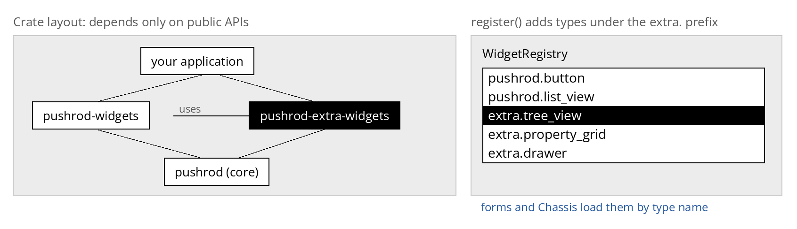

| Event emitted | When | Application callback |
|---|---|---|
| (none) | Infrastructure only | `register(&mut WidgetRegistry)` |

Like every Pushrod widget, it can also receive application-defined custom events in `handle_event` and emit its own (Pushrod 1.13), and every internal action emits an engine event (Pushrod 9.10).

**Acceptance Criteria.**

- Workspace builds with the new crate; CI runs fmt, clippy, tests, `check_docs`, and rustdoc on it
- `register` adds widgets under `extra.` and a test loads a form using one
- Documentation site has an Extra widgets section and the crate appears in Widget libraries

**Parallelism / Dependencies.** Not parallelizable. Pushrod: Pushrod 1.21 [#130](https://github.com/KenSuenobu/rust-pushrod/issues/130) Split the standard widgets into the pushrod-widgets crate, Pushrod 1.22 [#131](https://github.com/KenSuenobu/rust-pushrod/issues/131) Widget libraries: extend or replace pushrod-widgets, Pushrod 6.1 [#60](https://github.com/KenSuenobu/rust-pushrod/issues/60) Widget registry and factory, Pushrod 10.6 [#134](https://github.com/KenSuenobu/rust-pushrod/issues/134) Backend crates: keep SDL out of the core and the widgets

**Used by Chassis:** Chassis 1.4 [#170](https://github.com/KenSuenobu/rust-pushrod/issues/170) Commands, menus, and shortcuts, Chassis 2.3 [#173](https://github.com/KenSuenobu/rust-pushrod/issues/173) Project drawer, Chassis 3.1 [#178](https://github.com/KenSuenobu/rust-pushrod/issues/178) Design surface, Chassis 3.2 [#179](https://github.com/KenSuenobu/rust-pushrod/issues/179) Widget palette, Chassis 3.8 [#185](https://github.com/KenSuenobu/rust-pushrod/issues/185) Layout managers in the designer, Chassis 4.1 [#186](https://github.com/KenSuenobu/rust-pushrod/issues/186) Inspector drawer, Chassis 4.2 [#187](https://github.com/KenSuenobu/rust-pushrod/issues/187) Property grid, Chassis 4.3 [#188](https://github.com/KenSuenobu/rust-pushrod/issues/188) Typed property editors, Chassis 6.2 [#196](https://github.com/KenSuenobu/rust-pushrod/issues/196) Build and run, Chassis 9.7 [#318](https://github.com/KenSuenobu/rust-pushrod/issues/318) Assistant activity, review mode, and safety, Chassis 9.9 [#320](https://github.com/KenSuenobu/rust-pushrod/issues/320) Assistant drawer: chat inside Chassis.

**Technical Stack.** Rust (edition 2024, Rust 1.100), `pushrod`, `pushrod-widgets`.

**Documentation.** `pushrod-docs/docs/extra-widgets/crate.md` (new page in the **Extra widgets** section: what it is, a screenshot from the Showcase, a short example, events and callbacks); rustdoc on every non-private item; a page in the Pushrod Showcase (1.2).

### 1.2: Extra widgets in the Pushrod Showcase

*Issue [#253](https://github.com/KenSuenobu/rust-pushrod/issues/253)* · *Extra widgets 1: crate and Chassis widgets*

**Widget roadmap:** [`docs/extra-widgets/gallery.md`](extra-widgets/gallery.md)

**Problem Statement.** Each widget needs a place to be seen, tried, and screenshotted. Pushrod already has one: the Showcase (Pushrod 12.1). A second gallery would split the demos in two.

**Solution / Scope.** `pushrod-extra-widgets` exports `showcase_pages()`, and the Showcase lists them in an **Extra widgets** group (behind the showcase's `extra` feature, on by default). The Showcase's completeness test (Pushrod 12.2) walks the registry, so an extra widget registered without a page fails CI; its tour (Pushrod 12.7) produces the golden images and documentation screenshots. Every new extra widget adds its page in the same pull request.

*Ideas from:* Qt's widget gallery, GTK's widget factory, the WinUI Gallery. Names and behavior are Pushrod's own.

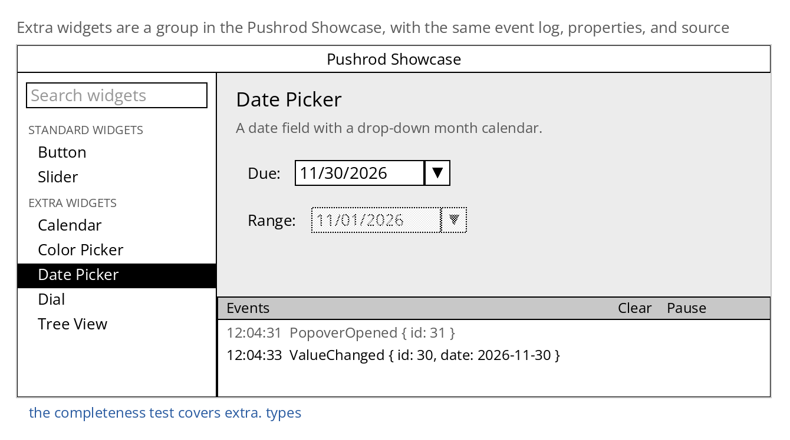

| Event emitted | When | Application callback |
|---|---|---|
| (per widget) | Any interaction | Shown in the Showcase's event log |

Like every Pushrod widget, it can also receive application-defined custom events in `handle_event` and emit its own (Pushrod 1.13), and every internal action emits an engine event (Pushrod 9.10).

**Acceptance Criteria.**

- The Showcase has an Extra widgets group with a page for every widget built so far
- The completeness test covers `extra.` types
- Golden images and documentation screenshots come from the Showcase tour

**Parallelism / Dependencies.** Parallelizable. Extra widgets: 1.1 ([#252](https://github.com/KenSuenobu/rust-pushrod/issues/252)); Pushrod: Pushrod 12.1 [#295](https://github.com/KenSuenobu/rust-pushrod/issues/295) Showcase application shell, Pushrod 12.2 [#296](https://github.com/KenSuenobu/rust-pushrod/issues/296) Showcase pages for every standard widget, with a completeness test, Pushrod 12.7 [#301](https://github.com/KenSuenobu/rust-pushrod/issues/301) Showcase in CI: scripted tour, golden screenshots, and documentation images

**Technical Stack.** Rust (edition 2024, Rust 1.100), `pushrod`, `pushrod-widgets`.

**Documentation.** `pushrod-docs/docs/extra-widgets/gallery.md` (new page in the **Extra widgets** section: what it is, a screenshot from the Showcase, a short example, events and callbacks); rustdoc on every non-private item; a page in the Pushrod Showcase (1.2).

### 1.3: Popover: a floating panel anchored to a control

*Issue [#254](https://github.com/KenSuenobu/rust-pushrod/issues/254)* · *Extra widgets 1: crate and Chassis widgets*

**Widget roadmap:** [`docs/extra-widgets/popover.md`](extra-widgets/popover.md)

**Problem Statement.** Pickers (date, time, color, font), menu buttons, and inline editors all need the same thing: a temporary panel next to the control that opened it, above everything else in the window, that goes away when you are done. Building it separately in each widget would give each one different rules.

**Solution / Scope.** `Popover::new(content)` shows `content` (any widget tree) in a framed panel attached to an anchor widget, placed below it by default and flipped above or sideways to stay inside the window. It is drawn in the window's top layer, clipped to the window, with a one-pixel border and no shadow. It closes on Escape, on a click outside, when the anchor is hidden, or when its content calls `close()`. Focus moves into the popover and returns to the anchor on close. Modeless by default; `modal(true)` blocks the rest of the window until it closes.

*Ideas from:* macOS NSPopover, GTK GtkPopover, MUI Popobject, and the pop-up panels of KDE's date and color buttons. Names and behavior are Pushrod's own.

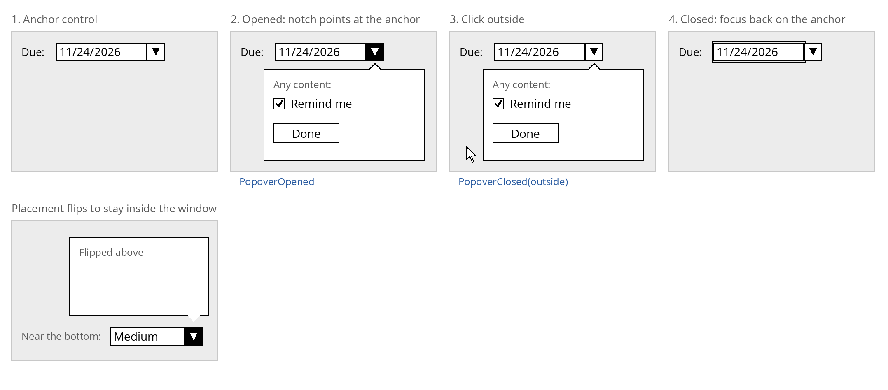

| Event emitted | When | Application callback |
|---|---|---|
| `PopoverOpened { id }` | Shown | `on_open(id, ..)` |
| `PopoverClosed { id, reason }` | Closed (Escape, outside click, programmatic) | `on_close(id, reason, ..)` |

Like every Pushrod widget, it can also receive application-defined custom events in `handle_event` and emit its own (Pushrod 1.13), and every internal action emits an engine event (Pushrod 9.10).

**Acceptance Criteria.**

- Placement flips to stay inside the window
- Escape and an outside click close it; focus returns to the anchor
- Any widget tree can be the content
- Modal and modeless modes

**Parallelism / Dependencies.** Parallelizable. Extra widgets: 1.1 ([#252](https://github.com/KenSuenobu/rust-pushrod/issues/252)); Pushrod: Pushrod 5.1 [#56](https://github.com/KenSuenobu/rust-pushrod/issues/56) Clip children to their parent's bounds, Pushrod 5.2 [#57](https://github.com/KenSuenobu/rust-pushrod/issues/57) Composite widgets: build widgets from parts that applications can retrieve and modify, Pushrod 9.2 [#94](https://github.com/KenSuenobu/rust-pushrod/issues/94) Event propagation: capture, target, and bubble phases with handled/ignored, Pushrod 1.4 [#20](https://github.com/KenSuenobu/rust-pushrod/issues/20) Keyboard focus, Tab order, and Return/Escape

**Used by Chassis:** Chassis 1.4 [#170](https://github.com/KenSuenobu/rust-pushrod/issues/170) Commands, menus, and shortcuts.

**Technical Stack.** Rust (edition 2024, Rust 1.100), `pushrod`, `pushrod-widgets`.

**Documentation.** `pushrod-docs/docs/extra-widgets/popover.md` (new page in the **Extra widgets** section: what it is, a screenshot from the Showcase, a short example, events and callbacks); rustdoc on every non-private item; a page in the Pushrod Showcase (1.2).

## Epic 2: Buttons and value controls ([#247](https://github.com/KenSuenobu/rust-pushrod/issues/247))

Menu and split buttons, segmented control, stepper, dial, level indicator, tool palette, ruler, shortcut field.

**Problem.** Toolkits share a set of small controls beyond the standard button, slider, and spin box: a button that opens a menu, a row of linked choices, bare up/down arrows, a rotary dial, a level meter, a palette of tools, a ruler, and a field that records a key combination.

**Scope.** Each is one control with one job, built from standard widgets where possible and drawn flat.

| Issue | Title | Summary | Labels | Parallel | MVP | Phase | Complexity | Affected modules |
|---|---|---|---|---|---|---|---|---|
| 2.1 ([#258](https://github.com/KenSuenobu/rust-pushrod/issues/258)) | Menu button and split button | A button that opens a menu, and a button with a separate arrow part that opens one. | `extra-widgets`, `extra-widgets-mvp`, `parallelizable`, `size/S`, `widget` | Y | Y | X2 | S | `pushrod-extra-widgets/src/menu_button.rs (new)`, `pushrod-docs` |
| 2.2 ([#50](https://github.com/KenSuenobu/rust-pushrod/issues/50)) | Segmented control | A row of joined buttons: pick one, or toggle several. | `extra-widgets`, `extra-widgets-mvp`, `parallelizable`, `size/S`, `widget` | Y | Y | X2 | S | `pushrod-extra-widgets/src/segmented_control.rs (new)`, `pushrod-docs` |
| 2.3 ([#259](https://github.com/KenSuenobu/rust-pushrod/issues/259)) | Stepper (up and down arrows) | A pair of small up/down arrows that step a value, attachable to any field. | `extra-widgets`, `extra-widgets-mvp`, `parallelizable`, `size/S`, `widget` | Y | Y | X2 | S | `pushrod-extra-widgets/src/stepper.rs (new)`, `pushrod-docs` |
| 2.4 ([#127](https://github.com/KenSuenobu/rust-pushrod/issues/127)) | Dial (rotary knob) | A round control turned by dragging, the wheel, or the keyboard, for values like volume, pan, or angle. | `extra-widgets`, `extra-widgets-mvp`, `parallelizable`, `size/S`, `widget` | Y | Y | X2 | S | `pushrod-extra-widgets/src/dial.rs (new)`, `pushrod-docs` |
| 2.5 ([#54](https://github.com/KenSuenobu/rust-pushrod/issues/54)) | Level indicator (meter) | A bar showing a level against warning and critical thresholds, continuous or in discrete segments. | `extra-widgets`, `extra-widgets-mvp`, `parallelizable`, `size/S`, `widget` | Y | Y | X2 | S | `pushrod-extra-widgets/src/level_indicator.rs (new)`, `pushrod-docs` |
| 2.6 ([#42](https://github.com/KenSuenobu/rust-pushrod/issues/42)) | Tool palette (grid of tool buttons) | A grid of icon buttons with one-of-many selection and optional drag out, for tools, swatches, or components. | `chassis`, `extra-widgets`, `extra-widgets-mvp`, `parallelizable`, `size/M`, `widget` | Y | Y | X1 | M | `pushrod-extra-widgets/src/tool_palette.rs (new)`, `pushrod-docs` |
| 2.7 ([#270](https://github.com/KenSuenobu/rust-pushrod/issues/270)) | Ruler | A horizontal or vertical scale in pixels, points, or units, with markers that can be dragged. | `extra-widgets`, `parallelizable`, `size/S`, `widget` | Y | N | X3 | S | `pushrod-extra-widgets/src/ruler.rs (new)`, `pushrod-docs` |
| 2.8 ([#271](https://github.com/KenSuenobu/rust-pushrod/issues/271)) | Shortcut field (key combination recorder) | A field that records the key combination pressed while it has focus. | `extra-widgets`, `parallelizable`, `size/S`, `widget` | Y | N | X3 | S | `pushrod-extra-widgets/src/shortcut_field.rs (new)`, `pushrod-docs` |
| 2.9 ([#302](https://github.com/KenSuenobu/rust-pushrod/issues/302)) | Drag value (numeric scrubber) | A compact number that changes as you drag it sideways, and becomes a text field when clicked. | `chassis`, `extra-widgets`, `extra-widgets-mvp`, `parallelizable`, `size/S`, `widget` | Y | Y | X1 | S | `pushrod-extra-widgets/src/drag_value.rs (new)`, `pushrod-docs` |
| 2.10 ([#306](https://github.com/KenSuenobu/rust-pushrod/issues/306)) | Range slider (two thumbs) | A slider with two thumbs selecting a lower and an upper value. | `extra-widgets`, `extra-widgets-mvp`, `parallelizable`, `size/S`, `widget` | Y | Y | X2 | S | `pushrod-extra-widgets/src/range_slider.rs (new)`, `pushrod-docs` |

### 2.1: Menu button and split button

*Issue [#258](https://github.com/KenSuenobu/rust-pushrod/issues/258)* · *Extra widgets 2: everyday controls and pickers*

**Widget roadmap:** [`docs/extra-widgets/menu-button.md`](extra-widgets/menu-button.md)

**Problem Statement.** Some commands have variants (Save / Save As / Save Copy) or a list of related actions, and a plain button can only run one action.

**Solution / Scope.** `MenuButton { label, menu }` shows a down-arrow glyph and opens its menu (Pushrod 2.11) on click or Space. `SplitButton { label, action, menu }` has two parts divided by a line: the label part runs the default action; the arrow part opens the menu. Menu items are actions (Pushrod 9.5), so their shortcuts and enabled state come for free. Keyboard: Alt+Down opens the menu on either kind.

*Ideas from:* Qt QToolButton menu modes, GTK GtkMenuButton and libadwaita's split button, macOS pull-down buttons and NSComboButton, Win32 split buttons, the Mac OS 8 bevel button with a pop-up arrow. Names and behavior are Pushrod's own.

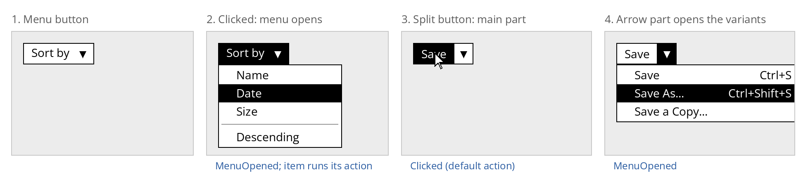

| Event emitted | When | Application callback |
|---|---|---|
| `Clicked { id }` | Split button's main part pressed | `on_click(id, ..)` |
| `MenuOpened { id }` | Menu shown | `on_menu_open(id, ..)` |
| (action) | Menu item chosen | the action's own callback |

Like every Pushrod widget, it can also receive application-defined custom events in `handle_event` and emit its own (Pushrod 1.13), and every internal action emits an engine event (Pushrod 9.10).

**Acceptance Criteria.**

- Menu button opens its menu by click, Space, and Alt+Down
- Split button: main part runs the default action, arrow part opens the menu
- Menu items are actions with shortcuts and enabled state

**Parallelism / Dependencies.** Parallelizable. Extra widgets: 1.1 ([#252](https://github.com/KenSuenobu/rust-pushrod/issues/252)); Pushrod: Pushrod 2.3 [#29](https://github.com/KenSuenobu/rust-pushrod/issues/29) Button behaviors: default, cancel, toggle, activate-on-press, dismiss dialog, Pushrod 2.11 [#37](https://github.com/KenSuenobu/rust-pushrod/issues/37) Menu bar and drop-down menus (drawn by Pushrod), Pushrod 9.5 [#97](https://github.com/KenSuenobu/rust-pushrod/issues/97) Actions and keyboard shortcuts: shared commands for menus, toolbars, and buttons

**Technical Stack.** Rust (edition 2024, Rust 1.100), `pushrod`, `pushrod-widgets`.

**Documentation.** `pushrod-docs/docs/extra-widgets/menu-button.md` (new page in the **Extra widgets** section: what it is, a screenshot from the Showcase, a short example, events and callbacks); rustdoc on every non-private item; a page in the Pushrod Showcase (1.2).

### 2.2: Segmented control

*Issue [#50](https://github.com/KenSuenobu/rust-pushrod/issues/50)* · *Extra widgets 2: everyday controls and pickers* · *moved from the standard widgets (issue #50 keeps its number)*

**Widget roadmap:** [`docs/extra-widgets/segmented-control.md`](extra-widgets/segmented-control.md)

**Problem Statement.** View switches (Day / Week / Month) and formatting toggles (Bold / Italic / Underline) read better as one joined control than as separate radio buttons or check boxes. Originally parked because radio groups cover the choice; as an extra widget it no longer adds weight to the standard set.

**Solution / Scope.** `SegmentedControl { segments, mode }`: segments share borders and are equal width (or sized to their labels). `mode` is `One` (radio semantics, Pushrod 2.5) or `Many` (each segment toggles). Selected segments are inverted. Segments can show text, an icon, or both, and can be disabled individually. Arrow keys move between segments; Space selects.

*Ideas from:* macOS NSSegmentedControl, GTK linked button boxes and GtkStackSwitcher, Qt exclusive QButtonGroup of tool buttons, Delphi TButtonGroup. Names and behavior are Pushrod's own.

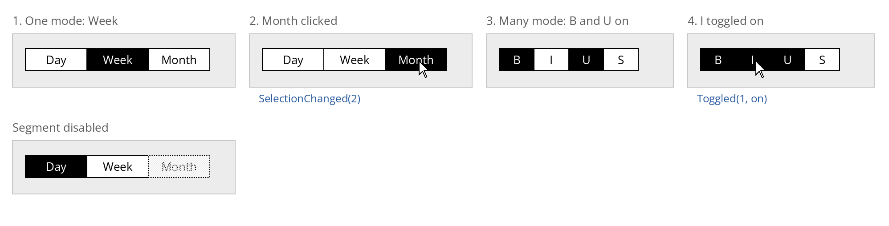

| Event emitted | When | Application callback |
|---|---|---|
| `SelectionChanged { id, index }` | A segment selected (One) | `on_selection_change(id, ..)` |
| `Toggled { id, index, on }` | A segment toggled (Many) | `on_toggle(id, ..)` |

Like every Pushrod widget, it can also receive application-defined custom events in `handle_event` and emit its own (Pushrod 1.13), and every internal action emits an engine event (Pushrod 9.10).

**Acceptance Criteria.**

- One and Many modes
- Per-segment disabled state, text, and icons
- Keyboard navigation and selection

**Parallelism / Dependencies.** Parallelizable. Extra widgets: 1.1 ([#252](https://github.com/KenSuenobu/rust-pushrod/issues/252)); Pushrod: Pushrod 2.3 [#29](https://github.com/KenSuenobu/rust-pushrod/issues/29) Button behaviors: default, cancel, toggle, activate-on-press, dismiss dialog, Pushrod 2.5 [#31](https://github.com/KenSuenobu/rust-pushrod/issues/31) Radio buttons and radio groups, Pushrod 1.17 [#104](https://github.com/KenSuenobu/rust-pushrod/issues/104) Per-state appearance: colors, border, and font for each visual state

**Technical Stack.** Rust (edition 2024, Rust 1.100), `pushrod`, `pushrod-widgets`.

**Documentation.** `pushrod-docs/docs/extra-widgets/segmented-control.md` (new page in the **Extra widgets** section: what it is, a screenshot from the Showcase, a short example, events and callbacks); rustdoc on every non-private item; a page in the Pushrod Showcase (1.2).

### 2.3: Stepper (up and down arrows)

*Issue [#259](https://github.com/KenSuenobu/rust-pushrod/issues/259)* · *Extra widgets 2: everyday controls and pickers*

**Widget roadmap:** [`docs/extra-widgets/stepper.md`](extra-widgets/stepper.md)

**Problem Statement.** The spin box joins a number field and arrows; sometimes the arrows belong next to something else (a time field's hours, a page number, a custom display).

**Solution / Scope.** `Stepper { min, max, step, value, wraps }`: two stacked glyph buttons (Pushrod 2.2). Click steps once; holding repeats after a delay (Pushrod 1.5). `buddy(widget_id)` keeps another widget's value in step through property bindings (Pushrod 9.6). Disabled arrows show when the value is at its limit (unless it wraps).

*Ideas from:* macOS NSStepper, the Mac OS 8 little arrows control, Win32 up-down control, Delphi TUpDown. Names and behavior are Pushrod's own.

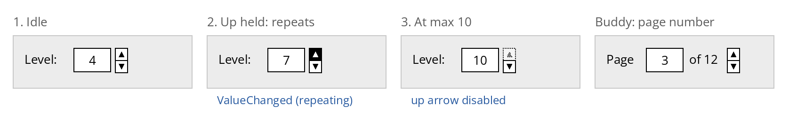

| Event emitted | When | Application callback |
|---|---|---|
| `ValueChanged { id, value }` | Each step, including repeats | `on_value_change(id, ..)` |

Like every Pushrod widget, it can also receive application-defined custom events in `handle_event` and emit its own (Pushrod 1.13), and every internal action emits an engine event (Pushrod 9.10).

**Acceptance Criteria.**

- Click steps; holding repeats with a delay
- Limits disable the matching arrow unless wrapping
- Buddy binding keeps another widget in step

**Parallelism / Dependencies.** Parallelizable. Extra widgets: 1.1 ([#252](https://github.com/KenSuenobu/rust-pushrod/issues/252)); Pushrod: Pushrod 2.2 [#28](https://github.com/KenSuenobu/rust-pushrod/issues/28) Glyph button (small single-character button), Pushrod 1.5 [#21](https://github.com/KenSuenobu/rust-pushrod/issues/21) Timers and idle callbacks, Pushrod 9.4 [#96](https://github.com/KenSuenobu/rust-pushrod/issues/96) Reusable input controllers: click, drag, scroll, hover, long-press, key, Pushrod 9.6 [#98](https://github.com/KenSuenobu/rust-pushrod/issues/98) Property bindings: keep two properties in sync

**Technical Stack.** Rust (edition 2024, Rust 1.100), `pushrod`, `pushrod-widgets`.

**Documentation.** `pushrod-docs/docs/extra-widgets/stepper.md` (new page in the **Extra widgets** section: what it is, a screenshot from the Showcase, a short example, events and callbacks); rustdoc on every non-private item; a page in the Pushrod Showcase (1.2).

### 2.4: Dial (rotary knob)

*Issue [#127](https://github.com/KenSuenobu/rust-pushrod/issues/127)* · *Extra widgets 2: everyday controls and pickers* · *moved from the standard widgets (issue #127 keeps its number)*

**Widget roadmap:** [`docs/extra-widgets/dial.md`](extra-widgets/dial.md)

**Problem Statement.** Some values are naturally rotary (volume, pan, gain, angle), and a dial takes less space than a slider. Moved here from the standard set because its round drawing and angle math go beyond the standard widgets' simple shapes.

**Solution / Scope.** `Dial { min, max, value, step, wrapping, notches }`: a circle with an indicator line and optional notch marks around the rim; drag vertically or around the center to turn; the mouse wheel and arrow keys step; Page Up/Down page. `wrapping` lets the value roll over (angles). Optional value text below. Outline drawing mode defers dependent work to release (Pushrod 10.1).

*Ideas from:* Qt QDial, MUI Knob, macOS circular NSSlider, and audio software. Names and behavior are Pushrod's own.

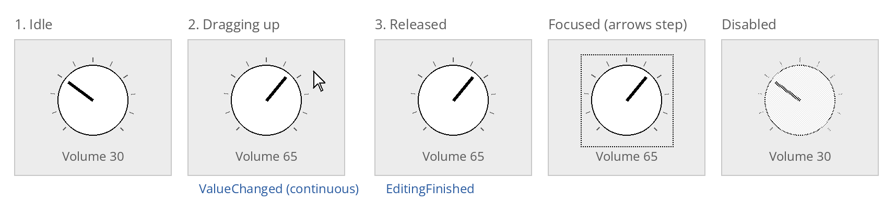

| Event emitted | When | Application callback |
|---|---|---|
| `ValueChanged { id, value }` | While turning | `on_value_change(id, ..)` |
| `EditingFinished { id }` | Drag released | `on_editing_finished(id, ..)` |

Like every Pushrod widget, it can also receive application-defined custom events in `handle_event` and emit its own (Pushrod 1.13), and every internal action emits an engine event (Pushrod 9.10).

**Acceptance Criteria.**

- Drag, wheel, and keys change the value within range
- Wrapping mode for angles
- Notches and optional value text

**Parallelism / Dependencies.** Parallelizable. Extra widgets: 1.1 ([#252](https://github.com/KenSuenobu/rust-pushrod/issues/252)); Pushrod: Pushrod 1.6 [#22](https://github.com/KenSuenobu/rust-pushrod/issues/22) Callback registry for every widget event, Pushrod 9.4 [#96](https://github.com/KenSuenobu/rust-pushrod/issues/96) Reusable input controllers: click, drag, scroll, hover, long-press, key

**Technical Stack.** Rust (edition 2024, Rust 1.100), `pushrod`, `pushrod-widgets`.

**Documentation.** `pushrod-docs/docs/extra-widgets/dial.md` (new page in the **Extra widgets** section: what it is, a screenshot from the Showcase, a short example, events and callbacks); rustdoc on every non-private item; a page in the Pushrod Showcase (1.2).

### 2.5: Level indicator (meter)

*Issue [#54](https://github.com/KenSuenobu/rust-pushrod/issues/54)* · *Extra widgets 2: everyday controls and pickers* · *moved from the standard widgets (issue #54 keeps its number)*

**Widget roadmap:** [`docs/extra-widgets/level-indicator.md`](extra-widgets/level-indicator.md)

**Problem Statement.** Disk usage, battery, signal strength, and password strength are levels, not progress: they don't move toward done, and they need warning and critical marks. Originally parked because the progress bar can approximate it; as an extra widget it can do the job properly.

**Solution / Scope.** `LevelIndicator { min, max, value, warning, critical, style }`: `Continuous` (a filled bar) or `Discrete(n)` (n separate segments). The fill pattern changes past the warning and critical values (solid, then hatched, then dithered) so it reads without color, with optional colors from per-state appearance (Pushrod 1.17). Optional text inside or beside ("62 GB of 100 GB"). Display only by default; `editable(true)` lets a click or arrow keys set the value.

*Ideas from:* macOS NSLevelIndicator, GTK GtkLevelBar, KDE KCapacityBar, AmigaOS fuelgauge.gadget, MUI Levelmeter. Names and behavior are Pushrod's own.

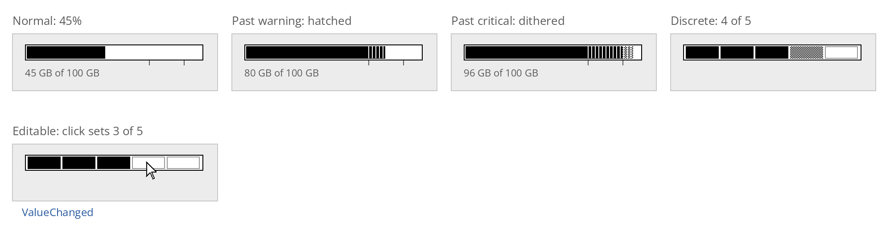

| Event emitted | When | Application callback |
|---|---|---|
| `ValueChanged { id, value }` | Value set by the user (editable only) | `on_value_change(id, ..)` |

Like every Pushrod widget, it can also receive application-defined custom events in `handle_event` and emit its own (Pushrod 1.13), and every internal action emits an engine event (Pushrod 9.10).

**Acceptance Criteria.**

- Continuous and discrete styles
- Warning and critical thresholds visible without color
- Optional text and editable mode

**Parallelism / Dependencies.** Parallelizable. Extra widgets: 1.1 ([#252](https://github.com/KenSuenobu/rust-pushrod/issues/252)); Pushrod: Pushrod 1.1 [#19](https://github.com/KenSuenobu/rust-pushrod/issues/19) Widget behavior flags and visual states, Pushrod 1.17 [#104](https://github.com/KenSuenobu/rust-pushrod/issues/104) Per-state appearance: colors, border, and font for each visual state, Pushrod 9.4 [#96](https://github.com/KenSuenobu/rust-pushrod/issues/96) Reusable input controllers: click, drag, scroll, hover, long-press, key

**Technical Stack.** Rust (edition 2024, Rust 1.100), `pushrod`, `pushrod-widgets`.

**Documentation.** `pushrod-docs/docs/extra-widgets/level-indicator.md` (new page in the **Extra widgets** section: what it is, a screenshot from the Showcase, a short example, events and callbacks); rustdoc on every non-private item; a page in the Pushrod Showcase (1.2).

### 2.6: Tool palette (grid of tool buttons)

*Issue [#42](https://github.com/KenSuenobu/rust-pushrod/issues/42)* · *Extra widgets 1: crate and Chassis widgets* · *moved from the standard widgets (issue #42 keeps its number)*

**Widget roadmap:** [`docs/extra-widgets/tool-palette.md`](extra-widgets/tool-palette.md)

**Problem Statement.** Drawing tools, color swatches, and Chassis's widget palette are the same thing: a compact grid of small picture buttons, one selected at a time, with names shown as tooltips. The parked "matrix of cells" issue asked for this.

**Solution / Scope.** `ToolPalette { items, layout, cell_size, mode }`: items are image buttons (Pushrod 2.21) with a name and optional group header rows. `layout` is `Grid { columns }` (icons only, names as tooltips, Pushrod 2.13) or `List` (one item per row: icon and name, as in Chassis's widget palette). Modes: `Select` (one selected item, inverted, like a tool box), `Click` (each click runs an action), or `Drag` (items can be dragged out with drag and drop, Pushrod 9.8, as Chassis's widget palette does). Arrow keys move, Space or Return activates. The grid reflows with the palette's width; a filter field (4.10) can narrow the items.

*Ideas from:* Delphi's component palette, AmigaOS palette.gadget and ReAction speedbar, NeXTSTEP NSMatrix, paint-program tool boxes (GEM paint programs, MacPaint), Win32 toolbars in check-group mode. Names and behavior are Pushrod's own.

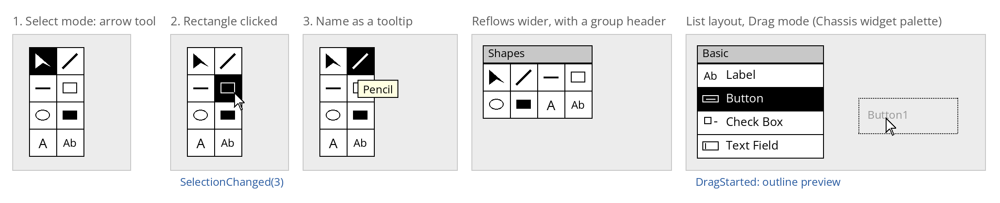

| Event emitted | When | Application callback |
|---|---|---|
| `SelectionChanged { id, index }` | Item selected (Select mode) | `on_selection_change(id, ..)` |
| `Activated { id, index }` | Item clicked (Click mode) | `on_activate(id, ..)` |
| `DragStarted { id, index }` | Item dragged out (Drag mode) | `on_drag_start(id, ..)` |

Like every Pushrod widget, it can also receive application-defined custom events in `handle_event` and emit its own (Pushrod 1.13), and every internal action emits an engine event (Pushrod 9.10).

**Acceptance Criteria.**

- Select, Click, and Drag modes
- Grid and List layouts, group header rows, and tooltips
- Grid reflows with width; keyboard navigation

**Parallelism / Dependencies.** Parallelizable. Extra widgets: 1.1 ([#252](https://github.com/KenSuenobu/rust-pushrod/issues/252)); Pushrod: Pushrod 2.21 [#125](https://github.com/KenSuenobu/rust-pushrod/issues/125) Image button, Pushrod 2.13 [#77](https://github.com/KenSuenobu/rust-pushrod/issues/77) Tooltips, Pushrod 5.10 [#121](https://github.com/KenSuenobu/rust-pushrod/issues/121) Flow layout (wrapping rows), Pushrod 9.8 [#100](https://github.com/KenSuenobu/rust-pushrod/issues/100) Drag and drop within the application

**Used by Chassis:** Chassis 3.2 [#179](https://github.com/KenSuenobu/rust-pushrod/issues/179) Widget palette.

**Technical Stack.** Rust (edition 2024, Rust 1.100), `pushrod`, `pushrod-widgets`.

**Documentation.** `pushrod-docs/docs/extra-widgets/tool-palette.md` (new page in the **Extra widgets** section: what it is, a screenshot from the Showcase, a short example, events and callbacks); rustdoc on every non-private item; a page in the Pushrod Showcase (1.2).

### 2.7: Ruler

*Issue [#270](https://github.com/KenSuenobu/rust-pushrod/issues/270)* · *Extra widgets 3: specialized views and assistants*

**Widget roadmap:** [`docs/extra-widgets/ruler.md`](extra-widgets/ruler.md)

**Problem Statement.** Layout tools, image editors, and text editors show a ruler along the edge of their work area, with the pointer's position and draggable markers (margins, tab stops, guides).

**Solution / Scope.** `Ruler { orientation, unit, origin, scale }`: major and minor ticks with labels at major ticks; `unit` is pixels, points, millimeters, or inches; follows a container's scroll offset and zoom when attached to it. A thin line tracks the pointer position over the attached view. `markers` are small triangles that can be dragged along the ruler.

*Ideas from:* macOS NSRulerView, KDE KRuler, MUI Scale, word-processor and layout-program rulers. Names and behavior are Pushrod's own.

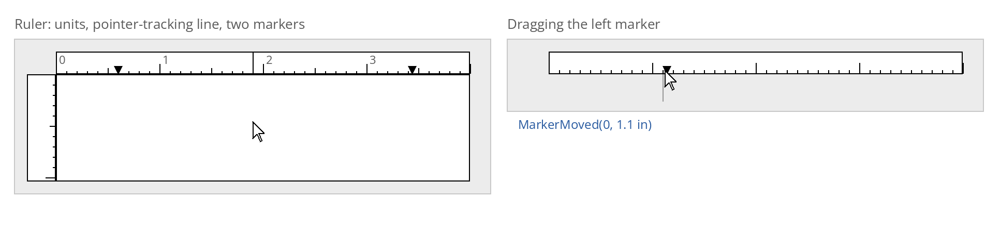

| Event emitted | When | Application callback |
|---|---|---|
| `MarkerMoved { id, index, position }` | A marker dragged | `on_marker_move(id, ..)` |

Like every Pushrod widget, it can also receive application-defined custom events in `handle_event` and emit its own (Pushrod 1.13), and every internal action emits an engine event (Pushrod 9.10).

**Acceptance Criteria.**

- Units, origin, and zoom
- Follows an attached container's scroll
- Pointer tracking line and draggable markers

**Parallelism / Dependencies.** Parallelizable. Extra widgets: 1.1 ([#252](https://github.com/KenSuenobu/rust-pushrod/issues/252)); Pushrod: Pushrod 2.10 [#36](https://github.com/KenSuenobu/rust-pushrod/issues/36) Custom paint widget (closure-drawn), Pushrod 5.3 [#58](https://github.com/KenSuenobu/rust-pushrod/issues/58) Container: a scrollable viewport onto fixed-size content, Pushrod 9.4 [#96](https://github.com/KenSuenobu/rust-pushrod/issues/96) Reusable input controllers: click, drag, scroll, hover, long-press, key

**Technical Stack.** Rust (edition 2024, Rust 1.100), `pushrod`, `pushrod-widgets`.

**Documentation.** `pushrod-docs/docs/extra-widgets/ruler.md` (new page in the **Extra widgets** section: what it is, a screenshot from the Showcase, a short example, events and callbacks); rustdoc on every non-private item; a page in the Pushrod Showcase (1.2).

### 2.8: Shortcut field (key combination recorder)

*Issue [#271](https://github.com/KenSuenobu/rust-pushrod/issues/271)* · *Extra widgets 3: specialized views and assistants*

**Widget roadmap:** [`docs/extra-widgets/shortcut-field.md`](extra-widgets/shortcut-field.md)

**Problem Statement.** Letting users change keyboard shortcuts needs a field that captures a key combination instead of typing text, and warns when the combination is already taken.

**Solution / Scope.** `ShortcutField { value: Option<KeyCombo> }`: click or focus to start recording ("Press keys…"); the next combination with at least one non-modifier key is shown as text ("Ctrl+Shift+S"). Escape cancels, Backspace clears. A `conflicts` closure can reject a combination already used by another action (Pushrod 9.5), shown inline.

*Ideas from:* Qt QKeySequenceEdit, KDE KKeySequenceWidget, Win32 hotkey control, Delphi THotKey. Names and behavior are Pushrod's own.

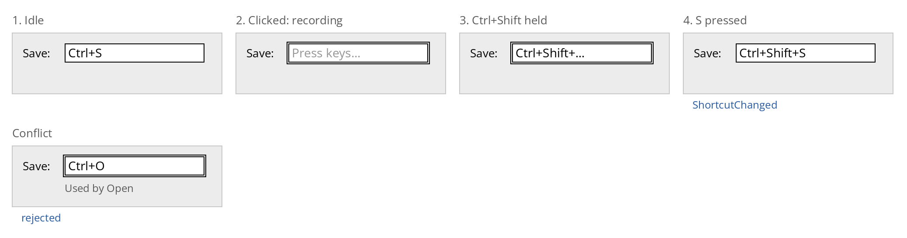

| Event emitted | When | Application callback |
|---|---|---|
| `ShortcutChanged { id, combo }` | A combination recorded or cleared | `on_shortcut_change(id, ..)` |

Like every Pushrod widget, it can also receive application-defined custom events in `handle_event` and emit its own (Pushrod 1.13), and every internal action emits an engine event (Pushrod 9.10).

**Acceptance Criteria.**

- Records combinations with modifiers
- Escape cancels, Backspace clears
- Conflicts reported inline

**Parallelism / Dependencies.** Parallelizable. Extra widgets: 1.1 ([#252](https://github.com/KenSuenobu/rust-pushrod/issues/252)); Pushrod: Pushrod 2.6 [#32](https://github.com/KenSuenobu/rust-pushrod/issues/32) Text field: single-line entry with input masks, validation, and numeric mode, Pushrod 9.5 [#97](https://github.com/KenSuenobu/rust-pushrod/issues/97) Actions and keyboard shortcuts: shared commands for menus, toolbars, and buttons, Pushrod 1.4 [#20](https://github.com/KenSuenobu/rust-pushrod/issues/20) Keyboard focus, Tab order, and Return/Escape

**Technical Stack.** Rust (edition 2024, Rust 1.100), `pushrod`, `pushrod-widgets`.

**Documentation.** `pushrod-docs/docs/extra-widgets/shortcut-field.md` (new page in the **Extra widgets** section: what it is, a screenshot from the Showcase, a short example, events and callbacks); rustdoc on every non-private item; a page in the Pushrod Showcase (1.2).

### 2.9: Drag value (numeric scrubber)

*Issue [#302](https://github.com/KenSuenobu/rust-pushrod/issues/302)* · *Extra widgets 1: crate and Chassis widgets*

**Widget roadmap:** [`docs/extra-widgets/drag-value.md`](extra-widgets/drag-value.md)

**Problem Statement.** Inspectors are full of numbers (X, Y, width, height, spacing). A spin box per number is wide and slow; tool applications let you drag the number itself.

**Solution / Scope.** `DragValue { value, min, max, speed, decimals, prefix, suffix }`: shows the value as text in a flat box ("X 120", "50 %"). Dragging left or right changes it by `speed` per pixel (Shift for fine steps, Ctrl for coarse); the pointer becomes a horizontal-resize cursor (Pushrod 9.9). A click without dragging, or Return when focused, turns it into a text field for typing (with arithmetic when Pushrod 4.12 is available); Escape restores the old value. Arrow keys step. Outline drawing mode defers dependent work to release (Pushrod 10.1).

*Ideas from:* egui's DragValue, Dear ImGui's drag fields, numeric fields in Blender, Figma, Unity, and Godot inspectors. Names and behavior are Pushrod's own.

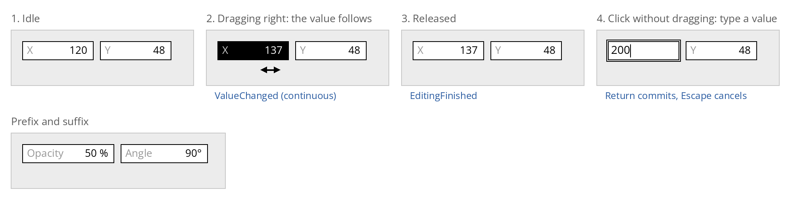

| Event emitted | When | Application callback |
|---|---|---|
| `ValueChanged { id, value }` | While dragging, stepping, or on commit | `on_value_change(id, ..)` |
| `EditingFinished { id }` | Drag released or typing committed | `on_editing_finished(id, ..)` |

Like every Pushrod widget, it can also receive application-defined custom events in `handle_event` and emit its own (Pushrod 1.13), and every internal action emits an engine event (Pushrod 9.10).

**Acceptance Criteria.**

- Drag changes the value with fine and coarse modifiers
- Click to type; Escape cancels
- Range, decimals, prefix, and suffix

**Parallelism / Dependencies.** Parallelizable. Extra widgets: 1.1 ([#252](https://github.com/KenSuenobu/rust-pushrod/issues/252)); Pushrod: Pushrod 2.6 [#32](https://github.com/KenSuenobu/rust-pushrod/issues/32) Text field: single-line entry with input masks, validation, and numeric mode, Pushrod 9.4 [#96](https://github.com/KenSuenobu/rust-pushrod/issues/96) Reusable input controllers: click, drag, scroll, hover, long-press, key, Pushrod 9.9 [#101](https://github.com/KenSuenobu/rust-pushrod/issues/101) Pointer cursor per widget

**Used by Chassis:** Chassis 4.3 [#188](https://github.com/KenSuenobu/rust-pushrod/issues/188) Typed property editors.

**Technical Stack.** Rust (edition 2024, Rust 1.100), `pushrod`, `pushrod-widgets`.

**Documentation.** `pushrod-docs/docs/extra-widgets/drag-value.md` (new page in the **Extra widgets** section: what it is, a screenshot from the Showcase, a short example, events and callbacks); rustdoc on every non-private item; a page in the Pushrod Showcase (1.2).

### 2.10: Range slider (two thumbs)

*Issue [#306](https://github.com/KenSuenobu/rust-pushrod/issues/306)* · *Extra widgets 2: everyday controls and pickers*

**Widget roadmap:** [`docs/extra-widgets/range-slider.md`](extra-widgets/range-slider.md)

**Problem Statement.** Filters such as price from/to, a year span, or a trim range need two bounds on one scale; two separate sliders don't show the span.

**Solution / Scope.** `RangeSlider { min, max, low, high, step, min_gap }` builds on the slider (Pushrod 3.2): two thumbs on one track with the span between them filled. Drag a thumb (they can't cross; `min_gap` keeps them apart), or drag the filled span to move both. Tab moves between thumbs; arrow keys step the focused one. Optional ticks and value labels as on the slider.

*Ideas from:* Qt Quick's RangeSlider, Flutter's RangeSlider, Material and Ant Design sliders in range mode. Names and behavior are Pushrod's own.

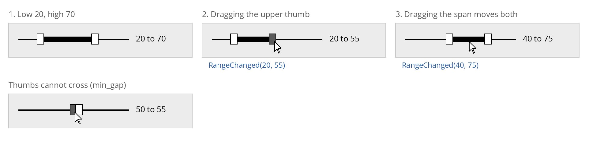

| Event emitted | When | Application callback |
|---|---|---|
| `RangeChanged { id, low, high }` | While dragging or stepping | `on_range_change(id, ..)` |
| `EditingFinished { id }` | Drag released | `on_editing_finished(id, ..)` |

Like every Pushrod widget, it can also receive application-defined custom events in `handle_event` and emit its own (Pushrod 1.13), and every internal action emits an engine event (Pushrod 9.10).

**Acceptance Criteria.**

- Two thumbs that cannot cross
- Dragging the span moves both
- Keyboard control of each thumb

**Parallelism / Dependencies.** Parallelizable. Extra widgets: 1.1 ([#252](https://github.com/KenSuenobu/rust-pushrod/issues/252)); Pushrod: Pushrod 3.2 [#40](https://github.com/KenSuenobu/rust-pushrod/issues/40) Slider, Pushrod 9.4 [#96](https://github.com/KenSuenobu/rust-pushrod/issues/96) Reusable input controllers: click, drag, scroll, hover, long-press, key

**Technical Stack.** Rust (edition 2024, Rust 1.100), `pushrod`, `pushrod-widgets`.

**Documentation.** `pushrod-docs/docs/extra-widgets/range-slider.md` (new page in the **Extra widgets** section: what it is, a screenshot from the Showcase, a short example, events and callbacks); rustdoc on every non-private item; a page in the Pushrod Showcase (1.2).

## Epic 3: Pickers and special fields ([#248](https://github.com/KenSuenobu/rust-pushrod/issues/248))

Calendar, date and time pickers, color and font choosers, path field, image well, new-password, character picker.

**Problem.** Choosing a date, a time, a color, a font, a file, an image, a new password, or a special character is common to almost every toolkit, and each is too large to live in the standard set.

**Scope.** Fields that open a popover or a dialog, plus the standalone views they use (calendar, color picker, font chooser), so applications can embed either.

| Issue | Title | Summary | Labels | Parallel | MVP | Phase | Complexity | Affected modules |
|---|---|---|---|---|---|---|---|---|
| 3.1 ([#260](https://github.com/KenSuenobu/rust-pushrod/issues/260)) | Calendar (month view) | A month grid for choosing a day or a range of days, usable on its own or in the date picker. | `extra-widgets`, `extra-widgets-mvp`, `parallelizable`, `size/M`, `widget` | Y | Y | X2 | M | `pushrod-extra-widgets/src/calendar.rs (new)`, `pushrod-docs` |
| 3.2 ([#91](https://github.com/KenSuenobu/rust-pushrod/issues/91)) | Date picker | A date field with a drop-down month calendar. | `extra-widgets`, `extra-widgets-mvp`, `parallelizable`, `size/S`, `widget` | Y | Y | X2 | S | `pushrod-extra-widgets/src/date_picker.rs (new)`, `pushrod-docs` |
| 3.3 ([#261](https://github.com/KenSuenobu/rust-pushrod/issues/261)) | Time field and date-time field | A time entry with steppable parts, and a combined date-and-time field. | `extra-widgets`, `extra-widgets-mvp`, `parallelizable`, `size/S`, `widget` | Y | Y | X2 | S | `pushrod-extra-widgets/src/time_field.rs (new)`, `pushrod-docs` |
| 3.4 ([#46](https://github.com/KenSuenobu/rust-pushrod/issues/46)) | Color well and color picker | A swatch button that opens a color picker with swatches, sliders, and a hex field. | `extra-widgets`, `extra-widgets-mvp`, `parallelizable`, `size/M`, `widget` | Y | Y | X2 | M | `pushrod-extra-widgets/src/color_picker.rs (new)`, `pushrod-docs` |
| 3.5 ([#129](https://github.com/KenSuenobu/rust-pushrod/issues/129)) | Font chooser | A font button that opens a chooser with family, style, size, and a preview. | `extra-widgets`, `extra-widgets-mvp`, `parallelizable`, `size/M`, `widget` | Y | Y | X2 | M | `pushrod-extra-widgets/src/font_chooser.rs (new)`, `pushrod-docs` |
| 3.6 ([#262](https://github.com/KenSuenobu/rust-pushrod/issues/262)) | Path field (file or folder with Browse) | A text field for a file or folder path, with a Browse button and drop support. | `extra-widgets`, `extra-widgets-mvp`, `parallelizable`, `size/S`, `widget` | Y | Y | X2 | S | `pushrod-extra-widgets/src/path_field.rs (new)`, `pushrod-docs` |
| 3.7 ([#272](https://github.com/KenSuenobu/rust-pushrod/issues/272)) | Image well | A framed area that shows an image and accepts a new one by drop, paste, or Choose. | `extra-widgets`, `parallelizable`, `size/S`, `widget` | Y | N | X3 | S | `pushrod-extra-widgets/src/image_well.rs (new)`, `pushrod-docs` |
| 3.8 ([#273](https://github.com/KenSuenobu/rust-pushrod/issues/273)) | New password (enter, confirm, strength) | Two password fields with a strength meter and a match check. | `extra-widgets`, `parallelizable`, `size/S`, `widget` | Y | N | X3 | S | `pushrod-extra-widgets/src/new_password.rs (new)`, `pushrod-docs` |
| 3.9 ([#274](https://github.com/KenSuenobu/rust-pushrod/issues/274)) | Character picker | A searchable grid of characters by block, with a preview and code point. | `extra-widgets`, `parallelizable`, `size/M`, `widget` | Y | N | X3 | M | `pushrod-extra-widgets/src/character_picker.rs (new)`, `pushrod-docs` |
| 3.10 ([#307](https://github.com/KenSuenobu/rust-pushrod/issues/307)) | Token field (tags in a field) | A text field whose entries become removable tokens, with optional suggestions. | `extra-widgets`, `extra-widgets-mvp`, `parallelizable`, `size/M`, `widget` | Y | Y | X2 | M | `pushrod-extra-widgets/src/token_field.rs (new)`, `pushrod-docs` |

### 3.1: Calendar (month view)

*Issue [#260](https://github.com/KenSuenobu/rust-pushrod/issues/260)* · *Extra widgets 2: everyday controls and pickers*

**Widget roadmap:** [`docs/extra-widgets/calendar.md`](extra-widgets/calendar.md)

**Problem Statement.** Scheduling and booking screens show a month calendar in the window, not only behind a date field. Splitting it out of the date picker lets both use it.

**Solution / Scope.** `Calendar { month, selection, mode, first_weekday, min, max }`: a month title with previous/next glyph buttons, weekday headings, and a 6 x 7 day grid. Today is outlined; the selection is inverted. `mode` is `Single` or `Range` (click a start, then shift-click or click an end). Days outside `min`/`max` are dithered. Arrow keys move by day, Page Up/Down by month; marked days (`marks`) get a dot under the number.

*Ideas from:* GTK GtkCalendar, Qt QCalendarWidget, KDE KDatePicker, AmigaOS datebrowser.gadget, macOS graphical NSDatePicker, Win32 month calendar control. Names and behavior are Pushrod's own.

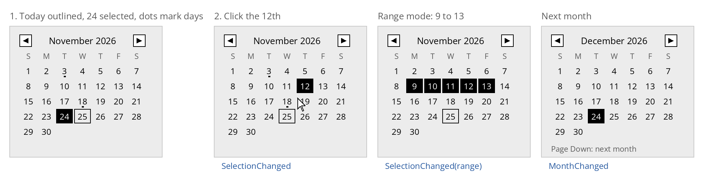

| Event emitted | When | Application callback |
|---|---|---|
| `SelectionChanged { id, date }` | Day or range chosen | `on_selection_change(id, ..)` |
| `MonthChanged { id, month }` | Month changed | `on_month_change(id, ..)` |

Like every Pushrod widget, it can also receive application-defined custom events in `handle_event` and emit its own (Pushrod 1.13), and every internal action emits an engine event (Pushrod 9.10).

**Acceptance Criteria.**

- Single and range selection
- Min/max limits and marked days
- Keyboard navigation by day and month

**Parallelism / Dependencies.** Parallelizable. Extra widgets: 1.1 ([#252](https://github.com/KenSuenobu/rust-pushrod/issues/252)); Pushrod: Pushrod 2.2 [#28](https://github.com/KenSuenobu/rust-pushrod/issues/28) Glyph button (small single-character button), Pushrod 9.4 [#96](https://github.com/KenSuenobu/rust-pushrod/issues/96) Reusable input controllers: click, drag, scroll, hover, long-press, key, Pushrod 1.4 [#20](https://github.com/KenSuenobu/rust-pushrod/issues/20) Keyboard focus, Tab order, and Return/Escape

**Technical Stack.** Rust (edition 2024, Rust 1.100), `pushrod`, `pushrod-widgets`.

**Documentation.** `pushrod-docs/docs/extra-widgets/calendar.md` (new page in the **Extra widgets** section: what it is, a screenshot from the Showcase, a short example, events and callbacks); rustdoc on every non-private item; a page in the Pushrod Showcase (1.2).

### 3.2: Date picker

*Issue [#91](https://github.com/KenSuenobu/rust-pushrod/issues/91)* · *Extra widgets 2: everyday controls and pickers* · *moved from the standard widgets (issue #91 keeps its number)*

**Widget roadmap:** [`docs/extra-widgets/date-picker.md`](extra-widgets/date-picker.md)

**Problem Statement.** Typing dates is error-prone and formats differ; a calendar makes the choice clear. Moved here from the standard set because it is a compound of a field, a popover, and a calendar.

**Solution / Scope.** `DatePicker { value, format, min, max }`: a masked text field (Pushrod 2.6) plus a glyph button that opens a popover (1.3) holding a calendar (3.1). Typing a valid date updates the calendar; choosing a day fills the field and closes the popover. Up/Down in the field step the part under the caret (day, month, year).

*Ideas from:* Qt QDateEdit, KDE KDateComboBox, Win32 date and time picker, GTK date entries, the Mac OS 8 clock control. Names and behavior are Pushrod's own.

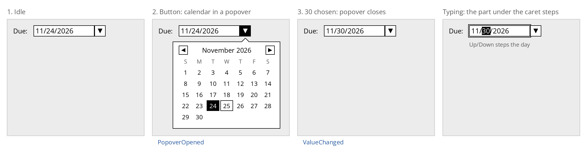

| Event emitted | When | Application callback |
|---|---|---|
| `ValueChanged { id, date }` | A valid date typed or chosen | `on_value_change(id, ..)` |

Like every Pushrod widget, it can also receive application-defined custom events in `handle_event` and emit its own (Pushrod 1.13), and every internal action emits an engine event (Pushrod 9.10).

**Acceptance Criteria.**

- Typed and chosen dates stay in step
- Min/max enforced
- Up/Down steps the date part under the caret

**Parallelism / Dependencies.** Parallelizable. Extra widgets: 1.3 ([#254](https://github.com/KenSuenobu/rust-pushrod/issues/254)), 3.1 ([#260](https://github.com/KenSuenobu/rust-pushrod/issues/260)); Pushrod: Pushrod 2.6 [#32](https://github.com/KenSuenobu/rust-pushrod/issues/32) Text field: single-line entry with input masks, validation, and numeric mode, Pushrod 2.2 [#28](https://github.com/KenSuenobu/rust-pushrod/issues/28) Glyph button (small single-character button)

**Technical Stack.** Rust (edition 2024, Rust 1.100), `pushrod`, `pushrod-widgets`.

**Documentation.** `pushrod-docs/docs/extra-widgets/date-picker.md` (new page in the **Extra widgets** section: what it is, a screenshot from the Showcase, a short example, events and callbacks); rustdoc on every non-private item; a page in the Pushrod Showcase (1.2).

### 3.3: Time field and date-time field

*Issue [#261](https://github.com/KenSuenobu/rust-pushrod/issues/261)* · *Extra widgets 2: everyday controls and pickers*

**Widget roadmap:** [`docs/extra-widgets/time-field.md`](extra-widgets/time-field.md)

**Problem Statement.** Times (hours, minutes, seconds, AM/PM) are best entered part by part with arrows, and many forms need a date and a time together.

**Solution / Scope.** `TimeField { value, format, step }`: the field shows `hh:mm[:ss] [AM/PM]`; clicking a part selects it, Up/Down or the attached stepper (2.3) changes it, digits type it, Tab or the separator key moves to the next part. `DateTimeField` joins a date picker (3.2) and a time field in one row with one value.

*Ideas from:* Qt QTimeEdit and QDateTimeEdit, KDE KTimeComboBox and KDateTimeEdit, macOS textual NSDatePicker, the Mac OS 8 clock control, Delphi TTimePicker. Names and behavior are Pushrod's own.

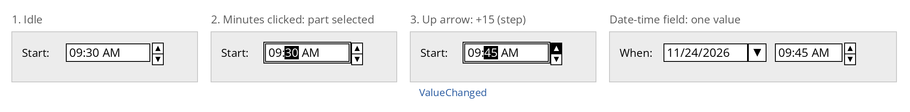

| Event emitted | When | Application callback |
|---|---|---|
| `ValueChanged { id, value }` | Any part changed | `on_value_change(id, ..)` |

Like every Pushrod widget, it can also receive application-defined custom events in `handle_event` and emit its own (Pushrod 1.13), and every internal action emits an engine event (Pushrod 9.10).

**Acceptance Criteria.**

- Part-by-part editing with keys and stepper
- 12- and 24-hour formats
- Date-time field keeps one combined value

**Parallelism / Dependencies.** Parallelizable. Extra widgets: 2.3 ([#259](https://github.com/KenSuenobu/rust-pushrod/issues/259)), 3.2 ([#91](https://github.com/KenSuenobu/rust-pushrod/issues/91)); Pushrod: Pushrod 2.6 [#32](https://github.com/KenSuenobu/rust-pushrod/issues/32) Text field: single-line entry with input masks, validation, and numeric mode

**Technical Stack.** Rust (edition 2024, Rust 1.100), `pushrod`, `pushrod-widgets`.

**Documentation.** `pushrod-docs/docs/extra-widgets/time-field.md` (new page in the **Extra widgets** section: what it is, a screenshot from the Showcase, a short example, events and callbacks); rustdoc on every non-private item; a page in the Pushrod Showcase (1.2).

### 3.4: Color well and color picker

*Issue [#46](https://github.com/KenSuenobu/rust-pushrod/issues/46)* · *Extra widgets 2: everyday controls and pickers* · *moved from the standard widgets (issue #46 keeps its number)*

**Widget roadmap:** [`docs/extra-widgets/color-picker.md`](extra-widgets/color-picker.md)

**Problem Statement.** Drawing programs, themes, and Chassis's color properties need a way to pick a color. Originally parked as rarely needed in dialogs; it belongs in the extra widgets.

**Solution / Scope.** `ColorWell { color }` is a button filled with its color. Clicking opens a popover (1.3) with a `ColorPicker`: a tool palette (2.6) of swatches (standard plus recently used), red/green/blue (or hue/saturation/value) sliders with numeric fields, a hex field, and a before/after preview. `ColorPicker` can also be placed in a window directly. Colors can be dragged from a well onto another well (Pushrod 9.8).

*Ideas from:* macOS NSColorWell and the color panel, GTK GtkColorButton and GtkColorChooser, Qt QColorDialog, KDE KColorButton, AmigaOS colorwheel.gadget and getcolor.gadget, Motif XmColorSelector. Names and behavior are Pushrod's own.

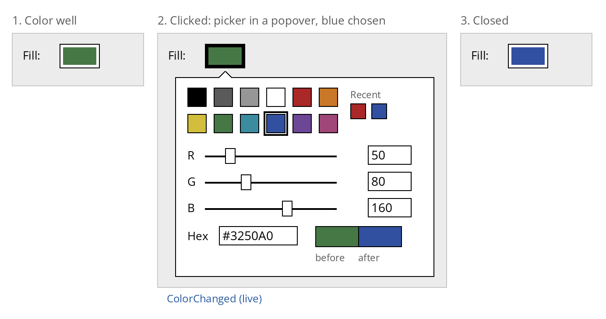

| Event emitted | When | Application callback |
|---|---|---|
| `ColorChanged { id, color }` | Color chosen or edited | `on_color_change(id, ..)` |

Like every Pushrod widget, it can also receive application-defined custom events in `handle_event` and emit its own (Pushrod 1.13), and every internal action emits an engine event (Pushrod 9.10).

**Acceptance Criteria.**

- Swatches, recent colors, RGB and HSV sliders, hex field
- Popover and inline use
- Drag a color between wells

**Parallelism / Dependencies.** Parallelizable. Extra widgets: 1.3 ([#254](https://github.com/KenSuenobu/rust-pushrod/issues/254)), 2.6 ([#42](https://github.com/KenSuenobu/rust-pushrod/issues/42)); Pushrod: Pushrod 3.2 [#40](https://github.com/KenSuenobu/rust-pushrod/issues/40) Slider, Pushrod 2.6 [#32](https://github.com/KenSuenobu/rust-pushrod/issues/32) Text field: single-line entry with input masks, validation, and numeric mode, Pushrod 9.8 [#100](https://github.com/KenSuenobu/rust-pushrod/issues/100) Drag and drop within the application

**Technical Stack.** Rust (edition 2024, Rust 1.100), `pushrod`, `pushrod-widgets`.

**Documentation.** `pushrod-docs/docs/extra-widgets/color-picker.md` (new page in the **Extra widgets** section: what it is, a screenshot from the Showcase, a short example, events and callbacks); rustdoc on every non-private item; a page in the Pushrod Showcase (1.2).

### 3.5: Font chooser

*Issue [#129](https://github.com/KenSuenobu/rust-pushrod/issues/129)* · *Extra widgets 2: everyday controls and pickers* · *moved from the standard widgets (issue #129 keeps its number)*

**Widget roadmap:** [`docs/extra-widgets/font-chooser.md`](extra-widgets/font-chooser.md)

**Problem Statement.** Editors and settings screens let users pick a font. Originally parked because most applications don't; it belongs in the extra widgets.

**Solution / Scope.** `FontButton { font }` shows the font's name in that font. Clicking opens a popover (1.3) with a `FontChooser`: a filter field, a family list (each name in its own face), a style list, a size field with common sizes, and an editable preview line. Families come from Pushrod's font registry (Pushrod 1.24). `FontChooser` can be used in a window or a modal dialog directly.

*Ideas from:* GTK GtkFontButton and GtkFontChooser, Qt QFontDialog and QFontComboBox, KDE KFontRequester and KFontChooser, AmigaOS getfont.gadget, GEM's font selector (fnts), Motif XmFontSelector. Names and behavior are Pushrod's own.

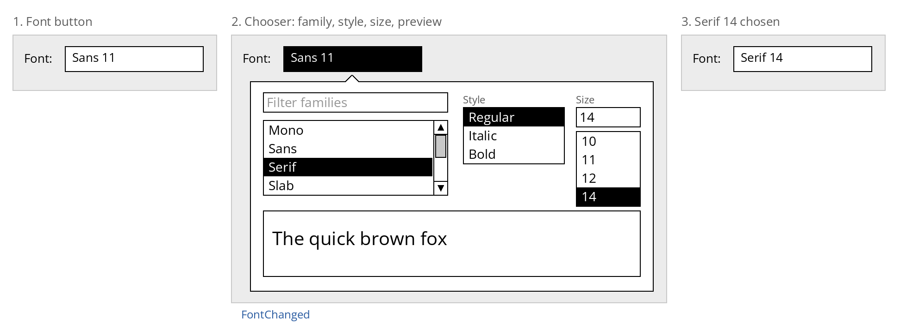

| Event emitted | When | Application callback |
|---|---|---|
| `FontChanged { id, font }` | Family, style, or size chosen | `on_font_change(id, ..)` |

Like every Pushrod widget, it can also receive application-defined custom events in `handle_event` and emit its own (Pushrod 1.13), and every internal action emits an engine event (Pushrod 9.10).

**Acceptance Criteria.**

- Family, style, and size lists with filtering
- Preview text editable
- Popover and dialog use

**Parallelism / Dependencies.** Parallelizable. Extra widgets: 1.3 ([#254](https://github.com/KenSuenobu/rust-pushrod/issues/254)); Pushrod: Pushrod 4.5 [#52](https://github.com/KenSuenobu/rust-pushrod/issues/52) List view, Pushrod 1.24 [#137](https://github.com/KenSuenobu/rust-pushrod/issues/137) Fonts: shared font handles and a built-in default font, Pushrod 2.6 [#32](https://github.com/KenSuenobu/rust-pushrod/issues/32) Text field: single-line entry with input masks, validation, and numeric mode, Pushrod 6.7 [#66](https://github.com/KenSuenobu/rust-pushrod/issues/66) Modal dialogs: run a form until a dismissing control is chosen

**Technical Stack.** Rust (edition 2024, Rust 1.100), `pushrod`, `pushrod-widgets`.

**Documentation.** `pushrod-docs/docs/extra-widgets/font-chooser.md` (new page in the **Extra widgets** section: what it is, a screenshot from the Showcase, a short example, events and callbacks); rustdoc on every non-private item; a page in the Pushrod Showcase (1.2).

### 3.6: Path field (file or folder with Browse)

*Issue [#262](https://github.com/KenSuenobu/rust-pushrod/issues/262)* · *Extra widgets 2: everyday controls and pickers*

**Widget roadmap:** [`docs/extra-widgets/path-field.md`](extra-widgets/path-field.md)

**Problem Statement.** Settings and import screens often ask for a path. A bare text field invites typos; a bare button hides the path. Every toolkit above joins the two.

**Solution / Scope.** `PathField { path, kind, filters }`: a text field plus a "…" button that opens the file chooser (Pushrod 2.12) in Open, Save, or Folder mode starting at the current path. Files can be dropped onto the field (Pushrod 9.8). Optional completion of path segments as you type, and an error mark when `must_exist` is set and the path is missing.

*Ideas from:* KDE KUrlRequester, AmigaOS getfile.gadget and MUI Popasl, GTK file chooser buttons, Delphi TButtonedEdit. Names and behavior are Pushrod's own.

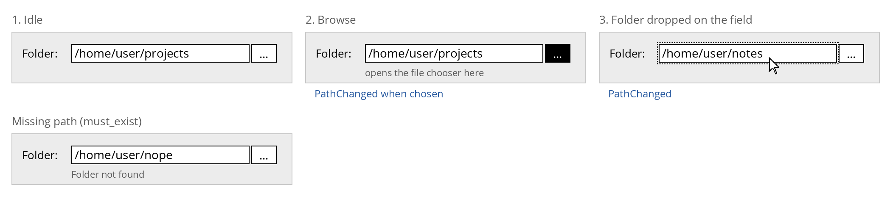

| Event emitted | When | Application callback |
|---|---|---|
| `PathChanged { id, path }` | Path typed, browsed, or dropped | `on_path_change(id, ..)` |

Like every Pushrod widget, it can also receive application-defined custom events in `handle_event` and emit its own (Pushrod 1.13), and every internal action emits an engine event (Pushrod 9.10).

**Acceptance Criteria.**

- Browse opens the chooser at the current path
- Typed, browsed, and dropped paths
- Missing-path mark when required

**Parallelism / Dependencies.** Parallelizable. Extra widgets: 1.1 ([#252](https://github.com/KenSuenobu/rust-pushrod/issues/252)); Pushrod: Pushrod 2.6 [#32](https://github.com/KenSuenobu/rust-pushrod/issues/32) Text field: single-line entry with input masks, validation, and numeric mode, Pushrod 2.12 [#38](https://github.com/KenSuenobu/rust-pushrod/issues/38) File chooser dialog (drawn by Pushrod), Pushrod 9.8 [#100](https://github.com/KenSuenobu/rust-pushrod/issues/100) Drag and drop within the application

**Technical Stack.** Rust (edition 2024, Rust 1.100), `pushrod`, `pushrod-widgets`.

**Documentation.** `pushrod-docs/docs/extra-widgets/path-field.md` (new page in the **Extra widgets** section: what it is, a screenshot from the Showcase, a short example, events and callbacks); rustdoc on every non-private item; a page in the Pushrod Showcase (1.2).

### 3.7: Image well

*Issue [#272](https://github.com/KenSuenobu/rust-pushrod/issues/272)* · *Extra widgets 3: specialized views and assistants*

**Widget roadmap:** [`docs/extra-widgets/image-well.md`](extra-widgets/image-well.md)

**Problem Statement.** Profile pictures, icons, and document images are set by dropping or choosing a picture into a framed slot.

**Solution / Scope.** `ImageWell { image }`: an image widget (Pushrod 2.7) scaled to fit inside a frame. Drop an image file (Pushrod 9.8) or double-click to choose with the file chooser; Delete clears it. Pasting an image with Ctrl+V works on the SDL3 backend only (Pushrod 10.5): SDL2's clipboard carries text, not images; on SDL2, pasting a file path loads that file. A dotted outline shows while a drop is over it. Optional square crop with a draggable selection.

*Ideas from:* macOS editable NSImageView, the Mac OS 8 image well, KDE KPixmapRegionSelector, avatar pickers in GTK and KDE settings. Names and behavior are Pushrod's own.

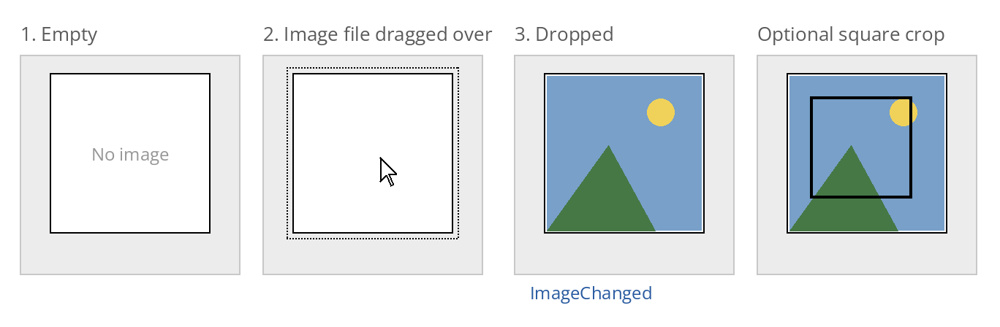

| Event emitted | When | Application callback |
|---|---|---|
| `ImageChanged { id }` | Image dropped, pasted, chosen, or cleared | `on_image_change(id, ..)` |

Like every Pushrod widget, it can also receive application-defined custom events in `handle_event` and emit its own (Pushrod 1.13), and every internal action emits an engine event (Pushrod 9.10).

**Acceptance Criteria.**

- Drop, choose, and clear; paste of a file path on SDL2 and of image data on SDL3
- Drop feedback outline
- Optional square crop

**Parallelism / Dependencies.** Parallelizable. Extra widgets: 1.1 ([#252](https://github.com/KenSuenobu/rust-pushrod/issues/252)); Pushrod: Pushrod 2.7 [#33](https://github.com/KenSuenobu/rust-pushrod/issues/33) Image widget, Pushrod 9.8 [#100](https://github.com/KenSuenobu/rust-pushrod/issues/100) Drag and drop within the application, Pushrod 2.12 [#38](https://github.com/KenSuenobu/rust-pushrod/issues/38) File chooser dialog (drawn by Pushrod)

**Technical Stack.** Rust (edition 2024, Rust 1.100), `pushrod`, `pushrod-widgets`.

**Documentation.** `pushrod-docs/docs/extra-widgets/image-well.md` (new page in the **Extra widgets** section: what it is, a screenshot from the Showcase, a short example, events and callbacks); rustdoc on every non-private item; a page in the Pushrod Showcase (1.2).

### 3.8: New password (enter, confirm, strength)

*Issue [#273](https://github.com/KenSuenobu/rust-pushrod/issues/273)* · *Extra widgets 3: specialized views and assistants*

**Widget roadmap:** [`docs/extra-widgets/new-password.md`](extra-widgets/new-password.md)

**Problem Statement.** Creating a password needs the same three things everywhere: hidden entry, confirmation, and feedback on strength, before the OK button is enabled.

**Solution / Scope.** `NewPassword { min_length, rules }`: password and confirm fields (Pushrod 2.6, password mode) with a show/hide toggle, a level indicator (2.5) for strength, and a line of text for the first unmet rule or a mismatch. `is_acceptable()` is true only when rules pass and both fields match; dialogs bind OK's enabled state to it. Strength is a simple, documented score (length and character classes), replaceable by a closure.

*Ideas from:* KDE KNewPasswordWidget, the macOS password assistant, account setup screens in GTK and Windows. Names and behavior are Pushrod's own.

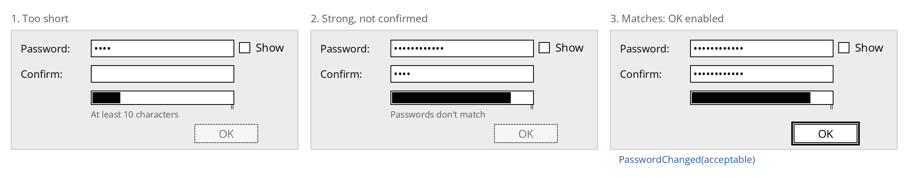

| Event emitted | When | Application callback |
|---|---|---|
| `PasswordChanged { id, acceptable }` | Either field edited | `on_password_change(id, ..)` |

Like every Pushrod widget, it can also receive application-defined custom events in `handle_event` and emit its own (Pushrod 1.13), and every internal action emits an engine event (Pushrod 9.10).

**Acceptance Criteria.**

- Strength meter and rule messages
- Match check and show/hide
- Acceptable state bindable to OK

**Parallelism / Dependencies.** Parallelizable. Extra widgets: 2.5 ([#54](https://github.com/KenSuenobu/rust-pushrod/issues/54)); Pushrod: Pushrod 2.6 [#32](https://github.com/KenSuenobu/rust-pushrod/issues/32) Text field: single-line entry with input masks, validation, and numeric mode, Pushrod 9.6 [#98](https://github.com/KenSuenobu/rust-pushrod/issues/98) Property bindings: keep two properties in sync

**Technical Stack.** Rust (edition 2024, Rust 1.100), `pushrod`, `pushrod-widgets`.

**Documentation.** `pushrod-docs/docs/extra-widgets/new-password.md` (new page in the **Extra widgets** section: what it is, a screenshot from the Showcase, a short example, events and callbacks); rustdoc on every non-private item; a page in the Pushrod Showcase (1.2).

### 3.9: Character picker

*Issue [#274](https://github.com/KenSuenobu/rust-pushrod/issues/274)* · *Extra widgets 3: specialized views and assistants*

**Widget roadmap:** [`docs/extra-widgets/character-picker.md`](extra-widgets/character-picker.md)

**Problem Statement.** Writers and developers need symbols that aren't on the keyboard (arrows, dashes, accented letters, math).

**Solution / Scope.** `CharacterPicker { font }`: a block chooser (Latin-1, Arrows, Math, Box drawing, ...), a search field matching names, a scrolling grid of characters drawn in the chosen font, and a detail pane with a large preview, name, and code point (U+2192). Double-click or Insert emits the character. Recently used characters row at the top. Character names come from a compact table built into the crate.

*Ideas from:* KDE KCharSelect, the Windows Character Map, the macOS character viewer, GTK's emoji chooser. Names and behavior are Pushrod's own.

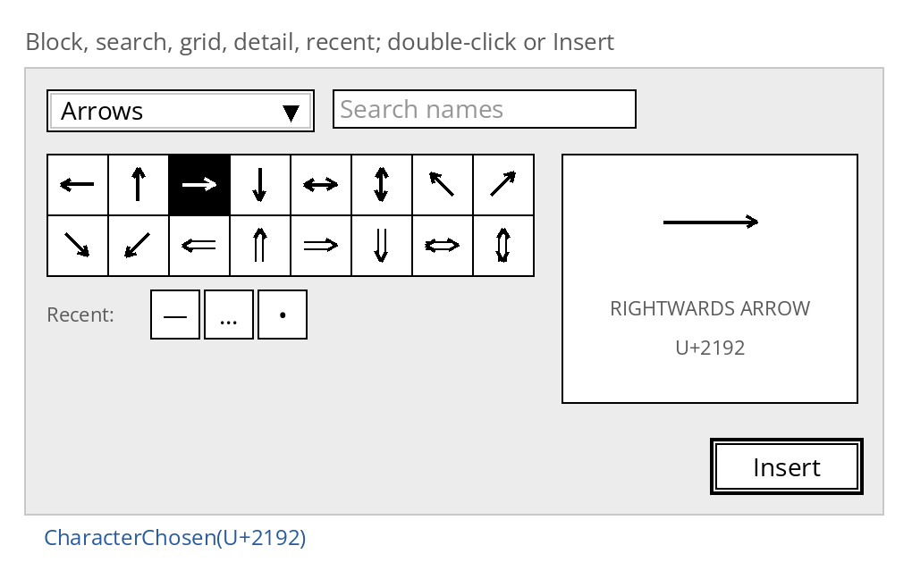

| Event emitted | When | Application callback |
|---|---|---|
| `CharacterChosen { id, ch }` | Character activated | `on_character_choose(id, ..)` |

Like every Pushrod widget, it can also receive application-defined custom events in `handle_event` and emit its own (Pushrod 1.13), and every internal action emits an engine event (Pushrod 9.10).

**Acceptance Criteria.**

- Blocks, name search, and recent characters
- Preview with name and code point
- Grid virtualized for large blocks

**Parallelism / Dependencies.** Parallelizable. Extra widgets: 1.1 ([#252](https://github.com/KenSuenobu/rust-pushrod/issues/252)); Pushrod: Pushrod 1.18 [#111](https://github.com/KenSuenobu/rust-pushrod/issues/111) Text layout engine: Parley for shaping, bidi, line breaking, and font fallback (with an SDL2 compatibility gate), Pushrod 2.6 [#32](https://github.com/KenSuenobu/rust-pushrod/issues/32) Text field: single-line entry with input masks, validation, and numeric mode, Pushrod 5.3 [#58](https://github.com/KenSuenobu/rust-pushrod/issues/58) Container: a scrollable viewport onto fixed-size content, Pushrod 3.6 [#44](https://github.com/KenSuenobu/rust-pushrod/issues/44) Choice button: pop-up list and click-to-cycle modes

**Technical Stack.** Rust (edition 2024, Rust 1.100), `pushrod`, `pushrod-widgets`.

**Documentation.** `pushrod-docs/docs/extra-widgets/character-picker.md` (new page in the **Extra widgets** section: what it is, a screenshot from the Showcase, a short example, events and callbacks); rustdoc on every non-private item; a page in the Pushrod Showcase (1.2).

### 3.10: Token field (tags in a field)

*Issue [#307](https://github.com/KenSuenobu/rust-pushrod/issues/307)* · *Extra widgets 2: everyday controls and pickers*

**Widget roadmap:** [`docs/extra-widgets/token-field.md`](extra-widgets/token-field.md)

**Problem Statement.** Tags, recipients, keywords, and filters are short lists of values typed one after another. A plain text field with commas gives no feedback and no way to remove one entry.

**Solution / Scope.** `TokenField { tokens, suggestions, separators }`: typing then Return, Tab, or a separator (comma by default) turns the text into a token: a flat box with the text and a small x. Tokens flow and wrap inside the field (Pushrod 5.10). Backspace at the start selects the last token, again removes it; arrow keys move across tokens; tokens can be dragged to reorder. Optional suggestions appear in a list below while typing. `validate` can reject a token; `unique(true)` rejects duplicates.

*Ideas from:* macOS NSTokenField, tag modes of Ant Design's Select and Material's Autocomplete, Fluent's tag picker, Flutter's input chips. Names and behavior are Pushrod's own.

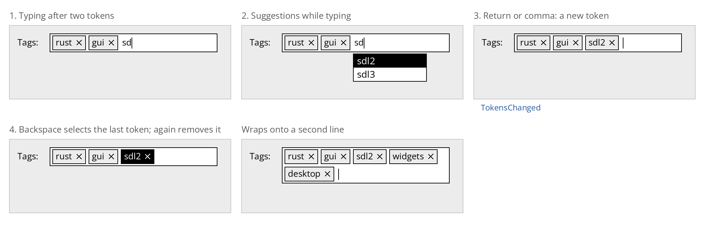

| Event emitted | When | Application callback |
|---|---|---|
| `TokensChanged { id }` | A token added, removed, or moved | `on_tokens_change(id, ..)` |

Like every Pushrod widget, it can also receive application-defined custom events in `handle_event` and emit its own (Pushrod 1.13), and every internal action emits an engine event (Pushrod 9.10).

**Acceptance Criteria.**

- Tokens created by Return, Tab, and separators; removed by x and Backspace
- Wraps to more lines as tokens are added
- Suggestions, validation, and uniqueness

**Parallelism / Dependencies.** Parallelizable. Extra widgets: 1.3 ([#254](https://github.com/KenSuenobu/rust-pushrod/issues/254)); Pushrod: Pushrod 2.6 [#32](https://github.com/KenSuenobu/rust-pushrod/issues/32) Text field: single-line entry with input masks, validation, and numeric mode, Pushrod 5.10 [#121](https://github.com/KenSuenobu/rust-pushrod/issues/121) Flow layout (wrapping rows), Pushrod 4.5 [#52](https://github.com/KenSuenobu/rust-pushrod/issues/52) List view

**Technical Stack.** Rust (edition 2024, Rust 1.100), `pushrod`, `pushrod-widgets`.

**Documentation.** `pushrod-docs/docs/extra-widgets/token-field.md` (new page in the **Extra widgets** section: what it is, a screenshot from the Showcase, a short example, events and callbacks); rustdoc on every non-private item; a page in the Pushrod Showcase (1.2).

## Epic 4: Data views ([#249](https://github.com/KenSuenobu/rust-pushrod/issues/249))

Tree view, column browser, icon grid, data grid, property grid, check list, editable list, dual list, breadcrumb bar, filter field, rule editor, image viewer.

**Problem.** The standard list and table views cover flat, read-only data. Applications also need hierarchies, editable grids, name/value inspectors, lists with check boxes or add/remove buttons, paths, live filtering, query building, and zoomable images.

**Scope.** Views built on the standard list view, table view, and container, each adding one capability, with the same selection and keyboard rules as the standard views.

| Issue | Title | Summary | Labels | Parallel | MVP | Phase | Complexity | Affected modules |
|---|---|---|---|---|---|---|---|---|
| 4.1 ([#55](https://github.com/KenSuenobu/rust-pushrod/issues/55)) | Tree view (outline) | A hierarchical list with expand/collapse triangles, backed by a tree data source. | `extra-widgets`, `extra-widgets-mvp`, `parallelizable`, `size/M`, `widget` | Y | Y | X2 | M | `pushrod-extra-widgets/src/tree_view.rs (new)`, `pushrod-docs` |
| 4.2 ([#45](https://github.com/KenSuenobu/rust-pushrod/issues/45)) | Column browser | Columns of lists where selecting an item in one column fills the next, as in NeXTSTEP and the Mac Finder. | `extra-widgets`, `parallelizable`, `size/L`, `widget` | Y | N | X3 | L | `pushrod-extra-widgets/src/column_browser.rs (new)`, `pushrod-docs` |
| 4.3 ([#275](https://github.com/KenSuenobu/rust-pushrod/issues/275)) | Icon grid view | A scrolling grid of icons with captions, rubber-band selection, and drag and drop. | `extra-widgets`, `parallelizable`, `size/M`, `widget` | Y | N | X3 | M | `pushrod-extra-widgets/src/icon_grid.rs (new)`, `pushrod-docs` |
| 4.4 ([#276](https://github.com/KenSuenobu/rust-pushrod/issues/276)) | Data grid (editable table) | A table whose cells edit in place with typed editors, with row add and delete. | `extra-widgets`, `parallelizable`, `size/L`, `widget` | Y | N | X3 | L | `pushrod-extra-widgets/src/data_grid.rs (new)`, `pushrod-docs` |
| 4.5 ([#255](https://github.com/KenSuenobu/rust-pushrod/issues/255)) | Property grid (name and value inspector) | Categorized name/value rows with an editor per value type. | `chassis`, `extra-widgets`, `extra-widgets-mvp`, `parallelizable`, `size/M`, `widget` | Y | Y | X1 | M | `pushrod-extra-widgets/src/property_grid.rs (new)`, `pushrod-docs` |
| 4.6 ([#263](https://github.com/KenSuenobu/rust-pushrod/issues/263)) | Check list | A list with a check box on every row, separate from the selection. | `extra-widgets`, `extra-widgets-mvp`, `parallelizable`, `size/S`, `widget` | Y | Y | X2 | S | `pushrod-extra-widgets/src/check_list.rs (new)`, `pushrod-docs` |
| 4.7 ([#264](https://github.com/KenSuenobu/rust-pushrod/issues/264)) | Editable list (add, remove, reorder) | A list with + and - buttons underneath, in-place editing, and reordering. | `extra-widgets`, `extra-widgets-mvp`, `parallelizable`, `size/S`, `widget` | Y | Y | X2 | S | `pushrod-extra-widgets/src/editable_list.rs (new)`, `pushrod-docs` |
| 4.8 ([#278](https://github.com/KenSuenobu/rust-pushrod/issues/278)) | Dual list (list builder) | Available and chosen lists side by side, with buttons to move items between them and order the chosen list. | `extra-widgets`, `parallelizable`, `size/S`, `widget` | Y | N | X3 | S | `pushrod-extra-widgets/src/dual_list.rs (new)`, `pushrod-docs` |
| 4.9 ([#256](https://github.com/KenSuenobu/rust-pushrod/issues/256)) | Breadcrumb bar (path control) | A row of clickable path segments, with a menu of siblings on each separator. | `chassis`, `extra-widgets`, `extra-widgets-mvp`, `parallelizable`, `size/S`, `widget` | Y | Y | X1 | S | `pushrod-extra-widgets/src/breadcrumb_bar.rs (new)`, `pushrod-docs` |
| 4.10 ([#277](https://github.com/KenSuenobu/rust-pushrod/issues/277)) | Filter field (live filter for lists, tables, and trees) | A search field bound to a list, table, or tree that hides non-matching rows as you type. | `extra-widgets`, `parallelizable`, `size/S`, `widget` | Y | N | X3 | S | `pushrod-extra-widgets/src/filter_field.rs (new)`, `pushrod-docs` |
| 4.11 ([#279](https://github.com/KenSuenobu/rust-pushrod/issues/279)) | Rule editor (query builder) | Rows of "field, operator, value" with add and remove buttons, joined by All or Any. | `extra-widgets`, `parallelizable`, `size/M`, `widget` | Y | N | X3 | M | `pushrod-extra-widgets/src/rule_editor.rs (new)`, `pushrod-docs` |
| 4.12 ([#280](https://github.com/KenSuenobu/rust-pushrod/issues/280)) | Image viewer (zoom and pan) | An image in a scrollable view with zoom to fit, actual size, zoom by wheel, and drag to pan. | `extra-widgets`, `parallelizable`, `size/S`, `widget` | Y | N | X3 | S | `pushrod-extra-widgets/src/image_viewer.rs (new)`, `pushrod-docs` |
| 4.13 ([#303](https://github.com/KenSuenobu/rust-pushrod/issues/303)) | Log view (append-only output) | A read-only, scrolling view of lines that follows the newest line, for build output and logs. | `chassis`, `extra-widgets`, `extra-widgets-mvp`, `parallelizable`, `size/S`, `widget` | Y | Y | X1 | S | `pushrod-extra-widgets/src/log_view.rs (new)`, `pushrod-docs` |
| 4.14 ([#304](https://github.com/KenSuenobu/rust-pushrod/issues/304)) | Canvas view (zoomable surface of items) | A scrollable, zoomable surface holding positioned items, with selection, rubber band, and moving. | `chassis`, `extra-widgets`, `extra-widgets-mvp`, `parallelizable`, `size/L`, `widget` | Y | Y | X1 | L | `pushrod-extra-widgets/src/canvas_view.rs (new)`, `pushrod-docs` |
| 4.15 ([#308](https://github.com/KenSuenobu/rust-pushrod/issues/308)) | Rich text view (formatted, read-only) | Read-only formatted text: headings, bold and italic, lists, code, and links, from Markdown or styled spans. | `extra-widgets`, `extra-widgets-mvp`, `parallelizable`, `size/M`, `widget` | Y | Y | X2 | M | `pushrod-extra-widgets/src/rich_text_view.rs (new)`, `pushrod-docs` |

### 4.1: Tree view (outline)

*Issue [#55](https://github.com/KenSuenobu/rust-pushrod/issues/55)* · *Extra widgets 2: everyday controls and pickers* · *moved from the standard widgets (issue #55 keeps its number)*

**Widget roadmap:** [`docs/extra-widgets/tree-view.md`](extra-widgets/tree-view.md)

**Problem Statement.** File trees, outlines, settings categories, and document structure are hierarchical. Parked from the standard set as specialized; the extra widgets are its natural home.

**Solution / Scope.** `TreeView { source }`: rows indented by depth with a disclosure triangle for items with children (expand on click, Right/Left keys, or `*` for all). Single and multiple selection as in the list view (Pushrod 4.5); optional columns as in the table view (Pushrod 4.9). A `TreeSource` trait supplies children lazily, so large trees load only what is visible. Optional drag to reorder or reparent (Pushrod 9.8) with an insertion line.

*Ideas from:* Qt QTreeView, GTK tree views, macOS NSOutlineView, KDE, Motif XmContainer (outline mode), AmigaOS hierarchical listbrowser, Win32 tree view. Names and behavior are Pushrod's own.

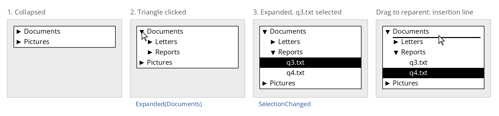

| Event emitted | When | Application callback |
|---|---|---|
| `SelectionChanged { id }` | Selection changed | `on_selection_change(id, ..)` |
| `Expanded { id, item }` | Item expanded | `on_expand(id, ..)` |
| `Collapsed { id, item }` | Item collapsed | `on_collapse(id, ..)` |
| `Activated { id, item }` | Double-click or Return | `on_activate(id, ..)` |

Like every Pushrod widget, it can also receive application-defined custom events in `handle_event` and emit its own (Pushrod 1.13), and every internal action emits an engine event (Pushrod 9.10).

**Acceptance Criteria.**

- Expand and collapse by mouse and keyboard
- Lazy children from a data source
- Optional columns and drag to reparent

**Parallelism / Dependencies.** Parallelizable. Extra widgets: 1.1 ([#252](https://github.com/KenSuenobu/rust-pushrod/issues/252)); Pushrod: Pushrod 4.5 [#52](https://github.com/KenSuenobu/rust-pushrod/issues/52) List view, Pushrod 4.9 [#92](https://github.com/KenSuenobu/rust-pushrod/issues/92) Table view, Pushrod 5.3 [#58](https://github.com/KenSuenobu/rust-pushrod/issues/58) Container: a scrollable viewport onto fixed-size content, Pushrod 9.8 [#100](https://github.com/KenSuenobu/rust-pushrod/issues/100) Drag and drop within the application

**Technical Stack.** Rust (edition 2024, Rust 1.100), `pushrod`, `pushrod-widgets`.

**Documentation.** `pushrod-docs/docs/extra-widgets/tree-view.md` (new page in the **Extra widgets** section: what it is, a screenshot from the Showcase, a short example, events and callbacks); rustdoc on every non-private item; a page in the Pushrod Showcase (1.2).

### 4.2: Column browser

*Issue [#45](https://github.com/KenSuenobu/rust-pushrod/issues/45)* · *Extra widgets 3: specialized views and assistants* · *moved from the standard widgets (issue #45 keeps its number)*

**Widget roadmap:** [`docs/extra-widgets/column-browser.md`](extra-widgets/column-browser.md)

**Problem Statement.** Browsing deep hierarchies one level at a time keeps the whole path visible. Moved here from the standard set as a large compound of list views.

**Solution / Scope.** `ColumnBrowser { source, column_width }`: one list view (Pushrod 4.5) per level, side by side in a horizontally scrolling container (Pushrod 5.3); selecting an item with children opens the next column, items with children show a right-arrow glyph. Left/Right move between columns. Optional preview pane for leaf items. Columns are resizable.

*Ideas from:* NeXTSTEP NSBrowser, the macOS Finder's column view, Motif-era file managers. Names and behavior are Pushrod's own.

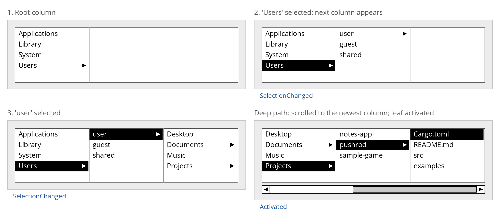

| Event emitted | When | Application callback |
|---|---|---|
| `SelectionChanged { id, path }` | Selection changed | `on_selection_change(id, ..)` |
| `Activated { id, path }` | Double-click or Return on a leaf | `on_activate(id, ..)` |

Like every Pushrod widget, it can also receive application-defined custom events in `handle_event` and emit its own (Pushrod 1.13), and every internal action emits an engine event (Pushrod 9.10).

**Acceptance Criteria.**

- Selecting fills the next column
- Keyboard navigation across columns
- Horizontal scrolling keeps the selection visible

**Parallelism / Dependencies.** Parallelizable. Extra widgets: 1.1 ([#252](https://github.com/KenSuenobu/rust-pushrod/issues/252)); Pushrod: Pushrod 4.5 [#52](https://github.com/KenSuenobu/rust-pushrod/issues/52) List view, Pushrod 5.3 [#58](https://github.com/KenSuenobu/rust-pushrod/issues/58) Container: a scrollable viewport onto fixed-size content, Pushrod 3.1 [#39](https://github.com/KenSuenobu/rust-pushrod/issues/39) Scroll bar

**Technical Stack.** Rust (edition 2024, Rust 1.100), `pushrod`, `pushrod-widgets`.

**Documentation.** `pushrod-docs/docs/extra-widgets/column-browser.md` (new page in the **Extra widgets** section: what it is, a screenshot from the Showcase, a short example, events and callbacks); rustdoc on every non-private item; a page in the Pushrod Showcase (1.2).

### 4.3: Icon grid view

*Issue [#275](https://github.com/KenSuenobu/rust-pushrod/issues/275)* · *Extra widgets 3: specialized views and assistants*

**Widget roadmap:** [`docs/extra-widgets/icon-grid.md`](extra-widgets/icon-grid.md)

**Problem Statement.** File managers, image browsers, and launchers show many items as icons in a grid; the standard icon widget is a single item.

**Solution / Scope.** `IconGrid { source, cell_size }`: icon widgets (Pushrod 2.8) in a reflowing grid inside a container (Pushrod 5.3), only visible cells created. Click, Ctrl-click, Shift-click, and a dotted rubber-band rectangle select; arrow keys move; typing jumps to the first matching caption. Items can be dragged out or reordered (Pushrod 9.8); captions can be renamed in place.

*Ideas from:* macOS NSCollectionView, GTK GtkIconView and GtkGridView, Qt QListView in icon mode, KDE file views, Motif XmContainer (spatial mode), Win32 list view in icon mode, the Atari and Amiga desktops. Names and behavior are Pushrod's own.

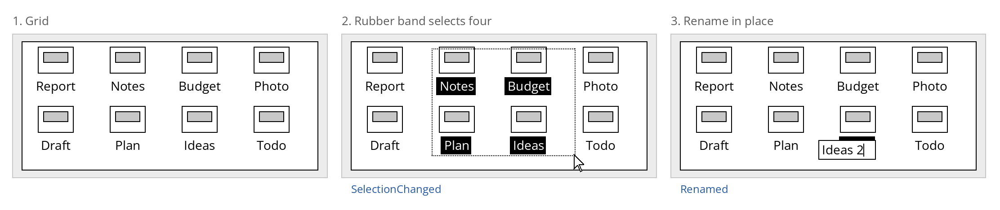

| Event emitted | When | Application callback |
|---|---|---|
| `SelectionChanged { id }` | Selection changed | `on_selection_change(id, ..)` |
| `Activated { id, index }` | Double-click or Return | `on_activate(id, ..)` |
| `Renamed { id, index, text }` | Caption edited | `on_rename(id, ..)` |

Like every Pushrod widget, it can also receive application-defined custom events in `handle_event` and emit its own (Pushrod 1.13), and every internal action emits an engine event (Pushrod 9.10).

**Acceptance Criteria.**

- Reflowing, virtualized grid
- Rubber-band and keyboard selection, type-to-find
- Drag and drop and in-place rename

**Parallelism / Dependencies.** Parallelizable. Extra widgets: 1.1 ([#252](https://github.com/KenSuenobu/rust-pushrod/issues/252)); Pushrod: Pushrod 2.8 [#34](https://github.com/KenSuenobu/rust-pushrod/issues/34) Icon widget (picture with caption), Pushrod 5.3 [#58](https://github.com/KenSuenobu/rust-pushrod/issues/58) Container: a scrollable viewport onto fixed-size content, Pushrod 9.4 [#96](https://github.com/KenSuenobu/rust-pushrod/issues/96) Reusable input controllers: click, drag, scroll, hover, long-press, key, Pushrod 9.8 [#100](https://github.com/KenSuenobu/rust-pushrod/issues/100) Drag and drop within the application

**Technical Stack.** Rust (edition 2024, Rust 1.100), `pushrod`, `pushrod-widgets`.

**Documentation.** `pushrod-docs/docs/extra-widgets/icon-grid.md` (new page in the **Extra widgets** section: what it is, a screenshot from the Showcase, a short example, events and callbacks); rustdoc on every non-private item; a page in the Pushrod Showcase (1.2).

### 4.4: Data grid (editable table)

*Issue [#276](https://github.com/KenSuenobu/rust-pushrod/issues/276)* · *Extra widgets 3: specialized views and assistants*

**Widget roadmap:** [`docs/extra-widgets/data-grid.md`](extra-widgets/data-grid.md)

**Problem Statement.** The standard table view is read-only on purpose. Data entry screens need cells you can type into, check, or choose from, with keyboard movement like a spreadsheet.

**Solution / Scope.** `DataGrid { source, columns }` builds on the table view (Pushrod 4.9). Each column has an editor kind: text, number, check box, choice (Pushrod 3.6), or date (3.2). Double-click, F2, or typing starts editing; Return commits and moves down, Tab moves right, Escape cancels. A `validate` closure can reject a value (cell marked). Optional new-row line at the bottom and Delete for selected rows. Changes go through the data source, which can refuse them.

*Ideas from:* Delphi TStringGrid and TDBGrid, Qt QTableView with item delegates, Win32 grid controls, GTK editable cell renderers. Names and behavior are Pushrod's own.

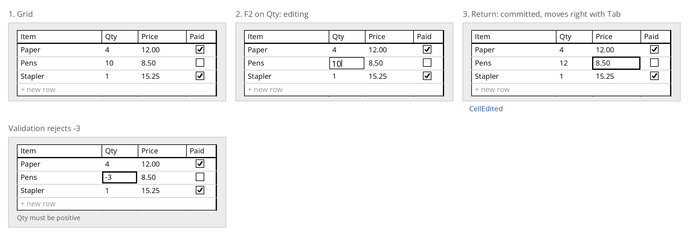

| Event emitted | When | Application callback |
|---|---|---|
| `CellEdited { id, row, column }` | A cell committed | `on_cell_edit(id, ..)` |
| `RowAdded { id, row }` / `RowsDeleted { id }` | Rows added or deleted | `on_rows_change(id, ..)` |

Like every Pushrod widget, it can also receive application-defined custom events in `handle_event` and emit its own (Pushrod 1.13), and every internal action emits an engine event (Pushrod 9.10).

**Acceptance Criteria.**

- Typed cell editors with validation
- Spreadsheet-style keyboard editing
- Add and delete rows through the data source

**Parallelism / Dependencies.** Parallelizable. Extra widgets: 3.2 ([#91](https://github.com/KenSuenobu/rust-pushrod/issues/91)); Pushrod: Pushrod 4.9 [#92](https://github.com/KenSuenobu/rust-pushrod/issues/92) Table view, Pushrod 2.6 [#32](https://github.com/KenSuenobu/rust-pushrod/issues/32) Text field: single-line entry with input masks, validation, and numeric mode, Pushrod 2.4 [#30](https://github.com/KenSuenobu/rust-pushrod/issues/30) Check box with indeterminate state, Pushrod 3.6 [#44](https://github.com/KenSuenobu/rust-pushrod/issues/44) Choice button: pop-up list and click-to-cycle modes

**Technical Stack.** Rust (edition 2024, Rust 1.100), `pushrod`, `pushrod-widgets`.

**Documentation.** `pushrod-docs/docs/extra-widgets/data-grid.md` (new page in the **Extra widgets** section: what it is, a screenshot from the Showcase, a short example, events and callbacks); rustdoc on every non-private item; a page in the Pushrod Showcase (1.2).

### 4.5: Property grid (name and value inspector)

*Issue [#255](https://github.com/KenSuenobu/rust-pushrod/issues/255)* · *Extra widgets 1: crate and Chassis widgets*

**Widget roadmap:** [`docs/extra-widgets/property-grid.md`](extra-widgets/property-grid.md)

**Problem Statement.** Chassis's inspector needs it, and so does any application with settings or object properties to edit: debuggers, editors, and configuration tools. Built here, any application can use it, and Chassis proves it.

**Solution / Scope.** `PropertyGrid { source }`: two columns (name, value) with a draggable divider and collapsible category header rows (Identity, Layout, Appearance, ...). Value editors by kind: text, integer with range, boolean (check box), enumeration (choice button), color (3.4 when available, else hex), font (3.5 when available), and custom editors registered by kind. The source can be Pushrod property introspection (Pushrod 6.2), so a widget's properties appear without extra code, or any `PropertySource`. Changed-from-default values are shown in bold; Reset sets the default. Edits apply immediately and report old and new values (for undo).

*Ideas from:* Delphi's Object Inspector and TValueListEditor, the Qt property browser used by Qt Designer, NeXTSTEP Interface Builder inspectors, Visual Studio's property window. Names and behavior are Pushrod's own.

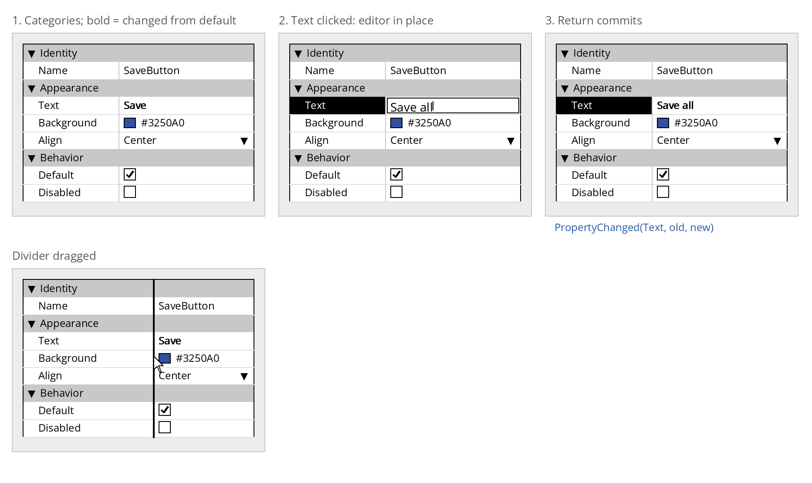

| Event emitted | When | Application callback |
|---|---|---|
| `PropertyChanged { id, name, old, new }` | A value committed | `on_property_change(id, ..)` |

Like every Pushrod widget, it can also receive application-defined custom events in `handle_event` and emit its own (Pushrod 1.13), and every internal action emits an engine event (Pushrod 9.10).

**Acceptance Criteria.**

- Categories, divider, and changed-from-default marking
- Typed editors and custom editors by kind
- Works from Pushrod property introspection and from any source

**Parallelism / Dependencies.** Parallelizable. Extra widgets: 1.1 ([#252](https://github.com/KenSuenobu/rust-pushrod/issues/252)); Pushrod: Pushrod 6.2 [#61](https://github.com/KenSuenobu/rust-pushrod/issues/61) Property introspection: list, get, and set widget properties by name, Pushrod 5.7 [#118](https://github.com/KenSuenobu/rust-pushrod/issues/118) Form layout: aligned label and field rows, Pushrod 2.6 [#32](https://github.com/KenSuenobu/rust-pushrod/issues/32) Text field: single-line entry with input masks, validation, and numeric mode, Pushrod 2.4 [#30](https://github.com/KenSuenobu/rust-pushrod/issues/30) Check box with indeterminate state, Pushrod 3.6 [#44](https://github.com/KenSuenobu/rust-pushrod/issues/44) Choice button: pop-up list and click-to-cycle modes, Pushrod 3.10 [#90](https://github.com/KenSuenobu/rust-pushrod/issues/90) Expander (collapsible section)

**Used by Chassis:** Chassis 4.2 [#187](https://github.com/KenSuenobu/rust-pushrod/issues/187) Property grid.

**Technical Stack.** Rust (edition 2024, Rust 1.100), `pushrod`, `pushrod-widgets`.

**Documentation.** `pushrod-docs/docs/extra-widgets/property-grid.md` (new page in the **Extra widgets** section: what it is, a screenshot from the Showcase, a short example, events and callbacks); rustdoc on every non-private item; a page in the Pushrod Showcase (1.2).

### 4.6: Check list

*Issue [#263](https://github.com/KenSuenobu/rust-pushrod/issues/263)* · *Extra widgets 2: everyday controls and pickers*

**Widget roadmap:** [`docs/extra-widgets/check-list.md`](extra-widgets/check-list.md)

**Problem Statement.** Choosing which items to include (features to install, columns to show, files to export) is a list of check boxes too long for a group box.

**Solution / Scope.** `CheckList { source }` builds on the list view (Pushrod 4.5): each row has a check box (Pushrod 2.4) in front of its text. Space toggles the checked state of the selected rows; clicking the box toggles one row. Optional tri-state rows and a header check box that checks or clears all (mixed when some are checked).

*Ideas from:* Delphi TCheckListBox, Qt checkable list items, Win32 list views with check boxes, macOS tables with a check column, KDE settings lists. Names and behavior are Pushrod's own.

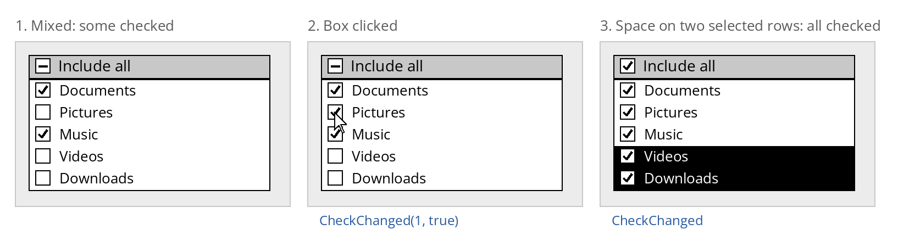

| Event emitted | When | Application callback |
|---|---|---|
| `CheckChanged { id, index, checked }` | A row checked or cleared | `on_check_change(id, ..)` |

Like every Pushrod widget, it can also receive application-defined custom events in `handle_event` and emit its own (Pushrod 1.13), and every internal action emits an engine event (Pushrod 9.10).

**Acceptance Criteria.**

- Check state independent of selection
- Space toggles the selected rows
- Check-all header with mixed state

**Parallelism / Dependencies.** Parallelizable. Extra widgets: 1.1 ([#252](https://github.com/KenSuenobu/rust-pushrod/issues/252)); Pushrod: Pushrod 4.5 [#52](https://github.com/KenSuenobu/rust-pushrod/issues/52) List view, Pushrod 2.4 [#30](https://github.com/KenSuenobu/rust-pushrod/issues/30) Check box with indeterminate state

**Technical Stack.** Rust (edition 2024, Rust 1.100), `pushrod`, `pushrod-widgets`.

**Documentation.** `pushrod-docs/docs/extra-widgets/check-list.md` (new page in the **Extra widgets** section: what it is, a screenshot from the Showcase, a short example, events and callbacks); rustdoc on every non-private item; a page in the Pushrod Showcase (1.2).

### 4.7: Editable list (add, remove, reorder)

*Issue [#264](https://github.com/KenSuenobu/rust-pushrod/issues/264)* · *Extra widgets 2: everyday controls and pickers*

**Widget roadmap:** [`docs/extra-widgets/editable-list.md`](extra-widgets/editable-list.md)

**Problem Statement.** Settings often hold a short list the user maintains: search paths, ignored words, recipients. Every application builds the same list-plus-buttons.

**Solution / Scope.** `EditableList { items }`: a list view (Pushrod 4.5) with a button bar below it: + (adds a row and starts editing it), - (removes the selected rows), and up/down glyph buttons to reorder. Double-click or F2 edits in place; drag reorders (Pushrod 9.8). A `validate` closure can reject an item; `unique(true)` rejects duplicates.

*Ideas from:* KDE KEditListWidget, the macOS add/remove button bar under tables, Qt Designer's string list editor, GTK preferences lists. Names and behavior are Pushrod's own.

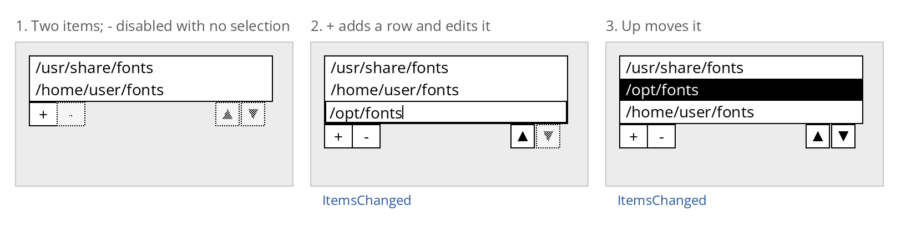

| Event emitted | When | Application callback |
|---|---|---|
| `ItemsChanged { id }` | Added, removed, edited, or moved | `on_items_change(id, ..)` |

Like every Pushrod widget, it can also receive application-defined custom events in `handle_event` and emit its own (Pushrod 1.13), and every internal action emits an engine event (Pushrod 9.10).

**Acceptance Criteria.**

- Add, remove, edit, and reorder
- Validation and uniqueness
- Buttons disabled when not applicable

**Parallelism / Dependencies.** Parallelizable. Extra widgets: 1.1 ([#252](https://github.com/KenSuenobu/rust-pushrod/issues/252)); Pushrod: Pushrod 4.5 [#52](https://github.com/KenSuenobu/rust-pushrod/issues/52) List view, Pushrod 2.2 [#28](https://github.com/KenSuenobu/rust-pushrod/issues/28) Glyph button (small single-character button), Pushrod 2.6 [#32](https://github.com/KenSuenobu/rust-pushrod/issues/32) Text field: single-line entry with input masks, validation, and numeric mode, Pushrod 9.8 [#100](https://github.com/KenSuenobu/rust-pushrod/issues/100) Drag and drop within the application

**Technical Stack.** Rust (edition 2024, Rust 1.100), `pushrod`, `pushrod-widgets`.

**Documentation.** `pushrod-docs/docs/extra-widgets/editable-list.md` (new page in the **Extra widgets** section: what it is, a screenshot from the Showcase, a short example, events and callbacks); rustdoc on every non-private item; a page in the Pushrod Showcase (1.2).

### 4.8: Dual list (list builder)

*Issue [#278](https://github.com/KenSuenobu/rust-pushrod/issues/278)* · *Extra widgets 3: specialized views and assistants*

**Widget roadmap:** [`docs/extra-widgets/dual-list.md`](extra-widgets/dual-list.md)

**Problem Statement.** Picking and ordering a subset (columns to show, toolbar buttons, fields to export) is clearer with both lists visible than with check boxes.

**Solution / Scope.** `DualList { available, chosen }`: two list views (Pushrod 4.5) with labels, and buttons between them: add, add all, remove, remove all; up/down buttons beside the chosen list. Double-click moves an item across; drag works too (Pushrod 9.8). Each list has an optional filter field (4.10).

*Ideas from:* KDE KActionSelector, Windows column choosers, toolbar customizers in many toolkits. Names and behavior are Pushrod's own.

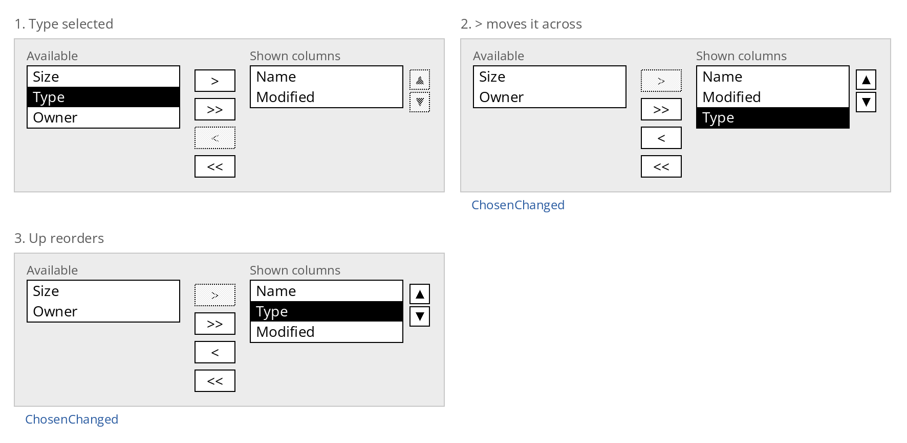

| Event emitted | When | Application callback |
|---|---|---|
| `ChosenChanged { id }` | Items moved or reordered | `on_chosen_change(id, ..)` |

Like every Pushrod widget, it can also receive application-defined custom events in `handle_event` and emit its own (Pushrod 1.13), and every internal action emits an engine event (Pushrod 9.10).

**Acceptance Criteria.**

- Move items by buttons, double-click, and drag
- Order the chosen list
- Buttons disabled when not applicable

**Parallelism / Dependencies.** Parallelizable. Extra widgets: 4.10 ([#277](https://github.com/KenSuenobu/rust-pushrod/issues/277)); Pushrod: Pushrod 4.5 [#52](https://github.com/KenSuenobu/rust-pushrod/issues/52) List view, Pushrod 2.3 [#29](https://github.com/KenSuenobu/rust-pushrod/issues/29) Button behaviors: default, cancel, toggle, activate-on-press, dismiss dialog, Pushrod 9.8 [#100](https://github.com/KenSuenobu/rust-pushrod/issues/100) Drag and drop within the application

**Technical Stack.** Rust (edition 2024, Rust 1.100), `pushrod`, `pushrod-widgets`.

**Documentation.** `pushrod-docs/docs/extra-widgets/dual-list.md` (new page in the **Extra widgets** section: what it is, a screenshot from the Showcase, a short example, events and callbacks); rustdoc on every non-private item; a page in the Pushrod Showcase (1.2).

### 4.9: Breadcrumb bar (path control)

*Issue [#256](https://github.com/KenSuenobu/rust-pushrod/issues/256)* · *Extra widgets 1: crate and Chassis widgets*

**Widget roadmap:** [`docs/extra-widgets/breadcrumb-bar.md`](extra-widgets/breadcrumb-bar.md)

**Problem Statement.** Chassis's designer shows where the selection sits inside nested layouts; file managers, settings pages, and document outlines show a path the same way. Clicking a segment goes there.

**Solution / Scope.** `BreadcrumbBar { segments }`: segments as flat text buttons separated by right-arrow glyphs; the last is the current location (not a link). Clicking a segment emits its index; clicking a separator opens a menu (Pushrod 2.11) of that level's other items. When the path doesn't fit, leading segments collapse into a "…" menu. Keyboard: Left/Right move, Return activates.

*Ideas from:* macOS NSPathControl, KDE KUrlNavigator, the GTK file chooser's path bar, Windows Explorer's address bar. Names and behavior are Pushrod's own.

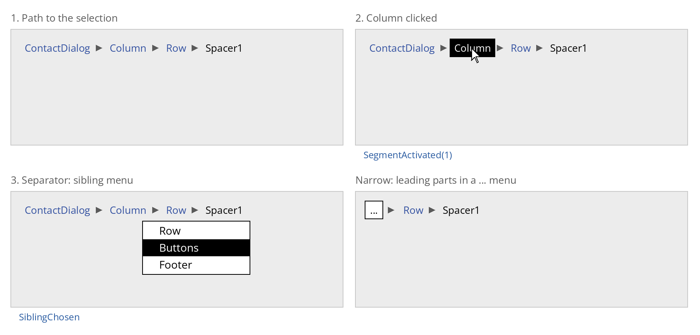

| Event emitted | When | Application callback |
|---|---|---|
| `SegmentActivated { id, index }` | Segment clicked | `on_segment_activate(id, ..)` |
| `SiblingChosen { id, level, item }` | Item chosen from a separator menu | `on_sibling_choose(id, ..)` |

Like every Pushrod widget, it can also receive application-defined custom events in `handle_event` and emit its own (Pushrod 1.13), and every internal action emits an engine event (Pushrod 9.10).

**Acceptance Criteria.**

- Clickable segments and sibling menus
- Overflow collapses into a menu
- Keyboard navigation

**Parallelism / Dependencies.** Parallelizable. Extra widgets: 1.1 ([#252](https://github.com/KenSuenobu/rust-pushrod/issues/252)); Pushrod: Pushrod 2.3 [#29](https://github.com/KenSuenobu/rust-pushrod/issues/29) Button behaviors: default, cancel, toggle, activate-on-press, dismiss dialog, Pushrod 2.11 [#37](https://github.com/KenSuenobu/rust-pushrod/issues/37) Menu bar and drop-down menus (drawn by Pushrod), Pushrod 1.18 [#111](https://github.com/KenSuenobu/rust-pushrod/issues/111) Text layout engine: Parley for shaping, bidi, line breaking, and font fallback (with an SDL2 compatibility gate)

**Used by Chassis:** Chassis 3.8 [#185](https://github.com/KenSuenobu/rust-pushrod/issues/185) Layout managers in the designer.

**Technical Stack.** Rust (edition 2024, Rust 1.100), `pushrod`, `pushrod-widgets`.

**Documentation.** `pushrod-docs/docs/extra-widgets/breadcrumb-bar.md` (new page in the **Extra widgets** section: what it is, a screenshot from the Showcase, a short example, events and callbacks); rustdoc on every non-private item; a page in the Pushrod Showcase (1.2).

### 4.10: Filter field (live filter for lists, tables, and trees)

*Issue [#277](https://github.com/KenSuenobu/rust-pushrod/issues/277)* · *Extra widgets 3: specialized views and assistants*

**Widget roadmap:** [`docs/extra-widgets/filter-field.md`](extra-widgets/filter-field.md)

**Problem Statement.** Long lists need filtering, and each application otherwise wires a search field to its view by hand, with different matching rules.

**Solution / Scope.** `FilterField::bind(view_id)`: a text field (Pushrod 2.6) with the search and clear glyph accessories, bound to a list, table (all or chosen columns), or tree view (4.1, keeping ancestors of matches). Matching is case-insensitive substring by default, replaceable by a closure; matches can be highlighted. Down arrow moves focus into the view. A "No matches" line shows when nothing matches.

*Ideas from:* KDE KTreeWidgetSearchLine, GTK GtkSearchEntry with filter models, macOS search fields in source lists. Names and behavior are Pushrod's own.

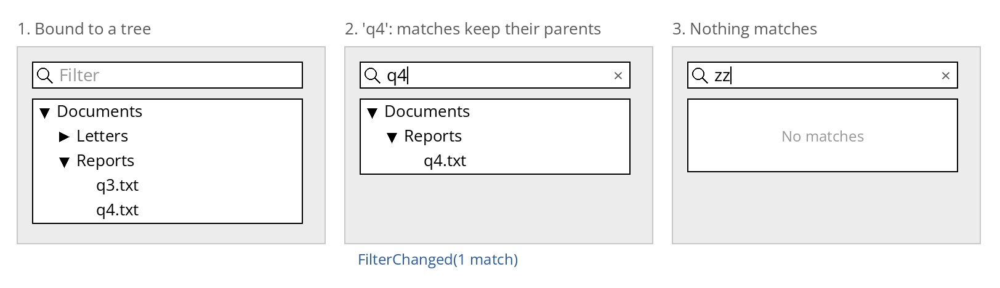

| Event emitted | When | Application callback |
|---|---|---|
| `FilterChanged { id, text, matches }` | Text edited | `on_filter_change(id, ..)` |

Like every Pushrod widget, it can also receive application-defined custom events in `handle_event` and emit its own (Pushrod 1.13), and every internal action emits an engine event (Pushrod 9.10).

**Acceptance Criteria.**

- Works with list, table, and tree views
- Tree filtering keeps ancestors
- Custom matching and no-match message

**Parallelism / Dependencies.** Parallelizable. Extra widgets: 4.1 ([#55](https://github.com/KenSuenobu/rust-pushrod/issues/55)); Pushrod: Pushrod 2.6 [#32](https://github.com/KenSuenobu/rust-pushrod/issues/32) Text field: single-line entry with input masks, validation, and numeric mode, Pushrod 4.5 [#52](https://github.com/KenSuenobu/rust-pushrod/issues/52) List view, Pushrod 4.9 [#92](https://github.com/KenSuenobu/rust-pushrod/issues/92) Table view

**Technical Stack.** Rust (edition 2024, Rust 1.100), `pushrod`, `pushrod-widgets`.

**Documentation.** `pushrod-docs/docs/extra-widgets/filter-field.md` (new page in the **Extra widgets** section: what it is, a screenshot from the Showcase, a short example, events and callbacks); rustdoc on every non-private item; a page in the Pushrod Showcase (1.2).

### 4.11: Rule editor (query builder)

*Issue [#279](https://github.com/KenSuenobu/rust-pushrod/issues/279)* · *Extra widgets 3: specialized views and assistants*

**Widget roadmap:** [`docs/extra-widgets/rule-editor.md`](extra-widgets/rule-editor.md)

**Problem Statement.** Smart folders, mail filters, and advanced search all let users build conditions without writing a query language.

**Solution / Scope.** `RuleEditor { fields }`: a header choice "Match All / Any of the following" and one row per rule: a field choice, an operator choice suited to the field's type (contains, is, before, greater than, ...), and a value editor (text, number, date 3.2, or choice), with + and - glyph buttons. Nested groups optional. `rules()` returns a plain data structure the application evaluates; serializable with serde.

*Ideas from:* macOS NSPredicateEditor and NSRuleEditor (smart folders), mail-filter editors in KDE and GTK applications, Windows advanced search. Names and behavior are Pushrod's own.

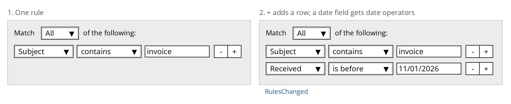

| Event emitted | When | Application callback |
|---|---|---|
| `RulesChanged { id }` | Any rule added, removed, or edited | `on_rules_change(id, ..)` |

Like every Pushrod widget, it can also receive application-defined custom events in `handle_event` and emit its own (Pushrod 1.13), and every internal action emits an engine event (Pushrod 9.10).

**Acceptance Criteria.**

- Operators follow the field's type
- Add, remove, and optional nested groups
- Rules returned as plain, serializable data

**Parallelism / Dependencies.** Parallelizable. Extra widgets: 3.2 ([#91](https://github.com/KenSuenobu/rust-pushrod/issues/91)); Pushrod: Pushrod 3.6 [#44](https://github.com/KenSuenobu/rust-pushrod/issues/44) Choice button: pop-up list and click-to-cycle modes, Pushrod 2.6 [#32](https://github.com/KenSuenobu/rust-pushrod/issues/32) Text field: single-line entry with input masks, validation, and numeric mode, Pushrod 2.2 [#28](https://github.com/KenSuenobu/rust-pushrod/issues/28) Glyph button (small single-character button), Pushrod 5.6 [#117](https://github.com/KenSuenobu/rust-pushrod/issues/117) Row and column layouts

**Technical Stack.** Rust (edition 2024, Rust 1.100), `pushrod`, `pushrod-widgets`.

**Documentation.** `pushrod-docs/docs/extra-widgets/rule-editor.md` (new page in the **Extra widgets** section: what it is, a screenshot from the Showcase, a short example, events and callbacks); rustdoc on every non-private item; a page in the Pushrod Showcase (1.2).

### 4.12: Image viewer (zoom and pan)

*Issue [#280](https://github.com/KenSuenobu/rust-pushrod/issues/280)* · *Extra widgets 3: specialized views and assistants*

**Widget roadmap:** [`docs/extra-widgets/image-viewer.md`](extra-widgets/image-viewer.md)

**Problem Statement.** Showing a photo or diagram larger than its space needs zoom and pan; the standard image widget only fits or tiles.

**Solution / Scope.** `ImageViewer { image }`: the image in a container (Pushrod 5.3) with scroll bars. Zoom modes: fit, fill, actual size, or a factor; Ctrl+wheel or +/- zoom around the pointer; dragging pans (hand cursor, Pushrod 9.9); double-click toggles fit and 100%. Optional zoom choice and percentage in a small bar. Large images are drawn in tiles so the texture stays within GPU limits.

*Ideas from:* Qt QGraphicsView image viewers, GTK GtkPicture in a scrolled window, macOS image views in Preview, KDE Gwenview. Names and behavior are Pushrod's own.

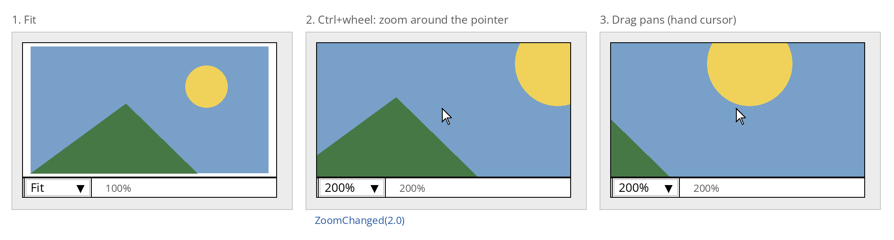

| Event emitted | When | Application callback |
|---|---|---|
| `ZoomChanged { id, factor }` | Zoom changed | `on_zoom_change(id, ..)` |

Like every Pushrod widget, it can also receive application-defined custom events in `handle_event` and emit its own (Pushrod 1.13), and every internal action emits an engine event (Pushrod 9.10).

**Acceptance Criteria.**

- Fit, fill, 100%, and zoom around the pointer
- Drag to pan
- Tiled drawing for large images

**Parallelism / Dependencies.** Parallelizable. Extra widgets: 1.1 ([#252](https://github.com/KenSuenobu/rust-pushrod/issues/252)); Pushrod: Pushrod 2.7 [#33](https://github.com/KenSuenobu/rust-pushrod/issues/33) Image widget, Pushrod 5.3 [#58](https://github.com/KenSuenobu/rust-pushrod/issues/58) Container: a scrollable viewport onto fixed-size content, Pushrod 9.4 [#96](https://github.com/KenSuenobu/rust-pushrod/issues/96) Reusable input controllers: click, drag, scroll, hover, long-press, key, Pushrod 9.9 [#101](https://github.com/KenSuenobu/rust-pushrod/issues/101) Pointer cursor per widget

**Technical Stack.** Rust (edition 2024, Rust 1.100), `pushrod`, `pushrod-widgets`.

**Documentation.** `pushrod-docs/docs/extra-widgets/image-viewer.md` (new page in the **Extra widgets** section: what it is, a screenshot from the Showcase, a short example, events and callbacks); rustdoc on every non-private item; a page in the Pushrod Showcase (1.2).

### 4.13: Log view (append-only output)

*Issue [#303](https://github.com/KenSuenobu/rust-pushrod/issues/303)* · *Extra widgets 1: crate and Chassis widgets*

**Widget roadmap:** [`docs/extra-widgets/log-view.md`](extra-widgets/log-view.md)

**Problem Statement.** Build output, test runs, and application logs arrive line by line, thousands of lines long. A text area is built for editing, not for appending fast and trimming old lines. Chassis needs this for Build and Run.

**Solution / Scope.** `LogView { max_lines }`: `append(line, level)` adds a line (levels: plain, info, warning, error; warnings and errors get a marker in the left margin and bold text, not color alone). Only visible lines are drawn. The view follows the tail while scrolled to the bottom and stops following when the user scrolls up (a "Jump to end" glyph appears). Old lines beyond `max_lines` are dropped. Lines can be selected and copied; `on_activate` reports a double-clicked line (to jump to `file:line`). Optional timestamps and wrapping.

*Ideas from:* Output panels in VS Code and Qt Creator, Dear ImGui's console and log examples, plain-text log widgets in Qt. Names and behavior are Pushrod's own.

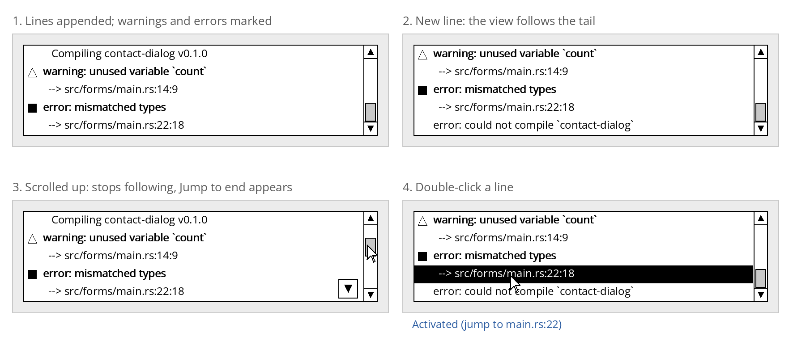

| Event emitted | When | Application callback |
|---|---|---|
| `Activated { id, line }` | A line double-clicked | `on_activate(id, ..)` |

Like every Pushrod widget, it can also receive application-defined custom events in `handle_event` and emit its own (Pushrod 1.13), and every internal action emits an engine event (Pushrod 9.10).

**Acceptance Criteria.**

- Appending 100,000 lines stays responsive; old lines trimmed
- Follows the tail unless the user scrolled up
- Select and copy; levels marked without relying on color

**Parallelism / Dependencies.** Parallelizable. Extra widgets: 1.1 ([#252](https://github.com/KenSuenobu/rust-pushrod/issues/252)); Pushrod: Pushrod 5.3 [#58](https://github.com/KenSuenobu/rust-pushrod/issues/58) Container: a scrollable viewport onto fixed-size content, Pushrod 1.18 [#111](https://github.com/KenSuenobu/rust-pushrod/issues/111) Text layout engine: Parley for shaping, bidi, line breaking, and font fallback (with an SDL2 compatibility gate), Pushrod 3.1 [#39](https://github.com/KenSuenobu/rust-pushrod/issues/39) Scroll bar

**Used by Chassis:** Chassis 6.2 [#196](https://github.com/KenSuenobu/rust-pushrod/issues/196) Build and run, Chassis 9.7 [#318](https://github.com/KenSuenobu/rust-pushrod/issues/318) Assistant activity, review mode, and safety.

**Technical Stack.** Rust (edition 2024, Rust 1.100), `pushrod`, `pushrod-widgets`.

**Documentation.** `pushrod-docs/docs/extra-widgets/log-view.md` (new page in the **Extra widgets** section: what it is, a screenshot from the Showcase, a short example, events and callbacks); rustdoc on every non-private item; a page in the Pushrod Showcase (1.2).

### 4.14: Canvas view (zoomable surface of items)

*Issue [#304](https://github.com/KenSuenobu/rust-pushrod/issues/304)* · *Extra widgets 1: crate and Chassis widgets*

**Widget roadmap:** [`docs/extra-widgets/canvas-view.md`](extra-widgets/canvas-view.md)

**Problem Statement.** Diagram editors, node graphs, floor plans, and form designers all place items on a large surface, select them, and move them. It is the base for a graph view, and Chassis's design surface is one.

**Solution / Scope.** `CanvasView { content_size, zoom, grid }`: items are widgets or `CanvasItem`s (custom-painted shapes) at content coordinates inside a container (Pushrod 5.3). Wheel scrolls, Ctrl+wheel zooms around the pointer, middle-drag or Space-drag pans. Optional grid (dots or lines) and snapping. Click selects (Shift or Ctrl extends), dragging on empty space draws a dotted rubber band, dragging a selection moves it (live or outline, Pushrod 10.1); arrow keys nudge. Hit-testing and z-order are the canvas's; what an item means is the application's. `connectors` draw straight or right-angled lines between items for graphs. Only visible items are painted.

*Ideas from:* Tk's Canvas, Qt's Graphics View, JavaFX's scene graph, the node canvases of egui and Dear ImGui add-ons. Names and behavior are Pushrod's own.

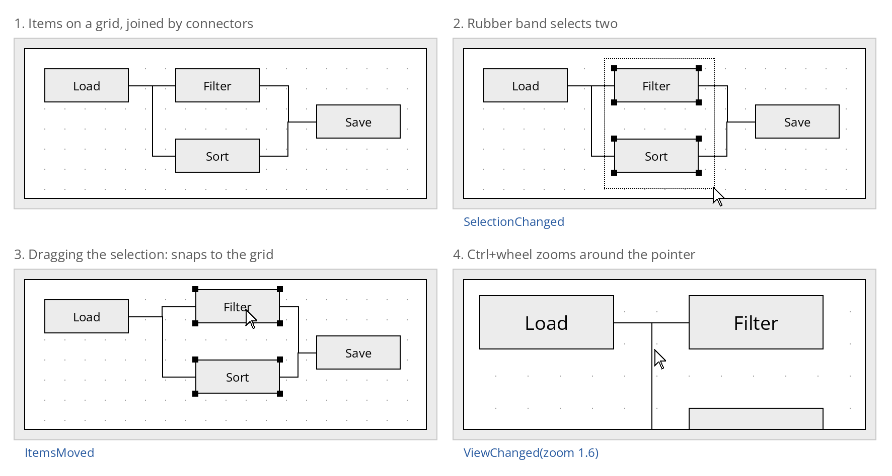

| Event emitted | When | Application callback |
|---|---|---|
| `SelectionChanged { id }` | Selection changed | `on_selection_change(id, ..)` |
| `ItemsMoved { id, delta }` | A drag or nudge finished | `on_items_move(id, ..)` |
| `ViewChanged { id, zoom, offset }` | Zoom or pan | `on_view_change(id, ..)` |

Like every Pushrod widget, it can also receive application-defined custom events in `handle_event` and emit its own (Pushrod 1.13), and every internal action emits an engine event (Pushrod 9.10).

**Acceptance Criteria.**

- Pan and zoom around the pointer
- Click, extend, and rubber-band selection; move with snapping
- Widgets and custom-painted items; connectors between items
- Only visible items are painted

**Parallelism / Dependencies.** Parallelizable. Extra widgets: 1.1 ([#252](https://github.com/KenSuenobu/rust-pushrod/issues/252)); Pushrod: Pushrod 5.3 [#58](https://github.com/KenSuenobu/rust-pushrod/issues/58) Container: a scrollable viewport onto fixed-size content, Pushrod 9.4 [#96](https://github.com/KenSuenobu/rust-pushrod/issues/96) Reusable input controllers: click, drag, scroll, hover, long-press, key, Pushrod 1.8 [#23](https://github.com/KenSuenobu/rust-pushrod/issues/23) Edit the widget tree at run time: remove, reparent, reorder, Pushrod 2.10 [#36](https://github.com/KenSuenobu/rust-pushrod/issues/36) Custom paint widget (closure-drawn)

**Used by Chassis:** Chassis 3.1 [#178](https://github.com/KenSuenobu/rust-pushrod/issues/178) Design surface.

**Technical Stack.** Rust (edition 2024, Rust 1.100), `pushrod`, `pushrod-widgets`.

**Documentation.** `pushrod-docs/docs/extra-widgets/canvas-view.md` (new page in the **Extra widgets** section: what it is, a screenshot from the Showcase, a short example, events and callbacks); rustdoc on every non-private item; a page in the Pushrod Showcase (1.2).

### 4.15: Rich text view (formatted, read-only)

*Issue [#308](https://github.com/KenSuenobu/rust-pushrod/issues/308)* · *Extra widgets 2: everyday controls and pickers*

**Widget roadmap:** [`docs/extra-widgets/rich-text-view.md`](extra-widgets/rich-text-view.md)

**Problem Statement.** Help pages, release notes, license text, and error explanations need a little structure. Plain labels can't show a heading, a list, or a link in a sentence.

**Solution / Scope.** `RichTextView::markdown(text)` or `::spans(...)`: headings (larger, bold), paragraphs with bold, italic, and `code` spans, bulleted and numbered lists, code blocks in a monospaced font, horizontal rules, and links (underlined; `LinkActivated` or open in the browser like the link label, Pushrod 2.22). Wraps to its width and scrolls in a container; text can be selected and copied. A deliberately small subset: no tables, images optional, no HTML. Markdown is parsed with `pulldown-cmark`; drawing uses the text layout's styled runs (Pushrod 1.18).

*Ideas from:* Qt's text browser, GTK's text view with tags, Tk's text widget, Markdown viewers for egui, WinUI, and Flutter. Names and behavior are Pushrod's own.

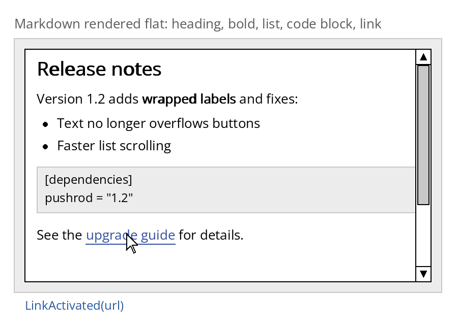

| Event emitted | When | Application callback |
|---|---|---|
| `LinkActivated { id, url }` | A link clicked | `on_link_activate(id, ..)` |

Like every Pushrod widget, it can also receive application-defined custom events in `handle_event` and emit its own (Pushrod 1.13), and every internal action emits an engine event (Pushrod 9.10).

**Acceptance Criteria.**

- Headings, emphasis, lists, code, rules, and links render and wrap
- Select and copy
- Links emit an event or open in the browser

**Parallelism / Dependencies.** Parallelizable. Extra widgets: 1.1 ([#252](https://github.com/KenSuenobu/rust-pushrod/issues/252)); Pushrod: Pushrod 1.18 [#111](https://github.com/KenSuenobu/rust-pushrod/issues/111) Text layout engine: Parley for shaping, bidi, line breaking, and font fallback (with an SDL2 compatibility gate), Pushrod 1.27 [#290](https://github.com/KenSuenobu/rust-pushrod/issues/290) Wrapped text: multi-line labels that reflow, Pushrod 5.3 [#58](https://github.com/KenSuenobu/rust-pushrod/issues/58) Container: a scrollable viewport onto fixed-size content, Pushrod 2.22 [#126](https://github.com/KenSuenobu/rust-pushrod/issues/126) Link label

**Used by Chassis:** Chassis 9.9 [#320](https://github.com/KenSuenobu/rust-pushrod/issues/320) Assistant drawer: chat inside Chassis.

**Technical Stack.** Rust (edition 2024, Rust 1.100), `pushrod`, `pushrod-widgets`.

**Documentation.** `pushrod-docs/docs/extra-widgets/rich-text-view.md` (new page in the **Extra widgets** section: what it is, a screenshot from the Showcase, a short example, events and callbacks); rustdoc on every non-private item; a page in the Pushrod Showcase (1.2).

## Epic 5: Panels and navigation ([#250](https://github.com/KenSuenobu/rust-pushrod/issues/250))

Drawer, accordion, sidebar, document tabs.

**Problem.** Larger windows organize their content with collapsible side panels, one-open-at-a-time sections, a sidebar of sections, and tabs for open documents that close and reorder.

**Scope.** Panels built on the split view, expander, list view, stack layout, and tab view.

| Issue | Title | Summary | Labels | Parallel | MVP | Phase | Complexity | Affected modules |
|---|---|---|---|---|---|---|---|---|
| 5.1 ([#257](https://github.com/KenSuenobu/rust-pushrod/issues/257)) | Drawer (collapsible side panel) | A side panel with a title bar that collapses to a thin strip and remembers its width. | `chassis`, `extra-widgets`, `extra-widgets-mvp`, `parallelizable`, `size/S`, `widget` | Y | Y | X1 | S | `pushrod-extra-widgets/src/drawer.rs (new)`, `pushrod-docs` |
| 5.2 ([#265](https://github.com/KenSuenobu/rust-pushrod/issues/265)) | Accordion (one section open at a time) | A stack of titled sections where opening one closes the others. | `extra-widgets`, `extra-widgets-mvp`, `parallelizable`, `size/S`, `widget` | Y | Y | X2 | S | `pushrod-extra-widgets/src/accordion.rs (new)`, `pushrod-docs` |
| 5.3 ([#266](https://github.com/KenSuenobu/rust-pushrod/issues/266)) | Sidebar (navigation list) | A list of sections with icons and headings that switches the page beside it. | `extra-widgets`, `extra-widgets-mvp`, `parallelizable`, `size/S`, `widget` | Y | Y | X2 | S | `pushrod-extra-widgets/src/sidebar.rs (new)`, `pushrod-docs` |
| 5.4 ([#281](https://github.com/KenSuenobu/rust-pushrod/issues/281)) | Document tabs (closable and reorderable) | A tab bar for open documents: close buttons, a modified mark, drag to reorder, and overflow. | `extra-widgets`, `parallelizable`, `size/M`, `widget` | Y | N | X3 | M | `pushrod-extra-widgets/src/document_tabs.rs (new)`, `pushrod-docs` |

### 5.1: Drawer (collapsible side panel)

*Issue [#257](https://github.com/KenSuenobu/rust-pushrod/issues/257)* · *Extra widgets 1: crate and Chassis widgets*

**Widget roadmap:** [`docs/extra-widgets/drawer.md`](extra-widgets/drawer.md)

**Problem Statement.** Chassis's project and inspector drawers, and the sidebars of many tools, are the same: a resizable panel on one side of a split view that can be hidden to give the work area more room.

**Solution / Scope.** `Drawer { side, title, content, collapsed }`: a pane of a split view (Pushrod 3.9) with a title bar holding the title and a collapse glyph button. Collapsed, it becomes a narrow strip with the title drawn vertically; click or a shortcut (an action, Pushrod 9.5) expands it to its previous width. No animation. Width and collapsed state can be saved and restored by the application.

*Ideas from:* macOS NSDrawer and collapsible split-view sidebars, Delphi TSplitView, Qt QDockWidget, libadwaita's overlay split view. Names and behavior are Pushrod's own.

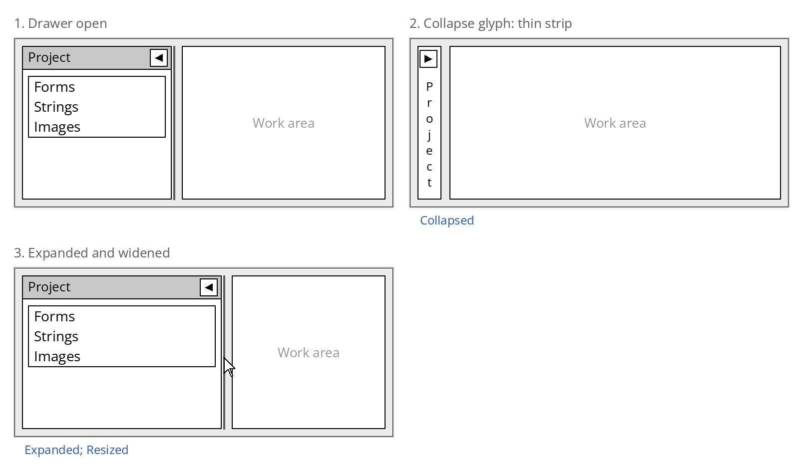

| Event emitted | When | Application callback |
|---|---|---|
| `Collapsed { id }` / `Expanded { id }` | Collapse or expand | `on_toggle(id, ..)` |
| `Resized { id, width }` | Divider dragged | `on_resize(id, ..)` |

Like every Pushrod widget, it can also receive application-defined custom events in `handle_event` and emit its own (Pushrod 1.13), and every internal action emits an engine event (Pushrod 9.10).

**Acceptance Criteria.**

- Collapses to a strip and restores its width
- Left, right, and bottom sides
- Toggle by button and action shortcut

**Parallelism / Dependencies.** Parallelizable. Extra widgets: 1.1 ([#252](https://github.com/KenSuenobu/rust-pushrod/issues/252)); Pushrod: Pushrod 3.9 [#47](https://github.com/KenSuenobu/rust-pushrod/issues/47) Split view (panes with draggable dividers), Pushrod 2.2 [#28](https://github.com/KenSuenobu/rust-pushrod/issues/28) Glyph button (small single-character button), Pushrod 9.5 [#97](https://github.com/KenSuenobu/rust-pushrod/issues/97) Actions and keyboard shortcuts: shared commands for menus, toolbars, and buttons

**Used by Chassis:** Chassis 2.3 [#173](https://github.com/KenSuenobu/rust-pushrod/issues/173) Project drawer, Chassis 4.1 [#186](https://github.com/KenSuenobu/rust-pushrod/issues/186) Inspector drawer, Chassis 9.7 [#318](https://github.com/KenSuenobu/rust-pushrod/issues/318) Assistant activity, review mode, and safety, Chassis 9.9 [#320](https://github.com/KenSuenobu/rust-pushrod/issues/320) Assistant drawer: chat inside Chassis.

**Technical Stack.** Rust (edition 2024, Rust 1.100), `pushrod`, `pushrod-widgets`.

**Documentation.** `pushrod-docs/docs/extra-widgets/drawer.md` (new page in the **Extra widgets** section: what it is, a screenshot from the Showcase, a short example, events and callbacks); rustdoc on every non-private item; a page in the Pushrod Showcase (1.2).

### 5.2: Accordion (one section open at a time)

*Issue [#265](https://github.com/KenSuenobu/rust-pushrod/issues/265)* · *Extra widgets 2: everyday controls and pickers*

**Widget roadmap:** [`docs/extra-widgets/accordion.md`](extra-widgets/accordion.md)

**Problem Statement.** Tool boxes and option panels with many sections fit in a narrow column when only one section is open at a time.

**Solution / Scope.** `Accordion { sections }`: expanders (Pushrod 3.10) in a column layout (Pushrod 5.6) where opening a section collapses the open one (or, with `multiple(true)`, behaves like independent expanders). The open section fills the remaining height and scrolls its content. Keyboard: Up/Down between headers, Space or Return opens.

*Ideas from:* Qt QToolBox, Delphi TCategoryPanelGroup, MUI register-style groups, the side panels of many design tools. Names and behavior are Pushrod's own.

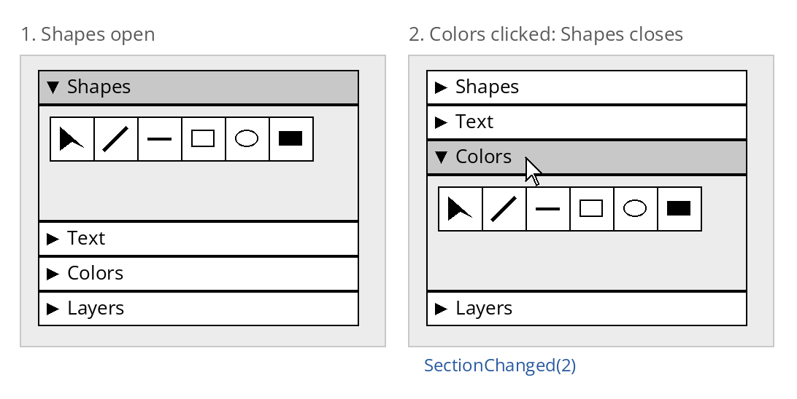

| Event emitted | When | Application callback |
|---|---|---|
| `SectionChanged { id, index }` | A section opened | `on_section_change(id, ..)` |

Like every Pushrod widget, it can also receive application-defined custom events in `handle_event` and emit its own (Pushrod 1.13), and every internal action emits an engine event (Pushrod 9.10).

**Acceptance Criteria.**

- Opening one closes the others (or multiple mode)
- Open section fills the height
- Keyboard navigation between headers

**Parallelism / Dependencies.** Parallelizable. Extra widgets: 1.1 ([#252](https://github.com/KenSuenobu/rust-pushrod/issues/252)); Pushrod: Pushrod 3.10 [#90](https://github.com/KenSuenobu/rust-pushrod/issues/90) Expander (collapsible section), Pushrod 5.6 [#117](https://github.com/KenSuenobu/rust-pushrod/issues/117) Row and column layouts

**Technical Stack.** Rust (edition 2024, Rust 1.100), `pushrod`, `pushrod-widgets`.

**Documentation.** `pushrod-docs/docs/extra-widgets/accordion.md` (new page in the **Extra widgets** section: what it is, a screenshot from the Showcase, a short example, events and callbacks); rustdoc on every non-private item; a page in the Pushrod Showcase (1.2).

### 5.3: Sidebar (navigation list)

*Issue [#266](https://github.com/KenSuenobu/rust-pushrod/issues/266)* · *Extra widgets 2: everyday controls and pickers*

**Widget roadmap:** [`docs/extra-widgets/sidebar.md`](extra-widgets/sidebar.md)

**Problem Statement.** Settings windows and multi-page tools switch pages from a list of sections on the left, more scalable than tabs when there are many.

**Solution / Scope.** `Sidebar { items }`: a list view (Pushrod 4.5) of items with an icon, a label, and an optional count, grouped under non-selectable heading rows. Bound to a stack layout (Pushrod 5.9) so selecting an item shows its page. Optional filter field (4.10) for long lists.

*Ideas from:* macOS source lists, GTK GtkStackSidebar, KDE KPageWidget's list mode, libadwaita's sidebar, Windows navigation panes. Names and behavior are Pushrod's own.

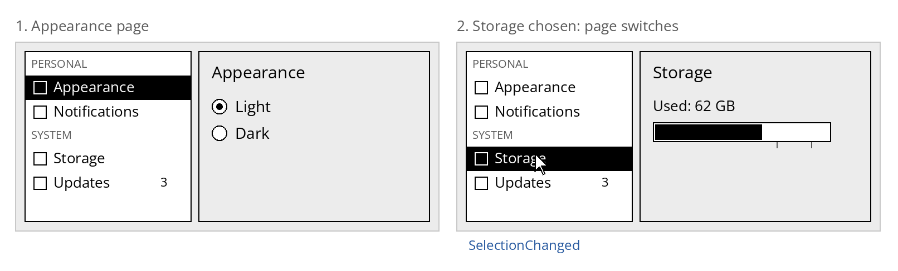

| Event emitted | When | Application callback |
|---|---|---|
| `SelectionChanged { id, index }` | Item chosen | `on_selection_change(id, ..)` |

Like every Pushrod widget, it can also receive application-defined custom events in `handle_event` and emit its own (Pushrod 1.13), and every internal action emits an engine event (Pushrod 9.10).

**Acceptance Criteria.**

- Headings, icons, and counts
- Bound to a stack layout
- Keyboard navigation

**Parallelism / Dependencies.** Parallelizable. Extra widgets: 1.1 ([#252](https://github.com/KenSuenobu/rust-pushrod/issues/252)); Pushrod: Pushrod 4.5 [#52](https://github.com/KenSuenobu/rust-pushrod/issues/52) List view, Pushrod 5.9 [#120](https://github.com/KenSuenobu/rust-pushrod/issues/120) Stack layout (one child visible at a time)

**Technical Stack.** Rust (edition 2024, Rust 1.100), `pushrod`, `pushrod-widgets`.

**Documentation.** `pushrod-docs/docs/extra-widgets/sidebar.md` (new page in the **Extra widgets** section: what it is, a screenshot from the Showcase, a short example, events and callbacks); rustdoc on every non-private item; a page in the Pushrod Showcase (1.2).

### 5.4: Document tabs (closable and reorderable)

*Issue [#281](https://github.com/KenSuenobu/rust-pushrod/issues/281)* · *Extra widgets 3: specialized views and assistants*

**Widget roadmap:** [`docs/extra-widgets/document-tabs.md`](extra-widgets/document-tabs.md)

**Problem Statement.** Editors keep many documents open. The standard tab view switches fixed pages; documents need closing, reordering, a modified mark, and a way to reach tabs that don't fit.

**Solution / Scope.** `DocumentTabs { tabs }` builds on the tab view (Pushrod 4.4): each tab has a close glyph (shown on hover and on the active tab) and a dot when modified. Drag to reorder (Pushrod 9.8); middle-click closes; a context menu (Pushrod 2.19) offers Close, Close Others, and Close to the Right. When tabs don't fit, scroll arrows and a menu listing all tabs appear. Closing asks the application first (`can_close`).

*Ideas from:* Qt QTabBar (closable, movable), GTK notebooks and libadwaita's tab bar, KDE editors, macOS window tabs, code editors. Names and behavior are Pushrod's own.

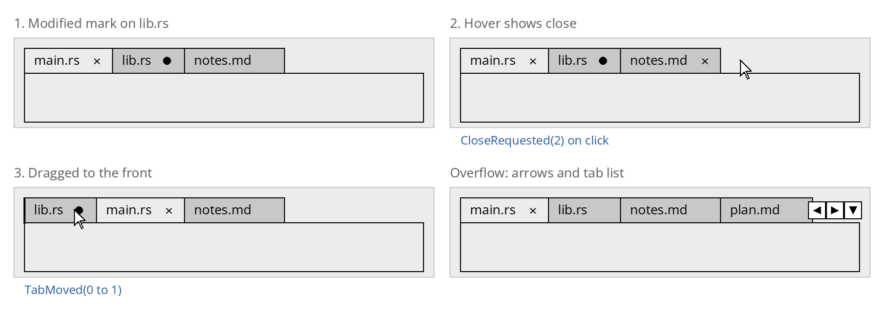

| Event emitted | When | Application callback |
|---|---|---|
| `TabActivated { id, index }` | Tab chosen | `on_tab_activate(id, ..)` |
| `CloseRequested { id, index }` | Close clicked | `on_close_request(id, ..)` |
| `TabMoved { id, from, to }` | Tab dragged | `on_tab_move(id, ..)` |

Like every Pushrod widget, it can also receive application-defined custom events in `handle_event` and emit its own (Pushrod 1.13), and every internal action emits an engine event (Pushrod 9.10).

**Acceptance Criteria.**

- Close buttons, modified marks, middle-click close
- Drag to reorder and context menu
- Overflow arrows and tab list menu

**Parallelism / Dependencies.** Parallelizable. Extra widgets: 1.1 ([#252](https://github.com/KenSuenobu/rust-pushrod/issues/252)); Pushrod: Pushrod 4.4 [#51](https://github.com/KenSuenobu/rust-pushrod/issues/51) Tab view, Pushrod 9.8 [#100](https://github.com/KenSuenobu/rust-pushrod/issues/100) Drag and drop within the application, Pushrod 2.19 [#88](https://github.com/KenSuenobu/rust-pushrod/issues/88) Context menus, Pushrod 2.11 [#37](https://github.com/KenSuenobu/rust-pushrod/issues/37) Menu bar and drop-down menus (drawn by Pushrod)

**Technical Stack.** Rust (edition 2024, Rust 1.100), `pushrod`, `pushrod-widgets`.

**Documentation.** `pushrod-docs/docs/extra-widgets/document-tabs.md` (new page in the **Extra widgets** section: what it is, a screenshot from the Showcase, a short example, events and callbacks); rustdoc on every non-private item; a page in the Pushrod Showcase (1.2).

## Epic 6: Dialogs and assistants ([#251](https://github.com/KenSuenobu/rust-pushrod/issues/251))

Input, progress, and task dialogs, wizard, settings and about dialogs, find bar, shortcuts editor.

**Problem.** Every toolkit ships a few ready-made dialogs that applications would otherwise build by hand, each slightly differently.

**Scope.** One-call dialogs and reusable assistants, built from standard widgets and Pushrod's modal dialogs, each returning its result through a completion closure.

| Issue | Title | Summary | Labels | Parallel | MVP | Phase | Complexity | Affected modules |
|---|---|---|---|---|---|---|---|---|
| 6.1 ([#267](https://github.com/KenSuenobu/rust-pushrod/issues/267)) | Input dialog (ask for one value) | A one-call modal dialog asking for a single text, number, or choice. | `extra-widgets`, `extra-widgets-mvp`, `parallelizable`, `size/S`, `widget` | Y | Y | X2 | S | `pushrod-extra-widgets/src/input_dialog.rs (new)`, `pushrod-docs` |
| 6.2 ([#268](https://github.com/KenSuenobu/rust-pushrod/issues/268)) | Progress dialog | A modal dialog with a message, a progress bar, and Cancel, for long tasks. | `extra-widgets`, `extra-widgets-mvp`, `parallelizable`, `size/S`, `widget` | Y | Y | X2 | S | `pushrod-extra-widgets/src/progress_dialog.rs (new)`, `pushrod-docs` |
| 6.3 ([#269](https://github.com/KenSuenobu/rust-pushrod/issues/269)) | Task dialog (alert with details and options) | An alert with a main instruction, expandable details, a "don't ask again" box, and command choices. | `extra-widgets`, `extra-widgets-mvp`, `parallelizable`, `size/S`, `widget` | Y | Y | X2 | S | `pushrod-extra-widgets/src/task_dialog.rs (new)`, `pushrod-docs` |
| 6.4 ([#282](https://github.com/KenSuenobu/rust-pushrod/issues/282)) | Wizard (step-by-step assistant) | Pages shown one at a time with Back, Next, and Finish, and a list of steps. | `extra-widgets`, `parallelizable`, `size/M`, `widget` | Y | N | X3 | M | `pushrod-extra-widgets/src/wizard.rs (new)`, `pushrod-docs` |
| 6.5 ([#283](https://github.com/KenSuenobu/rust-pushrod/issues/283)) | Settings dialog | A sidebar of categories, a page per category, and OK, Cancel, and Apply. | `extra-widgets`, `parallelizable`, `size/M`, `widget` | Y | N | X3 | M | `pushrod-extra-widgets/src/settings_dialog.rs (new)`, `pushrod-docs` |
| 6.6 ([#284](https://github.com/KenSuenobu/rust-pushrod/issues/284)) | About dialog | The application's icon, name, version, copyright, website, and credits and license pages. | `extra-widgets`, `parallelizable`, `size/S`, `widget` | Y | N | X3 | S | `pushrod-extra-widgets/src/about_dialog.rs (new)`, `pushrod-docs` |
| 6.7 ([#285](https://github.com/KenSuenobu/rust-pushrod/issues/285)) | Find and replace bar | A bar with find and replace fields, match options, a match count, and next and previous. | `extra-widgets`, `parallelizable`, `size/M`, `widget` | Y | N | X3 | M | `pushrod-extra-widgets/src/find_bar.rs (new)`, `pushrod-docs` |
| 6.8 ([#286](https://github.com/KenSuenobu/rust-pushrod/issues/286)) | Keyboard shortcuts editor | A filterable table of actions and their shortcuts, edited with the shortcut field. | `extra-widgets`, `parallelizable`, `size/M`, `widget` | Y | N | X3 | M | `pushrod-extra-widgets/src/shortcuts_editor.rs (new)`, `pushrod-docs` |
| 6.9 ([#305](https://github.com/KenSuenobu/rust-pushrod/issues/305)) | Command palette | A pop-up search box listing every command; type a few letters, press Return, and it runs. | `chassis`, `extra-widgets`, `extra-widgets-mvp`, `parallelizable`, `size/M`, `widget` | Y | Y | X1 | M | `pushrod-extra-widgets/src/command_palette.rs (new)`, `pushrod-docs` |
| 6.10 ([#309](https://github.com/KenSuenobu/rust-pushrod/issues/309)) | Recent files menu | An Open Recent submenu that remembers the last files, with Clear and missing-file handling. | `extra-widgets`, `extra-widgets-mvp`, `parallelizable`, `size/S`, `widget` | Y | Y | X2 | S | `pushrod-extra-widgets/src/recent_files_menu.rs (new)`, `pushrod-docs` |

### 6.1: Input dialog (ask for one value)

*Issue [#267](https://github.com/KenSuenobu/rust-pushrod/issues/267)* · *Extra widgets 2: everyday controls and pickers*

**Widget roadmap:** [`docs/extra-widgets/input-dialog.md`](extra-widgets/input-dialog.md)

**Problem Statement.** Asking for one value (a name for a new folder, a number of copies, one item from a list) shouldn't need a form file.

**Solution / Scope.** `InputDialog::text("New folder name", default)`, `::number(label, value, min, max)`, `::choice(label, items, editable)`: a modal dialog (Pushrod 6.7) with a message, the matching field (text field, spin box, or combo box), and OK/Cancel. OK is the default button and is disabled while a `validate` closure rejects the value. The completion closure receives `Option<value>`.

*Ideas from:* Qt QInputDialog, Motif prompt and selection dialogs (XmSelectionBox), KDE input dialogs, Delphi InputBox, Java JOptionPane. Names and behavior are Pushrod's own.

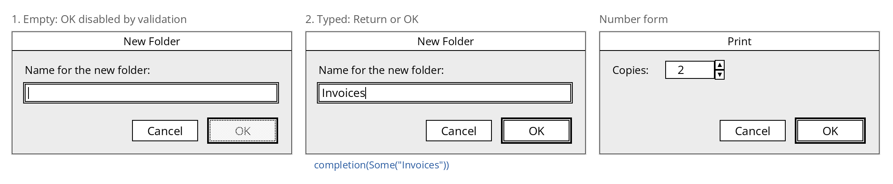

| Event emitted | When | Application callback |
|---|---|---|
| (completion) | OK or Cancel | Completion closure `FnOnce(&mut S, &mut Ui, Option<T>)` |

Like every Pushrod widget, it can also receive application-defined custom events in `handle_event` and emit its own (Pushrod 1.13), and every internal action emits an engine event (Pushrod 9.10).

**Acceptance Criteria.**

- Text, number, and choice forms
- Validation disables OK
- Completion receives None on Cancel

**Parallelism / Dependencies.** Parallelizable. Extra widgets: 1.1 ([#252](https://github.com/KenSuenobu/rust-pushrod/issues/252)); Pushrod: Pushrod 6.7 [#66](https://github.com/KenSuenobu/rust-pushrod/issues/66) Modal dialogs: run a form until a dismissing control is chosen, Pushrod 2.6 [#32](https://github.com/KenSuenobu/rust-pushrod/issues/32) Text field: single-line entry with input masks, validation, and numeric mode, Pushrod 4.2 [#49](https://github.com/KenSuenobu/rust-pushrod/issues/49) Spin box, Pushrod 4.6 [#53](https://github.com/KenSuenobu/rust-pushrod/issues/53) Combo box

**Technical Stack.** Rust (edition 2024, Rust 1.100), `pushrod`, `pushrod-widgets`.

**Documentation.** `pushrod-docs/docs/extra-widgets/input-dialog.md` (new page in the **Extra widgets** section: what it is, a screenshot from the Showcase, a short example, events and callbacks); rustdoc on every non-private item; a page in the Pushrod Showcase (1.2).

### 6.2: Progress dialog

*Issue [#268](https://github.com/KenSuenobu/rust-pushrod/issues/268)* · *Extra widgets 2: everyday controls and pickers*

**Widget roadmap:** [`docs/extra-widgets/progress-dialog.md`](extra-widgets/progress-dialog.md)

**Problem Statement.** Every long task (export, import, copy) needs the same dialog, shown only if the task takes more than a moment.

**Solution / Scope.** `ProgressDialog::start(title, message)` returns a handle; the task calls `set_progress(fraction or None)` and `set_message(text)` from timers or idle callbacks (Pushrod 1.5). The dialog appears only after a short delay (default 0.5 s), so quick tasks never flash it. Cancel sets `cancelled()`; the task checks it and stops. `finish()` closes it. Optional estimated time remaining.

*Ideas from:* Qt QProgressDialog, KDE job progress dialogs, the Windows progress dialog, BeOS/Haiku BStatusBar windows. Names and behavior are Pushrod's own.

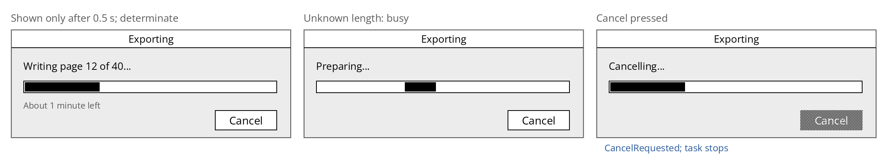

| Event emitted | When | Application callback |
|---|---|---|
| `CancelRequested { id }` | Cancel pressed | `on_cancel(id, ..)` and `cancelled()` |

Like every Pushrod widget, it can also receive application-defined custom events in `handle_event` and emit its own (Pushrod 1.13), and every internal action emits an engine event (Pushrod 9.10).

**Acceptance Criteria.**

- Delayed appearance for quick tasks
- Determinate and busy progress
- Cancel reported to the task

**Parallelism / Dependencies.** Parallelizable. Extra widgets: 1.1 ([#252](https://github.com/KenSuenobu/rust-pushrod/issues/252)); Pushrod: Pushrod 6.7 [#66](https://github.com/KenSuenobu/rust-pushrod/issues/66) Modal dialogs: run a form until a dismissing control is chosen, Pushrod 4.1 [#48](https://github.com/KenSuenobu/rust-pushrod/issues/48) Progress bar, Pushrod 1.5 [#21](https://github.com/KenSuenobu/rust-pushrod/issues/21) Timers and idle callbacks

**Technical Stack.** Rust (edition 2024, Rust 1.100), `pushrod`, `pushrod-widgets`.

**Documentation.** `pushrod-docs/docs/extra-widgets/progress-dialog.md` (new page in the **Extra widgets** section: what it is, a screenshot from the Showcase, a short example, events and callbacks); rustdoc on every non-private item; a page in the Pushrod Showcase (1.2).

### 6.3: Task dialog (alert with details and options)

*Issue [#269](https://github.com/KenSuenobu/rust-pushrod/issues/269)* · *Extra widgets 2: everyday controls and pickers*

**Widget roadmap:** [`docs/extra-widgets/task-dialog.md`](extra-widgets/task-dialog.md)

**Problem Statement.** The standard alert covers a message and buttons. Real applications also need error details to copy, a "don't ask again" option, and choices that need a sentence each.

**Solution / Scope.** `TaskDialog { icon, instruction, message, details, check, commands, buttons }`: the main instruction in larger text, an optional message, an expander (Pushrod 3.10) with details in a read-only text area (with Copy), an optional check box ("Don't ask again"), and either buttons or command choices (a large button with a title and one-line description each). The completion closure receives the chosen command and the check box state.

*Ideas from:* Windows task dialogs and command links, Qt QMessageBox detailed text and check box, macOS NSAlert suppression and accessory views, GEM form_alert. Names and behavior are Pushrod's own.

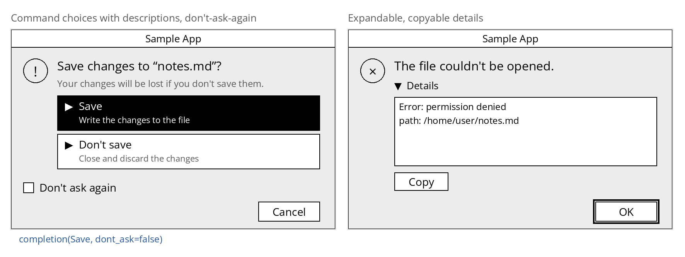

| Event emitted | When | Application callback |
|---|---|---|
| (completion) | A button or command chosen | Completion closure receives the choice and the check state |

Like every Pushrod widget, it can also receive application-defined custom events in `handle_event` and emit its own (Pushrod 1.13), and every internal action emits an engine event (Pushrod 9.10).

**Acceptance Criteria.**

- Instruction, message, and copyable details
- Check box state returned
- Command choices with descriptions

**Parallelism / Dependencies.** Parallelizable. Extra widgets: 1.1 ([#252](https://github.com/KenSuenobu/rust-pushrod/issues/252)); Pushrod: Pushrod 2.9 [#35](https://github.com/KenSuenobu/rust-pushrod/issues/35) Alert dialog, Pushrod 3.10 [#90](https://github.com/KenSuenobu/rust-pushrod/issues/90) Expander (collapsible section), Pushrod 2.4 [#30](https://github.com/KenSuenobu/rust-pushrod/issues/30) Check box with indeterminate state, Pushrod 2.18 [#87](https://github.com/KenSuenobu/rust-pushrod/issues/87) Multi-line text area, Pushrod 6.7 [#66](https://github.com/KenSuenobu/rust-pushrod/issues/66) Modal dialogs: run a form until a dismissing control is chosen

**Technical Stack.** Rust (edition 2024, Rust 1.100), `pushrod`, `pushrod-widgets`.

**Documentation.** `pushrod-docs/docs/extra-widgets/task-dialog.md` (new page in the **Extra widgets** section: what it is, a screenshot from the Showcase, a short example, events and callbacks); rustdoc on every non-private item; a page in the Pushrod Showcase (1.2).

### 6.4: Wizard (step-by-step assistant)

*Issue [#282](https://github.com/KenSuenobu/rust-pushrod/issues/282)* · *Extra widgets 3: specialized views and assistants*

**Widget roadmap:** [`docs/extra-widgets/wizard.md`](extra-widgets/wizard.md)

**Problem Statement.** Setup, import, and export flows ask a few questions in order, and every toolkit ships the same assistant.

**Solution / Scope.** `Wizard { pages }`: a modal dialog (Pushrod 6.7) with an optional step list on the left (current step bold, completed steps checked), the page title and the page in a stack layout (Pushrod 5.9), and Back, Next, Finish, and Cancel. Each page can block Next until it is complete (`is_complete`) and can skip the next page (`next_page`). Finish runs on the last page; a summary page is optional.

*Ideas from:* GTK GtkAssistant, Qt QWizard, KDE KAssistantDialog, Windows wizards, Mac OS X setup assistants. Names and behavior are Pushrod's own.

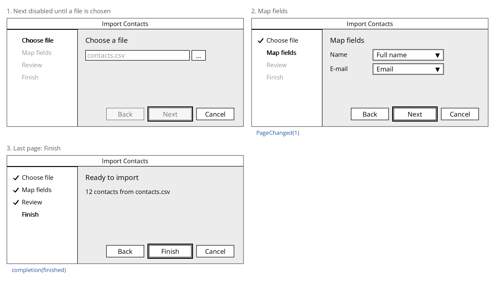

| Event emitted | When | Application callback |
|---|---|---|
| `PageChanged { id, index }` | Back or Next | `on_page_change(id, ..)` |
| (completion) | Finish or Cancel | Completion closure receives finished or cancelled |

Like every Pushrod widget, it can also receive application-defined custom events in `handle_event` and emit its own (Pushrod 1.13), and every internal action emits an engine event (Pushrod 9.10).

**Acceptance Criteria.**

- Back, Next, Finish, and Cancel with page validation
- Step list and conditional pages
- Summary page optional

**Parallelism / Dependencies.** Parallelizable. Extra widgets: 1.1 ([#252](https://github.com/KenSuenobu/rust-pushrod/issues/252)); Pushrod: Pushrod 5.9 [#120](https://github.com/KenSuenobu/rust-pushrod/issues/120) Stack layout (one child visible at a time), Pushrod 6.7 [#66](https://github.com/KenSuenobu/rust-pushrod/issues/66) Modal dialogs: run a form until a dismissing control is chosen, Pushrod 2.3 [#29](https://github.com/KenSuenobu/rust-pushrod/issues/29) Button behaviors: default, cancel, toggle, activate-on-press, dismiss dialog

**Technical Stack.** Rust (edition 2024, Rust 1.100), `pushrod`, `pushrod-widgets`.

**Documentation.** `pushrod-docs/docs/extra-widgets/wizard.md` (new page in the **Extra widgets** section: what it is, a screenshot from the Showcase, a short example, events and callbacks); rustdoc on every non-private item; a page in the Pushrod Showcase (1.2).

### 6.5: Settings dialog

*Issue [#283](https://github.com/KenSuenobu/rust-pushrod/issues/283)* · *Extra widgets 3: specialized views and assistants*

**Widget roadmap:** [`docs/extra-widgets/settings-dialog.md`](extra-widgets/settings-dialog.md)

**Problem Statement.** Almost every application has a settings window, and they all work the same: categories, pages of options, and Apply semantics.

**Solution / Scope.** `SettingsDialog { pages }`: a sidebar (5.3) or tabs, a page per category using a form layout (Pushrod 5.7), and OK, Cancel, Apply, and Restore Defaults. Each page reads from and writes to the application's settings through `load`/`apply` closures; Apply is enabled only when something changed. Optional search field that finds an option and shows its page.

*Ideas from:* KDE KPageDialog and KConfigDialog, libadwaita's preferences dialog, Windows property sheets, macOS Settings windows. Names and behavior are Pushrod's own.

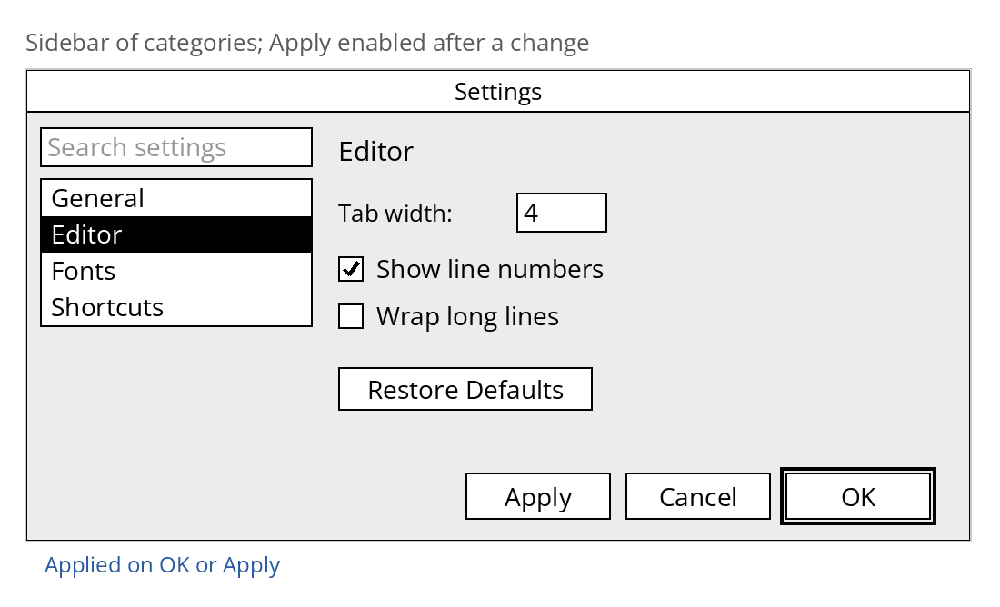

| Event emitted | When | Application callback |
|---|---|---|
| `Applied { id }` | OK or Apply | `on_apply(id, ..)` |
| `DefaultsRestored { id, page }` | Restore Defaults | `on_restore_defaults(id, ..)` |

Like every Pushrod widget, it can also receive application-defined custom events in `handle_event` and emit its own (Pushrod 1.13), and every internal action emits an engine event (Pushrod 9.10).

**Acceptance Criteria.**

- Sidebar or tabs layout
- Apply enabled only on changes; OK applies and closes
- Restore Defaults per page and optional search

**Parallelism / Dependencies.** Parallelizable. Extra widgets: 5.3 ([#266](https://github.com/KenSuenobu/rust-pushrod/issues/266)); Pushrod: Pushrod 5.9 [#120](https://github.com/KenSuenobu/rust-pushrod/issues/120) Stack layout (one child visible at a time), Pushrod 5.7 [#118](https://github.com/KenSuenobu/rust-pushrod/issues/118) Form layout: aligned label and field rows, Pushrod 6.7 [#66](https://github.com/KenSuenobu/rust-pushrod/issues/66) Modal dialogs: run a form until a dismissing control is chosen, Pushrod 4.4 [#51](https://github.com/KenSuenobu/rust-pushrod/issues/51) Tab view

**Technical Stack.** Rust (edition 2024, Rust 1.100), `pushrod`, `pushrod-widgets`.

**Documentation.** `pushrod-docs/docs/extra-widgets/settings-dialog.md` (new page in the **Extra widgets** section: what it is, a screenshot from the Showcase, a short example, events and callbacks); rustdoc on every non-private item; a page in the Pushrod Showcase (1.2).

### 6.6: About dialog

*Issue [#284](https://github.com/KenSuenobu/rust-pushrod/issues/284)* · *Extra widgets 3: specialized views and assistants*

**Widget roadmap:** [`docs/extra-widgets/about-dialog.md`](extra-widgets/about-dialog.md)

**Problem Statement.** Every application needs an About box, and the information is always the same.

**Solution / Scope.** `AboutDialog { icon, name, version, copyright, website, credits, license }`: icon and name centered, version and copyright below, the website as a link label (Pushrod 2.22), and Credits and License buttons that switch to scrolling text pages (Pushrod 2.18). Values can come from `Cargo.toml` with a `from_cargo!()` macro. Sample data in examples uses fictional placeholders.

*Ideas from:* GTK GtkAboutDialog, KDE's About dialog, the macOS standard about panel, Qt's about box, the Atari and Amiga "About" requesters. Names and behavior are Pushrod's own.

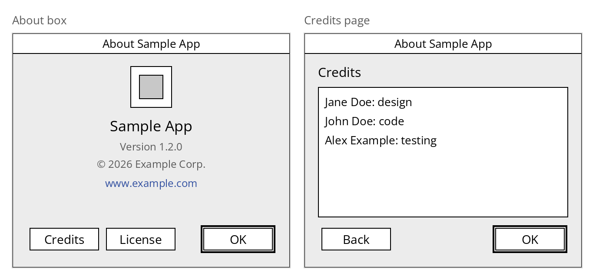

| Event emitted | When | Application callback |
|---|---|---|
| (none) | Closed with OK or Escape | None |

Like every Pushrod widget, it can also receive application-defined custom events in `handle_event` and emit its own (Pushrod 1.13), and every internal action emits an engine event (Pushrod 9.10).

**Acceptance Criteria.**

- Icon, name, version, copyright, and website
- Credits and license pages
- Values from Cargo metadata

**Parallelism / Dependencies.** Parallelizable. Extra widgets: 1.1 ([#252](https://github.com/KenSuenobu/rust-pushrod/issues/252)); Pushrod: Pushrod 6.7 [#66](https://github.com/KenSuenobu/rust-pushrod/issues/66) Modal dialogs: run a form until a dismissing control is chosen, Pushrod 2.7 [#33](https://github.com/KenSuenobu/rust-pushrod/issues/33) Image widget, Pushrod 2.22 [#126](https://github.com/KenSuenobu/rust-pushrod/issues/126) Link label, Pushrod 2.18 [#87](https://github.com/KenSuenobu/rust-pushrod/issues/87) Multi-line text area

**Technical Stack.** Rust (edition 2024, Rust 1.100), `pushrod`, `pushrod-widgets`.

**Documentation.** `pushrod-docs/docs/extra-widgets/about-dialog.md` (new page in the **Extra widgets** section: what it is, a screenshot from the Showcase, a short example, events and callbacks); rustdoc on every non-private item; a page in the Pushrod Showcase (1.2).

### 6.7: Find and replace bar

*Issue [#285](https://github.com/KenSuenobu/rust-pushrod/issues/285)* · *Extra widgets 3: specialized views and assistants*

**Widget roadmap:** [`docs/extra-widgets/find-bar.md`](extra-widgets/find-bar.md)

**Problem Statement.** Text views, tables, and documents all need find; a bar that doesn't cover the content is better than a dialog. The Chassis code editor's find (Pushrod 11.6) can reuse it.

**Solution / Scope.** `FindBar::attach(target)`: a find field, previous/next glyph buttons, a match count ("3 of 12"), and Match case, Whole word, and Regular expression check boxes; an optional replace row with Replace and Replace All. Bound through a `Searchable` trait (find all, select a match, replace) implemented for the text area (Pushrod 2.18) and available to others. Ctrl+F opens it, Escape closes it, Return and Shift+Return go next and previous.

*Ideas from:* KDE's search bars in Kate and Okular, GTK GtkSearchBar, macOS NSTextFinder's find bar, browser find bars. Names and behavior are Pushrod's own.

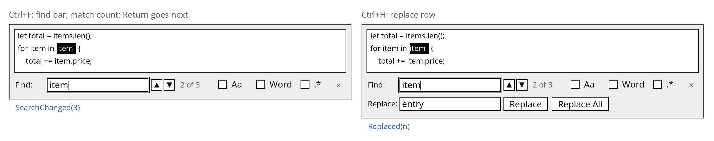

| Event emitted | When | Application callback |
|---|---|---|
| `SearchChanged { id, matches }` | Query or options changed | `on_search_change(id, ..)` |
| `Replaced { id, count }` | Replace or Replace All | `on_replace(id, ..)` |

Like every Pushrod widget, it can also receive application-defined custom events in `handle_event` and emit its own (Pushrod 1.13), and every internal action emits an engine event (Pushrod 9.10).

**Acceptance Criteria.**

- Find, next, previous, and match count
- Case, whole word, and regular expression options
- Replace and Replace All through the Searchable trait

**Parallelism / Dependencies.** Parallelizable. Extra widgets: 1.1 ([#252](https://github.com/KenSuenobu/rust-pushrod/issues/252)); Pushrod: Pushrod 2.6 [#32](https://github.com/KenSuenobu/rust-pushrod/issues/32) Text field: single-line entry with input masks, validation, and numeric mode, Pushrod 2.4 [#30](https://github.com/KenSuenobu/rust-pushrod/issues/30) Check box with indeterminate state, Pushrod 2.2 [#28](https://github.com/KenSuenobu/rust-pushrod/issues/28) Glyph button (small single-character button), Pushrod 2.18 [#87](https://github.com/KenSuenobu/rust-pushrod/issues/87) Multi-line text area, Pushrod 9.5 [#97](https://github.com/KenSuenobu/rust-pushrod/issues/97) Actions and keyboard shortcuts: shared commands for menus, toolbars, and buttons

**Technical Stack.** Rust (edition 2024, Rust 1.100), `pushrod`, `pushrod-widgets`.

**Documentation.** `pushrod-docs/docs/extra-widgets/find-bar.md` (new page in the **Extra widgets** section: what it is, a screenshot from the Showcase, a short example, events and callbacks); rustdoc on every non-private item; a page in the Pushrod Showcase (1.2).

### 6.8: Keyboard shortcuts editor

*Issue [#286](https://github.com/KenSuenobu/rust-pushrod/issues/286)* · *Extra widgets 3: specialized views and assistants*

**Widget roadmap:** [`docs/extra-widgets/shortcuts-editor.md`](extra-widgets/shortcuts-editor.md)

**Problem Statement.** Applications with many commands let users change their shortcuts, and need conflict detection and reset.

**Solution / Scope.** `ShortcutsEditor::new(&actions)`: a table (Pushrod 4.9) of actions with their category, name, and shortcut, a filter field (4.10) that matches names or key combinations, and a shortcut field (2.8) to change the selected action. Conflicts name the other action and offer to reassign. Reset and Reset All restore defaults. Changes are applied to the actions (Pushrod 9.5) and can be saved by the application.

*Ideas from:* KDE KShortcutsEditor, the Qt Creator and GTK keyboard shortcut settings, macOS keyboard shortcut preferences. Names and behavior are Pushrod's own.

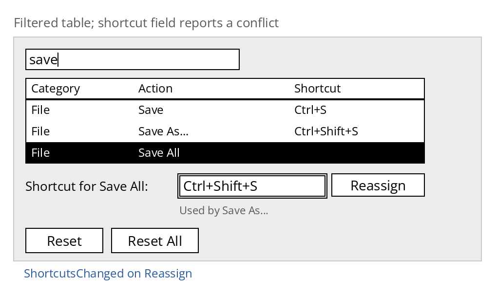

| Event emitted | When | Application callback |
|---|---|---|
| `ShortcutsChanged { id }` | Any shortcut changed or reset | `on_shortcuts_change(id, ..)` |

Like every Pushrod widget, it can also receive application-defined custom events in `handle_event` and emit its own (Pushrod 1.13), and every internal action emits an engine event (Pushrod 9.10).

**Acceptance Criteria.**

- Filter by name or key combination
- Conflict detection with reassign
- Reset one or all

**Parallelism / Dependencies.** Parallelizable. Extra widgets: 2.8 ([#271](https://github.com/KenSuenobu/rust-pushrod/issues/271)), 4.10 ([#277](https://github.com/KenSuenobu/rust-pushrod/issues/277)); Pushrod: Pushrod 4.9 [#92](https://github.com/KenSuenobu/rust-pushrod/issues/92) Table view, Pushrod 9.5 [#97](https://github.com/KenSuenobu/rust-pushrod/issues/97) Actions and keyboard shortcuts: shared commands for menus, toolbars, and buttons

**Technical Stack.** Rust (edition 2024, Rust 1.100), `pushrod`, `pushrod-widgets`.

**Documentation.** `pushrod-docs/docs/extra-widgets/shortcuts-editor.md` (new page in the **Extra widgets** section: what it is, a screenshot from the Showcase, a short example, events and callbacks); rustdoc on every non-private item; a page in the Pushrod Showcase (1.2).

### 6.9: Command palette

*Issue [#305](https://github.com/KenSuenobu/rust-pushrod/issues/305)* · *Extra widgets 1: crate and Chassis widgets*

**Widget roadmap:** [`docs/extra-widgets/command-palette.md`](extra-widgets/command-palette.md)

**Problem Statement.** Applications with many commands bury them in menus. A palette makes every command reachable from the keyboard in a few keystrokes, and shows its shortcut so users learn it. Pushrod's actions (Pushrod 9.5) already know every command's name, shortcut, and enabled state.

**Solution / Scope.** `CommandPalette::new(&actions)`: opened by a shortcut (Ctrl+Shift+P by default), it shows a framed panel at the top center of the window: a text field and a list of actions with category, name, and shortcut. Typing filters by fuzzy match (letters in order), best match first, matched letters bold; recently used commands come first when the field is empty. Up/Down move, Return runs the action and closes, Escape closes. Disabled actions are shown dimmed and don't run. `add_source` lets an application list other things (open files, forms, settings) with a prefix character.

*Ideas from:* The command palettes of VS Code and Sublime Text, Search Everywhere in JetBrains tools, Blender's operator search, the locator in Qt Creator. Names and behavior are Pushrod's own.

| Event emitted | When | Application callback |
|---|---|---|
| `CommandRun { id, action }` | An entry chosen | the action's own callback, and `on_command_run(id, ..)` |
| `PaletteClosed { id }` | Closed without choosing | `on_close(id, ..)` |

Like every Pushrod widget, it can also receive application-defined custom events in `handle_event` and emit its own (Pushrod 1.13), and every internal action emits an engine event (Pushrod 9.10).

**Acceptance Criteria.**

- Lists every action with its shortcut; disabled ones dimmed
- Fuzzy filtering with matched letters marked; recent first
- Keyboard only: open, move, run, close
- Extra sources with a prefix

**Parallelism / Dependencies.** Parallelizable. Extra widgets: 1.3 ([#254](https://github.com/KenSuenobu/rust-pushrod/issues/254)); Pushrod: Pushrod 9.5 [#97](https://github.com/KenSuenobu/rust-pushrod/issues/97) Actions and keyboard shortcuts: shared commands for menus, toolbars, and buttons, Pushrod 2.6 [#32](https://github.com/KenSuenobu/rust-pushrod/issues/32) Text field: single-line entry with input masks, validation, and numeric mode, Pushrod 4.5 [#52](https://github.com/KenSuenobu/rust-pushrod/issues/52) List view

**Used by Chassis:** Chassis 1.4 [#170](https://github.com/KenSuenobu/rust-pushrod/issues/170) Commands, menus, and shortcuts.

**Technical Stack.** Rust (edition 2024, Rust 1.100), `pushrod`, `pushrod-widgets`.

**Documentation.** `pushrod-docs/docs/extra-widgets/command-palette.md` (new page in the **Extra widgets** section: what it is, a screenshot from the Showcase, a short example, events and callbacks); rustdoc on every non-private item; a page in the Pushrod Showcase (1.2).

### 6.10: Recent files menu

*Issue [#309](https://github.com/KenSuenobu/rust-pushrod/issues/309)* · *Extra widgets 2: everyday controls and pickers*

**Widget roadmap:** [`docs/extra-widgets/recent-files-menu.md`](extra-widgets/recent-files-menu.md)

**Problem Statement.** Every document application has an Open Recent menu, and every one rebuilds the same list handling: move to top, cap the length, drop missing files, save and load.

**Solution / Scope.** `RecentFiles { max, store }`: `add(path)` moves a path to the top and trims the list; `menu()` returns a submenu (Pushrod 2.11) with one numbered item per file (file name, with the folder shown when names repeat, long paths truncated in the middle, Pushrod 1.26), then a separator and Clear Menu. Choosing an item emits the path; files that no longer exist are shown dimmed or removed. The list is saved to and loaded from a small file in the user's configuration directory, or through a `store` closure.

*Ideas from:* KDE's recent-files action, Open Recent on macOS, most-recently-used lists in Win32 and Delphi, GTK's recent manager. Names and behavior are Pushrod's own.

| Event emitted | When | Application callback |
|---|---|---|
| `RecentChosen { id, path }` | An item chosen | `on_recent_choose(id, ..)` |

Like every Pushrod widget, it can also receive application-defined custom events in `handle_event` and emit its own (Pushrod 1.13), and every internal action emits an engine event (Pushrod 9.10).

**Acceptance Criteria.**

- Add moves to top and caps the list
- Numbered items with mnemonics; Clear Menu
- Persists across runs; missing files handled

**Parallelism / Dependencies.** Parallelizable. Extra widgets: 1.1 ([#252](https://github.com/KenSuenobu/rust-pushrod/issues/252)); Pushrod: Pushrod 2.11 [#37](https://github.com/KenSuenobu/rust-pushrod/issues/37) Menu bar and drop-down menus (drawn by Pushrod), Pushrod 9.5 [#97](https://github.com/KenSuenobu/rust-pushrod/issues/97) Actions and keyboard shortcuts: shared commands for menus, toolbars, and buttons, Pushrod 1.26 [#289](https://github.com/KenSuenobu/rust-pushrod/issues/289) Text truncation: shorten text that doesn't fit with an ellipsis

**Technical Stack.** Rust (edition 2024, Rust 1.100), `pushrod`, `pushrod-widgets`.

**Documentation.** `pushrod-docs/docs/extra-widgets/recent-files-menu.md` (new page in the **Extra widgets** section: what it is, a screenshot from the Showcase, a short example, events and callbacks); rustdoc on every non-private item; a page in the Pushrod Showcase (1.2).

## Work Order

Work in this order; items in the same milestone can run in parallel unless their dependencies say otherwise. Each item also needs the Pushrod issues it lists; the [Order of Execution](roadmaps/ORDER_OF_EXECUTION.md) places every item after them.

**Extra widgets 1: crate and Chassis widgets** (MVP)

The crate, its showcase pages, the popover, and the generic widgets the Chassis MVP uses: tool palette, property grid, breadcrumb bar, drawer, drag value, log view, canvas view, and command palette.

1. 1.1 ([#252](https://github.com/KenSuenobu/rust-pushrod/issues/252)) Create the pushrod-extra-widgets crate — needed by the Chassis MVP
2. 1.2 ([#253](https://github.com/KenSuenobu/rust-pushrod/issues/253)) Extra widgets in the Pushrod Showcase
3. 1.3 ([#254](https://github.com/KenSuenobu/rust-pushrod/issues/254)) Popover: a floating panel anchored to a control — needed by the Chassis MVP
4. 2.6 ([#42](https://github.com/KenSuenobu/rust-pushrod/issues/42)) Tool palette (grid of tool buttons) — needed by the Chassis MVP
5. 2.9 ([#302](https://github.com/KenSuenobu/rust-pushrod/issues/302)) Drag value (numeric scrubber) — needed by the Chassis MVP
6. 4.5 ([#255](https://github.com/KenSuenobu/rust-pushrod/issues/255)) Property grid (name and value inspector) — needed by the Chassis MVP
7. 4.9 ([#256](https://github.com/KenSuenobu/rust-pushrod/issues/256)) Breadcrumb bar (path control) — needed by the Chassis MVP
8. 4.13 ([#303](https://github.com/KenSuenobu/rust-pushrod/issues/303)) Log view (append-only output) — needed by the Chassis MVP
9. 4.14 ([#304](https://github.com/KenSuenobu/rust-pushrod/issues/304)) Canvas view (zoomable surface of items) — needed by the Chassis MVP
10. 5.1 ([#257](https://github.com/KenSuenobu/rust-pushrod/issues/257)) Drawer (collapsible side panel) — needed by the Chassis MVP
11. 6.9 ([#305](https://github.com/KenSuenobu/rust-pushrod/issues/305)) Command palette — needed by the Chassis MVP

**Extra widgets 2: everyday controls and pickers** (MVP)

Controls and pickers most applications reach for: menu and split buttons, segmented control, stepper, dial, level indicator, calendar, date and time pickers, color and font choosers, path field, tree view, check and editable lists, accordion, sidebar, and the common dialogs.

1. 2.1 ([#258](https://github.com/KenSuenobu/rust-pushrod/issues/258)) Menu button and split button
2. 2.2 ([#50](https://github.com/KenSuenobu/rust-pushrod/issues/50)) Segmented control
3. 2.3 ([#259](https://github.com/KenSuenobu/rust-pushrod/issues/259)) Stepper (up and down arrows)
4. 2.4 ([#127](https://github.com/KenSuenobu/rust-pushrod/issues/127)) Dial (rotary knob)
5. 2.5 ([#54](https://github.com/KenSuenobu/rust-pushrod/issues/54)) Level indicator (meter)
6. 2.10 ([#306](https://github.com/KenSuenobu/rust-pushrod/issues/306)) Range slider (two thumbs)
7. 3.1 ([#260](https://github.com/KenSuenobu/rust-pushrod/issues/260)) Calendar (month view)
8. 3.2 ([#91](https://github.com/KenSuenobu/rust-pushrod/issues/91)) Date picker
9. 3.3 ([#261](https://github.com/KenSuenobu/rust-pushrod/issues/261)) Time field and date-time field
10. 3.4 ([#46](https://github.com/KenSuenobu/rust-pushrod/issues/46)) Color well and color picker
11. 3.5 ([#129](https://github.com/KenSuenobu/rust-pushrod/issues/129)) Font chooser
12. 3.6 ([#262](https://github.com/KenSuenobu/rust-pushrod/issues/262)) Path field (file or folder with Browse)
13. 3.10 ([#307](https://github.com/KenSuenobu/rust-pushrod/issues/307)) Token field (tags in a field)
14. 4.1 ([#55](https://github.com/KenSuenobu/rust-pushrod/issues/55)) Tree view (outline)
15. 4.6 ([#263](https://github.com/KenSuenobu/rust-pushrod/issues/263)) Check list
16. 4.7 ([#264](https://github.com/KenSuenobu/rust-pushrod/issues/264)) Editable list (add, remove, reorder)
17. 4.15 ([#308](https://github.com/KenSuenobu/rust-pushrod/issues/308)) Rich text view (formatted, read-only)
18. 5.2 ([#265](https://github.com/KenSuenobu/rust-pushrod/issues/265)) Accordion (one section open at a time)
19. 5.3 ([#266](https://github.com/KenSuenobu/rust-pushrod/issues/266)) Sidebar (navigation list)
20. 6.1 ([#267](https://github.com/KenSuenobu/rust-pushrod/issues/267)) Input dialog (ask for one value)
21. 6.2 ([#268](https://github.com/KenSuenobu/rust-pushrod/issues/268)) Progress dialog
22. 6.3 ([#269](https://github.com/KenSuenobu/rust-pushrod/issues/269)) Task dialog (alert with details and options)
23. 6.10 ([#309](https://github.com/KenSuenobu/rust-pushrod/issues/309)) Recent files menu

**Extra widgets 3: specialized views and assistants**

Specialized views and assistants: ruler, shortcut field, image well, new-password, character picker, column browser, icon grid, data grid, dual list, filter field, rule editor, image viewer, document tabs, wizard, settings and about dialogs, find bar, and shortcuts editor.

1. 2.7 ([#270](https://github.com/KenSuenobu/rust-pushrod/issues/270)) Ruler
2. 2.8 ([#271](https://github.com/KenSuenobu/rust-pushrod/issues/271)) Shortcut field (key combination recorder)
3. 3.7 ([#272](https://github.com/KenSuenobu/rust-pushrod/issues/272)) Image well
4. 3.8 ([#273](https://github.com/KenSuenobu/rust-pushrod/issues/273)) New password (enter, confirm, strength)
5. 3.9 ([#274](https://github.com/KenSuenobu/rust-pushrod/issues/274)) Character picker
6. 4.2 ([#45](https://github.com/KenSuenobu/rust-pushrod/issues/45)) Column browser
7. 4.3 ([#275](https://github.com/KenSuenobu/rust-pushrod/issues/275)) Icon grid view
8. 4.4 ([#276](https://github.com/KenSuenobu/rust-pushrod/issues/276)) Data grid (editable table)
9. 4.10 ([#277](https://github.com/KenSuenobu/rust-pushrod/issues/277)) Filter field (live filter for lists, tables, and trees)
10. 4.8 ([#278](https://github.com/KenSuenobu/rust-pushrod/issues/278)) Dual list (list builder)
11. 4.11 ([#279](https://github.com/KenSuenobu/rust-pushrod/issues/279)) Rule editor (query builder)
12. 4.12 ([#280](https://github.com/KenSuenobu/rust-pushrod/issues/280)) Image viewer (zoom and pan)
13. 5.4 ([#281](https://github.com/KenSuenobu/rust-pushrod/issues/281)) Document tabs (closable and reorderable)
14. 6.4 ([#282](https://github.com/KenSuenobu/rust-pushrod/issues/282)) Wizard (step-by-step assistant)
15. 6.5 ([#283](https://github.com/KenSuenobu/rust-pushrod/issues/283)) Settings dialog
16. 6.6 ([#284](https://github.com/KenSuenobu/rust-pushrod/issues/284)) About dialog
17. 6.7 ([#285](https://github.com/KenSuenobu/rust-pushrod/issues/285)) Find and replace bar
18. 6.8 ([#286](https://github.com/KenSuenobu/rust-pushrod/issues/286)) Keyboard shortcuts editor

## Chassis

The Chassis MVP uses these extra widgets; the Chassis issues list them as requirements and the Order of Execution builds them just before the Chassis phase that first needs them.

| Extra widget | Chassis issues |
|---|---|
| 1.1 ([#252](https://github.com/KenSuenobu/rust-pushrod/issues/252)) Create the pushrod-extra-widgets crate | Chassis 1.4 [#170](https://github.com/KenSuenobu/rust-pushrod/issues/170) Commands, menus, and shortcuts, Chassis 2.3 [#173](https://github.com/KenSuenobu/rust-pushrod/issues/173) Project drawer, Chassis 3.1 [#178](https://github.com/KenSuenobu/rust-pushrod/issues/178) Design surface, Chassis 3.2 [#179](https://github.com/KenSuenobu/rust-pushrod/issues/179) Widget palette, Chassis 3.8 [#185](https://github.com/KenSuenobu/rust-pushrod/issues/185) Layout managers in the designer, Chassis 4.1 [#186](https://github.com/KenSuenobu/rust-pushrod/issues/186) Inspector drawer, Chassis 4.2 [#187](https://github.com/KenSuenobu/rust-pushrod/issues/187) Property grid, Chassis 4.3 [#188](https://github.com/KenSuenobu/rust-pushrod/issues/188) Typed property editors, Chassis 6.2 [#196](https://github.com/KenSuenobu/rust-pushrod/issues/196) Build and run, Chassis 9.7 [#318](https://github.com/KenSuenobu/rust-pushrod/issues/318) Assistant activity, review mode, and safety, Chassis 9.9 [#320](https://github.com/KenSuenobu/rust-pushrod/issues/320) Assistant drawer: chat inside Chassis |
| 1.3 ([#254](https://github.com/KenSuenobu/rust-pushrod/issues/254)) Popover: a floating panel anchored to a control | Chassis 1.4 [#170](https://github.com/KenSuenobu/rust-pushrod/issues/170) Commands, menus, and shortcuts |
| 2.6 ([#42](https://github.com/KenSuenobu/rust-pushrod/issues/42)) Tool palette (grid of tool buttons) | Chassis 3.2 [#179](https://github.com/KenSuenobu/rust-pushrod/issues/179) Widget palette |
| 2.9 ([#302](https://github.com/KenSuenobu/rust-pushrod/issues/302)) Drag value (numeric scrubber) | Chassis 4.3 [#188](https://github.com/KenSuenobu/rust-pushrod/issues/188) Typed property editors |
| 4.5 ([#255](https://github.com/KenSuenobu/rust-pushrod/issues/255)) Property grid (name and value inspector) | Chassis 4.2 [#187](https://github.com/KenSuenobu/rust-pushrod/issues/187) Property grid |
| 4.9 ([#256](https://github.com/KenSuenobu/rust-pushrod/issues/256)) Breadcrumb bar (path control) | Chassis 3.8 [#185](https://github.com/KenSuenobu/rust-pushrod/issues/185) Layout managers in the designer |
| 4.13 ([#303](https://github.com/KenSuenobu/rust-pushrod/issues/303)) Log view (append-only output) | Chassis 6.2 [#196](https://github.com/KenSuenobu/rust-pushrod/issues/196) Build and run, Chassis 9.7 [#318](https://github.com/KenSuenobu/rust-pushrod/issues/318) Assistant activity, review mode, and safety |
| 4.14 ([#304](https://github.com/KenSuenobu/rust-pushrod/issues/304)) Canvas view (zoomable surface of items) | Chassis 3.1 [#178](https://github.com/KenSuenobu/rust-pushrod/issues/178) Design surface |
| 5.1 ([#257](https://github.com/KenSuenobu/rust-pushrod/issues/257)) Drawer (collapsible side panel) | Chassis 2.3 [#173](https://github.com/KenSuenobu/rust-pushrod/issues/173) Project drawer, Chassis 4.1 [#186](https://github.com/KenSuenobu/rust-pushrod/issues/186) Inspector drawer, Chassis 9.7 [#318](https://github.com/KenSuenobu/rust-pushrod/issues/318) Assistant activity, review mode, and safety, Chassis 9.9 [#320](https://github.com/KenSuenobu/rust-pushrod/issues/320) Assistant drawer: chat inside Chassis |
| 6.9 ([#305](https://github.com/KenSuenobu/rust-pushrod/issues/305)) Command palette | Chassis 1.4 [#170](https://github.com/KenSuenobu/rust-pushrod/issues/170) Commands, menus, and shortcuts |

## Sources

- [Qt 6: Qt Widgets classes](https://doc.qt.io/qt-6/widget-classes.html)
- [GTK 4: widget gallery (visual index)](https://docs.gtk.org/gtk4/visual_index.html)
- [libadwaita: widget gallery](https://gnome.pages.gitlab.gnome.org/libadwaita/doc/main/widget-gallery.html)
- [KDE Frameworks: KWidgetsAddons class list](https://api.kde.org/frameworks/kwidgetsaddons/html/annotated.html)
- [Apple: AppKit documentation](https://developer.apple.com/documentation/appkit)
- [O'Reilly: Motif Programming Manual (open book)](https://oreilly.com/openbook/motif/vol6a/Vol6a_html/toc.html)
- [AmigaOS documentation wiki: ReAction](https://wiki.amigaos.net/wiki/ReAction)
- [AmigaOS documentation wiki: BOOPSI class reference](https://wiki.amigaos.net/wiki/BOOPSI_Class_Reference)
- [Microsoft: Win32 common controls](https://learn.microsoft.com/en-us/windows/win32/controls/individual-control-info)
- [FreeMiNT: TOS.HYP (Atari GEM AES reference)](https://freemint.github.io/tos.hyp/en/index.html)
- Apple's Mac OS 8 Appearance Manager and Control Manager (classic Mac OS Toolbox) documentation
- MUI (Magic User Interface) class documentation for AmigaOS

