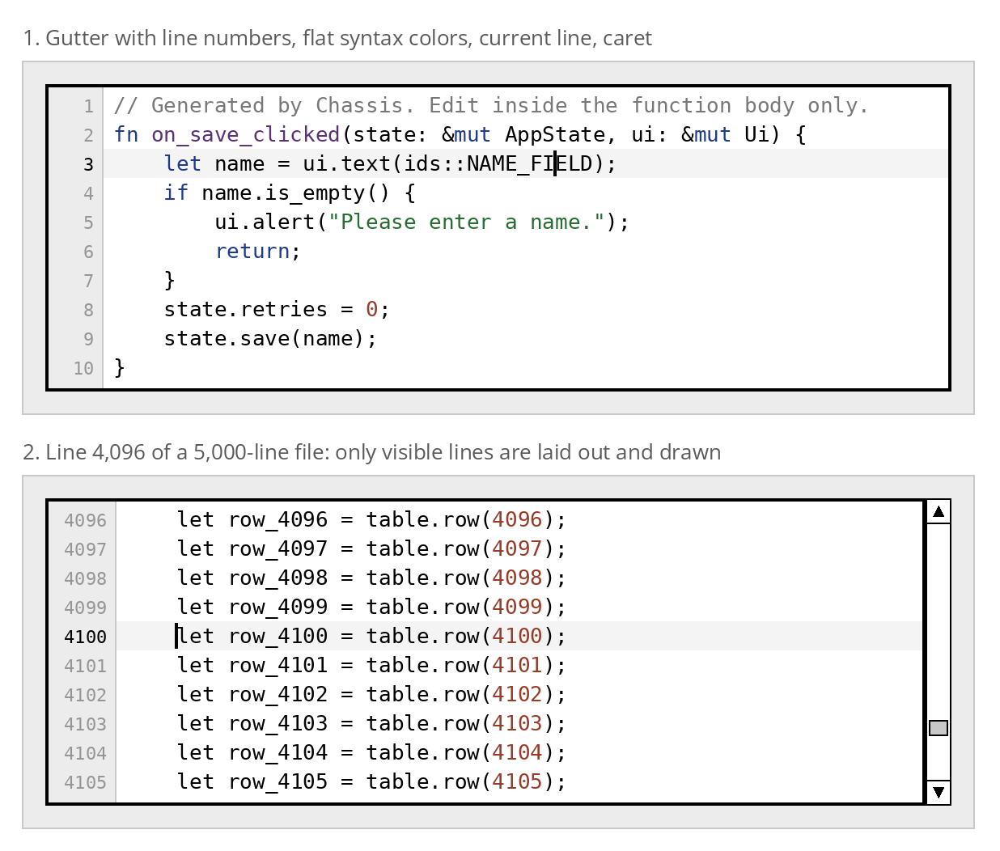
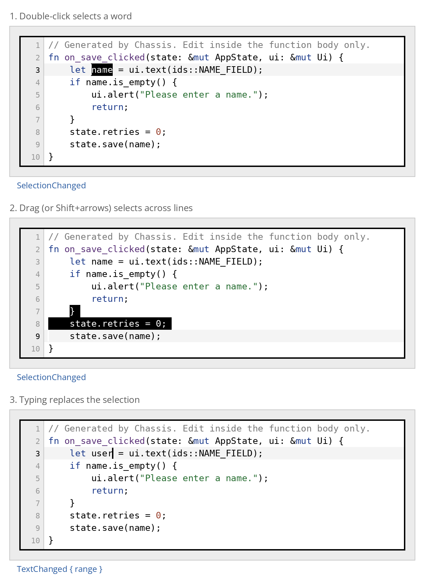
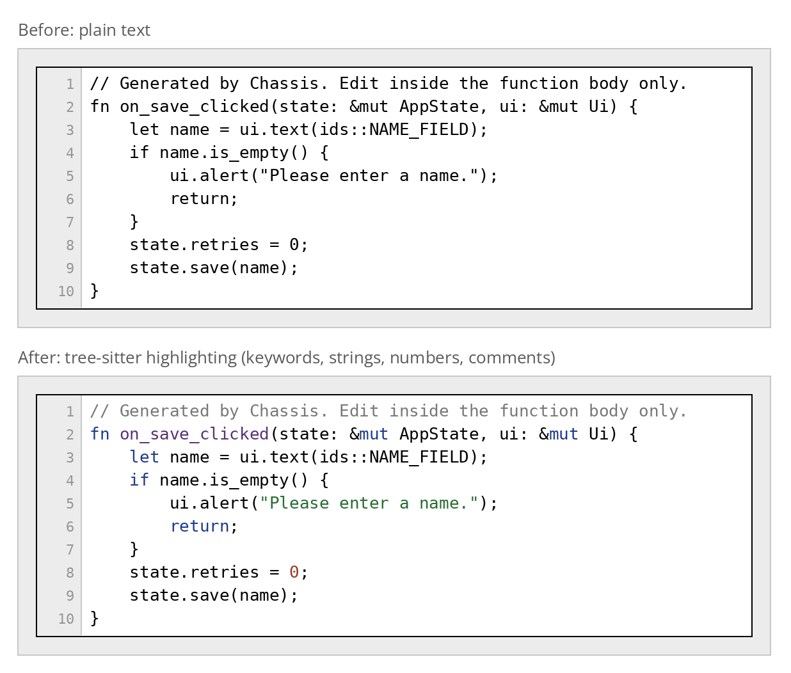
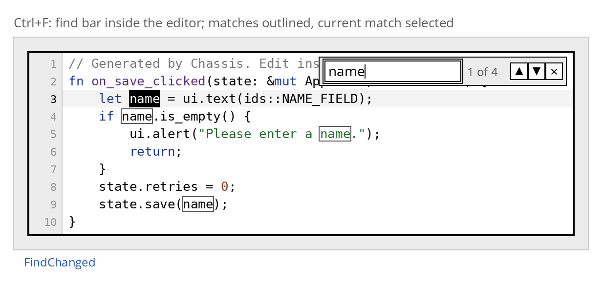
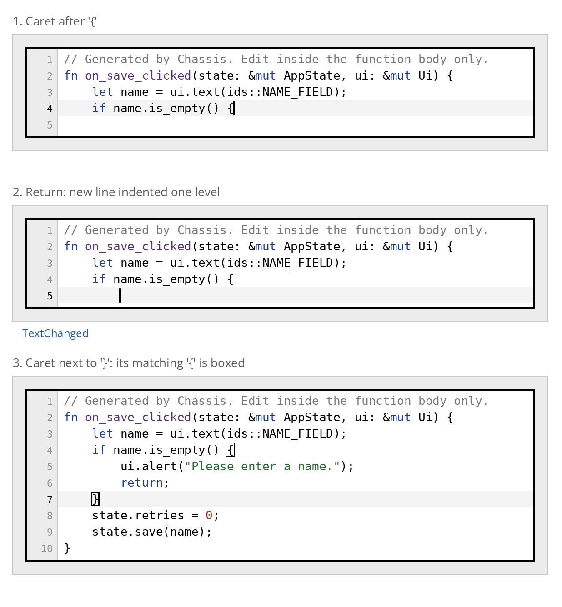
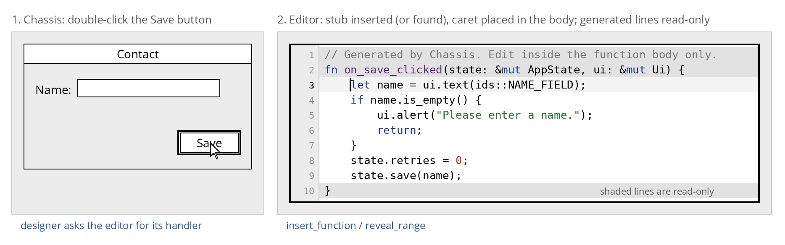

# Chassis code editor roadmap

> **Epic:** [#141](https://github.com/KenSuenobu/rust-pushrod/issues/141) · **Label:** `chassis` · **Overview:** [main roadmap](../ROADMAP_EXTENSIBLE_WIDGET_LIBRARY.md) · **Rules:** [design philosophy](../../DESIGN_PHILOSOPHY.md)

This file is the specification for these components: what they are, what they do, how they look, and how they respond. To change them, edit this file in a pull request (and the mockups in [`docs/mockups/generate.py`](../mockups/generate.py) if a picture changes), then bring the issues in line. If this file and an issue disagree, this file wins.

## Overview

Chassis, the visual form designer, works like the classic rapid-application-development IDEs: draw a form, double-click a control, and land in its event-handler stub to write code. That needs an embedded code editor, and none of the existing Rust code-editor components can be used in Pushrod: each is tied to its own toolkit's drawing and input.

A `chassis-code-editor` crate: a Pushrod widget library ([1.22](https://github.com/KenSuenobu/rust-pushrod/issues/131)) providing a `CodeEditor` widget with Tier 1 features only. **In scope:** a rope text buffer, cursors and selections, clipboard, undo and redo with typing grouped, line numbers, syntax highlighting (tree-sitter), scrolling that lays out and draws only visible lines, find, auto-indent, bracket matching, and an API that lets Chassis insert and navigate to generated code and protect it from edits. **Out of scope (Tier 2 and 3):** multiple cursors, folding, minimap, regex replace, language servers (completion, hover, diagnostics), diff view. It follows the design philosophy (flat, simple) and is usable by any Pushrod application, not only Chassis.

| Issue | Component | Summary |
|---|---|---|
| [#142](https://github.com/KenSuenobu/rust-pushrod/issues/142) (11.1) | Code editor crate and editing core | Create `chassis-code-editor` with its text buffer, cursor and selection model, and edit commands, independent of drawing. |
| [#143](https://github.com/KenSuenobu/rust-pushrod/issues/143) (11.2) | Code editor view: gutter, visible-line rendering, caret | The `CodeEditor` widget: draws line numbers, the visible lines, the current line, and the caret, and scrolls through files of any length. |
| [#144](https://github.com/KenSuenobu/rust-pushrod/issues/144) (11.3) | Code editor input: keyboard, mouse selection, clipboard, input methods | Editing with the keyboard and mouse the way users expect from a code editor. |
| [#145](https://github.com/KenSuenobu/rust-pushrod/issues/145) (11.4) | Code editor undo and redo | Undo and redo every edit, with consecutive typing grouped into one step. |
| [#146](https://github.com/KenSuenobu/rust-pushrod/issues/146) (11.5) | Code editor syntax highlighting with tree-sitter | Highlight code incrementally as it is edited, with a small, flat color scheme. |
| [#147](https://github.com/KenSuenobu/rust-pushrod/issues/147) (11.6) | Code editor find | A find bar inside the editor: type to search, step through matches. |
| [#148](https://github.com/KenSuenobu/rust-pushrod/issues/148) (11.7) | Code editor auto-indent and bracket matching | New lines keep and adjust indentation, and the bracket matching the one at the caret is boxed. |
| [#149](https://github.com/KenSuenobu/rust-pushrod/issues/149) (11.8) | Code editor API for the Chassis designer | Let Chassis insert, find, and protect generated code: double-click a control and land in its event handler. |
| [#150](https://github.com/KenSuenobu/rust-pushrod/issues/150) (11.9) | Code editor documentation, example, and tests | Document the code editor on the site, ship an example editor, and cover it with golden-image tests. |

## 11.1: Code editor crate and editing core

> **Issue:** [#142](https://github.com/KenSuenobu/rust-pushrod/issues/142) · **Size:** M · **User docs:** `pushrod-docs/docs/chassis/code-editor.md`

### What it is

Create `chassis-code-editor` with its text buffer, cursor and selection model, and edit commands, independent of drawing.

Every editor feature (typing, navigation, undo, find, Chassis's generated code) acts on the same text and selection. That core has to be correct and fast before anything is drawn.

*Ideas from:* The separation of editing core and view in Lapce (floem-editor-core) and cosmic-text. Names and behavior are Pushrod's own.

### What it does

A `Document` holding the text in a rope (`ropey`), so edits and line lookups stay fast on large files, plus a line index. A `Selection` (anchor and caret, in line/column and byte offsets, with the preferred column kept for vertical movement). Edits are `Transaction`s (a set of range replacements applied together), the single path for typing, paste, undo, and Chassis's programmatic edits. Commands: insert, delete backward/forward, move by character, word, line, page, and document, select variants of each. **Decision recorded in this issue:** build this small core directly on `ropey`, or adopt `floem-editor-core`; choose whichever keeps the dependency count and API smallest, and keep text layout in Parley ([1.18](https://github.com/KenSuenobu/rust-pushrod/issues/111)) either way. No drawing code: the core is unit-tested on its own.

### Acceptance criteria

- [ ] Edits, moves, and selections covered by unit tests, including multi-byte characters
- [ ] A 100,000-line file opens and edits without noticeable delay
- [ ] Core has no dependency on drawing or the backend

### Depends on

Requires [1.21](https://github.com/KenSuenobu/rust-pushrod/issues/130), [1.22](https://github.com/KenSuenobu/rust-pushrod/issues/131).

### Implementation notes

- **Modules:** `chassis-code-editor/ (new crate)`, `chassis-code-editor/src/buffer.rs (new)`, `chassis-code-editor/src/selection.rs (new)`, `chassis-code-editor/src/command.rs (new)`
- **Stack:** Rust

## 11.2: Code editor view: gutter, visible-line rendering, caret

> **Issue:** [#143](https://github.com/KenSuenobu/rust-pushrod/issues/143) · **Size:** L · **User docs:** `pushrod-docs/docs/chassis/code-editor.md`

### What it is

The `CodeEditor` widget: draws line numbers, the visible lines, the current line, and the caret, and scrolls through files of any length.

Redrawing a whole editor texture on every keystroke is wasteful, and laying out every line of a large file is slow. The editor has to lay out and draw only what is visible, and only what changed.

*Ideas from:* The text area of code editors generally; Monaco's virtualized rendering. Names and behavior are Pushrod's own.

### What it does

A `CodeEditor` widget hosted in a Container-style viewport ([5.3 Container](../widgets/container.md)) with vertical and horizontal scroll bars. A gutter shows line numbers (current line in black, others gray). Only visible lines are laid out (Parley, [1.18](https://github.com/KenSuenobu/rust-pushrod/issues/111)) and drawn with the glyph atlas ([1.7](https://github.com/KenSuenobu/rust-pushrod/issues/3)); each visible line is cached as its own texture ([1.20](https://github.com/KenSuenobu/rust-pushrod/issues/113)), so typing repaints one line, and scrolling reuses cached lines. The current line has a light band; the caret is a 2 px bar that blinks while focused (timer, [1.5](https://github.com/KenSuenobu/rust-pushrod/issues/21); no blinking in outline mode, [10.1](https://github.com/KenSuenobu/rust-pushrod/issues/105)). Monospace font from the font handles ([1.24](https://github.com/KenSuenobu/rust-pushrod/issues/137)); tab width configurable. **Parts ([5.2](https://github.com/KenSuenobu/rust-pushrod/issues/57)):** `gutter()`, `text_area()`, `scroll_bars()`.

### How it looks

Each image shows the widget step by step, drawn in Pushrod's current style; blue notes name the event emitted. Mockups come from [`docs/mockups/generate.py`](https://github.com/KenSuenobu/rust-pushrod/blob/main/docs/mockups/generate.py): edit a frame there and re-run it to change the design,.

**Gutter, syntax colors, current line, caret; a large file scrolled to line 4,096**

### How it responds

| Event emitted | When | Application callback |
|---|---|---|
| `ViewportChanged { id }` | Scrolled; read `first_visible_line()` | `on_event(..)` |

Like every widget, it can also receive application-defined custom events in `handle_event` and emit its own (1.13 (#78)).

### Acceptance criteria

- [ ] Smooth scrolling through a 5,000-line file
- [ ] Typing repaints only the edited line
- [ ] Sharp at 1x and 2x ([1.10](https://github.com/KenSuenobu/rust-pushrod/issues/25))
- [ ] Line numbers and current-line band as in the mockup

### Depends on

Requires [11.1](https://github.com/KenSuenobu/rust-pushrod/issues/142), [1.7](https://github.com/KenSuenobu/rust-pushrod/issues/3), [1.18](https://github.com/KenSuenobu/rust-pushrod/issues/111), [1.20](https://github.com/KenSuenobu/rust-pushrod/issues/113), [5.3 Container](../widgets/container.md), [1.10](https://github.com/KenSuenobu/rust-pushrod/issues/25), [1.24](https://github.com/KenSuenobu/rust-pushrod/issues/137).

### Implementation notes

- **Modules:** `chassis-code-editor/src/view.rs (new)`, `chassis-code-editor/src/gutter.rs (new)`
- **Stack:** Rust

## 11.3: Code editor input: keyboard, mouse selection, clipboard, input methods

> **Issue:** [#144](https://github.com/KenSuenobu/rust-pushrod/issues/144) · **Size:** M · **User docs:** `pushrod-docs/docs/chassis/code-editor.md`

### What it is

Editing with the keyboard and mouse the way users expect from a code editor.

An editor is only usable if every standard key and mouse gesture works exactly as users expect.

### What it does

Keys: arrows, Home/End (Home toggles between first non-blank and column 0), Page Up/Down, Ctrl+Home/End, Ctrl+Left/Right by word; Shift extends the selection; Tab/Shift+Tab indent and outdent selected lines; Ctrl+A, X, C, V, Z, Y through actions and shortcuts ([9.5](https://github.com/KenSuenobu/rust-pushrod/issues/97)). Mouse: click places the caret, double-click selects a word, triple-click a line, drag selects, Shift+click extends, wheel scrolls ([9.4](https://github.com/KenSuenobu/rust-pushrod/issues/96)). Clipboard through the backend ([10.6](https://github.com/KenSuenobu/rust-pushrod/issues/134)). Input-method composition shown inline ([1.19](https://github.com/KenSuenobu/rust-pushrod/issues/112)). Every change is a transaction ([11.1](https://github.com/KenSuenobu/rust-pushrod/issues/142)) and emits `TextChanged` with its range.

### How it looks

Each image shows the widget step by step, drawn in Pushrod's current style; blue notes name the event emitted. Mockups come from [`docs/mockups/generate.py`](https://github.com/KenSuenobu/rust-pushrod/blob/main/docs/mockups/generate.py): edit a frame there and re-run it to change the design,.

**Double-click selects a word, drag selects lines, typing replaces the selection**

### How it responds

| Event emitted | When | Application callback |
|---|---|---|
| `SelectionChanged { id }` | The caret or selection moved | `on_event(..)` |
| `TextChanged { id, range }` | Text was edited | `on_text_change(id, ..)` |

Like every widget, it can also receive application-defined custom events in `handle_event` and emit its own (1.13 (#78)).

### Acceptance criteria

- [ ] Every listed key and gesture works
- [ ] Composition text from an input method appears inline
- [ ] `TextChanged` and `SelectionChanged` carry the changed range

### Depends on

Requires [11.2](https://github.com/KenSuenobu/rust-pushrod/issues/143), [1.4](https://github.com/KenSuenobu/rust-pushrod/issues/20), [1.19](https://github.com/KenSuenobu/rust-pushrod/issues/112), [9.4](https://github.com/KenSuenobu/rust-pushrod/issues/96), [9.5](https://github.com/KenSuenobu/rust-pushrod/issues/97).

### Implementation notes

- **Modules:** `chassis-code-editor/src/input.rs (new)`
- **Stack:** Rust

## 11.4: Code editor undo and redo

> **Issue:** [#145](https://github.com/KenSuenobu/rust-pushrod/issues/145) · **Size:** S · **User docs:** `pushrod-docs/docs/chassis/code-editor.md`

### What it is

Undo and redo every edit, with consecutive typing grouped into one step.

Undoing one character at a time is tedious, and undo must also cover Chassis's generated edits so a designer action can be reversed.

### What it does

Undo history of transactions ([11.1](https://github.com/KenSuenobu/rust-pushrod/issues/142)) built on the core undo stack ([1.15](https://github.com/KenSuenobu/rust-pushrod/issues/81)). Consecutive typing groups into one step; a pause, cursor jump, deletion, paste, or programmatic edit starts a new step. Undo restores the selection as it was. Programmatic edits from Chassis ([11.8](https://github.com/KenSuenobu/rust-pushrod/issues/149)) can be grouped with the designer change that caused them, so one undo reverts both.

### Acceptance criteria

- [ ] Typing a word and undoing removes the whole word
- [ ] Undo restores the previous selection
- [ ] Chassis edits undo as one step

### Depends on

Requires [11.1](https://github.com/KenSuenobu/rust-pushrod/issues/142), [1.15](https://github.com/KenSuenobu/rust-pushrod/issues/81).

### Implementation notes

- **Modules:** `chassis-code-editor/src/history.rs (new)`
- **Stack:** Rust

## 11.5: Code editor syntax highlighting with tree-sitter

> **Issue:** [#146](https://github.com/KenSuenobu/rust-pushrod/issues/146) · **Size:** M · **User docs:** `pushrod-docs/docs/chassis/code-editor.md`

### What it is

Highlight code incrementally as it is edited, with a small, flat color scheme.

Highlighting has to stay correct while typing and must not re-parse the whole file on each keystroke.

*Ideas from:* Incremental parsing in tree-sitter-based editors. Names and behavior are Pushrod's own.

### What it does

Parse with tree-sitter and update the parse tree incrementally from each transaction; map highlight captures (keyword, string, number, comment, function, type) to a small set of flat text colors in a `HighlightTheme`. Only visible lines are styled. Languages are registered with `register_language(name, grammar, highlights_query)`; Rust is built in (it's the language Chassis generates). Plain text when no language is set.

### How it looks

Each image shows the widget step by step, drawn in Pushrod's current style; blue notes name the event emitted. Mockups come from [`docs/mockups/generate.py`](https://github.com/KenSuenobu/rust-pushrod/blob/main/docs/mockups/generate.py): edit a frame there and re-run it to change the design,.

**Before and after highlighting**

### Acceptance criteria

- [ ] Highlighting stays correct while typing inside strings and comments
- [ ] Editing re-parses incrementally, not the whole file
- [ ] Rust highlighted out of the box; other languages registrable

### Depends on

Requires [11.2](https://github.com/KenSuenobu/rust-pushrod/issues/143).

### Implementation notes

- **Modules:** `chassis-code-editor/src/highlight.rs (new)`
- **Stack:** Rust

## 11.6: Code editor find

> **Issue:** [#147](https://github.com/KenSuenobu/rust-pushrod/issues/147) · **Size:** S · **User docs:** `pushrod-docs/docs/chassis/code-editor.md`

### What it is

A find bar inside the editor: type to search, step through matches.

Finding text is the one navigation feature everyone uses, even in small files.

### What it does

Ctrl+F opens a find bar in the editor's upper right: a text field ([2.6 Text Field](../widgets/text-field.md)) with the search text, a match count ("1 of 4"), previous/next glyph buttons ([2.2 Glyph Button](../widgets/glyph-button.md)), and a close button. Matches are outlined; the current one is selected and scrolled into view. Return/Shift+Return and F3/Shift+F3 step through matches; Escape closes. Options: match case and whole word. (Regex and replace are Tier 2.) Searching runs on the rope without blocking typing.

### How it looks

Each image shows the widget step by step, drawn in Pushrod's current style; blue notes name the event emitted. Mockups come from [`docs/mockups/generate.py`](https://github.com/KenSuenobu/rust-pushrod/blob/main/docs/mockups/generate.py): edit a frame there and re-run it to change the design,.

**Find bar with four matches, the first selected**

### How it responds

| Event emitted | When | Application callback |
|---|---|---|
| `FindChanged { id, matches }` | Search text or options changed | `on_event(..)` |

Like every widget, it can also receive application-defined custom events in `handle_event` and emit its own (1.13 (#78)).

### Acceptance criteria

- [ ] Matches update as the search text changes
- [ ] Stepping wraps around the file
- [ ] Escape returns focus to the editor at the current match

### Depends on

Requires [11.3](https://github.com/KenSuenobu/rust-pushrod/issues/144), [2.6 Text Field](../widgets/text-field.md), [2.2 Glyph Button](../widgets/glyph-button.md).

### Implementation notes

- **Modules:** `chassis-code-editor/src/find.rs (new)`
- **Stack:** Rust

## 11.7: Code editor auto-indent and bracket matching

> **Issue:** [#148](https://github.com/KenSuenobu/rust-pushrod/issues/148) · **Size:** S · **User docs:** `pushrod-docs/docs/chassis/code-editor.md`

### What it is

New lines keep and adjust indentation, and the bracket matching the one at the caret is boxed.

Without auto-indent, every new line in a code block has to be indented by hand.

### What it does

Return copies the current line's indentation, adding one level after an opening bracket and removing one when a closing bracket is typed at the start of a line. Indent unit (spaces or tab, width) per document. When the caret is next to a bracket, it and its partner are outlined with a 1 px box; brackets inside strings and comments are ignored (using the parse tree, [11.5](https://github.com/KenSuenobu/rust-pushrod/issues/146)).

### How it looks

Each image shows the widget step by step, drawn in Pushrod's current style; blue notes name the event emitted. Mockups come from [`docs/mockups/generate.py`](https://github.com/KenSuenobu/rust-pushrod/blob/main/docs/mockups/generate.py): edit a frame there and re-run it to change the design,.

**Return after '{' indents; the bracket matching the caret is boxed**

### Acceptance criteria

- [ ] Return after '{' indents one level
- [ ] Typing '}' on a blank line outdents it
- [ ] Matching brackets boxed; brackets in strings ignored

### Depends on

Requires [11.3](https://github.com/KenSuenobu/rust-pushrod/issues/144), [11.5](https://github.com/KenSuenobu/rust-pushrod/issues/146).

### Implementation notes

- **Modules:** `chassis-code-editor/src/indent.rs (new)`
- **Stack:** Rust

## 11.8: Code editor API for the Chassis designer

> **Issue:** [#149](https://github.com/KenSuenobu/rust-pushrod/issues/149) · **Size:** M · **User docs:** `pushrod-docs/docs/chassis/code-editor-api.md`

### What it is

Let Chassis insert, find, and protect generated code: double-click a control and land in its event handler.

The designer and the code have to stay in step: creating a control's handler, jumping to it, renaming it when the control's ID changes, and keeping generated code from being broken by hand edits.

*Ideas from:* Rapid-application-development IDEs, where double-clicking a control opens its event handler. Names and behavior are Pushrod's own.

### What it does

**Edits:** `insert_text`, `replace_range`, and `insert_function(after: Anchor, text)` as transactions ([11.4](https://github.com/KenSuenobu/rust-pushrod/issues/145)), so they undo cleanly. **Finding code:** `find_function(name) -> Option<Range>` using the parse tree ([11.5](https://github.com/KenSuenobu/rust-pushrod/issues/146)), so Chassis can tell whether `on_save_clicked` already exists. **Navigation:** `reveal_range`, `select_range`, `set_caret`, and `focus()`. **Guarded ranges:** `add_guarded_range(range) -> GuardId`, read-only regions (drawn with a light gray band) for generated signatures and comments; edits inside them are refused and emit `GuardedEditBlocked`. Guarded ranges move with the text as it is edited. **Decorations:** highlight ranges and gutter markers, for showing which handlers belong to the selected control. The API is generic (no Chassis types), so other tools can use it too.

### How it looks

Each image shows the widget step by step, drawn in Pushrod's current style; blue notes name the event emitted. Mockups come from [`docs/mockups/generate.py`](https://github.com/KenSuenobu/rust-pushrod/blob/main/docs/mockups/generate.py): edit a frame there and re-run it to change the design,.

**Double-click the Save button in the designer; the editor shows its handler, generated lines read-only**

### How it responds

| Event emitted | When | Application callback |
|---|---|---|
| `GuardedEditBlocked { id, range }` | An edit inside a guarded range was refused | `on_event(..)` |
| `TextChanged { id, range }` | Any edit, including programmatic ones | `on_text_change(id, ..)` |

Like every widget, it can also receive application-defined custom events in `handle_event` and emit its own (1.13 (#78)).

### Acceptance criteria

- [ ] Double-click flow from the mockup works end to end in an example
- [ ] Guarded ranges refuse edits and track surrounding edits
- [ ] Generated insertions undo as one step

### Depends on

Requires [11.4](https://github.com/KenSuenobu/rust-pushrod/issues/145), [11.5](https://github.com/KenSuenobu/rust-pushrod/issues/146). Pairs with [6.9](https://github.com/KenSuenobu/rust-pushrod/issues/68) (Chassis design-mode hooks).

### Implementation notes

- **Modules:** `chassis-code-editor/src/api.rs (new)`
- **Stack:** Rust

## 11.9: Code editor documentation, example, and tests

> **Issue:** [#150](https://github.com/KenSuenobu/rust-pushrod/issues/150) · **Size:** S · **User docs:** `pushrod-docs/docs/chassis/code-editor.md`

### What it is

Document the code editor on the site, ship an example editor, and cover it with golden-image tests.

The editor is a large component; contributors and Chassis need it documented and protected against regressions.

### What it does

A **Chassis** group on the documentation site with the Code editor overview (features, keyboard reference, adding a language) and Code editor API pages. An example application (`examples/editor.rs`): open, edit, and save a file with fictional sample content. Golden-image tests for the mockup states, and benchmarks for opening and scrolling a 100,000-line file ([7.7](https://github.com/KenSuenobu/rust-pushrod/issues/115)).

### Acceptance criteria

- [ ] Docs pages published with screenshots from the example
- [ ] Golden images for each mockup state
- [ ] Benchmarks in CI

### Depends on

Requires [11.6](https://github.com/KenSuenobu/rust-pushrod/issues/147), [11.7](https://github.com/KenSuenobu/rust-pushrod/issues/148), [11.8](https://github.com/KenSuenobu/rust-pushrod/issues/149), [7.2](https://github.com/KenSuenobu/rust-pushrod/issues/70).

### Implementation notes

- **Modules:** `chassis-code-editor/examples/editor.rs (new)`, `chassis-code-editor/tests/ (new)`, `pushrod-docs/docs/chassis/ (new)`
- **Stack:** Rust

Drawn flat, in the standard Pushrod style: no bevels, gradients, shadows, glass, or rounded corners. Syntax colors are a few muted text colors.
