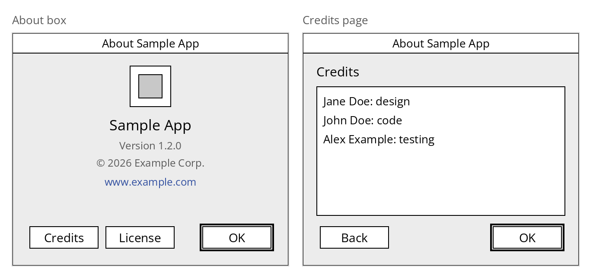

# About dialog: widget roadmap

> **Issue:** 6.6 (extra-widgets 6.6) · **Epic 6:** Dialogs and assistants · **Milestone:** Extra widgets 3: specialized views and assistants · **Size:** S
> **Crate:** `pushrod-extra-widgets` · **User docs:** `pushrod-docs/docs/extra-widgets/about-dialog.md` · **Overview:** [extra widgets roadmap](../ROADMAP_EXTRA_WIDGETS.md) · **Rules:** [design philosophy](../../DESIGN_PHILOSOPHY.md)

This file is the specification for this widget: what it is, what it does, how it looks, and how it responds. To change it, edit this file in a pull request (and its mockup in [`docs/mockups/generate_extra_widgets.py`](../mockups/generate_extra_widgets.py) if the picture changes), then bring the issue in line. If this file and the issue disagree, this file wins.

## What it is

The application's icon, name, version, copyright, website, and credits and license pages.

Every application needs an About box, and the information is always the same.

*Ideas from:* GTK GtkAboutDialog, KDE's About dialog, the macOS standard about panel, Qt's about box, the Atari and Amiga "About" requesters. Names and behavior are Pushrod's own.

## What it does

`AboutDialog { icon, name, version, copyright, website, credits, license }`: icon and name centered, version and copyright below, the website as a link label (Pushrod 2.22), and Credits and License buttons that switch to scrolling text pages (Pushrod 2.18). Values can come from `Cargo.toml` with a `from_cargo!()` macro. Sample data in examples uses fictional placeholders.

## How it looks

Each image shows the widget step by step; blue notes name the event emitted.

Drawn flat, in the standard Pushrod style: fills, one-pixel borders, and text; inverted when pressed or selected, dithered when disabled, a dotted outline when focused. No bevels, gradients, shadows, glass, or rounded corners.

## How it responds

### Events and callbacks

| Event emitted | When | Application callback |
|---|---|---|
| (none) | Closed with OK or Escape | None |

Like every Pushrod widget, it can also receive application-defined custom events in `handle_event` and emit its own (Pushrod 1.13), and every internal action emits an engine event (Pushrod 9.10).

### Shared behavior

Like every Pushrod widget, it gets these from the core rather than implementing them itself:

- behavior flags and visual states ([Pushrod 1.1](https://github.com/KenSuenobu/rust-pushrod/issues/19))
- per-state appearance ([Pushrod 1.17](https://github.com/KenSuenobu/rust-pushrod/issues/104))
- keyboard focus, Tab order, Return/Escape ([Pushrod 1.4](https://github.com/KenSuenobu/rust-pushrod/issues/20))
- callbacks registered by widget ID ([Pushrod 1.6](https://github.com/KenSuenobu/rust-pushrod/issues/22))
- custom application events with payloads ([Pushrod 1.13](https://github.com/KenSuenobu/rust-pushrod/issues/78))
- composite parts the application can retrieve and modify ([Pushrod 5.2](https://github.com/KenSuenobu/rust-pushrod/issues/57))
- engine events for every internal action ([Pushrod 9.10](https://github.com/KenSuenobu/rust-pushrod/issues/109))

## Acceptance criteria

- [ ] Icon, name, version, copyright, and website
- [ ] Credits and license pages
- [ ] Values from Cargo metadata
- [ ] Registered as `extra.about_dialog` and shown in the gallery (1.2)

## Depends on

Extra widgets: 1.1; Pushrod: Pushrod 6.7 [#66](https://github.com/KenSuenobu/rust-pushrod/issues/66) Modal dialogs: run a form until a dismissing control is chosen, Pushrod 2.7 [#33](https://github.com/KenSuenobu/rust-pushrod/issues/33) Image widget, Pushrod 2.22 [#126](https://github.com/KenSuenobu/rust-pushrod/issues/126) Link label, Pushrod 2.18 [#87](https://github.com/KenSuenobu/rust-pushrod/issues/87) Multi-line text area

## Implementation notes

- **Crate:** `pushrod-extra-widgets`, using only the public APIs of `pushrod` and `pushrod-widgets`. Anything missing from the core is added to the core first.
- **Modules:** `pushrod-extra-widgets/src/about_dialog.rs (new)`, `pushrod-docs`
- **Drawing:** paints into its own GPU texture only when invalidated; frames are composed by blitting. No OS-native controls; no per-frame CPU pixel work.
- **Documentation:** full doc headers on every non-private item, and the user page in the same pull request.

