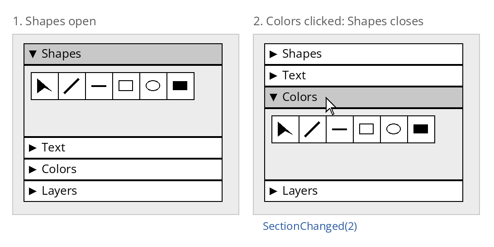

# Accordion (one section open at a time): widget roadmap

> **Issue:** [#265](https://github.com/KenSuenobu/rust-pushrod/issues/265) (extra-widgets 5.2) · **Epic 5:** Panels and navigation · **Milestone:** Extra widgets 2: everyday controls and pickers · **Size:** S
> **Crate:** `pushrod-extra-widgets` · **User docs:** `pushrod-docs/docs/extra-widgets/accordion.md` · **Overview:** [extra widgets roadmap](../ROADMAP_EXTRA_WIDGETS.md) · **Rules:** [design philosophy](../../DESIGN_PHILOSOPHY.md)

This file is the specification for this widget: what it is, what it does, how it looks, and how it responds. To change it, edit this file in a pull request (and its mockup in [`docs/mockups/generate_extra_widgets.py`](../mockups/generate_extra_widgets.py) if the picture changes), then bring the issue in line. If this file and the issue disagree, this file wins.

## What it is

A stack of titled sections where opening one closes the others.

Tool boxes and option panels with many sections fit in a narrow column when only one section is open at a time.

*Ideas from:* Qt QToolBox, Delphi TCategoryPanelGroup, MUI register-style groups, the side panels of many design tools. Names and behavior are Pushrod's own.

## What it does

`Accordion { sections }`: expanders (Pushrod 3.10) in a column layout (Pushrod 5.6) where opening a section collapses the open one (or, with `multiple(true)`, behaves like independent expanders). The open section fills the remaining height and scrolls its content. Keyboard: Up/Down between headers, Space or Return opens.

## How it looks

Each image shows the widget step by step; blue notes name the event emitted.

Drawn flat, in the standard Pushrod style: fills, one-pixel borders, and text; inverted when pressed or selected, dithered when disabled, a dotted outline when focused. No bevels, gradients, shadows, glass, or rounded corners.

## How it responds

### Events and callbacks

| Event emitted | When | Application callback |
|---|---|---|
| `SectionChanged { id, index }` | A section opened | `on_section_change(id, ..)` |

Like every Pushrod widget, it can also receive application-defined custom events in `handle_event` and emit its own (Pushrod 1.13), and every internal action emits an engine event (Pushrod 9.10).

### Shared behavior

Like every Pushrod widget, it gets these from the core rather than implementing them itself:

- behavior flags and visual states ([Pushrod 1.1](https://github.com/KenSuenobu/rust-pushrod/issues/19))
- per-state appearance ([Pushrod 1.17](https://github.com/KenSuenobu/rust-pushrod/issues/104))
- keyboard focus, Tab order, Return/Escape ([Pushrod 1.4](https://github.com/KenSuenobu/rust-pushrod/issues/20))
- callbacks registered by widget ID ([Pushrod 1.6](https://github.com/KenSuenobu/rust-pushrod/issues/22))
- custom application events with payloads ([Pushrod 1.13](https://github.com/KenSuenobu/rust-pushrod/issues/78))
- composite parts the application can retrieve and modify ([Pushrod 5.2](https://github.com/KenSuenobu/rust-pushrod/issues/57))
- engine events for every internal action ([Pushrod 9.10](https://github.com/KenSuenobu/rust-pushrod/issues/109))

## Acceptance criteria

- [ ] Opening one closes the others (or multiple mode)
- [ ] Open section fills the height
- [ ] Keyboard navigation between headers
- [ ] Registered as `extra.accordion` with a page in the Pushrod Showcase (1.2)

## Depends on

Extra widgets: 1.1 ([#252](https://github.com/KenSuenobu/rust-pushrod/issues/252)); Pushrod: Pushrod 3.10 [#90](https://github.com/KenSuenobu/rust-pushrod/issues/90) Expander (collapsible section), Pushrod 5.6 [#117](https://github.com/KenSuenobu/rust-pushrod/issues/117) Row and column layouts

## Implementation notes

- **Crate:** `pushrod-extra-widgets`, using only the public APIs of `pushrod` and `pushrod-widgets`. Anything missing from the core is added to the core first.
- **Modules:** `pushrod-extra-widgets/src/accordion.rs (new)`, `pushrod-docs`
- **Drawing:** paints into its own GPU texture only when invalidated; frames are composed by blitting. No OS-native controls; no per-frame CPU pixel work.
- **Documentation:** full doc headers on every non-private item, and the user page in the same pull request.

