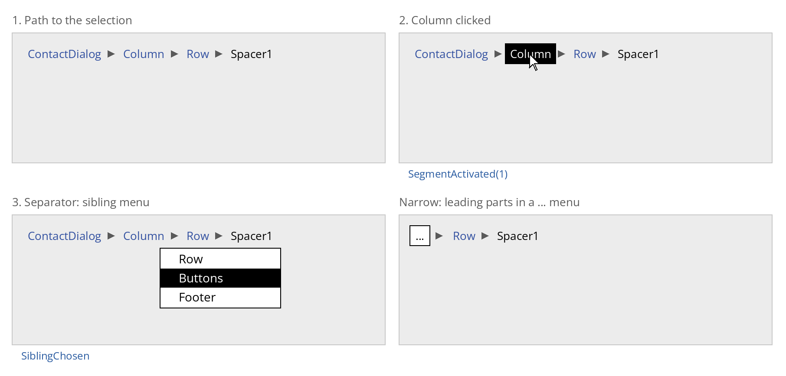

# Breadcrumb bar (path control): widget roadmap

> **Issue:** [#256](https://github.com/KenSuenobu/rust-pushrod/issues/256) (extra-widgets 4.9) · **Epic 4:** Data views · **Milestone:** Extra widgets 1: crate and Chassis widgets · **Size:** S
> **Crate:** `pushrod-extra-widgets` · **User docs:** `pushrod-docs/docs/extra-widgets/breadcrumb-bar.md` · **Overview:** [extra widgets roadmap](../ROADMAP_EXTRA_WIDGETS.md) · **Rules:** [design philosophy](../../DESIGN_PHILOSOPHY.md)

This file is the specification for this widget: what it is, what it does, how it looks, and how it responds. To change it, edit this file in a pull request (and its mockup in [`docs/mockups/generate_extra_widgets.py`](../mockups/generate_extra_widgets.py) if the picture changes), then bring the issue in line. If this file and the issue disagree, this file wins.

## What it is

A row of clickable path segments, with a menu of siblings on each separator.

Chassis's designer shows where the selection sits inside nested layouts; file managers, settings pages, and document outlines show a path the same way. Clicking a segment goes there.

*Ideas from:* macOS NSPathControl, KDE KUrlNavigator, the GTK file chooser's path bar, Windows Explorer's address bar. Names and behavior are Pushrod's own.

## What it does

`BreadcrumbBar { segments }`: segments as flat text buttons separated by right-arrow glyphs; the last is the current location (not a link). Clicking a segment emits its index; clicking a separator opens a menu (Pushrod 2.11) of that level's other items. When the path doesn't fit, leading segments collapse into a "…" menu. Keyboard: Left/Right move, Return activates.

## How it looks

Each image shows the widget step by step; blue notes name the event emitted.

Drawn flat, in the standard Pushrod style: fills, one-pixel borders, and text; inverted when pressed or selected, dithered when disabled, a dotted outline when focused. No bevels, gradients, shadows, glass, or rounded corners.

## How it responds

### Events and callbacks

| Event emitted | When | Application callback |
|---|---|---|
| `SegmentActivated { id, index }` | Segment clicked | `on_segment_activate(id, ..)` |
| `SiblingChosen { id, level, item }` | Item chosen from a separator menu | `on_sibling_choose(id, ..)` |

Like every Pushrod widget, it can also receive application-defined custom events in `handle_event` and emit its own (Pushrod 1.13), and every internal action emits an engine event (Pushrod 9.10).

### Shared behavior

Like every Pushrod widget, it gets these from the core rather than implementing them itself:

- behavior flags and visual states ([Pushrod 1.1](https://github.com/KenSuenobu/rust-pushrod/issues/19))
- per-state appearance ([Pushrod 1.17](https://github.com/KenSuenobu/rust-pushrod/issues/104))
- keyboard focus, Tab order, Return/Escape ([Pushrod 1.4](https://github.com/KenSuenobu/rust-pushrod/issues/20))
- callbacks registered by widget ID ([Pushrod 1.6](https://github.com/KenSuenobu/rust-pushrod/issues/22))
- custom application events with payloads ([Pushrod 1.13](https://github.com/KenSuenobu/rust-pushrod/issues/78))
- composite parts the application can retrieve and modify ([Pushrod 5.2](https://github.com/KenSuenobu/rust-pushrod/issues/57))
- engine events for every internal action ([Pushrod 9.10](https://github.com/KenSuenobu/rust-pushrod/issues/109))

## Acceptance criteria

- [ ] Clickable segments and sibling menus
- [ ] Overflow collapses into a menu
- [ ] Keyboard navigation
- [ ] Registered as `extra.breadcrumb_bar` with a page in the Pushrod Showcase (1.2)

## Depends on

Extra widgets: 1.1 ([#252](https://github.com/KenSuenobu/rust-pushrod/issues/252)); Pushrod: Pushrod 2.3 [#29](https://github.com/KenSuenobu/rust-pushrod/issues/29) Button behaviors: default, cancel, toggle, activate-on-press, dismiss dialog, Pushrod 2.11 [#37](https://github.com/KenSuenobu/rust-pushrod/issues/37) Menu bar and drop-down menus (drawn by Pushrod), Pushrod 1.18 [#111](https://github.com/KenSuenobu/rust-pushrod/issues/111) Text layout engine: Parley for shaping, bidi, line breaking, and font fallback (with an SDL2 compatibility gate)

## Used by Chassis

Chassis 3.8 [#185](https://github.com/KenSuenobu/rust-pushrod/issues/185) Layout managers in the designer.

## Implementation notes

- **Crate:** `pushrod-extra-widgets`, using only the public APIs of `pushrod` and `pushrod-widgets`. Anything missing from the core is added to the core first.
- **Modules:** `pushrod-extra-widgets/src/breadcrumb_bar.rs (new)`, `pushrod-docs`
- **Drawing:** paints into its own GPU texture only when invalidated; frames are composed by blitting. No OS-native controls; no per-frame CPU pixel work.
- **Documentation:** full doc headers on every non-private item, and the user page in the same pull request.

