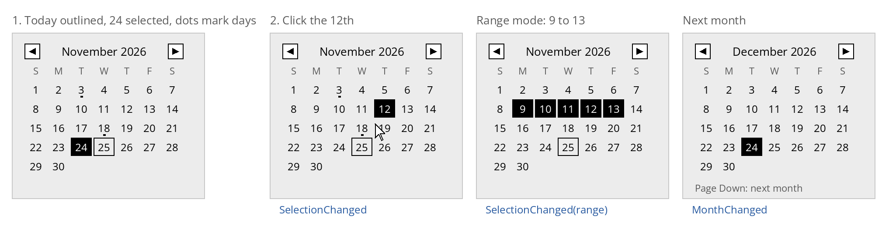

# Calendar (month view): widget roadmap

> **Issue:** 3.1 (extra-widgets 3.1) · **Epic 3:** Pickers and special fields · **Milestone:** Extra widgets 2: everyday controls and pickers · **Size:** M
> **Crate:** `pushrod-extra-widgets` · **User docs:** `pushrod-docs/docs/extra-widgets/calendar.md` · **Overview:** [extra widgets roadmap](../ROADMAP_EXTRA_WIDGETS.md) · **Rules:** [design philosophy](../../DESIGN_PHILOSOPHY.md)

This file is the specification for this widget: what it is, what it does, how it looks, and how it responds. To change it, edit this file in a pull request (and its mockup in [`docs/mockups/generate_extra_widgets.py`](../mockups/generate_extra_widgets.py) if the picture changes), then bring the issue in line. If this file and the issue disagree, this file wins.

## What it is

A month grid for choosing a day or a range of days, usable on its own or in the date picker.

Scheduling and booking screens show a month calendar in the window, not only behind a date field. Splitting it out of the date picker lets both use it.

*Ideas from:* GTK GtkCalendar, Qt QCalendarWidget, KDE KDatePicker, AmigaOS datebrowser.gadget, macOS graphical NSDatePicker, Win32 month calendar control. Names and behavior are Pushrod's own.

## What it does

`Calendar { month, selection, mode, first_weekday, min, max }`: a month title with previous/next glyph buttons, weekday headings, and a 6 x 7 day grid. Today is outlined; the selection is inverted. `mode` is `Single` or `Range` (click a start, then shift-click or click an end). Days outside `min`/`max` are dithered. Arrow keys move by day, Page Up/Down by month; marked days (`marks`) get a dot under the number.

## How it looks

Each image shows the widget step by step; blue notes name the event emitted.

Drawn flat, in the standard Pushrod style: fills, one-pixel borders, and text; inverted when pressed or selected, dithered when disabled, a dotted outline when focused. No bevels, gradients, shadows, glass, or rounded corners.

## How it responds

### Events and callbacks

| Event emitted | When | Application callback |
|---|---|---|
| `SelectionChanged { id, date }` | Day or range chosen | `on_selection_change(id, ..)` |
| `MonthChanged { id, month }` | Month changed | `on_month_change(id, ..)` |

Like every Pushrod widget, it can also receive application-defined custom events in `handle_event` and emit its own (Pushrod 1.13), and every internal action emits an engine event (Pushrod 9.10).

### Shared behavior

Like every Pushrod widget, it gets these from the core rather than implementing them itself:

- behavior flags and visual states ([Pushrod 1.1](https://github.com/KenSuenobu/rust-pushrod/issues/19))
- per-state appearance ([Pushrod 1.17](https://github.com/KenSuenobu/rust-pushrod/issues/104))
- keyboard focus, Tab order, Return/Escape ([Pushrod 1.4](https://github.com/KenSuenobu/rust-pushrod/issues/20))
- callbacks registered by widget ID ([Pushrod 1.6](https://github.com/KenSuenobu/rust-pushrod/issues/22))
- custom application events with payloads ([Pushrod 1.13](https://github.com/KenSuenobu/rust-pushrod/issues/78))
- composite parts the application can retrieve and modify ([Pushrod 5.2](https://github.com/KenSuenobu/rust-pushrod/issues/57))
- engine events for every internal action ([Pushrod 9.10](https://github.com/KenSuenobu/rust-pushrod/issues/109))

## Acceptance criteria

- [ ] Single and range selection
- [ ] Min/max limits and marked days
- [ ] Keyboard navigation by day and month
- [ ] Registered as `extra.calendar` and shown in the gallery (1.2)

## Depends on

Extra widgets: 1.1; Pushrod: Pushrod 2.2 [#28](https://github.com/KenSuenobu/rust-pushrod/issues/28) Glyph button (small single-character button), Pushrod 9.4 [#96](https://github.com/KenSuenobu/rust-pushrod/issues/96) Reusable input controllers: click, drag, scroll, hover, long-press, key, Pushrod 1.4 [#20](https://github.com/KenSuenobu/rust-pushrod/issues/20) Keyboard focus, Tab order, and Return/Escape

## Implementation notes

- **Crate:** `pushrod-extra-widgets`, using only the public APIs of `pushrod` and `pushrod-widgets`. Anything missing from the core is added to the core first.
- **Modules:** `pushrod-extra-widgets/src/calendar.rs (new)`, `pushrod-docs`
- **Drawing:** paints into its own GPU texture only when invalidated; frames are composed by blitting. No OS-native controls; no per-frame CPU pixel work.
- **Documentation:** full doc headers on every non-private item, and the user page in the same pull request.

