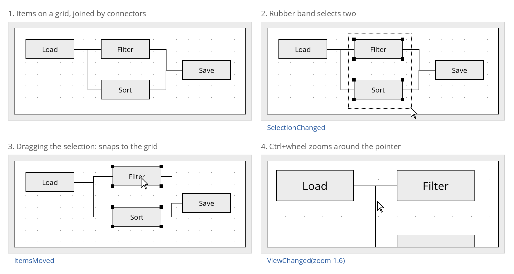

# Canvas view (zoomable surface of items): widget roadmap

> **Issue:** [#304](https://github.com/KenSuenobu/rust-pushrod/issues/304) (extra-widgets 4.14) · **Epic 4:** Data views · **Milestone:** Extra widgets 1: crate and Chassis widgets · **Size:** L
> **Crate:** `pushrod-extra-widgets` · **User docs:** `pushrod-docs/docs/extra-widgets/canvas-view.md` · **Overview:** [extra widgets roadmap](../ROADMAP_EXTRA_WIDGETS.md) · **Rules:** [design philosophy](../../DESIGN_PHILOSOPHY.md)

This file is the specification for this widget: what it is, what it does, how it looks, and how it responds. To change it, edit this file in a pull request (and its mockup in [`docs/mockups/generate_extra_widgets.py`](../mockups/generate_extra_widgets.py) if the picture changes), then bring the issue in line. If this file and the issue disagree, this file wins.

## What it is

A scrollable, zoomable surface holding positioned items, with selection, rubber band, and moving.

Diagram editors, node graphs, floor plans, and form designers all place items on a large surface, select them, and move them. It is the base for a graph view, and Chassis's design surface is one.

*Ideas from:* Tk's Canvas, Qt's Graphics View, JavaFX's scene graph, the node canvases of egui and Dear ImGui add-ons. Names and behavior are Pushrod's own.

## What it does

`CanvasView { content_size, zoom, grid }`: items are widgets or `CanvasItem`s (custom-painted shapes) at content coordinates inside a container (Pushrod 5.3). Wheel scrolls, Ctrl+wheel zooms around the pointer, middle-drag or Space-drag pans. Optional grid (dots or lines) and snapping. Click selects (Shift or Ctrl extends), dragging on empty space draws a dotted rubber band, dragging a selection moves it (live or outline, Pushrod 10.1); arrow keys nudge. Hit-testing and z-order are the canvas's; what an item means is the application's. `connectors` draw straight or right-angled lines between items for graphs. Only visible items are painted.

## How it looks

Each image shows the widget step by step; blue notes name the event emitted.

Drawn flat, in the standard Pushrod style: fills, one-pixel borders, and text; inverted when pressed or selected, dithered when disabled, a dotted outline when focused. No bevels, gradients, shadows, glass, or rounded corners.

## How it responds

### Events and callbacks

| Event emitted | When | Application callback |
|---|---|---|
| `SelectionChanged { id }` | Selection changed | `on_selection_change(id, ..)` |
| `ItemsMoved { id, delta }` | A drag or nudge finished | `on_items_move(id, ..)` |
| `ViewChanged { id, zoom, offset }` | Zoom or pan | `on_view_change(id, ..)` |

Like every Pushrod widget, it can also receive application-defined custom events in `handle_event` and emit its own (Pushrod 1.13), and every internal action emits an engine event (Pushrod 9.10).

### Shared behavior

Like every Pushrod widget, it gets these from the core rather than implementing them itself:

- behavior flags and visual states ([Pushrod 1.1](https://github.com/KenSuenobu/rust-pushrod/issues/19))
- per-state appearance ([Pushrod 1.17](https://github.com/KenSuenobu/rust-pushrod/issues/104))
- keyboard focus, Tab order, Return/Escape ([Pushrod 1.4](https://github.com/KenSuenobu/rust-pushrod/issues/20))
- callbacks registered by widget ID ([Pushrod 1.6](https://github.com/KenSuenobu/rust-pushrod/issues/22))
- custom application events with payloads ([Pushrod 1.13](https://github.com/KenSuenobu/rust-pushrod/issues/78))
- composite parts the application can retrieve and modify ([Pushrod 5.2](https://github.com/KenSuenobu/rust-pushrod/issues/57))
- engine events for every internal action ([Pushrod 9.10](https://github.com/KenSuenobu/rust-pushrod/issues/109))

## Acceptance criteria

- [ ] Pan and zoom around the pointer
- [ ] Click, extend, and rubber-band selection; move with snapping
- [ ] Widgets and custom-painted items; connectors between items
- [ ] Only visible items are painted
- [ ] Registered as `extra.canvas_view` with a page in the Pushrod Showcase (1.2)

## Depends on

Extra widgets: 1.1 ([#252](https://github.com/KenSuenobu/rust-pushrod/issues/252)); Pushrod: Pushrod 5.3 [#58](https://github.com/KenSuenobu/rust-pushrod/issues/58) Container: a scrollable viewport onto fixed-size content, Pushrod 9.4 [#96](https://github.com/KenSuenobu/rust-pushrod/issues/96) Reusable input controllers: click, drag, scroll, hover, long-press, key, Pushrod 1.8 [#23](https://github.com/KenSuenobu/rust-pushrod/issues/23) Edit the widget tree at run time: remove, reparent, reorder, Pushrod 2.10 [#36](https://github.com/KenSuenobu/rust-pushrod/issues/36) Custom paint widget (closure-drawn)

## Used by Chassis

Chassis 3.1 [#178](https://github.com/KenSuenobu/rust-pushrod/issues/178) Design surface.

## Implementation notes

- **Crate:** `pushrod-extra-widgets`, using only the public APIs of `pushrod` and `pushrod-widgets`. Anything missing from the core is added to the core first.
- **Modules:** `pushrod-extra-widgets/src/canvas_view.rs (new)`, `pushrod-docs`
- **Drawing:** paints into its own GPU texture only when invalidated; frames are composed by blitting. No OS-native controls; no per-frame CPU pixel work.
- **Documentation:** full doc headers on every non-private item, and the user page in the same pull request.

