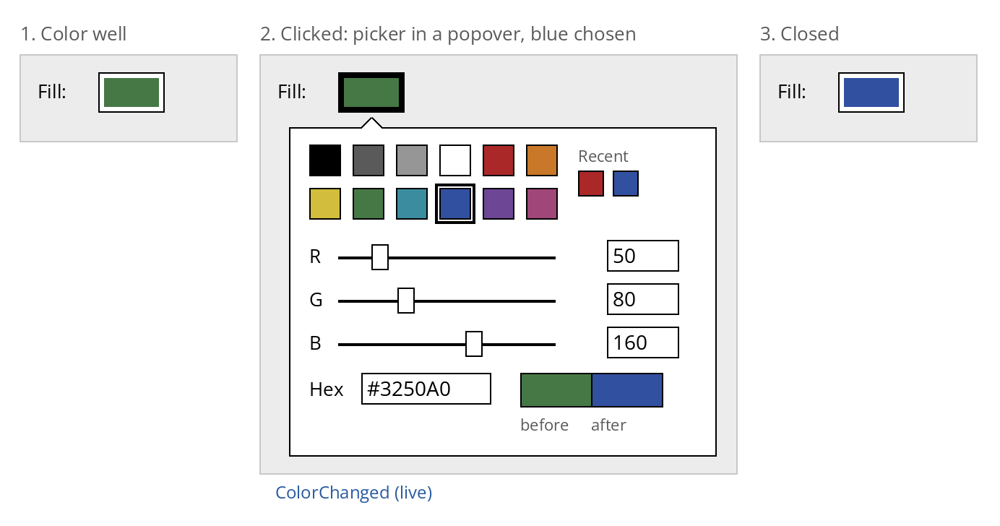

# Color well and color picker: widget roadmap

> **Issue:** [#46](https://github.com/KenSuenobu/rust-pushrod/issues/46) (extra-widgets 3.4) · **Epic 3:** Pickers and special fields · **Milestone:** Extra widgets 2: everyday controls and pickers · **Size:** M
> **Crate:** `pushrod-extra-widgets` · **User docs:** `pushrod-docs/docs/extra-widgets/color-picker.md` · **Overview:** [extra widgets roadmap](../ROADMAP_EXTRA_WIDGETS.md) · **Rules:** [design philosophy](../../DESIGN_PHILOSOPHY.md)

This file is the specification for this widget: what it is, what it does, how it looks, and how it responds. To change it, edit this file in a pull request (and its mockup in [`docs/mockups/generate_extra_widgets.py`](../mockups/generate_extra_widgets.py) if the picture changes), then bring the issue in line. If this file and the issue disagree, this file wins.

## What it is

A swatch button that opens a color picker with swatches, sliders, and a hex field.

Drawing programs, themes, and Chassis's color properties need a way to pick a color. Originally parked as rarely needed in dialogs; it belongs in the extra widgets.

*Ideas from:* macOS NSColorWell and the color panel, GTK GtkColorButton and GtkColorChooser, Qt QColorDialog, KDE KColorButton, AmigaOS colorwheel.gadget and getcolor.gadget, Motif XmColorSelector. Names and behavior are Pushrod's own.

## What it does

`ColorWell { color }` is a button filled with its color. Clicking opens a popover (1.3) with a `ColorPicker`: a tool palette (2.6) of swatches (standard plus recently used), red/green/blue (or hue/saturation/value) sliders with numeric fields, a hex field, and a before/after preview. `ColorPicker` can also be placed in a window directly. Colors can be dragged from a well onto another well (Pushrod 9.8).

## How it looks

Each image shows the widget step by step; blue notes name the event emitted.

Drawn flat, in the standard Pushrod style: fills, one-pixel borders, and text; inverted when pressed or selected, dithered when disabled, a dotted outline when focused. No bevels, gradients, shadows, glass, or rounded corners.

## How it responds

### Events and callbacks

| Event emitted | When | Application callback |
|---|---|---|
| `ColorChanged { id, color }` | Color chosen or edited | `on_color_change(id, ..)` |

Like every Pushrod widget, it can also receive application-defined custom events in `handle_event` and emit its own (Pushrod 1.13), and every internal action emits an engine event (Pushrod 9.10).

### Shared behavior

Like every Pushrod widget, it gets these from the core rather than implementing them itself:

- behavior flags and visual states ([Pushrod 1.1](https://github.com/KenSuenobu/rust-pushrod/issues/19))
- per-state appearance ([Pushrod 1.17](https://github.com/KenSuenobu/rust-pushrod/issues/104))
- keyboard focus, Tab order, Return/Escape ([Pushrod 1.4](https://github.com/KenSuenobu/rust-pushrod/issues/20))
- callbacks registered by widget ID ([Pushrod 1.6](https://github.com/KenSuenobu/rust-pushrod/issues/22))
- custom application events with payloads ([Pushrod 1.13](https://github.com/KenSuenobu/rust-pushrod/issues/78))
- composite parts the application can retrieve and modify ([Pushrod 5.2](https://github.com/KenSuenobu/rust-pushrod/issues/57))
- engine events for every internal action ([Pushrod 9.10](https://github.com/KenSuenobu/rust-pushrod/issues/109))

## Acceptance criteria

- [ ] Swatches, recent colors, RGB and HSV sliders, hex field
- [ ] Popover and inline use
- [ ] Drag a color between wells
- [ ] Registered as `extra.color_picker` and shown in the gallery (1.2)

## Depends on

Extra widgets: 1.3, 2.6 ([#42](https://github.com/KenSuenobu/rust-pushrod/issues/42)); Pushrod: Pushrod 3.2 [#40](https://github.com/KenSuenobu/rust-pushrod/issues/40) Slider, Pushrod 2.6 [#32](https://github.com/KenSuenobu/rust-pushrod/issues/32) Text field: single-line entry with input masks, validation, and numeric mode, Pushrod 9.8 [#100](https://github.com/KenSuenobu/rust-pushrod/issues/100) Drag and drop within the application

## Implementation notes

- **Crate:** `pushrod-extra-widgets`, using only the public APIs of `pushrod` and `pushrod-widgets`. Anything missing from the core is added to the core first.
- **Modules:** `pushrod-extra-widgets/src/color_picker.rs (new)`, `pushrod-docs`
- **Drawing:** paints into its own GPU texture only when invalidated; frames are composed by blitting. No OS-native controls; no per-frame CPU pixel work.
- **Documentation:** full doc headers on every non-private item, and the user page in the same pull request.

