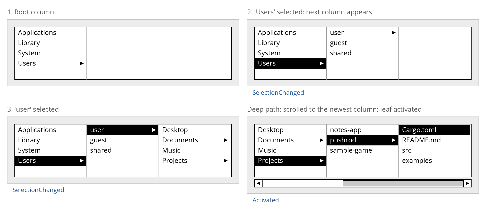

# Column browser: widget roadmap

> **Issue:** [#45](https://github.com/KenSuenobu/rust-pushrod/issues/45) (extra-widgets 4.2) · **Epic 4:** Data views · **Milestone:** Extra widgets 3: specialized views and assistants · **Size:** L
> **Crate:** `pushrod-extra-widgets` · **User docs:** `pushrod-docs/docs/extra-widgets/column-browser.md` · **Overview:** [extra widgets roadmap](../ROADMAP_EXTRA_WIDGETS.md) · **Rules:** [design philosophy](../../DESIGN_PHILOSOPHY.md)

This file is the specification for this widget: what it is, what it does, how it looks, and how it responds. To change it, edit this file in a pull request (and its mockup in [`docs/mockups/generate_extra_widgets.py`](../mockups/generate_extra_widgets.py) if the picture changes), then bring the issue in line. If this file and the issue disagree, this file wins.

## What it is

Columns of lists where selecting an item in one column fills the next, as in NeXTSTEP and the Mac Finder.

Browsing deep hierarchies one level at a time keeps the whole path visible. Moved here from the standard set as a large compound of list views.

*Ideas from:* NeXTSTEP NSBrowser, the macOS Finder's column view, Motif-era file managers. Names and behavior are Pushrod's own.

## What it does

`ColumnBrowser { source, column_width }`: one list view (Pushrod 4.5) per level, side by side in a horizontally scrolling container (Pushrod 5.3); selecting an item with children opens the next column, items with children show a right-arrow glyph. Left/Right move between columns. Optional preview pane for leaf items. Columns are resizable.

## How it looks

Each image shows the widget step by step; blue notes name the event emitted.

Drawn flat, in the standard Pushrod style: fills, one-pixel borders, and text; inverted when pressed or selected, dithered when disabled, a dotted outline when focused. No bevels, gradients, shadows, glass, or rounded corners.

## How it responds

### Events and callbacks

| Event emitted | When | Application callback |
|---|---|---|
| `SelectionChanged { id, path }` | Selection changed | `on_selection_change(id, ..)` |
| `Activated { id, path }` | Double-click or Return on a leaf | `on_activate(id, ..)` |

Like every Pushrod widget, it can also receive application-defined custom events in `handle_event` and emit its own (Pushrod 1.13), and every internal action emits an engine event (Pushrod 9.10).

### Shared behavior

Like every Pushrod widget, it gets these from the core rather than implementing them itself:

- behavior flags and visual states ([Pushrod 1.1](https://github.com/KenSuenobu/rust-pushrod/issues/19))
- per-state appearance ([Pushrod 1.17](https://github.com/KenSuenobu/rust-pushrod/issues/104))
- keyboard focus, Tab order, Return/Escape ([Pushrod 1.4](https://github.com/KenSuenobu/rust-pushrod/issues/20))
- callbacks registered by widget ID ([Pushrod 1.6](https://github.com/KenSuenobu/rust-pushrod/issues/22))
- custom application events with payloads ([Pushrod 1.13](https://github.com/KenSuenobu/rust-pushrod/issues/78))
- composite parts the application can retrieve and modify ([Pushrod 5.2](https://github.com/KenSuenobu/rust-pushrod/issues/57))
- engine events for every internal action ([Pushrod 9.10](https://github.com/KenSuenobu/rust-pushrod/issues/109))

## Acceptance criteria

- [ ] Selecting fills the next column
- [ ] Keyboard navigation across columns
- [ ] Horizontal scrolling keeps the selection visible
- [ ] Registered as `extra.column_browser` and shown in the gallery (1.2)

## Depends on

Extra widgets: 1.1 ([#252](https://github.com/KenSuenobu/rust-pushrod/issues/252)); Pushrod: Pushrod 4.5 [#52](https://github.com/KenSuenobu/rust-pushrod/issues/52) List view, Pushrod 5.3 [#58](https://github.com/KenSuenobu/rust-pushrod/issues/58) Container: a scrollable viewport onto fixed-size content, Pushrod 3.1 [#39](https://github.com/KenSuenobu/rust-pushrod/issues/39) Scroll bar

## Implementation notes

- **Crate:** `pushrod-extra-widgets`, using only the public APIs of `pushrod` and `pushrod-widgets`. Anything missing from the core is added to the core first.
- **Modules:** `pushrod-extra-widgets/src/column_browser.rs (new)`, `pushrod-docs`
- **Drawing:** paints into its own GPU texture only when invalidated; frames are composed by blitting. No OS-native controls; no per-frame CPU pixel work.
- **Documentation:** full doc headers on every non-private item, and the user page in the same pull request.

