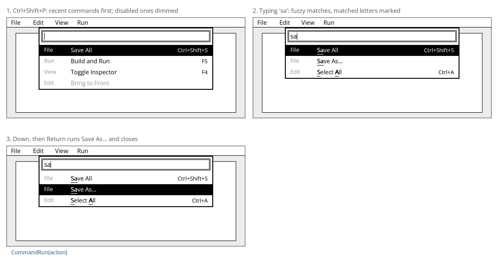

# Command palette: widget roadmap

> **Issue:** [#305](https://github.com/KenSuenobu/rust-pushrod/issues/305) (extra-widgets 6.9) · **Epic 6:** Dialogs and assistants · **Milestone:** Extra widgets 1: crate and Chassis widgets · **Size:** M
> **Crate:** `pushrod-extra-widgets` · **User docs:** `pushrod-docs/docs/extra-widgets/command-palette.md` · **Overview:** [extra widgets roadmap](../ROADMAP_EXTRA_WIDGETS.md) · **Rules:** [design philosophy](../../DESIGN_PHILOSOPHY.md)

This file is the specification for this widget: what it is, what it does, how it looks, and how it responds. To change it, edit this file in a pull request (and its mockup in [`docs/mockups/generate_extra_widgets.py`](../mockups/generate_extra_widgets.py) if the picture changes), then bring the issue in line. If this file and the issue disagree, this file wins.

## What it is

A pop-up search box listing every command; type a few letters, press Return, and it runs.

Applications with many commands bury them in menus. A palette makes every command reachable from the keyboard in a few keystrokes, and shows its shortcut so users learn it. Pushrod's actions (Pushrod 9.5) already know every command's name, shortcut, and enabled state.

*Ideas from:* The command palettes of VS Code and Sublime Text, Search Everywhere in JetBrains tools, Blender's operator search, the locator in Qt Creator. Names and behavior are Pushrod's own.

## What it does

`CommandPalette::new(&actions)`: opened by a shortcut (Ctrl+Shift+P by default), it shows a framed panel at the top center of the window: a text field and a list of actions with category, name, and shortcut. Typing filters by fuzzy match (letters in order), best match first, matched letters bold; recently used commands come first when the field is empty. Up/Down move, Return runs the action and closes, Escape closes. Disabled actions are shown dimmed and don't run. `add_source` lets an application list other things (open files, forms, settings) with a prefix character.

## How it looks

Each image shows the widget step by step; blue notes name the event emitted.

Drawn flat, in the standard Pushrod style: fills, one-pixel borders, and text; inverted when pressed or selected, dithered when disabled, a dotted outline when focused. No bevels, gradients, shadows, glass, or rounded corners.

## How it responds

### Events and callbacks

| Event emitted | When | Application callback |
|---|---|---|
| `CommandRun { id, action }` | An entry chosen | the action's own callback, and `on_command_run(id, ..)` |
| `PaletteClosed { id }` | Closed without choosing | `on_close(id, ..)` |

Like every Pushrod widget, it can also receive application-defined custom events in `handle_event` and emit its own (Pushrod 1.13), and every internal action emits an engine event (Pushrod 9.10).

### Shared behavior

Like every Pushrod widget, it gets these from the core rather than implementing them itself:

- behavior flags and visual states ([Pushrod 1.1](https://github.com/KenSuenobu/rust-pushrod/issues/19))
- per-state appearance ([Pushrod 1.17](https://github.com/KenSuenobu/rust-pushrod/issues/104))
- keyboard focus, Tab order, Return/Escape ([Pushrod 1.4](https://github.com/KenSuenobu/rust-pushrod/issues/20))
- callbacks registered by widget ID ([Pushrod 1.6](https://github.com/KenSuenobu/rust-pushrod/issues/22))
- custom application events with payloads ([Pushrod 1.13](https://github.com/KenSuenobu/rust-pushrod/issues/78))
- composite parts the application can retrieve and modify ([Pushrod 5.2](https://github.com/KenSuenobu/rust-pushrod/issues/57))
- engine events for every internal action ([Pushrod 9.10](https://github.com/KenSuenobu/rust-pushrod/issues/109))

## Acceptance criteria

- [ ] Lists every action with its shortcut; disabled ones dimmed
- [ ] Fuzzy filtering with matched letters marked; recent first
- [ ] Keyboard only: open, move, run, close
- [ ] Extra sources with a prefix
- [ ] Registered as `extra.command_palette` with a page in the Pushrod Showcase (1.2)

## Depends on

Extra widgets: 1.3 ([#254](https://github.com/KenSuenobu/rust-pushrod/issues/254)); Pushrod: Pushrod 9.5 [#97](https://github.com/KenSuenobu/rust-pushrod/issues/97) Actions and keyboard shortcuts: shared commands for menus, toolbars, and buttons, Pushrod 2.6 [#32](https://github.com/KenSuenobu/rust-pushrod/issues/32) Text field: single-line entry with input masks, validation, and numeric mode, Pushrod 4.5 [#52](https://github.com/KenSuenobu/rust-pushrod/issues/52) List view

## Used by Chassis

Chassis 1.4 [#170](https://github.com/KenSuenobu/rust-pushrod/issues/170) Commands, menus, and shortcuts.

## Implementation notes

- **Crate:** `pushrod-extra-widgets`, using only the public APIs of `pushrod` and `pushrod-widgets`. Anything missing from the core is added to the core first.
- **Modules:** `pushrod-extra-widgets/src/command_palette.rs (new)`, `pushrod-docs`
- **Drawing:** paints into its own GPU texture only when invalidated; frames are composed by blitting. No OS-native controls; no per-frame CPU pixel work.
- **Documentation:** full doc headers on every non-private item, and the user page in the same pull request.

