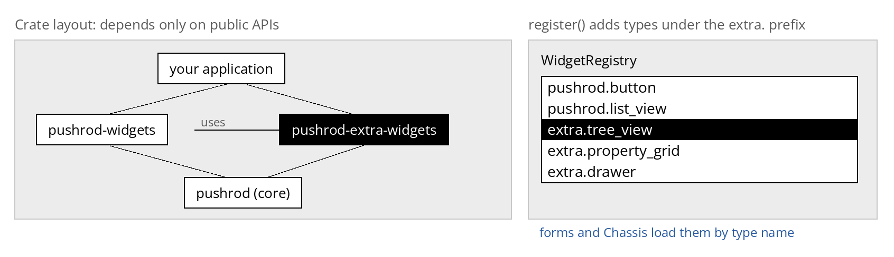

# Create the pushrod-extra-widgets crate: widget roadmap

> **Issue:** 1.1 (extra-widgets 1.1) · **Epic 1:** Crate and foundations · **Milestone:** Extra widgets 1: crate and Chassis widgets · **Size:** S
> **Crate:** `pushrod-extra-widgets` · **User docs:** `pushrod-docs/docs/extra-widgets/crate.md` · **Overview:** [extra widgets roadmap](../ROADMAP_EXTRA_WIDGETS.md) · **Rules:** [design philosophy](../../DESIGN_PHILOSOPHY.md)

This file is the specification for this widget: what it is, what it does, how it looks, and how it responds. To change it, edit this file in a pull request (and its mockup in [`docs/mockups/generate_extra_widgets.py`](../mockups/generate_extra_widgets.py) if the picture changes), then bring the issue in line. If this file and the issue disagree, this file wins.

## What it is

The crate, its registration function, its docs section, and its place in CI.

The standard widgets stay simple on purpose. Larger and compound widgets need their own crate so they can grow without making `pushrod-widgets` heavier, and so they prove that a widget library can be built from the public API alone (Pushrod 1.22).

*Ideas from:* Third-party widget sets for Qt (KDE Frameworks' KWidgetsAddons) and GTK (libadwaita), which extend the base toolkit without changing it. Names and behavior are Pushrod's own.

## What it does

Add `pushrod-extra-widgets/` to the workspace (edition 2024, Rust 1.100, same lints and doc rules as the other crates). It depends only on `pushrod` and `pushrod-widgets`. `pushrod_extra_widgets::register(&mut WidgetRegistry)` registers every widget under the `extra.` prefix (`extra.tree_view`, `extra.property_grid`), so forms and Chassis can load them. Add the crate to CI (fmt, clippy, test, `check_docs`, rustdoc, and `scripts/check_widget_pages.py` extended to `pushrod-docs/docs/extra-widgets/`), add an **Extra widgets** section to the documentation site, and add the crate to *Widget libraries*. Rules for the crate: flat look like the standard widgets (DESIGN_PHILOSOPHY.md); compound widgets reuse standard widgets as parts (Pushrod 5.2) rather than redrawing them; anything missing from the core is a core issue.

## How it looks

Each image shows the widget step by step; blue notes name the event emitted.

Drawn flat, in the standard Pushrod style: fills, one-pixel borders, and text; inverted when pressed or selected, dithered when disabled, a dotted outline when focused. No bevels, gradients, shadows, glass, or rounded corners.

## How it responds

### Events and callbacks

| Event emitted | When | Application callback |
|---|---|---|
| (none) | Infrastructure only | `register(&mut WidgetRegistry)` |

Like every Pushrod widget, it can also receive application-defined custom events in `handle_event` and emit its own (Pushrod 1.13), and every internal action emits an engine event (Pushrod 9.10).

### Shared behavior

Like every Pushrod widget, it gets these from the core rather than implementing them itself:

- behavior flags and visual states ([Pushrod 1.1](https://github.com/KenSuenobu/rust-pushrod/issues/19))
- per-state appearance ([Pushrod 1.17](https://github.com/KenSuenobu/rust-pushrod/issues/104))
- keyboard focus, Tab order, Return/Escape ([Pushrod 1.4](https://github.com/KenSuenobu/rust-pushrod/issues/20))
- callbacks registered by widget ID ([Pushrod 1.6](https://github.com/KenSuenobu/rust-pushrod/issues/22))
- custom application events with payloads ([Pushrod 1.13](https://github.com/KenSuenobu/rust-pushrod/issues/78))
- composite parts the application can retrieve and modify ([Pushrod 5.2](https://github.com/KenSuenobu/rust-pushrod/issues/57))
- engine events for every internal action ([Pushrod 9.10](https://github.com/KenSuenobu/rust-pushrod/issues/109))

## Acceptance criteria

- [ ] Workspace builds with the new crate; CI runs fmt, clippy, tests, `check_docs`, and rustdoc on it
- [ ] `register` adds widgets under `extra.` and a test loads a form using one
- [ ] Documentation site has an Extra widgets section and the crate appears in Widget libraries
- [ ] Documented on the docs site

## Depends on

Pushrod: Pushrod 1.21 [#130](https://github.com/KenSuenobu/rust-pushrod/issues/130) Split the standard widgets into the pushrod-widgets crate, Pushrod 1.22 [#131](https://github.com/KenSuenobu/rust-pushrod/issues/131) Widget libraries: extend or replace pushrod-widgets, Pushrod 6.1 [#60](https://github.com/KenSuenobu/rust-pushrod/issues/60) Widget registry and factory, Pushrod 10.6 [#134](https://github.com/KenSuenobu/rust-pushrod/issues/134) Backend crates: keep SDL out of the core and the widgets

## Used by Chassis

Chassis 2.3 [#173](https://github.com/KenSuenobu/rust-pushrod/issues/173) Project drawer, Chassis 3.2 [#179](https://github.com/KenSuenobu/rust-pushrod/issues/179) Widget palette, Chassis 3.8 [#185](https://github.com/KenSuenobu/rust-pushrod/issues/185) Layout managers in the designer, Chassis 4.1 [#186](https://github.com/KenSuenobu/rust-pushrod/issues/186) Inspector drawer, Chassis 4.2 [#187](https://github.com/KenSuenobu/rust-pushrod/issues/187) Property grid.

## Implementation notes

- **Crate:** `pushrod-extra-widgets`, using only the public APIs of `pushrod` and `pushrod-widgets`. Anything missing from the core is added to the core first.
- **Modules:** `pushrod-extra-widgets/Cargo.toml (new)`, `pushrod-extra-widgets/src/lib.rs (new)`, `Cargo.toml`, `.github/workflows/ci.yml`, `pushrod-docs`
- **Drawing:** paints into its own GPU texture only when invalidated; frames are composed by blitting. No OS-native controls; no per-frame CPU pixel work.
- **Documentation:** full doc headers on every non-private item, and the user page in the same pull request.

