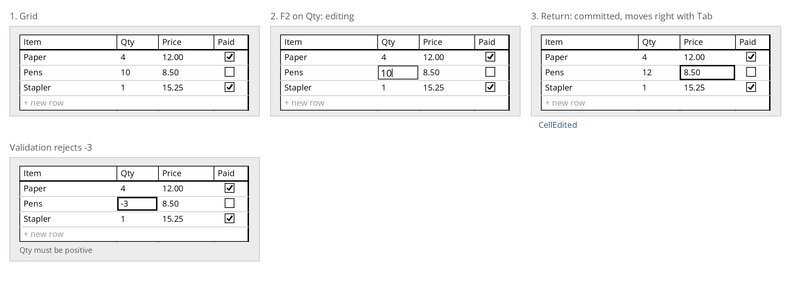

# Data grid (editable table): widget roadmap

> **Issue:** [#276](https://github.com/KenSuenobu/rust-pushrod/issues/276) (extra-widgets 4.4) · **Epic 4:** Data views · **Milestone:** Extra widgets 3: specialized views and assistants · **Size:** L
> **Crate:** `pushrod-extra-widgets` · **User docs:** `pushrod-docs/docs/extra-widgets/data-grid.md` · **Overview:** [extra widgets roadmap](../ROADMAP_EXTRA_WIDGETS.md) · **Rules:** [design philosophy](../../DESIGN_PHILOSOPHY.md)

This file is the specification for this widget: what it is, what it does, how it looks, and how it responds. To change it, edit this file in a pull request (and its mockup in [`docs/mockups/generate_extra_widgets.py`](../mockups/generate_extra_widgets.py) if the picture changes), then bring the issue in line. If this file and the issue disagree, this file wins.

## What it is

A table whose cells edit in place with typed editors, with row add and delete.

The standard table view is read-only on purpose. Data entry screens need cells you can type into, check, or choose from, with keyboard movement like a spreadsheet.

*Ideas from:* Delphi TStringGrid and TDBGrid, Qt QTableView with item delegates, Win32 grid controls, GTK editable cell renderers. Names and behavior are Pushrod's own.

## What it does

`DataGrid { source, columns }` builds on the table view (Pushrod 4.9). Each column has an editor kind: text, number, check box, choice (Pushrod 3.6), or date (3.2). Double-click, F2, or typing starts editing; Return commits and moves down, Tab moves right, Escape cancels. A `validate` closure can reject a value (cell marked). Optional new-row line at the bottom and Delete for selected rows. Changes go through the data source, which can refuse them.

## How it looks

Each image shows the widget step by step; blue notes name the event emitted.

Drawn flat, in the standard Pushrod style: fills, one-pixel borders, and text; inverted when pressed or selected, dithered when disabled, a dotted outline when focused. No bevels, gradients, shadows, glass, or rounded corners.

## How it responds

### Events and callbacks

| Event emitted | When | Application callback |
|---|---|---|
| `CellEdited { id, row, column }` | A cell committed | `on_cell_edit(id, ..)` |
| `RowAdded { id, row }` / `RowsDeleted { id }` | Rows added or deleted | `on_rows_change(id, ..)` |

Like every Pushrod widget, it can also receive application-defined custom events in `handle_event` and emit its own (Pushrod 1.13), and every internal action emits an engine event (Pushrod 9.10).

### Shared behavior

Like every Pushrod widget, it gets these from the core rather than implementing them itself:

- behavior flags and visual states ([Pushrod 1.1](https://github.com/KenSuenobu/rust-pushrod/issues/19))
- per-state appearance ([Pushrod 1.17](https://github.com/KenSuenobu/rust-pushrod/issues/104))
- keyboard focus, Tab order, Return/Escape ([Pushrod 1.4](https://github.com/KenSuenobu/rust-pushrod/issues/20))
- callbacks registered by widget ID ([Pushrod 1.6](https://github.com/KenSuenobu/rust-pushrod/issues/22))
- custom application events with payloads ([Pushrod 1.13](https://github.com/KenSuenobu/rust-pushrod/issues/78))
- composite parts the application can retrieve and modify ([Pushrod 5.2](https://github.com/KenSuenobu/rust-pushrod/issues/57))
- engine events for every internal action ([Pushrod 9.10](https://github.com/KenSuenobu/rust-pushrod/issues/109))

## Acceptance criteria

- [ ] Typed cell editors with validation
- [ ] Spreadsheet-style keyboard editing
- [ ] Add and delete rows through the data source
- [ ] Registered as `extra.data_grid` with a page in the Pushrod Showcase (1.2)

## Depends on

Extra widgets: 3.2 ([#91](https://github.com/KenSuenobu/rust-pushrod/issues/91)); Pushrod: Pushrod 4.9 [#92](https://github.com/KenSuenobu/rust-pushrod/issues/92) Table view, Pushrod 2.6 [#32](https://github.com/KenSuenobu/rust-pushrod/issues/32) Text field: single-line entry with input masks, validation, and numeric mode, Pushrod 2.4 [#30](https://github.com/KenSuenobu/rust-pushrod/issues/30) Check box with indeterminate state, Pushrod 3.6 [#44](https://github.com/KenSuenobu/rust-pushrod/issues/44) Choice button: pop-up list and click-to-cycle modes

## Implementation notes

- **Crate:** `pushrod-extra-widgets`, using only the public APIs of `pushrod` and `pushrod-widgets`. Anything missing from the core is added to the core first.
- **Modules:** `pushrod-extra-widgets/src/data_grid.rs (new)`, `pushrod-docs`
- **Drawing:** paints into its own GPU texture only when invalidated; frames are composed by blitting. No OS-native controls; no per-frame CPU pixel work.
- **Documentation:** full doc headers on every non-private item, and the user page in the same pull request.

