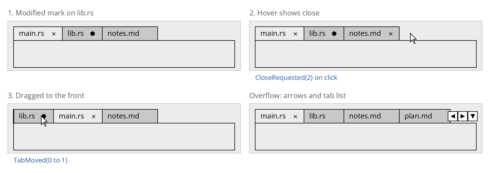

# Document tabs (closable and reorderable): widget roadmap

> **Issue:** [#281](https://github.com/KenSuenobu/rust-pushrod/issues/281) (extra-widgets 5.4) · **Epic 5:** Panels and navigation · **Milestone:** Extra widgets 3: specialized views and assistants · **Size:** M
> **Crate:** `pushrod-extra-widgets` · **User docs:** `pushrod-docs/docs/extra-widgets/document-tabs.md` · **Overview:** [extra widgets roadmap](../ROADMAP_EXTRA_WIDGETS.md) · **Rules:** [design philosophy](../../DESIGN_PHILOSOPHY.md)

This file is the specification for this widget: what it is, what it does, how it looks, and how it responds. To change it, edit this file in a pull request (and its mockup in [`docs/mockups/generate_extra_widgets.py`](../mockups/generate_extra_widgets.py) if the picture changes), then bring the issue in line. If this file and the issue disagree, this file wins.

## What it is

A tab bar for open documents: close buttons, a modified mark, drag to reorder, and overflow.

Editors keep many documents open. The standard tab view switches fixed pages; documents need closing, reordering, a modified mark, and a way to reach tabs that don't fit.

*Ideas from:* Qt QTabBar (closable, movable), GTK notebooks and libadwaita's tab bar, KDE editors, macOS window tabs, code editors. Names and behavior are Pushrod's own.

## What it does

`DocumentTabs { tabs }` builds on the tab view (Pushrod 4.4): each tab has a close glyph (shown on hover and on the active tab) and a dot when modified. Drag to reorder (Pushrod 9.8); middle-click closes; a context menu (Pushrod 2.19) offers Close, Close Others, and Close to the Right. When tabs don't fit, scroll arrows and a menu listing all tabs appear. Closing asks the application first (`can_close`).

## How it looks

Each image shows the widget step by step; blue notes name the event emitted.

Drawn flat, in the standard Pushrod style: fills, one-pixel borders, and text; inverted when pressed or selected, dithered when disabled, a dotted outline when focused. No bevels, gradients, shadows, glass, or rounded corners.

## How it responds

### Events and callbacks

| Event emitted | When | Application callback |
|---|---|---|
| `TabActivated { id, index }` | Tab chosen | `on_tab_activate(id, ..)` |
| `CloseRequested { id, index }` | Close clicked | `on_close_request(id, ..)` |
| `TabMoved { id, from, to }` | Tab dragged | `on_tab_move(id, ..)` |

Like every Pushrod widget, it can also receive application-defined custom events in `handle_event` and emit its own (Pushrod 1.13), and every internal action emits an engine event (Pushrod 9.10).

### Shared behavior

Like every Pushrod widget, it gets these from the core rather than implementing them itself:

- behavior flags and visual states ([Pushrod 1.1](https://github.com/KenSuenobu/rust-pushrod/issues/19))
- per-state appearance ([Pushrod 1.17](https://github.com/KenSuenobu/rust-pushrod/issues/104))
- keyboard focus, Tab order, Return/Escape ([Pushrod 1.4](https://github.com/KenSuenobu/rust-pushrod/issues/20))
- callbacks registered by widget ID ([Pushrod 1.6](https://github.com/KenSuenobu/rust-pushrod/issues/22))
- custom application events with payloads ([Pushrod 1.13](https://github.com/KenSuenobu/rust-pushrod/issues/78))
- composite parts the application can retrieve and modify ([Pushrod 5.2](https://github.com/KenSuenobu/rust-pushrod/issues/57))
- engine events for every internal action ([Pushrod 9.10](https://github.com/KenSuenobu/rust-pushrod/issues/109))

## Acceptance criteria

- [ ] Close buttons, modified marks, middle-click close
- [ ] Drag to reorder and context menu
- [ ] Overflow arrows and tab list menu
- [ ] Registered as `extra.document_tabs` with a page in the Pushrod Showcase (1.2)

## Depends on

Extra widgets: 1.1 ([#252](https://github.com/KenSuenobu/rust-pushrod/issues/252)); Pushrod: Pushrod 4.4 [#51](https://github.com/KenSuenobu/rust-pushrod/issues/51) Tab view, Pushrod 9.8 [#100](https://github.com/KenSuenobu/rust-pushrod/issues/100) Drag and drop within the application, Pushrod 2.19 [#88](https://github.com/KenSuenobu/rust-pushrod/issues/88) Context menus, Pushrod 2.11 [#37](https://github.com/KenSuenobu/rust-pushrod/issues/37) Menu bar and drop-down menus (drawn by Pushrod)

## Implementation notes

- **Crate:** `pushrod-extra-widgets`, using only the public APIs of `pushrod` and `pushrod-widgets`. Anything missing from the core is added to the core first.
- **Modules:** `pushrod-extra-widgets/src/document_tabs.rs (new)`, `pushrod-docs`
- **Drawing:** paints into its own GPU texture only when invalidated; frames are composed by blitting. No OS-native controls; no per-frame CPU pixel work.
- **Documentation:** full doc headers on every non-private item, and the user page in the same pull request.

