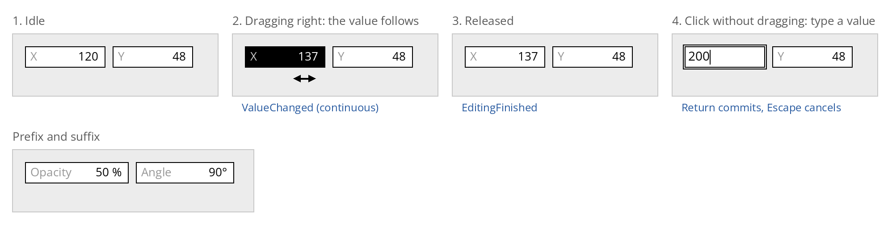

# Drag value (numeric scrubber): widget roadmap

> **Issue:** [#302](https://github.com/KenSuenobu/rust-pushrod/issues/302) (extra-widgets 2.9) · **Epic 2:** Buttons and value controls · **Milestone:** Extra widgets 1: crate and Chassis widgets · **Size:** S
> **Crate:** `pushrod-extra-widgets` · **User docs:** `pushrod-docs/docs/extra-widgets/drag-value.md` · **Overview:** [extra widgets roadmap](../ROADMAP_EXTRA_WIDGETS.md) · **Rules:** [design philosophy](../../DESIGN_PHILOSOPHY.md)

This file is the specification for this widget: what it is, what it does, how it looks, and how it responds. To change it, edit this file in a pull request (and its mockup in [`docs/mockups/generate_extra_widgets.py`](../mockups/generate_extra_widgets.py) if the picture changes), then bring the issue in line. If this file and the issue disagree, this file wins.

## What it is

A compact number that changes as you drag it sideways, and becomes a text field when clicked.

Inspectors are full of numbers (X, Y, width, height, spacing). A spin box per number is wide and slow; tool applications let you drag the number itself.

*Ideas from:* egui's DragValue, Dear ImGui's drag fields, numeric fields in Blender, Figma, Unity, and Godot inspectors. Names and behavior are Pushrod's own.

## What it does

`DragValue { value, min, max, speed, decimals, prefix, suffix }`: shows the value as text in a flat box ("X 120", "50 %"). Dragging left or right changes it by `speed` per pixel (Shift for fine steps, Ctrl for coarse); the pointer becomes a horizontal-resize cursor (Pushrod 9.9). A click without dragging, or Return when focused, turns it into a text field for typing (with arithmetic when Pushrod 4.12 is available); Escape restores the old value. Arrow keys step. Outline drawing mode defers dependent work to release (Pushrod 10.1).

## How it looks

Each image shows the widget step by step; blue notes name the event emitted.

Drawn flat, in the standard Pushrod style: fills, one-pixel borders, and text; inverted when pressed or selected, dithered when disabled, a dotted outline when focused. No bevels, gradients, shadows, glass, or rounded corners.

## How it responds

### Events and callbacks

| Event emitted | When | Application callback |
|---|---|---|
| `ValueChanged { id, value }` | While dragging, stepping, or on commit | `on_value_change(id, ..)` |
| `EditingFinished { id }` | Drag released or typing committed | `on_editing_finished(id, ..)` |

Like every Pushrod widget, it can also receive application-defined custom events in `handle_event` and emit its own (Pushrod 1.13), and every internal action emits an engine event (Pushrod 9.10).

### Shared behavior

Like every Pushrod widget, it gets these from the core rather than implementing them itself:

- behavior flags and visual states ([Pushrod 1.1](https://github.com/KenSuenobu/rust-pushrod/issues/19))
- per-state appearance ([Pushrod 1.17](https://github.com/KenSuenobu/rust-pushrod/issues/104))
- keyboard focus, Tab order, Return/Escape ([Pushrod 1.4](https://github.com/KenSuenobu/rust-pushrod/issues/20))
- callbacks registered by widget ID ([Pushrod 1.6](https://github.com/KenSuenobu/rust-pushrod/issues/22))
- custom application events with payloads ([Pushrod 1.13](https://github.com/KenSuenobu/rust-pushrod/issues/78))
- composite parts the application can retrieve and modify ([Pushrod 5.2](https://github.com/KenSuenobu/rust-pushrod/issues/57))
- engine events for every internal action ([Pushrod 9.10](https://github.com/KenSuenobu/rust-pushrod/issues/109))

## Acceptance criteria

- [ ] Drag changes the value with fine and coarse modifiers
- [ ] Click to type; Escape cancels
- [ ] Range, decimals, prefix, and suffix
- [ ] Registered as `extra.drag_value` with a page in the Pushrod Showcase (1.2)

## Depends on

Extra widgets: 1.1 ([#252](https://github.com/KenSuenobu/rust-pushrod/issues/252)); Pushrod: Pushrod 2.6 [#32](https://github.com/KenSuenobu/rust-pushrod/issues/32) Text field: single-line entry with input masks, validation, and numeric mode, Pushrod 9.4 [#96](https://github.com/KenSuenobu/rust-pushrod/issues/96) Reusable input controllers: click, drag, scroll, hover, long-press, key, Pushrod 9.9 [#101](https://github.com/KenSuenobu/rust-pushrod/issues/101) Pointer cursor per widget

## Used by Chassis

Chassis 4.3 [#188](https://github.com/KenSuenobu/rust-pushrod/issues/188) Typed property editors.

## Implementation notes

- **Crate:** `pushrod-extra-widgets`, using only the public APIs of `pushrod` and `pushrod-widgets`. Anything missing from the core is added to the core first.
- **Modules:** `pushrod-extra-widgets/src/drag_value.rs (new)`, `pushrod-docs`
- **Drawing:** paints into its own GPU texture only when invalidated; frames are composed by blitting. No OS-native controls; no per-frame CPU pixel work.
- **Documentation:** full doc headers on every non-private item, and the user page in the same pull request.

