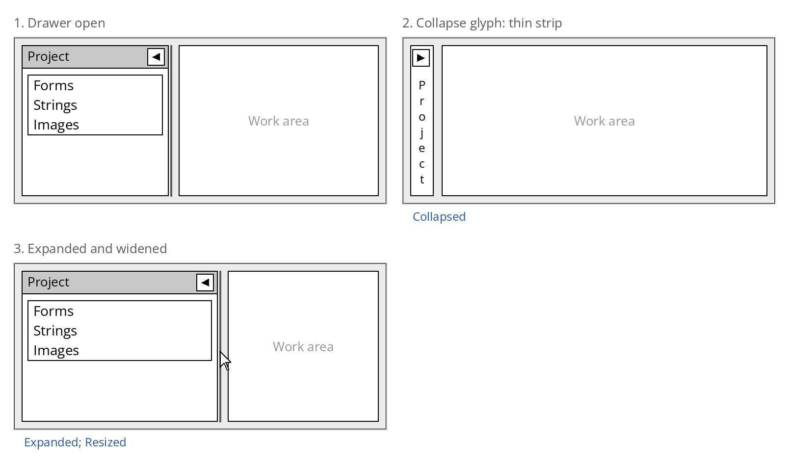

# Drawer (collapsible side panel): widget roadmap

> **Issue:** [#257](https://github.com/KenSuenobu/rust-pushrod/issues/257) (extra-widgets 5.1) · **Epic 5:** Panels and navigation · **Milestone:** Extra widgets 1: crate and Chassis widgets · **Size:** S
> **Crate:** `pushrod-extra-widgets` · **User docs:** `pushrod-docs/docs/extra-widgets/drawer.md` · **Overview:** [extra widgets roadmap](../ROADMAP_EXTRA_WIDGETS.md) · **Rules:** [design philosophy](../../DESIGN_PHILOSOPHY.md)

This file is the specification for this widget: what it is, what it does, how it looks, and how it responds. To change it, edit this file in a pull request (and its mockup in [`docs/mockups/generate_extra_widgets.py`](../mockups/generate_extra_widgets.py) if the picture changes), then bring the issue in line. If this file and the issue disagree, this file wins.

## What it is

A side panel with a title bar that collapses to a thin strip and remembers its width.

Chassis's project and inspector drawers, and the sidebars of many tools, are the same: a resizable panel on one side of a split view that can be hidden to give the work area more room.

*Ideas from:* macOS NSDrawer and collapsible split-view sidebars, Delphi TSplitView, Qt QDockWidget, libadwaita's overlay split view. Names and behavior are Pushrod's own.

## What it does

`Drawer { side, title, content, collapsed }`: a pane of a split view (Pushrod 3.9) with a title bar holding the title and a collapse glyph button. Collapsed, it becomes a narrow strip with the title drawn vertically; click or a shortcut (an action, Pushrod 9.5) expands it to its previous width. No animation. Width and collapsed state can be saved and restored by the application.

## How it looks

Each image shows the widget step by step; blue notes name the event emitted.

Drawn flat, in the standard Pushrod style: fills, one-pixel borders, and text; inverted when pressed or selected, dithered when disabled, a dotted outline when focused. No bevels, gradients, shadows, glass, or rounded corners.

## How it responds

### Events and callbacks

| Event emitted | When | Application callback |
|---|---|---|
| `Collapsed { id }` / `Expanded { id }` | Collapse or expand | `on_toggle(id, ..)` |
| `Resized { id, width }` | Divider dragged | `on_resize(id, ..)` |

Like every Pushrod widget, it can also receive application-defined custom events in `handle_event` and emit its own (Pushrod 1.13), and every internal action emits an engine event (Pushrod 9.10).

### Shared behavior

Like every Pushrod widget, it gets these from the core rather than implementing them itself:

- behavior flags and visual states ([Pushrod 1.1](https://github.com/KenSuenobu/rust-pushrod/issues/19))
- per-state appearance ([Pushrod 1.17](https://github.com/KenSuenobu/rust-pushrod/issues/104))
- keyboard focus, Tab order, Return/Escape ([Pushrod 1.4](https://github.com/KenSuenobu/rust-pushrod/issues/20))
- callbacks registered by widget ID ([Pushrod 1.6](https://github.com/KenSuenobu/rust-pushrod/issues/22))
- custom application events with payloads ([Pushrod 1.13](https://github.com/KenSuenobu/rust-pushrod/issues/78))
- composite parts the application can retrieve and modify ([Pushrod 5.2](https://github.com/KenSuenobu/rust-pushrod/issues/57))
- engine events for every internal action ([Pushrod 9.10](https://github.com/KenSuenobu/rust-pushrod/issues/109))

## Acceptance criteria

- [ ] Collapses to a strip and restores its width
- [ ] Left, right, and bottom sides
- [ ] Toggle by button and action shortcut
- [ ] Registered as `extra.drawer` with a page in the Pushrod Showcase (1.2)

## Depends on

Extra widgets: 1.1 ([#252](https://github.com/KenSuenobu/rust-pushrod/issues/252)); Pushrod: Pushrod 3.9 [#47](https://github.com/KenSuenobu/rust-pushrod/issues/47) Split view (panes with draggable dividers), Pushrod 2.2 [#28](https://github.com/KenSuenobu/rust-pushrod/issues/28) Glyph button (small single-character button), Pushrod 9.5 [#97](https://github.com/KenSuenobu/rust-pushrod/issues/97) Actions and keyboard shortcuts: shared commands for menus, toolbars, and buttons

## Used by Chassis

Chassis 2.3 [#173](https://github.com/KenSuenobu/rust-pushrod/issues/173) Project drawer, Chassis 4.1 [#186](https://github.com/KenSuenobu/rust-pushrod/issues/186) Inspector drawer.

## Implementation notes

- **Crate:** `pushrod-extra-widgets`, using only the public APIs of `pushrod` and `pushrod-widgets`. Anything missing from the core is added to the core first.
- **Modules:** `pushrod-extra-widgets/src/drawer.rs (new)`, `pushrod-docs`
- **Drawing:** paints into its own GPU texture only when invalidated; frames are composed by blitting. No OS-native controls; no per-frame CPU pixel work.
- **Documentation:** full doc headers on every non-private item, and the user page in the same pull request.

