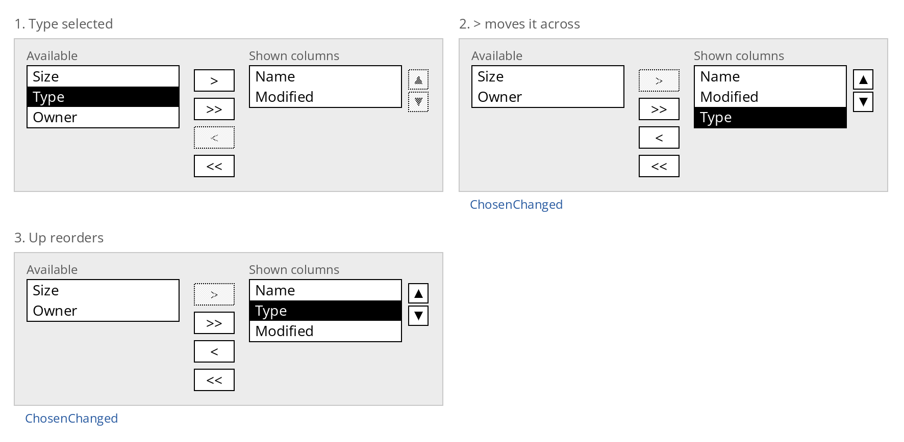

# Dual list (list builder): widget roadmap

> **Issue:** [#278](https://github.com/KenSuenobu/rust-pushrod/issues/278) (extra-widgets 4.8) · **Epic 4:** Data views · **Milestone:** Extra widgets 3: specialized views and assistants · **Size:** S
> **Crate:** `pushrod-extra-widgets` · **User docs:** `pushrod-docs/docs/extra-widgets/dual-list.md` · **Overview:** [extra widgets roadmap](../ROADMAP_EXTRA_WIDGETS.md) · **Rules:** [design philosophy](../../DESIGN_PHILOSOPHY.md)

This file is the specification for this widget: what it is, what it does, how it looks, and how it responds. To change it, edit this file in a pull request (and its mockup in [`docs/mockups/generate_extra_widgets.py`](../mockups/generate_extra_widgets.py) if the picture changes), then bring the issue in line. If this file and the issue disagree, this file wins.

## What it is

Available and chosen lists side by side, with buttons to move items between them and order the chosen list.

Picking and ordering a subset (columns to show, toolbar buttons, fields to export) is clearer with both lists visible than with check boxes.

*Ideas from:* KDE KActionSelector, Windows column choosers, toolbar customizers in many toolkits. Names and behavior are Pushrod's own.

## What it does

`DualList { available, chosen }`: two list views (Pushrod 4.5) with labels, and buttons between them: add, add all, remove, remove all; up/down buttons beside the chosen list. Double-click moves an item across; drag works too (Pushrod 9.8). Each list has an optional filter field (4.10).

## How it looks

Each image shows the widget step by step; blue notes name the event emitted.

Drawn flat, in the standard Pushrod style: fills, one-pixel borders, and text; inverted when pressed or selected, dithered when disabled, a dotted outline when focused. No bevels, gradients, shadows, glass, or rounded corners.

## How it responds

### Events and callbacks

| Event emitted | When | Application callback |
|---|---|---|
| `ChosenChanged { id }` | Items moved or reordered | `on_chosen_change(id, ..)` |

Like every Pushrod widget, it can also receive application-defined custom events in `handle_event` and emit its own (Pushrod 1.13), and every internal action emits an engine event (Pushrod 9.10).

### Shared behavior

Like every Pushrod widget, it gets these from the core rather than implementing them itself:

- behavior flags and visual states ([Pushrod 1.1](https://github.com/KenSuenobu/rust-pushrod/issues/19))
- per-state appearance ([Pushrod 1.17](https://github.com/KenSuenobu/rust-pushrod/issues/104))
- keyboard focus, Tab order, Return/Escape ([Pushrod 1.4](https://github.com/KenSuenobu/rust-pushrod/issues/20))
- callbacks registered by widget ID ([Pushrod 1.6](https://github.com/KenSuenobu/rust-pushrod/issues/22))
- custom application events with payloads ([Pushrod 1.13](https://github.com/KenSuenobu/rust-pushrod/issues/78))
- composite parts the application can retrieve and modify ([Pushrod 5.2](https://github.com/KenSuenobu/rust-pushrod/issues/57))
- engine events for every internal action ([Pushrod 9.10](https://github.com/KenSuenobu/rust-pushrod/issues/109))

## Acceptance criteria

- [ ] Move items by buttons, double-click, and drag
- [ ] Order the chosen list
- [ ] Buttons disabled when not applicable
- [ ] Registered as `extra.dual_list` and shown in the gallery (1.2)

## Depends on

Extra widgets: 4.10 ([#277](https://github.com/KenSuenobu/rust-pushrod/issues/277)); Pushrod: Pushrod 4.5 [#52](https://github.com/KenSuenobu/rust-pushrod/issues/52) List view, Pushrod 2.3 [#29](https://github.com/KenSuenobu/rust-pushrod/issues/29) Button behaviors: default, cancel, toggle, activate-on-press, dismiss dialog, Pushrod 9.8 [#100](https://github.com/KenSuenobu/rust-pushrod/issues/100) Drag and drop within the application

## Implementation notes

- **Crate:** `pushrod-extra-widgets`, using only the public APIs of `pushrod` and `pushrod-widgets`. Anything missing from the core is added to the core first.
- **Modules:** `pushrod-extra-widgets/src/dual_list.rs (new)`, `pushrod-docs`
- **Drawing:** paints into its own GPU texture only when invalidated; frames are composed by blitting. No OS-native controls; no per-frame CPU pixel work.
- **Documentation:** full doc headers on every non-private item, and the user page in the same pull request.

