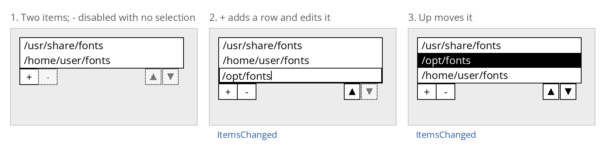

# Editable list (add, remove, reorder): widget roadmap

> **Issue:** [#264](https://github.com/KenSuenobu/rust-pushrod/issues/264) (extra-widgets 4.7) · **Epic 4:** Data views · **Milestone:** Extra widgets 2: everyday controls and pickers · **Size:** S
> **Crate:** `pushrod-extra-widgets` · **User docs:** `pushrod-docs/docs/extra-widgets/editable-list.md` · **Overview:** [extra widgets roadmap](../ROADMAP_EXTRA_WIDGETS.md) · **Rules:** [design philosophy](../../DESIGN_PHILOSOPHY.md)

This file is the specification for this widget: what it is, what it does, how it looks, and how it responds. To change it, edit this file in a pull request (and its mockup in [`docs/mockups/generate_extra_widgets.py`](../mockups/generate_extra_widgets.py) if the picture changes), then bring the issue in line. If this file and the issue disagree, this file wins.

## What it is

A list with + and - buttons underneath, in-place editing, and reordering.

Settings often hold a short list the user maintains: search paths, ignored words, recipients. Every application builds the same list-plus-buttons.

*Ideas from:* KDE KEditListWidget, the macOS add/remove button bar under tables, Qt Designer's string list editor, GTK preferences lists. Names and behavior are Pushrod's own.

## What it does

`EditableList { items }`: a list view (Pushrod 4.5) with a button bar below it: + (adds a row and starts editing it), - (removes the selected rows), and up/down glyph buttons to reorder. Double-click or F2 edits in place; drag reorders (Pushrod 9.8). A `validate` closure can reject an item; `unique(true)` rejects duplicates.

## How it looks

Each image shows the widget step by step; blue notes name the event emitted.

Drawn flat, in the standard Pushrod style: fills, one-pixel borders, and text; inverted when pressed or selected, dithered when disabled, a dotted outline when focused. No bevels, gradients, shadows, glass, or rounded corners.

## How it responds

### Events and callbacks

| Event emitted | When | Application callback |
|---|---|---|
| `ItemsChanged { id }` | Added, removed, edited, or moved | `on_items_change(id, ..)` |

Like every Pushrod widget, it can also receive application-defined custom events in `handle_event` and emit its own (Pushrod 1.13), and every internal action emits an engine event (Pushrod 9.10).

### Shared behavior

Like every Pushrod widget, it gets these from the core rather than implementing them itself:

- behavior flags and visual states ([Pushrod 1.1](https://github.com/KenSuenobu/rust-pushrod/issues/19))
- per-state appearance ([Pushrod 1.17](https://github.com/KenSuenobu/rust-pushrod/issues/104))
- keyboard focus, Tab order, Return/Escape ([Pushrod 1.4](https://github.com/KenSuenobu/rust-pushrod/issues/20))
- callbacks registered by widget ID ([Pushrod 1.6](https://github.com/KenSuenobu/rust-pushrod/issues/22))
- custom application events with payloads ([Pushrod 1.13](https://github.com/KenSuenobu/rust-pushrod/issues/78))
- composite parts the application can retrieve and modify ([Pushrod 5.2](https://github.com/KenSuenobu/rust-pushrod/issues/57))
- engine events for every internal action ([Pushrod 9.10](https://github.com/KenSuenobu/rust-pushrod/issues/109))

## Acceptance criteria

- [ ] Add, remove, edit, and reorder
- [ ] Validation and uniqueness
- [ ] Buttons disabled when not applicable
- [ ] Registered as `extra.editable_list` and shown in the gallery (1.2)

## Depends on

Extra widgets: 1.1 ([#252](https://github.com/KenSuenobu/rust-pushrod/issues/252)); Pushrod: Pushrod 4.5 [#52](https://github.com/KenSuenobu/rust-pushrod/issues/52) List view, Pushrod 2.2 [#28](https://github.com/KenSuenobu/rust-pushrod/issues/28) Glyph button (small single-character button), Pushrod 2.6 [#32](https://github.com/KenSuenobu/rust-pushrod/issues/32) Text field: single-line entry with input masks, validation, and numeric mode, Pushrod 9.8 [#100](https://github.com/KenSuenobu/rust-pushrod/issues/100) Drag and drop within the application

## Implementation notes

- **Crate:** `pushrod-extra-widgets`, using only the public APIs of `pushrod` and `pushrod-widgets`. Anything missing from the core is added to the core first.
- **Modules:** `pushrod-extra-widgets/src/editable_list.rs (new)`, `pushrod-docs`
- **Drawing:** paints into its own GPU texture only when invalidated; frames are composed by blitting. No OS-native controls; no per-frame CPU pixel work.
- **Documentation:** full doc headers on every non-private item, and the user page in the same pull request.

