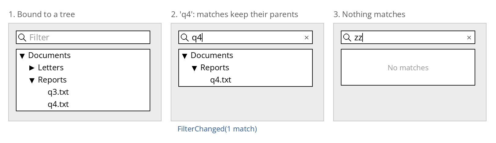

# Filter field (live filter for lists, tables, and trees): widget roadmap

> **Issue:** 4.10 (extra-widgets 4.10) · **Epic 4:** Data views · **Milestone:** Extra widgets 3: specialized views and assistants · **Size:** S
> **Crate:** `pushrod-extra-widgets` · **User docs:** `pushrod-docs/docs/extra-widgets/filter-field.md` · **Overview:** [extra widgets roadmap](../ROADMAP_EXTRA_WIDGETS.md) · **Rules:** [design philosophy](../../DESIGN_PHILOSOPHY.md)

This file is the specification for this widget: what it is, what it does, how it looks, and how it responds. To change it, edit this file in a pull request (and its mockup in [`docs/mockups/generate_extra_widgets.py`](../mockups/generate_extra_widgets.py) if the picture changes), then bring the issue in line. If this file and the issue disagree, this file wins.

## What it is

A search field bound to a list, table, or tree that hides non-matching rows as you type.

Long lists need filtering, and each application otherwise wires a search field to its view by hand, with different matching rules.

*Ideas from:* KDE KTreeWidgetSearchLine, GTK GtkSearchEntry with filter models, macOS search fields in source lists. Names and behavior are Pushrod's own.

## What it does

`FilterField::bind(view_id)`: a text field (Pushrod 2.6) with the search and clear glyph accessories, bound to a list, table (all or chosen columns), or tree view (4.1, keeping ancestors of matches). Matching is case-insensitive substring by default, replaceable by a closure; matches can be highlighted. Down arrow moves focus into the view. A "No matches" line shows when nothing matches.

## How it looks

Each image shows the widget step by step; blue notes name the event emitted.

Drawn flat, in the standard Pushrod style: fills, one-pixel borders, and text; inverted when pressed or selected, dithered when disabled, a dotted outline when focused. No bevels, gradients, shadows, glass, or rounded corners.

## How it responds

### Events and callbacks

| Event emitted | When | Application callback |
|---|---|---|
| `FilterChanged { id, text, matches }` | Text edited | `on_filter_change(id, ..)` |

Like every Pushrod widget, it can also receive application-defined custom events in `handle_event` and emit its own (Pushrod 1.13), and every internal action emits an engine event (Pushrod 9.10).

### Shared behavior

Like every Pushrod widget, it gets these from the core rather than implementing them itself:

- behavior flags and visual states ([Pushrod 1.1](https://github.com/KenSuenobu/rust-pushrod/issues/19))
- per-state appearance ([Pushrod 1.17](https://github.com/KenSuenobu/rust-pushrod/issues/104))
- keyboard focus, Tab order, Return/Escape ([Pushrod 1.4](https://github.com/KenSuenobu/rust-pushrod/issues/20))
- callbacks registered by widget ID ([Pushrod 1.6](https://github.com/KenSuenobu/rust-pushrod/issues/22))
- custom application events with payloads ([Pushrod 1.13](https://github.com/KenSuenobu/rust-pushrod/issues/78))
- composite parts the application can retrieve and modify ([Pushrod 5.2](https://github.com/KenSuenobu/rust-pushrod/issues/57))
- engine events for every internal action ([Pushrod 9.10](https://github.com/KenSuenobu/rust-pushrod/issues/109))

## Acceptance criteria

- [ ] Works with list, table, and tree views
- [ ] Tree filtering keeps ancestors
- [ ] Custom matching and no-match message
- [ ] Registered as `extra.filter_field` and shown in the gallery (1.2)

## Depends on

Extra widgets: 4.1 ([#55](https://github.com/KenSuenobu/rust-pushrod/issues/55)); Pushrod: Pushrod 2.6 [#32](https://github.com/KenSuenobu/rust-pushrod/issues/32) Text field: single-line entry with input masks, validation, and numeric mode, Pushrod 4.5 [#52](https://github.com/KenSuenobu/rust-pushrod/issues/52) List view, Pushrod 4.9 [#92](https://github.com/KenSuenobu/rust-pushrod/issues/92) Table view

## Implementation notes

- **Crate:** `pushrod-extra-widgets`, using only the public APIs of `pushrod` and `pushrod-widgets`. Anything missing from the core is added to the core first.
- **Modules:** `pushrod-extra-widgets/src/filter_field.rs (new)`, `pushrod-docs`
- **Drawing:** paints into its own GPU texture only when invalidated; frames are composed by blitting. No OS-native controls; no per-frame CPU pixel work.
- **Documentation:** full doc headers on every non-private item, and the user page in the same pull request.

