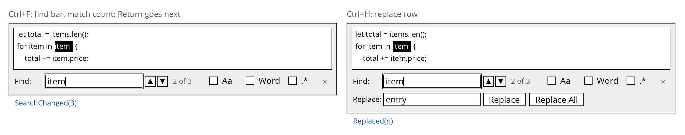

# Find and replace bar: widget roadmap

> **Issue:** 6.7 (extra-widgets 6.7) · **Epic 6:** Dialogs and assistants · **Milestone:** Extra widgets 3: specialized views and assistants · **Size:** M
> **Crate:** `pushrod-extra-widgets` · **User docs:** `pushrod-docs/docs/extra-widgets/find-bar.md` · **Overview:** [extra widgets roadmap](../ROADMAP_EXTRA_WIDGETS.md) · **Rules:** [design philosophy](../../DESIGN_PHILOSOPHY.md)

This file is the specification for this widget: what it is, what it does, how it looks, and how it responds. To change it, edit this file in a pull request (and its mockup in [`docs/mockups/generate_extra_widgets.py`](../mockups/generate_extra_widgets.py) if the picture changes), then bring the issue in line. If this file and the issue disagree, this file wins.

## What it is

A bar with find and replace fields, match options, a match count, and next and previous.

Text views, tables, and documents all need find; a bar that doesn't cover the content is better than a dialog. The Chassis code editor's find (Pushrod 11.6) can reuse it.

*Ideas from:* KDE's search bars in Kate and Okular, GTK GtkSearchBar, macOS NSTextFinder's find bar, browser find bars. Names and behavior are Pushrod's own.

## What it does

`FindBar::attach(target)`: a find field, previous/next glyph buttons, a match count ("3 of 12"), and Match case, Whole word, and Regular expression check boxes; an optional replace row with Replace and Replace All. Bound through a `Searchable` trait (find all, select a match, replace) implemented for the text area (Pushrod 2.18) and available to others. Ctrl+F opens it, Escape closes it, Return and Shift+Return go next and previous.

## How it looks

Each image shows the widget step by step; blue notes name the event emitted.

Drawn flat, in the standard Pushrod style: fills, one-pixel borders, and text; inverted when pressed or selected, dithered when disabled, a dotted outline when focused. No bevels, gradients, shadows, glass, or rounded corners.

## How it responds

### Events and callbacks

| Event emitted | When | Application callback |
|---|---|---|
| `SearchChanged { id, matches }` | Query or options changed | `on_search_change(id, ..)` |
| `Replaced { id, count }` | Replace or Replace All | `on_replace(id, ..)` |

Like every Pushrod widget, it can also receive application-defined custom events in `handle_event` and emit its own (Pushrod 1.13), and every internal action emits an engine event (Pushrod 9.10).

### Shared behavior

Like every Pushrod widget, it gets these from the core rather than implementing them itself:

- behavior flags and visual states ([Pushrod 1.1](https://github.com/KenSuenobu/rust-pushrod/issues/19))
- per-state appearance ([Pushrod 1.17](https://github.com/KenSuenobu/rust-pushrod/issues/104))
- keyboard focus, Tab order, Return/Escape ([Pushrod 1.4](https://github.com/KenSuenobu/rust-pushrod/issues/20))
- callbacks registered by widget ID ([Pushrod 1.6](https://github.com/KenSuenobu/rust-pushrod/issues/22))
- custom application events with payloads ([Pushrod 1.13](https://github.com/KenSuenobu/rust-pushrod/issues/78))
- composite parts the application can retrieve and modify ([Pushrod 5.2](https://github.com/KenSuenobu/rust-pushrod/issues/57))
- engine events for every internal action ([Pushrod 9.10](https://github.com/KenSuenobu/rust-pushrod/issues/109))

## Acceptance criteria

- [ ] Find, next, previous, and match count
- [ ] Case, whole word, and regular expression options
- [ ] Replace and Replace All through the Searchable trait
- [ ] Registered as `extra.find_bar` and shown in the gallery (1.2)

## Depends on

Extra widgets: 1.1; Pushrod: Pushrod 2.6 [#32](https://github.com/KenSuenobu/rust-pushrod/issues/32) Text field: single-line entry with input masks, validation, and numeric mode, Pushrod 2.4 [#30](https://github.com/KenSuenobu/rust-pushrod/issues/30) Check box with indeterminate state, Pushrod 2.2 [#28](https://github.com/KenSuenobu/rust-pushrod/issues/28) Glyph button (small single-character button), Pushrod 2.18 [#87](https://github.com/KenSuenobu/rust-pushrod/issues/87) Multi-line text area, Pushrod 9.5 [#97](https://github.com/KenSuenobu/rust-pushrod/issues/97) Actions and keyboard shortcuts: shared commands for menus, toolbars, and buttons

## Implementation notes

- **Crate:** `pushrod-extra-widgets`, using only the public APIs of `pushrod` and `pushrod-widgets`. Anything missing from the core is added to the core first.
- **Modules:** `pushrod-extra-widgets/src/find_bar.rs (new)`, `pushrod-docs`
- **Drawing:** paints into its own GPU texture only when invalidated; frames are composed by blitting. No OS-native controls; no per-frame CPU pixel work.
- **Documentation:** full doc headers on every non-private item, and the user page in the same pull request.

