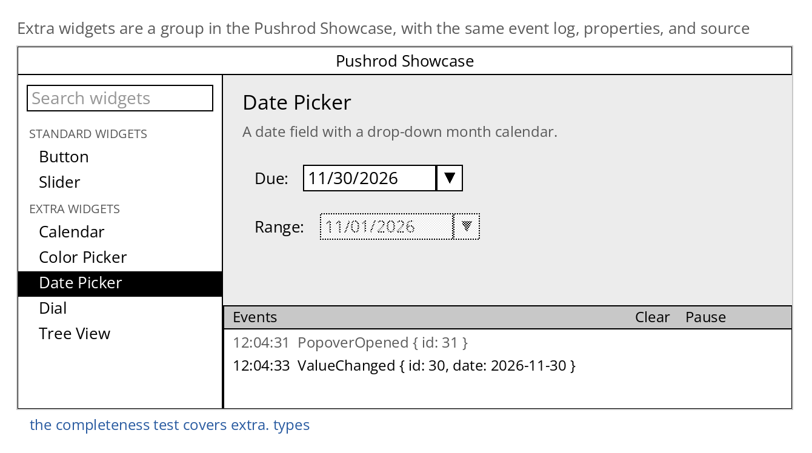

# Extra widgets in the Pushrod Showcase: widget roadmap

> **Issue:** [#253](https://github.com/KenSuenobu/rust-pushrod/issues/253) (extra-widgets 1.2) · **Epic 1:** Crate and foundations · **Milestone:** Extra widgets 1: crate and Chassis widgets · **Size:** S
> **Crate:** `pushrod-extra-widgets` · **User docs:** `pushrod-docs/docs/extra-widgets/gallery.md` · **Overview:** [extra widgets roadmap](../ROADMAP_EXTRA_WIDGETS.md) · **Rules:** [design philosophy](../../DESIGN_PHILOSOPHY.md)

This file is the specification for this widget: what it is, what it does, how it looks, and how it responds. To change it, edit this file in a pull request (and its mockup in [`docs/mockups/generate_extra_widgets.py`](../mockups/generate_extra_widgets.py) if the picture changes), then bring the issue in line. If this file and the issue disagree, this file wins.

## What it is

Every extra widget gets its page in the Pushrod Showcase, with the property panel, event log, and source view.

Each widget needs a place to be seen, tried, and screenshotted. Pushrod already has one: the Showcase (Pushrod 12.1). A second gallery would split the demos in two.

*Ideas from:* Qt's widget gallery, GTK's widget factory, the WinUI Gallery. Names and behavior are Pushrod's own.

## What it does

`pushrod-extra-widgets` exports `showcase_pages()`, and the Showcase lists them in an **Extra widgets** group (behind the showcase's `extra` feature, on by default). The Showcase's completeness test (Pushrod 12.2) walks the registry, so an extra widget registered without a page fails CI; its tour (Pushrod 12.7) produces the golden images and documentation screenshots. Every new extra widget adds its page in the same pull request.

## How it looks

Each image shows the widget step by step; blue notes name the event emitted.

Drawn flat, in the standard Pushrod style: fills, one-pixel borders, and text; inverted when pressed or selected, dithered when disabled, a dotted outline when focused. No bevels, gradients, shadows, glass, or rounded corners.

## How it responds

### Events and callbacks

| Event emitted | When | Application callback |
|---|---|---|
| (per widget) | Any interaction | Shown in the Showcase's event log |

Like every Pushrod widget, it can also receive application-defined custom events in `handle_event` and emit its own (Pushrod 1.13), and every internal action emits an engine event (Pushrod 9.10).

### Shared behavior

Like every Pushrod widget, it gets these from the core rather than implementing them itself:

- behavior flags and visual states ([Pushrod 1.1](https://github.com/KenSuenobu/rust-pushrod/issues/19))
- per-state appearance ([Pushrod 1.17](https://github.com/KenSuenobu/rust-pushrod/issues/104))
- keyboard focus, Tab order, Return/Escape ([Pushrod 1.4](https://github.com/KenSuenobu/rust-pushrod/issues/20))
- callbacks registered by widget ID ([Pushrod 1.6](https://github.com/KenSuenobu/rust-pushrod/issues/22))
- custom application events with payloads ([Pushrod 1.13](https://github.com/KenSuenobu/rust-pushrod/issues/78))
- composite parts the application can retrieve and modify ([Pushrod 5.2](https://github.com/KenSuenobu/rust-pushrod/issues/57))
- engine events for every internal action ([Pushrod 9.10](https://github.com/KenSuenobu/rust-pushrod/issues/109))

## Acceptance criteria

- [ ] The Showcase has an Extra widgets group with a page for every widget built so far
- [ ] The completeness test covers `extra.` types
- [ ] Golden images and documentation screenshots come from the Showcase tour
- [ ] Documented on the docs site

## Depends on

Extra widgets: 1.1 ([#252](https://github.com/KenSuenobu/rust-pushrod/issues/252)); Pushrod: Pushrod 12.1 [#295](https://github.com/KenSuenobu/rust-pushrod/issues/295) Showcase application shell, Pushrod 12.2 [#296](https://github.com/KenSuenobu/rust-pushrod/issues/296) Showcase pages for every standard widget, with a completeness test, Pushrod 12.7 [#301](https://github.com/KenSuenobu/rust-pushrod/issues/301) Showcase in CI: scripted tour, golden screenshots, and documentation images

## Implementation notes

- **Crate:** `pushrod-extra-widgets`, using only the public APIs of `pushrod` and `pushrod-widgets`. Anything missing from the core is added to the core first.
- **Modules:** `pushrod-extra-widgets/src/showcase.rs (new)`, `pushrod-showcase/Cargo.toml`, `pushrod-docs`
- **Drawing:** paints into its own GPU texture only when invalidated; frames are composed by blitting. No OS-native controls; no per-frame CPU pixel work.
- **Documentation:** full doc headers on every non-private item, and the user page in the same pull request.

