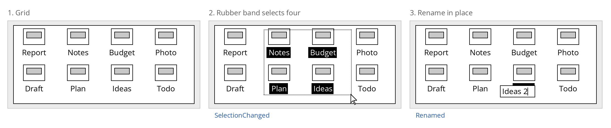

# Icon grid view: widget roadmap

> **Issue:** [#275](https://github.com/KenSuenobu/rust-pushrod/issues/275) (extra-widgets 4.3) · **Epic 4:** Data views · **Milestone:** Extra widgets 3: specialized views and assistants · **Size:** M
> **Crate:** `pushrod-extra-widgets` · **User docs:** `pushrod-docs/docs/extra-widgets/icon-grid.md` · **Overview:** [extra widgets roadmap](../ROADMAP_EXTRA_WIDGETS.md) · **Rules:** [design philosophy](../../DESIGN_PHILOSOPHY.md)

This file is the specification for this widget: what it is, what it does, how it looks, and how it responds. To change it, edit this file in a pull request (and its mockup in [`docs/mockups/generate_extra_widgets.py`](../mockups/generate_extra_widgets.py) if the picture changes), then bring the issue in line. If this file and the issue disagree, this file wins.

## What it is

A scrolling grid of icons with captions, rubber-band selection, and drag and drop.

File managers, image browsers, and launchers show many items as icons in a grid; the standard icon widget is a single item.

*Ideas from:* macOS NSCollectionView, GTK GtkIconView and GtkGridView, Qt QListView in icon mode, KDE file views, Motif XmContainer (spatial mode), Win32 list view in icon mode, the Atari and Amiga desktops. Names and behavior are Pushrod's own.

## What it does

`IconGrid { source, cell_size }`: icon widgets (Pushrod 2.8) in a reflowing grid inside a container (Pushrod 5.3), only visible cells created. Click, Ctrl-click, Shift-click, and a dotted rubber-band rectangle select; arrow keys move; typing jumps to the first matching caption. Items can be dragged out or reordered (Pushrod 9.8); captions can be renamed in place.

## How it looks

Each image shows the widget step by step; blue notes name the event emitted.

Drawn flat, in the standard Pushrod style: fills, one-pixel borders, and text; inverted when pressed or selected, dithered when disabled, a dotted outline when focused. No bevels, gradients, shadows, glass, or rounded corners.

## How it responds

### Events and callbacks

| Event emitted | When | Application callback |
|---|---|---|
| `SelectionChanged { id }` | Selection changed | `on_selection_change(id, ..)` |
| `Activated { id, index }` | Double-click or Return | `on_activate(id, ..)` |
| `Renamed { id, index, text }` | Caption edited | `on_rename(id, ..)` |

Like every Pushrod widget, it can also receive application-defined custom events in `handle_event` and emit its own (Pushrod 1.13), and every internal action emits an engine event (Pushrod 9.10).

### Shared behavior

Like every Pushrod widget, it gets these from the core rather than implementing them itself:

- behavior flags and visual states ([Pushrod 1.1](https://github.com/KenSuenobu/rust-pushrod/issues/19))
- per-state appearance ([Pushrod 1.17](https://github.com/KenSuenobu/rust-pushrod/issues/104))
- keyboard focus, Tab order, Return/Escape ([Pushrod 1.4](https://github.com/KenSuenobu/rust-pushrod/issues/20))
- callbacks registered by widget ID ([Pushrod 1.6](https://github.com/KenSuenobu/rust-pushrod/issues/22))
- custom application events with payloads ([Pushrod 1.13](https://github.com/KenSuenobu/rust-pushrod/issues/78))
- composite parts the application can retrieve and modify ([Pushrod 5.2](https://github.com/KenSuenobu/rust-pushrod/issues/57))
- engine events for every internal action ([Pushrod 9.10](https://github.com/KenSuenobu/rust-pushrod/issues/109))

## Acceptance criteria

- [ ] Reflowing, virtualized grid
- [ ] Rubber-band and keyboard selection, type-to-find
- [ ] Drag and drop and in-place rename
- [ ] Registered as `extra.icon_grid` with a page in the Pushrod Showcase (1.2)

## Depends on

Extra widgets: 1.1 ([#252](https://github.com/KenSuenobu/rust-pushrod/issues/252)); Pushrod: Pushrod 2.8 [#34](https://github.com/KenSuenobu/rust-pushrod/issues/34) Icon widget (picture with caption), Pushrod 5.3 [#58](https://github.com/KenSuenobu/rust-pushrod/issues/58) Container: a scrollable viewport onto fixed-size content, Pushrod 9.4 [#96](https://github.com/KenSuenobu/rust-pushrod/issues/96) Reusable input controllers: click, drag, scroll, hover, long-press, key, Pushrod 9.8 [#100](https://github.com/KenSuenobu/rust-pushrod/issues/100) Drag and drop within the application

## Implementation notes

- **Crate:** `pushrod-extra-widgets`, using only the public APIs of `pushrod` and `pushrod-widgets`. Anything missing from the core is added to the core first.
- **Modules:** `pushrod-extra-widgets/src/icon_grid.rs (new)`, `pushrod-docs`
- **Drawing:** paints into its own GPU texture only when invalidated; frames are composed by blitting. No OS-native controls; no per-frame CPU pixel work.
- **Documentation:** full doc headers on every non-private item, and the user page in the same pull request.

