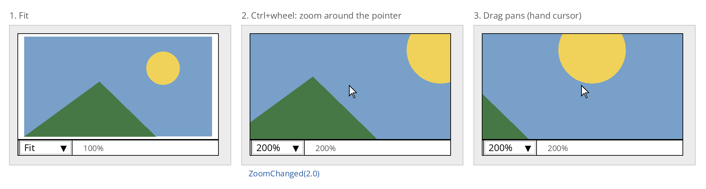

# Image viewer (zoom and pan): widget roadmap

> **Issue:** 4.12 (extra-widgets 4.12) · **Epic 4:** Data views · **Milestone:** Extra widgets 3: specialized views and assistants · **Size:** S
> **Crate:** `pushrod-extra-widgets` · **User docs:** `pushrod-docs/docs/extra-widgets/image-viewer.md` · **Overview:** [extra widgets roadmap](../ROADMAP_EXTRA_WIDGETS.md) · **Rules:** [design philosophy](../../DESIGN_PHILOSOPHY.md)

This file is the specification for this widget: what it is, what it does, how it looks, and how it responds. To change it, edit this file in a pull request (and its mockup in [`docs/mockups/generate_extra_widgets.py`](../mockups/generate_extra_widgets.py) if the picture changes), then bring the issue in line. If this file and the issue disagree, this file wins.

## What it is

An image in a scrollable view with zoom to fit, actual size, zoom by wheel, and drag to pan.

Showing a photo or diagram larger than its space needs zoom and pan; the standard image widget only fits or tiles.

*Ideas from:* Qt QGraphicsView image viewers, GTK GtkPicture in a scrolled window, macOS image views in Preview, KDE Gwenview. Names and behavior are Pushrod's own.

## What it does

`ImageViewer { image }`: the image in a container (Pushrod 5.3) with scroll bars. Zoom modes: fit, fill, actual size, or a factor; Ctrl+wheel or +/- zoom around the pointer; dragging pans (hand cursor, Pushrod 9.9); double-click toggles fit and 100%. Optional zoom choice and percentage in a small bar. Large images are drawn in tiles so the texture stays within GPU limits.

## How it looks

Each image shows the widget step by step; blue notes name the event emitted.

Drawn flat, in the standard Pushrod style: fills, one-pixel borders, and text; inverted when pressed or selected, dithered when disabled, a dotted outline when focused. No bevels, gradients, shadows, glass, or rounded corners.

## How it responds

### Events and callbacks

| Event emitted | When | Application callback |
|---|---|---|
| `ZoomChanged { id, factor }` | Zoom changed | `on_zoom_change(id, ..)` |

Like every Pushrod widget, it can also receive application-defined custom events in `handle_event` and emit its own (Pushrod 1.13), and every internal action emits an engine event (Pushrod 9.10).

### Shared behavior

Like every Pushrod widget, it gets these from the core rather than implementing them itself:

- behavior flags and visual states ([Pushrod 1.1](https://github.com/KenSuenobu/rust-pushrod/issues/19))
- per-state appearance ([Pushrod 1.17](https://github.com/KenSuenobu/rust-pushrod/issues/104))
- keyboard focus, Tab order, Return/Escape ([Pushrod 1.4](https://github.com/KenSuenobu/rust-pushrod/issues/20))
- callbacks registered by widget ID ([Pushrod 1.6](https://github.com/KenSuenobu/rust-pushrod/issues/22))
- custom application events with payloads ([Pushrod 1.13](https://github.com/KenSuenobu/rust-pushrod/issues/78))
- composite parts the application can retrieve and modify ([Pushrod 5.2](https://github.com/KenSuenobu/rust-pushrod/issues/57))
- engine events for every internal action ([Pushrod 9.10](https://github.com/KenSuenobu/rust-pushrod/issues/109))

## Acceptance criteria

- [ ] Fit, fill, 100%, and zoom around the pointer
- [ ] Drag to pan
- [ ] Tiled drawing for large images
- [ ] Registered as `extra.image_viewer` and shown in the gallery (1.2)

## Depends on

Extra widgets: 1.1; Pushrod: Pushrod 2.7 [#33](https://github.com/KenSuenobu/rust-pushrod/issues/33) Image widget, Pushrod 5.3 [#58](https://github.com/KenSuenobu/rust-pushrod/issues/58) Container: a scrollable viewport onto fixed-size content, Pushrod 9.4 [#96](https://github.com/KenSuenobu/rust-pushrod/issues/96) Reusable input controllers: click, drag, scroll, hover, long-press, key, Pushrod 9.9 [#101](https://github.com/KenSuenobu/rust-pushrod/issues/101) Pointer cursor per widget

## Implementation notes

- **Crate:** `pushrod-extra-widgets`, using only the public APIs of `pushrod` and `pushrod-widgets`. Anything missing from the core is added to the core first.
- **Modules:** `pushrod-extra-widgets/src/image_viewer.rs (new)`, `pushrod-docs`
- **Drawing:** paints into its own GPU texture only when invalidated; frames are composed by blitting. No OS-native controls; no per-frame CPU pixel work.
- **Documentation:** full doc headers on every non-private item, and the user page in the same pull request.

