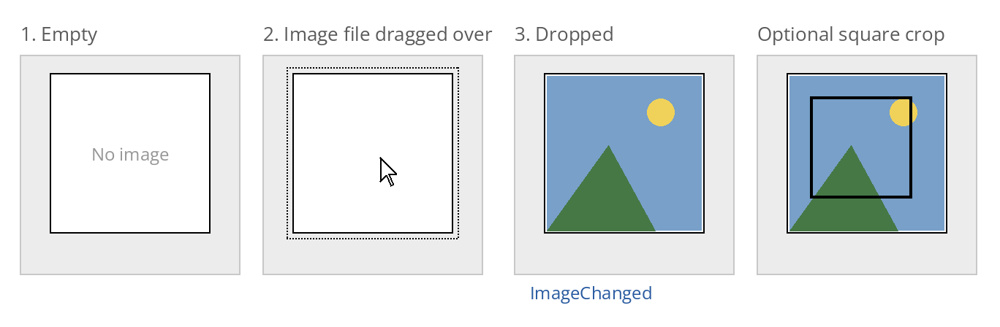

# Image well: widget roadmap

> **Issue:** [#272](https://github.com/KenSuenobu/rust-pushrod/issues/272) (extra-widgets 3.7) · **Epic 3:** Pickers and special fields · **Milestone:** Extra widgets 3: specialized views and assistants · **Size:** S
> **Crate:** `pushrod-extra-widgets` · **User docs:** `pushrod-docs/docs/extra-widgets/image-well.md` · **Overview:** [extra widgets roadmap](../ROADMAP_EXTRA_WIDGETS.md) · **Rules:** [design philosophy](../../DESIGN_PHILOSOPHY.md)

This file is the specification for this widget: what it is, what it does, how it looks, and how it responds. To change it, edit this file in a pull request (and its mockup in [`docs/mockups/generate_extra_widgets.py`](../mockups/generate_extra_widgets.py) if the picture changes), then bring the issue in line. If this file and the issue disagree, this file wins.

## What it is

A framed area that shows an image and accepts a new one by drop, paste, or Choose.

Profile pictures, icons, and document images are set by dropping or choosing a picture into a framed slot.

*Ideas from:* macOS editable NSImageView, the Mac OS 8 image well, KDE KPixmapRegionSelector, avatar pickers in GTK and KDE settings. Names and behavior are Pushrod's own.

## What it does

`ImageWell { image }`: an image widget (Pushrod 2.7) scaled to fit inside a frame. Drop an image file (Pushrod 9.8), paste with Ctrl+V, or double-click to choose with the file chooser; Delete clears it. A dotted outline shows while a drop is over it. Optional square crop with a draggable selection.

## How it looks

Each image shows the widget step by step; blue notes name the event emitted.

Drawn flat, in the standard Pushrod style: fills, one-pixel borders, and text; inverted when pressed or selected, dithered when disabled, a dotted outline when focused. No bevels, gradients, shadows, glass, or rounded corners.

## How it responds

### Events and callbacks

| Event emitted | When | Application callback |
|---|---|---|
| `ImageChanged { id }` | Image dropped, pasted, chosen, or cleared | `on_image_change(id, ..)` |

Like every Pushrod widget, it can also receive application-defined custom events in `handle_event` and emit its own (Pushrod 1.13), and every internal action emits an engine event (Pushrod 9.10).

### Shared behavior

Like every Pushrod widget, it gets these from the core rather than implementing them itself:

- behavior flags and visual states ([Pushrod 1.1](https://github.com/KenSuenobu/rust-pushrod/issues/19))
- per-state appearance ([Pushrod 1.17](https://github.com/KenSuenobu/rust-pushrod/issues/104))
- keyboard focus, Tab order, Return/Escape ([Pushrod 1.4](https://github.com/KenSuenobu/rust-pushrod/issues/20))
- callbacks registered by widget ID ([Pushrod 1.6](https://github.com/KenSuenobu/rust-pushrod/issues/22))
- custom application events with payloads ([Pushrod 1.13](https://github.com/KenSuenobu/rust-pushrod/issues/78))
- composite parts the application can retrieve and modify ([Pushrod 5.2](https://github.com/KenSuenobu/rust-pushrod/issues/57))
- engine events for every internal action ([Pushrod 9.10](https://github.com/KenSuenobu/rust-pushrod/issues/109))

## Acceptance criteria

- [ ] Drop, paste, choose, and clear
- [ ] Drop feedback outline
- [ ] Optional square crop
- [ ] Registered as `extra.image_well` and shown in the gallery (1.2)

## Depends on

Extra widgets: 1.1 ([#252](https://github.com/KenSuenobu/rust-pushrod/issues/252)); Pushrod: Pushrod 2.7 [#33](https://github.com/KenSuenobu/rust-pushrod/issues/33) Image widget, Pushrod 9.8 [#100](https://github.com/KenSuenobu/rust-pushrod/issues/100) Drag and drop within the application, Pushrod 2.12 [#38](https://github.com/KenSuenobu/rust-pushrod/issues/38) File chooser dialog (drawn by Pushrod)

## Implementation notes

- **Crate:** `pushrod-extra-widgets`, using only the public APIs of `pushrod` and `pushrod-widgets`. Anything missing from the core is added to the core first.
- **Modules:** `pushrod-extra-widgets/src/image_well.rs (new)`, `pushrod-docs`
- **Drawing:** paints into its own GPU texture only when invalidated; frames are composed by blitting. No OS-native controls; no per-frame CPU pixel work.
- **Documentation:** full doc headers on every non-private item, and the user page in the same pull request.

