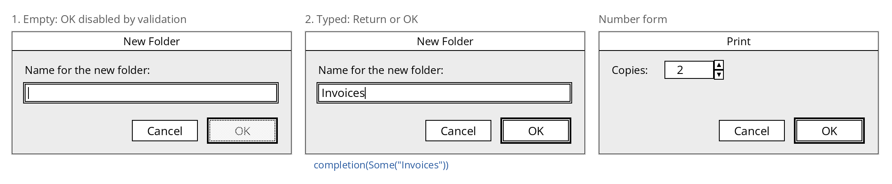

# Input dialog (ask for one value): widget roadmap

> **Issue:** [#267](https://github.com/KenSuenobu/rust-pushrod/issues/267) (extra-widgets 6.1) · **Epic 6:** Dialogs and assistants · **Milestone:** Extra widgets 2: everyday controls and pickers · **Size:** S
> **Crate:** `pushrod-extra-widgets` · **User docs:** `pushrod-docs/docs/extra-widgets/input-dialog.md` · **Overview:** [extra widgets roadmap](../ROADMAP_EXTRA_WIDGETS.md) · **Rules:** [design philosophy](../../DESIGN_PHILOSOPHY.md)

This file is the specification for this widget: what it is, what it does, how it looks, and how it responds. To change it, edit this file in a pull request (and its mockup in [`docs/mockups/generate_extra_widgets.py`](../mockups/generate_extra_widgets.py) if the picture changes), then bring the issue in line. If this file and the issue disagree, this file wins.

## What it is

A one-call modal dialog asking for a single text, number, or choice.

Asking for one value (a name for a new folder, a number of copies, one item from a list) shouldn't need a form file.

*Ideas from:* Qt QInputDialog, Motif prompt and selection dialogs (XmSelectionBox), KDE input dialogs, Delphi InputBox, Java JOptionPane. Names and behavior are Pushrod's own.

## What it does

`InputDialog::text("New folder name", default)`, `::number(label, value, min, max)`, `::choice(label, items, editable)`: a modal dialog (Pushrod 6.7) with a message, the matching field (text field, spin box, or combo box), and OK/Cancel. OK is the default button and is disabled while a `validate` closure rejects the value. The completion closure receives `Option<value>`.

## How it looks

Each image shows the widget step by step; blue notes name the event emitted.

Drawn flat, in the standard Pushrod style: fills, one-pixel borders, and text; inverted when pressed or selected, dithered when disabled, a dotted outline when focused. No bevels, gradients, shadows, glass, or rounded corners.

## How it responds

### Events and callbacks

| Event emitted | When | Application callback |
|---|---|---|
| (completion) | OK or Cancel | Completion closure `FnOnce(&mut S, &mut Ui, Option<T>)` |

Like every Pushrod widget, it can also receive application-defined custom events in `handle_event` and emit its own (Pushrod 1.13), and every internal action emits an engine event (Pushrod 9.10).

### Shared behavior

Like every Pushrod widget, it gets these from the core rather than implementing them itself:

- behavior flags and visual states ([Pushrod 1.1](https://github.com/KenSuenobu/rust-pushrod/issues/19))
- per-state appearance ([Pushrod 1.17](https://github.com/KenSuenobu/rust-pushrod/issues/104))
- keyboard focus, Tab order, Return/Escape ([Pushrod 1.4](https://github.com/KenSuenobu/rust-pushrod/issues/20))
- callbacks registered by widget ID ([Pushrod 1.6](https://github.com/KenSuenobu/rust-pushrod/issues/22))
- custom application events with payloads ([Pushrod 1.13](https://github.com/KenSuenobu/rust-pushrod/issues/78))
- composite parts the application can retrieve and modify ([Pushrod 5.2](https://github.com/KenSuenobu/rust-pushrod/issues/57))
- engine events for every internal action ([Pushrod 9.10](https://github.com/KenSuenobu/rust-pushrod/issues/109))

## Acceptance criteria

- [ ] Text, number, and choice forms
- [ ] Validation disables OK
- [ ] Completion receives None on Cancel
- [ ] Registered as `extra.input_dialog` with a page in the Pushrod Showcase (1.2)

## Depends on

Extra widgets: 1.1 ([#252](https://github.com/KenSuenobu/rust-pushrod/issues/252)); Pushrod: Pushrod 6.7 [#66](https://github.com/KenSuenobu/rust-pushrod/issues/66) Modal dialogs: run a form until a dismissing control is chosen, Pushrod 2.6 [#32](https://github.com/KenSuenobu/rust-pushrod/issues/32) Text field: single-line entry with input masks, validation, and numeric mode, Pushrod 4.2 [#49](https://github.com/KenSuenobu/rust-pushrod/issues/49) Spin box, Pushrod 4.6 [#53](https://github.com/KenSuenobu/rust-pushrod/issues/53) Combo box

## Implementation notes

- **Crate:** `pushrod-extra-widgets`, using only the public APIs of `pushrod` and `pushrod-widgets`. Anything missing from the core is added to the core first.
- **Modules:** `pushrod-extra-widgets/src/input_dialog.rs (new)`, `pushrod-docs`
- **Drawing:** paints into its own GPU texture only when invalidated; frames are composed by blitting. No OS-native controls; no per-frame CPU pixel work.
- **Documentation:** full doc headers on every non-private item, and the user page in the same pull request.

