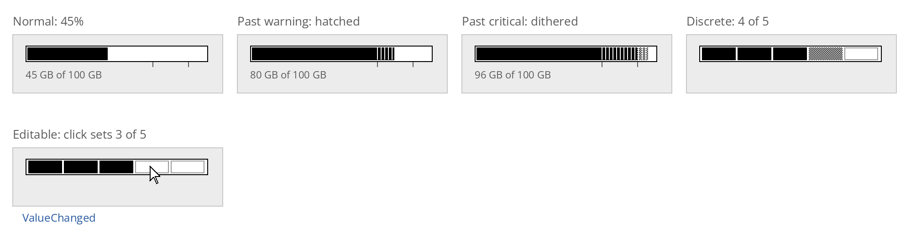

# Level indicator (meter): widget roadmap

> **Issue:** [#54](https://github.com/KenSuenobu/rust-pushrod/issues/54) (extra-widgets 2.5) · **Epic 2:** Buttons and value controls · **Milestone:** Extra widgets 2: everyday controls and pickers · **Size:** S
> **Crate:** `pushrod-extra-widgets` · **User docs:** `pushrod-docs/docs/extra-widgets/level-indicator.md` · **Overview:** [extra widgets roadmap](../ROADMAP_EXTRA_WIDGETS.md) · **Rules:** [design philosophy](../../DESIGN_PHILOSOPHY.md)

This file is the specification for this widget: what it is, what it does, how it looks, and how it responds. To change it, edit this file in a pull request (and its mockup in [`docs/mockups/generate_extra_widgets.py`](../mockups/generate_extra_widgets.py) if the picture changes), then bring the issue in line. If this file and the issue disagree, this file wins.

## What it is

A bar showing a level against warning and critical thresholds, continuous or in discrete segments.

Disk usage, battery, signal strength, and password strength are levels, not progress: they don't move toward done, and they need warning and critical marks. Originally parked because the progress bar can approximate it; as an extra widget it can do the job properly.

*Ideas from:* macOS NSLevelIndicator, GTK GtkLevelBar, KDE KCapacityBar, AmigaOS fuelgauge.gadget, MUI Levelmeter. Names and behavior are Pushrod's own.

## What it does

`LevelIndicator { min, max, value, warning, critical, style }`: `Continuous` (a filled bar) or `Discrete(n)` (n separate segments). The fill pattern changes past the warning and critical values (solid, then hatched, then dithered) so it reads without color, with optional colors from per-state appearance (Pushrod 1.17). Optional text inside or beside ("62 GB of 100 GB"). Display only by default; `editable(true)` lets a click or arrow keys set the value.

## How it looks

Each image shows the widget step by step; blue notes name the event emitted.

Drawn flat, in the standard Pushrod style: fills, one-pixel borders, and text; inverted when pressed or selected, dithered when disabled, a dotted outline when focused. No bevels, gradients, shadows, glass, or rounded corners.

## How it responds

### Events and callbacks

| Event emitted | When | Application callback |
|---|---|---|
| `ValueChanged { id, value }` | Value set by the user (editable only) | `on_value_change(id, ..)` |

Like every Pushrod widget, it can also receive application-defined custom events in `handle_event` and emit its own (Pushrod 1.13), and every internal action emits an engine event (Pushrod 9.10).

### Shared behavior

Like every Pushrod widget, it gets these from the core rather than implementing them itself:

- behavior flags and visual states ([Pushrod 1.1](https://github.com/KenSuenobu/rust-pushrod/issues/19))
- per-state appearance ([Pushrod 1.17](https://github.com/KenSuenobu/rust-pushrod/issues/104))
- keyboard focus, Tab order, Return/Escape ([Pushrod 1.4](https://github.com/KenSuenobu/rust-pushrod/issues/20))
- callbacks registered by widget ID ([Pushrod 1.6](https://github.com/KenSuenobu/rust-pushrod/issues/22))
- custom application events with payloads ([Pushrod 1.13](https://github.com/KenSuenobu/rust-pushrod/issues/78))
- composite parts the application can retrieve and modify ([Pushrod 5.2](https://github.com/KenSuenobu/rust-pushrod/issues/57))
- engine events for every internal action ([Pushrod 9.10](https://github.com/KenSuenobu/rust-pushrod/issues/109))

## Acceptance criteria

- [ ] Continuous and discrete styles
- [ ] Warning and critical thresholds visible without color
- [ ] Optional text and editable mode
- [ ] Registered as `extra.level_indicator` and shown in the gallery (1.2)

## Depends on

Extra widgets: 1.1; Pushrod: Pushrod 1.1 [#19](https://github.com/KenSuenobu/rust-pushrod/issues/19) Widget behavior flags and visual states, Pushrod 1.17 [#104](https://github.com/KenSuenobu/rust-pushrod/issues/104) Per-state appearance: colors, border, and font for each visual state, Pushrod 9.4 [#96](https://github.com/KenSuenobu/rust-pushrod/issues/96) Reusable input controllers: click, drag, scroll, hover, long-press, key

## Implementation notes

- **Crate:** `pushrod-extra-widgets`, using only the public APIs of `pushrod` and `pushrod-widgets`. Anything missing from the core is added to the core first.
- **Modules:** `pushrod-extra-widgets/src/level_indicator.rs (new)`, `pushrod-docs`
- **Drawing:** paints into its own GPU texture only when invalidated; frames are composed by blitting. No OS-native controls; no per-frame CPU pixel work.
- **Documentation:** full doc headers on every non-private item, and the user page in the same pull request.

