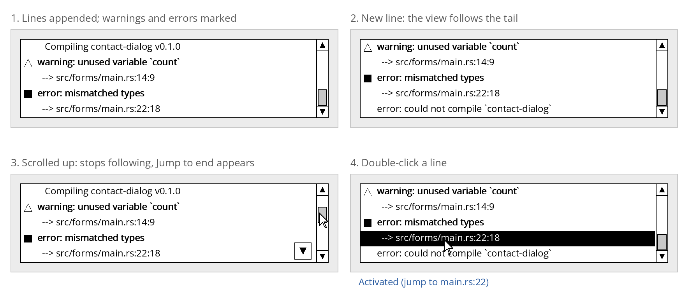

# Log view (append-only output): widget roadmap

> **Issue:** [#303](https://github.com/KenSuenobu/rust-pushrod/issues/303) (extra-widgets 4.13) · **Epic 4:** Data views · **Milestone:** Extra widgets 1: crate and Chassis widgets · **Size:** S
> **Crate:** `pushrod-extra-widgets` · **User docs:** `pushrod-docs/docs/extra-widgets/log-view.md` · **Overview:** [extra widgets roadmap](../ROADMAP_EXTRA_WIDGETS.md) · **Rules:** [design philosophy](../../DESIGN_PHILOSOPHY.md)

This file is the specification for this widget: what it is, what it does, how it looks, and how it responds. To change it, edit this file in a pull request (and its mockup in [`docs/mockups/generate_extra_widgets.py`](../mockups/generate_extra_widgets.py) if the picture changes), then bring the issue in line. If this file and the issue disagree, this file wins.

## What it is

A read-only, scrolling view of lines that follows the newest line, for build output and logs.

Build output, test runs, and application logs arrive line by line, thousands of lines long. A text area is built for editing, not for appending fast and trimming old lines. Chassis needs this for Build and Run.

*Ideas from:* Output panels in VS Code and Qt Creator, Dear ImGui's console and log examples, plain-text log widgets in Qt. Names and behavior are Pushrod's own.

## What it does

`LogView { max_lines }`: `append(line, level)` adds a line (levels: plain, info, warning, error; warnings and errors get a marker in the left margin and bold text, not color alone). Only visible lines are drawn. The view follows the tail while scrolled to the bottom and stops following when the user scrolls up (a "Jump to end" glyph appears). Old lines beyond `max_lines` are dropped. Lines can be selected and copied; `on_activate` reports a double-clicked line (to jump to `file:line`). Optional timestamps and wrapping.

## How it looks

Each image shows the widget step by step; blue notes name the event emitted.

Drawn flat, in the standard Pushrod style: fills, one-pixel borders, and text; inverted when pressed or selected, dithered when disabled, a dotted outline when focused. No bevels, gradients, shadows, glass, or rounded corners.

## How it responds

### Events and callbacks

| Event emitted | When | Application callback |
|---|---|---|
| `Activated { id, line }` | A line double-clicked | `on_activate(id, ..)` |

Like every Pushrod widget, it can also receive application-defined custom events in `handle_event` and emit its own (Pushrod 1.13), and every internal action emits an engine event (Pushrod 9.10).

### Shared behavior

Like every Pushrod widget, it gets these from the core rather than implementing them itself:

- behavior flags and visual states ([Pushrod 1.1](https://github.com/KenSuenobu/rust-pushrod/issues/19))
- per-state appearance ([Pushrod 1.17](https://github.com/KenSuenobu/rust-pushrod/issues/104))
- keyboard focus, Tab order, Return/Escape ([Pushrod 1.4](https://github.com/KenSuenobu/rust-pushrod/issues/20))
- callbacks registered by widget ID ([Pushrod 1.6](https://github.com/KenSuenobu/rust-pushrod/issues/22))
- custom application events with payloads ([Pushrod 1.13](https://github.com/KenSuenobu/rust-pushrod/issues/78))
- composite parts the application can retrieve and modify ([Pushrod 5.2](https://github.com/KenSuenobu/rust-pushrod/issues/57))
- engine events for every internal action ([Pushrod 9.10](https://github.com/KenSuenobu/rust-pushrod/issues/109))

## Acceptance criteria

- [ ] Appending 100,000 lines stays responsive; old lines trimmed
- [ ] Follows the tail unless the user scrolled up
- [ ] Select and copy; levels marked without relying on color
- [ ] Registered as `extra.log_view` with a page in the Pushrod Showcase (1.2)

## Depends on

Extra widgets: 1.1 ([#252](https://github.com/KenSuenobu/rust-pushrod/issues/252)); Pushrod: Pushrod 5.3 [#58](https://github.com/KenSuenobu/rust-pushrod/issues/58) Container: a scrollable viewport onto fixed-size content, Pushrod 1.18 [#111](https://github.com/KenSuenobu/rust-pushrod/issues/111) Text layout engine: Parley for shaping, bidi, line breaking, and font fallback (with an SDL2 compatibility gate), Pushrod 3.1 [#39](https://github.com/KenSuenobu/rust-pushrod/issues/39) Scroll bar

## Used by Chassis

Chassis 6.2 [#196](https://github.com/KenSuenobu/rust-pushrod/issues/196) Build and run.

## Implementation notes

- **Crate:** `pushrod-extra-widgets`, using only the public APIs of `pushrod` and `pushrod-widgets`. Anything missing from the core is added to the core first.
- **Modules:** `pushrod-extra-widgets/src/log_view.rs (new)`, `pushrod-docs`
- **Drawing:** paints into its own GPU texture only when invalidated; frames are composed by blitting. No OS-native controls; no per-frame CPU pixel work.
- **Documentation:** full doc headers on every non-private item, and the user page in the same pull request.

