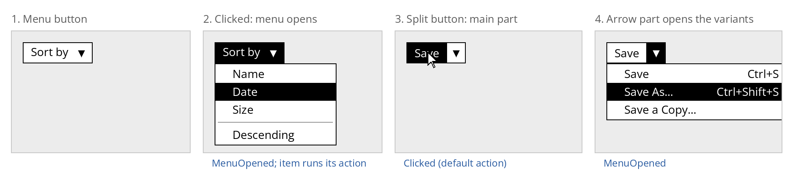

# Menu button and split button: widget roadmap

> **Issue:** [#258](https://github.com/KenSuenobu/rust-pushrod/issues/258) (extra-widgets 2.1) · **Epic 2:** Buttons and value controls · **Milestone:** Extra widgets 2: everyday controls and pickers · **Size:** S
> **Crate:** `pushrod-extra-widgets` · **User docs:** `pushrod-docs/docs/extra-widgets/menu-button.md` · **Overview:** [extra widgets roadmap](../ROADMAP_EXTRA_WIDGETS.md) · **Rules:** [design philosophy](../../DESIGN_PHILOSOPHY.md)

This file is the specification for this widget: what it is, what it does, how it looks, and how it responds. To change it, edit this file in a pull request (and its mockup in [`docs/mockups/generate_extra_widgets.py`](../mockups/generate_extra_widgets.py) if the picture changes), then bring the issue in line. If this file and the issue disagree, this file wins.

## What it is

A button that opens a menu, and a button with a separate arrow part that opens one.

Some commands have variants (Save / Save As / Save Copy) or a list of related actions, and a plain button can only run one action.

*Ideas from:* Qt QToolButton menu modes, GTK GtkMenuButton and libadwaita's split button, macOS pull-down buttons and NSComboButton, Win32 split buttons, the Mac OS 8 bevel button with a pop-up arrow. Names and behavior are Pushrod's own.

## What it does

`MenuButton { label, menu }` shows a down-arrow glyph and opens its menu (Pushrod 2.11) on click or Space. `SplitButton { label, action, menu }` has two parts divided by a line: the label part runs the default action; the arrow part opens the menu. Menu items are actions (Pushrod 9.5), so their shortcuts and enabled state come for free. Keyboard: Alt+Down opens the menu on either kind.

## How it looks

Each image shows the widget step by step; blue notes name the event emitted.

Drawn flat, in the standard Pushrod style: fills, one-pixel borders, and text; inverted when pressed or selected, dithered when disabled, a dotted outline when focused. No bevels, gradients, shadows, glass, or rounded corners.

## How it responds

### Events and callbacks

| Event emitted | When | Application callback |
|---|---|---|
| `Clicked { id }` | Split button's main part pressed | `on_click(id, ..)` |
| `MenuOpened { id }` | Menu shown | `on_menu_open(id, ..)` |
| (action) | Menu item chosen | the action's own callback |

Like every Pushrod widget, it can also receive application-defined custom events in `handle_event` and emit its own (Pushrod 1.13), and every internal action emits an engine event (Pushrod 9.10).

### Shared behavior

Like every Pushrod widget, it gets these from the core rather than implementing them itself:

- behavior flags and visual states ([Pushrod 1.1](https://github.com/KenSuenobu/rust-pushrod/issues/19))
- per-state appearance ([Pushrod 1.17](https://github.com/KenSuenobu/rust-pushrod/issues/104))
- keyboard focus, Tab order, Return/Escape ([Pushrod 1.4](https://github.com/KenSuenobu/rust-pushrod/issues/20))
- callbacks registered by widget ID ([Pushrod 1.6](https://github.com/KenSuenobu/rust-pushrod/issues/22))
- custom application events with payloads ([Pushrod 1.13](https://github.com/KenSuenobu/rust-pushrod/issues/78))
- composite parts the application can retrieve and modify ([Pushrod 5.2](https://github.com/KenSuenobu/rust-pushrod/issues/57))
- engine events for every internal action ([Pushrod 9.10](https://github.com/KenSuenobu/rust-pushrod/issues/109))

## Acceptance criteria

- [ ] Menu button opens its menu by click, Space, and Alt+Down
- [ ] Split button: main part runs the default action, arrow part opens the menu
- [ ] Menu items are actions with shortcuts and enabled state
- [ ] Registered as `extra.menu_button` and shown in the gallery (1.2)

## Depends on

Extra widgets: 1.1 ([#252](https://github.com/KenSuenobu/rust-pushrod/issues/252)); Pushrod: Pushrod 2.3 [#29](https://github.com/KenSuenobu/rust-pushrod/issues/29) Button behaviors: default, cancel, toggle, activate-on-press, dismiss dialog, Pushrod 2.11 [#37](https://github.com/KenSuenobu/rust-pushrod/issues/37) Menu bar and drop-down menus (drawn by Pushrod), Pushrod 9.5 [#97](https://github.com/KenSuenobu/rust-pushrod/issues/97) Actions and keyboard shortcuts: shared commands for menus, toolbars, and buttons

## Implementation notes

- **Crate:** `pushrod-extra-widgets`, using only the public APIs of `pushrod` and `pushrod-widgets`. Anything missing from the core is added to the core first.
- **Modules:** `pushrod-extra-widgets/src/menu_button.rs (new)`, `pushrod-docs`
- **Drawing:** paints into its own GPU texture only when invalidated; frames are composed by blitting. No OS-native controls; no per-frame CPU pixel work.
- **Documentation:** full doc headers on every non-private item, and the user page in the same pull request.

