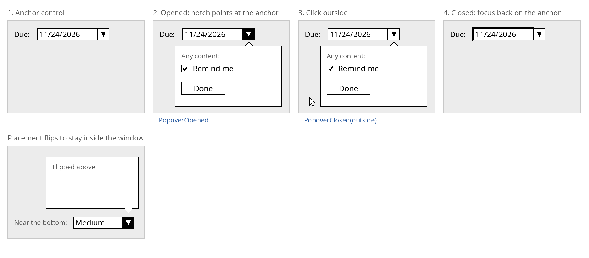

# Popover: a floating panel anchored to a control: widget roadmap

> **Issue:** [#254](https://github.com/KenSuenobu/rust-pushrod/issues/254) (extra-widgets 1.3) · **Epic 1:** Crate and foundations · **Milestone:** Extra widgets 1: crate and Chassis widgets · **Size:** M
> **Crate:** `pushrod-extra-widgets` · **User docs:** `pushrod-docs/docs/extra-widgets/popover.md` · **Overview:** [extra widgets roadmap](../ROADMAP_EXTRA_WIDGETS.md) · **Rules:** [design philosophy](../../DESIGN_PHILOSOPHY.md)

This file is the specification for this widget: what it is, what it does, how it looks, and how it responds. To change it, edit this file in a pull request (and its mockup in [`docs/mockups/generate_extra_widgets.py`](../mockups/generate_extra_widgets.py) if the picture changes), then bring the issue in line. If this file and the issue disagree, this file wins.

## What it is

A borderless panel that opens next to a control, holds any widgets, and closes on Escape or a click outside.

Pickers (date, time, color, font), menu buttons, and inline editors all need the same thing: a temporary panel next to the control that opened it, above everything else in the window, that goes away when you are done. Building it separately in each widget would give each one different rules.

*Ideas from:* macOS NSPopover, GTK GtkPopover, MUI Popobject, and the pop-up panels of KDE's date and color buttons. Names and behavior are Pushrod's own.

## What it does

`Popover::new(content)` shows `content` (any widget tree) in a framed panel attached to an anchor widget, placed below it by default and flipped above or sideways to stay inside the window. It is drawn in the window's top layer, clipped to the window, with a one-pixel border and no shadow. It closes on Escape, on a click outside, when the anchor is hidden, or when its content calls `close()`. Focus moves into the popover and returns to the anchor on close. Modeless by default; `modal(true)` blocks the rest of the window until it closes.

## How it looks

Each image shows the widget step by step; blue notes name the event emitted.

Drawn flat, in the standard Pushrod style: fills, one-pixel borders, and text; inverted when pressed or selected, dithered when disabled, a dotted outline when focused. No bevels, gradients, shadows, glass, or rounded corners.

## How it responds

### Events and callbacks

| Event emitted | When | Application callback |
|---|---|---|
| `PopoverOpened { id }` | Shown | `on_open(id, ..)` |
| `PopoverClosed { id, reason }` | Closed (Escape, outside click, programmatic) | `on_close(id, reason, ..)` |

Like every Pushrod widget, it can also receive application-defined custom events in `handle_event` and emit its own (Pushrod 1.13), and every internal action emits an engine event (Pushrod 9.10).

### Shared behavior

Like every Pushrod widget, it gets these from the core rather than implementing them itself:

- behavior flags and visual states ([Pushrod 1.1](https://github.com/KenSuenobu/rust-pushrod/issues/19))
- per-state appearance ([Pushrod 1.17](https://github.com/KenSuenobu/rust-pushrod/issues/104))
- keyboard focus, Tab order, Return/Escape ([Pushrod 1.4](https://github.com/KenSuenobu/rust-pushrod/issues/20))
- callbacks registered by widget ID ([Pushrod 1.6](https://github.com/KenSuenobu/rust-pushrod/issues/22))
- custom application events with payloads ([Pushrod 1.13](https://github.com/KenSuenobu/rust-pushrod/issues/78))
- composite parts the application can retrieve and modify ([Pushrod 5.2](https://github.com/KenSuenobu/rust-pushrod/issues/57))
- engine events for every internal action ([Pushrod 9.10](https://github.com/KenSuenobu/rust-pushrod/issues/109))

## Acceptance criteria

- [ ] Placement flips to stay inside the window
- [ ] Escape and an outside click close it; focus returns to the anchor
- [ ] Any widget tree can be the content
- [ ] Modal and modeless modes
- [ ] Registered as `extra.popover` and shown in the gallery (1.2)

## Depends on

Extra widgets: 1.1 ([#252](https://github.com/KenSuenobu/rust-pushrod/issues/252)); Pushrod: Pushrod 5.1 [#56](https://github.com/KenSuenobu/rust-pushrod/issues/56) Clip children to their parent's bounds, Pushrod 5.2 [#57](https://github.com/KenSuenobu/rust-pushrod/issues/57) Composite widgets: build widgets from parts that applications can retrieve and modify, Pushrod 9.2 [#94](https://github.com/KenSuenobu/rust-pushrod/issues/94) Event propagation: capture, target, and bubble phases with handled/ignored, Pushrod 1.4 [#20](https://github.com/KenSuenobu/rust-pushrod/issues/20) Keyboard focus, Tab order, and Return/Escape

## Implementation notes

- **Crate:** `pushrod-extra-widgets`, using only the public APIs of `pushrod` and `pushrod-widgets`. Anything missing from the core is added to the core first.
- **Modules:** `pushrod-extra-widgets/src/popover.rs (new)`, `pushrod-docs`
- **Drawing:** paints into its own GPU texture only when invalidated; frames are composed by blitting. No OS-native controls; no per-frame CPU pixel work.
- **Documentation:** full doc headers on every non-private item, and the user page in the same pull request.

