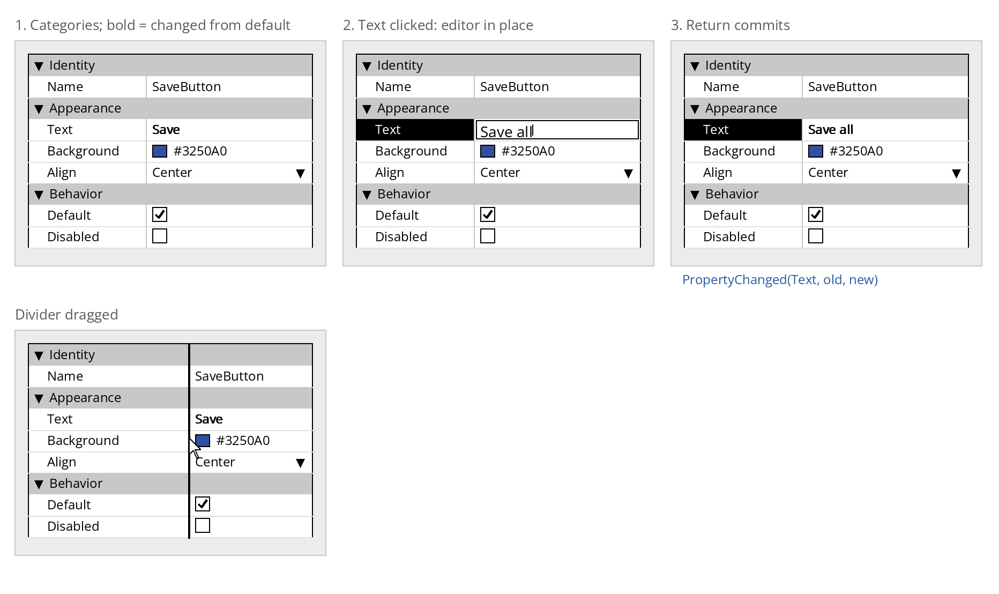

# Property grid (name and value inspector): widget roadmap

> **Issue:** [#255](https://github.com/KenSuenobu/rust-pushrod/issues/255) (extra-widgets 4.5) · **Epic 4:** Data views · **Milestone:** Extra widgets 1: crate and Chassis widgets · **Size:** M
> **Crate:** `pushrod-extra-widgets` · **User docs:** `pushrod-docs/docs/extra-widgets/property-grid.md` · **Overview:** [extra widgets roadmap](../ROADMAP_EXTRA_WIDGETS.md) · **Rules:** [design philosophy](../../DESIGN_PHILOSOPHY.md)

This file is the specification for this widget: what it is, what it does, how it looks, and how it responds. To change it, edit this file in a pull request (and its mockup in [`docs/mockups/generate_extra_widgets.py`](../mockups/generate_extra_widgets.py) if the picture changes), then bring the issue in line. If this file and the issue disagree, this file wins.

## What it is

Categorized name/value rows with an editor per value type.

Chassis's inspector needs it, and so does any application with settings or object properties to edit: debuggers, editors, and configuration tools. Built here, any application can use it, and Chassis proves it.

*Ideas from:* Delphi's Object Inspector and TValueListEditor, the Qt property browser used by Qt Designer, NeXTSTEP Interface Builder inspectors, Visual Studio's property window. Names and behavior are Pushrod's own.

## What it does

`PropertyGrid { source }`: two columns (name, value) with a draggable divider and collapsible category header rows (Identity, Layout, Appearance, ...). Value editors by kind: text, integer with range, boolean (check box), enumeration (choice button), color (3.4 when available, else hex), font (3.5 when available), and custom editors registered by kind. The source can be Pushrod property introspection (Pushrod 6.2), so a widget's properties appear without extra code, or any `PropertySource`. Changed-from-default values are shown in bold; Reset sets the default. Edits apply immediately and report old and new values (for undo).

## How it looks

Each image shows the widget step by step; blue notes name the event emitted.

Drawn flat, in the standard Pushrod style: fills, one-pixel borders, and text; inverted when pressed or selected, dithered when disabled, a dotted outline when focused. No bevels, gradients, shadows, glass, or rounded corners.

## How it responds

### Events and callbacks

| Event emitted | When | Application callback |
|---|---|---|
| `PropertyChanged { id, name, old, new }` | A value committed | `on_property_change(id, ..)` |

Like every Pushrod widget, it can also receive application-defined custom events in `handle_event` and emit its own (Pushrod 1.13), and every internal action emits an engine event (Pushrod 9.10).

### Shared behavior

Like every Pushrod widget, it gets these from the core rather than implementing them itself:

- behavior flags and visual states ([Pushrod 1.1](https://github.com/KenSuenobu/rust-pushrod/issues/19))
- per-state appearance ([Pushrod 1.17](https://github.com/KenSuenobu/rust-pushrod/issues/104))
- keyboard focus, Tab order, Return/Escape ([Pushrod 1.4](https://github.com/KenSuenobu/rust-pushrod/issues/20))
- callbacks registered by widget ID ([Pushrod 1.6](https://github.com/KenSuenobu/rust-pushrod/issues/22))
- custom application events with payloads ([Pushrod 1.13](https://github.com/KenSuenobu/rust-pushrod/issues/78))
- composite parts the application can retrieve and modify ([Pushrod 5.2](https://github.com/KenSuenobu/rust-pushrod/issues/57))
- engine events for every internal action ([Pushrod 9.10](https://github.com/KenSuenobu/rust-pushrod/issues/109))

## Acceptance criteria

- [ ] Categories, divider, and changed-from-default marking
- [ ] Typed editors and custom editors by kind
- [ ] Works from Pushrod property introspection and from any source
- [ ] Registered as `extra.property_grid` with a page in the Pushrod Showcase (1.2)

## Depends on

Extra widgets: 1.1 ([#252](https://github.com/KenSuenobu/rust-pushrod/issues/252)); Pushrod: Pushrod 6.2 [#61](https://github.com/KenSuenobu/rust-pushrod/issues/61) Property introspection: list, get, and set widget properties by name, Pushrod 5.7 [#118](https://github.com/KenSuenobu/rust-pushrod/issues/118) Form layout: aligned label and field rows, Pushrod 2.6 [#32](https://github.com/KenSuenobu/rust-pushrod/issues/32) Text field: single-line entry with input masks, validation, and numeric mode, Pushrod 2.4 [#30](https://github.com/KenSuenobu/rust-pushrod/issues/30) Check box with indeterminate state, Pushrod 3.6 [#44](https://github.com/KenSuenobu/rust-pushrod/issues/44) Choice button: pop-up list and click-to-cycle modes, Pushrod 3.10 [#90](https://github.com/KenSuenobu/rust-pushrod/issues/90) Expander (collapsible section)

## Used by Chassis

Chassis 4.2 [#187](https://github.com/KenSuenobu/rust-pushrod/issues/187) Property grid.

## Implementation notes

- **Crate:** `pushrod-extra-widgets`, using only the public APIs of `pushrod` and `pushrod-widgets`. Anything missing from the core is added to the core first.
- **Modules:** `pushrod-extra-widgets/src/property_grid.rs (new)`, `pushrod-docs`
- **Drawing:** paints into its own GPU texture only when invalidated; frames are composed by blitting. No OS-native controls; no per-frame CPU pixel work.
- **Documentation:** full doc headers on every non-private item, and the user page in the same pull request.

