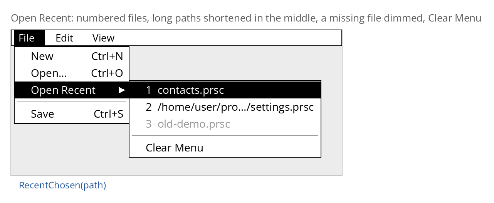

# Recent files menu: widget roadmap

> **Issue:** [#309](https://github.com/KenSuenobu/rust-pushrod/issues/309) (extra-widgets 6.10) · **Epic 6:** Dialogs and assistants · **Milestone:** Extra widgets 2: everyday controls and pickers · **Size:** S
> **Crate:** `pushrod-extra-widgets` · **User docs:** `pushrod-docs/docs/extra-widgets/recent-files-menu.md` · **Overview:** [extra widgets roadmap](../ROADMAP_EXTRA_WIDGETS.md) · **Rules:** [design philosophy](../../DESIGN_PHILOSOPHY.md)

This file is the specification for this widget: what it is, what it does, how it looks, and how it responds. To change it, edit this file in a pull request (and its mockup in [`docs/mockups/generate_extra_widgets.py`](../mockups/generate_extra_widgets.py) if the picture changes), then bring the issue in line. If this file and the issue disagree, this file wins.

## What it is

An Open Recent submenu that remembers the last files, with Clear and missing-file handling.

Every document application has an Open Recent menu, and every one rebuilds the same list handling: move to top, cap the length, drop missing files, save and load.

*Ideas from:* KDE's recent-files action, Open Recent on macOS, most-recently-used lists in Win32 and Delphi, GTK's recent manager. Names and behavior are Pushrod's own.

## What it does

`RecentFiles { max, store }`: `add(path)` moves a path to the top and trims the list; `menu()` returns a submenu (Pushrod 2.11) with one numbered item per file (file name, with the folder shown when names repeat, long paths truncated in the middle, Pushrod 1.26), then a separator and Clear Menu. Choosing an item emits the path; files that no longer exist are shown dimmed or removed. The list is saved to and loaded from a small file in the user's configuration directory, or through a `store` closure.

## How it looks

Each image shows the widget step by step; blue notes name the event emitted.

Drawn flat, in the standard Pushrod style: fills, one-pixel borders, and text; inverted when pressed or selected, dithered when disabled, a dotted outline when focused. No bevels, gradients, shadows, glass, or rounded corners.

## How it responds

### Events and callbacks

| Event emitted | When | Application callback |
|---|---|---|
| `RecentChosen { id, path }` | An item chosen | `on_recent_choose(id, ..)` |

Like every Pushrod widget, it can also receive application-defined custom events in `handle_event` and emit its own (Pushrod 1.13), and every internal action emits an engine event (Pushrod 9.10).

### Shared behavior

Like every Pushrod widget, it gets these from the core rather than implementing them itself:

- behavior flags and visual states ([Pushrod 1.1](https://github.com/KenSuenobu/rust-pushrod/issues/19))
- per-state appearance ([Pushrod 1.17](https://github.com/KenSuenobu/rust-pushrod/issues/104))
- keyboard focus, Tab order, Return/Escape ([Pushrod 1.4](https://github.com/KenSuenobu/rust-pushrod/issues/20))
- callbacks registered by widget ID ([Pushrod 1.6](https://github.com/KenSuenobu/rust-pushrod/issues/22))
- custom application events with payloads ([Pushrod 1.13](https://github.com/KenSuenobu/rust-pushrod/issues/78))
- composite parts the application can retrieve and modify ([Pushrod 5.2](https://github.com/KenSuenobu/rust-pushrod/issues/57))
- engine events for every internal action ([Pushrod 9.10](https://github.com/KenSuenobu/rust-pushrod/issues/109))

## Acceptance criteria

- [ ] Add moves to top and caps the list
- [ ] Numbered items with mnemonics; Clear Menu
- [ ] Persists across runs; missing files handled
- [ ] Registered as `extra.recent_files_menu` with a page in the Pushrod Showcase (1.2)

## Depends on

Extra widgets: 1.1 ([#252](https://github.com/KenSuenobu/rust-pushrod/issues/252)); Pushrod: Pushrod 2.11 [#37](https://github.com/KenSuenobu/rust-pushrod/issues/37) Menu bar and drop-down menus (drawn by Pushrod), Pushrod 9.5 [#97](https://github.com/KenSuenobu/rust-pushrod/issues/97) Actions and keyboard shortcuts: shared commands for menus, toolbars, and buttons, Pushrod 1.26 [#289](https://github.com/KenSuenobu/rust-pushrod/issues/289) Text truncation: shorten text that doesn't fit with an ellipsis

## Implementation notes

- **Crate:** `pushrod-extra-widgets`, using only the public APIs of `pushrod` and `pushrod-widgets`. Anything missing from the core is added to the core first.
- **Modules:** `pushrod-extra-widgets/src/recent_files_menu.rs (new)`, `pushrod-docs`
- **Drawing:** paints into its own GPU texture only when invalidated; frames are composed by blitting. No OS-native controls; no per-frame CPU pixel work.
- **Documentation:** full doc headers on every non-private item, and the user page in the same pull request.

