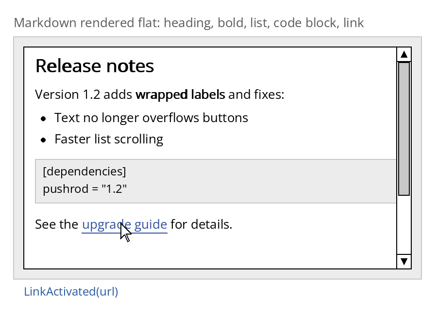

# Rich text view (formatted, read-only): widget roadmap

> **Issue:** [#308](https://github.com/KenSuenobu/rust-pushrod/issues/308) (extra-widgets 4.15) · **Epic 4:** Data views · **Milestone:** Extra widgets 2: everyday controls and pickers · **Size:** M
> **Crate:** `pushrod-extra-widgets` · **User docs:** `pushrod-docs/docs/extra-widgets/rich-text-view.md` · **Overview:** [extra widgets roadmap](../ROADMAP_EXTRA_WIDGETS.md) · **Rules:** [design philosophy](../../DESIGN_PHILOSOPHY.md)

This file is the specification for this widget: what it is, what it does, how it looks, and how it responds. To change it, edit this file in a pull request (and its mockup in [`docs/mockups/generate_extra_widgets.py`](../mockups/generate_extra_widgets.py) if the picture changes), then bring the issue in line. If this file and the issue disagree, this file wins.

## What it is

Read-only formatted text: headings, bold and italic, lists, code, and links, from Markdown or styled spans.

Help pages, release notes, license text, and error explanations need a little structure. Plain labels can't show a heading, a list, or a link in a sentence.

*Ideas from:* Qt's text browser, GTK's text view with tags, Tk's text widget, Markdown viewers for egui, WinUI, and Flutter. Names and behavior are Pushrod's own.

## What it does

`RichTextView::markdown(text)` or `::spans(...)`: headings (larger, bold), paragraphs with bold, italic, and `code` spans, bulleted and numbered lists, code blocks in a monospaced font, horizontal rules, and links (underlined; `LinkActivated` or open in the browser like the link label, Pushrod 2.22). Wraps to its width and scrolls in a container; text can be selected and copied. A deliberately small subset: no tables, images optional, no HTML. Markdown is parsed with `pulldown-cmark`; drawing uses the text layout's styled runs (Pushrod 1.18).

## How it looks

Each image shows the widget step by step; blue notes name the event emitted.

Drawn flat, in the standard Pushrod style: fills, one-pixel borders, and text; inverted when pressed or selected, dithered when disabled, a dotted outline when focused. No bevels, gradients, shadows, glass, or rounded corners.

## How it responds

### Events and callbacks

| Event emitted | When | Application callback |
|---|---|---|
| `LinkActivated { id, url }` | A link clicked | `on_link_activate(id, ..)` |

Like every Pushrod widget, it can also receive application-defined custom events in `handle_event` and emit its own (Pushrod 1.13), and every internal action emits an engine event (Pushrod 9.10).

### Shared behavior

Like every Pushrod widget, it gets these from the core rather than implementing them itself:

- behavior flags and visual states ([Pushrod 1.1](https://github.com/KenSuenobu/rust-pushrod/issues/19))
- per-state appearance ([Pushrod 1.17](https://github.com/KenSuenobu/rust-pushrod/issues/104))
- keyboard focus, Tab order, Return/Escape ([Pushrod 1.4](https://github.com/KenSuenobu/rust-pushrod/issues/20))
- callbacks registered by widget ID ([Pushrod 1.6](https://github.com/KenSuenobu/rust-pushrod/issues/22))
- custom application events with payloads ([Pushrod 1.13](https://github.com/KenSuenobu/rust-pushrod/issues/78))
- composite parts the application can retrieve and modify ([Pushrod 5.2](https://github.com/KenSuenobu/rust-pushrod/issues/57))
- engine events for every internal action ([Pushrod 9.10](https://github.com/KenSuenobu/rust-pushrod/issues/109))

## Acceptance criteria

- [ ] Headings, emphasis, lists, code, rules, and links render and wrap
- [ ] Select and copy
- [ ] Links emit an event or open in the browser
- [ ] Registered as `extra.rich_text_view` with a page in the Pushrod Showcase (1.2)

## Depends on

Extra widgets: 1.1 ([#252](https://github.com/KenSuenobu/rust-pushrod/issues/252)); Pushrod: Pushrod 1.18 [#111](https://github.com/KenSuenobu/rust-pushrod/issues/111) Text layout engine: Parley for shaping, bidi, line breaking, and font fallback (with an SDL2 compatibility gate), Pushrod 1.27 [#290](https://github.com/KenSuenobu/rust-pushrod/issues/290) Wrapped text: multi-line labels that reflow, Pushrod 5.3 [#58](https://github.com/KenSuenobu/rust-pushrod/issues/58) Container: a scrollable viewport onto fixed-size content, Pushrod 2.22 [#126](https://github.com/KenSuenobu/rust-pushrod/issues/126) Link label

## Used by Chassis

Chassis 9.9 [#320](https://github.com/KenSuenobu/rust-pushrod/issues/320) Assistant drawer: chat inside Chassis.

## Implementation notes

- **Crate:** `pushrod-extra-widgets`, using only the public APIs of `pushrod` and `pushrod-widgets`. Anything missing from the core is added to the core first.
- **Modules:** `pushrod-extra-widgets/src/rich_text_view.rs (new)`, `pushrod-docs`
- **Drawing:** paints into its own GPU texture only when invalidated; frames are composed by blitting. No OS-native controls; no per-frame CPU pixel work.
- **Documentation:** full doc headers on every non-private item, and the user page in the same pull request.

