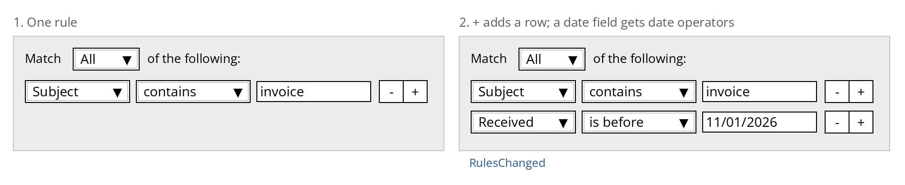

# Rule editor (query builder): widget roadmap

> **Issue:** [#279](https://github.com/KenSuenobu/rust-pushrod/issues/279) (extra-widgets 4.11) · **Epic 4:** Data views · **Milestone:** Extra widgets 3: specialized views and assistants · **Size:** M
> **Crate:** `pushrod-extra-widgets` · **User docs:** `pushrod-docs/docs/extra-widgets/rule-editor.md` · **Overview:** [extra widgets roadmap](../ROADMAP_EXTRA_WIDGETS.md) · **Rules:** [design philosophy](../../DESIGN_PHILOSOPHY.md)

This file is the specification for this widget: what it is, what it does, how it looks, and how it responds. To change it, edit this file in a pull request (and its mockup in [`docs/mockups/generate_extra_widgets.py`](../mockups/generate_extra_widgets.py) if the picture changes), then bring the issue in line. If this file and the issue disagree, this file wins.

## What it is

Rows of "field, operator, value" with add and remove buttons, joined by All or Any.

Smart folders, mail filters, and advanced search all let users build conditions without writing a query language.

*Ideas from:* macOS NSPredicateEditor and NSRuleEditor (smart folders), mail-filter editors in KDE and GTK applications, Windows advanced search. Names and behavior are Pushrod's own.

## What it does

`RuleEditor { fields }`: a header choice "Match All / Any of the following" and one row per rule: a field choice, an operator choice suited to the field's type (contains, is, before, greater than, ...), and a value editor (text, number, date 3.2, or choice), with + and - glyph buttons. Nested groups optional. `rules()` returns a plain data structure the application evaluates; serializable with serde.

## How it looks

Each image shows the widget step by step; blue notes name the event emitted.

Drawn flat, in the standard Pushrod style: fills, one-pixel borders, and text; inverted when pressed or selected, dithered when disabled, a dotted outline when focused. No bevels, gradients, shadows, glass, or rounded corners.

## How it responds

### Events and callbacks

| Event emitted | When | Application callback |
|---|---|---|
| `RulesChanged { id }` | Any rule added, removed, or edited | `on_rules_change(id, ..)` |

Like every Pushrod widget, it can also receive application-defined custom events in `handle_event` and emit its own (Pushrod 1.13), and every internal action emits an engine event (Pushrod 9.10).

### Shared behavior

Like every Pushrod widget, it gets these from the core rather than implementing them itself:

- behavior flags and visual states ([Pushrod 1.1](https://github.com/KenSuenobu/rust-pushrod/issues/19))
- per-state appearance ([Pushrod 1.17](https://github.com/KenSuenobu/rust-pushrod/issues/104))
- keyboard focus, Tab order, Return/Escape ([Pushrod 1.4](https://github.com/KenSuenobu/rust-pushrod/issues/20))
- callbacks registered by widget ID ([Pushrod 1.6](https://github.com/KenSuenobu/rust-pushrod/issues/22))
- custom application events with payloads ([Pushrod 1.13](https://github.com/KenSuenobu/rust-pushrod/issues/78))
- composite parts the application can retrieve and modify ([Pushrod 5.2](https://github.com/KenSuenobu/rust-pushrod/issues/57))
- engine events for every internal action ([Pushrod 9.10](https://github.com/KenSuenobu/rust-pushrod/issues/109))

## Acceptance criteria

- [ ] Operators follow the field's type
- [ ] Add, remove, and optional nested groups
- [ ] Rules returned as plain, serializable data
- [ ] Registered as `extra.rule_editor` with a page in the Pushrod Showcase (1.2)

## Depends on

Extra widgets: 3.2 ([#91](https://github.com/KenSuenobu/rust-pushrod/issues/91)); Pushrod: Pushrod 3.6 [#44](https://github.com/KenSuenobu/rust-pushrod/issues/44) Choice button: pop-up list and click-to-cycle modes, Pushrod 2.6 [#32](https://github.com/KenSuenobu/rust-pushrod/issues/32) Text field: single-line entry with input masks, validation, and numeric mode, Pushrod 2.2 [#28](https://github.com/KenSuenobu/rust-pushrod/issues/28) Glyph button (small single-character button), Pushrod 5.6 [#117](https://github.com/KenSuenobu/rust-pushrod/issues/117) Row and column layouts

## Implementation notes

- **Crate:** `pushrod-extra-widgets`, using only the public APIs of `pushrod` and `pushrod-widgets`. Anything missing from the core is added to the core first.
- **Modules:** `pushrod-extra-widgets/src/rule_editor.rs (new)`, `pushrod-docs`
- **Drawing:** paints into its own GPU texture only when invalidated; frames are composed by blitting. No OS-native controls; no per-frame CPU pixel work.
- **Documentation:** full doc headers on every non-private item, and the user page in the same pull request.

