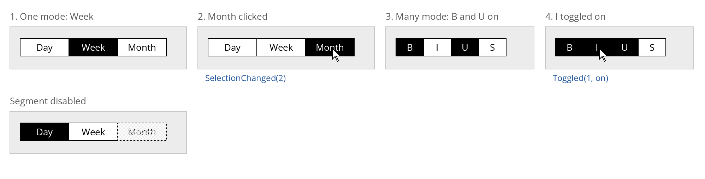

# Segmented control: widget roadmap

> **Issue:** [#50](https://github.com/KenSuenobu/rust-pushrod/issues/50) (extra-widgets 2.2) · **Epic 2:** Buttons and value controls · **Milestone:** Extra widgets 2: everyday controls and pickers · **Size:** S
> **Crate:** `pushrod-extra-widgets` · **User docs:** `pushrod-docs/docs/extra-widgets/segmented-control.md` · **Overview:** [extra widgets roadmap](../ROADMAP_EXTRA_WIDGETS.md) · **Rules:** [design philosophy](../../DESIGN_PHILOSOPHY.md)

This file is the specification for this widget: what it is, what it does, how it looks, and how it responds. To change it, edit this file in a pull request (and its mockup in [`docs/mockups/generate_extra_widgets.py`](../mockups/generate_extra_widgets.py) if the picture changes), then bring the issue in line. If this file and the issue disagree, this file wins.

## What it is

A row of joined buttons: pick one, or toggle several.

View switches (Day / Week / Month) and formatting toggles (Bold / Italic / Underline) read better as one joined control than as separate radio buttons or check boxes. Originally parked because radio groups cover the choice; as an extra widget it no longer adds weight to the standard set.

*Ideas from:* macOS NSSegmentedControl, GTK linked button boxes and GtkStackSwitcher, Qt exclusive QButtonGroup of tool buttons, Delphi TButtonGroup. Names and behavior are Pushrod's own.

## What it does

`SegmentedControl { segments, mode }`: segments share borders and are equal width (or sized to their labels). `mode` is `One` (radio semantics, Pushrod 2.5) or `Many` (each segment toggles). Selected segments are inverted. Segments can show text, an icon, or both, and can be disabled individually. Arrow keys move between segments; Space selects.

## How it looks

Each image shows the widget step by step; blue notes name the event emitted.

Drawn flat, in the standard Pushrod style: fills, one-pixel borders, and text; inverted when pressed or selected, dithered when disabled, a dotted outline when focused. No bevels, gradients, shadows, glass, or rounded corners.

## How it responds

### Events and callbacks

| Event emitted | When | Application callback |
|---|---|---|
| `SelectionChanged { id, index }` | A segment selected (One) | `on_selection_change(id, ..)` |
| `Toggled { id, index, on }` | A segment toggled (Many) | `on_toggle(id, ..)` |

Like every Pushrod widget, it can also receive application-defined custom events in `handle_event` and emit its own (Pushrod 1.13), and every internal action emits an engine event (Pushrod 9.10).

### Shared behavior

Like every Pushrod widget, it gets these from the core rather than implementing them itself:

- behavior flags and visual states ([Pushrod 1.1](https://github.com/KenSuenobu/rust-pushrod/issues/19))
- per-state appearance ([Pushrod 1.17](https://github.com/KenSuenobu/rust-pushrod/issues/104))
- keyboard focus, Tab order, Return/Escape ([Pushrod 1.4](https://github.com/KenSuenobu/rust-pushrod/issues/20))
- callbacks registered by widget ID ([Pushrod 1.6](https://github.com/KenSuenobu/rust-pushrod/issues/22))
- custom application events with payloads ([Pushrod 1.13](https://github.com/KenSuenobu/rust-pushrod/issues/78))
- composite parts the application can retrieve and modify ([Pushrod 5.2](https://github.com/KenSuenobu/rust-pushrod/issues/57))
- engine events for every internal action ([Pushrod 9.10](https://github.com/KenSuenobu/rust-pushrod/issues/109))

## Acceptance criteria

- [ ] One and Many modes
- [ ] Per-segment disabled state, text, and icons
- [ ] Keyboard navigation and selection
- [ ] Registered as `extra.segmented_control` and shown in the gallery (1.2)

## Depends on

Extra widgets: 1.1 ([#252](https://github.com/KenSuenobu/rust-pushrod/issues/252)); Pushrod: Pushrod 2.3 [#29](https://github.com/KenSuenobu/rust-pushrod/issues/29) Button behaviors: default, cancel, toggle, activate-on-press, dismiss dialog, Pushrod 2.5 [#31](https://github.com/KenSuenobu/rust-pushrod/issues/31) Radio buttons and radio groups, Pushrod 1.17 [#104](https://github.com/KenSuenobu/rust-pushrod/issues/104) Per-state appearance: colors, border, and font for each visual state

## Implementation notes

- **Crate:** `pushrod-extra-widgets`, using only the public APIs of `pushrod` and `pushrod-widgets`. Anything missing from the core is added to the core first.
- **Modules:** `pushrod-extra-widgets/src/segmented_control.rs (new)`, `pushrod-docs`
- **Drawing:** paints into its own GPU texture only when invalidated; frames are composed by blitting. No OS-native controls; no per-frame CPU pixel work.
- **Documentation:** full doc headers on every non-private item, and the user page in the same pull request.

