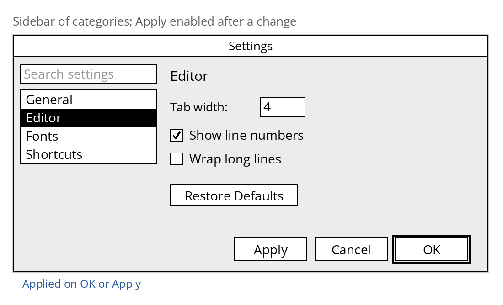

# Settings dialog: widget roadmap

> **Issue:** [#283](https://github.com/KenSuenobu/rust-pushrod/issues/283) (extra-widgets 6.5) · **Epic 6:** Dialogs and assistants · **Milestone:** Extra widgets 3: specialized views and assistants · **Size:** M
> **Crate:** `pushrod-extra-widgets` · **User docs:** `pushrod-docs/docs/extra-widgets/settings-dialog.md` · **Overview:** [extra widgets roadmap](../ROADMAP_EXTRA_WIDGETS.md) · **Rules:** [design philosophy](../../DESIGN_PHILOSOPHY.md)

This file is the specification for this widget: what it is, what it does, how it looks, and how it responds. To change it, edit this file in a pull request (and its mockup in [`docs/mockups/generate_extra_widgets.py`](../mockups/generate_extra_widgets.py) if the picture changes), then bring the issue in line. If this file and the issue disagree, this file wins.

## What it is

A sidebar of categories, a page per category, and OK, Cancel, and Apply.

Almost every application has a settings window, and they all work the same: categories, pages of options, and Apply semantics.

*Ideas from:* KDE KPageDialog and KConfigDialog, libadwaita's preferences dialog, Windows property sheets, macOS Settings windows. Names and behavior are Pushrod's own.

## What it does

`SettingsDialog { pages }`: a sidebar (5.3) or tabs, a page per category using a form layout (Pushrod 5.7), and OK, Cancel, Apply, and Restore Defaults. Each page reads from and writes to the application's settings through `load`/`apply` closures; Apply is enabled only when something changed. Optional search field that finds an option and shows its page.

## How it looks

Each image shows the widget step by step; blue notes name the event emitted.

Drawn flat, in the standard Pushrod style: fills, one-pixel borders, and text; inverted when pressed or selected, dithered when disabled, a dotted outline when focused. No bevels, gradients, shadows, glass, or rounded corners.

## How it responds

### Events and callbacks

| Event emitted | When | Application callback |
|---|---|---|
| `Applied { id }` | OK or Apply | `on_apply(id, ..)` |
| `DefaultsRestored { id, page }` | Restore Defaults | `on_restore_defaults(id, ..)` |

Like every Pushrod widget, it can also receive application-defined custom events in `handle_event` and emit its own (Pushrod 1.13), and every internal action emits an engine event (Pushrod 9.10).

### Shared behavior

Like every Pushrod widget, it gets these from the core rather than implementing them itself:

- behavior flags and visual states ([Pushrod 1.1](https://github.com/KenSuenobu/rust-pushrod/issues/19))
- per-state appearance ([Pushrod 1.17](https://github.com/KenSuenobu/rust-pushrod/issues/104))
- keyboard focus, Tab order, Return/Escape ([Pushrod 1.4](https://github.com/KenSuenobu/rust-pushrod/issues/20))
- callbacks registered by widget ID ([Pushrod 1.6](https://github.com/KenSuenobu/rust-pushrod/issues/22))
- custom application events with payloads ([Pushrod 1.13](https://github.com/KenSuenobu/rust-pushrod/issues/78))
- composite parts the application can retrieve and modify ([Pushrod 5.2](https://github.com/KenSuenobu/rust-pushrod/issues/57))
- engine events for every internal action ([Pushrod 9.10](https://github.com/KenSuenobu/rust-pushrod/issues/109))

## Acceptance criteria

- [ ] Sidebar or tabs layout
- [ ] Apply enabled only on changes; OK applies and closes
- [ ] Restore Defaults per page and optional search
- [ ] Registered as `extra.settings_dialog` with a page in the Pushrod Showcase (1.2)

## Depends on

Extra widgets: 5.3 ([#266](https://github.com/KenSuenobu/rust-pushrod/issues/266)); Pushrod: Pushrod 5.9 [#120](https://github.com/KenSuenobu/rust-pushrod/issues/120) Stack layout (one child visible at a time), Pushrod 5.7 [#118](https://github.com/KenSuenobu/rust-pushrod/issues/118) Form layout: aligned label and field rows, Pushrod 6.7 [#66](https://github.com/KenSuenobu/rust-pushrod/issues/66) Modal dialogs: run a form until a dismissing control is chosen, Pushrod 4.4 [#51](https://github.com/KenSuenobu/rust-pushrod/issues/51) Tab view

## Implementation notes

- **Crate:** `pushrod-extra-widgets`, using only the public APIs of `pushrod` and `pushrod-widgets`. Anything missing from the core is added to the core first.
- **Modules:** `pushrod-extra-widgets/src/settings_dialog.rs (new)`, `pushrod-docs`
- **Drawing:** paints into its own GPU texture only when invalidated; frames are composed by blitting. No OS-native controls; no per-frame CPU pixel work.
- **Documentation:** full doc headers on every non-private item, and the user page in the same pull request.

