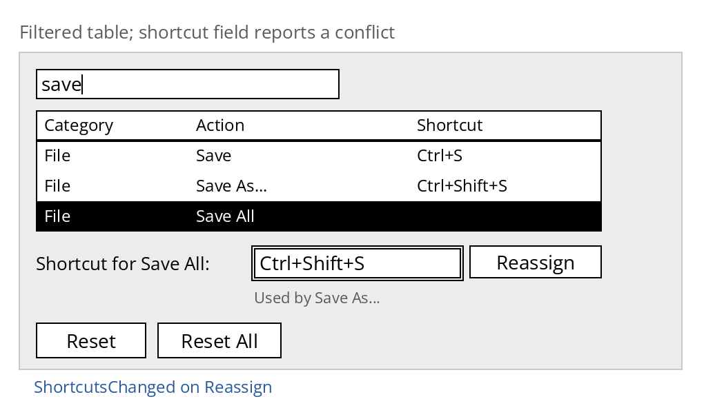

# Keyboard shortcuts editor: widget roadmap

> **Issue:** [#286](https://github.com/KenSuenobu/rust-pushrod/issues/286) (extra-widgets 6.8) · **Epic 6:** Dialogs and assistants · **Milestone:** Extra widgets 3: specialized views and assistants · **Size:** M
> **Crate:** `pushrod-extra-widgets` · **User docs:** `pushrod-docs/docs/extra-widgets/shortcuts-editor.md` · **Overview:** [extra widgets roadmap](../ROADMAP_EXTRA_WIDGETS.md) · **Rules:** [design philosophy](../../DESIGN_PHILOSOPHY.md)

This file is the specification for this widget: what it is, what it does, how it looks, and how it responds. To change it, edit this file in a pull request (and its mockup in [`docs/mockups/generate_extra_widgets.py`](../mockups/generate_extra_widgets.py) if the picture changes), then bring the issue in line. If this file and the issue disagree, this file wins.

## What it is

A filterable table of actions and their shortcuts, edited with the shortcut field.

Applications with many commands let users change their shortcuts, and need conflict detection and reset.

*Ideas from:* KDE KShortcutsEditor, the Qt Creator and GTK keyboard shortcut settings, macOS keyboard shortcut preferences. Names and behavior are Pushrod's own.

## What it does

`ShortcutsEditor::new(&actions)`: a table (Pushrod 4.9) of actions with their category, name, and shortcut, a filter field (4.10) that matches names or key combinations, and a shortcut field (2.8) to change the selected action. Conflicts name the other action and offer to reassign. Reset and Reset All restore defaults. Changes are applied to the actions (Pushrod 9.5) and can be saved by the application.

## How it looks

Each image shows the widget step by step; blue notes name the event emitted.

Drawn flat, in the standard Pushrod style: fills, one-pixel borders, and text; inverted when pressed or selected, dithered when disabled, a dotted outline when focused. No bevels, gradients, shadows, glass, or rounded corners.

## How it responds

### Events and callbacks

| Event emitted | When | Application callback |
|---|---|---|
| `ShortcutsChanged { id }` | Any shortcut changed or reset | `on_shortcuts_change(id, ..)` |

Like every Pushrod widget, it can also receive application-defined custom events in `handle_event` and emit its own (Pushrod 1.13), and every internal action emits an engine event (Pushrod 9.10).

### Shared behavior

Like every Pushrod widget, it gets these from the core rather than implementing them itself:

- behavior flags and visual states ([Pushrod 1.1](https://github.com/KenSuenobu/rust-pushrod/issues/19))
- per-state appearance ([Pushrod 1.17](https://github.com/KenSuenobu/rust-pushrod/issues/104))
- keyboard focus, Tab order, Return/Escape ([Pushrod 1.4](https://github.com/KenSuenobu/rust-pushrod/issues/20))
- callbacks registered by widget ID ([Pushrod 1.6](https://github.com/KenSuenobu/rust-pushrod/issues/22))
- custom application events with payloads ([Pushrod 1.13](https://github.com/KenSuenobu/rust-pushrod/issues/78))
- composite parts the application can retrieve and modify ([Pushrod 5.2](https://github.com/KenSuenobu/rust-pushrod/issues/57))
- engine events for every internal action ([Pushrod 9.10](https://github.com/KenSuenobu/rust-pushrod/issues/109))

## Acceptance criteria

- [ ] Filter by name or key combination
- [ ] Conflict detection with reassign
- [ ] Reset one or all
- [ ] Registered as `extra.shortcuts_editor` with a page in the Pushrod Showcase (1.2)

## Depends on

Extra widgets: 2.8 ([#271](https://github.com/KenSuenobu/rust-pushrod/issues/271)), 4.10 ([#277](https://github.com/KenSuenobu/rust-pushrod/issues/277)); Pushrod: Pushrod 4.9 [#92](https://github.com/KenSuenobu/rust-pushrod/issues/92) Table view, Pushrod 9.5 [#97](https://github.com/KenSuenobu/rust-pushrod/issues/97) Actions and keyboard shortcuts: shared commands for menus, toolbars, and buttons

## Implementation notes

- **Crate:** `pushrod-extra-widgets`, using only the public APIs of `pushrod` and `pushrod-widgets`. Anything missing from the core is added to the core first.
- **Modules:** `pushrod-extra-widgets/src/shortcuts_editor.rs (new)`, `pushrod-docs`
- **Drawing:** paints into its own GPU texture only when invalidated; frames are composed by blitting. No OS-native controls; no per-frame CPU pixel work.
- **Documentation:** full doc headers on every non-private item, and the user page in the same pull request.

