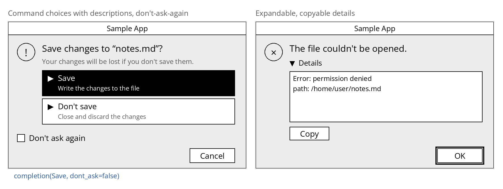

# Task dialog (alert with details and options): widget roadmap

> **Issue:** [#269](https://github.com/KenSuenobu/rust-pushrod/issues/269) (extra-widgets 6.3) · **Epic 6:** Dialogs and assistants · **Milestone:** Extra widgets 2: everyday controls and pickers · **Size:** S
> **Crate:** `pushrod-extra-widgets` · **User docs:** `pushrod-docs/docs/extra-widgets/task-dialog.md` · **Overview:** [extra widgets roadmap](../ROADMAP_EXTRA_WIDGETS.md) · **Rules:** [design philosophy](../../DESIGN_PHILOSOPHY.md)

This file is the specification for this widget: what it is, what it does, how it looks, and how it responds. To change it, edit this file in a pull request (and its mockup in [`docs/mockups/generate_extra_widgets.py`](../mockups/generate_extra_widgets.py) if the picture changes), then bring the issue in line. If this file and the issue disagree, this file wins.

## What it is

An alert with a main instruction, expandable details, a "don't ask again" box, and command choices.

The standard alert covers a message and buttons. Real applications also need error details to copy, a "don't ask again" option, and choices that need a sentence each.

*Ideas from:* Windows task dialogs and command links, Qt QMessageBox detailed text and check box, macOS NSAlert suppression and accessory views, GEM form_alert. Names and behavior are Pushrod's own.

## What it does

`TaskDialog { icon, instruction, message, details, check, commands, buttons }`: the main instruction in larger text, an optional message, an expander (Pushrod 3.10) with details in a read-only text area (with Copy), an optional check box ("Don't ask again"), and either buttons or command choices (a large button with a title and one-line description each). The completion closure receives the chosen command and the check box state.

## How it looks

Each image shows the widget step by step; blue notes name the event emitted.

Drawn flat, in the standard Pushrod style: fills, one-pixel borders, and text; inverted when pressed or selected, dithered when disabled, a dotted outline when focused. No bevels, gradients, shadows, glass, or rounded corners.

## How it responds

### Events and callbacks

| Event emitted | When | Application callback |
|---|---|---|
| (completion) | A button or command chosen | Completion closure receives the choice and the check state |

Like every Pushrod widget, it can also receive application-defined custom events in `handle_event` and emit its own (Pushrod 1.13), and every internal action emits an engine event (Pushrod 9.10).

### Shared behavior

Like every Pushrod widget, it gets these from the core rather than implementing them itself:

- behavior flags and visual states ([Pushrod 1.1](https://github.com/KenSuenobu/rust-pushrod/issues/19))
- per-state appearance ([Pushrod 1.17](https://github.com/KenSuenobu/rust-pushrod/issues/104))
- keyboard focus, Tab order, Return/Escape ([Pushrod 1.4](https://github.com/KenSuenobu/rust-pushrod/issues/20))
- callbacks registered by widget ID ([Pushrod 1.6](https://github.com/KenSuenobu/rust-pushrod/issues/22))
- custom application events with payloads ([Pushrod 1.13](https://github.com/KenSuenobu/rust-pushrod/issues/78))
- composite parts the application can retrieve and modify ([Pushrod 5.2](https://github.com/KenSuenobu/rust-pushrod/issues/57))
- engine events for every internal action ([Pushrod 9.10](https://github.com/KenSuenobu/rust-pushrod/issues/109))

## Acceptance criteria

- [ ] Instruction, message, and copyable details
- [ ] Check box state returned
- [ ] Command choices with descriptions
- [ ] Registered as `extra.task_dialog` and shown in the gallery (1.2)

## Depends on

Extra widgets: 1.1 ([#252](https://github.com/KenSuenobu/rust-pushrod/issues/252)); Pushrod: Pushrod 2.9 [#35](https://github.com/KenSuenobu/rust-pushrod/issues/35) Alert dialog, Pushrod 3.10 [#90](https://github.com/KenSuenobu/rust-pushrod/issues/90) Expander (collapsible section), Pushrod 2.4 [#30](https://github.com/KenSuenobu/rust-pushrod/issues/30) Check box with indeterminate state, Pushrod 2.18 [#87](https://github.com/KenSuenobu/rust-pushrod/issues/87) Multi-line text area, Pushrod 6.7 [#66](https://github.com/KenSuenobu/rust-pushrod/issues/66) Modal dialogs: run a form until a dismissing control is chosen

## Implementation notes

- **Crate:** `pushrod-extra-widgets`, using only the public APIs of `pushrod` and `pushrod-widgets`. Anything missing from the core is added to the core first.
- **Modules:** `pushrod-extra-widgets/src/task_dialog.rs (new)`, `pushrod-docs`
- **Drawing:** paints into its own GPU texture only when invalidated; frames are composed by blitting. No OS-native controls; no per-frame CPU pixel work.
- **Documentation:** full doc headers on every non-private item, and the user page in the same pull request.

