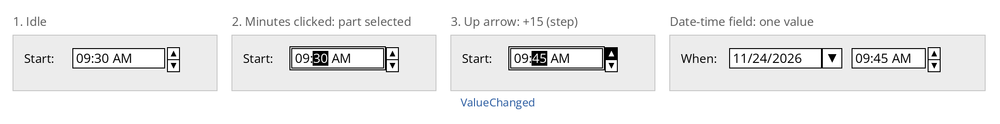

# Time field and date-time field: widget roadmap

> **Issue:** [#261](https://github.com/KenSuenobu/rust-pushrod/issues/261) (extra-widgets 3.3) · **Epic 3:** Pickers and special fields · **Milestone:** Extra widgets 2: everyday controls and pickers · **Size:** S
> **Crate:** `pushrod-extra-widgets` · **User docs:** `pushrod-docs/docs/extra-widgets/time-field.md` · **Overview:** [extra widgets roadmap](../ROADMAP_EXTRA_WIDGETS.md) · **Rules:** [design philosophy](../../DESIGN_PHILOSOPHY.md)

This file is the specification for this widget: what it is, what it does, how it looks, and how it responds. To change it, edit this file in a pull request (and its mockup in [`docs/mockups/generate_extra_widgets.py`](../mockups/generate_extra_widgets.py) if the picture changes), then bring the issue in line. If this file and the issue disagree, this file wins.

## What it is

A time entry with steppable parts, and a combined date-and-time field.

Times (hours, minutes, seconds, AM/PM) are best entered part by part with arrows, and many forms need a date and a time together.

*Ideas from:* Qt QTimeEdit and QDateTimeEdit, KDE KTimeComboBox and KDateTimeEdit, macOS textual NSDatePicker, the Mac OS 8 clock control, Delphi TTimePicker. Names and behavior are Pushrod's own.

## What it does

`TimeField { value, format, step }`: the field shows `hh:mm[:ss] [AM/PM]`; clicking a part selects it, Up/Down or the attached stepper (2.3) changes it, digits type it, Tab or the separator key moves to the next part. `DateTimeField` joins a date picker (3.2) and a time field in one row with one value.

## How it looks

Each image shows the widget step by step; blue notes name the event emitted.

Drawn flat, in the standard Pushrod style: fills, one-pixel borders, and text; inverted when pressed or selected, dithered when disabled, a dotted outline when focused. No bevels, gradients, shadows, glass, or rounded corners.

## How it responds

### Events and callbacks

| Event emitted | When | Application callback |
|---|---|---|
| `ValueChanged { id, value }` | Any part changed | `on_value_change(id, ..)` |

Like every Pushrod widget, it can also receive application-defined custom events in `handle_event` and emit its own (Pushrod 1.13), and every internal action emits an engine event (Pushrod 9.10).

### Shared behavior

Like every Pushrod widget, it gets these from the core rather than implementing them itself:

- behavior flags and visual states ([Pushrod 1.1](https://github.com/KenSuenobu/rust-pushrod/issues/19))
- per-state appearance ([Pushrod 1.17](https://github.com/KenSuenobu/rust-pushrod/issues/104))
- keyboard focus, Tab order, Return/Escape ([Pushrod 1.4](https://github.com/KenSuenobu/rust-pushrod/issues/20))
- callbacks registered by widget ID ([Pushrod 1.6](https://github.com/KenSuenobu/rust-pushrod/issues/22))
- custom application events with payloads ([Pushrod 1.13](https://github.com/KenSuenobu/rust-pushrod/issues/78))
- composite parts the application can retrieve and modify ([Pushrod 5.2](https://github.com/KenSuenobu/rust-pushrod/issues/57))
- engine events for every internal action ([Pushrod 9.10](https://github.com/KenSuenobu/rust-pushrod/issues/109))

## Acceptance criteria

- [ ] Part-by-part editing with keys and stepper
- [ ] 12- and 24-hour formats
- [ ] Date-time field keeps one combined value
- [ ] Registered as `extra.time_field` and shown in the gallery (1.2)

## Depends on

Extra widgets: 2.3 ([#259](https://github.com/KenSuenobu/rust-pushrod/issues/259)), 3.2 ([#91](https://github.com/KenSuenobu/rust-pushrod/issues/91)); Pushrod: Pushrod 2.6 [#32](https://github.com/KenSuenobu/rust-pushrod/issues/32) Text field: single-line entry with input masks, validation, and numeric mode

## Implementation notes

- **Crate:** `pushrod-extra-widgets`, using only the public APIs of `pushrod` and `pushrod-widgets`. Anything missing from the core is added to the core first.
- **Modules:** `pushrod-extra-widgets/src/time_field.rs (new)`, `pushrod-docs`
- **Drawing:** paints into its own GPU texture only when invalidated; frames are composed by blitting. No OS-native controls; no per-frame CPU pixel work.
- **Documentation:** full doc headers on every non-private item, and the user page in the same pull request.

