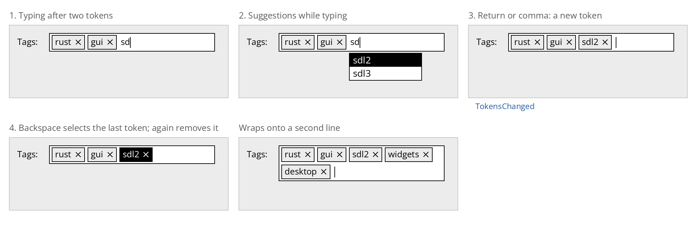

# Token field (tags in a field): widget roadmap

> **Issue:** [#307](https://github.com/KenSuenobu/rust-pushrod/issues/307) (extra-widgets 3.10) · **Epic 3:** Pickers and special fields · **Milestone:** Extra widgets 2: everyday controls and pickers · **Size:** M
> **Crate:** `pushrod-extra-widgets` · **User docs:** `pushrod-docs/docs/extra-widgets/token-field.md` · **Overview:** [extra widgets roadmap](../ROADMAP_EXTRA_WIDGETS.md) · **Rules:** [design philosophy](../../DESIGN_PHILOSOPHY.md)

This file is the specification for this widget: what it is, what it does, how it looks, and how it responds. To change it, edit this file in a pull request (and its mockup in [`docs/mockups/generate_extra_widgets.py`](../mockups/generate_extra_widgets.py) if the picture changes), then bring the issue in line. If this file and the issue disagree, this file wins.

## What it is

A text field whose entries become removable tokens, with optional suggestions.

Tags, recipients, keywords, and filters are short lists of values typed one after another. A plain text field with commas gives no feedback and no way to remove one entry.

*Ideas from:* macOS NSTokenField, tag modes of Ant Design's Select and Material's Autocomplete, Fluent's tag picker, Flutter's input chips. Names and behavior are Pushrod's own.

## What it does

`TokenField { tokens, suggestions, separators }`: typing then Return, Tab, or a separator (comma by default) turns the text into a token: a flat box with the text and a small x. Tokens flow and wrap inside the field (Pushrod 5.10). Backspace at the start selects the last token, again removes it; arrow keys move across tokens; tokens can be dragged to reorder. Optional suggestions appear in a list below while typing. `validate` can reject a token; `unique(true)` rejects duplicates.

## How it looks

Each image shows the widget step by step; blue notes name the event emitted.

Drawn flat, in the standard Pushrod style: fills, one-pixel borders, and text; inverted when pressed or selected, dithered when disabled, a dotted outline when focused. No bevels, gradients, shadows, glass, or rounded corners.

## How it responds

### Events and callbacks

| Event emitted | When | Application callback |
|---|---|---|
| `TokensChanged { id }` | A token added, removed, or moved | `on_tokens_change(id, ..)` |

Like every Pushrod widget, it can also receive application-defined custom events in `handle_event` and emit its own (Pushrod 1.13), and every internal action emits an engine event (Pushrod 9.10).

### Shared behavior

Like every Pushrod widget, it gets these from the core rather than implementing them itself:

- behavior flags and visual states ([Pushrod 1.1](https://github.com/KenSuenobu/rust-pushrod/issues/19))
- per-state appearance ([Pushrod 1.17](https://github.com/KenSuenobu/rust-pushrod/issues/104))
- keyboard focus, Tab order, Return/Escape ([Pushrod 1.4](https://github.com/KenSuenobu/rust-pushrod/issues/20))
- callbacks registered by widget ID ([Pushrod 1.6](https://github.com/KenSuenobu/rust-pushrod/issues/22))
- custom application events with payloads ([Pushrod 1.13](https://github.com/KenSuenobu/rust-pushrod/issues/78))
- composite parts the application can retrieve and modify ([Pushrod 5.2](https://github.com/KenSuenobu/rust-pushrod/issues/57))
- engine events for every internal action ([Pushrod 9.10](https://github.com/KenSuenobu/rust-pushrod/issues/109))

## Acceptance criteria

- [ ] Tokens created by Return, Tab, and separators; removed by x and Backspace
- [ ] Wraps to more lines as tokens are added
- [ ] Suggestions, validation, and uniqueness
- [ ] Registered as `extra.token_field` with a page in the Pushrod Showcase (1.2)

## Depends on

Extra widgets: 1.3 ([#254](https://github.com/KenSuenobu/rust-pushrod/issues/254)); Pushrod: Pushrod 2.6 [#32](https://github.com/KenSuenobu/rust-pushrod/issues/32) Text field: single-line entry with input masks, validation, and numeric mode, Pushrod 5.10 [#121](https://github.com/KenSuenobu/rust-pushrod/issues/121) Flow layout (wrapping rows), Pushrod 4.5 [#52](https://github.com/KenSuenobu/rust-pushrod/issues/52) List view

## Implementation notes

- **Crate:** `pushrod-extra-widgets`, using only the public APIs of `pushrod` and `pushrod-widgets`. Anything missing from the core is added to the core first.
- **Modules:** `pushrod-extra-widgets/src/token_field.rs (new)`, `pushrod-docs`
- **Drawing:** paints into its own GPU texture only when invalidated; frames are composed by blitting. No OS-native controls; no per-frame CPU pixel work.
- **Documentation:** full doc headers on every non-private item, and the user page in the same pull request.

