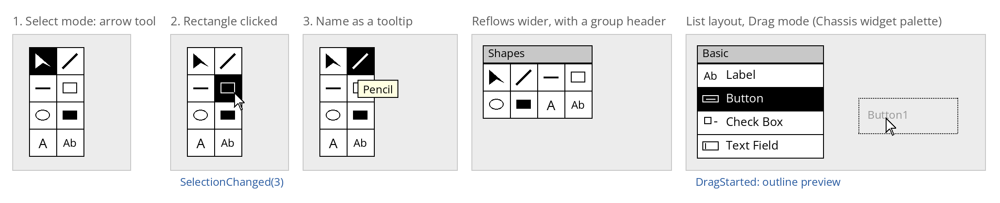

# Tool palette (grid of tool buttons): widget roadmap

> **Issue:** [#42](https://github.com/KenSuenobu/rust-pushrod/issues/42) (extra-widgets 2.6) · **Epic 2:** Buttons and value controls · **Milestone:** Extra widgets 1: crate and Chassis widgets · **Size:** M
> **Crate:** `pushrod-extra-widgets` · **User docs:** `pushrod-docs/docs/extra-widgets/tool-palette.md` · **Overview:** [extra widgets roadmap](../ROADMAP_EXTRA_WIDGETS.md) · **Rules:** [design philosophy](../../DESIGN_PHILOSOPHY.md)

This file is the specification for this widget: what it is, what it does, how it looks, and how it responds. To change it, edit this file in a pull request (and its mockup in [`docs/mockups/generate_extra_widgets.py`](../mockups/generate_extra_widgets.py) if the picture changes), then bring the issue in line. If this file and the issue disagree, this file wins.

## What it is

A grid of icon buttons with one-of-many selection and optional drag out, for tools, swatches, or components.

Drawing tools, color swatches, and Chassis's widget palette are the same thing: a compact grid of small picture buttons, one selected at a time, with names shown as tooltips. The parked "matrix of cells" issue asked for this.

*Ideas from:* Delphi's component palette, AmigaOS palette.gadget and ReAction speedbar, NeXTSTEP NSMatrix, paint-program tool boxes (GEM paint programs, MacPaint), Win32 toolbars in check-group mode. Names and behavior are Pushrod's own.

## What it does

`ToolPalette { items, layout, cell_size, mode }`: items are image buttons (Pushrod 2.21) with a name and optional group header rows. `layout` is `Grid { columns }` (icons only, names as tooltips, Pushrod 2.13) or `List` (one item per row: icon and name, as in Chassis's widget palette). Modes: `Select` (one selected item, inverted, like a tool box), `Click` (each click runs an action), or `Drag` (items can be dragged out with drag and drop, Pushrod 9.8, as Chassis's widget palette does). Arrow keys move, Space or Return activates. The grid reflows with the palette's width; a filter field (4.10) can narrow the items.

## How it looks

Each image shows the widget step by step; blue notes name the event emitted.

Drawn flat, in the standard Pushrod style: fills, one-pixel borders, and text; inverted when pressed or selected, dithered when disabled, a dotted outline when focused. No bevels, gradients, shadows, glass, or rounded corners.

## How it responds

### Events and callbacks

| Event emitted | When | Application callback |
|---|---|---|
| `SelectionChanged { id, index }` | Item selected (Select mode) | `on_selection_change(id, ..)` |
| `Activated { id, index }` | Item clicked (Click mode) | `on_activate(id, ..)` |
| `DragStarted { id, index }` | Item dragged out (Drag mode) | `on_drag_start(id, ..)` |

Like every Pushrod widget, it can also receive application-defined custom events in `handle_event` and emit its own (Pushrod 1.13), and every internal action emits an engine event (Pushrod 9.10).

### Shared behavior

Like every Pushrod widget, it gets these from the core rather than implementing them itself:

- behavior flags and visual states ([Pushrod 1.1](https://github.com/KenSuenobu/rust-pushrod/issues/19))
- per-state appearance ([Pushrod 1.17](https://github.com/KenSuenobu/rust-pushrod/issues/104))
- keyboard focus, Tab order, Return/Escape ([Pushrod 1.4](https://github.com/KenSuenobu/rust-pushrod/issues/20))
- callbacks registered by widget ID ([Pushrod 1.6](https://github.com/KenSuenobu/rust-pushrod/issues/22))
- custom application events with payloads ([Pushrod 1.13](https://github.com/KenSuenobu/rust-pushrod/issues/78))
- composite parts the application can retrieve and modify ([Pushrod 5.2](https://github.com/KenSuenobu/rust-pushrod/issues/57))
- engine events for every internal action ([Pushrod 9.10](https://github.com/KenSuenobu/rust-pushrod/issues/109))

## Acceptance criteria

- [ ] Select, Click, and Drag modes
- [ ] Grid and List layouts, group header rows, and tooltips
- [ ] Grid reflows with width; keyboard navigation
- [ ] Registered as `extra.tool_palette` and shown in the gallery (1.2)

## Depends on

Extra widgets: 1.1; Pushrod: Pushrod 2.21 [#125](https://github.com/KenSuenobu/rust-pushrod/issues/125) Image button, Pushrod 2.13 [#77](https://github.com/KenSuenobu/rust-pushrod/issues/77) Tooltips, Pushrod 5.10 [#121](https://github.com/KenSuenobu/rust-pushrod/issues/121) Flow layout (wrapping rows), Pushrod 9.8 [#100](https://github.com/KenSuenobu/rust-pushrod/issues/100) Drag and drop within the application

## Used by Chassis

Chassis 3.2 [#179](https://github.com/KenSuenobu/rust-pushrod/issues/179) Widget palette.

## Implementation notes

- **Crate:** `pushrod-extra-widgets`, using only the public APIs of `pushrod` and `pushrod-widgets`. Anything missing from the core is added to the core first.
- **Modules:** `pushrod-extra-widgets/src/tool_palette.rs (new)`, `pushrod-docs`
- **Drawing:** paints into its own GPU texture only when invalidated; frames are composed by blitting. No OS-native controls; no per-frame CPU pixel work.
- **Documentation:** full doc headers on every non-private item, and the user page in the same pull request.

