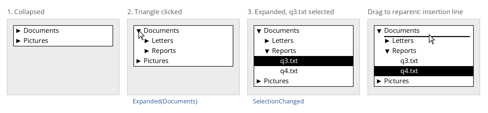

# Tree view (outline): widget roadmap

> **Issue:** [#55](https://github.com/KenSuenobu/rust-pushrod/issues/55) (extra-widgets 4.1) · **Epic 4:** Data views · **Milestone:** Extra widgets 2: everyday controls and pickers · **Size:** M
> **Crate:** `pushrod-extra-widgets` · **User docs:** `pushrod-docs/docs/extra-widgets/tree-view.md` · **Overview:** [extra widgets roadmap](../ROADMAP_EXTRA_WIDGETS.md) · **Rules:** [design philosophy](../../DESIGN_PHILOSOPHY.md)

This file is the specification for this widget: what it is, what it does, how it looks, and how it responds. To change it, edit this file in a pull request (and its mockup in [`docs/mockups/generate_extra_widgets.py`](../mockups/generate_extra_widgets.py) if the picture changes), then bring the issue in line. If this file and the issue disagree, this file wins.

## What it is

A hierarchical list with expand/collapse triangles, backed by a tree data source.

File trees, outlines, settings categories, and document structure are hierarchical. Parked from the standard set as specialized; the extra widgets are its natural home.

*Ideas from:* Qt QTreeView, GTK tree views, macOS NSOutlineView, KDE, Motif XmContainer (outline mode), AmigaOS hierarchical listbrowser, Win32 tree view. Names and behavior are Pushrod's own.

## What it does

`TreeView { source }`: rows indented by depth with a disclosure triangle for items with children (expand on click, Right/Left keys, or `*` for all). Single and multiple selection as in the list view (Pushrod 4.5); optional columns as in the table view (Pushrod 4.9). A `TreeSource` trait supplies children lazily, so large trees load only what is visible. Optional drag to reorder or reparent (Pushrod 9.8) with an insertion line.

## How it looks

Each image shows the widget step by step; blue notes name the event emitted.

Drawn flat, in the standard Pushrod style: fills, one-pixel borders, and text; inverted when pressed or selected, dithered when disabled, a dotted outline when focused. No bevels, gradients, shadows, glass, or rounded corners.

## How it responds

### Events and callbacks

| Event emitted | When | Application callback |
|---|---|---|
| `SelectionChanged { id }` | Selection changed | `on_selection_change(id, ..)` |
| `Expanded { id, item }` | Item expanded | `on_expand(id, ..)` |
| `Collapsed { id, item }` | Item collapsed | `on_collapse(id, ..)` |
| `Activated { id, item }` | Double-click or Return | `on_activate(id, ..)` |

Like every Pushrod widget, it can also receive application-defined custom events in `handle_event` and emit its own (Pushrod 1.13), and every internal action emits an engine event (Pushrod 9.10).

### Shared behavior

Like every Pushrod widget, it gets these from the core rather than implementing them itself:

- behavior flags and visual states ([Pushrod 1.1](https://github.com/KenSuenobu/rust-pushrod/issues/19))
- per-state appearance ([Pushrod 1.17](https://github.com/KenSuenobu/rust-pushrod/issues/104))
- keyboard focus, Tab order, Return/Escape ([Pushrod 1.4](https://github.com/KenSuenobu/rust-pushrod/issues/20))
- callbacks registered by widget ID ([Pushrod 1.6](https://github.com/KenSuenobu/rust-pushrod/issues/22))
- custom application events with payloads ([Pushrod 1.13](https://github.com/KenSuenobu/rust-pushrod/issues/78))
- composite parts the application can retrieve and modify ([Pushrod 5.2](https://github.com/KenSuenobu/rust-pushrod/issues/57))
- engine events for every internal action ([Pushrod 9.10](https://github.com/KenSuenobu/rust-pushrod/issues/109))

## Acceptance criteria

- [ ] Expand and collapse by mouse and keyboard
- [ ] Lazy children from a data source
- [ ] Optional columns and drag to reparent
- [ ] Registered as `extra.tree_view` with a page in the Pushrod Showcase (1.2)

## Depends on

Extra widgets: 1.1 ([#252](https://github.com/KenSuenobu/rust-pushrod/issues/252)); Pushrod: Pushrod 4.5 [#52](https://github.com/KenSuenobu/rust-pushrod/issues/52) List view, Pushrod 4.9 [#92](https://github.com/KenSuenobu/rust-pushrod/issues/92) Table view, Pushrod 5.3 [#58](https://github.com/KenSuenobu/rust-pushrod/issues/58) Container: a scrollable viewport onto fixed-size content, Pushrod 9.8 [#100](https://github.com/KenSuenobu/rust-pushrod/issues/100) Drag and drop within the application

## Implementation notes

- **Crate:** `pushrod-extra-widgets`, using only the public APIs of `pushrod` and `pushrod-widgets`. Anything missing from the core is added to the core first.
- **Modules:** `pushrod-extra-widgets/src/tree_view.rs (new)`, `pushrod-docs`
- **Drawing:** paints into its own GPU texture only when invalidated; frames are composed by blitting. No OS-native controls; no per-frame CPU pixel work.
- **Documentation:** full doc headers on every non-private item, and the user page in the same pull request.

