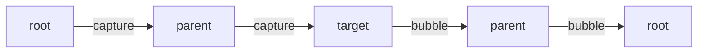

# Spec: events

Conformance tests: `tests/conformance/events.rs`.

## Vocabulary

`Event` is the one type that carries everything: pointer events (`PointerPressed`, `PointerMoved`,
...), keyboard and text events, focus events, **semantic** events a widget emits for the
application (`Clicked`, `Activated`, `ValueChanged`, ...), lifecycle events (`Shown`, `Resized`,
`Removed`, ...), window events, `Tick`, `Engine(EngineEvent)`, and `Custom(CustomEvent)`.
`Event::kind()` gives the `EventKind` and `Event::widget_id()` the widget it is about.

## Phases

An input event for a target widget is delivered in three phases:

1. **Capture**: from the root down to the target's parent, **only** to widgets whose
   `handles_capture()` is `true`.
2. **Target**: the widget itself.
3. **Bubble**: from the target's parent up to the root, to every ancestor.

`EventCtx::phase()` tells a widget which phase it is in.

## Handled and ignored

`Propagation::Stop` from any widget in any phase **ends delivery at once**. `Continue` passes the
event on.

## Which events propagate

Pointer presses, releases, motion, scrolls, key presses and releases, and text input propagate
(`EventKind::propagates`). Hover and semantic events go to **one widget only**.

## Masks

An `EventMask` is a set of classes (`POINTER_BUTTONS`, `POINTER_MOTION`, `HOVER`, `SCROLL`,
`KEYBOARD`, `TEXT`, `FOCUS`, `WINDOW`, `LIFECYCLE`, `TIMER`, `CUSTOM`, `ENGINE`).

- The **run-loop mask** (`Engine::set_event_mask`) is applied first: an input event outside it is
  dropped before any widget sees it.
- A **widget mask** then filters that widget's deliveries; a masked widget is skipped, and its
  ancestors still see the bubble.
- Semantic events, close requests, and engine events have no class and are never dropped by the
  run-loop mask (`EventKind::mask_class` is `None`).

## Engine events

Every internal action Pushrod performs emits an `EngineEvent` (a widget added, removed, or
reparented, focus changed, a timer fired, a broadcast, ...).

- Engine callbacks (`Engine::on_engine_event`) receive them in the order the actions happened.
- A widget receives them **only** if its mask includes `ENGINE`, and a kind filter
  (`set_engine_filter`) narrows that further.
- A widget's response to an engine event is **never broadcast again**, so engine events cannot
  loop.

## Composition

An input method composes text before it commits it.

- A composition arrives as `InputEvent::Composition` and reaches the **focused widget only**, as
  `Event::TextComposing { id, text, cursor }` (class `TEXT`, propagating like `TextEntered`).
  Empty `text` means the composition was cleared.
- The committed text arrives as `Event::TextEntered`, so a widget never sees composition text as
  content.
- The engine emits `CompositionStarted` on the first non-empty text, `CompositionUpdated` for every
  non-empty text, and `CompositionEnded { committed }`: `true` when `TextEntered` follows the
  composition, `false` when it is cancelled (the focus moved, or an event other than the commit
  followed the empty text).

## Ordering guarantees

- A broadcast visits parents before children, and siblings in the order they were added.
- Every broadcast queues one `EngineEvent::EventBroadcast` with the number of recipients.
- Callbacks and the event loop see **the same events in the same order**: what `Engine::run`
  delivers to `on_event` is what `Engine::next_event` returns.
- A widget's callbacks never run after its `Removed` event, and its ID is never reused.
