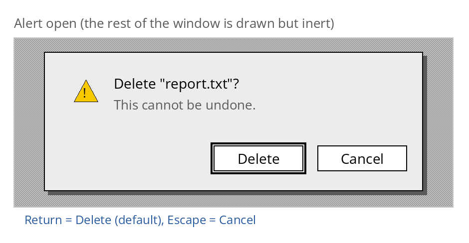
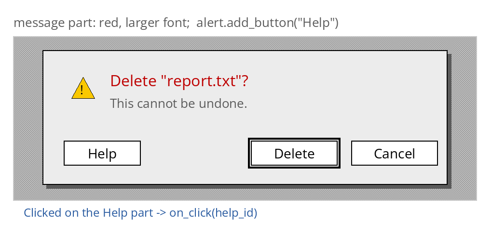

# Alert: widget roadmap

> **Issue:** [#35](https://github.com/KenSuenobu/rust-pushrod/issues/35) (2.9) · **Epic 2:** Core dialog widgets · **Release:** MVP (v0.1) · **Size:** M
> **User docs:** `pushrod-docs/docs/widgets/alert.md` · **Overview:** [main roadmap](../ROADMAP_EXTENSIBLE_WIDGET_LIBRARY.md) · **Rules:** [design philosophy](../../DESIGN_PHILOSOPHY.md)

This file is the specification for this widget: what it is, what it does, and how it responds. To change its look or behavior, edit this file in a pull request (and its mockup in [`docs/mockups/generate.py`](../mockups/generate.py) if the picture changes), then bring the issue in line. If this file and the issue disagree, this file wins.

## What it is

One-call modal alert with icon, message, and up to three buttons.

Every system has a one-call alert (icon, message, a few buttons). Pushrod has no modal dialogs.

*Ideas from:* Alerts on GEM, the classic Mac, Motif, Qt, and GTK. Names and behavior are Pushrod's own.

## What it does

`ui.alert(AlertKind, title, message, buttons, default, |state, ui, choice| ..)` builds a centered modal form ([6.7](https://github.com/KenSuenobu/rust-pushrod/issues/66)) from existing widgets and calls the completion closure with the chosen button index. Return chooses the default, Escape the last button. Always drawn by Pushrod. **Parts ([5.2](https://github.com/KenSuenobu/rust-pushrod/issues/57)):** `AlertParts { icon, title, message, buttons }`; `add_button`, `remove_button`, `set_default_button`. Every part can be retrieved and restyled (font, color, text). Example: `let a = ui.alert(..); ui.get_mut::<TextWidget>(a.parts().message)?.set_font_color(Color::RED); a.add_button(ui, "Help");`

## How it looks

Each image shows the widget step by step, drawn in Pushrod's current style; blue notes name the event emitted. Mockups come from [`docs/mockups/generate.py`](https://github.com/KenSuenobu/rust-pushrod/blob/main/docs/mockups/generate.py): edit a frame there and re-run it to change the design,.

**1. Alert opens centered; the rest of the window is drawn but inert**



**2. Return = Delete (default), Escape = Cancel  3. Closes; completion gets the index**

```rust
 ui.alert(AlertKind::Warning, "Delete \"report.txt\"?", "This cannot be undone.",
          &["Delete", "Cancel"], 0, |state, ui, choice| if choice == 0 { /* delete */ });
```

**Customized through its parts: bold red message, an extra Help button**



Drawn flat, in the standard Pushrod style: fills, one-pixel borders, and text; inverted when pressed or selected, dithered when disabled, a dotted outline when focused. No bevels, gradients, shadows, glass, or rounded corners (see the [design philosophy](../../DESIGN_PHILOSOPHY.md)).

## How it responds

### Events and callbacks

| Event emitted | When | Application callback |
|---|---|---|
| (completion) | A button is chosen | Completion closure `FnOnce(&mut S, &mut Ui, usize)` |

Like every widget, it can also receive application-defined custom events in `handle_event` and emit its own (1.13 (#78)).

### Shared behavior

Like every Pushrod widget, it gets these from the core rather than implementing them itself:

- behavior flags (selectable, default, exit, disabled, hidden, ...) and visual states ([1.1](https://github.com/KenSuenobu/rust-pushrod/issues/19))
- per-state appearance (normal, selected, hovered, pressed, drag-over, disabled), with `MouseEntered` / `MouseExited` ([1.17](https://github.com/KenSuenobu/rust-pushrod/issues/104))
- keyboard focus, Tab order, Return/Escape ([1.4](https://github.com/KenSuenobu/rust-pushrod/issues/20))
- callbacks registered by widget ID ([1.6](https://github.com/KenSuenobu/rust-pushrod/issues/22))
- custom application events with payloads, received in `handle_event` ([1.13](https://github.com/KenSuenobu/rust-pushrod/issues/78))
- composite parts the application can retrieve and modify ([5.2](https://github.com/KenSuenobu/rust-pushrod/issues/57))
- engine events for every internal action ([9.10](https://github.com/KenSuenobu/rust-pushrod/issues/109))
- live or outline drawing modes, switchable at run time ([10.1](https://github.com/KenSuenobu/rust-pushrod/issues/105))

## Acceptance criteria

- [ ] Modal: nothing else receives input while open
- [ ] Return/Escape behave as described
- [ ] Completion closure gets the index
- [ ] Parts are retrievable and modifiable as described

## Depends on

Requires [2.3 Button](button.md), [6.7](https://github.com/KenSuenobu/rust-pushrod/issues/66), [5.2](https://github.com/KenSuenobu/rust-pushrod/issues/57).

## Implementation notes

- **Crate:** `pushrod-widgets`, using only the public API of the `pushrod` core. Shared behavior (states, focus, events) comes from the core; anything the widget needs that the core doesn't expose is added to the core first.
- **Modules:** `pushrod-widgets/src/alert.rs (new)`, `src/engine.rs`
- **Stack:** Rust
- **Drawing:** paints into its own GPU texture only when invalidated; frames are composed by blitting. No OS-native controls; no per-frame CPU pixel work.

## Sources

- [ICS: Motif widget descriptions](https://motif.ics.com/book/export/html/341)
