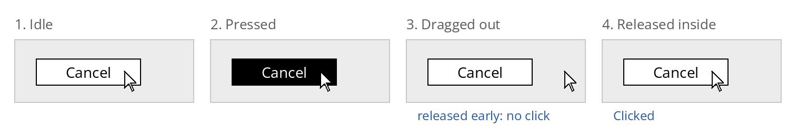
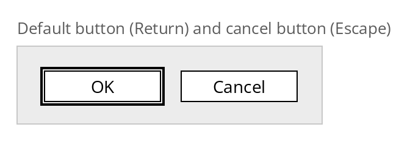
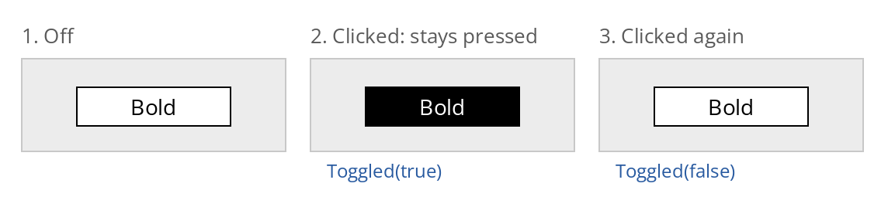

# Button: widget roadmap

> **Issue:** [#29](https://github.com/KenSuenobu/rust-pushrod/issues/29) (2.3) · **Epic 2:** Core dialog widgets · **Release:** MVP (v0.1) · **Size:** S
> **User docs:** `pushrod-docs/docs/widgets/button.md` · **Overview:** [main roadmap](../ROADMAP_EXTENSIBLE_WIDGET_LIBRARY.md) · **Rules:** [design philosophy](../../DESIGN_PHILOSOPHY.md)

This file is the specification for this widget: what it is, what it does, and how it responds. To change its look or behavior, edit this file in a pull request (and its mockup in [`docs/mockups/generate.py`](../mockups/generate.py) if the picture changes), then bring the issue in line. If this file and the issue disagree, this file wins.

## What it is

A push button that runs an action when clicked; it can also be a dialog's default or cancel button, a toggle, or a button that closes a dialog.

`Button` is only a push button. Dialogs need a visibly distinct default button (Return), a cancel button (Escape), toggle buttons, buttons that fire on press, and buttons that close a dialog.

*Ideas from:* Default and cancel buttons on the classic Mac, GEM, Motif, Windows, Qt, and GTK; toggle buttons everywhere. Names and behavior are Pushrod's own.

## What it does

Behavior comes from flags ([1.1](https://github.com/KenSuenobu/rust-pushrod/issues/19)): `DEFAULT_ACTION` draws a 2 px ring and is triggered by Return; `CANCEL_ACTION` by Escape; `TOGGLE` stays pressed and emits `Toggled`; `ACTIVATE_ON_PRESS` emits `Clicked` on press; `DISMISSES_DIALOG` closes the modal dialog ([6.7](https://github.com/KenSuenobu/rust-pushrod/issues/66)) and reports its ID. Pressed inversion moves to shared state painting.

## How it looks

Each image shows the widget step by step, drawn in Pushrod's current style; blue notes name the event emitted. Mockups come from [`docs/mockups/generate.py`](https://github.com/KenSuenobu/rust-pushrod/blob/main/docs/mockups/generate.py): edit a frame there and re-run it to change the design,.

**Push button: 1. idle 2. pressed 3. dragged out (releases) 4. released inside -> Clicked**

**Default button: 2 px ring, Return activates it**

**Toggle button: click stays pressed, click again releases**

Drawn flat, in the standard Pushrod style: fills, one-pixel borders, and text; inverted when pressed or selected, dithered when disabled, a dotted outline when focused. No bevels, gradients, shadows, glass, or rounded corners (see the [design philosophy](../../DESIGN_PHILOSOPHY.md)).

## How it responds

### Events and callbacks

| Event emitted | When | Application callback |
|---|---|---|
| `Clicked { id, button, count }` | Push/default/cancel: release inside; activate-on-press: press | `on_click(id, ..)` |
| `Toggled { id, checked }` | Toggle button changes state | `on_toggle(id, ..)` |

Like every widget, it can also receive application-defined custom events in `handle_event` and emit its own (1.13 (#78)).

### Shared behavior

Like every Pushrod widget, it gets these from the core rather than implementing them itself:

- behavior flags (selectable, default, exit, disabled, hidden, ...) and visual states ([1.1](https://github.com/KenSuenobu/rust-pushrod/issues/19))
- per-state appearance (normal, selected, hovered, pressed, drag-over, disabled), with `MouseEntered` / `MouseExited` ([1.17](https://github.com/KenSuenobu/rust-pushrod/issues/104))
- keyboard focus, Tab order, Return/Escape ([1.4](https://github.com/KenSuenobu/rust-pushrod/issues/20))
- callbacks registered by widget ID ([1.6](https://github.com/KenSuenobu/rust-pushrod/issues/22))
- custom application events with payloads, received in `handle_event` ([1.13](https://github.com/KenSuenobu/rust-pushrod/issues/78))
- composite parts the application can retrieve and modify ([5.2](https://github.com/KenSuenobu/rust-pushrod/issues/57))
- engine events for every internal action ([9.10](https://github.com/KenSuenobu/rust-pushrod/issues/109))
- live or outline drawing modes, switchable at run time ([10.1](https://github.com/KenSuenobu/rust-pushrod/issues/105))

## Acceptance criteria

- [x] Each flag combination behaves as described and is tested
- [x] Default button is recognizable at a glance
- [x] No regression in PR [#10](https://github.com/KenSuenobu/rust-pushrod/pull/10) click tests

## Depends on

Requires [1.1](https://github.com/KenSuenobu/rust-pushrod/issues/19), [1.6](https://github.com/KenSuenobu/rust-pushrod/issues/22).

## Implementation notes

- **Crate:** `pushrod-widgets`, using only the public API of the `pushrod` core. Shared behavior (states, focus, events) comes from the core; anything the widget needs that the core doesn't expose is added to the core first.
- **Modules:** `pushrod-widgets/src/button.rs`, `src/paint.rs`
- **Stack:** Rust
- **Drawing:** paints into its own GPU texture only when invalidated; frames are composed by blitting. No OS-native controls; no per-frame CPU pixel work.

## Sources

- [GEM AES object structure (flags, states, object tree)](https://www.seasip.info/Gem/aestruct.html)
- [ICS: Motif widget descriptions](https://motif.ics.com/book/export/html/341)
