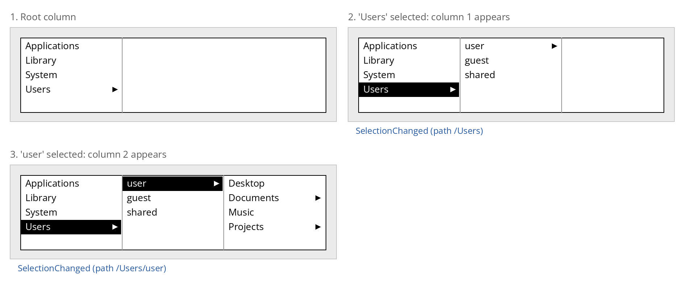
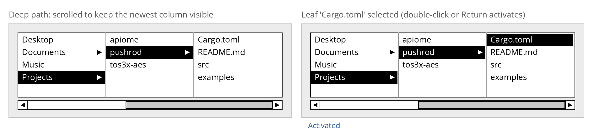

# Column Browser: widget roadmap

> **Issue:** [#45](https://github.com/KenSuenobu/rust-pushrod/issues/45) (3.7) · **Epic 3:** Value and choice controls · **Release:** after the MVP · **Size:** L
> **User docs:** `pushrod-docs/docs/widgets/column-browser.md` · **Overview:** [main roadmap](../ROADMAP_EXTENSIBLE_WIDGET_LIBRARY.md) · **Rules:** [design philosophy](../../DESIGN_PHILOSOPHY.md)

This file is the specification for this widget: what it is, what it does, and how it responds. To change its look or behavior, edit this file in a pull request (and its mockup in [`docs/mockups/generate.py`](../mockups/generate.py) if the picture changes), then bring the issue in line. If this file and the issue disagree, this file wins.

## What it is

Columns of lists where selecting an item in one column fills the next, as in the NeXTSTEP browser and the Mac Finder's column view.

Hierarchies (folders, settings categories, class trees, mail folders) are easiest to navigate when the whole path stays visible. NeXTSTEP's column browser shows column 0 as the root; selecting an item in column 0 fills column 1 with its children, selecting in column 1 fills column 2, and so on, with the path always on screen.

*Ideas from:* The NeXTSTEP browser (NSBrowser) and the Mac Finder column view. Names and behavior are Pushrod's own.

## What it does

`ColumnBrowser` composite ([5.2](https://github.com/KenSuenobu/rust-pushrod/issues/57)) of list-view columns ([4.5 List View](list-view.md)) inside a horizontal container ([5.3 Container](container.md)). Data comes from a `BrowserModel` trait: `children(&path) -> Vec<BrowserItem>`, `is_leaf(&path)`, optional icon and label per item. Selecting an item in column *n* replaces every column to the right with a new column *n+1* listing that item's children; selecting a leaf clears the columns to the right (an optional preview pane can show leaf details). Branch items show a ▶ marker. When columns overflow the width, the view scrolls horizontally to keep the newest column visible. Columns have a fixed default width and can be resized by dragging the divider between them. Keyboard: Up/Down move within a column, Right enters the selected branch (moving focus to the next column), Left returns to the parent column, typing jumps to a matching item, Return activates. Double-click or Return on a leaf emits `Activated`. **Parts ([5.2](https://github.com/KenSuenobu/rust-pushrod/issues/57)):** `columns()` returns each column's list-view ID; columns can be restyled like any list view; `path()` and `set_path()` read and set the selection. The file chooser ([2.12 File Chooser](file-chooser.md)) can offer a column mode built on it.

```text
col[0] (root)       col[1] (children of
                    col[0] selection)   col[2] (children of col[1] selection)
+--------------+    +--------------+    +--------------+
| Applications▶|    | user        ▶|    | Documents   ▶|
|#Users########|--> |#user########▶|--> |#Projects####▶|--> col[3] ...
| System      ▶|    | shared      ▶|    | Music       ▶|
+--------------+    +--------------+    +--------------+
```

## How it looks

Each image shows the widget step by step, drawn in Pushrod's current style; blue notes name the event emitted. Mockups come from [`docs/mockups/generate.py`](https://github.com/KenSuenobu/rust-pushrod/blob/main/docs/mockups/generate.py): edit a frame there and re-run it to change the design,.

**Selecting in each column fills the next one**



**Many columns: the view scrolls horizontally to keep the newest column visible**



Drawn flat, in the standard Pushrod style: fills, one-pixel borders, and text; inverted when pressed or selected, dithered when disabled, a dotted outline when focused. No bevels, gradients, glass, or rounded corners (see the [design philosophy](../../DESIGN_PHILOSOPHY.md)).

## How it responds

### Events and callbacks

| Event emitted | When | Application callback |
|---|---|---|
| `SelectionChanged { id }` | The selected path changes; read `path()` | `on_selection_change(id, ..)` |
| `Activated { id }` | Double-click or Return on a leaf | `on_activate(id, ..)` |

Like every widget, it can also receive application-defined custom events in `handle_event` and emit its own (1.13 (#78)).

### Shared behavior

Like every Pushrod widget, it gets these from the core rather than implementing them itself:

- behavior flags (selectable, default, exit, disabled, hidden, ...) and visual states ([1.1](https://github.com/KenSuenobu/rust-pushrod/issues/19))
- per-state appearance (normal, selected, hovered, pressed, drag-over, disabled), with `MouseEntered` / `MouseExited` ([1.17](https://github.com/KenSuenobu/rust-pushrod/issues/104))
- keyboard focus, Tab order, Return/Escape ([1.4](https://github.com/KenSuenobu/rust-pushrod/issues/20))
- callbacks registered by widget ID ([1.6](https://github.com/KenSuenobu/rust-pushrod/issues/22))
- custom application events with payloads, received in `handle_event` ([1.13](https://github.com/KenSuenobu/rust-pushrod/issues/78))
- composite parts the application can retrieve and modify ([5.2](https://github.com/KenSuenobu/rust-pushrod/issues/57))
- engine events for every internal action ([9.10](https://github.com/KenSuenobu/rust-pushrod/issues/109))
- live or outline drawing modes, switchable at run time ([10.1](https://github.com/KenSuenobu/rust-pushrod/issues/105))

## Acceptance criteria

- [ ] Selecting in column n fills column n+1 and clears columns to its right
- [ ] Leaf selection clears columns to the right; optional preview pane
- [ ] Horizontal scrolling keeps the newest column visible; column widths are resizable
- [ ] Keyboard navigation: Up/Down, Right into a branch, Left to parent, type-ahead, Return
- [ ] `path()`/`set_path()`, `columns()` part access
- [ ] Works with a filesystem model and an in-memory tree model

## Depends on

Requires [4.5 List View](list-view.md), [5.2](https://github.com/KenSuenobu/rust-pushrod/issues/57), [5.3 Container](container.md).

## Implementation notes

- **Modules:** `column_browser.rs (new)`
- **Stack:** Rust
- **Drawing:** paints into its own GPU texture only when invalidated; frames are composed by blitting. No OS-native controls; no per-frame CPU pixel work.

## Sources

- [OpenStep specification: controls and target/action](https://www.ict.griffith.edu.au/teaching/2501ICT/archive/resources/OpenStepSpec/ApplicationKit/Classes/NSControl.html)
